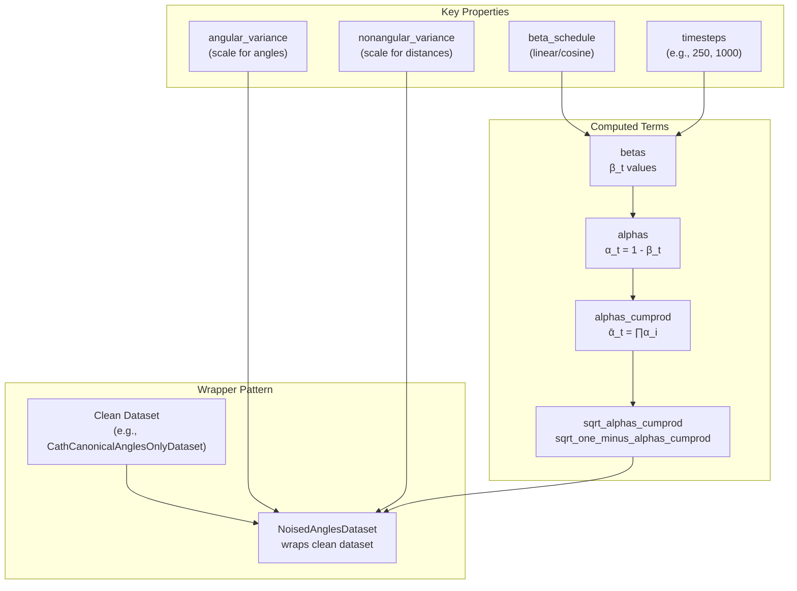
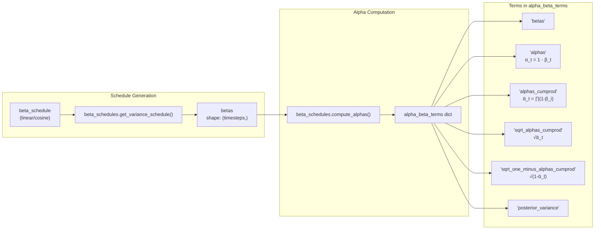
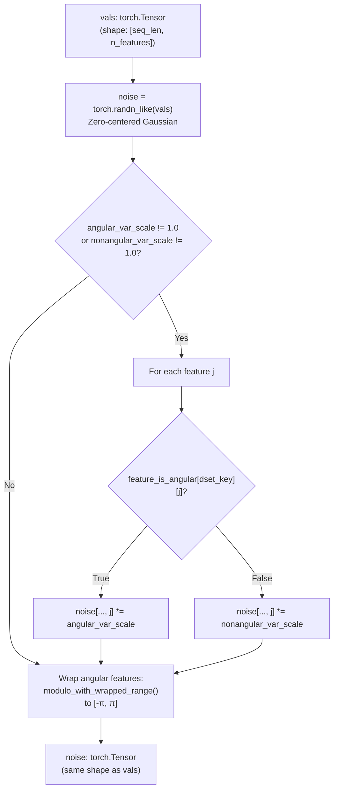
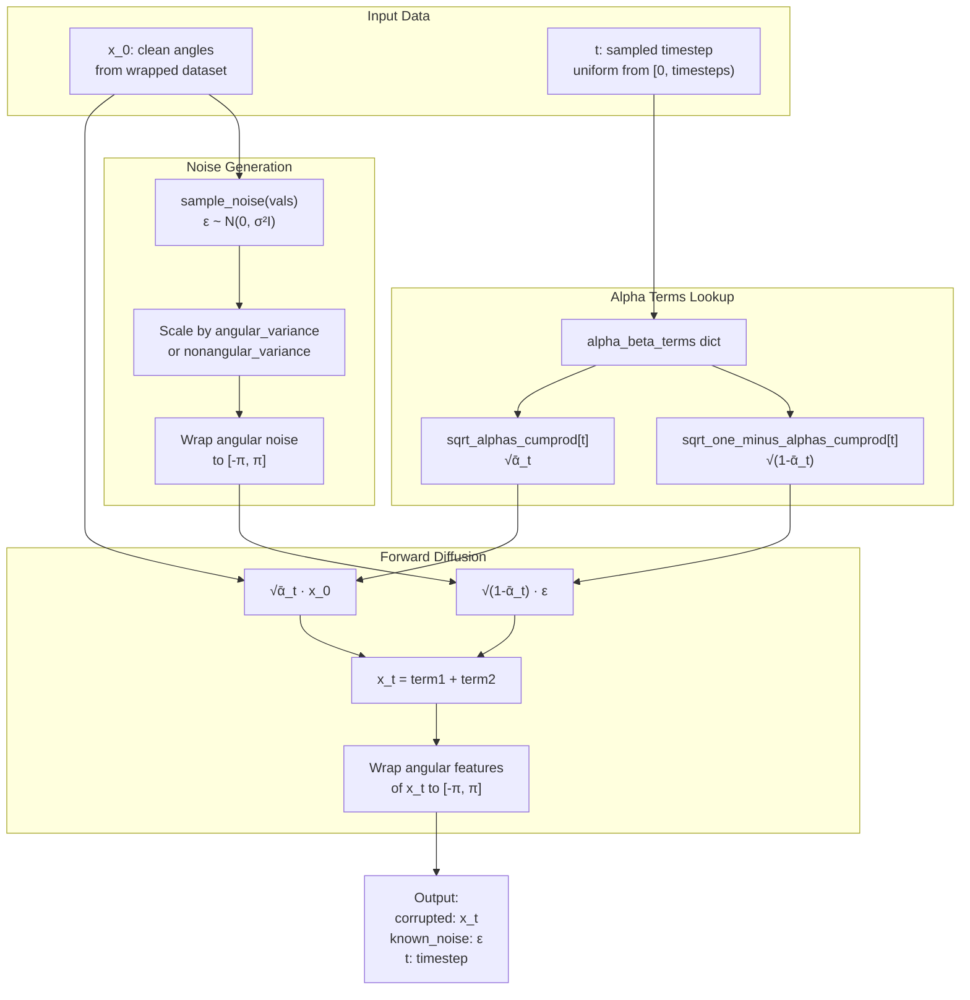
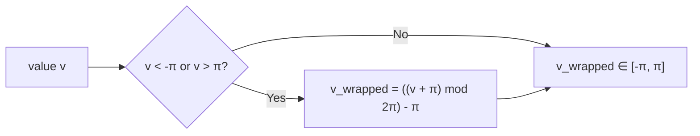
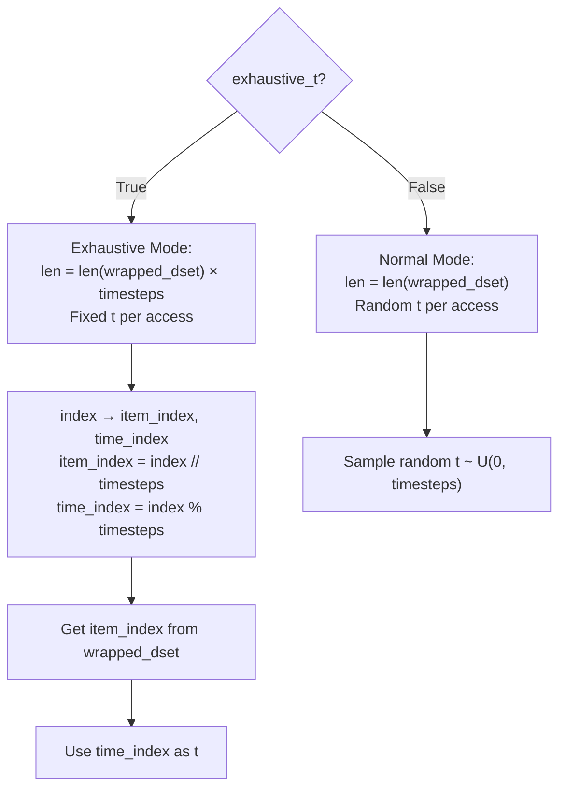
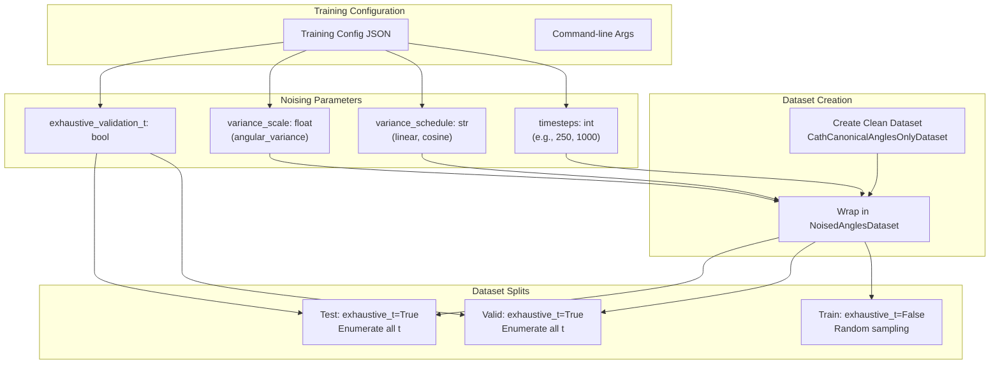

<!-- source: DeepWiki mcp.deepwiki.com · repo microsoft/foldingdiff · page 4.3 Noising Process · fetched 2026-10-26 -->

# Noising Process

<details>
<summary>Relevant source files</summary>

The following files were used as context for generating this wiki page:

- [bin/train.py](bin/train.py)
- [foldingdiff/angles_and_coords.py](foldingdiff/angles_and_coords.py)
- [foldingdiff/datasets.py](foldingdiff/datasets.py)
- [foldingdiff/sampling.py](foldingdiff/sampling.py)
- [tests/mini_model_for_testing/results/training_args.json](tests/mini_model_for_testing/results/training_args.json)
- [tests/test_angles_and_coords.py](tests/test_angles_and_coords.py)

</details>


## Purpose and Scope

This page documents how the `NoisedAnglesDataset` class adds controlled noise to clean protein angle data according to a diffusion schedule. This noising process is the forward diffusion step that corrupts training data, enabling the model to learn denoising (the reverse process covered in [7.2](#7.2)).

For information about the clean dataset classes that `NoisedAnglesDataset` wraps, see [4.1 Dataset Classes](#4.1). For the mathematical foundations of diffusion models, see [3.1 Diffusion Models for Proteins](#3.1).

---

## Overview

The noising process transforms clean protein structures into progressively more corrupted versions by adding Gaussian noise scaled according to a variance schedule. The `NoisedAnglesDataset` class wraps any clean dataset (e.g., `CathCanonicalAnglesOnlyDataset`) and applies the forward diffusion equation at training time.

**Key characteristics:**
- Wraps clean datasets and adds noise on-the-fly during `__getitem__`
- Supports multiple beta schedules (linear, cosine)
- Handles angular features specially to maintain periodicity
- Optionally exhaustively enumerates all timesteps for validation
- Allows different noise scales for angular vs non-angular features

Sources: [foldingdiff/datasets.py:685-752]()

---

## NoisedAnglesDataset Architecture



**Class Definition**

The `NoisedAnglesDataset` is defined at [foldingdiff/datasets.py:685-726](). It inherits from `torch.utils.data.Dataset` and takes the following constructor parameters:

| Parameter | Type | Description |
|-----------|------|-------------|
| `dset` | `Dataset` | Clean dataset to wrap |
| `dset_key` | `str` | Key to extract from wrapped dataset (e.g., "angles", "coords") |
| `timesteps` | `int` | Number of diffusion timesteps (default: 250) |
| `exhaustive_t` | `bool` | If True, enumerate all timesteps instead of sampling |
| `beta_schedule` | `str` | Schedule type: "linear", "cosine" |
| `nonangular_variance` | `float` | Variance scale for non-angular features |
| `angular_variance` | `float` | Variance scale for angular features |

Sources: [foldingdiff/datasets.py:685-726](), [bin/train.py:184-195]()

---

## Beta Schedules and Alpha Terms

The noising process uses a variance schedule defined by beta values β_t that control how much noise is added at each timestep. The `NoisedAnglesDataset` computes several derived terms during initialization:



**Initialization Code**

```python
# From NoisedAnglesDataset.__init__
betas = beta_schedules.get_variance_schedule(beta_schedule, timesteps)
self.alpha_beta_terms = beta_schedules.compute_alphas(betas)
```

The `alpha_beta_terms` dictionary contains:
- `betas`: β_t values for each timestep
- `alphas`: α_t = 1 - β_t
- `alphas_cumprod`: ᾱ_t = ∏ᵢ₌₁ᵗ αᵢ (cumulative product)
- `sqrt_alphas_cumprod`: √ᾱ_t (used in forward diffusion)
- `sqrt_one_minus_alphas_cumprod`: √(1 - ᾱ_t) (noise coefficient)
- `posterior_variance`: Used during reverse diffusion

Sources: [foldingdiff/datasets.py:718-726](), [foldingdiff/beta_schedules.py]()

---

## Noise Sampling with Angular Handling

The `sample_noise()` method generates noise tensors with special handling for angular features to maintain their periodic nature.



**Feature-Specific Scaling**

For canonical angles dataset with features `[phi, psi, omega, tau, CA:C:1N, C:1N:1CA]`:
- All features are angular → use `angular_var_scale`
- Default `angular_var_scale` is often π to match the range of angles
- Noise is wrapped to [-π, π] to prevent boundary violations

**Code Implementation**

The noise sampling logic is in [foldingdiff/datasets.py:772-799]():

```python
def sample_noise(self, vals: torch.Tensor) -> torch.Tensor:
    # Start with standard Gaussian noise
    noise = torch.randn_like(vals)
    
    # Scale by variance based on feature type
    if self.angular_var_scale != 1.0 or self.nonangular_var_scale != 1.0:
        for j in range(noise.shape[-1]):
            s = (self.angular_var_scale 
                 if self.dset.feature_is_angular[self.dset_key][j]
                 else self.nonangular_var_scale)
            noise[..., j] *= s
    
    # Wrap angular features to [-π, π]
    angular_idx = np.where(self.dset.feature_is_angular[self.dset_key])[0]
    noise[..., angular_idx] = utils.modulo_with_wrapped_range(
        noise[..., angular_idx], -np.pi, np.pi
    )
    
    return noise
```

Sources: [foldingdiff/datasets.py:772-799]()

---

## Forward Diffusion Equation

The core noising operation applies the forward diffusion equation from DDPM (Denoising Diffusion Probabilistic Models):

**Mathematical Formula:**

```
x_t = √ᾱ_t · x_0 + √(1 - ᾱ_t) · ε
```

Where:
- `x_0`: Clean data at timestep 0
- `x_t`: Noised data at timestep t
- `ᾱ_t`: Cumulative product of alphas (from `alpha_beta_terms`)
- `ε`: Noise sampled from N(0, I) with feature-specific scaling



**Implementation in `__getitem__`**

The noising happens in the `__getitem__` method [foldingdiff/datasets.py:801-897]():

```python
def __getitem__(self, index: int, use_t_val: Optional[int] = None, 
                ignore_zero_center: bool = False) -> Dict[str, torch.Tensor]:
    # Get clean data from wrapped dataset
    item = self.dset.__getitem__(index, ignore_zero_center=ignore_zero_center)
    vals = item[self.dset_key].clone()
    
    # Sample timestep (or use specified value)
    if use_t_val is not None:
        t = torch.from_numpy(np.clip([use_t_val], 0, self.timesteps - 1)).long()
    elif self.exhaustive_timesteps:
        time_index = index % self.timesteps
        t = torch.tensor([time_index]).long()
    else:
        t = torch.randint(0, self.timesteps, (1,)).long()
    
    # Get alpha terms for this timestep
    sqrt_alphas_cumprod_t = self.alpha_beta_terms["sqrt_alphas_cumprod"][t.item()]
    sqrt_one_minus_alphas_cumprod_t = self.alpha_beta_terms[
        "sqrt_one_minus_alphas_cumprod"][t.item()]
    
    # Sample noise and apply forward diffusion
    noise = self.sample_noise(vals)
    noised_vals = sqrt_alphas_cumprod_t * vals + sqrt_one_minus_alphas_cumprod_t * noise
    
    # Wrap angular features to maintain valid range
    angular_idx = np.where(self.dset.feature_is_angular[self.dset_key])[0]
    noised_vals[:, angular_idx] = utils.modulo_with_wrapped_range(
        noised_vals[:, angular_idx], -np.pi, np.pi
    )
    
    return {
        "corrupted": noised_vals,
        "t": t,
        "known_noise": noise,
        "sqrt_alphas_cumprod_t": sqrt_alphas_cumprod_t,
        "sqrt_one_minus_alphas_cumprod_t": sqrt_one_minus_alphas_cumprod_t,
    }
```

Sources: [foldingdiff/datasets.py:801-897]()

---

## Angular Feature Wrapping

A critical aspect of the noising process is maintaining the periodic nature of angular features. All operations that could push angles outside [-π, π] are followed by wrapping using `modulo_with_wrapped_range()`.

**Why Wrapping is Necessary:**

| Operation | Risk | Solution |
|-----------|------|----------|
| Noise generation | Noise > π may violate bounds | Wrap after sampling |
| Forward diffusion | x_t = √ᾱ_t·x_0 + √(1-ᾱ_t)·ε may exceed [-π, π] | Wrap after addition |
| Mean offsetting | Clean data is zero-centered, may cross boundaries | Wrap after offset removal |

**Wrapping Logic:**



The wrapping is applied at multiple points:

1. **After noise generation** [foldingdiff/datasets.py:794-797]():
   ```python
   angular_idx = np.where(self.dset.feature_is_angular[self.dset_key])[0]
   noise[..., angular_idx] = utils.modulo_with_wrapped_range(
       noise[..., angular_idx], -np.pi, np.pi
   )
   ```

2. **After forward diffusion** [foldingdiff/datasets.py:867-871]():
   ```python
   noised_vals[:, angular_idx] = utils.modulo_with_wrapped_range(
       noised_vals[:, angular_idx], -np.pi, np.pi
   )
   ```

Sources: [foldingdiff/datasets.py:794-797](), [foldingdiff/datasets.py:867-871](), [foldingdiff/utils.py]()

---

## Exhaustive Timestep Mode

The `NoisedAnglesDataset` supports an optional "exhaustive timestep" mode for validation, where the dataset length is multiplied by the number of timesteps, and each clean example is paired with every possible timestep value.



**Purpose:**
- Used for validation/test sets to ensure comprehensive evaluation
- Each validation example is evaluated at all timesteps
- Provides deterministic behavior for reproducibility

**Implementation:**

In `__len__` [foldingdiff/datasets.py:753-757]():
```python
def __len__(self) -> int:
    if not self.exhaustive_timesteps:
        return len(self.dset)
    else:
        return int(len(self.dset) * self.timesteps)
```

In `__getitem__` [foldingdiff/datasets.py:813-826]():
```python
if self.exhaustive_timesteps:
    item_index = index // self.timesteps
    time_index = index % self.timesteps
    item = self.dset.__getitem__(item_index, ignore_zero_center=ignore_zero_center)
    t = torch.tensor([time_index]).long()
```

Sources: [foldingdiff/datasets.py:753-757](), [foldingdiff/datasets.py:813-826]()

---

## Dataset Configuration in Training

The noising dataset is instantiated during training with configuration from JSON files or command-line arguments.



**Example Configuration:**

From [tests/mini_model_for_testing/results/training_args.json]():
```json
{
    "timesteps": 250,
    "variance_schedule": "cosine",
    "variance_scale": 1.0
}
```

**Creation in Training Script:**

From [bin/train.py:184-195]():
```python
noised_dsets = [
    dset_noiser_class(
        dset=ds,
        dset_key="coords" if angles_definitions == "cart-coords" else "angles",
        timesteps=timesteps,
        exhaustive_t=(i != 0) and exhaustive_t,  # Only for validation/test
        beta_schedule=variance_schedule,
        nonangular_variance=1.0,
        angular_variance=var_scale,
    )
    for i, ds in enumerate(clean_dsets)
]
```

Sources: [bin/train.py:184-195](), [bin/train.py:111-204](), [tests/mini_model_for_testing/results/training_args.json]()

---

## Returned Dictionary Structure

Each call to `NoisedAnglesDataset.__getitem__()` returns a dictionary containing both the corrupted data and metadata needed for training.

| Key | Shape | Type | Description |
|-----|-------|------|-------------|
| `corrupted` | `(seq_len, n_features)` | `torch.Tensor` | Noised angles x_t |
| `t` | `(1,)` | `torch.LongTensor` | Timestep value |
| `known_noise` | `(seq_len, n_features)` | `torch.Tensor` | The noise ε that was added |
| `sqrt_alphas_cumprod_t` | scalar | `float` | √ᾱ_t coefficient |
| `sqrt_one_minus_alphas_cumprod_t` | scalar | `float` | √(1-ᾱ_t) coefficient |

Additionally, keys from the wrapped dataset are passed through:
- `attn_mask`: Attention mask for padded positions
- `position_ids`: Position indices for transformer
- `lengths`: True sequence length (before padding)
- `coords`: Coordinates (if available)

**Usage in Training:**

The model receives `corrupted` and `t` as inputs and predicts `known_noise`. The loss compares the predicted noise to the actual noise that was added.

Sources: [foldingdiff/datasets.py:873-897](), [foldingdiff/modelling.py]()

---

## Summary

The noising process implemented by `NoisedAnglesDataset` is a critical component that:

1. **Wraps clean datasets** and adds noise on-the-fly during iteration
2. **Implements forward diffusion** according to the DDPM equation: x_t = √ᾱ_t·x_0 + √(1-ᾱ_t)·ε
3. **Handles angular features specially** with appropriate variance scaling and wrapping to [-π, π]
4. **Supports multiple beta schedules** (linear, cosine) for different noise progression patterns
5. **Provides exhaustive enumeration** of timesteps for validation/testing
6. **Returns all necessary data** for training: corrupted inputs, known noise targets, and timestep information

This implementation ensures that the model learns to denoise across all timesteps while respecting the geometric constraints of angular data.

Sources: [foldingdiff/datasets.py:685-897](), [bin/train.py:111-204]()

---

