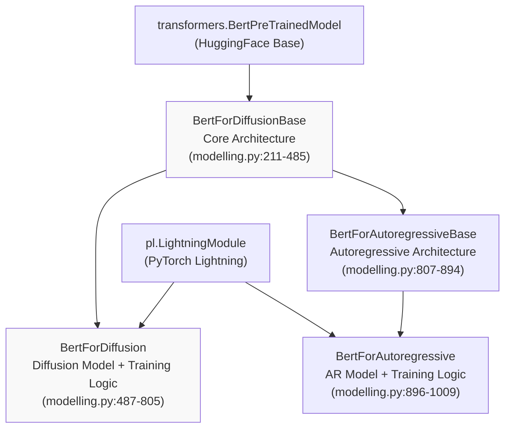
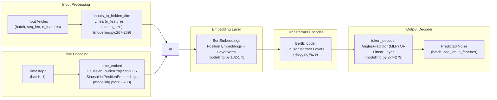
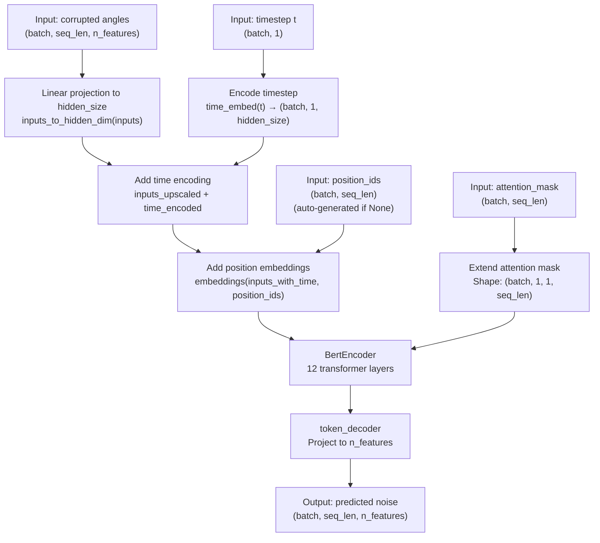

<!-- source: DeepWiki mcp.deepwiki.com · repo microsoft/foldingdiff · page 5 Model Architecture · fetched 2026-10-26 -->

# Model Architecture

<details>
<summary>Relevant source files</summary>

The following files were used as context for generating this wiki page:

- [bin/train.py](bin/train.py)
- [bin/train_autoregressive.py](bin/train_autoregressive.py)
- [foldingdiff/modelling.py](foldingdiff/modelling.py)
- [tests/mini_model_for_testing/results/training_args.json](tests/mini_model_for_testing/results/training_args.json)

</details>


## Purpose and Scope

This document provides a comprehensive overview of the neural network architecture used in FoldingDiff for protein backbone generation. It covers the core model components, architectural design decisions, and the flow of data through the network during both training and inference.

For detailed information about the main diffusion model class and its methods, see [BertForDiffusion Model](#5.1). For information about specific model components (time embeddings, decoders) and model variants (autoregressive models), see [Model Components and Variants](#5.2). For information about how the model is trained, see [Training](#6).

---

## Overview

FoldingDiff adapts the BERT transformer architecture for continuous-valued protein structure generation. The model operates as a denoising diffusion model, predicting noise in corrupted angle representations at each timestep. The architecture is implemented in [foldingdiff/modelling.py]() and consists of a base model class (`BertForDiffusionBase`) and a PyTorch Lightning wrapper (`BertForDiffusion`) for training.

**Key architectural features:**
- **Transformer-based**: Uses HuggingFace BERT encoder with 12 layers (configurable)
- **Time-conditioned**: Encodes diffusion timesteps via Gaussian Fourier features or sinusoidal embeddings
- **Continuous inputs**: Operates on continuous angle values rather than discrete tokens
- **Angular-aware**: Separate loss functions for angular vs. non-angular features
- **Flexible position embeddings**: Supports absolute, relative key, or relative key-query position encodings

Sources: [foldingdiff/modelling.py:1-1026]()

---

## Model Class Hierarchy



**Class descriptions:**

| Class | Purpose | Key Methods |
|-------|---------|-------------|
| `BertForDiffusionBase` | Core architecture without training logic | `forward()`, `from_dir()` |
| `BertForDiffusion` | Adds training/validation loops, loss computation | `training_step()`, `validation_step()`, `configure_optimizers()` |
| `BertForAutoregressiveBase` | Variant for sequential angle generation | `forward()`, `sample()` |
| `BertForAutoregressive` | Autoregressive model with training logic | `training_step()`, `validation_step()` |

Sources: [foldingdiff/modelling.py:211-1009]()

---

## Architecture Components

### High-Level Component Diagram



Sources: [foldingdiff/modelling.py:239-485]()

---

## Detailed Architecture Specification

### Input Projection

The model accepts continuous-valued features rather than discrete tokens. A linear layer projects the input features to the model's hidden dimension.

```
inputs_to_hidden_dim: Linear(n_inputs → hidden_size)
```

**Configuration:**
- `n_inputs`: Number of input features (e.g., 6 for full angles: phi, psi, omega, tau, CA:C:1N, C:1N:1CA)
- `hidden_size`: Typically 384 (default BERT is 768)

Sources: [foldingdiff/modelling.py:266-269](), [bin/train.py:421-423]()

---

### Time Encoding

The diffusion timestep is encoded and added to the input embeddings. Two encoding strategies are supported:

#### GaussianFourierProjection

Random Fourier features encode timesteps into high-dimensional space. Weights are randomly sampled at initialization and remain fixed during training.

```python
# Shape transformations
t: (batch,) → time_embed(t) → (batch, embed_dim)
```

**Implementation:** [foldingdiff/modelling.py:42-72]()

#### SinusoidalPositionEmbeddings

Sinusoidal functions encode timesteps, similar to positional encodings in the original Transformer paper.

```python
# Embeddings computed as:
embeddings = torch.cat((torch.sin(frequencies), torch.cos(frequencies)), dim=-1)
```

**Implementation:** [foldingdiff/modelling.py:74-94]()

**Configuration:** Set via `time_encoding` parameter, typically `"gaussian_fourier"`.

Sources: [foldingdiff/modelling.py:42-94](), [foldingdiff/modelling.py:282-288](), [bin/train.py:300]()

---

### Position Embeddings

The model supports three types of position embeddings:

| Type | Description | Reference |
|------|-------------|-----------|
| `absolute` | Standard learned position embeddings | BERT original |
| `relative_key` | Relative position bias in attention | [Shaw et al. 2018](https://arxiv.org/pdf/1803.02155.pdf) |
| `relative_key_query` | Relative position in both key and query | [Huang et al. 2020](https://arxiv.org/pdf/2009.13658.pdf) |

Position embeddings are added in the `BertEmbeddings` layer after input projection and before the encoder.

Sources: [foldingdiff/modelling.py:132-171](), [bin/train.py:305-307]()

---

### Transformer Encoder

The core of the architecture is a standard BERT encoder from HuggingFace Transformers, consisting of stacked transformer layers with multi-head self-attention.

**Default configuration:**
- `num_hidden_layers`: 12
- `num_attention_heads`: 12
- `hidden_size`: 384
- `intermediate_size`: 768 (feed-forward network dimension)
- `hidden_dropout_prob`: 0.1
- `attention_probs_dropout_prob`: 0.1

**Attention masking:** The model uses an attention mask to ignore padding tokens in variable-length sequences.

Sources: [foldingdiff/modelling.py:271](), [bin/train.py:301-304](), [bin/train.py:425-435]()

---

### Output Decoder

Two decoder options transform the encoder outputs back to the target feature space:

#### Linear Decoder
```python
token_decoder = nn.Linear(hidden_size, n_inputs)
```

#### MLP Decoder (AnglesPredictor)
```python
# Two-layer MLP with GELU activation
hidden_size → dense1 → GELU → LayerNorm → dense2 → n_inputs
```

The MLP decoder follows BERT's masked language modeling head design.

**Configuration:** Set via `decoder` parameter, typically `"mlp"`.

Sources: [foldingdiff/modelling.py:173-209](), [foldingdiff/modelling.py:274-279](), [bin/train.py:309]()

---

## Forward Pass Data Flow



**Key implementation:** [foldingdiff/modelling.py:384-484]()

### Shape transformations:
1. **Input angles:** `(batch, seq_len, n_features)` → **Linear projection** → `(batch, seq_len, hidden_size)`
2. **Timestep:** `(batch, 1)` → **Time embedding** → `(batch, hidden_size)` → **Unsqueeze** → `(batch, 1, hidden_size)`
3. **Combined:** `(batch, seq_len, hidden_size)` + `(batch, 1, hidden_size)` → `(batch, seq_len, hidden_size)`
4. **Position embeddings added:** `(batch, seq_len, hidden_size)`
5. **Through encoder:** `(batch, seq_len, hidden_size)`
6. **Output projection:** `(batch, seq_len, hidden_size)` → **Decoder** → `(batch, seq_len, n_features)`

Sources: [foldingdiff/modelling.py:427-484]()

---

## Model Instantiation and Configuration

### Configuration via BertConfig

The model uses HuggingFace's `BertConfig` to specify architecture parameters:

```python
from transformers import BertConfig

cfg = BertConfig(
    max_position_embeddings=512,      # Maximum sequence length
    num_attention_heads=12,           # Number of attention heads
    hidden_size=384,                  # Hidden dimension
    intermediate_size=768,            # FFN intermediate dimension
    num_hidden_layers=12,             # Number of transformer layers
    position_embedding_type="absolute",
    hidden_dropout_prob=0.1,
    attention_probs_dropout_prob=0.1,
    use_cache=False,                  # Don't cache for training
)
```

### Model initialization

```python
model = modelling.BertForDiffusion(
    config=cfg,
    time_encoding="gaussian_fourier",
    decoder="mlp",
    ft_is_angular=[False, True, True, True, True, True],  # Which features are angles
    ft_names=["tau", "phi", "psi", "omega", "CA:C:1N", "C:1N:1CA"],
    lr=5e-5,
    loss="smooth_l1",
    # ... additional training parameters
)
```

Sources: [bin/train.py:425-463]()

---

## Model Variants

### BertForDiffusion (Primary)

The main diffusion model used for training and sampling. Predicts noise at each timestep given corrupted angles.

**Key features:**
- Time-conditioned forward pass
- Multiple loss functions for angular/non-angular features
- Optional pairwise distance loss for geometric consistency
- PyTorch Lightning integration for training

Sources: [foldingdiff/modelling.py:487-805]()

### BertForAutoregressive (Baseline)

An alternative autoregressive model that generates angles sequentially rather than via diffusion. Used as a baseline for comparison.

**Key differences:**
- No noise prediction
- Causal attention masking
- Encodes total sequence length instead of timestep
- Different sampling mechanism

**Usage:** Primarily for baseline comparisons and ablation studies.

Sources: [foldingdiff/modelling.py:807-1009](), [bin/train_autoregressive.py:1-288]()

---

## Loading Pre-trained Models

Models can be loaded from a saved directory using the `from_dir` class method:

```python
model = BertForDiffusion.from_dir(
    dirname="path/to/results",
    load_weights=True,
    idx=-1,                      # Load most recent checkpoint
    best_by="valid",             # Use validation-best or train-best
)
```

The method automatically loads:
- Model configuration from `config.json`
- Training arguments from `training_args.json`
- Model weights from checkpoint files in `models/best_by_{valid|train}/`

**Implementation:** [foldingdiff/modelling.py:297-382]()

Sources: [foldingdiff/modelling.py:297-382]()

---

## Model Size and Parameters

Typical model configurations:

| Configuration | Hidden Size | Layers | Heads | Parameters |
|---------------|-------------|--------|-------|------------|
| Small (test) | 192 | 6 | 6 | ~2.5M |
| Standard | 384 | 12 | 12 | ~11M |
| Large | 768 | 12 | 12 | ~40M |

Parameter count is logged during training initialization: [bin/train.py:460-461]()

**Memory considerations:**
- Batch size typically 64 for standard configuration
- Gradient clipping at 1.0 helps stabilize training
- Mixed precision training can be enabled via PyTorch Lightning

Sources: [bin/train.py:301-304](), [bin/train.py:460-461](), [tests/mini_model_for_testing/results/training_args.json]()

---

## Architecture Design Rationale

### Why BERT-based Architecture?

1. **Self-attention captures long-range dependencies** between residues in protein structures
2. **Pre-trained initialization** available from HuggingFace (though not typically used here)
3. **Well-studied architecture** with robust implementations and tooling
4. **Position embeddings** naturally handle variable-length sequences

### Why Continuous Inputs?

Unlike standard BERT which operates on discrete tokens, FoldingDiff processes continuous angle values. This design:
- Avoids quantization artifacts in angle space
- Preserves geometric precision needed for protein structures
- Enables smooth interpolation during diffusion sampling

### Why Separate Angular/Non-angular Losses?

Angles (phi, psi, omega) are periodic quantities on the circle, while distances and bond angles are not. The model uses:
- **Radian-aware loss functions** (e.g., `radian_smooth_l1_loss`) for angular features
- **Standard loss functions** for non-angular features

This prevents issues like treating -π and +π as distant values when they represent the same angle.

Sources: [foldingdiff/modelling.py:224-237](), [foldingdiff/losses.py]()

---

## Summary Table: Key Model Components

| Component | Implementation | Location | Purpose |
|-----------|---------------|----------|---------|
| Input Projection | `nn.Linear` | [modelling.py:267-269]() | Projects n_features → hidden_size |
| Time Encoding | `GaussianFourierProjection` or `SinusoidalPositionEmbeddings` | [modelling.py:42-94]() | Encodes diffusion timestep |
| Position Embeddings | `BertEmbeddings` | [modelling.py:132-171]() | Adds position information |
| Encoder | `BertEncoder` (HuggingFace) | [modelling.py:271]() | 12-layer transformer |
| Output Decoder | `AnglesPredictor` or `nn.Linear` | [modelling.py:173-209](), [modelling.py:274-279]() | Projects hidden_size → n_features |
| Attention Masking | Extended mask | [modelling.py:444-452]() | Handles variable-length sequences |

Sources: [foldingdiff/modelling.py:211-485]()

---

