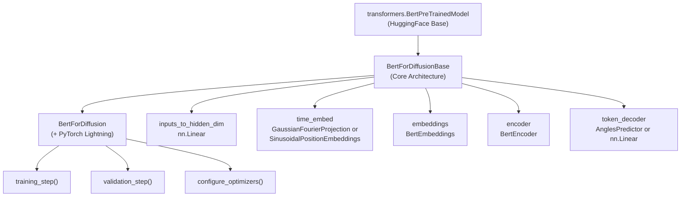
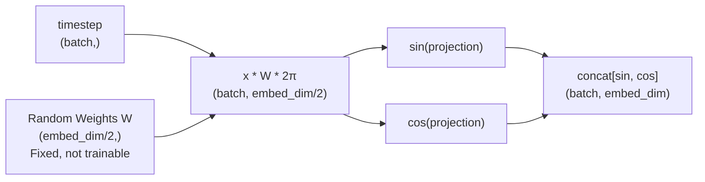
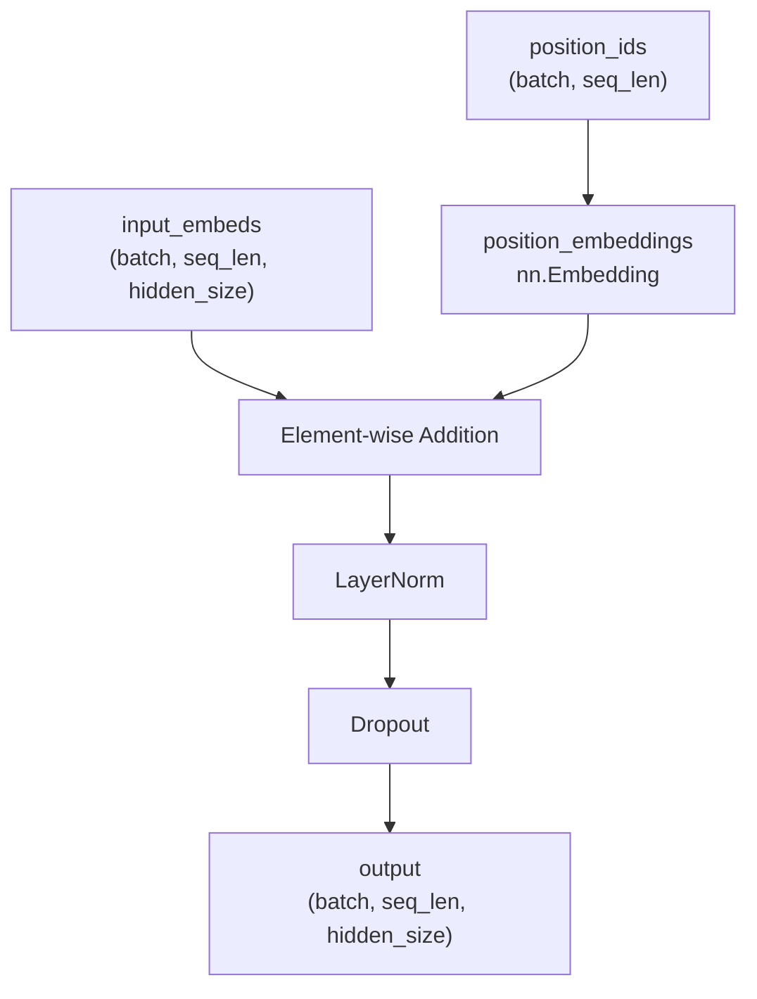
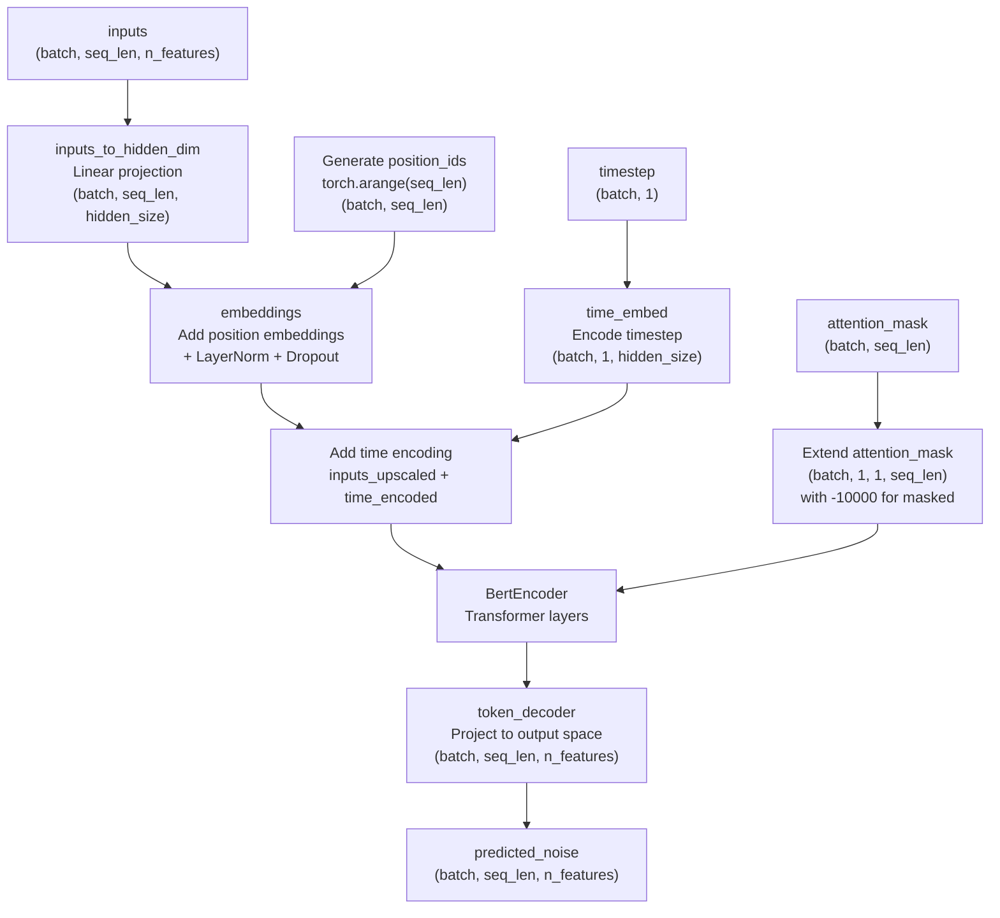
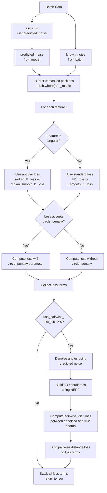
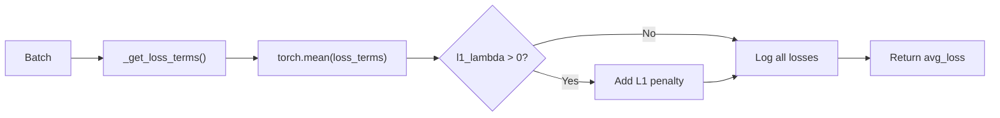
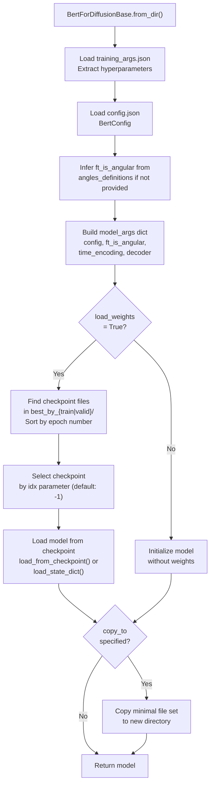

<!-- source: DeepWiki mcp.deepwiki.com · repo microsoft/foldingdiff · page 5.1 BertForDiffusion Model · fetched 2026-10-26 -->

# BertForDiffusion Model

<details>
<summary>Relevant source files</summary>

The following files were used as context for generating this wiki page:

- [bin/train_autoregressive.py](bin/train_autoregressive.py)
- [foldingdiff/modelling.py](foldingdiff/modelling.py)

</details>


## Purpose and Scope

This page documents the `BertForDiffusion` model architecture, which is the core neural network used for protein backbone generation via diffusion models. The model is a continuous-input adaptation of BERT that predicts noise in corrupted protein angle representations. This page covers the base architecture (`BertForDiffusionBase`), its PyTorch Lightning wrapper (`BertForDiffusion`), and the key components that enable time-conditioned denoising.

For information about the autoregressive variant of this model, see [Model Components and Variants](#5.2). For details on how the model is trained, see [Training Pipeline](#6.1). For information about the sampling/inference process, see [Reverse Diffusion Process](#7.2).

---

## Architecture Overview

The `BertForDiffusion` model adapts the BERT transformer architecture to work with continuous angle data instead of discrete tokens. The model takes corrupted angle sequences and timestep information as input, and predicts the noise that was added to create the corruption.

**Model Class Hierarchy**



**Sources:** [foldingdiff/modelling.py:211-805]()

---

## Core Components

### BertForDiffusionBase Class

The `BertForDiffusionBase` class ([foldingdiff/modelling.py:211-485]()) is the base model that implements the core architecture. It inherits from HuggingFace's `BertPreTrainedModel` and contains all the neural network components for processing continuous angle inputs.

**Key Attributes:**

| Attribute | Type | Description |
|-----------|------|-------------|
| `ft_is_angular` | `List[bool]` | Indicates which features are angular (requires special loss handling) |
| `ft_names` | `List[str]` | Names of input features (e.g., "phi", "psi", "omega") |
| `n_inputs` | `int` | Number of input features per position |
| `inputs_to_hidden_dim` | `nn.Linear` | Projects low-dimensional input to hidden dimension |
| `time_embed` | `nn.Module` | Encodes diffusion timestep information |
| `embeddings` | `BertEmbeddings` | Adds position embeddings and normalization |
| `encoder` | `BertEncoder` | Core transformer encoder from HuggingFace BERT |
| `token_decoder` | `nn.Module` | Decodes hidden states to predicted noise |

**Constructor Signature:**

```python
BertForDiffusionBase(
    config: BertConfig,
    ft_is_angular: List[bool] = [False, True, True, True],
    ft_names: Optional[List[str]] = None,
    time_encoding: TIME_ENCODING = "gaussian_fourier",
    decoder: DECODER_HEAD = "mlp"
)
```

**Sources:** [foldingdiff/modelling.py:239-291]()

---

### Time Encoding Mechanisms

Time encoding is crucial for the diffusion model to understand which denoising step it's performing. Two encoding mechanisms are available:

#### GaussianFourierProjection

Projects timesteps using random Fourier features ([foldingdiff/modelling.py:42-71]()):



- **Input:** Timestep tensor of shape `(batch_size,)`
- **Output:** Time embedding of shape `(batch_size, embed_dim)`
- **Key Feature:** Uses fixed random weights sampled at initialization (not trainable)
- **Scale:** Default scale is `2π` to match angle periodicity

#### SinusoidalPositionEmbeddings

Similar to positional embeddings in vanilla Transformers ([foldingdiff/modelling.py:74-93]()):

- **Formula:** Uses `sin` and `cos` with exponentially scaled frequencies
- **Computation:** `embeddings = torch.exp(torch.arange(half_dim) * -log(10000) / (half_dim - 1))`
- **Output:** Concatenated sine and cosine embeddings

**Sources:** [foldingdiff/modelling.py:42-93]()

---

### Position Embeddings

#### BertEmbeddings Class

The `BertEmbeddings` class ([foldingdiff/modelling.py:132-170]()) adds positional information to the input sequence:

**Architecture:**



**Key Features:**
- Supports `"absolute"` position embeddings (default)
- Can also support `"relative_key"` or `"relative_key_query"` embeddings
- Applies LayerNorm and Dropout after adding position embeddings
- Position IDs are auto-generated if not provided: `torch.arange(seq_length).expand(batch_size, -1)`

**Sources:** [foldingdiff/modelling.py:132-170]()

---

### Decoder Heads

The decoder head converts the transformer's hidden states back to predicted noise values for each feature.

#### AnglesPredictor (MLP Decoder)

A two-layer MLP decoder ([foldingdiff/modelling.py:173-208]()):

**Architecture:**
```
hidden_size → Linear → hidden_size → Activation (GELU) → LayerNorm → Linear → n_outputs
```

**Code Structure:**
- `dense1`: First linear layer (`d_model → d_model`)
- `dense1_act`: Activation function (default: GELU)
- `layer_norm`: LayerNorm for stabilization
- `dense2`: Output projection (`d_model → d_out`)

#### Linear Decoder

A simple single linear layer (`decoder="linear"`):
```python
self.token_decoder = nn.Linear(config.hidden_size, n_inputs)
```

**Decoder Selection:** Specified via `decoder` parameter:
- `decoder="mlp"`: Uses `AnglesPredictor` (default, more expressive)
- `decoder="linear"`: Uses single linear layer (faster, simpler)

**Sources:** [foldingdiff/modelling.py:173-279]()

---

## Forward Pass

The forward pass ([foldingdiff/modelling.py:384-484]()) processes corrupted angles and timesteps to predict noise:

**Forward Pass Flow Diagram**



**Step-by-Step Process:**

1. **Input Projection** ([line 464]()): Project from `n_features` to `hidden_size`
   ```python
   inputs_upscaled = self.inputs_to_hidden_dim(inputs)
   ```

2. **Position Embeddings** ([line 467]()): Add positional information
   ```python
   inputs_upscaled = self.embeddings(inputs_upscaled, position_ids=position_ids)
   ```

3. **Time Encoding** ([line 471]()): Encode timestep and add to all positions
   ```python
   time_encoded = self.time_embed(timestep.squeeze(dim=-1)).unsqueeze(1)
   inputs_with_time = inputs_upscaled + time_encoded
   ```

4. **Attention Mask Extension** ([lines 450-452]()): Convert 2D mask to 4D for multi-head attention
   ```python
   extended_attention_mask = attention_mask[:, None, None, :]
   extended_attention_mask = (1.0 - extended_attention_mask) * -10000.0
   ```

5. **Encoder** ([lines 473-480]()): Process through transformer layers

6. **Decoder** ([line 483]()): Project hidden states to output features

**Sources:** [foldingdiff/modelling.py:384-484]()

---

## PyTorch Lightning Integration

### BertForDiffusion Class

The `BertForDiffusion` class ([foldingdiff/modelling.py:487-805]()) wraps `BertForDiffusionBase` with PyTorch Lightning for simplified training.

**Additional Constructor Parameters:**

| Parameter | Type | Default | Description |
|-----------|------|---------|-------------|
| `lr` | `float` | `5e-5` | Learning rate |
| `loss` | `str` or `Callable` | `"smooth_l1"` | Loss function key or callable |
| `use_pairwise_dist_loss` | `float` or `Tuple` | `0.0` | Weight for pairwise distance loss |
| `l2` | `float` | `0.0` | L2 regularization (weight decay) |
| `l1` | `float` | `0.0` | L1 regularization penalty |
| `circle_reg` | `float` | `0.0` | Circle regularization for angular losses |
| `epochs` | `int` | `1` | Total number of training epochs |
| `lr_scheduler` | `str` | `None` | Learning rate scheduler ("OneCycleLR", "LinearWarmup") |

**Sources:** [foldingdiff/modelling.py:492-551]()

---

### Loss Computation

The `_get_loss_terms()` method ([foldingdiff/modelling.py:553-678]()) computes loss for each feature:

**Loss Computation Flow**



**Angular vs Non-Angular Loss Functions:**

The model maintains separate loss function dictionaries ([lines 224-237]()):

```python
nonangular_loss_fn_dict = {
    "l1": F.l1_loss,
    "smooth_l1": F.smooth_l1_loss,
}
angular_loss_fn_dict = {
    "l1": losses.radian_l1_loss,
    "smooth_l1": functools.partial(losses.radian_smooth_l1_loss, beta=torch.pi / 10),
}
```

Each feature uses the appropriate loss based on `ft_is_angular` flag.

**Optional Pairwise Distance Loss:**

If `use_pairwise_dist_loss > 0`, the model:
1. Denoises the corrupted angles using predicted noise ([lines 624-629]())
2. Builds 3D coordinates using NERF for both denoised and true angles ([lines 632-649]())
3. Computes pairwise distance loss between CA atoms ([lines 671-676]())
4. Adds this loss term with specified weight

**Sources:** [foldingdiff/modelling.py:553-678](), [foldingdiff/losses.py]()

---

### Training and Validation Steps

**Training Step** ([foldingdiff/modelling.py:681-706]()):



**Validation Step** ([foldingdiff/modelling.py:720-751]()):
- Identical to training step but runs under `torch.no_grad()`
- Optionally writes predictions to JSON files if `write_preds_to_dir` is set
- Uses `self.all_gather()` for distributed training compatibility

**Sources:** [foldingdiff/modelling.py:681-761]()

---

### Optimizer Configuration

The `configure_optimizers()` method ([foldingdiff/modelling.py:762-804]()) sets up the optimizer and optional learning rate scheduler:

**Default Optimizer:**
```python
torch.optim.AdamW(
    self.parameters(),
    lr=self.learning_rate,
    weight_decay=self.l2_lambda
)
```

**Learning Rate Schedulers:**

| Scheduler | Description | Configuration |
|-----------|-------------|---------------|
| `OneCycleLR` | Cyclical learning rate | `max_lr=1e-2`, updates per step |
| `LinearWarmup` | Linear warmup then decay | Warmup for 10% of epochs, then linear decay |

**Sources:** [foldingdiff/modelling.py:762-804]()

---

## Model Loading and Checkpoints

### Loading from Directory

The `from_dir()` class method ([foldingdiff/modelling.py:297-382]()) loads a trained model from a directory structure:

**Expected Directory Structure:**
```
model_dir/
├── training_args.json        # Training configuration
├── config.json               # BERT configuration
└── models/
    ├── best_by_train/        # Checkpoints selected by training loss
    │   └── epoch=*.ckpt
    └── best_by_valid/        # Checkpoints selected by validation loss
        └── epoch=*.ckpt
```

**Loading Process:**



**Method Signature:**
```python
@classmethod
def from_dir(
    cls,
    dirname: str,
    ft_is_angular: Optional[Sequence[bool]] = None,
    load_weights: bool = True,
    idx: int = -1,
    best_by: Literal["train", "valid"] = "valid",
    copy_to: str = "",
    **kwargs
)
```

**Parameters:**
- `dirname`: Directory containing model files
- `ft_is_angular`: Override feature angularity (auto-detected if `None`)
- `load_weights`: Whether to load trained weights or just initialize architecture
- `idx`: Which checkpoint to load if multiple exist (-1 = latest)
- `best_by`: Load checkpoint from "train" or "valid" subfolder
- `copy_to`: Optional directory to copy minimal file set for deployment

**Sources:** [foldingdiff/modelling.py:297-382]()

---

## Configuration and Hyperparameters

### BertConfig Parameters

The model uses HuggingFace's `BertConfig` for architecture configuration:

| Parameter | Typical Value | Description |
|-----------|---------------|-------------|
| `max_position_embeddings` | 128-512 | Maximum sequence length |
| `num_attention_heads` | 12 | Number of attention heads per layer |
| `hidden_size` | 384-768 | Dimension of hidden states |
| `intermediate_size` | 768-3072 | Dimension of feed-forward layer |
| `num_hidden_layers` | 12 | Number of transformer layers |
| `position_embedding_type` | "absolute" | Type of position embeddings |
| `hidden_dropout_prob` | 0.1 | Dropout probability |
| `attention_probs_dropout_prob` | 0.1 | Attention dropout |
| `use_cache` | False | Cache for autoregressive generation |

**Example Configuration:**
```python
from transformers import BertConfig

cfg = BertConfig(
    max_position_embeddings=128,
    num_attention_heads=12,
    hidden_size=384,
    intermediate_size=768,
    num_hidden_layers=12,
    position_embedding_type="absolute",
    hidden_dropout_prob=0.1,
    attention_probs_dropout_prob=0.1,
    use_cache=False,
)
```

**Sources:** [bin/train_autoregressive.py:163-173]()

---

## Model Variants

### Comparison with BertForAutoregressive

While this page focuses on the diffusion model, the codebase also includes an autoregressive variant:

| Aspect | BertForDiffusion | BertForAutoregressive |
|--------|------------------|----------------------|
| Base Class | `BertForDiffusionBase` | `BertForAutoregressiveBase` |
| Input | Corrupted angles + timestep | Clean angles |
| Conditioning | Timestep encoding | Sequence length encoding |
| Output | Predicted noise | Next angle prediction |
| Attention | Bidirectional | Causal (autoregressive) |
| Training | Denoising objective | Next-token prediction |
| Use Case | Diffusion sampling | Sequential generation |

The autoregressive model reuses the time embedder for sequence length encoding and overrides the forward method to remove timestep handling. See [Model Components and Variants](#5.2) for details.

**Sources:** [foldingdiff/modelling.py:807-1009]()

---

## Usage Examples

### Initializing the Model

```python
from transformers import BertConfig
from foldingdiff.modelling import BertForDiffusion

# Create configuration
config = BertConfig(
    max_position_embeddings=128,
    num_attention_heads=12,
    hidden_size=384,
    intermediate_size=768,
    num_hidden_layers=12
)

# Initialize model
model = BertForDiffusion(
    config=config,
    ft_is_angular=[False, True, True, True, True, True],  # tau, phi, psi, omega, CA:C:1N, C:1N:1CA
    ft_names=["tau", "phi", "psi", "omega", "CA:C:1N", "C:1N:1CA"],
    time_encoding="gaussian_fourier",
    decoder="mlp",
    lr=5e-5,
    loss="smooth_l1",
    l2=0.01
)
```

### Loading a Trained Model

```python
from foldingdiff.modelling import BertForDiffusion

# Load latest checkpoint from validation set
model = BertForDiffusion.from_dir(
    dirname="./results/my_model",
    best_by="valid",
    idx=-1  # Latest checkpoint
)

# Load specific checkpoint by epoch
model = BertForDiffusion.from_dir(
    dirname="./results/my_model",
    best_by="train",
    idx=0  # First checkpoint (earliest epoch)
)
```

### Forward Pass

```python
import torch

# Prepare inputs
batch = {
    "corrupted": torch.randn(32, 128, 6),  # (batch, seq_len, features)
    "t": torch.randint(0, 1000, (32, 1)),  # (batch, 1)
    "attn_mask": torch.ones(32, 128),      # (batch, seq_len)
    "position_ids": torch.arange(128).expand(32, -1)  # (batch, seq_len)
}

# Forward pass
predicted_noise = model.forward(
    inputs=batch["corrupted"],
    timestep=batch["t"],
    attention_mask=batch["attn_mask"],
    position_ids=batch["position_ids"]
)

# Output shape: (32, 128, 6)
```

**Sources:** [foldingdiff/modelling.py:211-805]()

---

