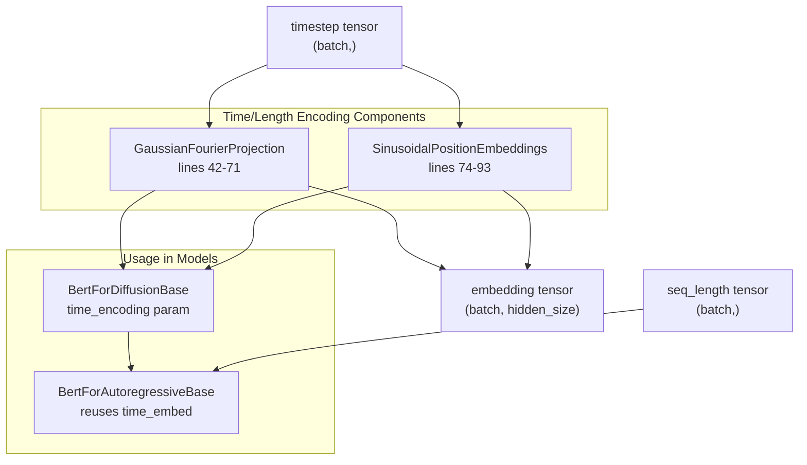
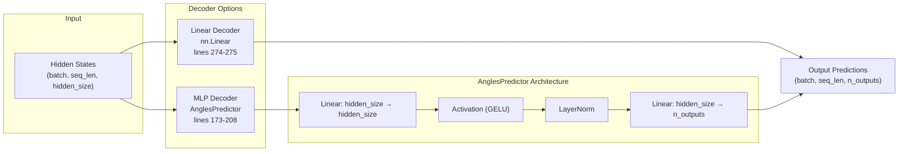
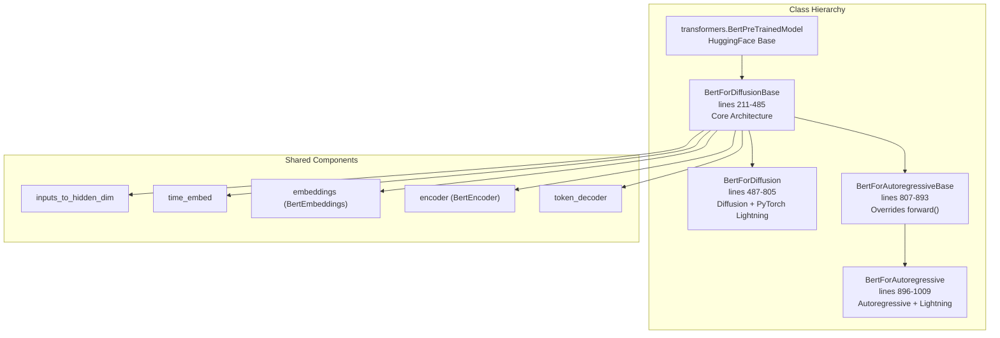
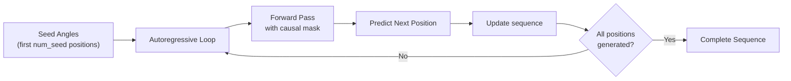

<!-- source: DeepWiki mcp.deepwiki.com · repo microsoft/foldingdiff · page 5.2 Model Components and Variants · fetched 2026-10-26 -->

# Model Components and Variants

<details>
<summary>Relevant source files</summary>

The following files were used as context for generating this wiki page:

- [bin/train_autoregressive.py](bin/train_autoregressive.py)
- [foldingdiff/modelling.py](foldingdiff/modelling.py)

</details>


This page documents the individual components that make up the model architecture and the different model variants available in FoldingDiff. For the main `BertForDiffusion` model architecture and its forward pass, see [BertForDiffusion Model](#5.1). For training details, see [Training Pipeline](#6.1).

## Overview

The FoldingDiff architecture is composed of modular components that can be configured independently. The main components include:

- **Time/sequence length encoders**: Convert scalar timesteps or sequence lengths into embeddings
- **Position embedders**: Add positional information to token sequences  
- **Input projections**: Map low-dimensional angle/coordinate features to hidden dimension
- **Decoder heads**: Map hidden representations back to output predictions
- **Model variants**: Different training objectives (diffusion vs autoregressive)

## Time and Sequence Length Encoding

Time encoding is critical for conditioning the model on the diffusion timestep (or, in the autoregressive variant, on the sequence length). FoldingDiff supports two encoding strategies.

### Component Architecture



**Sources:** [foldingdiff/modelling.py:42-93](), [foldingdiff/modelling.py:282-288](), [foldingdiff/modelling.py:825-828]()

### GaussianFourierProjection

The `GaussianFourierProjection` class [foldingdiff/modelling.py:42-71]() implements Gaussian random features for encoding time steps, based on score-based models. Key characteristics:

| Property | Value |
|----------|-------|
| **Input** | Timestep scalar or tensor of shape `(batch,)` |
| **Output** | Embedding of shape `(batch, embed_dim)` |
| **Parameters** | Fixed random weights `W` sampled at initialization (not trainable) |
| **Formula** | `[sin(2π * t * W), cos(2π * t * W)]` |

The weights are sampled from a Gaussian distribution scaled by `2π` and registered as a non-trainable buffer [foldingdiff/modelling.py:55-57](). The forward pass [foldingdiff/modelling.py:59-71]() handles input shape normalization and computes the sinusoidal projection.

### SinusoidalPositionEmbeddings

The `SinusoidalPositionEmbeddings` class [foldingdiff/modelling.py:74-93]() provides an alternative encoding strategy using standard sinusoidal position embeddings. 

| Property | Value |
|----------|-------|
| **Input** | Timestep tensor of shape `(batch,)` |
| **Output** | Embedding of shape `(batch, dim)` |
| **Parameters** | None (computed on-the-fly) |
| **Formula** | `[sin(t / 10000^(2i/d)), cos(t / 10000^(2i/d))]` for i in 0..d/2 |

The implementation [foldingdiff/modelling.py:83-93]() computes embeddings dynamically without learnable parameters, following the Transformer positional encoding design.

**Configuration:** The choice between encoders is controlled by the `time_encoding` parameter in model initialization [foldingdiff/modelling.py:282-288](), accepting values `"gaussian_fourier"` or `"sinusoidal"`.

**Sources:** [foldingdiff/modelling.py:42-93](), [foldingdiff/modelling.py:282-288]()

## Position Encoding Components

Position encoding adds information about token positions in the sequence. FoldingDiff uses two components for this purpose.

### PositionalEncoding

The `PositionalEncoding` class [foldingdiff/modelling.py:96-129]() implements standard Transformer-style positional encodings with dropout. This component:

- Accepts input tensors of shape `(batch, seq_len, embedding_dim)` [foldingdiff/modelling.py:115-129]()
- Adds fixed sinusoidal positional embeddings precomputed up to `max_len=5000` [foldingdiff/modelling.py:106-113]()
- Applies dropout after adding positional information
- Is primarily used as a standalone utility but not directly in the main model pipeline

### BertEmbeddings

The `BertEmbeddings` class [foldingdiff/modelling.py:132-170]() is the actual position embedder used in the model pipeline. It:

- Adds learnable absolute position embeddings if `position_embedding_type="absolute"` [foldingdiff/modelling.py:142-149]()
- Applies LayerNorm and dropout to the embeddings [foldingdiff/modelling.py:153-154]()
- Is instantiated in `BertForDiffusionBase.__init__` [foldingdiff/modelling.py:270]()
- Is called in the forward pass to add positional information [foldingdiff/modelling.py:467]()

The position embeddings are learnable `nn.Embedding` layers with `max_position_embeddings` entries [foldingdiff/modelling.py:143-145]().

**Sources:** [foldingdiff/modelling.py:96-170](), [foldingdiff/modelling.py:270](), [foldingdiff/modelling.py:467]()

## Decoder Head Components

The decoder head maps the hidden representations from the transformer encoder back to the output feature space (angle predictions). FoldingDiff supports two decoder architectures.



**Sources:** [foldingdiff/modelling.py:173-208](), [foldingdiff/modelling.py:273-279]()

### Linear Decoder

The simplest decoder option is a single linear layer [foldingdiff/modelling.py:274-275]():

```python
self.token_decoder = nn.Linear(config.hidden_size, n_inputs)
```

This directly projects each token's hidden state to the output dimension with no intermediate non-linearity.

### MLP Decoder (AnglesPredictor)

The `AnglesPredictor` class [foldingdiff/modelling.py:173-208]() implements a two-layer MLP decoder with the architecture:

1. **Dense Layer 1**: Linear projection `hidden_size → hidden_size` [foldingdiff/modelling.py:193]()
2. **Activation**: GELU activation (or other specified activation) [foldingdiff/modelling.py:195-198]()
3. **LayerNorm**: Normalizes the activated outputs [foldingdiff/modelling.py:199]()
4. **Dense Layer 2**: Final projection `hidden_size → n_outputs` [foldingdiff/modelling.py:201]()

This architecture mirrors the BERT MLM head design and provides more expressiveness than a single linear layer.

**Configuration:** The decoder type is selected via the `decoder` parameter [foldingdiff/modelling.py:245]() accepting values `"linear"` or `"mlp"`. The MLP decoder is generally preferred and used in most training configurations.

**Sources:** [foldingdiff/modelling.py:173-208](), [foldingdiff/modelling.py:273-279]()

## Model Variants

FoldingDiff includes two main model variants that share the same base architecture but differ in their training objectives and forward pass behavior.

### Architecture Comparison



**Sources:** [foldingdiff/modelling.py:211-1009]()

### BertForDiffusion (Primary Model)

The `BertForDiffusion` class [foldingdiff/modelling.py:487-805]() wraps `BertForDiffusionBase` with PyTorch Lightning for training. Key features:

| Aspect | Details |
|--------|---------|
| **Base Class** | `BertForDiffusionBase`, `pl.LightningModule` [foldingdiff/modelling.py:487]() |
| **Training Objective** | Predict noise added to corrupted angles at timestep t |
| **Forward Inputs** | `inputs`, `timestep`, `attention_mask`, `position_ids` [foldingdiff/modelling.py:384-394]() |
| **Loss Functions** | Per-feature losses (angular/non-angular), optional pairwise distance loss [foldingdiff/modelling.py:553-678]() |
| **Optimizer** | AdamW with optional LinearWarmup or OneCycleLR scheduling [foldingdiff/modelling.py:762-804]() |

The model supports multiple loss functions that handle angular vs. non-angular features differently [foldingdiff/modelling.py:223-237]():

- **Angular losses**: `radian_l1_loss`, `radian_smooth_l1_loss` (wrap around at ±π)
- **Non-angular losses**: Standard `l1_loss`, `smooth_l1_loss`

An optional pairwise distance loss [foldingdiff/modelling.py:616-677]() can be added that:
1. Denoises the corrupted input using predicted noise
2. Reconstructs 3D coordinates using NERF
3. Compares pairwise CA-CA distances between denoised and ground truth structures

**Sources:** [foldingdiff/modelling.py:487-805]()

### BertForAutoregressive (Baseline Variant)

The `BertForAutoregressiveBase` class [foldingdiff/modelling.py:807-893]() adapts the diffusion architecture for autoregressive generation, where angles are predicted sequentially given previous angles.

#### Key Differences from Diffusion Model

| Aspect | Diffusion Model | Autoregressive Model |
|--------|-----------------|---------------------|
| **Forward Inputs** | `inputs`, `timestep`, `attention_mask` | `inputs`, `seq_lengths`, `attention_mask` [foldingdiff/modelling.py:812-821]() |
| **Time Embedding** | Encodes diffusion timestep | Repurposed to encode total sequence length [foldingdiff/modelling.py:825-828]() |
| **Training** | Predicts noise at any timestep | Predicts next angle given previous angles [foldingdiff/modelling.py:921-938]() |
| **Attention Mask** | Padded sequence mask | Causal mask (no future positions) |

#### Forward Pass Implementation

The autoregressive forward pass [foldingdiff/modelling.py:812-862]() differs from diffusion:

1. **No timestep input**: Instead uses `seq_lengths` to encode the total length
2. **Sequence length embedding**: The `time_embed` component is reused to embed sequence lengths [foldingdiff/modelling.py:827]()
3. **Standard transformer flow**: Input projection → position embeddings → encoder → decoder

#### Sampling Method

The autoregressive model includes a `sample()` method [foldingdiff/modelling.py:864-893]() for sequential generation:



The method [foldingdiff/modelling.py:884-892]():
- Starts with `num_seed` initial angles
- Iteratively predicts the next position using a causal attention mask
- Returns complete sequences for each item in the batch

**Sources:** [foldingdiff/modelling.py:807-893]()

### BertForAutoregressive with PyTorch Lightning

The `BertForAutoregressive` class [foldingdiff/modelling.py:896-1009]() wraps the autoregressive base with PyTorch Lightning, similar to how `BertForDiffusion` wraps `BertForDiffusionBase`.

Training differences [foldingdiff/modelling.py:921-938]():
- Uses only angular loss functions (no non-angular features in autoregressive setting)
- Targets are the next angle in the sequence given by `batch["causal_target"]`
- Predictions are made at positions indicated by `batch["causal_idx"]`

The autoregressive model is trained using [bin/train_autoregressive.py]() with the `AutoregressiveCausalDataset` wrapper that provides appropriate causal masks and targets.

**Sources:** [foldingdiff/modelling.py:896-1009](), [bin/train_autoregressive.py:1-288]()

## Model Loading and Serialization

Both model variants support loading from saved checkpoints using the `from_dir()` class method [foldingdiff/modelling.py:297-382](). This method:

1. Loads `training_args.json` to reconstruct model configuration [foldingdiff/modelling.py:313-316]()
2. Loads `config.json` for BERT configuration [foldingdiff/modelling.py:316]()
3. Auto-detects angular features from `angles_definitions` [foldingdiff/modelling.py:318-322]()
4. Loads model weights from checkpoint files in `models/best_by_{train|valid}/` [foldingdiff/modelling.py:346-363]()

The method supports:
- Loading uninitialized models (`load_weights=False`)
- Selecting specific checkpoint by epoch (`idx` parameter)
- Choosing best-by-train vs best-by-validation checkpoints (`best_by` parameter)
- Copying minimal file set to new directory (`copy_to` parameter)

**Sources:** [foldingdiff/modelling.py:297-382]()

## Usage Summary

| Component/Variant | Primary Use Case | Configuration Key |
|-------------------|------------------|-------------------|
| `GaussianFourierProjection` | Time encoding in diffusion models | `time_encoding="gaussian_fourier"` |
| `SinusoidalPositionEmbeddings` | Alternative time encoding | `time_encoding="sinusoidal"` |
| `AnglesPredictor` (MLP) | Decoder head for angle prediction | `decoder="mlp"` |
| Linear decoder | Simple decoder alternative | `decoder="linear"` |
| `BertForDiffusion` | Training diffusion models | Default training mode |
| `BertForAutoregressive` | Autoregressive baseline | Used with [train_autoregressive.py](#) |

**Sources:** [foldingdiff/modelling.py:1-1026](), [bin/train_autoregressive.py:1-288]()

---

