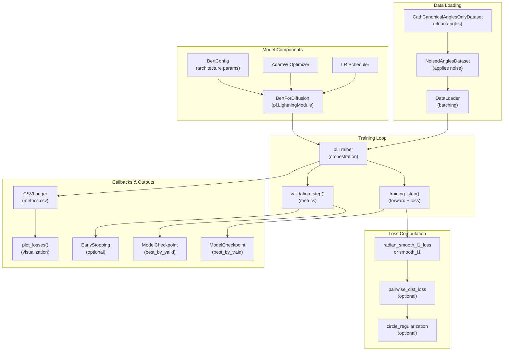
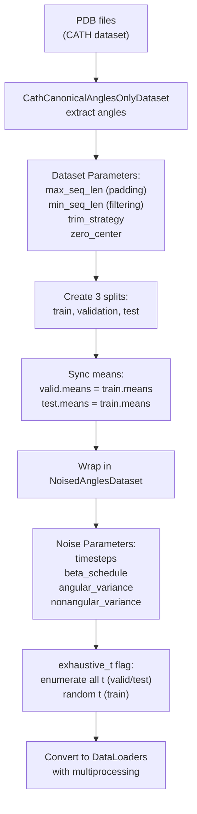
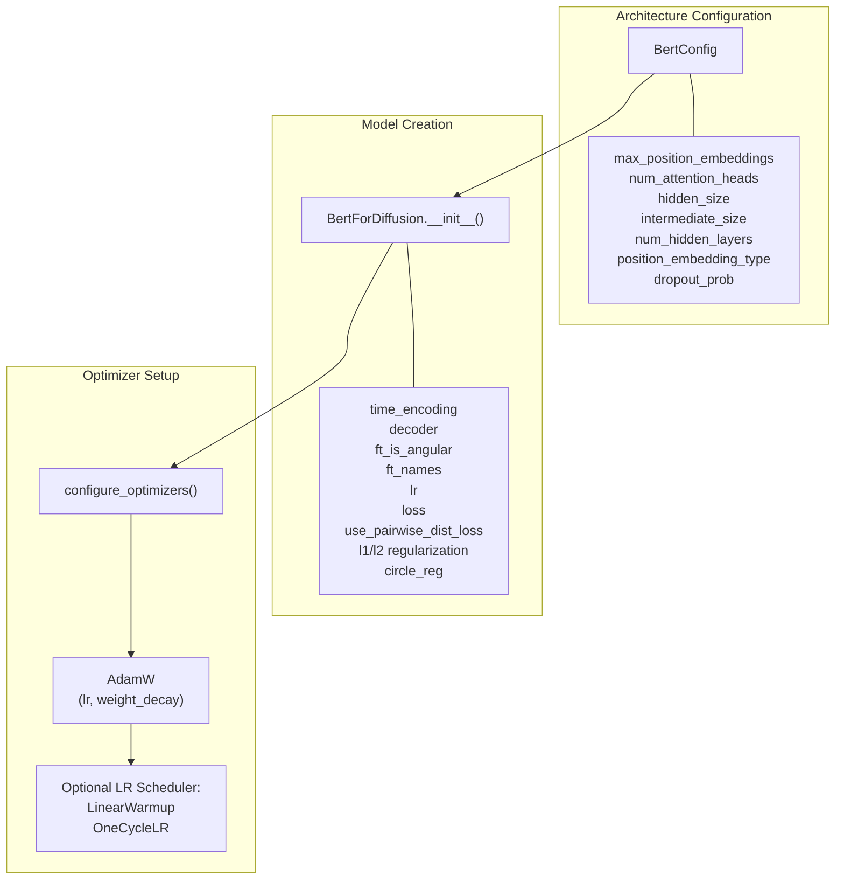

<!-- source: DeepWiki mcp.deepwiki.com · repo microsoft/foldingdiff · page 6 Training · fetched 2026-10-26 -->

# Training

<details>
<summary>Relevant source files</summary>

The following files were used as context for generating this wiki page:

- [bin/train.py](bin/train.py)
- [environment.yml](environment.yml)
- [foldingdiff/utils.py](foldingdiff/utils.py)
- [scripts/amlt.yaml](scripts/amlt.yaml)
- [tests/mini_model_for_testing/results/training_args.json](tests/mini_model_for_testing/results/training_args.json)

</details>


## Purpose and Scope

This document provides an overview of the training system for FoldingDiff diffusion models. It covers the high-level training architecture, workflow, and key components involved in training protein backbone generation models. For detailed information about:
- The training script and command-line interface, see [Training Pipeline (train.py)](#6.1)
- Loss function implementations and regularization, see [Loss Functions](#6.2)
- Configuration files and hyperparameter tuning, see [Training Configuration](#6.3)

For information about data loading and preprocessing, see [Data Pipeline](#4). For model architecture details, see [Model Architecture](#5).

## Overview

The FoldingDiff training system learns a diffusion model to denoise protein backbone angles. Training is implemented using PyTorch Lightning and supports distributed multi-GPU training via DDP (Distributed Data Parallel). The system trains a BERT-based transformer to predict noise added to protein structures at various timesteps in the forward diffusion process.

The training process operates on internal coordinates (dihedral angles) rather than Cartesian coordinates, leveraging the `NoisedAnglesDataset` class to apply progressive noise according to a beta schedule. The trained model learns to reverse this noising process, enabling generation of novel protein structures.

**Sources:** [bin/train.py:1-50]()

## Training Architecture

The following diagram shows how the major components interact during training:



**Sources:** [bin/train.py:111-205](), [bin/train.py:287-508]()

## Training Workflow

The training process follows this sequence:

```mermaid
graph LR
    START["train() function<br/>entry point"] --> ARGS["Parse arguments<br/>from JSON config"]
    ARGS --> DATASETS["get_train_valid_test_sets()<br/>Create datasets"]
    DATASETS --> SPLIT_INFO["Record splits:<br/>training_mean_offset.npy<br/>train_files.txt"]
    SPLIT_INFO --> DATALOADERS["Create DataLoaders<br/>(train/valid/test)"]
    DATALOADERS --> PLOTS_PRE["plot_kl_divergence()<br/>plot_timestep_distributions()"]
    PLOTS_PRE --> MODEL_INIT["Initialize BertForDiffusion<br/>with BertConfig"]
    MODEL_INIT --> CALLBACKS["build_callbacks()<br/>(checkpoints, early stop)"]
    CALLBACKS --> TRAINER_INIT["Initialize pl.Trainer<br/>(accelerator, strategy)"]
    TRAINER_INIT --> FIT["trainer.fit()<br/>(training loop)"]
    FIT --> PLOTS_POST["plot_losses()<br/>(final visualization)"]
    PLOTS_POST --> END["Training complete<br/>checkpoints saved"]
```



**Sources:** [bin/train.py:287-508]()

### Key Training Steps

1. **Configuration Loading**: The `train()` function accepts parameters either from command-line arguments or a JSON configuration file. All training hyperparameters are captured in `func_args` and saved to `training_args.json`.

2. **Dataset Preparation**: The `get_train_valid_test_sets()` function creates three dataset splits (train, validation, test), each wrapped in a `NoisedAnglesDataset` that applies diffusion noise according to the beta schedule.

3. **Batch Size Adjustment**: Under distributed training, the effective batch size is automatically adjusted by dividing by the number of GPUs: `effective_batch_size = batch_size / torch.cuda.device_count()`.

4. **Pre-Training Visualization**: Before training begins, the system generates diagnostic plots including KL divergence across timesteps and distribution visualizations at various noise levels.

5. **Model Initialization**: A `BertForDiffusion` model is created using a `BertConfig` object that specifies architecture hyperparameters.

6. **Training Execution**: PyTorch Lightning's `Trainer.fit()` method orchestrates the training loop, handling data loading, forward passes, backpropagation, and validation.

7. **Post-Training Analysis**: After training completes, loss curves are plotted from the logged metrics.

**Sources:** [bin/train.py:287-508](), [bin/train.py:340-344](), [bin/train.py:374-382]()

## Data Preparation for Training

The training system uses a two-layer dataset architecture:

| Layer | Class | Purpose |
|-------|-------|---------|
| Clean Data | `CathCanonicalAnglesOnlyDataset` | Loads and preprocesses PDB files into dihedral angles |
| Noised Data | `NoisedAnglesDataset` | Applies forward diffusion noise at random timesteps |

The `get_train_valid_test_sets()` function creates these datasets with the following flow:



**Sources:** [bin/train.py:111-205](), [bin/train.py:346-393]()

### Important Dataset Features

- **Zero Centering**: Training data is zero-centered by default (angles shifted to [-π, π] range) to improve training stability.
- **Mean Synchronization**: Validation and test sets use the training set's mean offset to ensure consistency.
- **Exhaustive Timesteps**: Validation and test datasets can enumerate all timesteps exhaustively for reproducible evaluation.
- **Multiprocessing**: DataLoaders use all available CPU cores for parallel data loading.

**Sources:** [bin/train.py:159-164](), [bin/train.py:184-195]()

## Model and Optimization Configuration

The training script creates a `BertForDiffusion` model which extends PyTorch Lightning's `LightningModule`:



**Sources:** [bin/train.py:425-463]()

### Key Configuration Parameters

| Parameter | Default | Purpose |
|-----------|---------|---------|
| `hidden_size` | 384 | Dimension of hidden layers |
| `num_hidden_layers` | 12 | Number of transformer blocks |
| `num_heads` | 12 | Number of attention heads |
| `intermediate_size` | 768 | Dimension of feed-forward layer |
| `lr` | 5e-5 | Learning rate for AdamW |
| `dropout_p` | 0.1 | Dropout probability |
| `gradient_clip` | 1.0 | Gradient clipping threshold |

The model's `configure_optimizers()` method is called automatically by PyTorch Lightning to set up the AdamW optimizer and optional learning rate scheduler.

**Sources:** [bin/train.py:299-325](), [bin/train.py:425-435]()

## Training Execution with PyTorch Lightning

PyTorch Lightning's `Trainer` orchestrates the training process:

```mermaid
graph TB
    TRAINER["pl.Trainer"] --> CONFIG["Configuration:<br/>max_epochs<br/>gradient_clip_val<br/>accelerator (cuda/cpu)<br/>strategy (DDP)<br/>gpus<br/>callbacks"]
    
    CONFIG --> FIT["trainer.fit()"]
    
    FIT --> EPOCH_LOOP["For each epoch:"]
    
    EPOCH_LOOP --> TRAIN_BATCH["For each train batch:<br/>model.training_step()"]
    
    TRAIN_BATCH --> FORWARD["Forward pass:<br/>predict noise ε_θ"]
    
    FORWARD --> LOSS_CALC["Compute loss:<br/>radian_smooth_l1_loss<br/>+ optional pdist_loss<br/>+ optional circle_reg"]
    
    LOSS_CALC --> BACKWARD["Backward pass:<br/>compute gradients"]
    
    BACKWARD --> CLIP["Clip gradients:<br/>gradient_clip_val"]
    
    CLIP --> UPDATE["Update weights:<br/>optimizer.step()"]
    
    UPDATE --> LOG_TRAIN["Log metrics:<br/>train_loss"]
    
    LOG_TRAIN --> VALID_LOOP["Validation loop:<br/>model.validation_step()"]
    
    VALID_LOOP --> EVAL_MODE["Evaluation mode:<br/>no gradient computation"]
    
    EVAL_MODE --> VALID_LOSS["Compute validation loss"]
    
    VALID_LOSS --> LOG_VALID["Log metrics:<br/>val_loss"]
    
    LOG_VALID --> CALLBACKS["Trigger callbacks:<br/>ModelCheckpoint<br/>EarlyStopping<br/>LRScheduler"]
    
    CALLBACKS --> CHECK_CONTINUE["Continue training?"]
    
    CHECK_CONTINUE -->|Yes| EPOCH_LOOP
    CHECK_CONTINUE -->|No| DONE["Training complete"]
```



**Sources:** [bin/train.py:478-497]()

### Distributed Training

When multiple GPUs are available, the trainer automatically uses DDP strategy:

```python
if torch.cuda.device_count() > 1:
    strategy = DDPStrategy(find_unused_parameters=False)
```

The effective batch size is automatically divided across GPUs, maintaining the same total batch size across all devices.

**Sources:** [bin/train.py:469-476]()

### Callbacks

The `build_callbacks()` function creates several callbacks:

1. **ModelCheckpoint (by validation)**: Saves top 5 models by validation loss to `models/best_by_valid/`
2. **ModelCheckpoint (by training)**: Saves top 5 models by training loss to `models/best_by_train/`
3. **LearningRateMonitor**: Logs learning rate at each epoch
4. **EarlyStopping** (optional): Stops training if validation loss doesn't improve for `early_stop_patience` epochs
5. **StochasticWeightAveraging** (optional): Averages model weights for better generalization

**Sources:** [bin/train.py:207-248]()

## Output Artifacts

The training process generates the following outputs in the results directory:

### Directory Structure

```
results/
├── training_args.json          # All hyperparameters and configuration
├── git_sha.txt                 # Git commit hash for reproducibility
├── training_mean_offset.npy    # Mean offsets for zero-centering
├── train_files.txt             # List of training PDB files
├── valid_files.txt             # List of validation PDB files
├── test_files.txt              # List of test PDB files
├── config.json                 # BertConfig architecture parameters
├── plots/
│   ├── kl_divergence_timesteps.pdf
│   ├── train_dists_at_t_*.pdf
│   └── losses.pdf
├── models/
│   ├── best_by_valid/
│   │   └── epoch=*-step=*.ckpt
│   └── best_by_train/
│       └── epoch=*-step=*.ckpt
└── logs/
    └── lightning_logs/
        └── version_0/
            └── metrics.csv
```

**Sources:** [bin/train.py:256-285](), [bin/train.py:362-372](), [bin/train.py:463]()

### Key Output Files

| File | Purpose |
|------|---------|
| `training_args.json` | Complete record of all training hyperparameters for reproducibility |
| `training_mean_offset.npy` | Saved mean offsets from training set; required for sampling |
| `config.json` | BERT architecture configuration; required for loading model |
| `metrics.csv` | Per-epoch training and validation metrics |
| Model checkpoints | Saved model weights; can be loaded for sampling or continued training |

The `record_args_and_metadata()` function saves all training arguments and attempts to capture the Git commit hash for full reproducibility.

**Sources:** [bin/train.py:255-285]()

### Visualization Outputs

Three types of plots are generated:

1. **KL Divergence Plot**: Shows KL divergence between empirical and Gaussian distributions across all timesteps for each feature, generated by `plot_kl_divergence()`.

2. **Distribution Plots**: Visualize the distribution of angles at various noise levels (t=0, t=100, t=500, etc.), generated by `plot_timestep_distributions()` in parallel across multiple CPU cores.

3. **Loss Curves**: Training and validation loss over epochs, generated by `plotting.plot_losses()` after training completes.

**Sources:** [bin/train.py:51-109](), [bin/train.py:405-410](), [bin/train.py:499-507]()

## Command-Line Interface

The training script can be invoked in two ways:

### Using Configuration File
```bash
python bin/train.py config.json
```

### With Command-Line Overrides
```bash
python bin/train.py config.json --outdir ./my_results --toy 100 --ngpu 2
```

The `build_parser()` function defines the following command-line arguments:

| Argument | Purpose |
|----------|---------|
| `config` | Path to JSON configuration file (optional) |
| `--outdir` | Output directory for results |
| `--toy` | Use toy dataset of n samples for debugging |
| `--debug_single_time` | Debug mode with single timestep |
| `--cpu` | Force CPU-only training |
| `--ngpu` | Number of GPUs to use (-1 for all) |
| `--dryrun` | Skip some visualization for faster debugging |

Command-line arguments override values in the configuration file via `utils.update_dict_nonnull()`.

**Sources:** [bin/train.py:510-571]()

### Example Configuration

A typical training configuration looks like:

```json
{
    "angles_definitions": "canonical-full-angles",
    "max_seq_len": 128,
    "timesteps": 250,
    "variance_schedule": "cosine",
    "num_hidden_layers": 6,
    "hidden_size": 192,
    "batch_size": 128,
    "lr": 5e-05,
    "loss": "smooth_l1",
    "max_epochs": 20,
    "lr_scheduler": "LinearWarmup"
}
```

**Sources:** [tests/mini_model_for_testing/results/training_args.json:1-40]()

## Integration with AMLT

For distributed training on Azure ML, the system includes an AMLT configuration file:

```yaml
target:
  service: sing
  name: msrresrchvc

environment:
  image: amlt-sing/pytorch-1.11.0
  setup:
    - pip install pytorch-lightning==1.6.4
    - pip install transformers==4.11.3

jobs:
  - name: training_job
    sku: 16G2-V100
    command:
      - tar -xzf data/cath/cath-dataset-nonredundant-S40.pdb.tgz -C data/cath
      - python bin/train.py config.json -o $AMLT_OUTPUT_DIR/results
```

The AMLT system handles job scheduling, resource allocation, and output storage on Azure infrastructure.

**Sources:** [scripts/amlt.yaml:1-40]()

---

