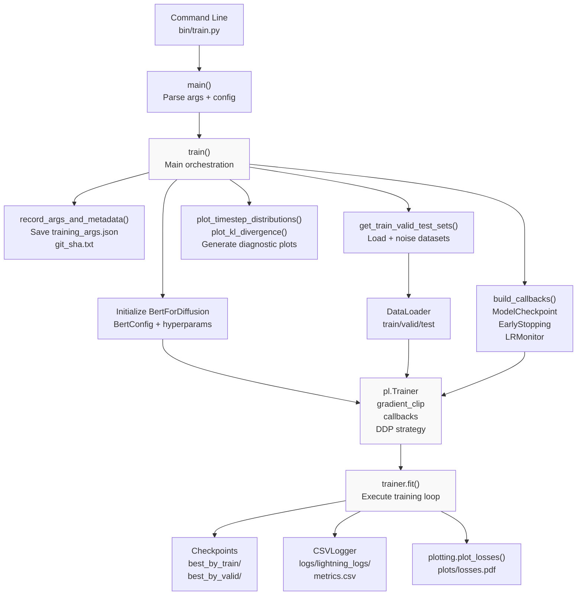
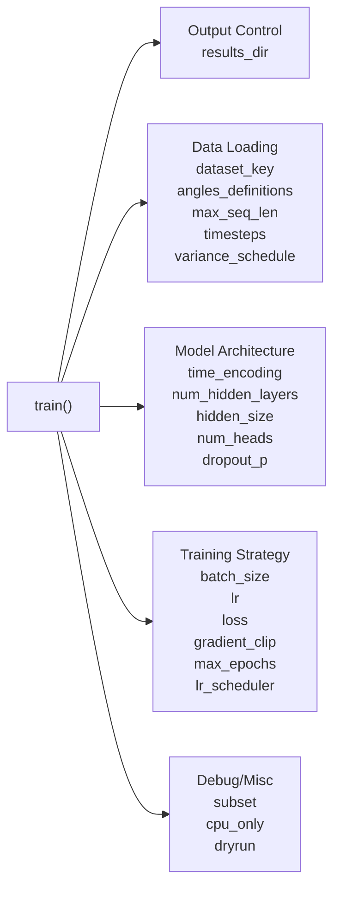
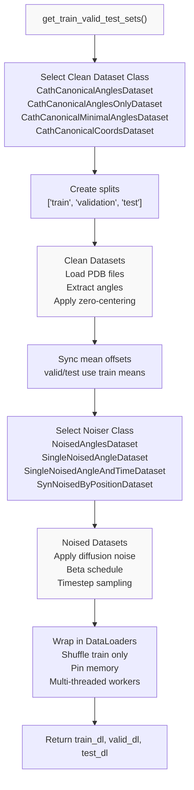
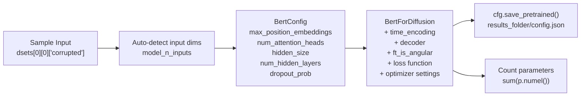
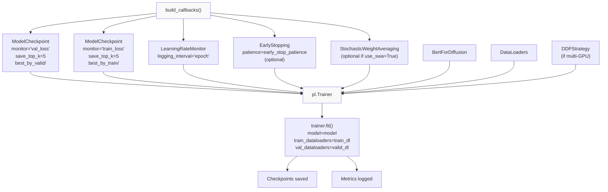
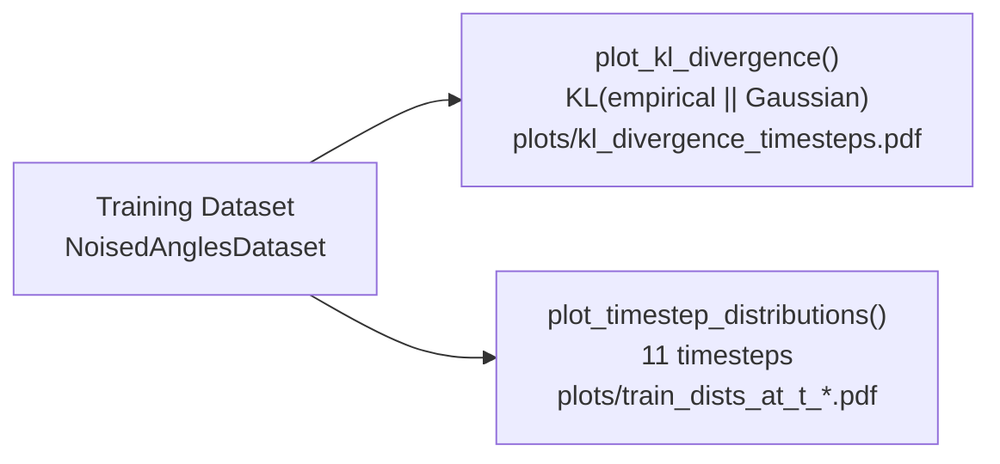
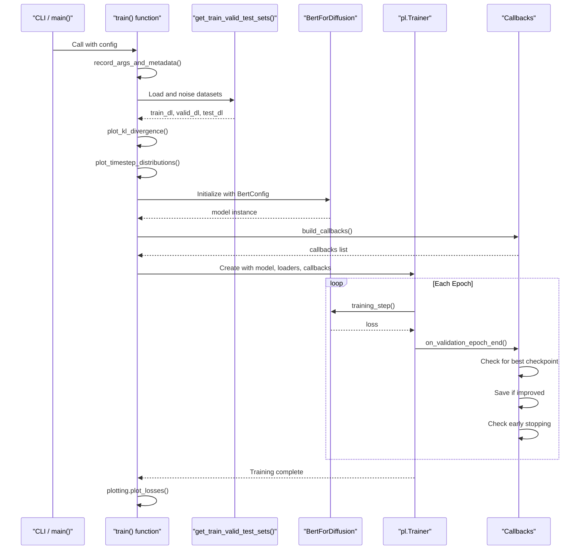
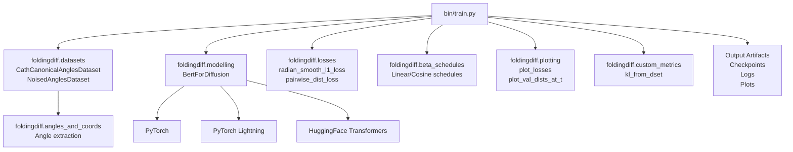

<!-- source: DeepWiki mcp.deepwiki.com · repo microsoft/foldingdiff · page 6.1 Training Pipeline (train.py) · fetched 2026-10-26 -->

# Training Pipeline (train.py)

<details>
<summary>Relevant source files</summary>

The following files were used as context for generating this wiki page:

- [bin/train.py](bin/train.py)
- [tests/mini_model_for_testing/results/training_args.json](tests/mini_model_for_testing/results/training_args.json)

</details>


**Purpose**: This document describes the training pipeline implemented in [bin/train.py](), which orchestrates the end-to-end process of training a diffusion model on protein backbone structures. It covers command-line usage, configuration, the training loop, callbacks, and output artifacts.

**Scope**: This page focuses specifically on the training orchestration script. For details about:
- Model architecture, see [BertForDiffusion Model](#5.1)
- Loss functions, see [Loss Functions](#6.2)
- Training configuration files, see [Training Configuration](#6.3)
- Data loading and noising, see [Dataset Classes](#4.1) and [Noising Process](#4.3)

---

## Overview

The training script [bin/train.py]() is the primary executable for training diffusion models on protein structures. It integrates PyTorch Lightning for distributed training, handles data loading, initializes models, configures callbacks, and manages output artifacts.

**Key Responsibilities**:
- Load and prepare datasets with appropriate noising
- Initialize `BertForDiffusion` model with specified architecture
- Configure PyTorch Lightning trainer with callbacks and distributed strategy
- Execute training loop with validation
- Save checkpoints, logs, and diagnostic plots
- Record training metadata and Git commit information

**Entry Points**:
- CLI: `python bin/train.py [config.json]`
- Programmatic: `train()` function with keyword arguments

Sources: [bin/train.py:1-583]()

---

## Training Pipeline Architecture



**Training Workflow Components**:

| Component | Function | Output |
|-----------|----------|--------|
| CLI Parser | `build_parser()` | Parsed arguments |
| Configuration | `main()` loads JSON | Merged config dict |
| Metadata Recording | `record_args_and_metadata()` | `training_args.json`, `git_sha.txt` |
| Dataset Loading | `get_train_valid_test_sets()` | `NoisedAnglesDataset` objects |
| Model Initialization | `BertConfig` + `BertForDiffusion()` | PyTorch Lightning module |
| Callback Setup | `build_callbacks()` | List of callbacks |
| Training Loop | `trainer.fit()` | Trained model + logs |

Sources: [bin/train.py:287-508](), [bin/train.py:510-571]()

---

## Command-Line Interface

### Basic Usage

```bash
# Train with configuration file
python bin/train.py config.json

# Train with config and override output directory
python bin/train.py config.json --outdir ./my_results

# Quick test with toy dataset
python bin/train.py config.json --toy 100

# Force CPU training
python bin/train.py config.json --cpu

# Specify number of GPUs
python bin/train.py config.json --ngpu 2
```

### CLI Arguments

The script accepts a configuration JSON file as its primary argument, with additional CLI flags for common overrides:

| Argument | Type | Default | Description |
|----------|------|---------|-------------|
| `config` | str | `""` | Path to JSON configuration file |
| `--outdir`, `-o` | str | `./results` | Output directory for training artifacts |
| `--toy` | int | `None` | Use toy dataset with n samples |
| `--debug_single_time` | flag | `False` | Debug mode with single angle and timestep |
| `--cpu` | flag | `False` | Force CPU-only training |
| `--ngpu` | int | `-1` | Number of GPUs (-1 for all available) |
| `--dryrun` | flag | `False` | Skip diagnostic plots for fast testing |

Sources: [bin/train.py:510-546]()

### Configuration JSON Structure

The configuration file contains all training hyperparameters. Example structure from [tests/mini_model_for_testing/results/training_args.json]():

```json
{
    "angles_definitions": "canonical-full-angles",
    "max_seq_len": 128,
    "timesteps": 250,
    "variance_schedule": "cosine",
    "num_hidden_layers": 6,
    "hidden_size": 192,
    "batch_size": 128,
    "lr": 5e-05,
    "loss": "smooth_l1",
    "max_epochs": 20
}
```

For complete configuration parameters, see [Training Configuration](#6.3).

Sources: [tests/mini_model_for_testing/results/training_args.json:1-40](), [bin/train.py:549-571]()

---

## Main Training Function

### Function Signature

The `train()` function at [bin/train.py:287-508]() is the core orchestrator with the following parameter categories:



Sources: [bin/train.py:287-337]()

### Parameter Categories

**Data Loading Parameters**:
- `dataset_key`: Dataset to use (`"cath"`, `"alphafold"`, or directory path)
- `angles_definitions`: Type of angle representation (see [Internal Coordinates](#3.2))
- `max_seq_len`: Maximum sequence length (default: 512)
- `min_seq_len`: Minimum sequence length filter (default: 0)
- `trim_strategy`: How to handle sequences exceeding max length
- `timesteps`: Number of diffusion timesteps (default: 250)
- `variance_schedule`: Beta schedule type (default: `"linear"`)
- `variance_scale`: Scale factor for angular variance (default: 1.0)

**Model Architecture Parameters**:
- `time_encoding`: Timestep encoding method (default: `"gaussian_fourier"`)
- `num_hidden_layers`: Number of transformer layers (default: 12)
- `hidden_size`: Hidden dimension size (default: 384)
- `intermediate_size`: Feed-forward intermediate size (default: 768)
- `num_heads`: Number of attention heads (default: 12)
- `position_embedding_type`: Type of position embeddings (default: `"absolute"`)
- `dropout_p`: Dropout probability (default: 0.1)
- `decoder`: Output decoder head type (default: `"mlp"`)

**Training Strategy Parameters**:
- `batch_size`: Batch size (default: 64)
- `lr`: Learning rate (default: 5e-5)
- `loss`: Loss function key (default: `"smooth_l1"`)
- `use_pdist_loss`: Weight for pairwise distance loss (default: 0.0)
- `gradient_clip`: Gradient clipping value (default: 1.0)
- `max_epochs`: Maximum training epochs (default: 10000)
- `early_stop_patience`: Early stopping patience (0 to disable)
- `lr_scheduler`: Learning rate schedule (default: `None`)
- `use_swa`: Enable stochastic weight averaging (default: `False`)

Sources: [bin/train.py:287-337]()

---

## Data Loading and Preparation

### Dataset Creation Workflow



Sources: [bin/train.py:111-204]()

### Dataset Selection Logic

The function `get_train_valid_test_sets()` at [bin/train.py:111-204]() selects the appropriate dataset class based on `angles_definitions`:

| `angles_definitions` | Clean Dataset Class | Features Included |
|---------------------|---------------------|-------------------|
| `"canonical"` | `CathCanonicalAnglesDataset` | Angles + distances + bond angles |
| `"canonical-full-angles"` | `CathCanonicalAnglesOnlyDataset` | Phi, psi, omega only |
| `"canonical-minimal-angles"` | `CathCanonicalMinimalAnglesDataset` | Minimal angle set |
| `"cart-coords"` | `CathCanonicalCoordsDataset` | Cartesian coordinates |

**Noiser Selection**: The script supports several noising strategies for debugging and specialized training:

| Condition | Noiser Class | Purpose |
|-----------|--------------|---------|
| Default | `NoisedAnglesDataset` | Standard diffusion noise |
| `single_angle_debug > 0` | `SingleNoisedAngleDataset` | Noise single angle only |
| `single_time_debug` | `SingleNoisedAngleAndTimeDataset` | Single angle + timestep |
| `syn_noiser == "halfhalf"` | `SynNoisedByPositionDataset` | Synthetic noise pattern |

Sources: [bin/train.py:136-183]()

### DataLoader Configuration

The datasets are wrapped in PyTorch `DataLoader` objects at [bin/train.py:384-393]():

```python
DataLoader(
    dataset=ds,
    batch_size=effective_batch_size,
    shuffle=(i == 0),  # Only shuffle training set
    num_workers=multiprocessing.cpu_count(),
    pin_memory=True
)
```

**Effective Batch Size**: When using distributed training, the batch size is adjusted per GPU:

```
effective_batch_size = batch_size / torch.cuda.device_count()
```

This ensures the total batch size across all GPUs equals the specified `batch_size`.

Sources: [bin/train.py:374-393]()

---

## Model Initialization

### Model Configuration Flow



Sources: [bin/train.py:420-463]()

### BertConfig Creation

A `BertConfig` object is created at [bin/train.py:425-435]() with architecture hyperparameters:

```python
cfg = BertConfig(
    max_position_embeddings=max_seq_len,
    num_attention_heads=num_heads,
    hidden_size=hidden_size,
    intermediate_size=intermediate_size,
    num_hidden_layers=num_hidden_layers,
    position_embedding_type=position_embedding_type,
    hidden_dropout_prob=dropout_p,
    attention_probs_dropout_prob=dropout_p,
    use_cache=False,
)
```

### BertForDiffusion Instantiation

The model is instantiated at [bin/train.py:438-458]() with diffusion-specific parameters:

```python
model = modelling.BertForDiffusion(
    config=cfg,
    time_encoding=time_encoding,
    decoder=decoder,
    ft_is_angular=dsets[0].dset.feature_is_angular[ft_key],
    ft_names=dsets[0].dset.feature_names[ft_key],
    lr=lr,
    loss=loss_fn,
    use_pairwise_dist_loss=use_pdist_loss,
    l2=l2_norm,
    l1=l1_norm,
    circle_reg=circle_reg,
    epochs=max_epochs,
    steps_per_epoch=len(train_dataloader),
    lr_scheduler=lr_scheduler,
    write_preds_to_dir=results_folder / "valid_preds",
)
```

**Key Parameters**:
- `ft_is_angular`: Boolean mask indicating which features are angular (for proper loss calculation)
- `ft_names`: Feature names for logging
- `use_pairwise_dist_loss`: Optional auxiliary loss on CA distances
- `l1`, `l2`, `circle_reg`: Regularization terms
- `steps_per_epoch`: Used for learning rate scheduling

Sources: [bin/train.py:420-463]()

---

## Training Loop and Callbacks

### PyTorch Lightning Trainer Setup



Sources: [bin/train.py:207-248](), [bin/train.py:469-497]()

### Callback Configuration

The `build_callbacks()` function at [bin/train.py:207-248]() creates PyTorch Lightning callbacks:

**ModelCheckpoint Callbacks**:
- **Best by Validation**: Monitors `val_loss`, saves top 5 checkpoints to `models/best_by_valid/`
- **Best by Training**: Monitors `train_loss`, saves top 5 checkpoints to `models/best_by_train/`
- Both callbacks save weights only (`save_weights_only=True`) to reduce disk usage

**Other Callbacks**:
- **LearningRateMonitor**: Logs learning rate at each epoch
- **EarlyStopping** (optional): Stops training if `val_loss` doesn't improve for `patience` epochs
- **StochasticWeightAveraging** (optional): Averages weights during training for better generalization

Sources: [bin/train.py:207-248]()

### Distributed Training Strategy

The trainer automatically configures distributed training at [bin/train.py:469-476]():

```python
accelerator, strategy = "cpu", None
if not cpu_only and torch.cuda.is_available():
    accelerator = "cuda"
    if torch.cuda.device_count() > 1:
        strategy = DDPStrategy(find_unused_parameters=False)
```

**Distributed Data Parallel (DDP)**: When multiple GPUs are available, `DDPStrategy` is used for efficient data-parallel training with gradient synchronization.

Sources: [bin/train.py:469-492]()

### Trainer Instantiation and Fitting

The trainer is created at [bin/train.py:478-492]():

```python
trainer = pl.Trainer(
    default_root_dir=results_folder,
    gradient_clip_val=gradient_clip,
    min_epochs=min_epochs,
    max_epochs=max_epochs,
    check_val_every_n_epoch=1,
    callbacks=callbacks,
    logger=pl.loggers.CSVLogger(save_dir=results_folder / "logs"),
    log_every_n_steps=min(200, len(train_dataloader)),
    accelerator=accelerator,
    strategy=strategy,
    gpus=ngpu,
    enable_progress_bar=False,
    move_metrics_to_cpu=False,
)
```

Training is executed with:

```python
trainer.fit(
    model=model,
    train_dataloaders=train_dataloader,
    val_dataloaders=valid_dataloader,
)
```

Sources: [bin/train.py:478-497]()

---

## Diagnostic Plots and Metadata

### Pre-Training Diagnostics

Before training begins, the script generates diagnostic plots at [bin/train.py:399-410]():



**KL Divergence Plot**: Visualizes how well the empirical distribution at each timestep matches a Gaussian, computed via `cm.kl_from_dset()`. This helps diagnose issues with the noising process.

**Timestep Distributions**: Plots the distribution of noised angles at 11 evenly-spaced timesteps (from t=0 to t=timesteps). Uses multiprocessing for parallel generation via `plotting.plot_val_dists_at_t()`.

Sources: [bin/train.py:51-109]()

### Post-Training Artifacts

After training completes, additional plots are generated at [bin/train.py:499-507]():

```python
plotting.plot_losses(
    metrics_csv, 
    out_fname=plots_folder / "losses.pdf", 
    simple=True
)
```

This reads `logs/lightning_logs/version_0/metrics.csv` and plots training/validation loss curves.

Sources: [bin/train.py:499-507]()

### Metadata Recording

The function `record_args_and_metadata()` at [bin/train.py:255-285]() saves:

1. **training_args.json**: All function arguments passed to `train()`
2. **git_sha.txt**: Current Git commit hash for reproducibility
3. **training_mean_offset.npy**: Mean values used for zero-centering
4. **{train,valid,test}_files.txt**: Lists of PDB files used in each split

Sources: [bin/train.py:255-285](), [bin/train.py:362-372]()

---

## Output Directory Structure

After training completes, the output directory has the following structure:

```
results_folder/
├── training_args.json                 # Configuration used
├── git_sha.txt                        # Git commit hash
├── training_mean_offset.npy           # Zero-centering means
├── train_files.txt                    # Training PDB files
├── valid_files.txt                    # Validation PDB files
├── test_files.txt                     # Test PDB files
├── config.json                        # Saved BertConfig
├── logs/
│   └── lightning_logs/
│       └── version_0/
│           ├── metrics.csv            # Training metrics log
│           └── hparams.yaml           # Hyperparameters
├── models/
│   ├── best_by_valid/                 # Top 5 checkpoints by val_loss
│   │   ├── epoch=X-step=Y.ckpt
│   │   └── ...
│   └── best_by_train/                 # Top 5 checkpoints by train_loss
│       ├── epoch=X-step=Y.ckpt
│       └── ...
├── plots/
│   ├── kl_divergence_timesteps.pdf    # KL divergence plot
│   ├── train_dists_at_t_0.pdf         # Distributions at t=0
│   ├── train_dists_at_t_25.pdf        # Distributions at t=25
│   ├── ...                            # Other timesteps
│   └── losses.pdf                     # Training/validation curves
└── valid_preds/                       # Validation predictions (optional)
    └── ...
```

**Directory Creation**: Directories are created at [bin/train.py:213-216]() and [bin/train.py:396-397]().

Sources: [bin/train.py:207-248](), [bin/train.py:255-285](), [bin/train.py:395-410]()

---

## Training Loop Execution Flow



Sources: [bin/train.py:287-508]()

---

## Reproducibility and Determinism

The script sets random seeds and CUDA configurations at [bin/train.py:39-43]():

```python
torch.manual_seed(6489)
torch.backends.cudnn.benchmark = False
```

**Note**: Full determinism is challenging with CUDA operations. The commented line `torch.use_deterministic_algorithms(True)` may cause issues with some operations and is disabled by default.

Sources: [bin/train.py:39-43]()

---

## Logging Configuration

The script configures logging at [bin/train.py:574-581]():

```python
logging.basicConfig(
    level=logging.INFO,
    handlers=[
        logging.FileHandler(f"training_{curr_time}.log"),
        logging.StreamHandler(),
    ],
)
```

Logs are written to both:
1. A timestamped file: `training_YYMMDD_HHMMSS.log`
2. Standard output (console)

Sources: [bin/train.py:574-581]()

---

## Example Usage Scenarios

### Basic Training Run

```bash
# Create config file: config.json
python bin/train.py config.json
```

### Quick Test with Toy Dataset

```bash
# Train on 100 samples for quick validation
python bin/train.py config.json --toy 100 --dryrun
```

### Multi-GPU Training

```bash
# Use all available GPUs (automatic)
python bin/train.py config.json

# Use specific number of GPUs
python bin/train.py config.json --ngpu 4
```

### Custom Output Directory

```bash
# Specify custom output location
python bin/train.py config.json --outdir /path/to/results
```

### Debug Mode

```bash
# Single angle and timestep for debugging
python bin/train.py config.json --debug_single_time --toy 10
```

Sources: [bin/train.py:549-583]()

---

## Integration with Other Components



**Module Dependencies**:
- **foldingdiff.datasets**: Provides data loading and noising functionality
- **foldingdiff.modelling**: Contains the `BertForDiffusion` model class
- **foldingdiff.losses**: Loss functions for training
- **foldingdiff.beta_schedules**: Noise schedules for diffusion
- **foldingdiff.plotting**: Visualization utilities
- **foldingdiff.custom_metrics**: Evaluation metrics

Sources: [bin/train.py:31-37]()

---

## Key Design Decisions

**PyTorch Lightning Integration**: The script leverages PyTorch Lightning for:
- Automatic distributed training (DDP)
- Gradient clipping and accumulation
- Checkpoint management
- Metrics logging
- Simplified training loop

**Separation of Clean and Noised Datasets**: The training pipeline separates clean data loading from noise application, allowing flexible experimentation with different noising strategies.

**Multiple Checkpoint Strategies**: Saving both "best by validation" and "best by training" allows recovering models optimized for different objectives.

**Diagnostic Plot Generation**: Pre-training plots help verify data quality and noising correctness before expensive training runs.

**Git SHA Recording**: Automatic recording of Git commit ensures reproducibility by linking results to exact code versions.

Sources: [bin/train.py:1-583]()

---

