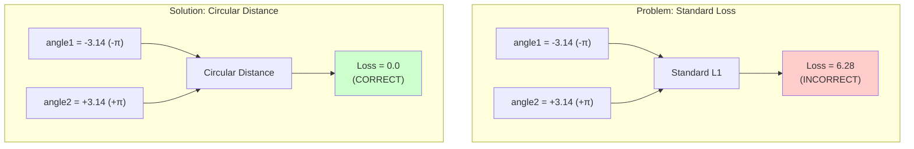
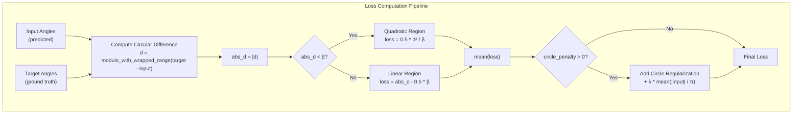
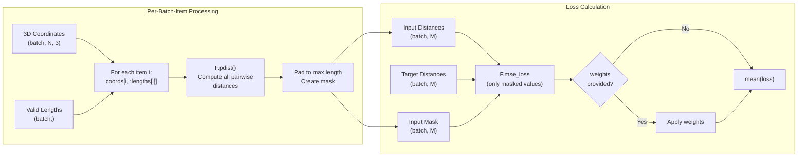
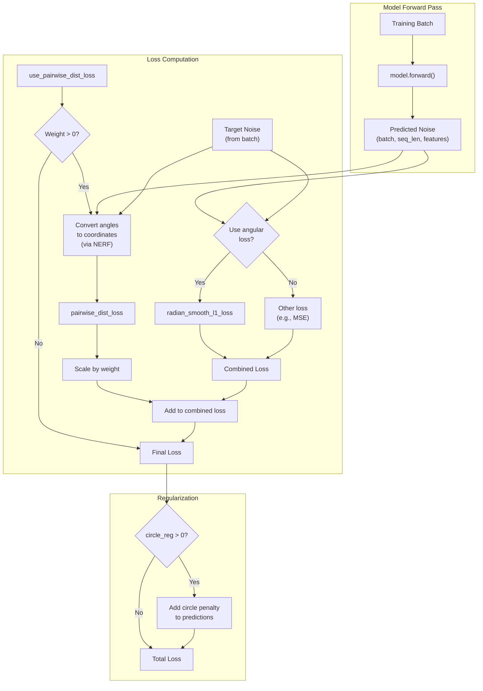
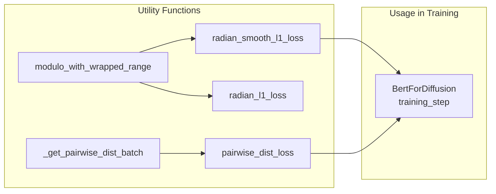

<!-- source: DeepWiki mcp.deepwiki.com · repo microsoft/foldingdiff · page 6.2 Loss Functions · fetched 2026-10-26 -->

# Loss Functions

<details>
<summary>Relevant source files</summary>

The following files were used as context for generating this wiki page:

- [.gitignore](.gitignore)
- [bin/train.py](bin/train.py)
- [foldingdiff/__init__.py](foldingdiff/__init__.py)
- [foldingdiff/beta_schedules.py](foldingdiff/beta_schedules.py)
- [foldingdiff/custom_metrics.py](foldingdiff/custom_metrics.py)
- [foldingdiff/losses.py](foldingdiff/losses.py)
- [foldingdiff/pymol_vis.py](foldingdiff/pymol_vis.py)
- [tests/mini_model_for_testing/results/training_args.json](tests/mini_model_for_testing/results/training_args.json)
- [tests/test_data.py](tests/test_data.py)
- [tests/test_losses.py](tests/test_losses.py)

</details>


## Purpose and Scope

This page documents the loss functions used in FoldingDiff for training diffusion models on protein structures. These loss functions are designed to handle the unique properties of protein backbone data, particularly the circular nature of dihedral angles and the rotation/translation invariance requirements for 3D coordinates.

For information about how these losses are integrated into the training pipeline, see [Training Pipeline (train.py)](#6.1). For details on the model architecture that uses these losses, see [BertForDiffusion Model](#5.1).

---

## Overview of Loss Functions

FoldingDiff implements three primary loss functions, each designed for specific aspects of protein structure:

| Loss Function | Purpose | Key Property | Primary Use Case |
|---------------|---------|--------------|------------------|
| `radian_l1_loss` | L1 loss for angles | Circular distance | Simple angle prediction |
| `radian_smooth_l1_loss` | Robust angle loss | Circular distance + Huber-style smoothing | Main training loss for angles |
| `pairwise_dist_loss` | 3D structure preservation | Rotation/translation invariant | Auxiliary geometric constraint |

**Sources:** [foldingdiff/losses.py:1-166]()

---

## Angular Loss Functions

### Circular Distance Computation

Angular data (dihedral angles φ, ψ, ω) are periodic with range [-π, π]. Standard L1 or L2 losses fail to account for this periodicity, incorrectly computing large differences between angles like -π and π (which are actually identical).



**Diagram: Circular Distance vs Standard Distance for Angular Data**

**Sources:** [foldingdiff/losses.py:12-26]()

### radian_l1_loss

The basic angular L1 loss computes the absolute circular distance between predicted and target angles:

```python
def radian_l1_loss(input: torch.Tensor, target: torch.Tensor) -> torch.Tensor
```

**Implementation Details:**
- Normalizes both input and target to [0, 2π] range
- Computes circular difference: `d = (target - input + π) % (2π) - π`
- Returns mean absolute value of circular differences

This function is primarily used for debugging and simple test cases. For production training, `radian_smooth_l1_loss` is preferred.

**Sources:** [foldingdiff/losses.py:12-26]()

### radian_smooth_l1_loss

The smooth L1 loss (also known as Huber loss) provides robust optimization by using quadratic loss for small errors and linear loss for large errors:

```python
def radian_smooth_l1_loss(
    input: torch.Tensor,
    target: torch.Tensor,
    beta: float = 1.0,
    circle_penalty: float = 0.0,
) -> torch.Tensor
```

**Mathematical Formulation:**

For circular difference d = circular_distance(target, input):

```
Loss = {
    0.5 * d² / β           if |d| < β
    |d| - 0.5 * β          if |d| ≥ β
}
```

Where:
- β controls the transition point between quadratic and linear regions
- Smaller β makes the loss more robust to outliers
- Common values: β = 0.1π for angle data

**Circle Regularization:**

An optional `circle_penalty` term discourages predictions that "wind around" the circle multiple times:

```
Total Loss = Smooth L1 Loss + λ * mean(|input| / π)
```

Where λ is the `circle_penalty` weight.

**Sources:** [foldingdiff/losses.py:29-63]()



**Diagram: Radian Smooth L1 Loss Computation Flow**

**Sources:** [foldingdiff/losses.py:29-63]()

### Loss Function Selection in Training

The loss function is selected via the `loss` parameter in [bin/train.py:314]():

```python
loss: modelling.LOSS_KEYS = "smooth_l1"
```

For debugging modes (single angle or single timestep), a specialized variant is used [bin/train.py:415-418]():

```python
if single_angle_debug > 0 or single_timestep_debug or syn_noiser:
    loss_fn = functools.partial(losses.radian_smooth_l1_loss, beta=0.1 * np.pi)
```

**Sources:** [bin/train.py:314-320](), [bin/train.py:415-418]()

---

## Coordinate-Based Loss Functions

### pairwise_dist_loss

For coordinate data or as an auxiliary loss on angles (via NERF reconstruction), the pairwise distance loss ensures geometric consistency:

```python
def pairwise_dist_loss(
    input: torch.Tensor,        # Shape: (batch, N, 3)
    target: torch.Tensor,       # Shape: (batch, N, 3)
    lengths: Optional[torch.Tensor] = None,  # Shape: (batch,)
    weights: Optional[torch.Tensor] = None,
) -> torch.Tensor
```

**Key Properties:**

1. **Rotation Invariant:** Loss depends only on pairwise distances, not absolute positions
2. **Translation Invariant:** Shifting all coordinates by a constant doesn't change loss
3. **Padding Aware:** Uses `lengths` tensor to mask padded positions
4. **Weighted:** Supports optional per-sample or per-distance weights

**Sources:** [foldingdiff/losses.py:101-149]()

### Pairwise Distance Computation



**Diagram: Pairwise Distance Loss Computation Pipeline**

**Sources:** [foldingdiff/losses.py:66-149]()

### Usage as Auxiliary Loss

The pairwise distance loss can be combined with the primary angular loss to provide additional geometric constraints. This is configured via `use_pdist_loss` in training:

```python
use_pdist_loss: Union[float, Tuple[float, float]] = 0.0
```

**Configuration Options:**

| Value | Meaning |
|-------|---------|
| `0.0` | Disabled (default) |
| Single float (e.g., `0.1`) | Constant weight across all timesteps |
| Tuple `(start, end)` | Weight ramps from `start` to `end` across timesteps |

When enabled, the model converts predicted angles to 3D coordinates (via NERF) and computes pairwise distance loss against target coordinates.

**Sources:** [bin/train.py:315-317](), [bin/train.py:446-448]()

---

## Loss Function Integration in Model

The loss functions are integrated into the `BertForDiffusion` model class, which handles loss computation during training.



**Diagram: Loss Computation in BertForDiffusion Model**

**Sources:** [bin/train.py:438-458](), [foldingdiff/losses.py:1-166]()

---

## Testing and Validation

The loss functions are extensively tested to ensure correctness:

### Test Coverage for radian_smooth_l1_loss

| Test | Purpose | File Reference |
|------|---------|----------------|
| `test_easy` | Basic wrapping functionality | [tests/test_losses.py:10-15]() |
| `test_rounding` | Circular distance around 0 | [tests/test_losses.py:17-25]() |
| `test_symmetric` | Loss(x,y) = Loss(y,x) | [tests/test_losses.py:125-135]() |
| `test_zeros` | Multiple of 2π gives zero loss | [tests/test_losses.py:62-71]() |
| `test_loop_*` | Shift invariance | [tests/test_losses.py:73-123]() |

### Test Coverage for pairwise_dist_loss

| Test | Purpose | File Reference |
|------|---------|----------------|
| `test_shift_invariance` | Translation invariance | [tests/test_losses.py:158-162]() |
| `test_length_masking_eq` | Masking correctness | [tests/test_losses.py:164-171]() |
| `test_zero_on_identical` | Zero loss for identical inputs | [tests/test_losses.py:195-198]() |
| `test_symmetric` | Loss(x,y) = Loss(y,x) | [tests/test_losses.py:200-204]() |

**Sources:** [tests/test_losses.py:1-209]()

---

## Configuration Summary

Loss function configuration is specified in training configuration JSON files and passed to the training script:

```json
{
    "loss": "smooth_l1",
    "use_pdist_loss": 0.0,
    "circle_reg": 0.0,
    "l1_norm": 0.0,
    "l2_norm": 0.0
}
```

**Parameter Descriptions:**

| Parameter | Type | Default | Description |
|-----------|------|---------|-------------|
| `loss` | string | `"smooth_l1"` | Primary loss function key |
| `use_pdist_loss` | float or tuple | `0.0` | Weight for pairwise distance loss |
| `circle_reg` | float | `0.0` | Circle regularization penalty |
| `l1_norm` | float | `0.0` | L1 weight regularization |
| `l2_norm` | float | `0.0` | L2 weight regularization (AdamW) |

**Sources:** [bin/train.py:314-320](), [tests/mini_model_for_testing/results/training_args.json:21-24]()

---

## Implementation Details

### Helper Functions

The loss functions rely on several utility functions:

**`modulo_with_wrapped_range`** (from `foldingdiff.utils`):
- Wraps angular differences to [-π, π] range
- Ensures correct circular distance computation
- Used in [foldingdiff/losses.py:50]()

**`_get_pairwise_dist_batch`**:
- Computes pairwise distances for batched 3D coordinates
- Returns distances and mask tensors
- Handles variable sequence lengths via padding
- Defined in [foldingdiff/losses.py:66-98]()



**Diagram: Helper Function Dependencies**

**Sources:** [foldingdiff/losses.py:9-10](), [foldingdiff/losses.py:66-98]()

---

## Example Loss Computation

Here's a concrete example of how loss is computed during training:

**Scenario:** Training at timestep t=500 with batch_size=32, seq_len=128, features=6 (angles only)

1. **Model Forward Pass:**
   - Input: Corrupted angles of shape (32, 128, 6)
   - Output: Predicted noise of shape (32, 128, 6)

2. **Primary Loss (radian_smooth_l1_loss):**
   ```python
   loss = radian_smooth_l1_loss(
       input=predicted_noise,      # (32, 128, 6)
       target=known_noise,         # (32, 128, 6)
       beta=0.1 * np.pi,          # ~0.314 radians
       circle_penalty=0.0          # No regularization
   )
   # Output: scalar tensor
   ```

3. **Optional Auxiliary Loss (if use_pdist_loss > 0):**
   ```python
   # Convert angles to coordinates using NERF
   pred_coords = angles_to_coords(predicted_angles)  # (32, 128, 3)
   target_coords = angles_to_coords(target_angles)   # (32, 128, 3)
   
   pdist_loss = pairwise_dist_loss(
       input=pred_coords,
       target=target_coords,
       lengths=batch['lengths']    # (32,)
   )
   
   # Combine losses
   total_loss = loss + use_pdist_loss * pdist_loss
   ```

**Sources:** [foldingdiff/losses.py:29-63](), [foldingdiff/losses.py:101-149]()

---

