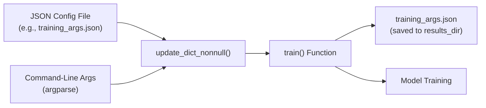
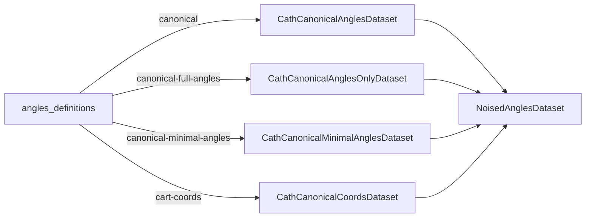
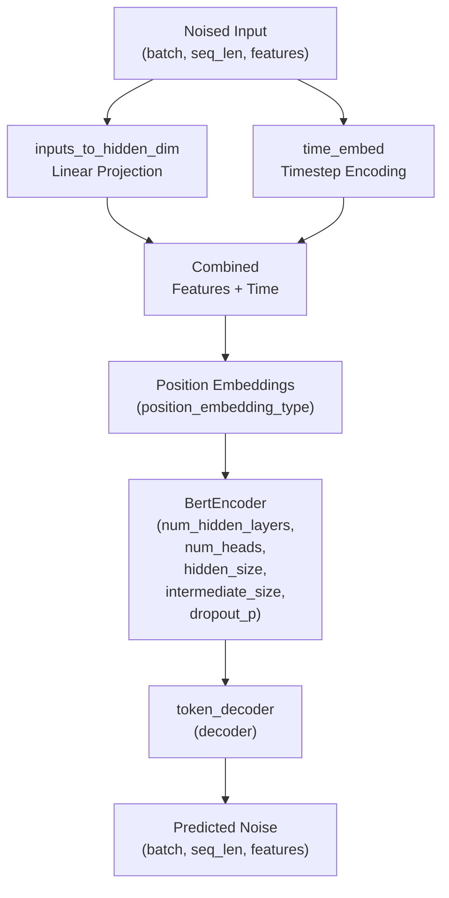
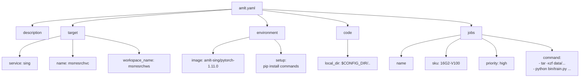
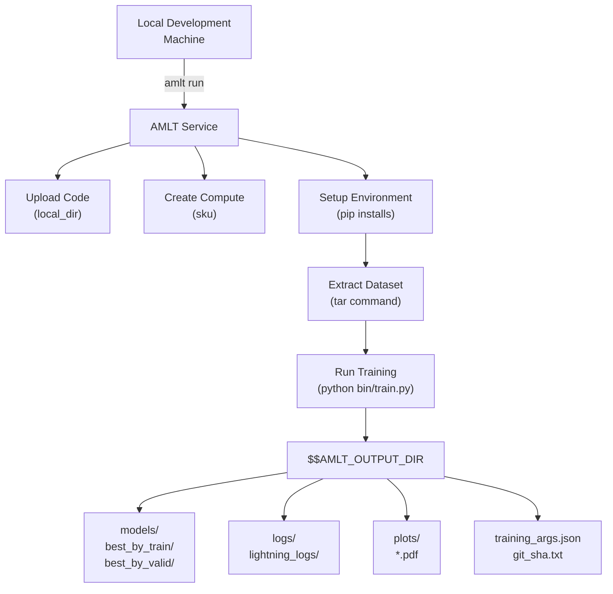
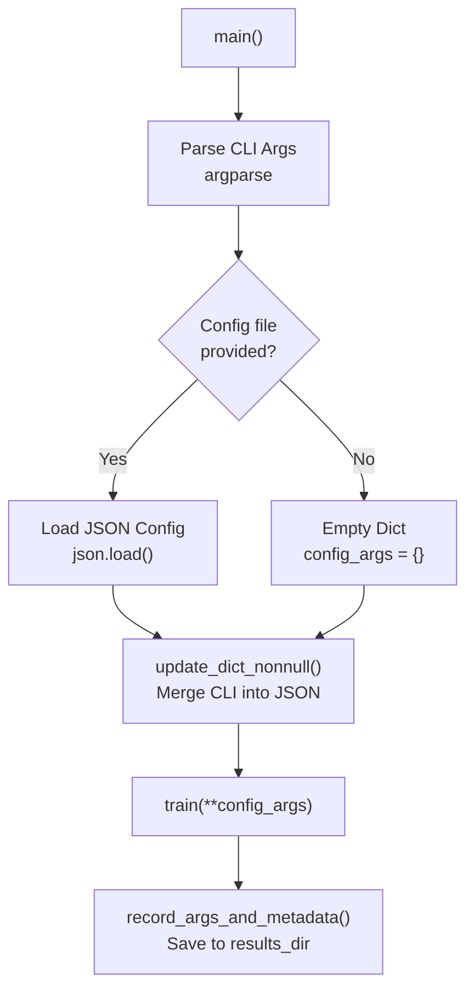
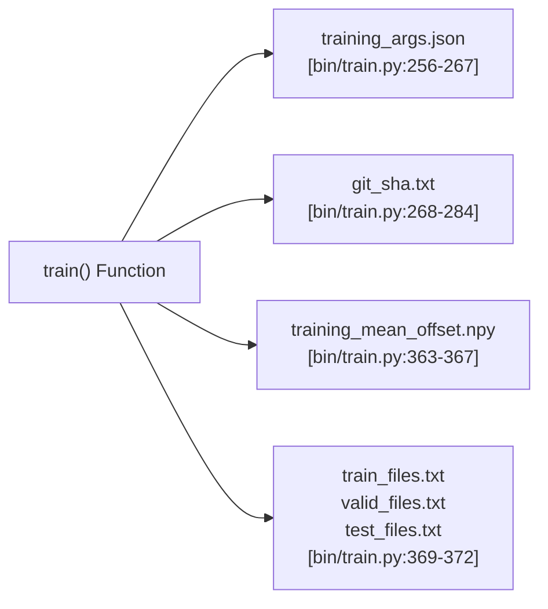

<!-- source: DeepWiki mcp.deepwiki.com · repo microsoft/foldingdiff · page 6.3 Training Configuration · fetched 2026-10-26 -->

# Training Configuration

<details>
<summary>Relevant source files</summary>

The following files were used as context for generating this wiki page:

- [bin/train.py](bin/train.py)
- [environment.yml](environment.yml)
- [foldingdiff/utils.py](foldingdiff/utils.py)
- [scripts/amlt.yaml](scripts/amlt.yaml)
- [tests/mini_model_for_testing/results/training_args.json](tests/mini_model_for_testing/results/training_args.json)

</details>


## Purpose and Scope

This document explains the configuration system for training FoldingDiff models, including the JSON configuration file format, hyperparameter reference, AMLT job orchestration, and configuration best practices. For details about the training pipeline execution and PyTorch Lightning integration, see [Training Pipeline](#6.1). For information about loss function options, see [Loss Functions](#6.2).

## Configuration System Overview

FoldingDiff uses a flexible configuration system that combines JSON configuration files with command-line arguments. The system is designed to support both local training and distributed training via Azure Machine Learning (AMLT).

**Configuration Flow**



The configuration loading process follows this sequence:

1. Parse command-line arguments using `argparse` [bin/train.py:510-546]()
2. Load JSON configuration file if provided [bin/train.py:554-558]()
3. Merge CLI arguments into JSON config using `update_dict_nonnull()` [bin/train.py:559-569]()
4. Pass merged configuration to `train()` function [bin/train.py:570]()
5. Record final configuration to `training_args.json` in results directory [bin/train.py:256-267]()

Sources: [bin/train.py:549-571](), [foldingdiff/utils.py:124-137]()

## Configuration File Format

### JSON Structure

Configuration files are JSON dictionaries where keys correspond to parameter names in the `train()` function. All parameters are optional; unspecified parameters use default values.

**Example Configuration File**

```json
{
    "angles_definitions": "canonical-full-angles",
    "max_seq_len": 128,
    "min_seq_len": 40,
    "trim_strategy": "discard",
    "timesteps": 250,
    "variance_schedule": "cosine",
    "variance_scale": 1.0,
    "time_encoding": "gaussian_fourier",
    "num_hidden_layers": 6,
    "hidden_size": 192,
    "intermediate_size": 384,
    "num_heads": 6,
    "position_embedding_type": "relative_key",
    "dropout_p": 0.1,
    "decoder": "mlp",
    "batch_size": 128,
    "lr": 5e-05,
    "loss": "smooth_l1",
    "max_epochs": 20,
    "lr_scheduler": "LinearWarmup"
}
```

Sources: [tests/mini_model_for_testing/results/training_args.json:1-40]()

### Command-Line Interface

The training script accepts several command-line arguments that override or supplement the JSON configuration:

| Argument | Type | Description |
|----------|------|-------------|
| `config` | positional | Path to JSON configuration file |
| `-o, --outdir` | str | Output directory for results (default: `./results`) |
| `--toy` | int | Use toy dataset with n samples for testing |
| `--debug_single_time` | flag | Enable single timestep debugging |
| `--cpu` | flag | Force CPU-only training |
| `--ngpu` | int | Number of GPUs to use (-1 for all available) |
| `--dryrun` | flag | Fast dry run without full plotting |

**Example Usage**

```bash
# Basic usage with config file
python bin/train.py config_jsons/my_config.json

# Override output directory
python bin/train.py config.json -o /path/to/output

# Toy dataset for testing
python bin/train.py config.json --toy 100

# CPU-only training
python bin/train.py config.json --cpu
```

Sources: [bin/train.py:510-546](), [bin/train.py:1-5]()

## Hyperparameter Reference

The `train()` function accepts parameters organized into several categories. All parameters have default values defined in the function signature.

### Parameter Categories Diagram

```mermaid
graph TD
    TRAIN["train() Function"]
    
    OUTPUT["Output Controls"]
    DATA["Data Loading & Noising"]
    MODEL["Model Architecture"]
    TRAINING["Training Strategy"]
    DEBUG["Debugging & Misc"]
    
    TRAIN --> OUTPUT
    TRAIN --> DATA
    TRAIN --> MODEL
    TRAIN --> TRAINING
    TRAIN --> DEBUG
    
    OUTPUT --> OD1["results_dir"]
    
    DATA --> DD1["dataset_key"]
    DATA --> DD2["angles_definitions"]
    DATA --> DD3["max_seq_len"]
    DATA --> DD4["min_seq_len"]
    DATA --> DD5["trim_strategy"]
    DATA --> DD6["timesteps"]
    DATA --> DD7["variance_schedule"]
    DATA --> DD8["variance_scale"]
    
    MODEL --> MD1["time_encoding"]
    MODEL --> MD2["num_hidden_layers"]
    MODEL --> MD3["hidden_size"]
    MODEL --> MD4["intermediate_size"]
    MODEL --> MD5["num_heads"]
    MODEL --> MD6["position_embedding_type"]
    MODEL --> MD7["dropout_p"]
    MODEL --> MD8["decoder"]
    
    TRAINING --> TD1["gradient_clip"]
    TRAINING --> TD2["batch_size"]
    TRAINING --> TD3["lr"]
    TRAINING --> TD4["loss"]
    TRAINING --> TD5["use_pdist_loss"]
    TRAINING --> TD6["l2_norm / l1_norm"]
    TRAINING --> TD7["circle_reg"]
    TRAINING --> TD8["max_epochs"]
    TRAINING --> TD9["early_stop_patience"]
    TRAINING --> TD10["lr_scheduler"]
    TRAINING --> TD11["use_swa"]
    
    DEBUG --> DBG1["multithread"]
    DEBUG --> DBG2["subset"]
    DEBUG --> DBG3["syn_noiser"]
    DEBUG --> DBG4["single_angle_debug"]
    DEBUG --> DBG5["cpu_only"]
    DEBUG --> DBG6["write_valid_preds"]
```



Sources: [bin/train.py:287-337]()

### Output Control Parameters

| Parameter | Type | Default | Description |
|-----------|------|---------|-------------|
| `results_dir` | str | `"./results"` | Directory for all training outputs including models, logs, and plots |

Sources: [bin/train.py:289]()

### Data Loading and Noising Parameters

| Parameter | Type | Default | Description |
|-----------|------|---------|-------------|
| `dataset_key` | str | `"cath"` | Dataset identifier: `"cath"`, `"alphafold"`, or path to PDB directory |
| `angles_definitions` | ANGLES_DEFINITIONS | `"canonical-full-angles"` | Feature representation: `"canonical"`, `"canonical-full-angles"`, `"canonical-minimal-angles"`, or `"cart-coords"` |
| `max_seq_len` | int | `512` | Maximum sequence length; sequences are padded or trimmed to this length |
| `min_seq_len` | int | `0` | Minimum sequence length; shorter sequences are filtered out (0 disables filtering) |
| `trim_strategy` | TRIM_STRATEGIES | `"leftalign"` | Strategy for handling sequences longer than `max_seq_len`: `"leftalign"`, `"randomcrop"`, or `"discard"` |
| `timesteps` | int | `250` | Number of diffusion timesteps (T in the diffusion process) |
| `variance_schedule` | SCHEDULES | `"linear"` | Beta schedule for noise variance: `"linear"`, `"cosine"`, `"sqrt"` |
| `variance_scale` | float | `1.0` | Scaling factor for angular variance (typically set to π for angular features) |

**Dataset Classes by `angles_definitions`**



Sources: [bin/train.py:291-298](), [bin/train.py:136-141]()

### Model Architecture Parameters

| Parameter | Type | Default | Description |
|-----------|------|---------|-------------|
| `time_encoding` | TIME_ENCODING | `"gaussian_fourier"` | Timestep encoding method: `"sinusoidal"`, `"gaussian_fourier"`, or `"positional"` |
| `num_hidden_layers` | int | `12` | Number of transformer layers in the BERT encoder |
| `hidden_size` | int | `384` | Dimensionality of hidden representations (default BERT: 768) |
| `intermediate_size` | int | `768` | Dimensionality of feedforward layer (default BERT: 3072) |
| `num_heads` | int | `12` | Number of attention heads in each transformer layer |
| `position_embedding_type` | str | `"absolute"` | Position encoding: `"absolute"`, `"relative_key"`, or `"relative_key_query"` |
| `dropout_p` | float | `0.1` | Dropout probability for attention and hidden layers |
| `decoder` | DECODER_HEAD | `"mlp"` | Output decoder architecture type |

**Model Architecture Flow**



Sources: [bin/train.py:300-309](), [bin/train.py:425-435]()

### Training Strategy Parameters

| Parameter | Type | Default | Description |
|-----------|------|---------|-------------|
| `gradient_clip` | float | `1.0` | Maximum gradient norm for gradient clipping |
| `batch_size` | int | `64` | Total batch size across all GPUs (automatically divided by GPU count) |
| `lr` | float | `5e-5` | Learning rate for Adam optimizer |
| `loss` | LOSS_KEYS | `"smooth_l1"` | Primary loss function identifier |
| `use_pdist_loss` | float/tuple | `0.0` | Weight for pairwise distance loss (0.0 disables); can be tuple `(weight, ramp_timesteps)` |
| `l2_norm` | float | `0.0` | L2 regularization weight (AdamW weight decay) |
| `l1_norm` | float | `0.0` | L1 regularization weight |
| `circle_reg` | float | `0.0` | Circular regularization weight for angular features |
| `min_epochs` | int | `None` | Minimum number of training epochs |
| `max_epochs` | int | `10000` | Maximum number of training epochs |
| `early_stop_patience` | int | `0` | Early stopping patience in epochs (0 disables early stopping) |
| `lr_scheduler` | LR_SCHEDULE | `None` | Learning rate scheduler: `None`, `"LinearWarmup"`, `"CosineAnnealingLR"`, etc. |
| `use_swa` | bool | `False` | Enable Stochastic Weight Averaging for improved generalization |

**Batch Size Calculation**

The effective batch size per GPU is automatically calculated:

```
effective_batch_size = batch_size / num_gpus
```

This ensures consistent total batch size across different GPU configurations [bin/train.py:374-382]().

Sources: [bin/train.py:311-326]()

### Debugging and Miscellaneous Parameters

| Parameter | Type | Default | Description |
|-----------|------|---------|-------------|
| `multithread` | bool | `True` | Enable multithreaded data loading |
| `subset` | int/bool | `False` | Use subset of n training examples for quick testing |
| `exhaustive_validation_t` | bool | `False` | Exhaustively enumerate all timesteps during validation |
| `syn_noiser` | str | `""` | Use synthetic noiser for debugging (e.g., `"halfhalf"`) |
| `single_angle_debug` | int | `-1` | Debug single angle only (1-3 for ω/θ/φ; -1 disables) |
| `single_timestep_debug` | bool | `False` | Debug single timestep only |
| `cpu_only` | bool | `False` | Force CPU-only training |
| `ngpu` | int | `-1` | Number of GPUs to use (-1 for all available) |
| `write_valid_preds` | bool | `False` | Write validation predictions to disk each epoch |
| `dryrun` | bool | `False` | Fast dry run without full plotting |

Sources: [bin/train.py:327-337]()

## AMLT Job Orchestration

FoldingDiff supports distributed training on Azure Machine Learning via AMLT (Azure Machine Learning Tools). AMLT jobs are defined in YAML configuration files.

### AMLT Configuration Structure



Sources: [scripts/amlt.yaml:1-40]()

### AMLT YAML Sections

**Target Configuration**

Specifies the Azure ML workspace and compute cluster:

```yaml
target:
  service: sing           # Target service platform
  name: msrresrchvc       # Cluster name
  workspace_name: msrresrchws  # AML workspace
```

**Environment Setup**

Defines the Docker image and package installations:

```yaml
environment:
  image: amlt-sing/pytorch-1.11.0
  setup:
    - pip install seaborn
    - pip install mpl-scatter-density
    - pip install astropy
    - pip install transformers==4.11.3
    - pip install pytorch-lightning==1.6.4
    - pip install sequence-models
    - pip install biotite==0.34
```

Core packages (numpy, pandas, tqdm, matplotlib, pytorch) are pre-installed in the base image [scripts/amlt.yaml:8-28]().

**Code Directory**

Specifies the local code directory to upload:

```yaml
code:
  local_dir: $CONFIG_DIR/..  # Relative to config file directory
```

**Job Definition**

Defines individual training jobs with compute resources and commands:

```yaml
jobs:
- name: cath_canonical_angles_linear_warmup_zero_centered_500_steps_short_seq
  sku: 16G2-V100        # 16GB memory with 2 V100 GPUs
  priority: high
  sla_tier: premium
  command:
  - tar -xzf data/cath/cath-dataset-nonredundant-S40.pdb.tgz -C data/cath
  - python bin/train.py config_jsons/my_config.json -o $$AMLT_OUTPUT_DIR/results
```

**Available SKUs** (examples):
- `16G2-V100`: 16GB RAM, 2 V100 GPUs
- `16G4-V100`: 16GB RAM, 4 V100 GPUs
- Use `amlt target list singularity -v` for complete list

Sources: [scripts/amlt.yaml:1-40]()

### AMLT Execution Flow



Sources: [scripts/amlt.yaml:34-40]()

## Configuration Loading Process

The configuration system uses a hierarchical merge strategy where command-line arguments override JSON configuration values.

**Configuration Merge Logic**



**Merge Behavior**

The `update_dict_nonnull()` function merges configurations with these rules:

1. If key exists in JSON and CLI provides non-null value → CLI value used
2. If key only in CLI → CLI value used
3. If key only in JSON → JSON value used
4. Null CLI values do not override JSON values

Example:

```python
json_config = {"lr": 5e-5, "batch_size": 64}
cli_args = {"batch_size": 128, "ngpu": 4}
# Result: {"lr": 5e-5, "batch_size": 128, "ngpu": 4}
```

Sources: [bin/train.py:549-571](), [foldingdiff/utils.py:124-137]()

## Configuration Metadata and Reproducibility

### Recorded Metadata

The training script automatically records configuration and environment metadata to the results directory:

| File | Content | Purpose |
|------|---------|---------|
| `training_args.json` | Final merged configuration | Reproducibility and reference |
| `git_sha.txt` | Git commit SHA | Version tracking |
| `training_mean_offset.npy` | Dataset mean values | Required for sampling |
| `{train,valid,test}_files.txt` | List of PDB files used | Dataset provenance |

**Metadata Recording Flow**



This metadata enables exact reproduction of training runs and ensures generated samples use the correct normalization [bin/train.py:256-284](), [bin/train.py:363-372]().

## Best Practices

### General Configuration

1. **Always use configuration files** rather than modifying code directly
2. **Version control your configs** to track experimental changes
3. **Use descriptive names** for results directories that indicate key hyperparameters
4. **Record git SHA** to link results to specific code versions (automatic)

### Dataset Configuration

1. **Start with `max_seq_len=128`** for faster iteration, then increase to 512 for final training
2. **Set `min_seq_len`** to filter very short proteins that may not be representative
3. **Use `trim_strategy="discard"`** for validation/test sets to avoid artificial truncation
4. **Set `variance_scale=π`** (3.14159) for angular features
5. **Use `timesteps=1000`** for production models (higher quality), 250 for experimentation

### Model Architecture

1. **Default BERT-base dimensions** (`hidden_size=768`, `intermediate_size=3072`, `num_hidden_layers=12`) work well
2. **Reduce model size** for experimentation: `hidden_size=384`, `intermediate_size=768`, `num_hidden_layers=6`
3. **Use `position_embedding_type="relative_key"`** for better length generalization
4. **Keep `num_heads` divisible by `hidden_size`** for efficient attention computation

### Training Strategy

1. **Start with `lr=5e-5`** (BERT default) and adjust based on loss curves
2. **Use `lr_scheduler="LinearWarmup"`** for stable training
3. **Enable `early_stop_patience=10`** to prevent overfitting
4. **Set `batch_size` as large as GPU memory allows** (distributed training automatically adjusts)
5. **Use `gradient_clip=1.0`** to prevent gradient explosions
6. **Enable `use_swa=True`** for final production models to improve generalization

### Loss Configuration

1. **Use `loss="smooth_l1"`** as baseline (robust to outliers)
2. **Add `use_pdist_loss=0.1`** to improve structural coherence
3. **Avoid combining multiple regularization terms** (`l1_norm`, `l2_norm`, `circle_reg`) without careful tuning

### Debugging and Development

1. **Use `--toy 100`** to test configuration with small dataset
2. **Enable `--dryrun`** to skip plotting for faster iteration
3. **Use `subset=1000`** in JSON for development without full dataset
4. **Set `write_valid_preds=True`** only when analyzing validation behavior (large output)
5. **Monitor `logs/lightning_logs/version_0/metrics.csv`** for training progress

### AMLT-Specific

1. **Start with `sku: 16G2-V100`** for single-GPU debugging
2. **Scale to `16G4-V100`** or higher for production training
3. **Set `priority: high`** and `sla_tier: premium`** for important jobs
4. **Use `$$AMLT_OUTPUT_DIR`** variable for output paths (automatic Azure storage)
5. **Extract datasets in command section** before training starts

### Example Production Configuration

```json
{
    "results_dir": "results/cath_1000steps_production",
    "dataset_key": "cath",
    "angles_definitions": "canonical-full-angles",
    "max_seq_len": 512,
    "min_seq_len": 40,
    "trim_strategy": "leftalign",
    "timesteps": 1000,
    "variance_schedule": "cosine",
    "variance_scale": 3.14159,
    "time_encoding": "gaussian_fourier",
    "num_hidden_layers": 12,
    "hidden_size": 768,
    "intermediate_size": 3072,
    "num_heads": 12,
    "position_embedding_type": "relative_key",
    "dropout_p": 0.1,
    "decoder": "mlp",
    "batch_size": 128,
    "lr": 5e-05,
    "loss": "smooth_l1",
    "use_pdist_loss": 0.1,
    "l2_norm": 0.0,
    "max_epochs": 10000,
    "early_stop_patience": 10,
    "lr_scheduler": "LinearWarmup",
    "use_swa": true,
    "gradient_clip": 1.0
}
```

Sources: [bin/train.py:287-509](), [tests/mini_model_for_testing/results/training_args.json:1-40](), [scripts/amlt.yaml:1-40]()

---

