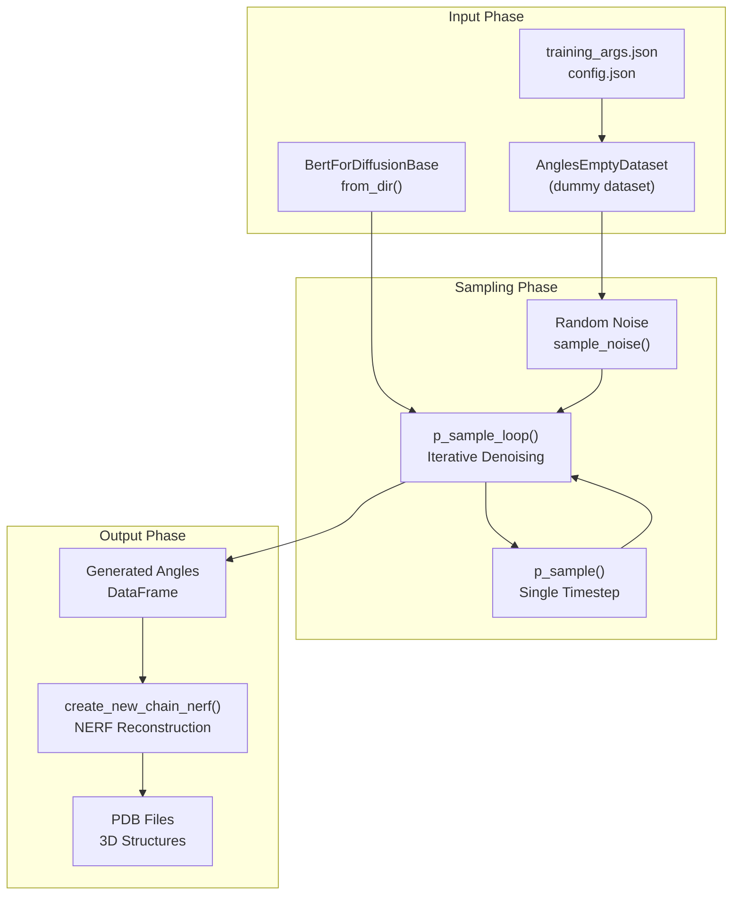
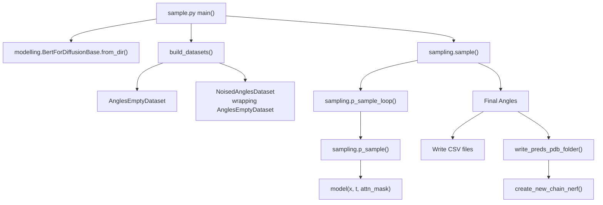
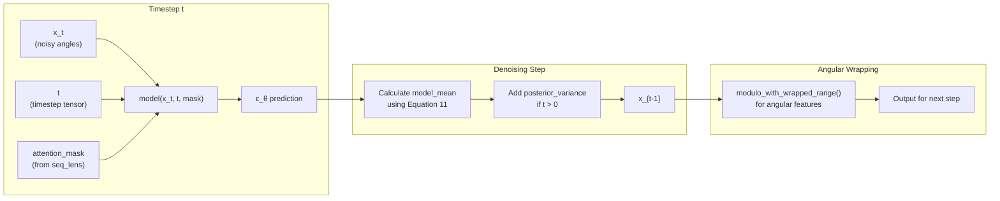
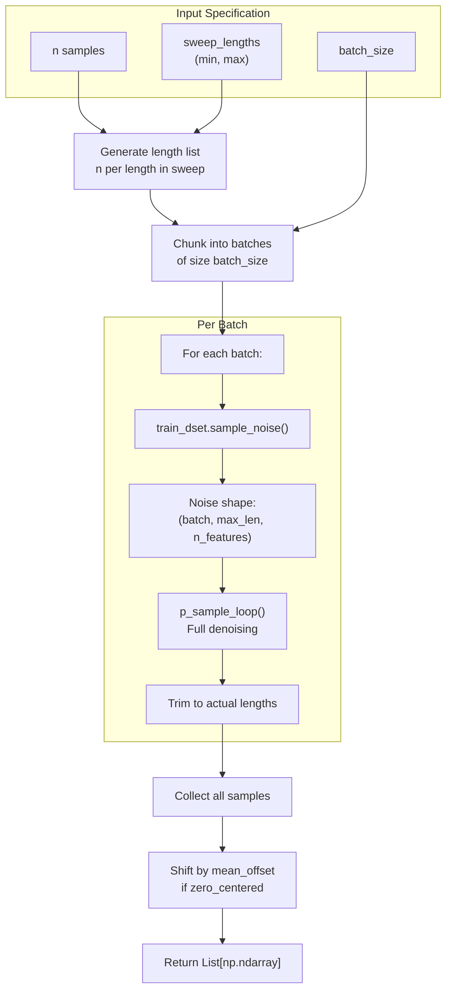
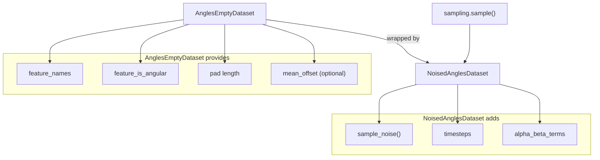
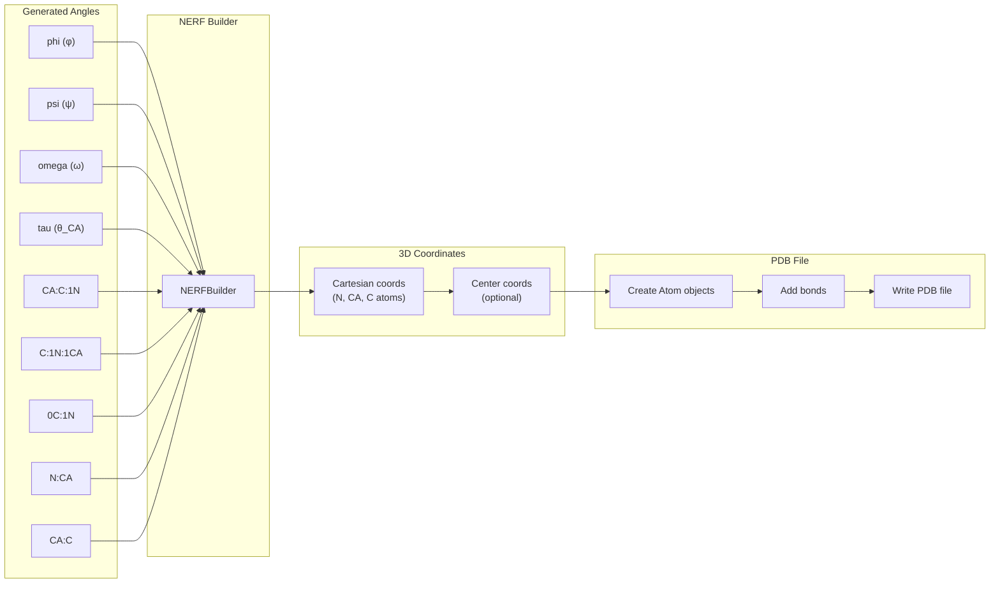
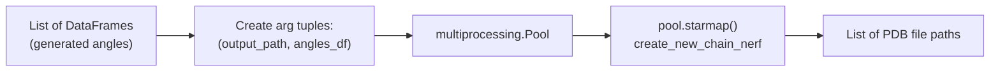

<!-- source: DeepWiki mcp.deepwiki.com · repo microsoft/foldingdiff · page 7 Generation and Sampling · fetched 2026-10-26 -->

# Generation and Sampling

<details>
<summary>Relevant source files</summary>

The following files were used as context for generating this wiki page:

- [bin/sample.py](bin/sample.py)
- [foldingdiff/angles_and_coords.py](foldingdiff/angles_and_coords.py)
- [foldingdiff/datasets.py](foldingdiff/datasets.py)
- [foldingdiff/sampling.py](foldingdiff/sampling.py)
- [tests/test_angles_and_coords.py](tests/test_angles_and_coords.py)

</details>


This document describes the process of generating novel protein backbone structures from trained diffusion models. It covers the reverse diffusion process that transforms random noise into valid protein angles, and the subsequent conversion of these angles into 3D PDB structures.

**Scope**: This page provides an architectural overview of the generation system. For implementation details of the sampling pipeline script, see [7.1](#7.1). For the mathematical details of the reverse diffusion algorithm, see [7.2](#7.2). For output formats and visualization, see [7.3](#7.3). For information about training models, see [6](#6).

## Overview of the Generation Process

The generation system operates in reverse compared to training. While training learns to predict noise added to real structures, generation starts from pure noise and iteratively removes it to produce valid protein backbone angles. These angles are then converted to 3D Cartesian coordinates and written as PDB files.

### High-Level Architecture



Sources: [bin/sample.py:1-475](), [foldingdiff/sampling.py:1-365]()

## Key Components

The generation system consists of three primary components that work together to produce protein structures:

| Component | File Location | Purpose |
|-----------|--------------|---------|
| `sample.py` | [bin/sample.py:1-475]() | Main sampling script with CLI interface |
| `sampling.sample()` | [foldingdiff/sampling.py:135-224]() | Core sampling function that orchestrates generation |
| `sampling.p_sample_loop()` | [foldingdiff/sampling.py:78-133]() | Iterative denoising loop over timesteps |
| `sampling.p_sample()` | [foldingdiff/sampling.py:27-76]() | Single denoising step at timestep t |
| `AnglesEmptyDataset` | [foldingdiff/datasets.py:569-624]() | Placeholder dataset for sampling |
| `create_new_chain_nerf()` | [foldingdiff/angles_and_coords.py:112-184]() | Converts angles to 3D coordinates |

### Component Relationships



Sources: [bin/sample.py:49-103](), [bin/sample.py:290-474](), [foldingdiff/sampling.py:135-224]()

## The Reverse Diffusion Process

Generation uses a reverse diffusion process that iteratively denoises random input. The process starts at timestep `T` with pure noise and proceeds to timestep `0` to produce clean protein angles.

### Mathematical Framework

At each timestep `t`, the model predicts the noise component in the current sample `x_t`. This prediction is used to compute a less noisy sample `x_{t-1}`:

```
x_{t-1} = (1/√α_t) * (x_t - (β_t/√(1-ᾱ_t)) * ε_θ(x_t, t)) + √β̃_t * z
```

where:
- `ε_θ(x_t, t)` is the model's noise prediction
- `α_t, β_t` are variance schedule parameters
- `z ~ N(0, I)` is fresh noise (zero at t=0)

### Implementation Flow



Sources: [foldingdiff/sampling.py:27-76](), [foldingdiff/sampling.py:78-133]()

The key implementation is in `p_sample()` which handles a single denoising step:

**Key Features**:
- **Attention Masking**: Only valid sequence positions are processed [foldingdiff/sampling.py:56-58]()
- **Noise Scaling**: Uses pre-computed `alpha_beta_terms` from beta schedules [foldingdiff/sampling.py:42-53]()
- **Conditional on Length**: Each sample can have different sequence length [foldingdiff/sampling.py:32]()
- **Angular Wrapping**: Angular features are wrapped to `[-π, π]` after each step [foldingdiff/sampling.py:119-130]()

Sources: [foldingdiff/sampling.py:27-76]()

## Sampling Workflow

The complete sampling workflow orchestrates multiple denoising steps across batches of different sequence lengths.

### Batch Processing



Sources: [foldingdiff/sampling.py:135-224]()

### Key Parameters

The `sample()` function accepts several important parameters:

| Parameter | Type | Purpose |
|-----------|------|---------|
| `model` | `nn.Module` | Trained diffusion model |
| `train_dset` | `NoisedAnglesDataset` | Provides noise sampling and schedule info |
| `n` | `int` | Number of samples per length |
| `sweep_lengths` | `Tuple[int, int]` | Range of sequence lengths to generate |
| `batch_size` | `int` | Batch size for GPU efficiency |
| `feature_key` | `str` | Key for feature type (`"angles"` or `"coords"`) |
| `disable_pbar` | `bool` | Whether to show progress bar |
| `trim_to_length` | `bool` | Trim padding to save memory |

Sources: [foldingdiff/sampling.py:135-144]()

## Using Empty Datasets for Sampling

During sampling, actual training data is not needed. The system uses `AnglesEmptyDataset` as a lightweight placeholder that provides the same API as real datasets but without loading PDB files.

### Dataset Hierarchy During Sampling



Sources: [foldingdiff/datasets.py:569-624](), [bin/sample.py:49-103]()

The `AnglesEmptyDataset` is constructed from a model directory using:
- `training_args.json` for feature definitions and sequence length [foldingdiff/datasets.py:594-611]()
- `training_mean_offset.npy` for zero-centering information [foldingdiff/datasets.py:602-605]()

**Why This Works**: The sampling process only needs:
1. The correct feature definitions (which angles/distances to generate)
2. Noise sampling capability (provided by `NoisedAnglesDataset` wrapper)
3. Mean offset for shifting generated values back to original scale

Sources: [foldingdiff/datasets.py:569-624](), [bin/sample.py:82-102]()

## From Angles to 3D Structures

After generating angles through reverse diffusion, the system converts them to 3D Cartesian coordinates using the NERF (Natural Extension Reference Frame) algorithm. This produces valid protein backbone structures.

### Angle-to-Coordinate Pipeline



Sources: [foldingdiff/angles_and_coords.py:112-184](), [foldingdiff/angles_and_coords.py:187-253]()

### File Writing Functions

The conversion process uses two main functions:

**`create_new_chain_nerf()`** [foldingdiff/angles_and_coords.py:112-184]()
- Input: `pd.DataFrame` with angle/distance columns
- Constructs `NERFBuilder` with appropriate parameters
- Returns path to created PDB file (or empty string on failure)

**`write_coords_to_pdb()`** [foldingdiff/angles_and_coords.py:187-253]()
- Input: `np.ndarray` of shape `(3*n_residues, 3)` 
- Creates `biotite.structure.Atom` objects for N, CA, C atoms
- Adds bonds between consecutive atoms
- Writes to PDB file using `biotite.structure.io.pdb.PDBFile`

Sources: [foldingdiff/angles_and_coords.py:112-253]()

### Parallel PDB Writing

For efficiency, the sampling script writes multiple PDB files in parallel:



Sources: [bin/sample.py:105-128]()

The `write_preds_pdb_folder()` function uses `multiprocessing.Pool` to write PDB files in parallel, significantly speeding up I/O for large sample sets [bin/sample.py:105-128]().

## Output Files and Formats

The sampling pipeline generates multiple output formats for downstream analysis and visualization.

### Directory Structure

When running `sample.py`, the following directory structure is created:

```
output_dir/
├── model_snapshot/              # Copy of model files for reproducibility
├── sampled_angles/              # Raw angle values
│   ├── generated_0.csv.gz
│   ├── generated_1.csv.gz
│   └── ...
├── sampled_pdb/                 # 3D structures
│   ├── generated_0.pdb
│   ├── generated_1.pdb
│   └── ...
└── plots/                       # Visualization outputs
    ├── ramachandran_generated.pdf
    ├── dist_phi.pdf
    ├── cdf_combined.pdf
    └── ss_cooccurrence_sampled.pdf
```

Sources: [bin/sample.py:290-474]()

### CSV Format

Each CSV file contains one row per residue with columns for all generated features:

| Column | Description | Range |
|--------|-------------|-------|
| `phi` | Backbone dihedral φ | `[-π, π]` |
| `psi` | Backbone dihedral ψ | `[-π, π]` |
| `omega` | Backbone dihedral ω | `[-π, π]` |
| `tau` | Bond angle N-CA-C | `[0, π]` |
| `CA:C:1N` | Bond angle CA-C-N | `[0, π]` |
| `C:1N:1CA` | Bond angle C-N-CA | `[0, π]` |
| `0C:1N` | Bond distance C-N (Å) | Positive |
| `N:CA` | Bond distance N-CA (Å) | Positive |
| `CA:C` | Bond distance CA-C (Å) | Positive |

The exact columns depend on the `angles_definitions` used during training [bin/sample.py:361-370]().

Sources: [bin/sample.py:365-370]()

### PDB Format

Generated PDB files contain:
- Backbone atoms only (N, CA, C per residue)
- All residues labeled as GLY (glycine)
- Sequential residue numbering starting from 1
- Chain ID "A"
- Bonds between consecutive atoms

This minimal representation is sufficient for structural analysis while keeping files compact. For more details on NERF reconstruction, see [3.3](#3.3).

Sources: [foldingdiff/angles_and_coords.py:187-253]()

### Optional Full History Output

When `--fullhistory` flag is used, the script saves snapshots at every denoising timestep:

```
sampled_angles/sample_history/
└── generated_0/
    ├── generated_0_timestep_0.csv.gz
    ├── generated_0_timestep_1.csv.gz
    └── ...

sampled_pdb/sample_history/
└── generated_0/
    ├── generated_0_timestep_0.pdb
    ├── generated_0_timestep_1.pdb
    └── ...
```

This is useful for visualizing the denoising process or debugging. See [9.1](#9.1) for visualization tools.

Sources: [bin/sample.py:375-398]()

## Simple Sampling Interface

For basic use cases, the system provides a simplified interface through `sample_simple()`:

```python
sampled_dfs = sample_simple(
    model_dir="wukevin/foldingdiff_cath",
    n=10,
    sweep_lengths=(50, 128)
)
```

This function:
1. Automatically downloads model from HuggingFace Hub if needed
2. Loads model and creates dummy dataset
3. Performs sampling
4. Returns list of `pd.DataFrame` objects with generated angles

Sources: [foldingdiff/sampling.py:227-264]()

### Integration Points

The simple interface is designed for:
- Quick prototyping and testing
- Gradio web interface integration [foldingdiff/sampling.py:231-233]()
- Jupyter notebook exploration
- Automated evaluation pipelines

It abstracts away dataset construction and model loading, making it easier to generate samples programmatically.

Sources: [foldingdiff/sampling.py:227-264]()

---

