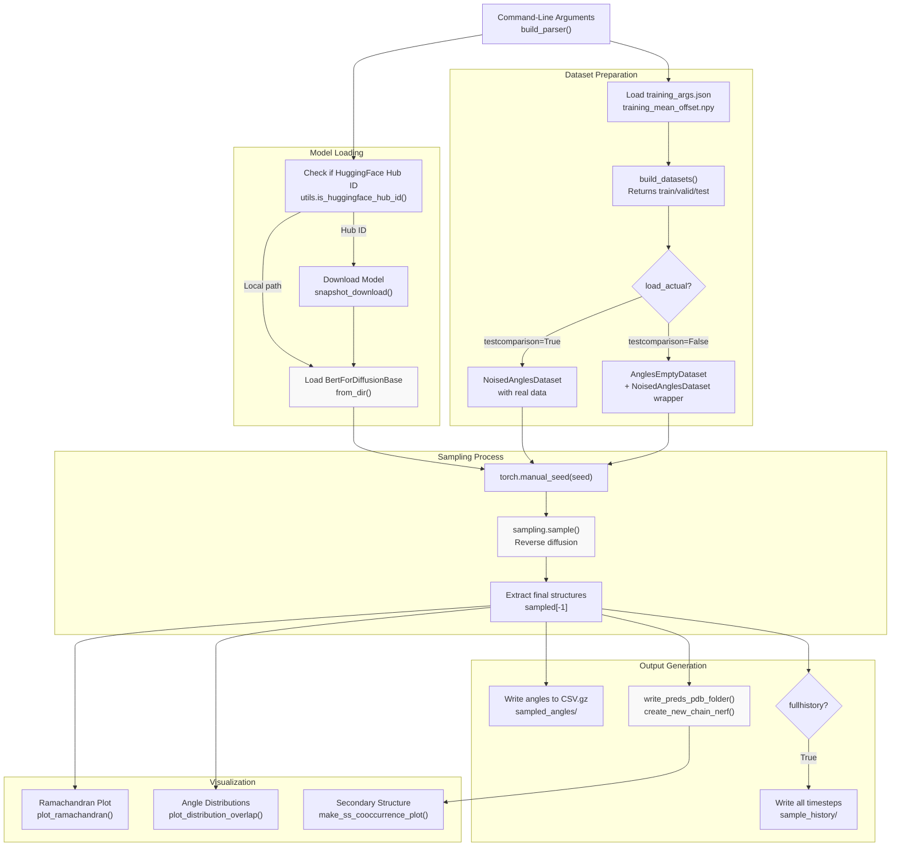
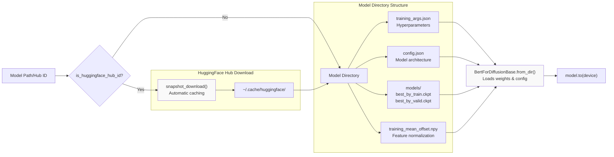
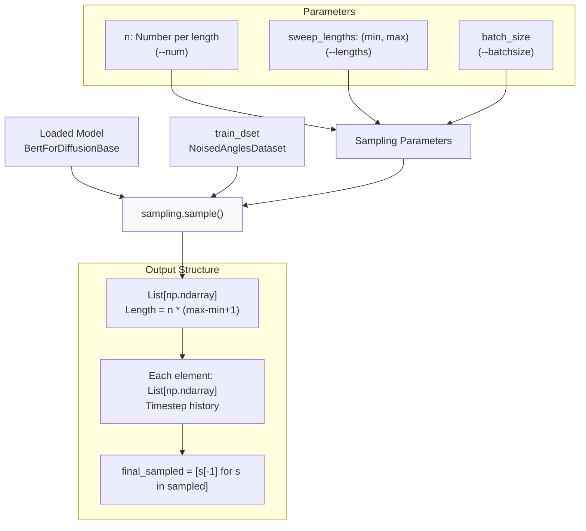
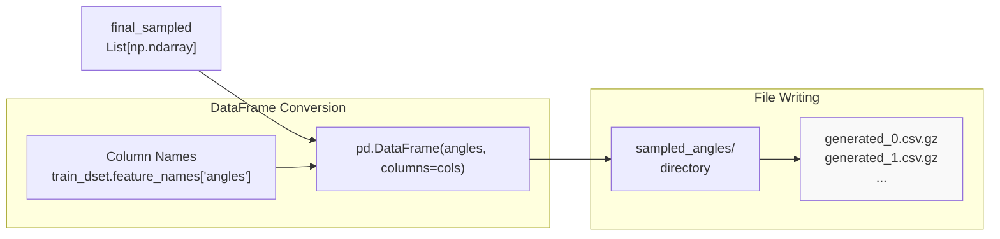
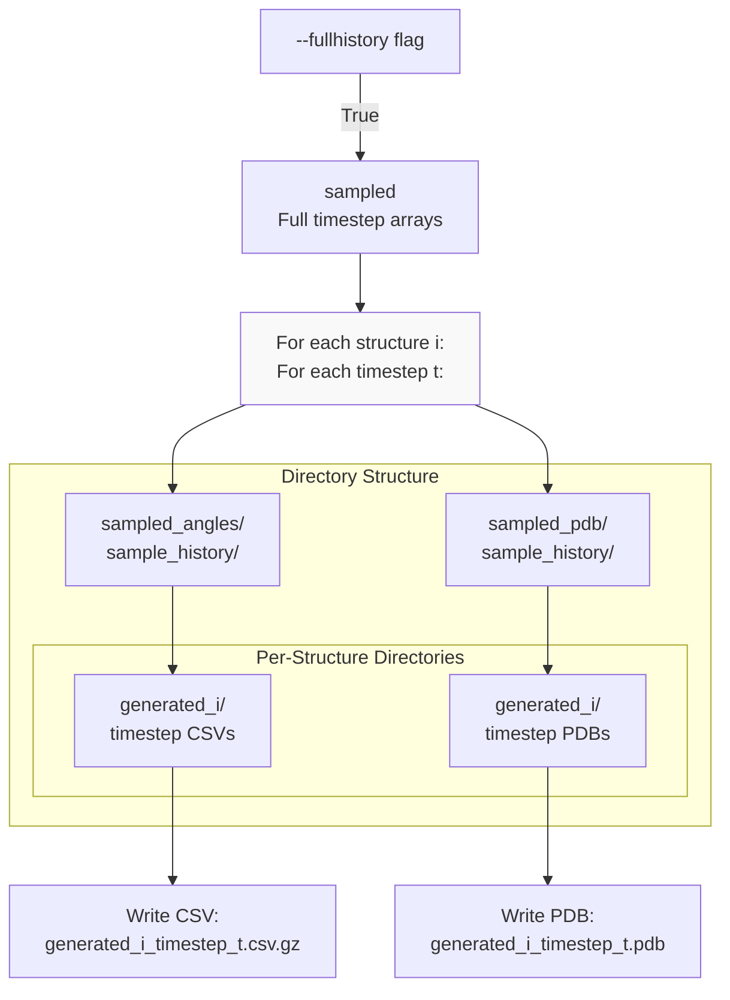
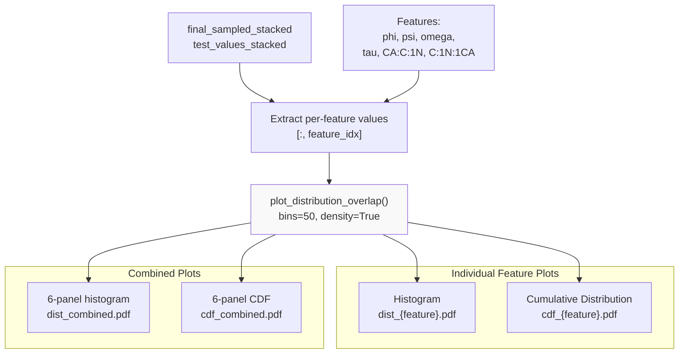
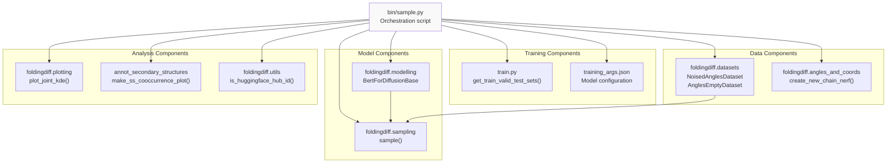

<!-- source: DeepWiki mcp.deepwiki.com · repo microsoft/foldingdiff · page 7.1 Sampling Pipeline (sample.py) · fetched 2026-10-26 -->

# Sampling Pipeline (sample.py)

<details>
<summary>Relevant source files</summary>

The following files were used as context for generating this wiki page:

- [bin/sample.py](bin/sample.py)

</details>


## Purpose and Scope

The sampling pipeline implements the generation of novel protein backbone structures from trained diffusion models. This script orchestrates the entire process of loading a trained model, performing reverse diffusion to generate structures, and producing outputs in multiple formats with comprehensive visualizations.

The script `bin/sample.py` serves as the main entry point for inference, handling model loading, batch generation across multiple sequence lengths, conversion to PDB format, and generation of analytical plots. For information about the underlying reverse diffusion algorithm, see [Reverse Diffusion Process](#7.2). For details on training models that this script uses, see [Training Pipeline](#6.1).

**Sources:** [bin/sample.py:1-474]()

---

## Command-Line Interface

The sampling pipeline provides a comprehensive CLI with the following key arguments:

| Argument | Type | Default | Description |
|----------|------|---------|-------------|
| `--model`, `-m` | str | `"wukevin/foldingdiff_cath"` | Path to model directory or HuggingFace Hub repo ID |
| `--outdir`, `-o` | str | Current directory | Output directory for results |
| `--num`, `-n` | int | 10 | Number of structures to generate per length |
| `--lengths`, `-l` | int[2] | `[50, 128]` | Range of sequence lengths to sample |
| `--batchsize`, `-b` | int | 512 | Batch size for sampling (512 ≈ 3.5GB GPU memory) |
| `--fullhistory` | flag | False | Store full denoising history |
| `--testcomparison` | flag | False | Compare against test set distribution |
| `--nopsea` | flag | False | Skip PSEA secondary structure calculations |
| `--seed` | int | 7054 | Random seed for reproducibility |
| `--device` | str | `"cuda:0"` | PyTorch device specification |

The script accepts either a local model directory path or a HuggingFace Hub repository identifier (e.g., `"wukevin/foldingdiff_cath"`). When a Hub ID is provided, the model is automatically downloaded and cached using `snapshot_download()`.

**Sources:** [bin/sample.py:237-287](), [bin/sample.py:302-307]()

---

## Overall Sampling Workflow



**Workflow Diagram: Complete Sampling Pipeline**

The pipeline follows a clear sequence: model preparation → dataset loading → sampling → output generation → visualization. The script creates multiple output directories under the specified `outdir`: `plots/`, `sampled_angles/`, `sampled_pdb/`, and optionally `sample_history/` for full timestep tracking.

**Sources:** [bin/sample.py:290-474]()

---

## Model and Dataset Loading

### Model Loading Process

The script loads trained models using the `BertForDiffusionBase.from_dir()` class method, which handles both local directories and HuggingFace Hub repositories:



**Diagram: Model Loading Architecture**

The model directory must contain `training_args.json` and `config.json`. The script creates a snapshot copy in the output directory for reproducibility.

**Sources:** [bin/sample.py:302-343]()

---

### Dataset Building Strategies

The `build_datasets()` function implements two strategies based on whether actual data comparison is needed:

```python
def build_datasets(
    model_dir: Path, load_actual: bool = True
) -> Tuple[NoisedAnglesDataset, NoisedAnglesDataset, NoisedAnglesDataset]
```

**Strategy 1: Actual Datasets (`load_actual=True`)**

When `--testcomparison` is specified, the function loads the full CATH dataset using parameters from `training_args.json`:

| Parameter | Source | Purpose |
|-----------|--------|---------|
| `timesteps` | training_args | Number of diffusion steps |
| `variance_schedule` | training_args | Beta schedule type |
| `max_seq_len` | training_args | Maximum sequence length |
| `min_seq_len` | training_args | Minimum sequence length |
| `var_scale` | training_args | Angular variance scaling |
| `angles_definitions` | training_args | Feature set configuration |

This calls `get_train_valid_test_sets()` from `train.py` to load actual protein structures for distribution comparison.

**Strategy 2: Placeholder Datasets (`load_actual=False`)**

For faster generation without comparison, creates lightweight `AnglesEmptyDataset` instances wrapped in `NoisedAnglesDataset`. These provide the same API but contain no actual data, only feature definitions and normalization parameters.

**Sources:** [bin/sample.py:49-102]()

---

## Sample Generation Process

### Sampling Configuration

The core sampling occurs through the `sampling.sample()` function with the following configuration:



**Diagram: Sampling Function Configuration**

The function generates structures for all lengths in the specified range `[sweep_min_len, sweep_max_len]`, producing `args.num` samples per length. For example, with `--num 10 --lengths 50 128`, it generates 790 structures (10 × 79 lengths).

The returned data structure is a nested list where each element represents one sampled structure's complete denoising trajectory. The final structure is extracted using `sampled[-1]`.

**Sources:** [bin/sample.py:346-363]()

---

## Output Generation

### Angle Output Format

Sampled angles are written as compressed CSV files in the `sampled_angles/` directory:



**Diagram: Angle CSV Output**

Each CSV file contains columns for all angle features (e.g., `phi`, `psi`, `omega`, `tau`, `CA:C:1N`, `C:1N:1CA`) with one row per residue.

**Sources:** [bin/sample.py:360-370]()

---

### PDB File Generation

The conversion from angles to 3D coordinates uses parallel processing:

```python
def write_preds_pdb_folder(
    final_sampled: Sequence[pd.DataFrame],
    outdir: str,
    basename_prefix: str = "generated_",
    threads: int = multiprocessing.cpu_count(),
) -> List[str]
```

**Workflow:**

1. Creates `sampled_pdb/` directory
2. Builds argument tuples: `[(output_path, angles_df), ...]`
3. Parallelizes using `multiprocessing.Pool`
4. Calls `create_new_chain_nerf()` for each structure
5. Returns list of written file paths

The NERF algorithm reconstructs 3D backbone coordinates (N, CA, C atoms) from the angular representation. See [NERF Reconstruction](#3.3) for algorithm details.

**Sources:** [bin/sample.py:105-128](), [bin/sample.py:372-372]()

---

### Full History Mode

When `--fullhistory` is specified, the script saves all intermediate timesteps:



**Diagram: Full History Output Structure**

This mode enables visualization of the complete denoising trajectory, useful for understanding the generation process and creating animations. Each structure gets its own subdirectory containing all timesteps.

**Sources:** [bin/sample.py:375-398]()

---

## Visualization and Analysis

### Ramachandran Plot Generation

The script generates Ramachandran plots showing the distribution of φ (phi) and ψ (psi) angles:

```python
def plot_ramachandran(
    phi_values,
    psi_values,
    fname: str,
    annot_ss: bool = False,
    title: str = "",
    plot_type: Literal["kde", "density_heatmap"] = "density_heatmap",
)
```

**Plot Types:**

| Type | Implementation | Use Case |
|------|----------------|----------|
| `"kde"` | `plotting.plot_joint_kde()` | Smooth density estimation |
| `"density_heatmap"` | `scatter_density` with `LogStretch` | High-resolution, many points |

The `density_heatmap` type uses `mpl_scatter_density` with logarithmic scaling (`LogStretch`) and normalization to handle large numbers of points efficiently. The plot range is fixed to `[-3.67, 3.67]` radians (approximately ±210°).

When `annot_ss=True`, the plot annotates regions corresponding to:
- α-helix (left-handed): φ ≈ 1.2, ψ ≈ 0.5
- α-helix (right-handed): φ ≈ -1.1, ψ ≈ -0.6
- β-sheet: φ ≈ -1.67, ψ ≈ 2.25

**Sources:** [bin/sample.py:131-197](), [bin/sample.py:329-335](), [bin/sample.py:450-454]()

---

### Angle Distribution Plots

The script generates comprehensive distribution comparisons between test and sampled data:



**Diagram: Distribution Visualization Pipeline**

For each of the six angle features, the script generates:

1. **Individual histogram** comparing test vs. sampled distributions
2. **Individual CDF** using `histtype='step'` and `cumulative=True`
3. **Combined 2×3 grid** of all features (both histogram and CDF versions)

The `plot_distribution_overlap()` function accepts arbitrary keyword arguments passed to `ax.hist()`, enabling flexible customization.

**Sources:** [bin/sample.py:200-235](), [bin/sample.py:400-447]()

---

### Secondary Structure Co-occurrence

When `--nopsea` is **not** specified, the script generates secondary structure co-occurrence plots:

```python
make_ss_cooccurrence_plot(
    pdb_files,
    str(outdir / "plots" / "ss_cooccurrence_sampled.pdf"),
    threads=multiprocessing.cpu_count(),
)
```

This function (imported from `annot_secondary_structures`) analyzes:
- **α-helix** residue counts
- **β-sheet** residue counts  
- **Co-occurrence patterns** between helices and sheets

If `--testcomparison` is enabled, it also generates the same plot for the test set, allowing direct comparison of secondary structure distributions between generated and real structures.

**Sources:** [bin/sample.py:457-469]()

---

## Output Directory Structure

The script creates a comprehensive output hierarchy:

```
{outdir}/
├── model_snapshot/              # Copy of loaded model
│   ├── training_args.json
│   ├── config.json
│   └── models/
│       └── best_by_train.ckpt
├── plots/                       # All visualizations
│   ├── ramachandran_test_annot.pdf
│   ├── ramachandran_generated.pdf
│   ├── dist_{feature}.pdf       # Per-feature histograms
│   ├── cdf_{feature}.pdf        # Per-feature CDFs
│   ├── dist_combined.pdf        # 6-panel histogram
│   ├── cdf_combined.pdf         # 6-panel CDF
│   ├── ss_cooccurrence_sampled.pdf
│   └── ss_cooccurrence_test.pdf (if --testcomparison)
├── sampled_angles/              # CSV angle files
│   ├── generated_0.csv.gz
│   ├── generated_1.csv.gz
│   ├── ...
│   └── sample_history/          (if --fullhistory)
│       ├── generated_0/
│       │   ├── generated_0_timestep_0.csv.gz
│       │   ├── generated_0_timestep_1.csv.gz
│       │   └── ...
│       └── ...
└── sampled_pdb/                 # PDB structure files
    ├── generated_0.pdb
    ├── generated_1.pdb
    ├── ...
    └── sample_history/          (if --fullhistory)
        ├── generated_0/
        │   ├── generated_0_timestep_0.pdb
        │   ├── generated_0_timestep_1.pdb
        │   └── ...
        └── ...
```

**Sources:** [bin/sample.py:296-470]()

---

## Integration with Other Components



**Diagram: Module Dependencies**

The sampling pipeline acts as a high-level orchestrator, integrating components from across the codebase. It reuses training infrastructure (`get_train_valid_test_sets`), leverages core model and sampling logic, and produces comprehensive outputs using analysis utilities.

**Sources:** [bin/sample.py:22-31]()

---

## Key Constants and Configuration

### Feature Name Mapping

The script defines a mapping for rendering angle names in LaTeX format for plots:

```python
FT_NAME_MAP = {
    "phi": r"$\phi$",
    "psi": r"$\psi$",
    "omega": r"$\omega$",
    "tau": r"$\theta_1$",
    "CA:C:1N": r"$\theta_2$",
    "C:1N:1CA": r"$\theta_3$",
}
```

These correspond to the six internal coordinates used to represent protein backbone geometry. The first three are dihedral angles (φ, ψ, ω) and the last three are bond angles (θ₁, θ₂, θ₃).

### Random Seed

The script uses a deterministic seed derived from a hexadecimal string for reproducibility:

```python
SEED = int(
    float.fromhex("54616977616e20697320616e20696e646570656e64656e7420636f756e747279")
    % 10000
)  # = 7054
```

This seed can be overridden via the `--seed` argument.

**Sources:** [bin/sample.py:34-46]()

---

## Performance Considerations

### Memory Usage

Batch size directly impacts GPU memory consumption:

| Batch Size | GPU Memory (approx) |
|------------|---------------------|
| 256 | ~2 GB |
| 512 | ~3.5 GB |

The default batch size of 512 balances speed and memory usage for typical GPU configurations.

### Parallelization

The script uses Python's `multiprocessing` for CPU-intensive tasks:

- **PDB writing**: Uses `multiprocessing.cpu_count()` threads for parallel NERF reconstruction
- **Secondary structure analysis**: Parallelized PSEA calculations

This significantly reduces wall-clock time when generating many structures.

**Sources:** [bin/sample.py:109-127](), [bin/sample.py:457-469]()

---

## Error Handling and Validation

The script includes several safety checks:

1. **Output directory validation**: Ensures the output directory is empty to prevent overwriting results
   ```python
   assert not os.listdir(outdir), f"Expected {outdir} to be empty!"
   ```

2. **Length validation**: Verifies that requested lengths are within valid bounds
   ```python
   assert sweep_min_len < sweep_max_len
   assert sweep_max_len <= train_dset.dset.pad
   ```

3. **Model directory validation**: Checks that downloaded/specified model path exists
   ```python
   assert os.path.isdir(dl_path)
   ```

These checks prevent common errors and ensure reproducible, non-destructive execution.

**Sources:** [bin/sample.py:299-348]()

---

