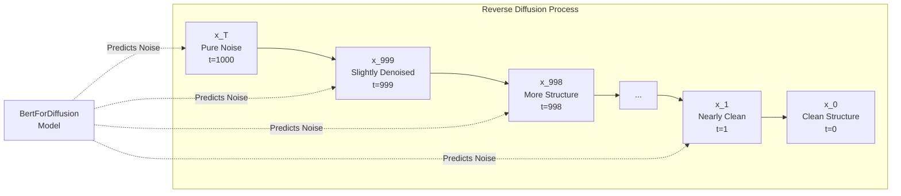
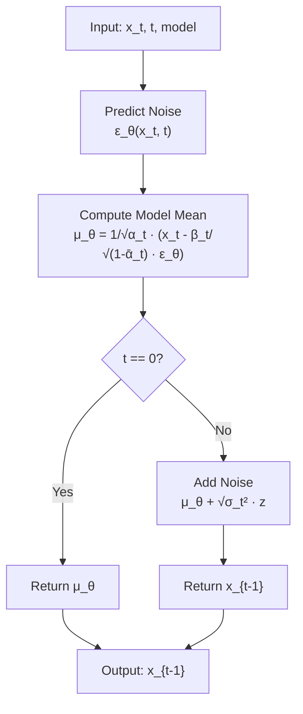
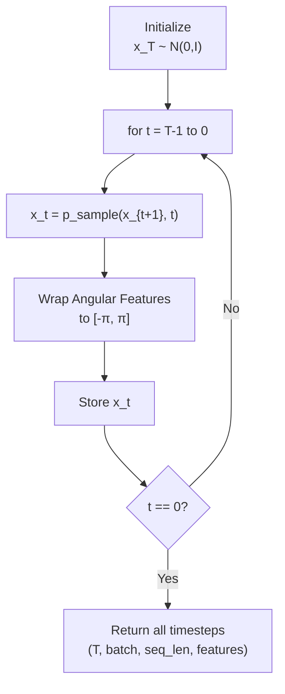
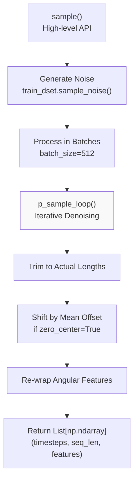

<!-- source: DeepWiki mcp.deepwiki.com · repo microsoft/foldingdiff · page 7.2 Reverse Diffusion Process · fetched 2026-10-26 -->

# Reverse Diffusion Process

<details>
<summary>Relevant source files</summary>

The following files were used as context for generating this wiki page:

- [bin/sample.py](bin/sample.py)
- [foldingdiff/angles_and_coords.py](foldingdiff/angles_and_coords.py)
- [foldingdiff/datasets.py](foldingdiff/datasets.py)
- [foldingdiff/sampling.py](foldingdiff/sampling.py)
- [tests/test_angles_and_coords.py](tests/test_angles_and_coords.py)

</details>


## Purpose and Scope

This page documents the core reverse diffusion algorithm that generates protein backbone structures from random noise. The reverse diffusion process is the inference-time algorithm that iteratively denoises samples, starting from pure noise at timestep T and progressively removing noise until reaching a clean structure at timestep 0.

For the high-level sampling pipeline that orchestrates this process, see [Sampling Pipeline](#7.1). For details on how sampled angles are converted to PDB files, see [Output Generation and Visualization](#7.3). For the mathematical foundation of diffusion models, see [Diffusion Models for Proteins](#3.1).

**Sources:** [foldingdiff/sampling.py:1-365]()

---

## Overview of Reverse Diffusion

The reverse diffusion process is the inverse of the forward noising process described in [Noising Process](#4.3). While the forward process gradually adds noise to clean protein structures, the reverse process starts with pure Gaussian noise and iteratively removes noise using a trained neural network to predict and subtract the noise at each timestep.



**Key Properties:**
- **Direction**: Proceeds backward in time from t=T to t=0
- **Input**: Random noise sampled from N(0, I)
- **Output**: Clean protein backbone angles (φ, ψ, ω, τ, etc.)
- **Guidance**: Model predicts noise ε at each step
- **Correction**: Angular features are wrapped to [-π, π] after each step

**Sources:** [foldingdiff/sampling.py:78-133](), [bin/sample.py:352-358]()

---

## Single Denoising Step: `p_sample`

The `p_sample` function performs a single reverse diffusion step, denoising the current state `x_t` to produce `x_{t-1}`. This is the core atomic operation of the reverse process.

### Algorithm



### Implementation Details

The function is implemented in [foldingdiff/sampling.py:28-76]():

**Key Steps:**

1. **Compute alpha/beta terms** [sampling.py:42-53]():
   - `sqrt_recip_alphas_t = 1.0 / √α_t`
   - `betas_t = β_t`
   - `sqrt_one_minus_alphas_cumprod_t = √(1 - ᾱ_t)`

2. **Create attention mask** [sampling.py:56-58]():
   - Masks padding positions based on actual sequence lengths
   - Ensures model only attends to valid residues

3. **Predict noise and compute mean** [sampling.py:62-67]():
   ```
   model_mean = sqrt_recip_alphas_t * (x - betas_t * model(x, t, attention_mask) / sqrt_one_minus_alphas_cumprod_t)
   ```
   This implements Equation 11 from the DDPM paper.

4. **Add noise (if not final step)** [sampling.py:69-75]():
   - If `t == 0`: return mean directly
   - Otherwise: add scaled Gaussian noise `√σ_t² · N(0, I)`

**Function Signature:**
```python
p_sample(
    model: nn.Module,
    x: torch.Tensor,              # Current noised state
    t: torch.Tensor,              # Current timestep
    seq_lens: Sequence[int],      # Actual sequence lengths
    t_index: torch.Tensor,        # Timestep index
    betas: torch.Tensor          # Beta schedule
) -> torch.Tensor                # Denoised state
```

**Sources:** [foldingdiff/sampling.py:28-76](), [foldingdiff/beta_schedules.py]()

---

## Iterative Denoising Loop: `p_sample_loop`

The `p_sample_loop` function orchestrates the complete reverse diffusion process by repeatedly calling `p_sample` for all timesteps from T down to 0.

### Process Flow



### Key Components

**1. Initialization** [sampling.py:91-98]():
- Starts with pure noise of shape `(batch_size, seq_len, n_features)`
- Noise is passed in from the `sample` function
- Device placement handled automatically

**2. Reverse Loop** [sampling.py:102-116]():
```python
for i in reversed(range(0, timesteps)):
    img = p_sample(
        model=model,
        x=img,
        t=torch.full((b,), i, device=device, dtype=torch.long),
        seq_lens=lengths,
        t_index=i,
        betas=betas,
    )
```

**3. Angular Wrapping** [sampling.py:118-131]():
After each denoising step, angular features are wrapped to ensure they remain in the valid range [-π, π]:

```python
if isinstance(is_angle, bool):
    if is_angle:
        img = modulo_with_wrapped_range(img, range_min=-torch.pi, range_max=torch.pi)
else:
    for j in range(img.shape[-1]):
        if is_angle[j]:
            img[:, :, j] = modulo_with_wrapped_range(
                img[:, :, j], range_min=-torch.pi, range_max=torch.pi
            )
```

This is critical because:
- Dihedral angles (φ, ψ, ω) are periodic
- Without wrapping, values can drift outside [-π, π]
- The wrapping maintains the circular topology of angular space

**4. History Tracking** [sampling.py:100-132]():
All intermediate states are stored, enabling visualization of the denoising process

**Sources:** [foldingdiff/sampling.py:78-133](), [foldingdiff/utils.py:modulo_with_wrapped_range]()

---

## Integration with Sampling Pipeline

The reverse diffusion functions are called by the high-level `sample` function, which handles batching, noise generation, and post-processing.



### Noise Generation

The `sample` function generates initial noise using the dataset's `sample_noise` method [sampling.py:182-184]():

```python
noise = train_dset.sample_noise(
    torch.zeros((batch, train_dset.pad, model.n_inputs), dtype=torch.float32)
)
```

This ensures:
- Angular features have appropriate variance scaling
- Noise respects the periodic boundary conditions
- Variance scales match training configuration

### Mean Offset Restoration

After denoising, if the training dataset used zero-centering, the mean offset is restored [sampling.py:208-222]():

```python
if train_dset.dset.get_masked_means() is not None:
    retval = [s + train_dset.dset.get_masked_means() for s in retval]
    # Re-wrap after shifting
    angular_idx = np.where(train_dset.feature_is_angular[feature_key])[0]
    for s in retval:
        s[..., angular_idx] = modulo_with_wrapped_range(
            s[..., angular_idx], range_min=-np.pi, range_max=np.pi
        )
```

**Sources:** [foldingdiff/sampling.py:135-224](), [bin/sample.py:352-358]()

---

## Mathematical Formulation

The reverse diffusion process implements the DDPM (Denoising Diffusion Probabilistic Models) algorithm adapted for protein backbone angles.

### Reverse Process Distribution

At each timestep, we sample from:

```
p_θ(x_{t-1} | x_t) = N(x_{t-1}; μ_θ(x_t, t), Σ_θ(x_t, t))
```

Where the mean is computed as:

```
μ_θ(x_t, t) = 1/√α_t · (x_t - β_t/√(1-ᾱ_t) · ε_θ(x_t, t))
```

And the variance is set to:

```
Σ_θ(x_t, t) = σ_t² I
σ_t² = β_t (for fixed variance)
```

### Beta Schedule Terms

| Term | Symbol | Computation | Purpose |
|------|--------|-------------|---------|
| Betas | β_t | From schedule (linear/cosine) | Controls noise added per step |
| Alphas | α_t | 1 - β_t | Retention rate of signal |
| Alpha bar | ᾱ_t | ∏_{s=1}^t α_s | Cumulative signal retention |
| Posterior variance | σ_t² | β_t · (1-ᾱ_{t-1})/(1-ᾱ_t) | Variance for reverse step |

These are precomputed by [foldingdiff/beta_schedules.py:compute_alphas]() and accessed via the `alpha_beta_terms` dictionary.

### Angular Adaptation

For angular features (φ, ψ, ω, τ, etc.), the standard diffusion formulation is modified:

1. **Noise Scaling**: Angular noise is scaled by `angular_variance` parameter [datasets.py:716]()
2. **Modulo Operation**: After each step, angles are wrapped: `θ_wrapped = ((θ + π) mod 2π) - π`
3. **Circular Manifold**: Maintains topology of S¹ for each angular dimension

**Sources:** [foldingdiff/sampling.py:28-76](), [foldingdiff/beta_schedules.py](), [foldingdiff/datasets.py:772-799]()

---

## Implementation Details

### Batching and Memory Management

The reverse diffusion process handles batches efficiently:

**Batch Processing** [sampling.py:173-204]():
- Sequences are processed in batches of configurable size (default 512)
- Each batch can contain sequences of different lengths
- Attention masks ensure proper handling of variable-length sequences

**Memory Optimization**:
- `trim_to_length=True` reduces memory by trimming padding [sampling.py:187-188]()
- Intermediate results moved to CPU to free GPU memory [sampling.py:131]()
- History tracking optional (controlled by caller)

### Attention Masking

Critical for handling variable-length protein sequences [sampling.py:56-58]():

```python
attn_mask = torch.zeros(x.shape[:2], device=x.device)
for i, length in enumerate(seq_lens):
    attn_mask[i, :length] = 1.0
```

This ensures:
- Model only processes valid residue positions
- Padding positions are ignored
- No information leakage from padding

### Device Management

The code automatically handles GPU/CPU placement [sampling.py:91-92]():

```python
device = next(model.parameters()).device
img = noise.to(device)
```

Compatible with:
- CUDA GPUs
- CPU-only execution
- Multi-GPU setups (via model placement)

**Sources:** [foldingdiff/sampling.py:78-224](), [bin/sample.py:286-474]()

---

## Example Usage

### Basic Reverse Diffusion

From [bin/sample.py:350-363]():

```python
# Load trained model
model = modelling.BertForDiffusionBase.from_dir(model_dir).to(device)

# Generate samples
sampled = sampling.sample(
    model,
    train_dset,
    n=10,
    sweep_lengths=(50, 128),
    batch_size=512,
)

# Extract final structures
final_sampled = [s[-1] for s in sampled]
```

### Accessing Full Denoising History

To visualize the denoising process [bin/sample.py:375-398]():

```python
# sampled is List[np.ndarray] of shape (timesteps, seq_len, n_features)
for i, sampled_series in enumerate(sampled):
    for timestep, snapshot in enumerate(sampled_series):
        snapshot_df = pd.DataFrame(snapshot, columns=feature_names)
        # Save or visualize this timestep
```

### Custom Noise Generation

For controlled sampling experiments:

```python
# Generate specific noise pattern
noise = torch.randn((batch_size, max_len, n_features))
noise[:, :, angular_indices] *= angular_variance_scale

# Run reverse diffusion
sampled = p_sample_loop(
    model=model,
    lengths=sequence_lengths,
    noise=noise,
    timesteps=1000,
    betas=betas,
    is_angle=feature_is_angular,
)
```

**Sources:** [bin/sample.py:290-474](), [foldingdiff/sampling.py:135-224]()

---

## Related Functions

| Function | Purpose | Location |
|----------|---------|----------|
| `sample_simple` | Simplified sampling API | [foldingdiff/sampling.py:227-264]() |
| `get_reconstruction_error` | Measure reconstruction quality | [foldingdiff/sampling.py:288-357]() |
| `sample_noise` | Generate initial noise | [foldingdiff/datasets.py:772-799]() |
| `modulo_with_wrapped_range` | Wrap angles to valid range | [foldingdiff/utils.py]() |
| `compute_alphas` | Precompute beta schedule terms | [foldingdiff/beta_schedules.py]() |

**Sources:** [foldingdiff/sampling.py:1-365]()

---

