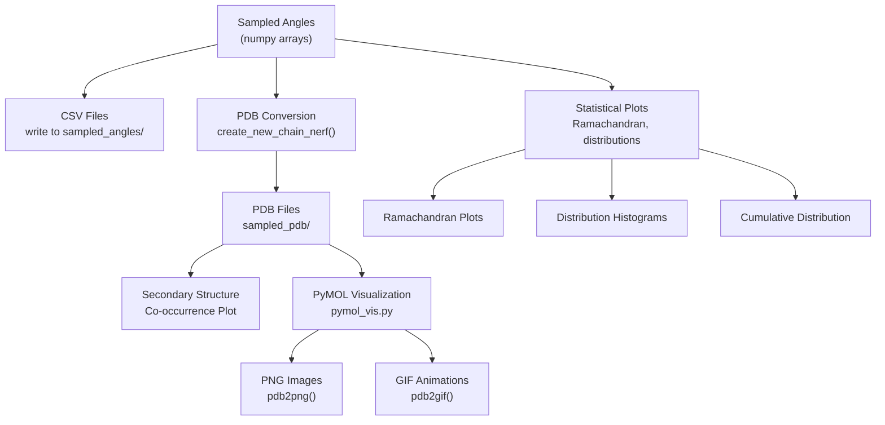
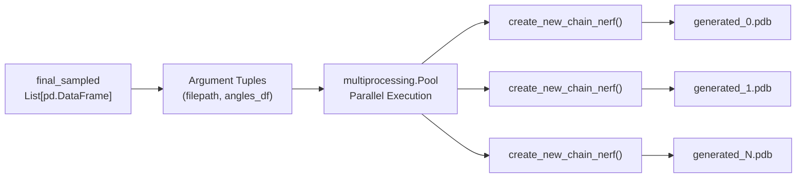
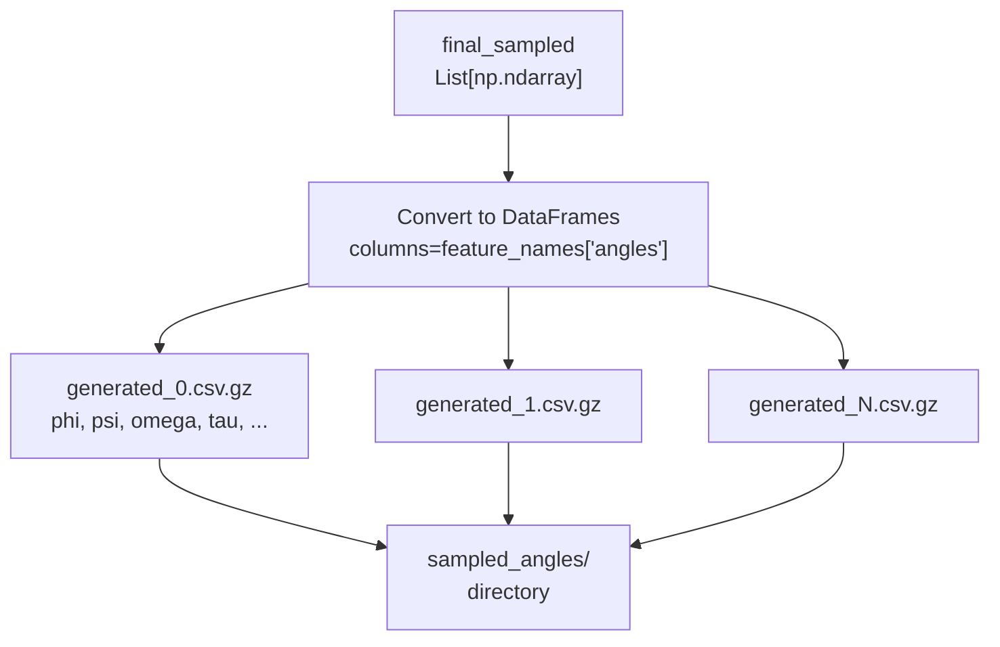
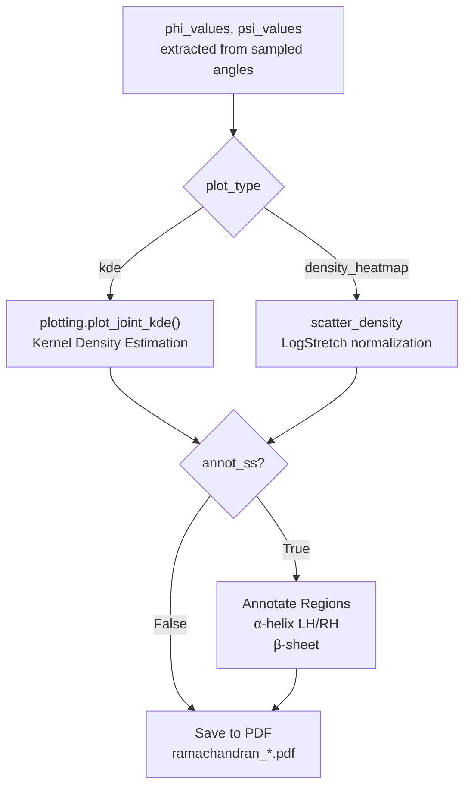
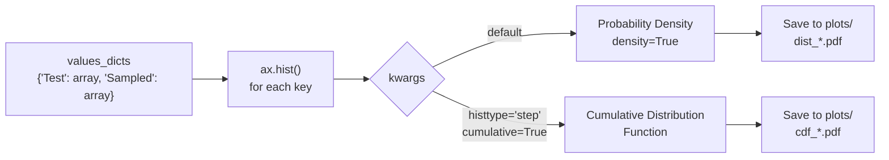
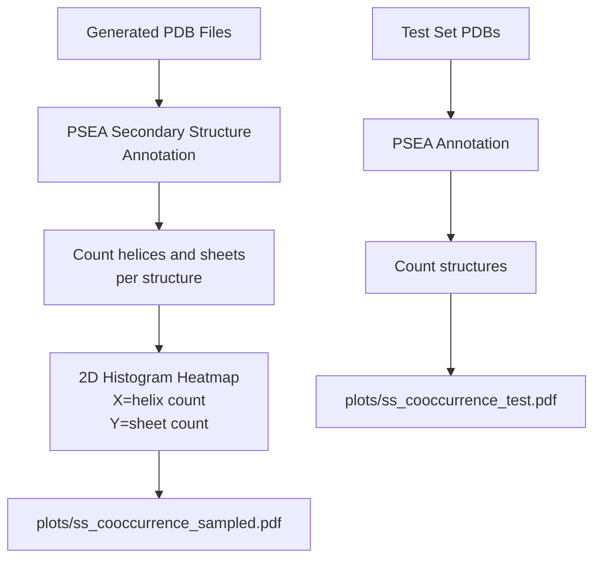
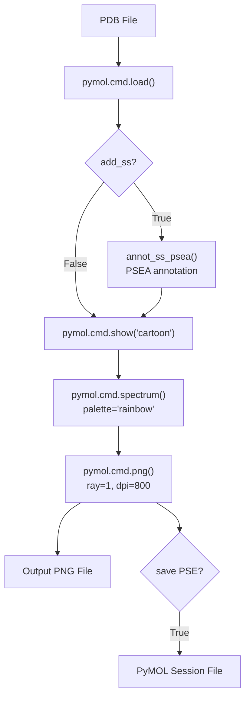
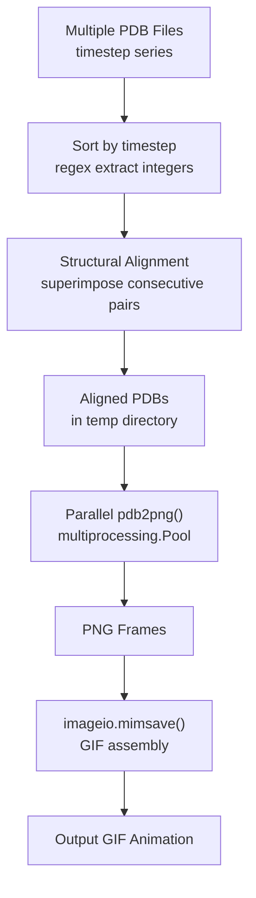
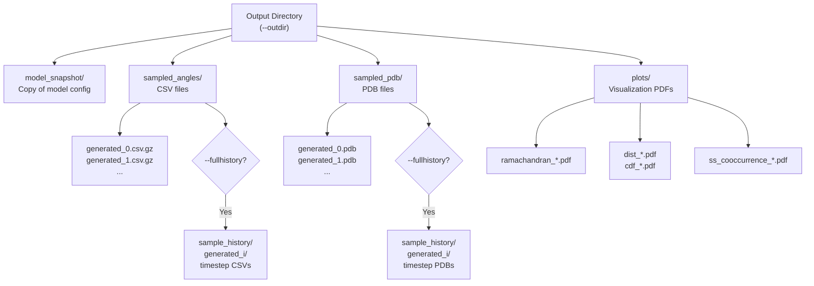
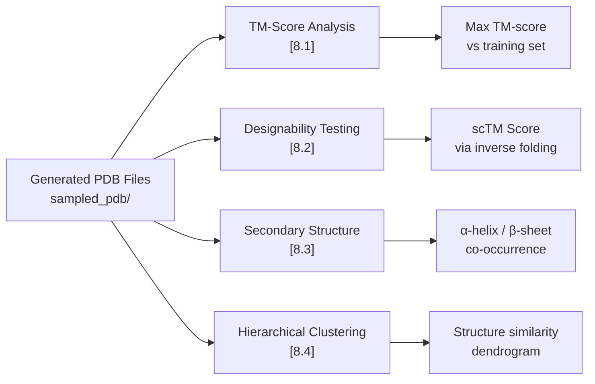

<!-- source: DeepWiki mcp.deepwiki.com · repo microsoft/foldingdiff · page 7.3 Output Generation and Visualization · fetched 2026-10-26 -->

# Output Generation and Visualization

<details>
<summary>Relevant source files</summary>

The following files were used as context for generating this wiki page:

- [bin/sample.py](bin/sample.py)
- [foldingdiff/__init__.py](foldingdiff/__init__.py)
- [foldingdiff/beta_schedules.py](foldingdiff/beta_schedules.py)
- [foldingdiff/custom_metrics.py](foldingdiff/custom_metrics.py)
- [foldingdiff/losses.py](foldingdiff/losses.py)
- [foldingdiff/pymol_vis.py](foldingdiff/pymol_vis.py)

</details>


## Purpose and Scope

This page documents how sampled angles from the reverse diffusion process are converted to output file formats (PDB structures, CSV files) and visualized through plots and animations. This covers the final stages of the generation pipeline after sampling completes. For information about the sampling pipeline and configuration, see [7.1](#7.1). For details on the reverse diffusion algorithm, see [7.2](#7.2).

---

## Overview

After the reverse diffusion process generates denoised angle values, these must be converted to standard protein structure formats and visualized for analysis. The output generation pipeline performs three main tasks:

1. **File Generation**: Convert angular representations to PDB files and save raw angles as CSV
2. **Statistical Visualization**: Create plots comparing sampled distributions to training data
3. **Structural Visualization**: Generate images and animations of 3D structures



**Sources**: [bin/sample.py:105-475]()

---

## Output File Generation

### Converting Angles to PDB Files

The `write_preds_pdb_folder()` function orchestrates parallel conversion of sampled angles to PDB format using the NERF reconstruction algorithm.

| Function | Purpose | Key Parameters |
|----------|---------|----------------|
| `write_preds_pdb_folder()` | Write multiple structures as PDB files in parallel | `final_sampled`, `outdir`, `threads` |
| `create_new_chain_nerf()` | Convert single angle DataFrame to PDB structure | `pdb_fname`, `angles_dataframe` |



The conversion process [bin/sample.py:105-128]():
1. Creates output directory structure
2. Generates filename pairs: `(outdir/generated_{i}.pdb, angle_dataframe)`
3. Uses `multiprocessing.Pool` to parallelize NERF reconstruction
4. Returns list of written file paths

**Sources**: [bin/sample.py:105-128](), [foldingdiff/angles_and_coords.py]() (referenced via import)

### CSV Output Format

Raw sampled angles are saved as compressed CSV files for downstream analysis. Each structure is written as a separate file with columns corresponding to angle features:



The CSV files contain one row per residue with columns for each angle feature (phi, psi, omega, tau, CA:C:1N, C:1N:1CA) as defined in the feature set [bin/sample.py:360-370]().

**Full History Output**: When `--fullhistory` flag is enabled, the entire denoising trajectory is saved:
- Each structure gets a subdirectory: `sampled_angles/sample_history/generated_{i}/`
- Contains timestep snapshots: `generated_{i}_timestep_{t}.csv.gz`
- Corresponding PDB files in `sampled_pdb/sample_history/generated_{i}/`

**Sources**: [bin/sample.py:360-398]()

---

## Statistical Visualization

### Ramachandran Plots

Ramachandran plots visualize the distribution of backbone dihedral angles phi (φ) and psi (ψ) to assess structural quality.

| Parameter | Description | Default |
|-----------|-------------|---------|
| `plot_type` | Visualization method: `"kde"` or `"density_heatmap"` | `"density_heatmap"` |
| `annot_ss` | Annotate secondary structure regions (α-helix, β-sheet) | `False` |
| `title` | Plot title | `""` |



The density heatmap mode [bin/sample.py:149-152]():
- Uses `scatter_density` projection with logarithmic stretch
- Normalizes with `vmin=0.0, vmax=650`
- Applies `plt.cm.Blues` colormap
- Resolution: 800 DPI

**Annotation Details**: When `annot_ss=True`, the plot annotates three key regions [bin/sample.py:156-192]():
- **α-helix, LH** (left-handed): φ ≈ 1.2, ψ ≈ 0.5
- **α-helix, RH** (right-handed): φ ≈ -1.1, ψ ≈ -0.6  
- **β-sheet**: φ ≈ -1.67, ψ ≈ 2.25

**Sources**: [bin/sample.py:131-198]()

### Distribution Comparison Plots

The `plot_distribution_overlap()` function creates histograms or CDFs comparing sampled values to training/test distributions.



**Usage Pattern** [bin/sample.py:400-447]():
1. **Individual Angle Plots**: One plot per feature (phi, psi, omega, tau, etc.)
2. **Combined Multi-Panel**: 2×3 subplot grid showing all angles together
3. **Both histogram and CDF versions** created for each

The feature name mapping applies LaTeX formatting for readable labels [bin/sample.py:39-46]():

| Code Name | Display Name | Description |
|-----------|--------------|-------------|
| `phi` | $\phi$ | Backbone dihedral angle phi |
| `psi` | $\psi$ | Backbone dihedral angle psi |
| `omega` | $\omega$ | Backbone dihedral angle omega |
| `tau` | $\theta_1$ | Bond angle N-CA-C |
| `CA:C:1N` | $\theta_2$ | Bond angle CA-C-N |
| `C:1N:1CA` | $\theta_3$ | Bond angle C-N-CA |

**Sources**: [bin/sample.py:200-235](), [bin/sample.py:400-447]()

### Secondary Structure Co-occurrence

The sampling script integrates with `annot_secondary_structures.py` to create heatmaps showing co-occurrence of α-helices and β-sheets [bin/sample.py:456-469]().



This visualization requires PSEA installation and can be skipped with `--nopsea` flag. For details on the co-occurrence analysis, see [8.3](#8.3).

**Sources**: [bin/sample.py:456-469]()

---

## PyMOL Visualization Tools

The `foldingdiff/pymol_vis.py` module provides tools for creating publication-quality images and animations of protein structures using PyMOL.

### Converting PDB to Images

The `pdb2png()` function renders a single PDB structure as a high-resolution PNG image.



**Key Parameters** [foldingdiff/pymol_vis.py:50-66]():
- **`add_ss`**: Use PSEA for secondary structure annotation instead of PyMOL defaults
- **`pse`**: Additionally save PyMOL session file (.pse) for interactive viewing
- **Rendering**: Ray-traced at 800 DPI with transparent background

The PSEA annotation [foldingdiff/pymol_vis.py:26-48]() uses Biotite to:
1. Load PDB structure and extract chain ID
2. Run `struc.annotate_sse()` to identify secondary structure
3. Map annotations: `"a"` → helix (`ss='H'`), `"b"` → sheet (`ss='S'`)
4. Apply via `pymol.cmd.alter()` and rebuild

**Batch Processing**: The `pdb2png_dir_from_args()` function processes entire directories in parallel using `multiprocessing.Pool` [foldingdiff/pymol_vis.py:74-90]().

**Sources**: [foldingdiff/pymol_vis.py:26-90]()

### Creating Animations

The `pdb2gif` command creates smooth GIF animations from a series of PDB structures representing the diffusion process.



**Alignment Process** [foldingdiff/pymol_vis.py:113-157]():
1. Use last structure as reference
2. Iteratively align each earlier structure to the next (working backwards)
3. Uses `struc.superimpose(fixed, mobile)` from Biotite
4. Creates smooth transitions between frames

**Frame Timing** [foldingdiff/pymol_vis.py:98-109]():
- Each frame: 0.05 seconds
- Last frame: 10 seconds (pause for viewing final structure)
- Loop mode: Infinite loop by default

**Example Usage**:
```bash
python foldingdiff/pymol_vis.py pdb2gif \
  -i sampled_pdb/sample_history/generated_0/*.pdb \
  -o generated_0.gif
```

**Sources**: [foldingdiff/pymol_vis.py:93-157]()

---

## Output Directory Structure

The `sample.py` script creates a standardized directory hierarchy for all outputs:



**Key Directories**:

| Directory | Contents | Purpose |
|-----------|----------|---------|
| `model_snapshot/` | Model config, training args | Reproducibility - snapshot of model state |
| `sampled_angles/` | Compressed CSV files | Raw angle values for analysis |
| `sampled_pdb/` | PDB structure files | Standard format for visualization/evaluation |
| `plots/` | PDF plots | Statistical analysis and quality assessment |
| `sample_history/` | Timestep trajectories | Full diffusion reversal process (optional) |

**Safety Check**: The script requires the output directory to be empty to prevent accidental overwrites [bin/sample.py:299]():
```python
assert not os.listdir(outdir), f"Expected {outdir} to be empty!"
```

**Sources**: [bin/sample.py:290-398]()

---

## Integration with Evaluation Pipeline

Generated outputs serve as inputs to the evaluation pipeline documented in [8](#8):



The PDB files output by `write_preds_pdb_folder()` are directly consumable by:
- `bin/tmscore_training.py` for novelty assessment
- ESM-IF1/ProteinMPNN for inverse folding
- PSEA/DSSP for secondary structure annotation
- TM-align for pairwise structure comparison

**Sources**: [bin/sample.py:372](), referenced evaluation scripts

---

