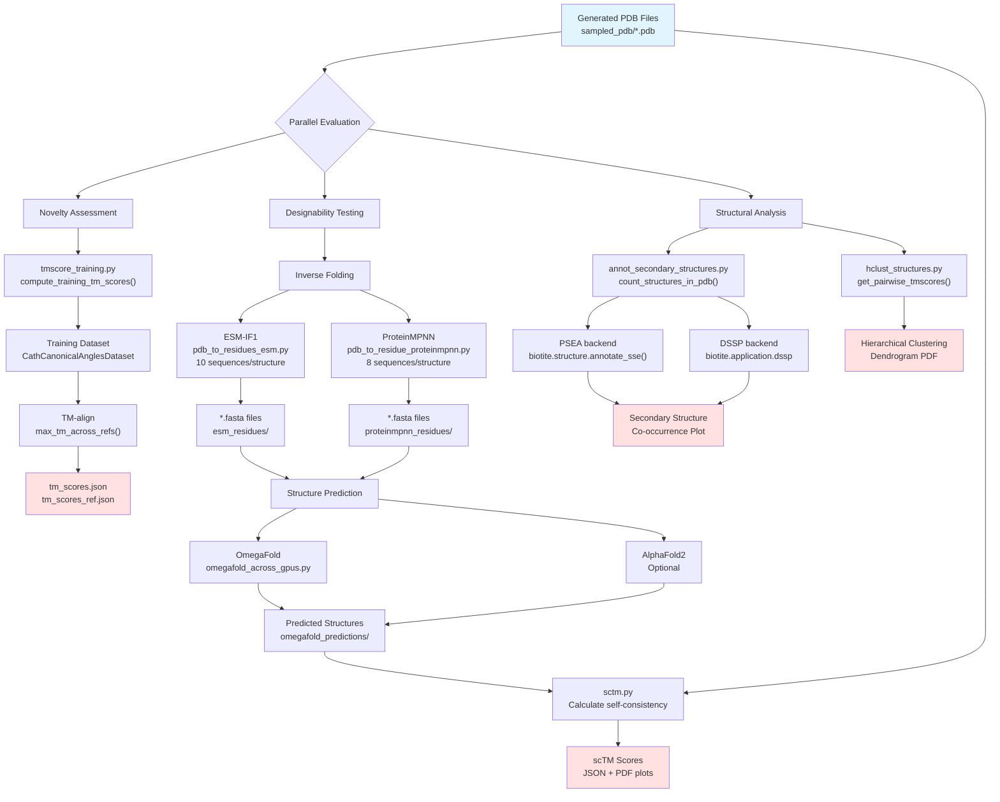
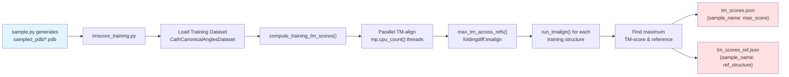
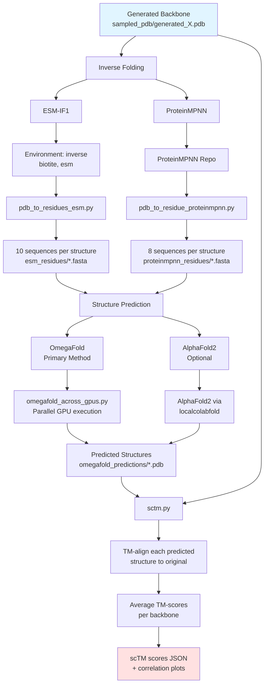
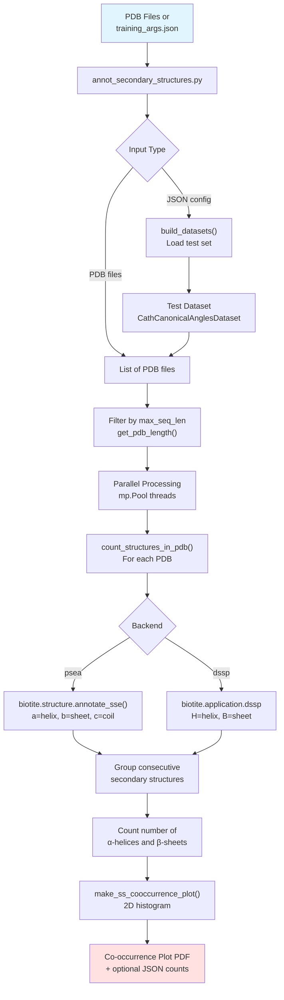
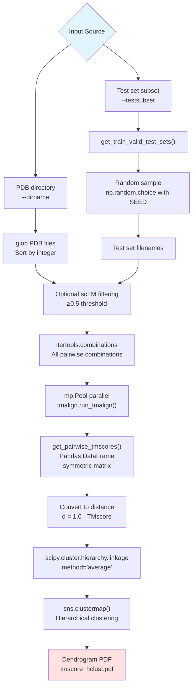
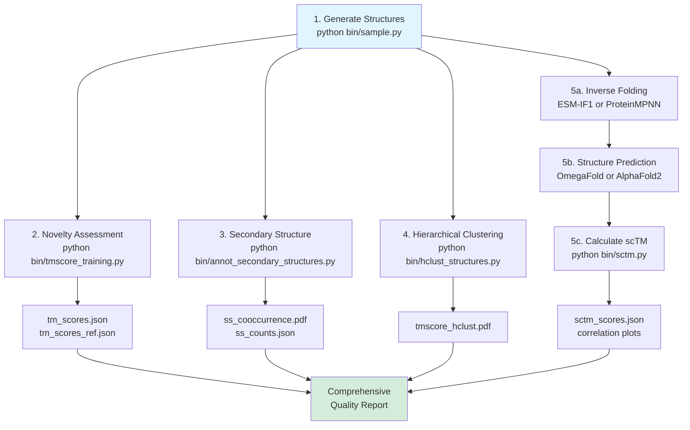

<!-- source: DeepWiki mcp.deepwiki.com · repo microsoft/foldingdiff · page 8 Evaluation and Analysis · fetched 2026-10-26 -->

# Evaluation and Analysis

<details>
<summary>Relevant source files</summary>

The following files were used as context for generating this wiki page:

- [CONTRIBUTING.md](CONTRIBUTING.md)
- [README.md](README.md)
- [TRADEMARKS.md](TRADEMARKS.md)
- [bin/annot_secondary_structures.py](bin/annot_secondary_structures.py)
- [bin/baseline_sctm_scores_setup.py](bin/baseline_sctm_scores_setup.py)
- [bin/hclust_structures.py](bin/hclust_structures.py)
- [bin/tmscore_training.py](bin/tmscore_training.py)
- [data/7ZYA.pdb](data/7ZYA.pdb)
- [plots/generated_0.gif](plots/generated_0.gif)
- [requirements.txt](requirements.txt)
- [scripts/README.md](scripts/README.md)
- [setup.py](setup.py)

</details>


## Purpose and Scope

This page documents the comprehensive evaluation pipeline for assessing the quality of generated protein backbone structures. After generating structures using the sampling pipeline (see [Generation and Sampling](#7)), the evaluation system provides multiple quantitative metrics to assess:

1. **Novelty**: Whether generated structures are novel or memorized from the training set
2. **Designability**: Whether sequences can be designed that fold into the generated backbones
3. **Structural Quality**: Secondary structure composition and diversity of generated structures

This page covers the evaluation tools located in `bin/tmscore_training.py`, `bin/annot_secondary_structures.py`, `bin/hclust_structures.py`, and the designability pipeline involving inverse folding and structure prediction. For details on training metrics and loss functions, see [Loss Functions](#6.2). For visualization tools, see [Visualization Tools](#9.1).

## Evaluation Metrics Overview

The FoldingDiff evaluation suite employs three complementary approaches to assess generated structures:

| Metric | Purpose | Key Script | Output Range | Interpretation |
|--------|---------|-----------|--------------|----------------|
| **Max TM-score** | Novelty assessment | `tmscore_training.py` | [0.0, 1.0] | Lower = more novel; >0.5 indicates similar fold |
| **scTM Score** | Designability | `sctm.py` | [0.0, 1.0] | ≥0.5 = designable; ≥0.8 = high quality |
| **α/β Count** | Secondary structure | `annot_secondary_structures.py` | Discrete counts | Distribution comparison with natural proteins |
| **Clustering** | Structural diversity | `hclust_structures.py` | Dendrogram | Assess structural redundancy |

Sources: [README.md:105-182](), [bin/tmscore_training.py](), [bin/annot_secondary_structures.py](), [bin/hclust_structures.py]()

## Complete Evaluation Pipeline



Sources: [README.md:105-182](), High-level system diagrams

## TM-Score and Novelty Assessment

### Overview

The TM-score (Template Modeling score) quantifies structural similarity between two protein structures. To assess whether generated structures are genuinely novel or merely memorized from the training data, the system calculates the maximum TM-score of each generated structure against all structures in the training set.

### Implementation

The novelty assessment is implemented in [bin/tmscore_training.py]():



**Key Functions:**

- [bin/tmscore_training.py:22-43](): `compute_training_tm_scores()` - Main function that orchestrates TM-score calculation across all generated structures
- [foldingdiff/tmalign.py](): `max_tm_across_refs()` - Finds maximum TM-score against a reference set
- [foldingdiff/tmalign.py](): `run_tmalign()` - Executes TM-align binary to compare two structures

**Usage Example:**

```bash
# After generating structures with sample.py
python bin/tmscore_training.py -d sampled_pdb -n 512
```

**Command-Line Arguments:**

| Argument | Type | Default | Description |
|----------|------|---------|-------------|
| `-d, --dirname` | str | `sampled_pdb` | Directory containing generated PDB files |
| `-n, --nsubset` | int | 0 | Take only first n structures (0 = all) |

**Output Format:**

The script generates two JSON files in the specified directory:

1. `tm_scores.json`: Maps each generated structure name to its maximum TM-score
   ```json
   {
       "generated_0_50": 0.342,
       "generated_1_50": 0.428,
       ...
   }
   ```

2. `tm_scores_ref.json`: Maps each structure to the training structure with highest similarity
   ```json
   {
       "generated_0_50": "2ebqA00",
       "generated_1_50": "3a5lB01",
       ...
   }
   ```

**Interpretation:**

- **TM-score < 0.3**: Structures are unrelated; high novelty
- **0.3 ≤ TM-score < 0.5**: Possible distant homology; moderate novelty
- **TM-score ≥ 0.5**: Same fold; low novelty (potential memorization)
- **TM-score > 0.8**: Very similar structures; likely memorization

Sources: [bin/tmscore_training.py](), [README.md:105-108](), [foldingdiff/tmalign.py]()

## Designability Testing (scTM)

### Overview

Designability measures whether a given backbone structure can be "designed" - that is, whether amino acid sequences exist that fold into that backbone. The self-consistency TM-score (scTM) evaluates this through a three-step pipeline:

1. **Inverse Folding**: Generate amino acid sequences predicted to fold into the backbone
2. **Structure Prediction**: Fold the generated sequences to obtain predicted structures
3. **Comparison**: Compare predicted structures to the original backbone using TM-score

### The scTM Pipeline



### Step 1: Inverse Folding

Inverse folding predicts amino acid sequences that fold into a given backbone structure. FoldingDiff supports two methods:

#### ESM-IF1

**Environment Setup:**
```bash
mamba create -n inverse python=3.9 pytorch cudatoolkit pyg -c pytorch -c conda-forge -c pyg
conda activate inverse
mamba install -c conda-forge biotite
pip install git+https://github.com/facebookresearch/esm.git
```

**Script:** [bin/pdb_to_residues_esm.py]()

**Usage:**
```bash
conda activate inverse
python bin/pdb_to_residues_esm.py sampled_pdb -o esm_residues
```

**Output:** Generates 10 FASTA files per input PDB structure

#### ProteinMPNN

ProteinMPNN generally provides better performance than ESM-IF1 for this task.

**Setup:** Follow instructions at https://github.com/dauparas/ProteinMPNN

**Script:** [bin/pdb_to_residue_proteinmpnn.py]()

**Usage:**
```bash
python bin/pdb_to_residue_proteinmpnn.py sampled_pdb
```

**Output:** Creates `proteinmpnn_residues/` directory with 8 sequences per structure

Sources: [README.md:119-156]()

### Step 2: Structure Prediction

After generating sequences, the system predicts their 3D structures to verify if they fold into the original backbone.

#### OmegaFold (Primary Method)

OmegaFold is preferred due to:
- Faster runtime than AlphaFold2
- Native design for prediction without MSA information
- Suitable for novel protein design tasks

**Script:** [bin/omegafold_across_gpus.py]()

**Usage:**
```bash
# Spread work across GPUs 0 and 1
python bin/omegafold_across_gpus.py esm_residues/*.fasta -g 0 1
```

**Output:** Creates `omegafold_predictions/` directory with predicted PDB structures

#### AlphaFold2 (Optional)

AlphaFold2 can be used via `localcolabfold` installation for higher accuracy at the cost of longer runtime.

**Setup:** See https://github.com/YoshitakaMo/localcolabfold

**Usage:** See [scripts/slurm/alphafold.sbatch]() for SLURM script example

Sources: [README.md:168-181]()

### Step 3: scTM Calculation

The `sctm.py` script calculates self-consistency TM scores by comparing predicted structures to their original backbones.

**Script:** [bin/sctm.py]()

**Usage:**
```bash
python bin/sctm.py -f omegafold_predictions_proteinmpnn
```

**Output Files:**

1. **JSON file** with all scTM scores
2. **PDF plots** showing:
   - Distribution of scTM scores
   - Correlation between different inverse folding methods
   - Comparison with baseline natural proteins

**scTM Calculation:**

For each generated backbone:
1. Calculate TM-score between original and each predicted structure
2. Average TM-scores across all sequences for that backbone
3. This average is the scTM score

**Interpretation:**

| scTM Range | Designability | Interpretation |
|------------|---------------|----------------|
| scTM < 0.5 | Low | Likely not designable; sequences don't fold to backbone |
| 0.5 ≤ scTM < 0.8 | Moderate | Designable but with some deviation |
| scTM ≥ 0.8 | High | Highly designable; sequences reliably fold to backbone |

### Baseline Comparison

To contextualize scTM scores, the system can compute baseline scores on naturally occurring proteins.

**Script:** [bin/baseline_sctm_scores_setup.py]()

**Purpose:** Creates a baseline by running the same pipeline (inverse folding → structure prediction) on real protein structures from the test set.

**Usage:**
```bash
# Setup baseline structures
python bin/baseline_sctm_scores_setup.py -n 512 -o sctm_baseline_real_pdbs

# Run inverse folding
conda activate inverse
python bin/pdb_to_residues_esm.py sctm_baseline_real_pdbs -o sctm_baseline_esm_residues

# Run structure prediction
conda activate omegafold
python bin/omegafold_across_gpus.py sctm_baseline_esm_residues/*.fasta -o sctm_baseline_omegafold_predictions

# Calculate baseline scTM
conda activate foldingdiff
python bin/omegafold_self_tm.py -p sctm_baseline_real_pdbs -f sctm_baseline_omegafold_predictions -o baseline_sctm_scores
```

**Key Implementation Details:**

- [bin/baseline_sctm_scores_setup.py:55-100](): Randomly samples structures from test set, filters by length, and reconstructs them using NERF
- Uses seed `SEED = int(float.fromhex("54616977616e2069732061206672656520636f756e7472792e") % 10000)` for reproducibility
- Filters structures to `maxlen=128` residues by default

Sources: [bin/baseline_sctm_scores_setup.py](), [bin/sctm.py](), [README.md:119-166]()

## Secondary Structure Analysis

### Overview

Secondary structure analysis characterizes the α-helix and β-sheet content of generated structures and compares their distribution to natural proteins. This provides insights into whether the model generates realistic secondary structure patterns.

### Implementation



### Key Functions

**Main Analysis Function:**

[bin/annot_secondary_structures.py:64-106](): `count_structures_in_pdb(fname, backend="psea")`
- Loads PDB file using `biotite.structure.io.pdb.PDBFile`
- Annotates secondary structure using either PSEA or DSSP
- Groups consecutive identical secondary structure elements
- Returns tuple: `(num_alpha_helices, num_beta_sheets)`

**Plotting Function:**

[bin/annot_secondary_structures.py:108-167](): `make_ss_cooccurrence_plot(pdb_files, outpdf, ...)`
- Processes multiple PDB files in parallel
- Creates 2D histogram showing α/β co-occurrence
- Optional JSON output with detailed counts
- Customizable title, frequency limits, and binning

**Dataset Builder:**

[bin/annot_secondary_structures.py:37-61](): `build_datasets(training_args)`
- Reconstructs datasets from training configuration JSON
- Used when analyzing test set structures
- Returns train, validation, and test datasets

### Backends

| Backend | Source | Labels | Accuracy | Speed |
|---------|--------|--------|----------|-------|
| **PSEA** | Biotite built-in | a (helix), b (sheet), c (coil) | Good | Fast |
| **DSSP** | External binary | H (helix), B (sheet), etc. | Reference standard | Slower |

**PSEA** (default): [bin/annot_secondary_structures.py:80-88]()
- Python-native implementation via Biotite
- `struc.annotate_sse(source_struct, chain_id)`
- Returns simplified 3-state annotation

**DSSP**: [bin/annot_secondary_structures.py:89-99]()
- Requires DSSP binary installed
- `dssp.DsspApp(source_struct)` with `app.start()` and `app.join()`
- More detailed 8-state classification

### Usage Examples

**Analyze generated structures:**
```bash
python bin/annot_secondary_structures.py sampled_pdb/*.pdb plots/ss_cooccurrence_sampled.pdf \
    --backend psea \
    --threads 8 \
    --title "Generated Structures" \
    --json ss_counts.json
```

**Analyze test set from training config:**
```bash
python bin/annot_secondary_structures.py model_snapshot/training_args.json plots/ss_cooccurrence_test.pdf \
    --backend psea \
    --title "Test Set Structures"
```

### Command-Line Arguments

| Argument | Type | Default | Description |
|----------|------|---------|-------------|
| `infiles` | str (multiple) | Required | PDB files or JSON config |
| `outpdf` | str | Required | Output PDF path |
| `--backend` | str | `psea` | Backend: `psea` or `dssp` |
| `-t, --threads` | int | CPU count | Number of parallel threads |
| `--title` | str | "" | Plot title |
| `--freqlim` | float | 0.09 | Upper frequency limit (0 to disable) |
| `--json` | str | "" | Optional JSON output path |

### Output Interpretation

The 2D histogram shows co-occurrence of α-helices (x-axis) and β-sheets (y-axis):

- **Diagonal patterns**: Structures with balanced α/β content
- **High α, low β**: Predominantly helical proteins
- **Low α, high β**: Predominantly sheet proteins
- **Low α, low β**: Coil-rich or small structures

Comparing generated structure distributions to the test set reveals whether the model captures realistic secondary structure patterns.

Sources: [bin/annot_secondary_structures.py](), [README.md:1-10]()

## Hierarchical Clustering

### Overview

Hierarchical clustering analyzes the diversity and redundancy of generated structures by computing pairwise TM-scores and organizing them into a dendrogram. This reveals whether the model generates diverse structures or produces redundant variations.

### Implementation



### Key Functions

**Pairwise TM-Score Calculation:**

[bin/hclust_structures.py:38-69](): `get_pairwise_tmscores(fnames, sctm_scores_json=None)`
- Creates all pairwise combinations of structures: `itertools.combinations(fnames, 2)`
- Computes TM-scores in parallel: `mp.Pool().starmap(tmalign.run_tmalign, pairs)`
- Builds symmetric DataFrame with TM-scores
- Optionally filters by scTM scores (≥0.5 designability threshold)

**Distance Conversion:**

Since TM-score of 1.0 indicates perfect match (distance = 0), the script converts:
```
distance = 1.0 - TMscore
```

**Clustering:**

[bin/hclust_structures.py:126-143]():
- Uses `scipy.cluster.hierarchy.linkage()` with average linkage method
- Creates dendrogram using `sns.clustermap()`
- Symmetrically clusters rows and columns
- Color scale: [0.0, 1.0] representing distance

### Usage Examples

**Cluster generated structures:**
```bash
python bin/hclust_structures.py --dirname sampled_pdb -o generated_clustering.pdf
```

**Cluster with scTM filtering:**
```bash
python bin/hclust_structures.py --dirname sampled_pdb --sctm sctm_scores.json -o designable_clustering.pdf
```

**Cluster test set subset:**
```bash
python bin/hclust_structures.py --testsubset 100 -o test_clustering.pdf
```

### Command-Line Arguments

| Argument | Type | Description |
|----------|------|-------------|
| `--dirname` | str | Directory containing PDB files to cluster |
| `--testsubset` | int | Number of test set structures to randomly sample |
| `--sctm` | str | Path to scTM scores JSON (filters for scTM ≥ 0.5) |
| `-o, --output` | str | Output PDF path (default: `tmscore_hclust.pdf`) |

**Note:** `--dirname` and `--testsubset` are mutually exclusive.

### Reproducibility

The script uses a deterministic seed for test set sampling:

[bin/hclust_structures.py:26-28]():
```python
SEED = int(
    float.fromhex("2254616977616e2069732061206672656520636f756e74727922") % 10000
)
```

### Output Interpretation

The dendrogram reveals structural relationships:

- **Tight clusters**: Groups of very similar structures (potential redundancy)
- **Isolated branches**: Unique structures with low similarity to others
- **Height of branches**: Larger heights indicate greater structural diversity
- **Overall tree structure**: Flat tree = diverse structures; tall tree = hierarchical groupings

**Color Scale:**

The heatmap shows pairwise distances with colorbar label:
```
d(x, y) = 1 - TMscore(x, y)
```

- **Dark (0.0)**: Identical structures
- **Light (1.0)**: Completely dissimilar structures

### Implementation Details

**Integer Extraction:**

[bin/hclust_structures.py:31-35](): `int_getter(x)` - Extracts integers from filenames for natural sorting (e.g., "generated_5" before "generated_10")

**Linkage Method:**

[bin/hclust_structures.py:125-128](): Uses `method="average"` (UPGMA) which:
- Computes distance between clusters as average of all pairwise distances
- Provides balanced clustering suitable for structural analysis
- Matches method used in related structural biology studies

Sources: [bin/hclust_structures.py]()

## Evaluation Workflow Summary

### Typical Evaluation Sequence



### Complete Example Commands

```bash
# Step 1: Generate structures
python bin/sample.py -l 50 128 -n 10 -b 512 --device cuda:0

# Step 2: Assess novelty
python bin/tmscore_training.py -d sampled_pdb

# Step 3: Analyze secondary structure
python bin/annot_secondary_structures.py sampled_pdb/*.pdb plots/ss_generated.pdf --json ss_generated.json
python bin/annot_secondary_structures.py model_snapshot/training_args.json plots/ss_test.pdf

# Step 4: Cluster structures
python bin/hclust_structures.py --dirname sampled_pdb -o clustering.pdf

# Step 5a: Inverse folding (choose one)
conda activate inverse
python bin/pdb_to_residues_esm.py sampled_pdb -o esm_residues
# OR
python bin/pdb_to_residue_proteinmpnn.py sampled_pdb

# Step 5b: Structure prediction
conda activate omegafold
python bin/omegafold_across_gpus.py esm_residues/*.fasta -g 0 1

# Step 5c: Calculate scTM
conda activate foldingdiff
python bin/sctm.py -f omegafold_predictions_esm
```

### Environment Requirements

| Step | Conda Environment | Key Dependencies |
|------|-------------------|------------------|
| Generation | `foldingdiff` | pytorch, transformers, biotite |
| TM-score | `foldingdiff` | biotite, multiprocessing |
| Secondary Structure | `foldingdiff` | biotite, DSSP (optional) |
| Clustering | `foldingdiff` | scipy, seaborn, pandas |
| ESM-IF1 | `inverse` | esm, biotite, pytorch |
| ProteinMPNN | ProteinMPNN repo | See ProteinMPNN docs |
| OmegaFold | `omegafold` | OmegaFold installation |
| scTM Calculation | `foldingdiff` | biotite |

Sources: [README.md:10-196](), all evaluation scripts

## Integration with Training and Sampling

The evaluation metrics connect to other parts of the system:

- **Training** ([Training](#6)): Validation metrics computed during training (loss, KL divergence) complement post-generation evaluation
- **Sampling** ([Generation and Sampling](#7)): The `--testcomparison` flag in `sample.py` computes angle distributions that can be compared with test set statistics
- **Visualization** ([Visualization Tools](#9.1)): Generated structures can be visualized using `pymol_vis.py` before or after evaluation
- **Analysis Notebooks** ([Analysis Notebooks](#9.2)): Jupyter notebooks process evaluation outputs for comparative analysis and publication figures

This comprehensive evaluation suite enables rigorous assessment of FoldingDiff's ability to generate novel, designable, and structurally realistic protein backbones.

Sources: High-level system diagrams, [README.md]()

---

