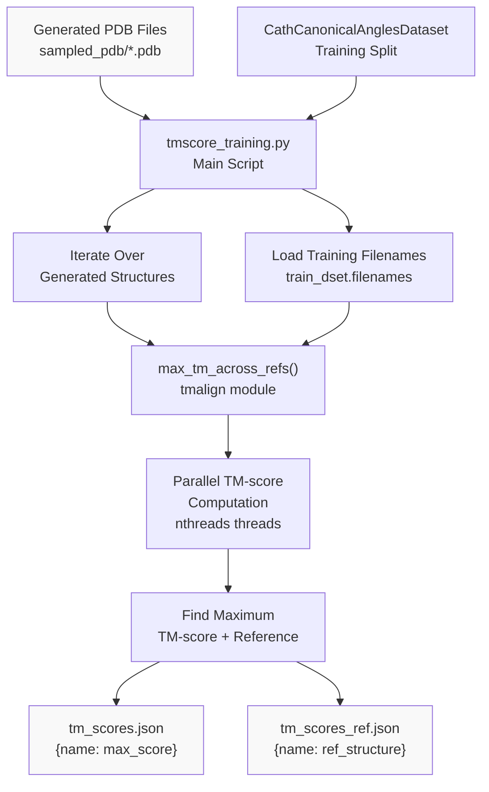
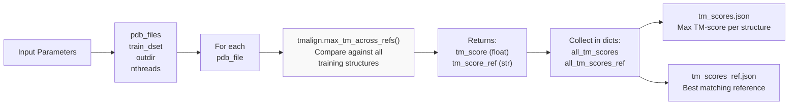
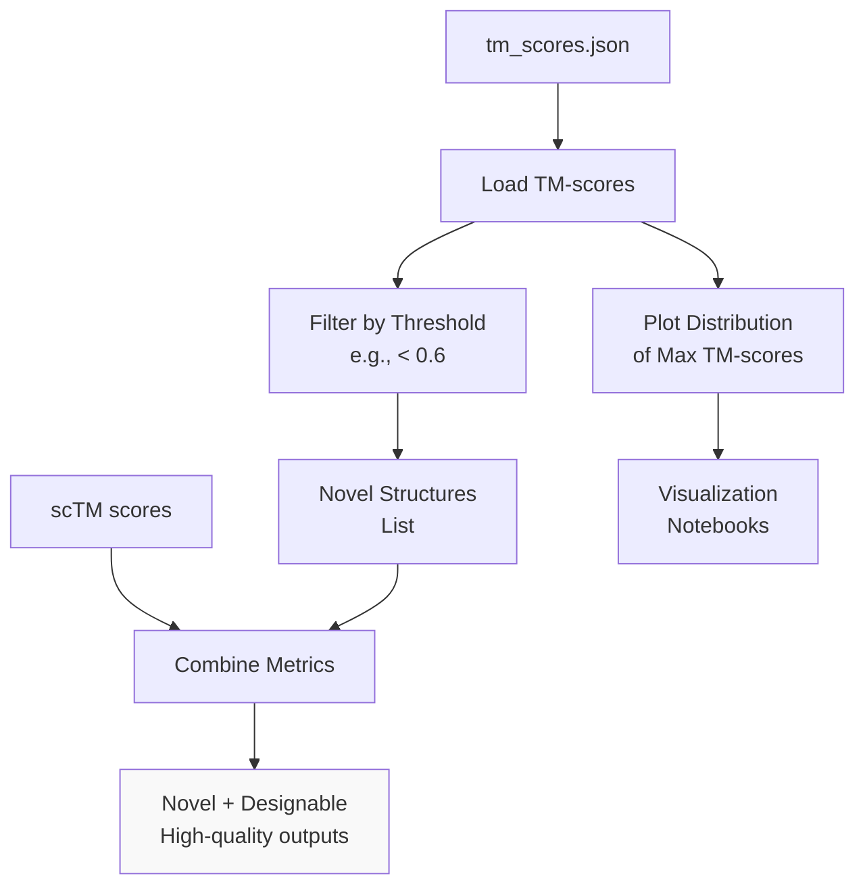
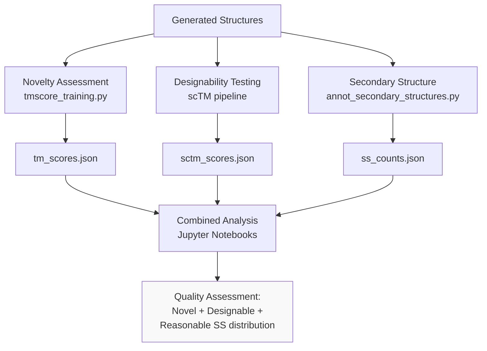

<!-- source: DeepWiki mcp.deepwiki.com · repo microsoft/foldingdiff · page 8.1 TM-Score and Novelty Assessment · fetched 2026-10-26 -->

# TM-Score and Novelty Assessment

<details>
<summary>Relevant source files</summary>

The following files were used as context for generating this wiki page:

- [bin/annot_secondary_structures.py](bin/annot_secondary_structures.py)
- [bin/baseline_sctm_scores_setup.py](bin/baseline_sctm_scores_setup.py)
- [bin/hclust_structures.py](bin/hclust_structures.py)
- [bin/tmscore_training.py](bin/tmscore_training.py)
- [data/7ZYA.pdb](data/7ZYA.pdb)

</details>


## Purpose and Scope

This document describes the **novelty assessment pipeline** for evaluating generated protein structures. Novelty is measured by computing the maximum TM-score of each generated structure against all structures in the training set. Lower TM-scores indicate that a generated structure is more novel and less likely to be a memorized copy from the training data.

For information about designability testing using self-consistency TM-scores (scTM), see [Designability Testing (scTM)](#8.2). For hierarchical clustering analysis using TM-scores, see [Hierarchical Clustering](#8.4).

---

## TM-Score as a Novelty Metric

**TM-score** (Template Modeling score) is a structural alignment metric that ranges from 0 to 1, where 1 indicates perfect structural alignment and lower values indicate greater structural dissimilarity. In the context of generative models, TM-score serves as a critical novelty metric:

- **High TM-score (≥0.8)**: Generated structure is very similar to a training example, suggesting potential memorization
- **Moderate TM-score (0.5-0.8)**: Structure shares some similarity with training data but has distinct features
- **Low TM-score (<0.5)**: Structure is highly novel and structurally distinct from training examples

The **maximum TM-score** across all training structures provides a conservative estimate of novelty—if even the most similar training structure has a low TM-score, the generated structure is genuinely novel.

---

## Novelty Assessment Pipeline

The novelty assessment workflow computes TM-scores between generated structures and the entire training set:



**Diagram: Novelty Assessment Workflow**

Sources: [bin/tmscore_training.py:1-91]()

---

## Running Novelty Assessment

### Basic Usage

The `tmscore_training.py` script computes maximum TM-scores for all PDB files in a directory:

```bash
python bin/tmscore_training.py -d sampled_pdb/
```

This will:
1. Find all `*.pdb` files in the `sampled_pdb/` directory
2. Load the training set filenames from `CathCanonicalAnglesDataset`
3. Compute maximum TM-score for each generated structure
4. Write results to `sampled_pdb/tm_scores.json` and `sampled_pdb/tm_scores_ref.json`

### Command-Line Arguments

| Argument | Default | Description |
|----------|---------|-------------|
| `-d`, `--dirname` | `./sampled_pdb` | Directory containing generated PDB files |
| `-n`, `--nsubset` | `0` | Process only first N files (0 = all) |

Sources: [bin/tmscore_training.py:45-59]()

---

## Implementation Details

### Core Function: `compute_training_tm_scores`

The main computation is performed by the `compute_training_tm_scores` function:



**Diagram: compute_training_tm_scores Function Flow**

The function signature is:

```python
def compute_training_tm_scores(
    pdb_files: Collection[str],
    train_dset,
    outdir: Path,
    nthreads: int = mp.cpu_count(),
)
```

Key aspects:
- **Parallel computation**: Uses `nthreads` threads for TM-align calculations
- **Training dataset**: Requires a dataset object with a `filenames` attribute containing paths to training PDB files
- **Output format**: Two JSON files mapping structure names to scores and reference structures

Sources: [bin/tmscore_training.py:22-42]()

### Training Dataset Access

The script creates a minimal `CathCanonicalAnglesDataset` to access training filenames:

```python
train_dset = CathCanonicalAnglesDataset(split="train")
```

This dataset object is used solely to provide the list of training structure filenames via `train_dset.filenames`. The specific dataset parameters (e.g., `min_seq_len`, `max_seq_len`, noising settings) don't affect novelty assessment since only filenames are needed.

Sources: [bin/tmscore_training.py:82-85]()

### TM-Align Module Integration

The actual TM-score computation is delegated to the `tmalign` module through the `max_tm_across_refs` function:

```python
tm_score, tm_score_ref = tmalign.max_tm_across_refs(
    fname,
    train_dset.filenames,
    n_threads=nthreads,
)
```

This function:
1. Takes a query PDB file (`fname`)
2. Compares it against all reference structures (`train_dset.filenames`)
3. Returns the maximum TM-score found and the corresponding reference structure filename
4. Parallelizes computation across `n_threads` threads

Sources: [bin/tmscore_training.py:32-36]()

---

## Output Format

### tm_scores.json

Contains the maximum TM-score for each generated structure:

```json
{
    "sample_0000": 0.7234,
    "sample_0001": 0.4891,
    "sample_0002": 0.8123,
    ...
}
```

Keys are structure names (without `.pdb` extension), values are floating-point TM-scores.

### tm_scores_ref.json

Contains the filename of the training structure with the highest TM-score:

```json
{
    "sample_0000": "/path/to/training/structure_1234.pdb",
    "sample_0001": "/path/to/training/structure_5678.pdb",
    ...
}
```

This allows identification of which training structure each generated structure most closely resembles.

Sources: [bin/tmscore_training.py:39-42]()

---

## Interpreting Novelty Results

### Novelty Thresholds

Based on structural biology conventions:

| TM-Score Range | Interpretation | Novelty Assessment |
|----------------|----------------|-------------------|
| ≥ 0.8 | Very high similarity | **Low novelty** - potential memorization |
| 0.5 - 0.8 | Moderate similarity | **Medium novelty** - shares fold family |
| < 0.5 | Low similarity | **High novelty** - structurally distinct |

### Analysis Workflow

After computing TM-scores, typical analysis includes:

1. **Distribution analysis**: Plot histogram of maximum TM-scores
2. **Threshold filtering**: Identify highly novel structures (e.g., max TM-score < 0.6)
3. **Reference inspection**: Examine which training structures are most similar
4. **Combined metrics**: Use with scTM scores to identify novel AND designable structures



**Diagram: Post-Processing Novelty Results**

Sources: [bin/tmscore_training.py:29-42]()

---

## Performance Considerations

### Computational Cost

TM-score computation is expensive:
- **Per-structure cost**: O(N × L²) where N is training set size (~18,000 structures) and L is sequence length
- **Parallel scaling**: Uses multiprocessing across all available CPU cores by default
- **Typical runtime**: Several minutes to hours depending on the number of generated structures

### Optimization Strategies

1. **Subset testing**: Use `-n` flag to test on a small subset first
2. **Thread control**: Adjust `nthreads` parameter based on available CPU cores
3. **Length filtering**: The training dataset initialization can filter by `min_seq_len` if needed

Sources: [bin/tmscore_training.py:22-28](), [bin/tmscore_training.py:58-77]()

---

## Integration with Evaluation Pipeline

The novelty assessment is typically one component of a multi-faceted evaluation:



**Diagram: Novelty in Broader Evaluation Context**

For complete evaluation workflows:
- **Designability testing**: See [Designability Testing (scTM)](#8.2)
- **Secondary structure analysis**: See [Secondary Structure Analysis](#8.3)
- **Structural clustering**: See [Hierarchical Clustering](#8.4)

Sources: [bin/tmscore_training.py:1-91](), [bin/hclust_structures.py:38-69]()

---

## Related Scripts and Modules

### Dependencies

| Module/Script | Role |
|--------------|------|
| `foldingdiff.tmalign` | TM-score computation engine |
| `foldingdiff.datasets.CathCanonicalAnglesDataset` | Training set access |
| `bin/sample.py` | Generates structures to evaluate |

### Related Evaluation Tools

The TM-score is also used in:
- **Hierarchical clustering** ([bin/hclust_structures.py:38-69]()): Computes pairwise TM-scores for clustering analysis
- **Baseline comparisons** ([bin/baseline_sctm_scores_setup.py]()): Natural protein structures as evaluation baselines

Sources: [bin/tmscore_training.py:18-19](), [bin/hclust_structures.py:23]()

---

