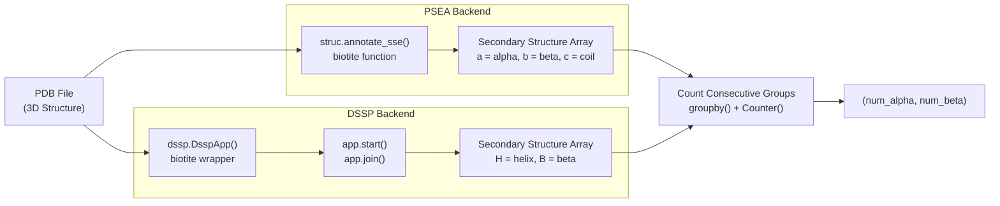
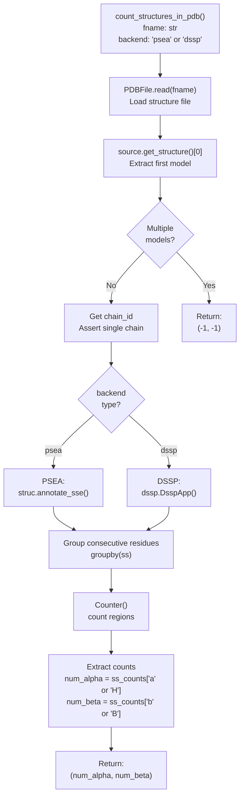
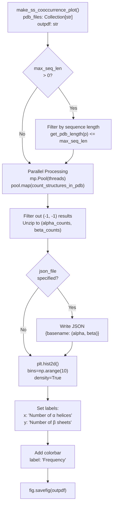
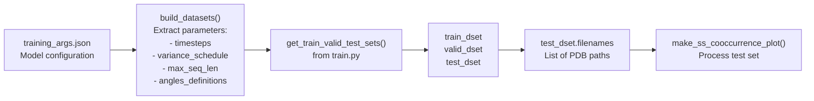
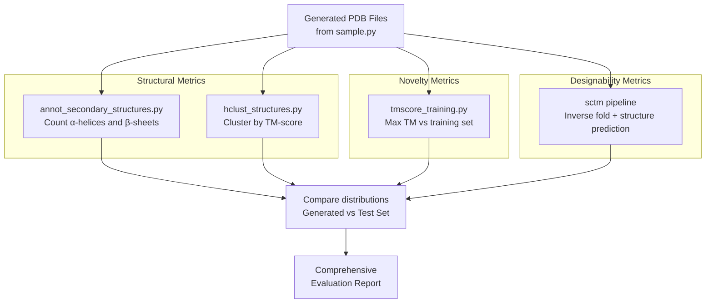

<!-- source: DeepWiki mcp.deepwiki.com · repo microsoft/foldingdiff · page 8.3 Secondary Structure Analysis · fetched 2026-10-26 -->

# Secondary Structure Analysis

<details>
<summary>Relevant source files</summary>

The following files were used as context for generating this wiki page:

- [bin/annot_secondary_structures.py](bin/annot_secondary_structures.py)
- [bin/baseline_sctm_scores_setup.py](bin/baseline_sctm_scores_setup.py)
- [bin/hclust_structures.py](bin/hclust_structures.py)
- [bin/tmscore_training.py](bin/tmscore_training.py)
- [data/7ZYA.pdb](data/7ZYA.pdb)

</details>


## Purpose and Scope

This document covers the secondary structure annotation system used to analyze α-helices and β-sheets in protein structures. The primary implementation is in [bin/annot_secondary_structures.py](), which counts secondary structure elements and generates co-occurrence plots to characterize the structural composition of protein backbones. 

For evaluating structural similarity and novelty, see [TM-Score and Novelty Assessment](#8.1). For designability metrics based on inverse folding, see [Designability Testing (scTM)](#8.2). For clustering structures based on similarity, see [Hierarchical Clustering](#8.4).

---

## Overview

Secondary structure analysis characterizes proteins by counting their α-helices and β-sheets. This provides insight into the structural composition of generated proteins compared to natural proteins in the training set. The system supports two computational backends (PSEA and DSSP) and can process individual PDB files or entire datasets in parallel.

**Key Components:**

| Component | File Location | Purpose |
|-----------|--------------|---------|
| Main Script | [bin/annot_secondary_structures.py]() | Entry point for secondary structure annotation |
| Structure Counting | [bin/annot_secondary_structures.py:64-105]() | Counts α-helices and β-sheets using PSEA or DSSP |
| Co-occurrence Plotting | [bin/annot_secondary_structures.py:108-167]() | Creates 2D histogram of helix/sheet counts |
| Dataset Integration | [bin/annot_secondary_structures.py:37-61]() | Analyzes training/test set structures |

Sources: [bin/annot_secondary_structures.py]()

---

## Backend Methods: PSEA vs DSSP

The system supports two algorithms for annotating secondary structures, each with different characteristics:



**Backend Comparison:**

| Feature | PSEA | DSSP |
|---------|------|------|
| Implementation | Pure Python (biotite) | External program wrapper |
| Speed | Faster | Slower (requires subprocess) |
| Default | ✓ Yes | No |
| Helix Label | `"a"` | `"H"` |
| Sheet Label | `"b"` | `"B"` |
| Code Location | [bin/annot_secondary_structures.py:80-88]() | [bin/annot_secondary_structures.py:89-99]() |

**PSEA Backend Logic** [bin/annot_secondary_structures.py:80-88]():
1. Calls `struc.annotate_sse(source_struct, chain_id)` from biotite
2. Returns array with labels: `'a'` (alpha), `'b'` (beta), `'c'` (coil)
3. Groups consecutive identical labels using `groupby()`
4. Counts number of separate regions for each type

**DSSP Backend Logic** [bin/annot_secondary_structures.py:89-99]():
1. Creates `dssp.DsspApp(source_struct)` instance
2. Executes external DSSP program with `app.start()` and `app.join()`
3. Retrieves results with `app.get_sse()`
4. Returns array with labels: `'H'` (helix), `'B'` (beta sheet)

Sources: [bin/annot_secondary_structures.py:64-105]()

---

## Secondary Structure Counting Pipeline

The `count_structures_in_pdb()` function implements the core counting logic:



**Key Implementation Details:**

1. **File Validation** [bin/annot_secondary_structures.py:68](): Verifies PDB file exists before processing

2. **Single Model Requirement** [bin/annot_secondary_structures.py:73-74](): Returns `(-1, -1)` for multi-model files, which are filtered out downstream

3. **Single Chain Assertion** [bin/annot_secondary_structures.py:76-78](): Ensures protein has exactly one chain

4. **Consecutive Grouping** [bin/annot_secondary_structures.py:84-85](): Uses `groupby(ss)` to identify separate regions of the same secondary structure type

5. **Safe Counting** [bin/annot_secondary_structures.py:87-88](): Uses dictionary lookup with default of 0 to avoid KeyError

Sources: [bin/annot_secondary_structures.py:64-105]()

---

## Co-occurrence Analysis and Visualization

The `make_ss_cooccurrence_plot()` function creates 2D histograms showing the joint distribution of α-helices and β-sheets:



**Parallel Processing Configuration** [bin/annot_secondary_structures.py:129-133]():
- Uses `multiprocessing.Pool` with configurable thread count (default: `mp.cpu_count()`)
- `functools.partial` applies backend parameter to all workers
- `chunksize=10` batches work for efficiency

**Histogram Configuration** [bin/annot_secondary_structures.py:152-159]():
- **Bins**: `np.arange(10)` creates bins [0,1), [1,2), ..., [9,10)
- **Normalization**: `density=True` converts counts to probability density
- **Color Range**: `vmin=0.0` with optional `vmax` parameter for frequency ceiling
- **Additional kwargs**: Passed through to `hist2d()` for customization

**Output Formats:**
1. **PDF Plot** [bin/annot_secondary_structures.py:166](): 2D histogram saved at 300 DPI
2. **JSON File** [bin/annot_secondary_structures.py:139-149]() (optional): Dictionary mapping `{basename: (alpha_count, beta_count)}`

Sources: [bin/annot_secondary_structures.py:108-167]()

---

## Integration with Datasets

The system can analyze structures from the test set by loading dataset configurations:



**Dataset Building** [bin/annot_secondary_structures.py:37-61]():
- Reconstructs datasets with identical parameters used during training
- Ensures consistency in filtering (min/max sequence length)
- Accesses `test_dset.filenames` for PDB file paths
- Uses `test_dset.dset.pad` for max sequence length filtering

**Key Parameters Preserved:**
- `timesteps`: Number of diffusion timesteps (affects dataset initialization)
- `variance_schedule`: Noise schedule type
- `max_seq_len` / `min_seq_len`: Sequence length bounds
- `angles_definitions`: Which angle features to extract

**Usage Pattern** [bin/annot_secondary_structures.py:220-236]():
```
# When single JSON file provided
if len(fnames) == 1 and fnames[0].endswith(".json"):
    training_args = json.load(fnames[0])
    _, _, test_dset = build_datasets(training_args)
    fnames = test_dset.filenames
```

Sources: [bin/annot_secondary_structures.py:37-61](), [bin/annot_secondary_structures.py:220-236]()

---

## Command-Line Interface

The script accepts flexible input formats via command-line arguments:

**Input Modes:**

| Mode | Example | Description |
|------|---------|-------------|
| PDB Files | `*.pdb` | Direct list of PDB files to analyze |
| JSON Config | `training_args.json` | Loads test set from model configuration |

**Arguments:**

| Argument | Type | Default | Description |
|----------|------|---------|-------------|
| `infiles` | str (nargs="+") | Required | PDB files or JSON config |
| `outpdf` | str | Required | Output PDF for co-occurrence plot |
| `--backend` | str | `"psea"` | Backend: "psea" or "dssp" |
| `--threads` | int | `mp.cpu_count()` | Number of parallel threads |
| `--title` | str | `""` | Custom title for plot |
| `--freqlim` | float | `0.09` | Upper frequency limit (0 to disable) |
| `--json` | str | `""` | Output JSON file for raw counts |

**Example Usage** [bin/annot_secondary_structures.py:7-9]():

```bash
# Analyze sampled structures
python bin/annot_secondary_structures.py \
    sampled_pdb/*.pdb \
    plots/ss_cooccurrence_sampled.pdf

# Analyze test set from training config
python bin/annot_secondary_structures.py \
    model_snapshot/training_args.json \
    plots/ss_cooccurrence_test.pdf

# With custom parameters
python bin/annot_secondary_structures.py \
    sampled_pdb/*.pdb \
    plots/output.pdf \
    --backend dssp \
    --threads 16 \
    --title "Generated Structures" \
    --freqlim 0.15 \
    --json ss_counts.json
```

Sources: [bin/annot_secondary_structures.py:169-211](), [bin/annot_secondary_structures.py:7-9]()

---

## Output Interpretation

**Co-occurrence Plot Characteristics:**

1. **Density Normalization**: Values represent probability density, not raw counts
2. **Frequency Interpretation**: Higher values indicate more common (α-helix, β-sheet) combinations
3. **Comparison Utility**: Generated structures can be compared against test set distributions

**Typical Patterns:**
- Natural proteins often show diverse combinations of helices and sheets
- Purely helical or sheet proteins appear as concentrations along axes
- Mixed α/β proteins show diagonal or scattered distributions

**Quality Indicators:**
- Generated structures should match test set distribution patterns
- Extreme outliers (e.g., 0 helices + 0 sheets) suggest structural issues
- Clustering in specific regions may indicate mode collapse

Sources: [bin/annot_secondary_structures.py:108-167]()

---

## Integration with Evaluation Pipeline

Secondary structure analysis complements other evaluation metrics:



**Related Analysis Scripts:**

- **[tmscore_training.py]()**: Computes novelty by comparing against training structures (see [TM-Score and Novelty Assessment](#8.1))
- **[hclust_structures.py]()**: Performs hierarchical clustering based on pairwise TM-scores (see [Hierarchical Clustering](#8.4))
- **scTM Pipeline**: Tests designability through inverse folding (see [Designability Testing (scTM)](#8.2))
- **[baseline_sctm_scores_setup.py]()**: Creates baseline secondary structure distributions from natural proteins

Sources: [bin/annot_secondary_structures.py](), [bin/tmscore_training.py](), [bin/hclust_structures.py](), [bin/baseline_sctm_scores_setup.py]()

---

