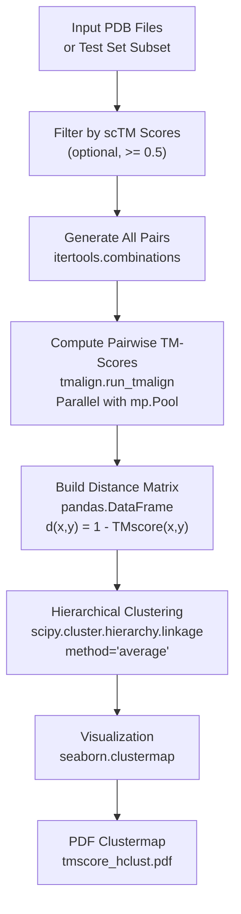
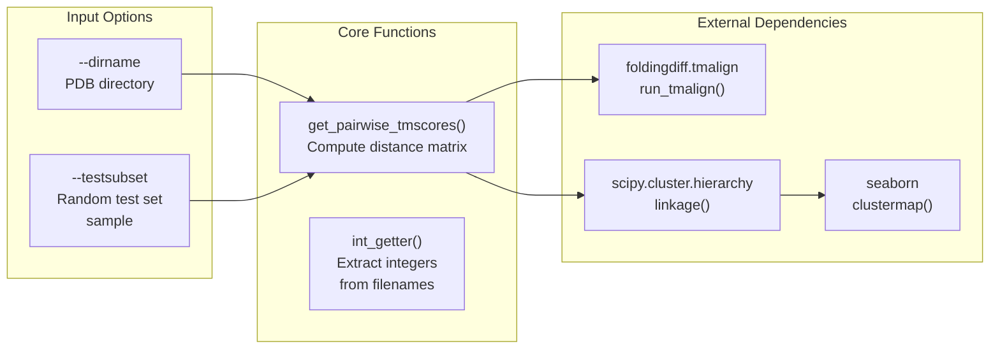
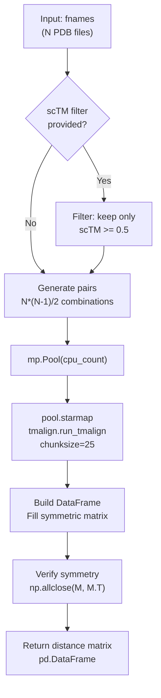
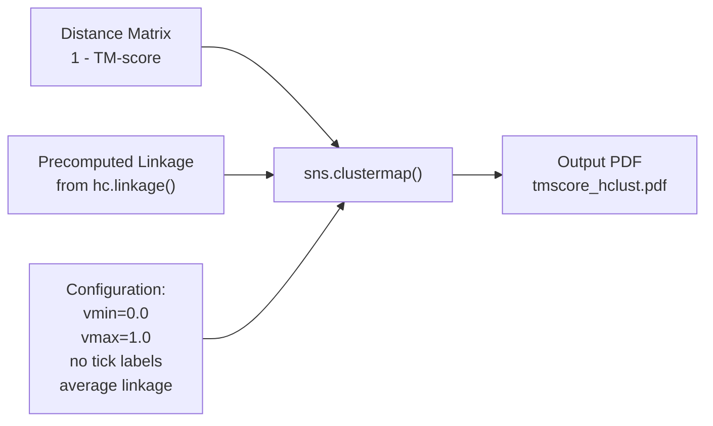
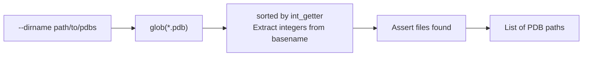
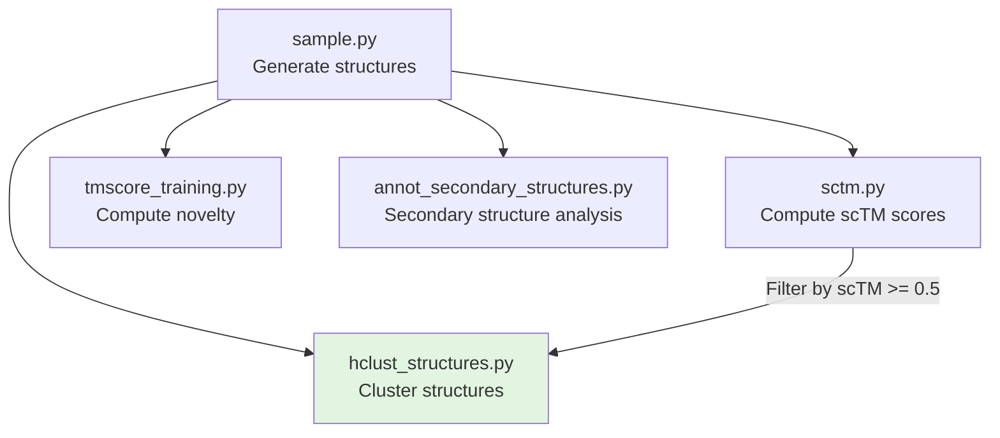

<!-- source: DeepWiki mcp.deepwiki.com · repo microsoft/foldingdiff · page 8.4 Hierarchical Clustering · fetched 2026-10-26 -->

# Hierarchical Clustering

<details>
<summary>Relevant source files</summary>

The following files were used as context for generating this wiki page:

- [bin/annot_secondary_structures.py](bin/annot_secondary_structures.py)
- [bin/baseline_sctm_scores_setup.py](bin/baseline_sctm_scores_setup.py)
- [bin/hclust_structures.py](bin/hclust_structures.py)
- [bin/tmscore_training.py](bin/tmscore_training.py)
- [data/7ZYA.pdb](data/7ZYA.pdb)

</details>


## Purpose and Scope

This page documents the hierarchical clustering functionality for protein structures based on TM-score similarity. The primary purpose is to group generated protein structures into clusters to assess structural diversity and identify redundant or similar structures.

For TM-score calculation against the training set for novelty assessment, see [TM-Score and Novelty Assessment](#8.1). For designability metrics using scTM scores, see [Designability Testing (scTM)](#8.2). For secondary structure analysis, see [Secondary Structure Analysis](#8.3).

**Sources:** [bin/hclust_structures.py:1-149]()

---

## Overview

The hierarchical clustering system analyzes collections of protein structures by:
1. Computing pairwise TM-scores between all structure pairs
2. Converting TM-scores to distance metrics
3. Performing hierarchical clustering using average linkage
4. Visualizing results as a clustermap heatmap

This enables assessment of structural diversity in generated protein samples and identification of structurally similar clusters.

**Sources:** [bin/hclust_structures.py:1-149]()

---

## Hierarchical Clustering Workflow



**Diagram: Complete hierarchical clustering pipeline from input PDB files to output visualization**

**Sources:** [bin/hclust_structures.py:38-143]()

---

## Core Components

### Main Script: hclust_structures.py

The script `bin/hclust_structures.py` provides the complete hierarchical clustering pipeline.



**Diagram: Key functions and dependencies in hclust_structures.py**

**Sources:** [bin/hclust_structures.py:1-149]()

---

## Pairwise TM-Score Computation

### Function: get_pairwise_tmscores()

This function computes the pairwise TM-scores between all input structures and returns a symmetric distance matrix.

| Parameter | Type | Description |
|-----------|------|-------------|
| `fnames` | `Collection[str]` | List of PDB file paths to analyze |
| `sctm_scores_json` | `Optional[str]` | JSON file containing scTM scores for filtering |
| **Returns** | `pd.DataFrame` | Symmetric matrix of pairwise distances (1 - TM-score) |

**Key Implementation Details:**
- Generates all unique pairs using `itertools.combinations(fnames, 2)` [bin/hclust_structures.py:57]()
- Parallel computation using `mp.Pool()` with `mp.cpu_count()` workers [bin/hclust_structures.py:58]()
- Uses `chunksize=25` for efficient work distribution [bin/hclust_structures.py:59]()
- Optional filtering: retains only structures with scTM >= 0.5 [bin/hclust_structures.py:51]()
- Constructs symmetric DataFrame initialized to 1.0 (diagonal) [bin/hclust_structures.py:64]()
- Fills both triangular halves to ensure symmetry [bin/hclust_structures.py:66-67]()



**Diagram: get_pairwise_tmscores() function logic flow**

**Sources:** [bin/hclust_structures.py:38-69]()

---

## Distance Metric

The hierarchical clustering uses a distance metric derived from TM-score:

**Distance Formula:**
```
d(x, y) = 1.0 - TMscore(x, y)
```

Where:
- TM-score = 1.0 indicates perfect structural match (distance = 0.0)
- TM-score = 0.0 indicates no structural similarity (distance = 1.0)
- TM-score range: [0, 1]
- Distance range: [0, 1]

This conversion is necessary because:
1. TM-score is a similarity metric (higher = more similar)
2. Hierarchical clustering requires distance metrics (lower = more similar)
3. The transformation preserves relative ordering

**Sources:** [bin/hclust_structures.py:121]()

---

## Clustering Algorithm

### Linkage Method

The system uses **average linkage** (UPGMA) for hierarchical clustering:

```python
linkage = hc.linkage(
    sp.distance.squareform(pdist_df), 
    method='average',
    optimal_ordering=False
)
```

**Linkage Method Details:**

| Parameter | Value | Description |
|-----------|-------|-------------|
| `method` | `'average'` | Distance between clusters = average of all pairwise distances |
| `optimal_ordering` | `False` | No leaf reordering for faster computation |
| Input | Condensed distance matrix | Converted via `sp.distance.squareform()` |

The average linkage method computes the distance between two clusters as the mean distance between all pairs of points from the two clusters.

**Sources:** [bin/hclust_structures.py:125-128]()

---

## Visualization

### Clustermap Generation

The script generates a clustermap using seaborn:



**Diagram: Clustermap visualization pipeline**

**Clustermap Parameters:**

| Parameter | Value | Purpose |
|-----------|-------|---------|
| `row_linkage` | Precomputed linkage | Use hierarchical clustering result |
| `col_linkage` | Same as row | Symmetric clustering |
| `method` | `None` | Already have linkage, don't recompute |
| `vmin` / `vmax` | 0.0 / 1.0 | Distance range bounds |
| `xticklabels` | `False` | Hide x-axis labels for clarity |
| `yticklabels` | `False` | Hide y-axis labels for clarity |
| `cbar_kws` | Label string | Colorbar label explaining metric |

The colorbar displays: `d(x, y) = 1 - TMscore(x, y)`

**Sources:** [bin/hclust_structures.py:130-143]()

---

## Command-Line Interface

### Usage

```bash
python bin/hclust_structures.py [OPTIONS]
```

### Arguments

| Argument | Type | Default | Description |
|----------|------|---------|-------------|
| `--dirname` | `str` | None | Directory containing PDB files to analyze |
| `--testsubset` | `int` | None | Number of random test set structures to use |
| `--sctm` | `str` | `""` | Path to scTM scores JSON for filtering (>= 0.5) |
| `-o, --output` | `str` | `tmscore_hclust.pdf` | Output PDF file path |

**Mutually Exclusive Options:**
- Either `--dirname` OR `--testsubset` must be specified
- Cannot use both simultaneously

**Sources:** [bin/hclust_structures.py:72-90]()

---

## Input Sources

### Option 1: Directory of PDB Files

When using `--dirname`, the script:
1. Finds all `*.pdb` files in the specified directory [bin/hclust_structures.py:101]()
2. Sorts files by extracted integer values using `int_getter()` [bin/hclust_structures.py:102]()
3. Validates that files exist [bin/hclust_structures.py:104]()



**Diagram: Processing PDB directory input**

### Option 2: Test Set Subset

When using `--testsubset`, the script:
1. Builds test dataset using `get_train_valid_test_sets()` [bin/hclust_structures.py:107-111]()
2. Uses fixed parameters: `max_seq_len=128`, `min_seq_len=50`, `seq_trim_strategy="discard"`
3. Randomly samples the specified number of structures using seed `SEED` [bin/hclust_structures.py:112-114]()
4. Returns selected filenames from test set [bin/hclust_structures.py:116]()

**Random Seed:** The seed is derived from the hex string `"2254616977616e2069732061206672656520636f756e74727922"` (line comment says `:)`) [bin/hclust_structures.py:26-28]()

**Sources:** [bin/hclust_structures.py:99-118]()

---

## Helper Functions

### int_getter()

Extracts integer values from filenames for sorting.

```python
def int_getter(x: str) -> int:
    """Fetches integer value out of a string"""
    matches = re.findall(r"[0-9]+", x)
    assert len(matches) == 1
    return int(matches.pop())
```

**Behavior:**
- Finds all numeric sequences in the string using regex `[0-9]+`
- Asserts exactly one match exists
- Returns the integer value

This enables proper sorting of files like: `sample_001.pdb`, `sample_002.pdb`, etc.

**Sources:** [bin/hclust_structures.py:31-35]()

---

## Filtering by Designability

When `--sctm` is provided with a JSON file path, the system filters structures by designability:

1. Load scTM scores from JSON file [bin/hclust_structures.py:49-50]()
2. Extract basename from each PDB path [bin/hclust_structures.py:47]()
3. Keep only structures with `scTM >= 0.5` [bin/hclust_structures.py:51]()
4. Log the number of retained structures [bin/hclust_structures.py:52]()

**scTM Score Threshold:** 0.5 is used as the minimum threshold for designability. Structures below this threshold are excluded from clustering analysis.

This filtering ensures the clustering analysis focuses on designable structures, removing potentially non-physical or low-quality predictions.

**Sources:** [bin/hclust_structures.py:48-52]()

---

## Computational Performance

### Parallelization Strategy

| Aspect | Implementation |
|--------|----------------|
| Workers | `mp.cpu_count()` - all available CPU cores |
| Work Distribution | `chunksize=25` - 25 pairs per worker task |
| Function | `pool.starmap()` - unpacks tuple arguments |
| Target | `tmalign.run_tmalign()` - TM-score computation |

### Complexity

For N structures:
- **Pairs to compute:** N × (N-1) / 2
- **Example:** 100 structures = 4,950 pairs
- **Example:** 512 structures = 130,816 pairs

The multiprocessing approach enables efficient computation even for large structure collections.

**Sources:** [bin/hclust_structures.py:58-61]()

---

## Output Files

### Clustermap PDF

The primary output is a PDF file containing:
- **Heatmap:** Distance matrix with color scale from 0.0 (similar) to 1.0 (dissimilar)
- **Dendrograms:** Hierarchical clustering trees on both axes
- **Colorbar:** Labeled with distance metric formula
- **No Tick Labels:** Individual structure names are hidden for clarity

The dendrogram reveals:
- Cluster structure in the generated samples
- Relative distances between clusters
- Structural diversity in the dataset

**Sources:** [bin/hclust_structures.py:130-143]()

---

## Example Usage

### Clustering Generated Structures

```bash
# Cluster all structures in a directory
python bin/hclust_structures.py \
    --dirname sampled_pdb \
    --output plots/generated_hclust.pdf
```

### Clustering with Designability Filter

```bash
# Only cluster designable structures (scTM >= 0.5)
python bin/hclust_structures.py \
    --dirname sampled_pdb \
    --sctm sampled_pdb/sctm_scores.json \
    --output plots/designable_hclust.pdf
```

### Clustering Test Set Subset

```bash
# Cluster 100 random test set structures
python bin/hclust_structures.py \
    --testsubset 100 \
    --output plots/test_subset_hclust.pdf
```

**Sources:** [bin/hclust_structures.py:1-149]()

---

## Integration with Evaluation Pipeline

Hierarchical clustering integrates with other evaluation tools:



**Diagram: Hierarchical clustering in the evaluation pipeline**

The hierarchical clustering analysis typically follows:
1. **Generation:** Structures are generated via `sample.py`
2. **Quality Assessment:** scTM scores computed for designability
3. **Clustering:** Structures grouped by TM-score similarity
4. **Analysis:** Dendrograms reveal diversity and redundancy

**Sources:** [bin/hclust_structures.py:1-149](), [bin/tmscore_training.py:1-91]()

---

## Interpreting Results

### Dendrogram Analysis

The hierarchical clustering dendrogram reveals:

| Pattern | Interpretation |
|---------|----------------|
| Short branches | Structures are very similar (high TM-score) |
| Long branches | Structures are dissimilar (low TM-score) |
| Tight clusters | Model generates similar structures repeatedly |
| Distributed clusters | Model generates diverse structures |
| Single outliers | Unique structures unlike others |

### Distance Matrix Heatmap

The heatmap color intensity indicates:
- **Dark (low values):** Similar structures (TM-score ≈ 1.0)
- **Light (high values):** Dissimilar structures (TM-score ≈ 0.0)
- **Block patterns:** Distinct structural families
- **Gradual transitions:** Continuous structural variation

### Diversity Assessment

High structural diversity is indicated by:
- Multiple distinct clusters
- Long inter-cluster distances
- Few highly similar pairs
- Well-distributed dendrogram

Low diversity suggests:
- One or few dominant clusters
- Many similar structure pairs
- Collapsed dendrogram regions
- Potential mode collapse

**Sources:** [bin/hclust_structures.py:130-143]()

---

## Dependencies

### Python Packages

| Package | Usage |
|---------|-------|
| `numpy` | Numerical operations, random sampling |
| `pandas` | Distance matrix representation |
| `scipy.spatial` | Distance matrix conversion |
| `scipy.cluster.hierarchy` | Hierarchical clustering algorithm |
| `seaborn` | Clustermap visualization |
| `multiprocessing` | Parallel TM-score computation |

### Internal Modules

| Module | Function |
|--------|----------|
| `foldingdiff.tmalign` | `run_tmalign()` - TM-score computation |
| `train` | `get_train_valid_test_sets()` - Test set loading |

**Sources:** [bin/hclust_structures.py:1-24]()

---

