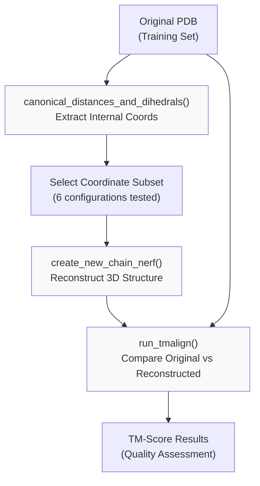
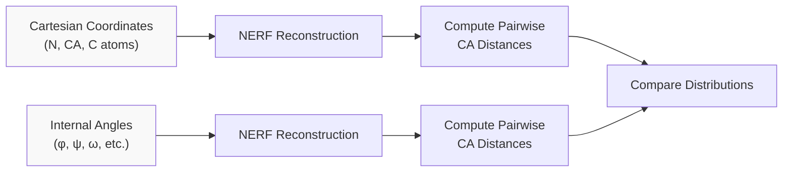
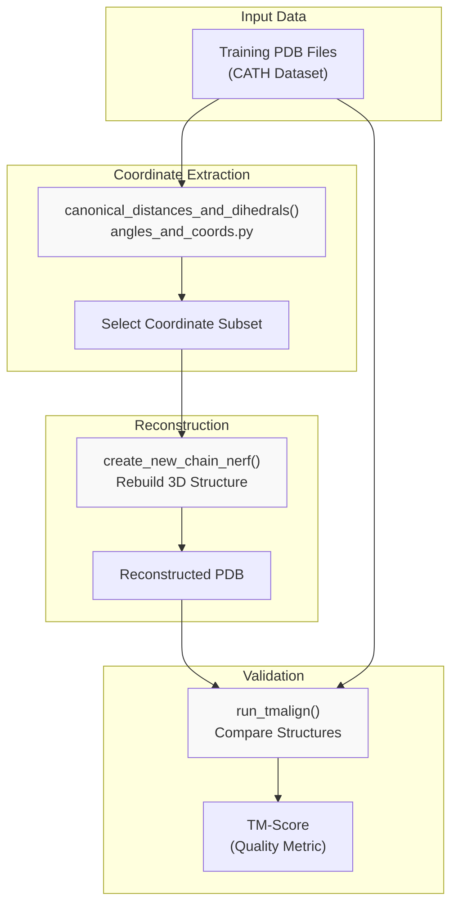
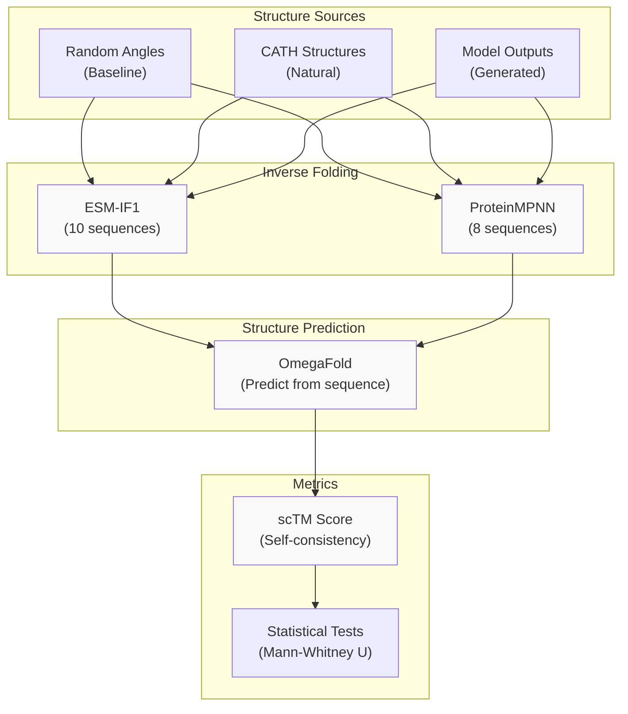

<!-- source: DeepWiki mcp.deepwiki.com · repo microsoft/foldingdiff · page 9 Advanced Topics · fetched 2026-10-26 -->

# Advanced Topics

<details>
<summary>Relevant source files</summary>

The following files were used as context for generating this wiki page:

- [jupyter/cartesian_baseline.ipynb](jupyter/cartesian_baseline.ipynb)
- [jupyter/random_angles_vs_generated.ipynb](jupyter/random_angles_vs_generated.ipynb)
- [jupyter/requisite_internal_values.ipynb](jupyter/requisite_internal_values.ipynb)
- [plots/cartesian_baseline_pairwise_dists/pairwise_dist_cartesian_baseline.pdf](plots/cartesian_baseline_pairwise_dists/pairwise_dist_cartesian_baseline.pdf)
- [plots/cartesian_baseline_pairwise_dists/pairwise_dist_ours.pdf](plots/cartesian_baseline_pairwise_dists/pairwise_dist_ours.pdf)
- [plots/cartesian_baseline_pairwise_dists/pairwise_dist_real.pdf](plots/cartesian_baseline_pairwise_dists/pairwise_dist_real.pdf)
- [plots/reconstruction_angles_coords/reconstruction_by_len.pdf](plots/reconstruction_angles_coords/reconstruction_by_len.pdf)
- [plots/sctm_scores_gen_vs_baseline.pdf](plots/sctm_scores_gen_vs_baseline.pdf)

</details>


## Purpose and Scope

This section covers advanced analysis techniques, baseline comparisons, and specialized tools used for research and validation in the FoldingDiff codebase. These topics go beyond the core training, generation, and evaluation workflows to explore:

- Specialized visualization and analysis notebooks
- Baseline model comparisons (e.g., Cartesian coordinates)
- Perturbation analysis to understand model sensitivity
- Dimensionality reduction for interpretability

For information about basic visualization in the generation pipeline, see [Output Generation and Visualization](#7.3). For standard evaluation metrics, see [Evaluation and Analysis](#8).

---

## Overview of Advanced Analysis

The FoldingDiff repository includes several Jupyter notebooks and analysis scripts that provide deeper insights into model behavior, validate design choices, and establish baselines for comparison. These tools are primarily located in the `jupyter/` directory and are used for research and development rather than production workflows.

### Analysis Categories

The advanced analysis work falls into four main categories:

1. **Minimal Representation Studies** - Determining the minimum set of internal coordinates required for accurate protein structure reconstruction
2. **Baseline Comparisons** - Evaluating alternative model architectures and representations against the primary approach
3. **Perturbation Analysis** - Understanding how small changes in angles affect structure (the "scissor effect")
4. **Latent Space Visualization** - Using dimensionality reduction to interpret model behavior across different parameters

---

## Minimal Internal Coordinate Requirements

One fundamental question in protein structure generation is: **What is the minimum set of internal coordinates needed to fully specify a protein backbone?**

The notebook [jupyter/requisite_internal_values.ipynb]() investigates this question by systematically testing different combinations of angles and distances.

### Coordinate Combinations Tested

The analysis evaluates six different combinations of internal coordinates:

| Configuration | Angles | Distances | Description |
|---------------|--------|-----------|-------------|
| Full specification | φ, ψ, ω, τ, CA:C:1N, C:1N:1CA | 0C:1N, N:CA, CA:C | Complete set of angles and bond distances |
| Dihedrals and angles | φ, ψ, ω, τ, CA:C:1N, C:1N:1CA | None | All angles, no explicit distances |
| Dihedrals, τ, and distances | φ, ψ, ω, τ | 0C:1N, N:CA, CA:C | Three dihedrals plus tau with distances |
| Dihedrals and τ | φ, ψ, ω, τ | None | Three dihedrals plus tau only |
| Dihedrals and distances | φ, ψ, ω | 0C:1N, N:CA, CA:C | Three dihedrals with distances |
| Dihedrals only | φ, ψ, ω | None | Minimal set of three dihedrals |

### Reconstruction Testing

The analysis uses the `test_consistency` function [jupyter/requisite_internal_values.ipynb:160-183]() which:

1. Extracts internal coordinates from a PDB file using `canonical_distances_and_dihedrals`
2. Reconstructs the structure using `create_new_chain_nerf` from [foldingdiff/angles_and_coords.py]()
3. Compares the original and reconstructed structures using TM-score via `tmalign.run_tmalign`
4. Returns reconstruction quality (TM-score = 1.0 indicates perfect reconstruction)



The parallel evaluation across 5000 training structures [jupyter/requisite_internal_values.ipynb:461-486]() provides statistical validation of which coordinate sets are sufficient for accurate reconstruction.

**Sources:** [jupyter/requisite_internal_values.ipynb:1-487](), [foldingdiff/angles_and_coords.py](), [foldingdiff/tmalign.py]()

---

## Baseline Comparisons

### Random Angle Baseline

The notebook [jupyter/random_angles_vs_generated.ipynb]() establishes that generated structures are significantly more designable than random structures.

#### Designability Comparison

The analysis compares three structure sources:

1. **Random Baseline** - Structures with randomly sampled backbone angles
2. **Natural Structures** - Real proteins from the CATH training set  
3. **Generated Structures** - Outputs from the trained diffusion model

For each structure source, designability is measured using the **scTM metric** (self-consistency TM-score), which evaluates whether a sequence designed for the backbone can successfully fold back to that backbone structure. See [Designability Testing (scTM)](#8.2) for details on this metric.

#### Statistical Validation

The notebook uses Mann-Whitney U test [jupyter/random_angles_vs_generated.ipynb:70-79]() to compare distributions:

```python
stats.mannwhitneyu(
    to_arr(generated_sctm.values()),
    to_arr(baseline_sctm.values()),
)
# Result: statistic=512745.5, pvalue=1.596e-121
```

The extremely low p-value (< 10⁻¹²⁰) confirms that generated structures are statistically significantly more designable than random baselines.

#### Designability Thresholds

| Structure Source | scTM ≥ 0.5 | scTM ≥ 0.8 |
|------------------|-----------|-----------|
| Natural (CATH) | 86.9% | 55.5% |
| Generated (Model) | Higher than random | Higher than random |
| Random Baseline | Significantly lower | Significantly lower |

**Sources:** [jupyter/random_angles_vs_generated.ipynb:1-334](), [plots/sctm_scores_gen_vs_baseline.pdf]()

### Cartesian Coordinate Baseline

The notebook [jupyter/cartesian_baseline.ipynb]() implements an alternative model that operates directly in Cartesian (xyz) coordinate space rather than internal angular coordinates.

#### Cartesian Model Architecture

The Cartesian baseline uses the same overall architecture as the main model but with key differences:

- **Input representation**: Direct xyz coordinates of N, CA, C atoms instead of angles
- **Feature dimension**: 9 features per residue (3 atoms × 3 coordinates) 
- **Training configuration**: [plots/cartesian_baseline_pairwise_dists/]() directory contains results

Training configuration from [jupyter/cartesian_baseline.ipynb:2-3]():

```python
MODEL_DIR = Path("/home/wukevin/projects/protdiff_results/models/coords/results")
```

The model configuration includes:
- `angles_definitions: 'cart-coords'` - Uses Cartesian coordinates instead of angles
- Same architecture parameters (12 layers, 384 hidden size)
- Cosine variance schedule with 1000 timesteps

#### Pairwise Distance Analysis

To validate that both representations capture similar structural properties, pairwise distance distributions are compared:



The pairwise distance distributions [plots/cartesian_baseline_pairwise_dists/pairwise_dist_cartesian_baseline.pdf]() and [plots/cartesian_baseline_pairwise_dists/pairwise_dist_ours.pdf]() show whether the two representations lead to similar structural properties.

**Why Internal Coordinates Were Chosen**: While both representations can work, internal coordinates provide:
- **Invariance**: Automatic translation and rotation invariance
- **Reduced dimensionality**: 6 angles vs 9 coordinates per residue
- **Physical interpretability**: Angles correspond to known structural features (Ramachandran plots)
- **Stable gradients**: Angular changes have bounded effects on structure

**Sources:** [jupyter/cartesian_baseline.ipynb:1-200](), [plots/cartesian_baseline_pairwise_dists/]()

---

## Key Analysis Workflows

### Reconstruction Quality Assessment



**Sources:** [jupyter/requisite_internal_values.ipynb:160-183](), [foldingdiff/angles_and_coords.py](), [foldingdiff/nerf.py]()

### Designability Comparison Pipeline



**Sources:** [jupyter/random_angles_vs_generated.ipynb:1-334](), [bin/sctm.py]()

---

## Relationship to Main Pipeline

The advanced analysis tools complement the main training and generation pipeline:

| Main Pipeline Component | Advanced Analysis | Purpose |
|------------------------|-------------------|---------|
| Data loading ([datasets.py]()) | Minimal coordinate studies | Validate representation choices |
| Model architecture ([modelling.py]()) | Cartesian baseline | Compare alternative architectures |
| Sampling ([sample.py]()) | Designability comparison | Validate generation quality |
| Evaluation metrics ([sctm.py]()) | Random baseline comparison | Establish statistical significance |

These analyses are typically run **after** the main model is trained and used to:

1. **Validate design decisions** - Why use angles instead of coordinates?
2. **Establish baselines** - How much better than random are we?
3. **Debug issues** - What happens when we perturb specific angles?
4. **Interpret results** - What is the model learning in latent space?

For detailed information on specific analysis techniques, see the child pages:
- [Visualization Tools](#9.1) - PyMOL rendering and animation generation
- [Analysis Notebooks](#9.2) - Detailed guides to included notebooks
- [Angle Perturbation Analysis](#9.3) - The scissor effect and sensitivity studies
- [UMAP Visualizations](#9.4) - Dimensionality reduction for interpretation

**Sources:** [jupyter/](), [plots/](), [bin/sample.py](), [foldingdiff/datasets.py](), [foldingdiff/modelling.py]()

---

