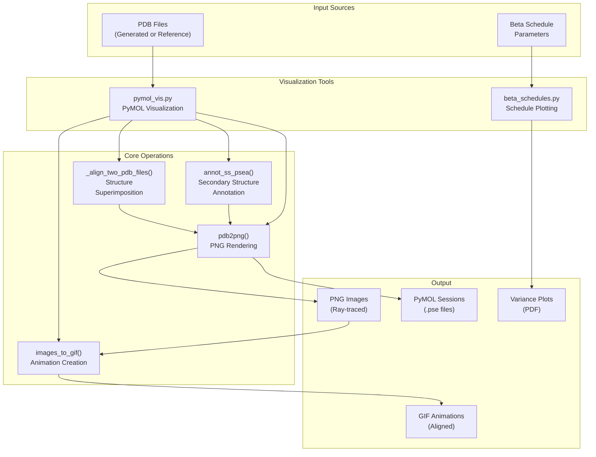
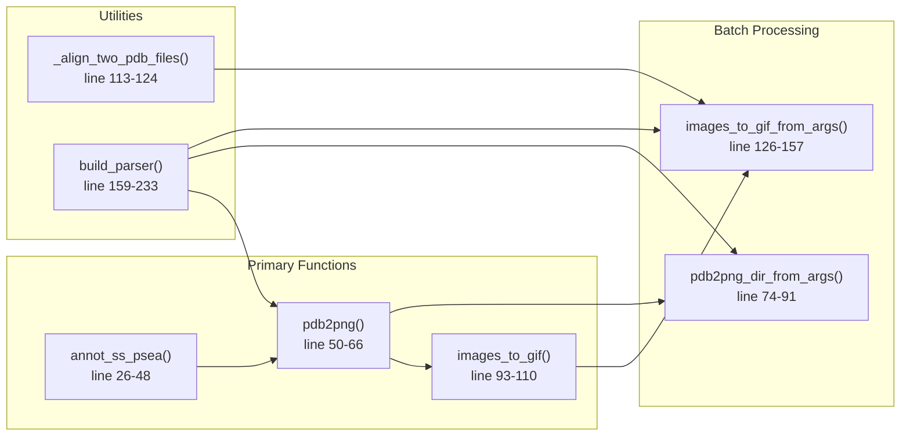
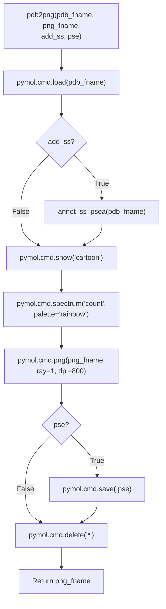
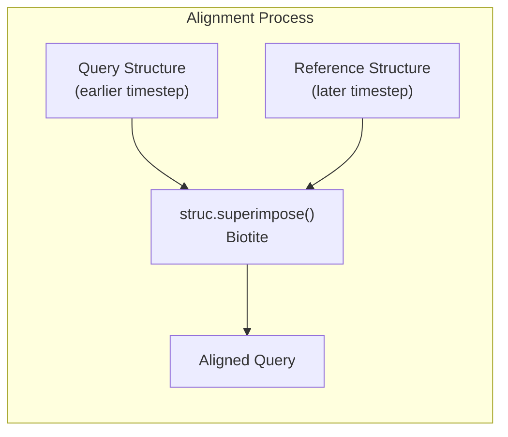
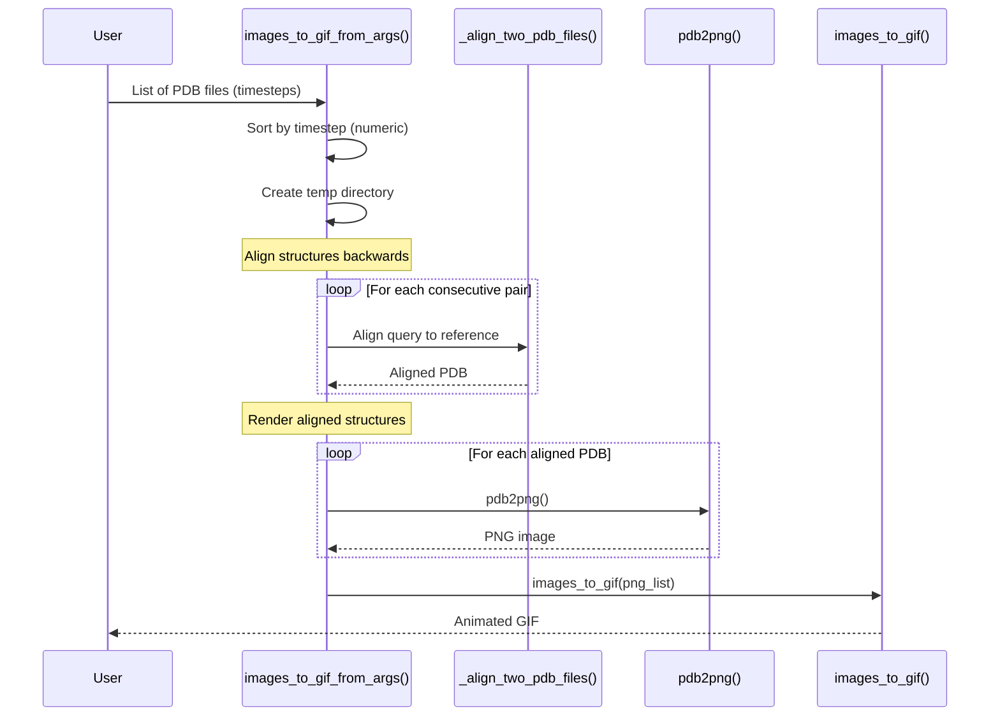
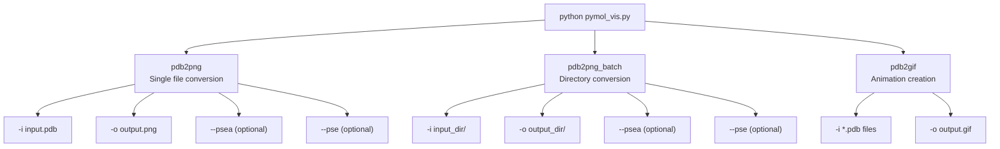
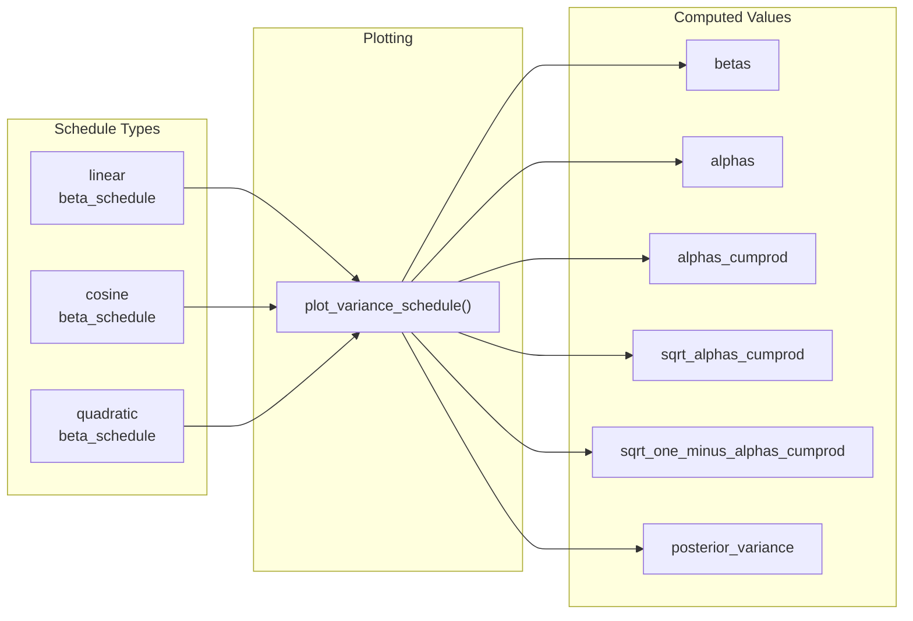
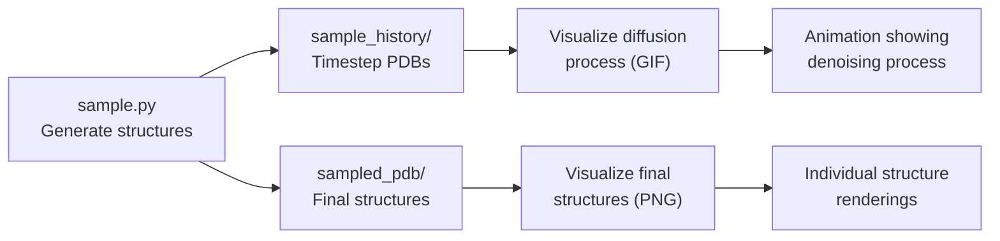

<!-- source: DeepWiki mcp.deepwiki.com · repo microsoft/foldingdiff · page 9.1 Visualization Tools · fetched 2026-10-26 -->

# Visualization Tools

<details>
<summary>Relevant source files</summary>

The following files were used as context for generating this wiki page:

- [foldingdiff/__init__.py](foldingdiff/__init__.py)
- [foldingdiff/beta_schedules.py](foldingdiff/beta_schedules.py)
- [foldingdiff/custom_metrics.py](foldingdiff/custom_metrics.py)
- [foldingdiff/losses.py](foldingdiff/losses.py)
- [foldingdiff/pymol_vis.py](foldingdiff/pymol_vis.py)
- [plots/reconstruction_angles_coords/reconstruction_barplot.pdf](plots/reconstruction_angles_coords/reconstruction_barplot.pdf)
- [plots/reconstruction_angles_coords/reconstruction_distributions.pdf](plots/reconstruction_angles_coords/reconstruction_distributions.pdf)

</details>


## Purpose and Scope

This document covers the visualization utilities provided by FoldingDiff for rendering protein structures and creating animations. The primary tool is the PyMOL-based visualization module that converts PDB files to static images (PNG) and animated sequences (GIF). These tools are essential for visualizing generated structures and the diffusion process.

For information about analyzing generated structures with metrics, see [Evaluation and Analysis](#8). For details on the sampling pipeline that generates PDB files, see [Generation and Sampling](#7).

## Overview

FoldingDiff provides visualization capabilities through two main components:

1. **PyMOL Visualization Module** ([foldingdiff/pymol_vis.py]()): Converts protein structures to publication-quality images and animations
2. **Beta Schedule Plotting** ([foldingdiff/beta_schedules.py:81-103]()): Visualizes variance schedules used in the diffusion process

The PyMOL module is the primary tool and supports three operational modes:
- Single PDB to PNG conversion
- Batch directory conversion (multiple PDBs to PNGs)
- Animated GIF generation from PDB sequences

**Sources:** [foldingdiff/pymol_vis.py:1-244]()

## System Architecture



**Sources:** [foldingdiff/pymol_vis.py:1-244](), [foldingdiff/beta_schedules.py:81-103]()

## PyMOL Visualization Module

### Core Components

The visualization module is built around PyMOL's Python API and provides programmatic access to high-quality structure rendering.



**Sources:** [foldingdiff/pymol_vis.py:26-233]()

### Secondary Structure Annotation

The `annot_ss_psea()` function annotates protein structures with secondary structure information using biotite's PSEA (Protein Secondary structure Element Assignment) algorithm:

| Feature | Description |
|---------|-------------|
| **Function** | `annot_ss_psea(fname: str)` |
| **Input** | Path to PDB file |
| **Algorithm** | PSEA via biotite |
| **Effect** | Sets PyMOL secondary structure attributes |
| **Annotations** | `'a'` for helix (H), `'b'` for sheet (S) |

The function reads the PDB structure, computes secondary structure assignments, and applies them to the PyMOL session using `pymol.cmd.alter()` commands.

**Sources:** [foldingdiff/pymol_vis.py:26-48]()

### PNG Rendering

The `pdb2png()` function converts a single PDB file to a high-quality PNG image:



Configuration details:
- **Rendering style**: Cartoon representation
- **Coloring scheme**: Rainbow spectrum by residue count
- **Ray tracing**: Enabled (high quality)
- **DPI**: 800
- **Background**: Transparent (`ray_opaque_background=0`)

**Sources:** [foldingdiff/pymol_vis.py:50-66]()

### Batch Directory Conversion

The `pdb2png_dir_from_args()` function processes entire directories of PDB files in parallel:

```python
# Workflow
# 1. Find all *.pdb files in input directory
# 2. Create output directory
# 3. Spawn multiprocessing pool (cpu_count() workers)
# 4. Convert all PDB files to PNG in parallel
```

The function uses `multiprocessing.Pool` with `starmap_async()` to maximize throughput. Each worker processes files independently with a chunksize of 5.

**Sources:** [foldingdiff/pymol_vis.py:74-91]()

## Creating Animations

### Structure Alignment for Smooth Transitions

Before creating animations, consecutive PDB structures are aligned using biotite's superimposition algorithm to ensure smooth visual transitions:



The `_align_two_pdb_files()` function performs this operation:
- Loads both structures using biotite
- Computes optimal rotation/translation via `struc.superimpose(ref, mobile)`
- Saves the aligned query structure to disk

**Sources:** [foldingdiff/pymol_vis.py:113-124]()

### GIF Generation Workflow

The `images_to_gif_from_args()` function creates animated visualizations of the diffusion process:



Key parameters:
- **Frame duration**: 0.05 seconds per frame
- **Last frame pause**: 10 seconds (if `pause_on_last=True`)
- **Looping**: Infinite loop by default
- **Compression**: Subrectangles optimization enabled

**Sources:** [foldingdiff/pymol_vis.py:126-157](), [foldingdiff/pymol_vis.py:93-110]()

## Command-Line Interface

The module provides a complete CLI with three subcommands:

### Subcommand Structure



### Usage Examples

| Mode | Command | Description |
|------|---------|-------------|
| **Single PNG** | `python pymol_vis.py pdb2png -i struct.pdb -o struct.png` | Convert one PDB to PNG |
| **With SS** | `python pymol_vis.py pdb2png -i struct.pdb -o struct.png --psea` | Include PSEA secondary structure |
| **Save PSE** | `python pymol_vis.py pdb2png -i struct.pdb -o struct.png --pse` | Also save PyMOL session |
| **Batch** | `python pymol_vis.py pdb2png_batch -i pdb_dir/ -o png_dir/` | Convert directory |
| **GIF** | `python pymol_vis.py pdb2gif -i timestep_*.pdb -o animation.gif` | Create animation |

**Sources:** [foldingdiff/pymol_vis.py:159-233]()

## Beta Schedule Visualization

The `beta_schedules.py` module includes plotting functionality for visualizing variance schedules used in the diffusion process:



The `plot_variance_schedule()` function generates publication-quality plots showing how β, α, and derived quantities evolve across timesteps. This is useful for understanding how noise is added during the forward diffusion process.

**Sources:** [foldingdiff/beta_schedules.py:81-103]()

## Integration with Sampling Pipeline

The visualization tools are typically used after generation to inspect results:



When running `sample.py` with the `--write-pdb-trajectory` flag, it outputs PDB files at each denoising timestep, which can then be animated using the `pdb2gif` subcommand.

**Sources:** [foldingdiff/pymol_vis.py:1-6]()

## Technical Dependencies

The visualization module requires:

| Package | Purpose | Usage |
|---------|---------|-------|
| **pymol** | Molecular visualization | Structure rendering, cartoon representation |
| **biotite** | Structural bioinformatics | PSEA secondary structure, structure alignment |
| **imageio** | Image I/O | GIF creation with custom frame durations |
| **multiprocessing** | Parallel processing | Batch conversion speedup |

The module suppresses biotite warnings about element guessing ([foldingdiff/pymol_vis.py:29]()) to reduce console noise during batch processing.

**Sources:** [foldingdiff/pymol_vis.py:11-24]()

## Example Workflow: Visualizing a Diffusion Trajectory

Complete workflow for visualizing how a structure is generated:

```bash
# 1. Generate structures with trajectory
python bin/sample.py \
    --model-dir trained_models/best/ \
    --n-samples 1 \
    --write-pdb-trajectory \
    --out-dir generation_with_history/

# 2. Create animation of the diffusion process
python foldingdiff/pymol_vis.py pdb2gif \
    -i generation_with_history/sample_history/generated_0/*.pdb \
    -o diffusion_animation.gif

# 3. Render final structure with secondary structure
python foldingdiff/pymol_vis.py pdb2png \
    -i generation_with_history/sampled_pdb/generated_0.pdb \
    -o final_structure.png \
    --psea --pse

# 4. Batch process all generated structures
python foldingdiff/pymol_vis.py pdb2png_batch \
    -i generation_with_history/sampled_pdb/ \
    -o rendered_structures/ \
    --psea
```

**Sources:** [foldingdiff/pymol_vis.py:1-6](), [foldingdiff/pymol_vis.py:159-233]()

---

