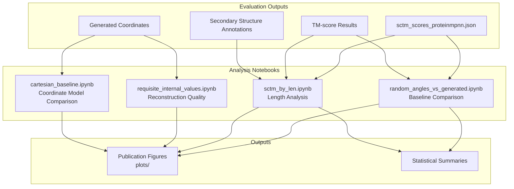
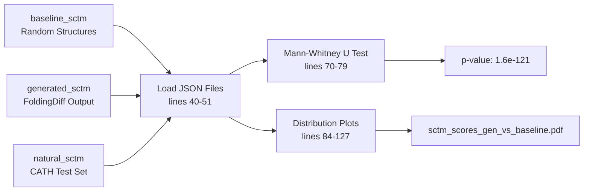
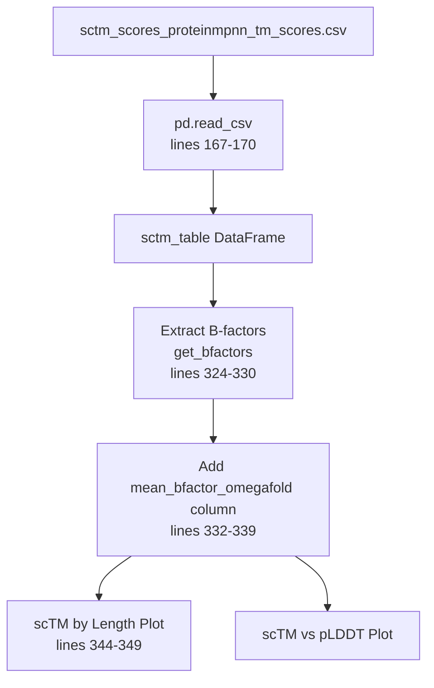
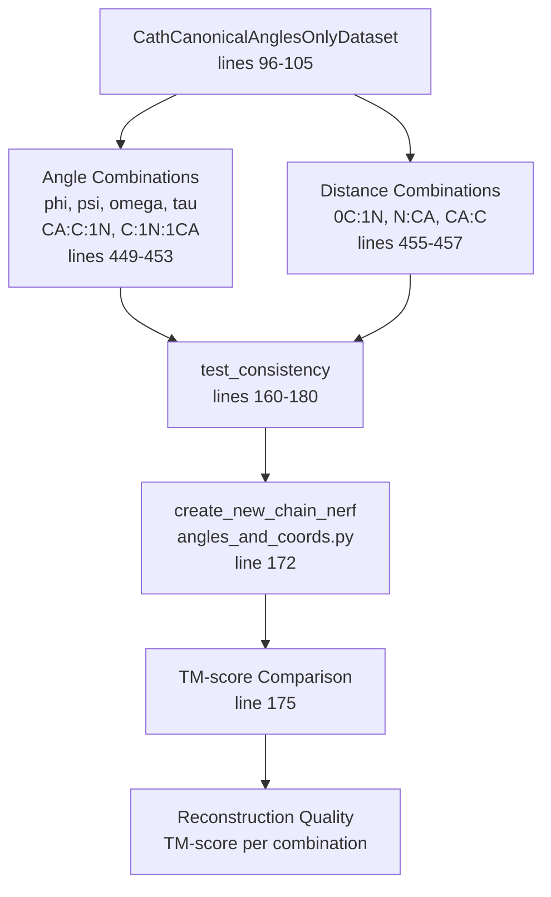
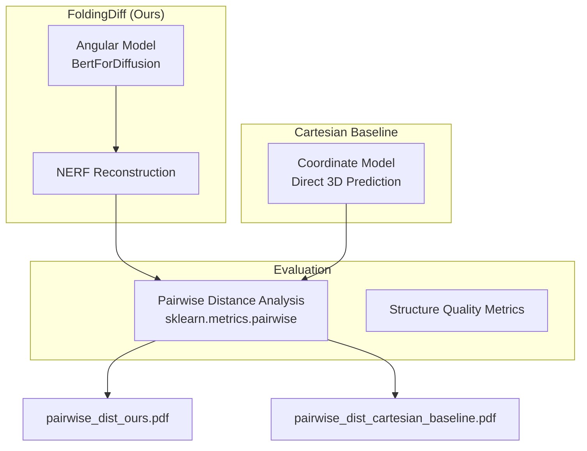
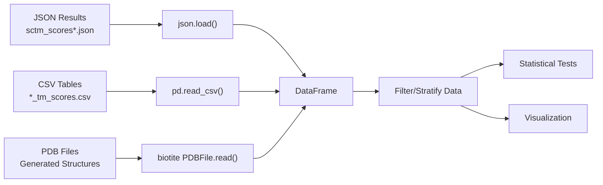
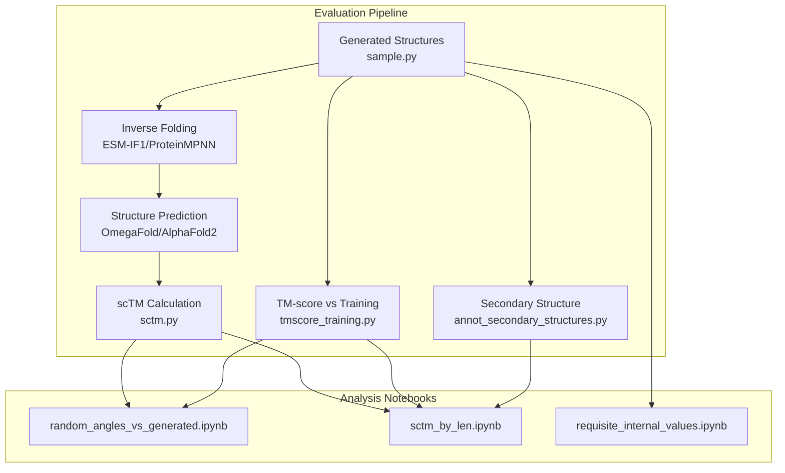

<!-- source: DeepWiki mcp.deepwiki.com · repo microsoft/foldingdiff · page 9.2 Analysis Notebooks · fetched 2026-10-26 -->

# Analysis Notebooks

<details>
<summary>Relevant source files</summary>

The following files were used as context for generating this wiki page:

- [jupyter/cartesian_baseline.ipynb](jupyter/cartesian_baseline.ipynb)
- [jupyter/random_angles_vs_generated.ipynb](jupyter/random_angles_vs_generated.ipynb)
- [jupyter/requisite_internal_values.ipynb](jupyter/requisite_internal_values.ipynb)
- [jupyter/sctm_by_len.ipynb](jupyter/sctm_by_len.ipynb)
- [plots/cartesian_baseline_pairwise_dists/pairwise_dist_cartesian_baseline.pdf](plots/cartesian_baseline_pairwise_dists/pairwise_dist_cartesian_baseline.pdf)
- [plots/cartesian_baseline_pairwise_dists/pairwise_dist_ours.pdf](plots/cartesian_baseline_pairwise_dists/pairwise_dist_ours.pdf)
- [plots/cartesian_baseline_pairwise_dists/pairwise_dist_real.pdf](plots/cartesian_baseline_pairwise_dists/pairwise_dist_real.pdf)
- [plots/reconstruction_angles_coords/reconstruction_by_len.pdf](plots/reconstruction_angles_coords/reconstruction_by_len.pdf)
- [plots/sctm_by_len.pdf](plots/sctm_by_len.pdf)
- [plots/sctm_by_secondary_structure.pdf](plots/sctm_by_secondary_structure.pdf)
- [plots/sctm_scores_gen_vs_baseline.pdf](plots/sctm_scores_gen_vs_baseline.pdf)
- [plots/sctm_vs_plddt.pdf](plots/sctm_vs_plddt.pdf)

</details>


## Purpose and Scope

This document describes the Jupyter notebooks used to analyze and visualize the results of protein structure generation, evaluation metrics, and model comparisons. These notebooks perform statistical analyses, generate publication-quality figures, and provide insights into model performance across various dimensions such as designability (scTM scores), novelty (TM-score vs training set), and structural properties.

For information about the evaluation pipeline that generates the data analyzed by these notebooks, see [Evaluation and Analysis](#8). For visualization utilities used within these notebooks, see [Visualization Tools](#9.1).

## Overview

The analysis notebooks are located in the `jupyter/` directory and consume outputs from various evaluation pipelines including scTM calculations, TM-score comparisons, and secondary structure annotations. They produce statistical summaries and publication-ready figures stored in the `plots/` directory.



**Sources:** [jupyter/random_angles_vs_generated.ipynb](), [jupyter/sctm_by_len.ipynb](), [jupyter/requisite_internal_values.ipynb](), [jupyter/cartesian_baseline.ipynb]()

## Key Analysis Notebooks

### Baseline Comparison (`random_angles_vs_generated.ipynb`)

This notebook compares the designability of generated structures against random baseline structures using scTM scores from ProteinMPNN inverse folding experiments.

#### Analysis Workflow



**Key Findings:**
- Tests whether generated structures have significantly different designability than random structures
- Uses `scipy.stats.mannwhitneyu()` for non-parametric statistical testing [jupyter/random_angles_vs_generated.ipynb:76-79]()
- Calculates fraction of natural structures with scTM ≥ 0.8 (55.5%) and ≥ 0.5 (86.9%) [jupyter/random_angles_vs_generated.ipynb:99-120]()

**Sources:** [jupyter/random_angles_vs_generated.ipynb:1-127]()

### Length-Stratified Analysis (`sctm_by_len.ipynb`)

Analyzes how designability metrics vary with protein length and examines the correlation between scTM scores and OmegaFold's confidence metric (B-factor/pLDDT).

#### Data Processing Pipeline



**B-factor Extraction:**
The notebook uses biotite to read B-factors (confidence scores) from OmegaFold predictions:

```python
def get_bfactors(pdb_fname: str) -> np.ndarray:
    pdb_file = PDBFile.read(pdb_fname)
    atoms = pdb_file.get_structure(extra_fields=['b_factor'])[0]
    return atoms.b_factor
```

**Data Schema:**
The input CSV contains columns: `id`, `scTM`, `max training TM`, `length_int`, `alpha_counts`, `beta_counts`, `scTM best match`, `max training TM structure`, `length`, `designable` [jupyter/sctm_by_len.ipynb:167-172]()

**Sources:** [jupyter/sctm_by_len.ipynb:1-349]()

### Reconstruction Quality Analysis (`requisite_internal_values.ipynb`)

Investigates which internal coordinates (angles and distances) are necessary for accurate protein structure reconstruction using the NERF algorithm.

#### Reconstruction Test Framework



**Test Combinations Evaluated:**
1. Dihedrals, angles, and distances (φ, ψ, ω, τ, CA:C:1N, C:1N:1CA) + (0C:1N, N:CA, CA:C)
2. Dihedrals and angles (φ, ψ, ω, τ, CA:C:1N, C:1N:1CA)
3. Dihedrals, τ, and distances (φ, ψ, ω, τ) + (0C:1N, N:CA, CA:C)
4. Dihedrals and τ (φ, ψ, ω, τ)
5. Dihedrals and distances (φ, ψ, ω) + (0C:1N, N:CA, CA:C)
6. Dihedrals only (φ, ψ, ω)

The parallel evaluation function processes 5000 training structures using multiprocessing [jupyter/requisite_internal_values.ipynb:461-473]():

```python
def evaluate_angle_set_parallel(filenames, angles, dists):
    pfunc = functools.partial(
        test_consistency,
        angles_to_use=angles,
        dists_to_use=dists,
    )
    pool = multiprocessing.Pool(multiprocessing.cpu_count())
    tm_scores = np.array([score for score, _view in pool.map(pfunc, filenames, chunksize=20)])
    pool.close()
    pool.join()
    return tm_scores
```

**Sources:** [jupyter/requisite_internal_values.ipynb:1-487]()

### Cartesian Baseline Comparison (`cartesian_baseline.ipynb`)

Compares the FoldingDiff angular representation approach against a baseline model that directly predicts Cartesian coordinates.

#### Model Comparison Architecture



**Key Comparison Metrics:**
- Pairwise distance distributions between predicted atoms
- Structure quality as measured by TM-score
- Geometric consistency of generated structures

**Sources:** [jupyter/cartesian_baseline.ipynb](), [plots/cartesian_baseline_pairwise_dists/pairwise_dist_ours.pdf](), [plots/cartesian_baseline_pairwise_dists/pairwise_dist_cartesian_baseline.pdf]()

## Common Analysis Patterns

### Data Loading and Preprocessing

Most notebooks follow a standard pattern for loading evaluation results:



### Statistical Testing

Notebooks use `scipy.stats` for hypothesis testing:
- **Mann-Whitney U test:** Non-parametric comparison of two distributions [jupyter/random_angles_vs_generated.ipynb:76-79]()
- **Mean/median calculations:** Summary statistics for different strata
- **Correlation analysis:** Relationship between metrics (e.g., scTM vs pLDDT)

### Visualization Generation

Figures are created using `matplotlib` and `seaborn` and saved to the `plots/` directory:
- Box plots for comparing distributions across categories
- Scatter plots for correlation analysis
- Histograms for distribution visualization
- Heatmaps for pairwise comparisons

## Output Artifacts

### Generated Plots

| Plot File | Notebook Source | Purpose |
|-----------|----------------|---------|
| `sctm_scores_gen_vs_baseline.pdf` | `random_angles_vs_generated.ipynb` | Compare generated vs random baseline designability |
| `sctm_by_len.pdf` | `sctm_by_len.ipynb` | Designability stratified by protein length |
| `sctm_vs_plddt.pdf` | `sctm_by_len.ipynb` | Correlation between scTM and structure confidence |
| `sctm_by_secondary_structure.pdf` | `sctm_by_len.ipynb` | Designability by α-helix/β-sheet content |
| `pairwise_dist_*.pdf` | `cartesian_baseline.ipynb` | Geometric quality comparison |
| `reconstruction_by_len.pdf` | `requisite_internal_values.ipynb` | Reconstruction accuracy by feature set |

**Sources:** [plots/sctm_scores_gen_vs_baseline.pdf](), [plots/sctm_by_len.pdf](), [plots/sctm_vs_plddt.pdf](), [plots/sctm_by_secondary_structure.pdf](), [plots/cartesian_baseline_pairwise_dists/](), [plots/reconstruction_angles_coords/reconstruction_by_len.pdf]()

## Integration with Evaluation Pipeline

The notebooks consume outputs from the evaluation pipeline described in [Evaluation and Analysis](#8):



**Sources:** [jupyter/random_angles_vs_generated.ipynb:40-51](), [jupyter/sctm_by_len.ipynb:167-172](), [jupyter/requisite_internal_values.ipynb:96-105]()

---

