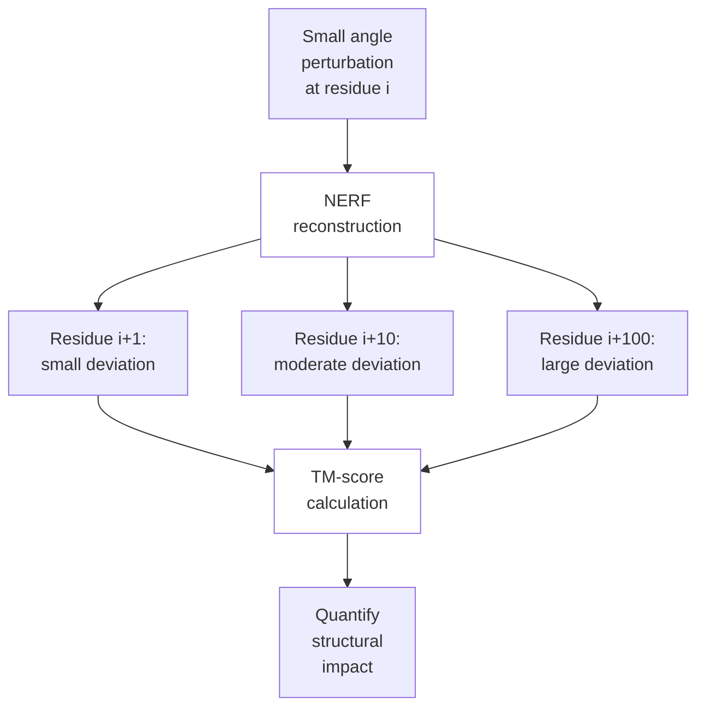
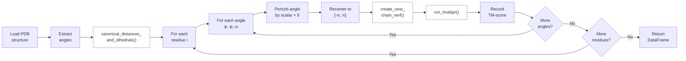
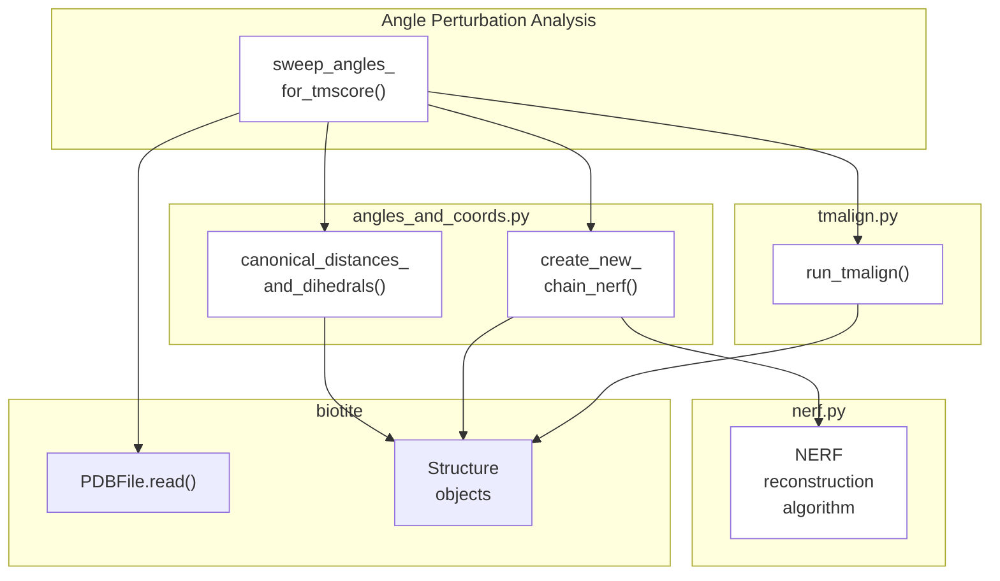
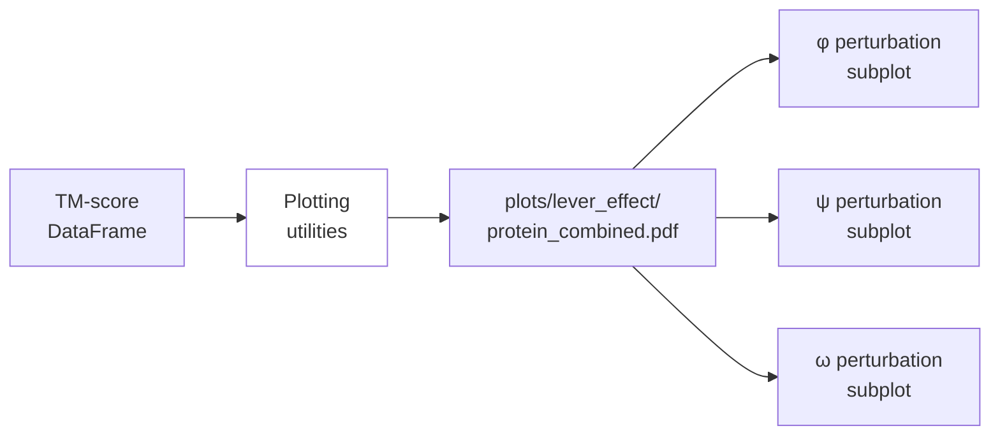

<!-- source: DeepWiki mcp.deepwiki.com · repo microsoft/foldingdiff · page 9.3 Angle Perturbation Analysis · fetched 2026-10-26 -->

# Angle Perturbation Analysis

<details>
<summary>Relevant source files</summary>

The following files were used as context for generating this wiki page:

- [jupyter/scissor_effect_plots.ipynb](jupyter/scissor_effect_plots.ipynb)
- [plots/lever_effect/1xewY00_combined.pdf](plots/lever_effect/1xewY00_combined.pdf)
- [plots/lever_effect/2epdA00_combined.pdf](plots/lever_effect/2epdA00_combined.pdf)
- [plots/lever_effect/3l84A01_combined.pdf](plots/lever_effect/3l84A01_combined.pdf)
- [plots/lever_effect/6nsjA00_combined.pdf](plots/lever_effect/6nsjA00_combined.pdf)

</details>


## Purpose and Scope

This page documents the angle perturbation analysis system in FoldingDiff, which studies how small changes in backbone dihedral angles affect protein structure. This analysis is critical for understanding the "scissor effect" (also called the "lever effect") - the phenomenon where small angular errors propagate through the protein chain, causing increasingly large positional deviations in downstream residues.

For information about the NERF algorithm used to reconstruct structures from angles, see [NERF Reconstruction](#3.3). For details on angle extraction and coordinate conversion, see [Angle Extraction and Conversion](#4.2). For evaluation metrics including TM-score, see [TM-Score and Novelty Assessment](#8.1).

## Overview

The angle perturbation analysis systematically perturbs individual dihedral angles (φ, ψ, ω) at each position in a protein backbone, reconstructs the 3D structure, and measures the resulting structural deviation using TM-score. This analysis reveals:

1. **Positional sensitivity**: How perturbations at different positions affect overall structure
2. **Angular sensitivity**: Which angle types (φ, ψ, or ω) have the greatest impact
3. **Cumulative effects**: How small errors accumulate through the NERF reconstruction process
4. **Model tolerance**: The robustness of generated structures to prediction errors

## The Scissor Effect

The scissor effect is a fundamental property of internal coordinate representations. Because each residue's 3D position depends on all preceding angles in the chain, a small angular error at position *i* causes:

- Minimal deviation at position *i+1*
- Moderate deviation at position *i+10*  
- Potentially large deviation at position *i+100*

This effect is particularly important for diffusion models, where the model must predict angles with sufficient precision to avoid cumulative structural distortions.



**Sources**: [jupyter/scissor_effect_plots.ipynb:1-301]()

## Analysis Workflow

The angle perturbation analysis follows this workflow:



**Sources**: [jupyter/scissor_effect_plots.ipynb:252-301]()

## Implementation

### Core Function: `sweep_angles_for_tmscore`

The analysis is implemented in the Jupyter notebook as the `sweep_angles_for_tmscore` function:

| Parameter | Type | Description |
|-----------|------|-------------|
| `fname` | `str` | Path to PDB file to analyze |
| `deltas` | `Optional[pd.Series]` | Perturbation magnitudes per angle type; defaults to standard deviation |
| `scalar` | `float` | Multiplier for perturbation size (default: 0.2) |
| `disable_pbar` | `bool` | Whether to disable progress bar |

**Returns**: `pd.DataFrame` with shape `(n_residues, 3)` containing TM-scores for φ, ψ, and ω perturbations at each position.

The function performs these steps:

1. **Load structure**: Read PDB and extract to biotite structure
2. **Extract angles**: Use `canonical_distances_and_dihedrals` to get internal coordinates
3. **Set perturbations**: Use provided deltas or calculate standard deviation
4. **Iterate positions**: For each residue in the chain
5. **Perturb angles**: Apply `scalar * delta` to each angle type
6. **Recenter**: Map perturbed angles back to [-π, π] range
7. **Reconstruct**: Build 3D structure with `create_new_chain_nerf`
8. **Compare**: Calculate TM-score against original structure
9. **Record**: Store TM-score in result DataFrame

**Sources**: [jupyter/scissor_effect_plots.ipynb:252-294]()

### Perturbation Magnitudes

The notebook uses two approaches to determine perturbation magnitudes:

**Approach 1: Model Error Statistics**

The notebook contains empirically measured average errors and standard deviations from the trained model at timestep 250:

```python
average_test_error = {
    'phi': 0.002905,
    'psi': -0.009807,
    'omega': 0.009512,
    'tau': -0.000435,
    'CA:C:1N': 0.002994,
    'C:1N:1CA': -0.000519,
}

std_test_error = {
    'phi': 0.351,
    'psi': 0.354,
    'omega': 0.262,
    'tau': 0.055,
    'CA:C:1N': 0.052,
    'C:1N:1CA': 0.057,
}
```

The test perturbation is set to `average + 0.5 * std` to represent a moderately large prediction error.

**Approach 2: Data-Driven**

If no deltas are provided, the function computes the standard deviation of each angle across all residues in the input structure, providing perturbations representative of natural variability.

**Sources**: [jupyter/scissor_effect_plots.ipynb:54-101]()

### Angle Recentering

A critical implementation detail is recentering angles to the [-π, π] range after perturbation:

```python
recenter = lambda x: (x + np.pi) % (2 * np.pi) - np.pi
angles_perturbed_centered = recenter(angles_perturbed)
```

This ensures that angular values remain in the valid range expected by the NERF reconstruction algorithm, avoiding discontinuities at the ±π boundary.

**Sources**: [jupyter/scissor_effect_plots.ipynb:273-286]()

## Integration with Core Systems

The analysis integrates with multiple FoldingDiff components:



**Sources**: [jupyter/scissor_effect_plots.ipynb:25-26](), [jupyter/scissor_effect_plots.ipynb:265-291]()

## Interpretation of Results

### TM-Score Values

The output DataFrame contains TM-scores in the range [0, 1]:

| TM-Score Range | Interpretation |
|----------------|----------------|
| 0.99 - 1.00 | Minimal structural impact; perturbation well-tolerated |
| 0.95 - 0.99 | Small structural deviation; acceptable for most applications |
| 0.90 - 0.95 | Moderate deviation; may affect functional properties |
| < 0.90 | Significant structural change; likely problematic |

### Positional Patterns

Typical observations from this analysis:

1. **Terminal sensitivity**: Perturbations near the N-terminus affect more downstream residues
2. **Middle robustness**: Central residues show moderate sensitivity 
3. **C-terminal tolerance**: Perturbations near the C-terminus have localized effects
4. **Angle hierarchy**: ω perturbations typically have less impact than φ/ψ due to restricted geometry

### Example Results

From the notebook analysis of structure `6nsjA00`, a 182-residue protein shows TM-scores remaining above 0.999 for most perturbations, indicating high structural stability.

**Sources**: [jupyter/scissor_effect_plots.ipynb:117-249]()

## Visualization

The analysis produces combined plots showing TM-score degradation across all three angles:



The plots typically show:
- **X-axis**: Residue position
- **Y-axis**: TM-score after perturbation
- **Three subplots**: One for each angle type (φ, ψ, ω)
- **Saved location**: `plots/lever_effect/` directory

**Sources**: [jupyter/scissor_effect_plots.ipynb:28](), [plots/lever_effect/6nsjA00_combined.pdf:1-552](), [plots/lever_effect/2epdA00_combined.pdf:1-552]()

## Usage Example

To perform angle perturbation analysis on a protein structure:

1. **Set up environment**: Ensure the foldingdiff module and biotite are available
2. **Define perturbations**: Either use model error statistics or let function compute from data
3. **Run analysis**: Call `sweep_angles_for_tmscore` with PDB path
4. **Inspect results**: Examine DataFrame to identify sensitive positions/angles
5. **Visualize**: Create plots to show spatial patterns

The notebook provides a complete example analyzing structure `6nsjA00` with model-derived perturbations scaled by 0.2.

**Sources**: [jupyter/scissor_effect_plots.ipynb:296-300]()

## Applications

### Model Evaluation

Angle perturbation analysis helps evaluate model quality by:
- Identifying whether model prediction errors will cause acceptable structural deviations
- Comparing sensitivity across different model variants
- Establishing error tolerances for acceptable generated structures

### Design Validation

For generated protein designs:
- Verify robustness to small variations in backbone geometry
- Identify positions requiring higher precision in angle prediction
- Assess whether structures will maintain fold under realistic perturbations

### Debugging NERF Reconstruction

The analysis reveals:
- Numerical stability issues in coordinate reconstruction
- Positions where small errors amplify unexpectedly
- Whether angle range normalization is working correctly

**Sources**: [jupyter/scissor_effect_plots.ipynb:54-101]()

## Technical Considerations

### Computational Cost

The analysis has complexity O(N × 3) where N is the number of residues, since it:
- Perturbs 3 angles per residue
- Performs NERF reconstruction (O(N) per reconstruction)
- Runs TM-align (O(N²) but fast in practice)

For typical proteins (100-300 residues), analysis completes in seconds to minutes.

### Temporary Files

The implementation uses `tempfile.NamedTemporaryFile` to:
- Write reconstructed structures for TM-align comparison
- Avoid disk clutter from hundreds of intermediate PDB files
- Ensure cleanup even if analysis is interrupted

**Sources**: [jupyter/scissor_effect_plots.ipynb:278-291]()

### Multiprocessing Support

The notebook imports `multiprocessing` but the current implementation is serial. The function could be parallelized across residues for faster analysis of large proteins.

**Sources**: [jupyter/scissor_effect_plots.ipynb:12]()

## Related Analyses

Other notebooks in the repository perform complementary analyses:

| Analysis Type | Purpose |
|---------------|---------|
| scTM analysis | Designability evaluation via inverse folding/structure prediction cycles |
| Baseline comparisons | Compare generated structures against reference methods |
| UMAP visualizations | Project model behavior across parameter space |

For details on these analyses, see [Analysis Notebooks](#9.2).

**Sources**: Page context from table of contents

---

