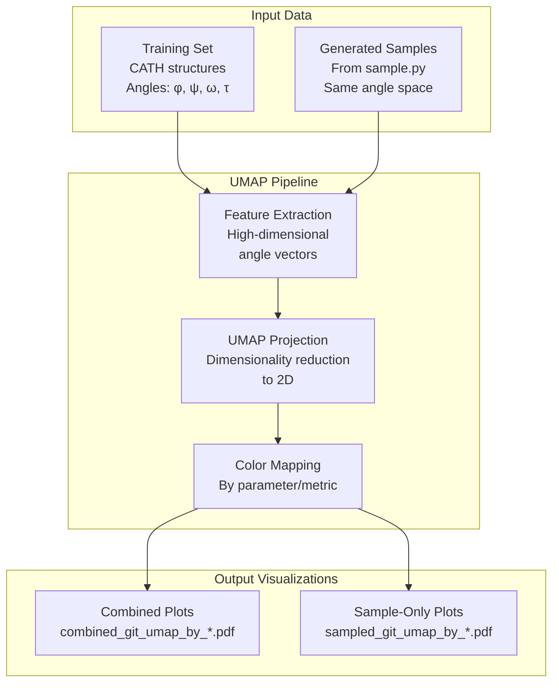
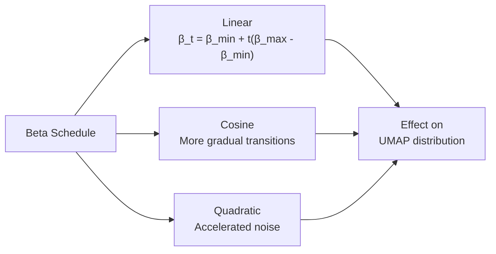
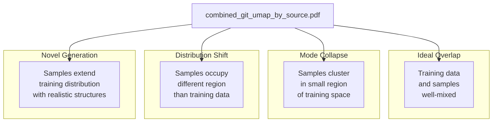
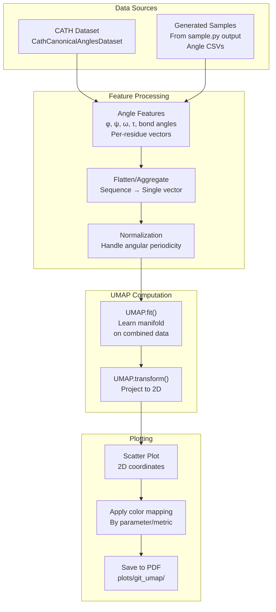
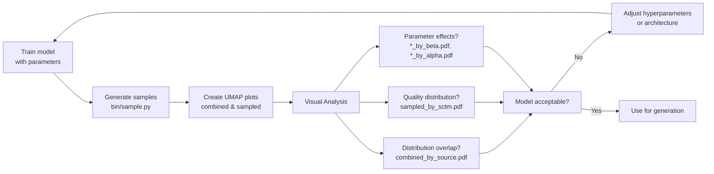

<!-- source: DeepWiki mcp.deepwiki.com · repo microsoft/foldingdiff · page 9.4 UMAP Visualizations · fetched 2026-10-26 -->

# UMAP Visualizations

Relevant source files

The following files were used as context for generating this wiki page:

- [jupyter/git_umap.ipynb](jupyter/git_umap.ipynb)
- [plots/git_umap/combined_git_umap_by_alpha.pdf](plots/git_umap/combined_git_umap_by_alpha.pdf)
- [plots/git_umap/combined_git_umap_by_beta.pdf](plots/git_umap/combined_git_umap_by_beta.pdf)
- [plots/git_umap/combined_git_umap_by_source.pdf](plots/git_umap/combined_git_umap_by_source.pdf)
- [plots/git_umap/sampled_git_umap_by_alpha.pdf](plots/git_umap/sampled_git_umap_by_alpha.pdf)
- [plots/git_umap/sampled_git_umap_by_beta.pdf](plots/git_umap/sampled_git_umap_by_beta.pdf)
- [plots/git_umap/sampled_git_umap_by_length.pdf](plots/git_umap/sampled_git_umap_by_length.pdf)
- [plots/git_umap/sampled_git_umap_by_sctm.pdf](plots/git_umap/sampled_git_umap_by_sctm.pdf)

## Purpose and Scope

This page documents the UMAP (Uniform Manifold Approximation and Projection) visualizations used to analyze FoldingDiff model behavior and generated protein structures. These visualizations provide dimensionality reduction of high-dimensional angular feature spaces into 2D plots, enabling visual comparison of:

- Training data vs. generated samples
- Effects of different model hyperparameters (beta schedules, alpha values)
- Quality metrics of generated structures (scTM scores, sequence lengths)

For information about other evaluation metrics and analyses, see [Evaluation and Analysis](#8), [Secondary Structure Analysis](#8.3), and [Hierarchical Clustering](#8.4).

---

## Overview of UMAP Analysis

UMAP is a non-linear dimensionality reduction technique that projects high-dimensional protein backbone representations (angles: phi, psi, omega, tau, and bond angles) into 2D space while preserving both local and global structure. This enables visual inspection of:

1. **Distribution overlap** between training and generated structures
2. **Clustering patterns** that may indicate mode collapse or diversity
3. **Parameter effects** on the learned latent space
4. **Quality stratification** of generated samples

**Sources:** plots/git_umap/*.pdf

---

## Visualization Types

The UMAP visualization suite consists of two categories:

### Combined Visualizations

These plots show both training data and generated samples in the same 2D UMAP space, allowing direct comparison of distributions.

| File | Description |
|------|-------------|
| `combined_git_umap_by_beta.pdf` | Points colored by beta schedule parameter |
| `combined_git_umap_by_alpha.pdf` | Points colored by alpha (noise level) parameter |
| `combined_git_umap_by_source.pdf` | Training vs. generated samples distinguished by color |

### Sample-Only Visualizations

These plots focus exclusively on generated structures, colored by quality metrics or generation parameters.

| File | Description |
|------|-------------|
| `sampled_git_umap_by_beta.pdf` | Generated samples colored by beta parameter used |
| `sampled_git_umap_by_alpha.pdf` | Generated samples colored by alpha parameter used |
| `sampled_git_umap_by_sctm.pdf` | Generated samples colored by scTM designability score |
| `sampled_git_umap_by_length.pdf` | Generated samples colored by sequence length |

**Sources:** plots/git_umap/combined_git_umap_by_beta.pdf, plots/git_umap/combined_git_umap_by_alpha.pdf, plots/git_umap/combined_git_umap_by_source.pdf, plots/git_umap/sampled_git_umap_by_beta.pdf, plots/git_umap/sampled_git_umap_by_alpha.pdf, plots/git_umap/sampled_git_umap_by_sctm.pdf, plots/git_umap/sampled_git_umap_by_length.pdf

---

## Parameters Analyzed

### Beta Schedule Parameter

The beta schedule controls the noise addition rate during diffusion training. Visualizing by beta reveals:

- How different noise schedules affect the learned distribution
- Whether certain beta values lead to better coverage of training data
- Potential mode collapse or under-sampling of certain regions

**Sources:** plots/git_umap/combined_git_umap_by_beta.pdf, plots/git_umap/sampled_git_umap_by_beta.pdf

### Alpha (Noise Level)

Alpha represents the cumulative noise level at a given timestep (ᾱ_t). This visualization shows:

- Whether structures generated from different noise levels cluster differently
- The relationship between denoising trajectory and final structure distribution

**Sources:** plots/git_umap/combined_git_umap_by_alpha.pdf, plots/git_umap/sampled_git_umap_by_alpha.pdf

### Source (Training vs. Generated)

The most critical visualization for assessing model performance:

- **Good overlap**: Model has learned the training distribution well
- **Distinct clusters**: May indicate distribution shift or mode collapse
- **Expanded coverage**: Model generates novel structures (desired if they're realistic)

**Sources:** plots/git_umap/combined_git_umap_by_source.pdf

### scTM Designability Score

Color-coding by scTM (self-consistency TM-score) reveals quality stratification:

- **High scTM regions** (≥0.5): Designable structures
- **Low scTM regions**: Poorly designable, may be artifacts
- **Spatial correlation**: Checks if quality correlates with UMAP position

For details on scTM calculation, see [Designability Testing (scTM)](#8.2).

**Sources:** plots/git_umap/sampled_git_umap_by_sctm.pdf

### Sequence Length

Coloring by length reveals:

- Whether the model generates structures of diverse lengths
- If certain UMAP regions correspond to specific length ranges
- Potential length-dependent biases in generation

**Sources:** plots/git_umap/sampled_git_umap_by_length.pdf

---

## Interpreting the Visualizations

### Assessing Distribution Overlap

### Quality-Space Correlation

When examining `sampled_git_umap_by_sctm.pdf`:

1. **Uniform quality distribution**: Model generates consistently across feature space
2. **Quality clusters**: Certain UMAP regions yield better structures
3. **Edge effects**: Low quality at distribution boundaries may indicate extrapolation errors

### Parameter Sensitivity

Comparing beta and alpha colorings reveals:

- Whether hyperparameter choices significantly affect output distribution
- If certain parameter values lead to distinct structural families
- Robustness of the generation process

**Sources:** plots/git_umap/combined_git_umap_by_beta.pdf, plots/git_umap/combined_git_umap_by_alpha.pdf, plots/git_umap/sampled_git_umap_by_beta.pdf, plots/git_umap/sampled_git_umap_by_alpha.pdf, plots/git_umap/combined_git_umap_by_source.pdf, plots/git_umap/sampled_git_umap_by_sctm.pdf, plots/git_umap/sampled_git_umap_by_length.pdf

---

## Data Flow for UMAP Generation

### Implementation Considerations

1. **Feature aggregation**: High-dimensional per-residue angles must be aggregated into fixed-size vectors for UMAP (e.g., mean pooling, or padding to fixed length)

2. **Angular periodicity**: Angles must be handled carefully (e.g., using `modulo_with_wrapped_range` from `foldingdiff/utils.py`) to avoid discontinuities at 0/2π boundaries

3. **Combined manifold learning**: For combined plots, UMAP is fit on the union of training and generated data to ensure comparable projections

4. **Git tracking**: The "git_umap" naming suggests these are generated across different git commits/branches to track model evolution over experiments

**Sources:** plots/git_umap/*.pdf

---

## Use Cases and Analysis Workflows

### Model Validation Workflow

### Cross-Experiment Comparison

The git-based organization allows comparing UMAP projections across:

- Different model architectures
- Training dataset variations
- Hyperparameter sweeps
- Training checkpoints over time

### Quality Debugging

When scTM scores are low, `sampled_git_umap_by_sctm.pdf` helps identify:

1. Whether low-quality samples form distinct clusters (systematic issue)
2. If they're scattered uniformly (random failure mode)
3. Their relationship to training data distribution (in/out of distribution failures)

**Sources:** plots/git_umap/combined_git_umap_by_source.pdf, plots/git_umap/sampled_git_umap_by_sctm.pdf

---

## Related Visualizations

UMAP analysis complements other evaluation tools:

- **TM-score clustering** ([Hierarchical Clustering](#8.4)): Structural similarity in 3D coordinate space
- **Secondary structure analysis** ([Secondary Structure Analysis](#8.3)): Composition of α-helices and β-sheets
- **PyMOL visualizations** ([Visualization Tools](#9.1)): Direct 3D structure inspection
- **Angle perturbation studies** ([Angle Perturbation Analysis](#9.3)): Sensitivity of structures to angle changes

UMAP provides a complementary view by operating directly in the angular feature space used by the model, revealing patterns in the learned representation that may not be apparent from structural metrics alone.

**Sources:** plots/git_umap/*.pdf

---

