# Page: Overview

# Overview

<details>
<summary>Relevant source files</summary>

The following files were used as context for generating this wiki page:

- [CONTRIBUTING.md](CONTRIBUTING.md)
- [README.md](README.md)
- [TRADEMARKS.md](TRADEMARKS.md)
- [plots/generated_0.gif](plots/generated_0.gif)
- [requirements.txt](requirements.txt)
- [scripts/README.md](scripts/README.md)
- [setup.py](setup.py)

</details>


## Purpose and Scope

FoldingDiff is a diffusion model-based system for generating novel protein backbone structures. This page provides a high-level overview of the system's architecture, key components, and how they interact. It covers:

- The overall system design and purpose
- Core components and their relationships
- Data representations used throughout the system
- The distinction between training and inference pipelines
- Key dependencies and technologies

For specific implementation details, see:
- Training pipeline: [Training](#6)
- Generation pipeline: [Generation and Sampling](#7)
- Data processing: [Data Pipeline](#4)
- Model architecture: [Model Architecture](#5)

## What is FoldingDiff?

FoldingDiff is a research codebase that implements a **diffusion model for protein backbone generation**. Rather than operating directly on 3D Cartesian coordinates, the system works in **internal coordinate space** (dihedral angles and bond lengths), which provides translation/rotation invariance and reduces dimensionality.

The system can:
1. **Train** diffusion models on protein structures from the CATH database
2. **Generate** novel protein backbones through iterative denoising
3. **Evaluate** generated structures for novelty, designability, and structural quality

Sources: [README.md:1-6](), [setup.py:11]()

## System Architecture

The following diagram maps the system's conceptual components to their concrete implementations in the codebase:

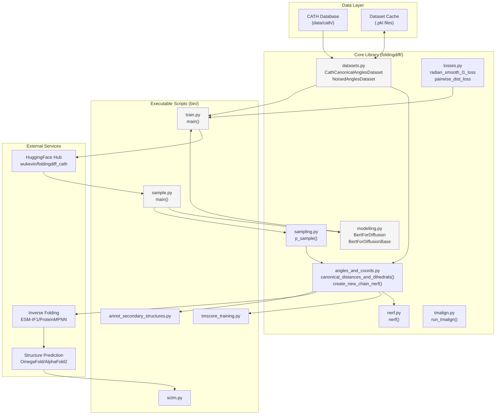

**Key Insight**: The system is organized into three layers: (1) data storage and caching, (2) core library modules providing reusable functionality, and (3) executable scripts that orchestrate workflows.

Sources: [README.md:9-196](), [setup.py:1-36]()

## Core Components

### Package Structure

The codebase follows a standard Python package structure:

| Component | Location | Purpose |
|-----------|----------|---------|
| Core library | `foldingdiff/` | Reusable modules for data, models, and utilities |
| Executables | `bin/` | Command-line scripts for training, sampling, evaluation |
| Configuration | `config_jsons/` | JSON files defining model hyperparameters |
| Data | `data/` | CATH dataset and cached preprocessed data |
| Tests | `tests/` | Unit tests for core functionality |

Sources: [setup.py:9](), [README.md:34-49]()

### Module Dependency Graph

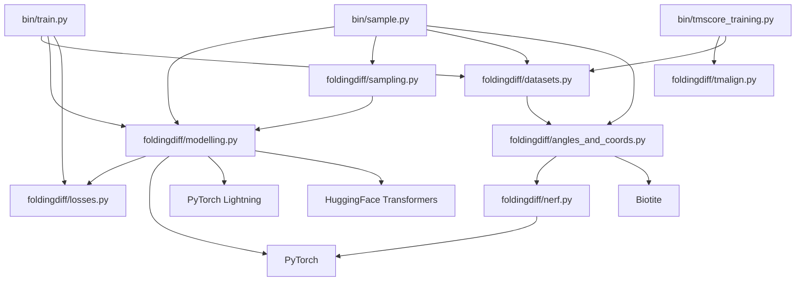

Sources: [setup.py:15-29](), [README.md:11]()

### Key Classes and Functions

The following table maps high-level concepts to their concrete implementations:

| Concept | Implementation | File |
|---------|---------------|------|
| Dataset loading | `CathCanonicalAnglesDataset` | [foldingdiff/datasets.py]() |
| Noising process | `NoisedAnglesDataset` | [foldingdiff/datasets.py]() |
| Model architecture | `BertForDiffusion` | [foldingdiff/modelling.py]() |
| Training loop | `BertForDiffusion.training_step()` | [foldingdiff/modelling.py]() |
| Reverse diffusion | `p_sample()` | [foldingdiff/sampling.py]() |
| Angle extraction | `canonical_distances_and_dihedrals()` | [foldingdiff/angles_and_coords.py]() |
| 3D reconstruction | `nerf()` | [foldingdiff/nerf.py]() |
| Loss functions | `radian_smooth_l1_loss()` | [foldingdiff/losses.py]() |

Sources: [README.md:53-77]()

## Data Representation Flow

The system operates through multiple representations of protein structures, transforming data between formats as needed:

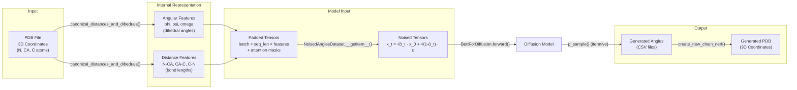

**Key Design Decision**: Operating in angle space rather than Cartesian coordinates provides:
- Translation and rotation invariance
- Reduced dimensionality (6 features per residue vs 9 for xyz coordinates)
- Natural handling of protein chain topology

Sources: [README.md:53-77]()

## Training vs Inference Pipelines

The system has two distinct operational modes:

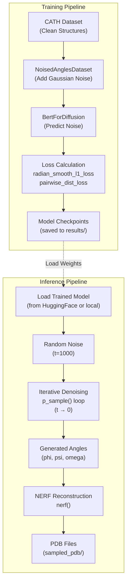

**Key Difference**: Training learns to predict noise from corrupted structures, while inference starts from pure noise and iteratively removes it.

**Entry Points**:
- Training: `bin/train.py` with configuration file
- Inference: `bin/sample.py` with model path

Sources: [README.md:32-116]()

## Key Technologies

### Core Dependencies

| Technology | Purpose | Version Requirement |
|-----------|---------|-------------------|
| PyTorch | Deep learning framework | 1.12 |
| PyTorch Lightning | Training orchestration | 1.6.4 |
| HuggingFace Transformers | BERT architecture | 4.11.3 |
| Biotite | Protein structure I/O | 0.34 |
| NumPy | Numerical operations | 1.22 |
| Pandas | Data manipulation | 1.1 |

Sources: [requirements.txt:1-14](), [setup.py:15-29]()

### Model Architecture

The diffusion model is based on **BERT transformers** adapted for continuous data:

- Base class: `BertForDiffusionBase` extends `transformers.BertPreTrainedModel`
- Training wrapper: `BertForDiffusion` extends `BertForDiffusionBase` and `pl.LightningModule`
- Key modifications:
  - Continuous value prediction instead of classification
  - Timestep conditioning through sinusoidal embeddings
  - Custom output head for angle regression

Sources: [README.md:53-77]()

## Pre-trained Models

FoldingDiff provides pre-trained weights via HuggingFace Hub:

- **Model ID**: `wukevin/foldingdiff_cath`
- **Training data**: CATH dataset (non-redundant S40)
- **Loading method**: `BertForDiffusion.from_dir(snapshot_download("wukevin/foldingdiff_cath"))`

The model can generate protein backbones ranging from 50-128 residues in length.

Sources: [README.md:51-77]()

## Evaluation Metrics

Generated structures are assessed through multiple metrics:

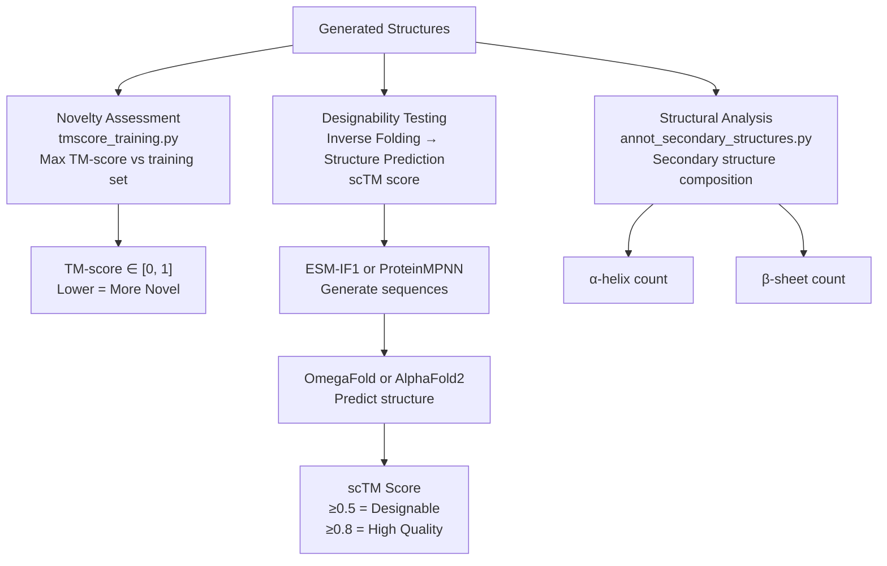

**Interpretation**:
- **Novelty**: Lower TM-scores indicate less similarity to training data
- **Designability**: Higher scTM scores indicate the backbone can be realized by real sequences
- **Structural quality**: Co-occurrence of α-helices and β-sheets indicates proper folding

Sources: [README.md:105-181]()

## Directory Structure

After running training and sampling, the system produces the following outputs:

```
project_root/
├── foldingdiff/              # Core library
│   ├── datasets.py
│   ├── modelling.py
│   ├── sampling.py
│   ├── angles_and_coords.py
│   ├── nerf.py
│   └── losses.py
├── bin/                      # Executable scripts
│   ├── train.py
│   ├── sample.py
│   ├── tmscore_training.py
│   └── sctm.py
├── data/                     # Dataset storage
│   └── cath/                 # CATH database
├── config_jsons/             # Training configurations
├── results/                  # Training outputs
│   ├── config.json
│   ├── models/               # Checkpoints
│   ├── logs/                 # Training logs
│   └── training_args.json
└── sampling_outputs/         # Generation outputs
    ├── sampled_angles/       # CSV files
    ├── sampled_pdb/          # PDB files
    └── plots/                # Visualizations
```

Sources: [README.md:42-96]()

## Use Cases

FoldingDiff supports three primary workflows:

1. **Training a new model**: Use `bin/train.py` with a config file to train on the CATH dataset
2. **Generating structures**: Use `bin/sample.py` with a trained model to generate novel backbones
3. **Evaluating quality**: Use `bin/tmscore_training.py`, `bin/sctm.py`, and `bin/annot_secondary_structures.py` to assess generated structures

Each workflow is orchestrated by a command-line script that coordinates the appropriate library modules.

Sources: [README.md:32-196]()

---

# Page: Getting Started

# Getting Started

<details>
<summary>Relevant source files</summary>

The following files were used as context for generating this wiki page:

- [CONTRIBUTING.md](CONTRIBUTING.md)
- [README.md](README.md)
- [TRADEMARKS.md](TRADEMARKS.md)
- [data/cath_checksums.md5](data/cath_checksums.md5)
- [data/download_cath.sh](data/download_cath.sh)
- [environment.yml](environment.yml)
- [foldingdiff/utils.py](foldingdiff/utils.py)
- [plots/generated_0.gif](plots/generated_0.gif)
- [requirements.txt](requirements.txt)
- [scripts/README.md](scripts/README.md)
- [scripts/amlt.yaml](scripts/amlt.yaml)
- [setup.py](setup.py)

</details>


This page guides you through the initial setup of FoldingDiff, including installation of dependencies, environment configuration, and downloading the required CATH dataset. After completing these steps, you will be ready to train models, generate protein structures, or evaluate results.

For detailed environment configuration including AMLT and Singularity deployment, see [Installation and Environment Setup](#2.1). For information about the CATH dataset structure and verification procedures, see [Downloading CATH Dataset](#2.2).

## Prerequisites

Before beginning, ensure you have:

- **Git** for cloning the repository
- **Conda** (or [mamba](https://mamba.readthedocs.io/en/latest/index.html)) for environment management
- **Python 3.8** or higher
- Sufficient disk space for the CATH dataset (~2-3 GB compressed, ~5 GB uncompressed)

## Setup Overview

The setup process follows three main stages: repository cloning, environment creation, and data acquisition.

**Setup Workflow**

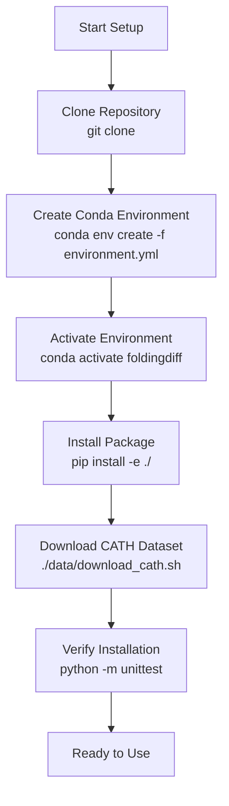

Sources: [README.md:9-17](), [README.md:19-28]()

## Quick Start

### 1. Clone Repository

```bash
git clone https://github.com/microsoft/foldingdiff
cd foldingdiff
```

### 2. Create Conda Environment

The environment specification is defined in `environment.yml` with all required dependencies.

```bash
conda env create -f environment.yml
conda activate foldingdiff
pip install -e ./
```

This installs:
- **PyTorch 1.12** with CUDA support for GPU acceleration
- **PyTorch Lightning 1.6.4** for training orchestration
- **HuggingFace Transformers 4.11.3** for BERT model architecture
- **Biotite 0.34** for protein structure manipulation
- **TM-align** for structural similarity calculations
- Additional scientific computing libraries (numpy, pandas, seaborn, etc.)

Sources: [README.md:11-17](), [environment.yml:1-25](), [setup.py:15-29]()

**Dependency Architecture**

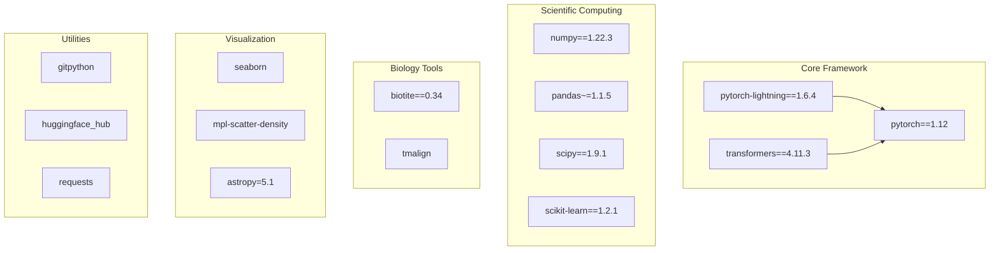

Sources: [environment.yml:8-24](), [requirements.txt:1-14]()

### 3. Download CATH Dataset

The CATH dataset is required for training. Navigate to the `data` directory and run the download script:

```bash
cd data
chmod +x download_cath.sh
./download_cath.sh
```

The script performs three operations:
1. Downloads `cath-dataset-nonredundant-S40.pdb.tgz` from UCL FTP server
2. Verifies integrity using MD5 checksum
3. Extracts PDB files to `data/cath/dompdb/`

If the download link fails, a mirror is available at the [Dropbox link](https://www.dropbox.com/s/ka5m5lx58477qu6/cath-dataset-nonredundant-S40.pdb.tgz?dl=0) referenced in the README.

Sources: [README.md:19-30](), [data/download_cath.sh:1-9](), [data/cath_checksums.md5:1]()

## Post-Setup Directory Structure

After completing setup, your directory structure should look like this:

```
foldingdiff/
├── bin/                          # Executable scripts
│   ├── train.py                  # Training pipeline
│   ├── sample.py                 # Sampling/generation
│   └── tmscore_training.py       # Novelty assessment
├── foldingdiff/                  # Core library code
│   ├── datasets.py               # Data loading classes
│   ├── modelling.py              # Model architecture
│   ├── sampling.py               # Reverse diffusion
│   ├── angles_and_coords.py      # Coordinate conversion
│   ├── nerf.py                   # 3D reconstruction
│   └── losses.py                 # Loss functions
├── data/
│   ├── cath/
│   │   ├── dompdb/              # PDB files (after extraction)
│   │   └── cath-dataset-nonredundant-S40.pdb.tgz
│   └── download_cath.sh
├── config_jsons/                 # Training configurations
├── tests/                        # Unit tests
├── environment.yml               # Conda environment spec
├── setup.py                      # Package installation
└── README.md
```

Sources: [README.md:44-49](), [data/download_cath.sh:8-9]()

## Environment Configuration

### Standard Installation

The standard installation uses `environment.yml` and is suitable for local development and training on personal machines with GPUs.

**Key packages installed:**
- `pytorch::pytorch=1.12` - Deep learning framework with CUDA support
- `pytorch-lightning=1.6.4` - Training abstractions and callbacks
- `huggingface::transformers=4.11.3` - BERT model implementation
- `biotite=0.34` - Protein structure I/O and manipulation
- `bioconda::tmalign` - Structural alignment for evaluation

Sources: [environment.yml:1-24](), [README.md:11-17]()

### Alternative: Requirements.txt

For environments where conda is not available, a `requirements.txt` is provided for pip-based installation:

```bash
pip install -r requirements.txt
```

This installs the same dependencies but without conda-managed packages like TM-align, which must be installed separately.

Sources: [requirements.txt:1-14]()

### Cloud Deployment (AMLT/Singularity)

For training on Azure ML or Singularity clusters, see [Installation and Environment Setup](#2.1) for AMLT configuration details. The AMLT setup uses a pre-built Docker image (`amlt-sing/pytorch-1.11.0`) and installs dependencies via pip for faster setup.

Sources: [scripts/amlt.yaml:1-40](), [scripts/README.md:1-17]()

## Verification

### Run Unit Tests

Verify the installation by running the test suite:

```bash
python -m unittest -v
```

Expected output includes tests for:
- Dataset loading and angle extraction
- NERF reconstruction algorithm
- Loss function calculations
- Utility functions (modulo operations, comparisons)

You may see warnings about illegal omega values in certain PDB files - these are expected and indicate the dataset loading is working correctly:

```
WARNING:root:Illegal values for omega in .../data/cath/dompdb/2ebqA00 -- skipping
```

Sources: [README.md:183-195]()

### Verify CATH Dataset

Check that the CATH dataset was extracted correctly:

```bash
ls data/cath/dompdb/ | wc -l
```

You should see thousands of PDB files. The dataset contains non-redundant protein domains from the CATH database with ≤40% sequence identity.

Verify the checksum of the downloaded tarball:

```bash
cd data
md5sum -c cath_checksums.md5
```

Expected output:
```
cath/cath-dataset-nonredundant-S40.pdb.tgz: OK
```

Sources: [data/download_cath.sh:4-5](), [data/cath_checksums.md5:1]()

## Next Steps

After completing setup, you can:

1. **Train a model** - See [Training Pipeline](#6.1) for using `bin/train.py` with configuration files
2. **Generate structures** - See [Sampling Pipeline](#7.1) for using pre-trained models to generate protein backbones
3. **Evaluate results** - See [Evaluation and Analysis](#8) for computing TM-scores, designability metrics, and structural analyses

### Using Pre-trained Models

If you want to skip training and use pre-trained weights, the model is available on HuggingFace Hub at `wukevin/foldingdiff_cath`. The model will be automatically downloaded when you run sampling:

```python
from huggingface_hub import snapshot_download
from foldingdiff import modelling

# Automatically downloads and caches model
model_dir = snapshot_download("wukevin/foldingdiff_cath")
model = modelling.BertForDiffusion.from_dir(model_dir)
```

Sources: [README.md:52-77]()

### Running Without Data Download

Note that the CATH dataset is **not required** for sampling with pre-trained models. It is only needed for:
- Training your own models
- Using the `--testcomparison` flag in `sample.py` to compare generated structures against test set
- Computing novelty metrics via `tmscore_training.py`

Sources: [README.md:21-22](), [README.md:88]()

## Common Issues

### Conda Environment Creation Fails

If `conda env create` is slow or fails, try using `mamba` instead:

```bash
mamba env create -f environment.yml
```

Mamba is a faster drop-in replacement for conda.

### Missing TM-align

If TM-align is not available after environment creation, install it manually:

```bash
conda install -c bioconda tmalign
```

### CUDA Out of Memory

If you encounter CUDA out-of-memory errors during training, reduce the batch size in your training configuration JSON file or use the `--device cpu` flag for CPU execution (significantly slower).

Sources: [environment.yml:23](), [README.md:98-103]()

---

# Page: Installation and Environment Setup

# Installation and Environment Setup

<details>
<summary>Relevant source files</summary>

The following files were used as context for generating this wiki page:

- [CONTRIBUTING.md](CONTRIBUTING.md)
- [README.md](README.md)
- [TRADEMARKS.md](TRADEMARKS.md)
- [environment.yml](environment.yml)
- [foldingdiff/utils.py](foldingdiff/utils.py)
- [plots/generated_0.gif](plots/generated_0.gif)
- [requirements.txt](requirements.txt)
- [scripts/README.md](scripts/README.md)
- [scripts/amlt.yaml](scripts/amlt.yaml)
- [setup.py](setup.py)

</details>


## Purpose and Scope

This page provides detailed instructions for installing FoldingDiff and setting up the required environment for development and deployment. It covers three primary deployment scenarios: local development, AMLT cloud training, and Singularity container deployment. For information about downloading the CATH dataset after installation, see [Downloading CATH Dataset](#2.2). For training configuration after setup, see [Training Configuration](#6.3).

## Deployment Target Overview

FoldingDiff supports three deployment configurations, each with slightly different setup requirements:

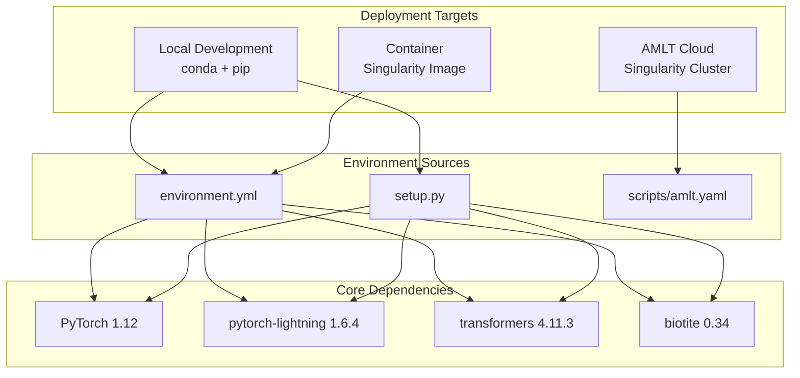

**Deployment Target Selection**

Sources: [README.md:9-17](), [scripts/amlt.yaml:1-40](), [environment.yml:1-25]()

## Local Installation

### Prerequisites

Before installation, ensure you have:
- Python 3.8 or higher
- conda or [mamba](https://mamba.readthedocs.io/en/latest/index.html) package manager
- Git for cloning the repository

### Installation Steps

The local installation process follows a two-phase approach: creating the conda environment and installing the package itself.

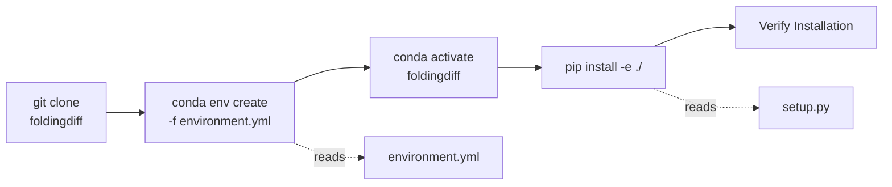

**Installation Process Flow**

#### Step 1: Clone Repository

```bash
git clone https://github.com/microsoft/foldingdiff
cd foldingdiff
```

#### Step 2: Create Conda Environment

The `environment.yml` file defines all required dependencies:

```bash
conda env create -f environment.yml
```

Alternatively, for faster installation, use mamba:

```bash
mamba env create -f environment.yml
```

Sources: [README.md:11-17](), [environment.yml:1-25]()

#### Step 3: Activate Environment

```bash
conda activate foldingdiff
```

#### Step 4: Install Package in Editable Mode

```bash
pip install -e ./
```

The editable mode (`-e`) allows code changes to take effect without reinstalling. The `setup.py` file defines package metadata and dependencies.

Sources: [README.md:13-17](), [setup.py:1-37]()

## Dependency Specification

FoldingDiff requires specific versions of core libraries to ensure compatibility. Dependencies are specified in two locations with slightly different formats.

### environment.yml Dependencies

| Package | Version | Channel | Purpose |
|---------|---------|---------|---------|
| `python` | 3.8 | defaults | Base interpreter |
| `numpy` | 1.22.3 | anaconda | Numerical computing |
| `pandas` | ~1.1.5 | conda-forge | Data manipulation |
| `pytorch` | 1.12 | pytorch | Deep learning framework |
| `transformers` | 4.11.3 | huggingface | BERT model architecture |
| `pytorch-lightning` | 1.6.4 | conda-forge | Training framework |
| `huggingface_hub` | latest | conda-forge | Model hosting |
| `biotite` | 0.34 | conda-forge | Structural biology |
| `tmalign` | latest | bioconda | Structure alignment |
| `scikit-learn` | 1.2.1 | conda-forge | Clustering algorithms |
| `seaborn` | latest | conda-forge | Visualization |
| `mpl-scatter-density` | latest | conda-forge | Dense scatter plots |
| `astropy` | 5.1 | conda-forge | Unit handling |
| `gitpython` | latest | conda-forge | Git integration |
| `requests` | latest | conda-forge | HTTP requests |

Sources: [environment.yml:1-25]()

### setup.py Dependencies

The `setup.py` file lists minimum required packages without version pinning for flexibility:

```python
install_requires=[
    "pandas",
    "numpy", 
    "torch",
    "scipy",
    "transformers",
    "pytorch-lightning",
    "huggingface-hub",
    "seaborn",
    "mpl-scatter-density",
    "astropy",
    "gitpython",
    "biotite",
    "requests"
]
```

Sources: [setup.py:15-29]()

### Critical Version Requirements

**PyTorch 1.12** is required for compatibility with `pytorch-lightning 1.6.4`. **Transformers 4.11.3** is pinned because the `BertForDiffusion` model relies on specific internal APIs that changed in later versions. **Biotite 0.34** is required for stable PDB parsing functionality.

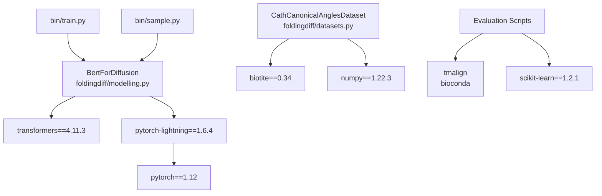

**Dependency Relationships**

Sources: [environment.yml:9-24](), [setup.py:15-29]()

## AMLT/Singularity Deployment

AMLT (Azure Machine Learning Tools) deployment uses Singularity containers for cloud training. This setup differs from local installation because the environment is pre-configured in the container image.

### AMLT Configuration Structure

The `scripts/amlt.yaml` file defines the deployment:

```yaml
target:
  service: sing
  name: msrresrchvc
  workspace_name: msrresrchws

environment:
  image: amlt-sing/pytorch-1.11.0
  setup:
    - pip install seaborn
    - pip install mpl-scatter-density
    - pip install astropy
    - pip install transformers==4.11.3
    - pip install pytorch-lightning==1.6.4
    - pip install sequence-models
    - pip install biotite==0.34
```

Sources: [scripts/amlt.yaml:1-29]()

### Key Differences from Local Setup

1. **Base Image**: Uses `amlt-sing/pytorch-1.11.0` which includes PyTorch, NumPy, Pandas, and matplotlib pre-installed
2. **pip-only Installation**: All packages installed via pip instead of conda for faster setup
3. **No conda Environment**: The Singularity image provides the Python environment
4. **Dataset Extraction**: CATH dataset is extracted during job execution

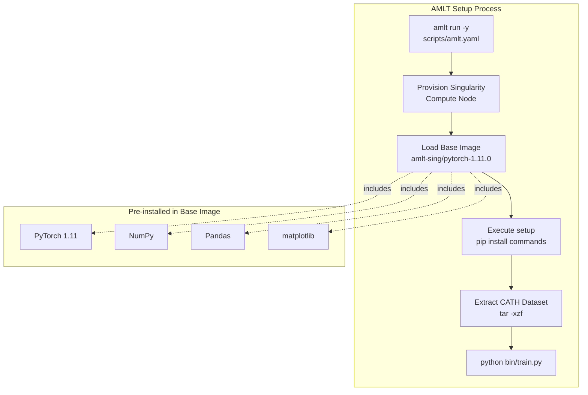

**AMLT Deployment Workflow**

Sources: [scripts/amlt.yaml:8-40](), [scripts/README.md:1-17]()

### AMLT Job Submission

To submit a training job to AMLT:

```bash
# Requires separate amlt8 conda environment
conda create -n amlt8 python=3.8
conda activate amlt8
pip install amulet-ml

# Submit job
amlt run -y scripts/amlt.yaml -o results
```

The `-o results` flag specifies the output directory for logs and checkpoints. The job configuration in `amlt.yaml` includes:

- **SKU Selection**: `16G2-V100` specifies 16GB memory with 2 V100 GPUs
- **Priority**: `high` priority in the `premium` SLA tier
- **Data Handling**: Automatic extraction of CATH dataset from tarball
- **Output Directory**: `$$AMLT_OUTPUT_DIR/results` for model checkpoints

Sources: [scripts/amlt.yaml:34-40](), [scripts/README.md:5-13]()

## Installation Verification

After installation, verify that the environment is correctly configured:

### Import Test

```python
# Test core imports
from foldingdiff import modelling
from foldingdiff import datasets as dsets
from foldingdiff import angles_and_coords
from foldingdiff import nerf

# Verify PyTorch and CUDA
import torch
print(f"PyTorch version: {torch.__version__}")
print(f"CUDA available: {torch.cuda.is_available()}")

# Verify transformers
import transformers
print(f"Transformers version: {transformers.__version__}")

# Verify lightning
import pytorch_lightning as pl
print(f"Lightning version: {pl.__version__}")
```

### Running Tests

The codebase includes unit tests implemented through both doctests and unittest:

```bash
# Run unittests
python -m unittest -v
```

Expected warnings during testing:
```
WARNING:root:Illegal values for omega in protdiff-main/data/cath/dompdb/5a2qw00 -- skipping
```

These warnings are normal and indicate that certain PDB files in the CATH dataset have invalid dihedral angle values and are automatically skipped.

Sources: [README.md:184-196]()

### Verifying Package Installation

```bash
# Check that foldingdiff is installed in editable mode
pip show foldingdiff

# Verify all required packages
pip list | grep -E "torch|transformers|lightning|biotite"
```

## Environment File Details

### environment.yml Structure

The `environment.yml` file specifies four conda channels in priority order:

1. `defaults` - Core Anaconda packages
2. `anaconda` - Additional Anaconda packages  
3. `pytorch` - PyTorch and related packages
4. `conda-forge` - Community-maintained packages
5. `huggingface` - HuggingFace transformers
6. `bioconda` - Bioinformatics packages (for `tmalign`)

Sources: [environment.yml:1-7]()

### setup.py Metadata

The `setup.py` file defines package metadata used for distribution:

| Field | Value |
|-------|-------|
| `name` | `"foldingdiff"` |
| `author` | `"Kevin Wu"` |
| `version` | `"0.0.1"` |
| `python_requires` | `">=3.8"` |
| `url` | `https://github.com/microsoft/foldingdiff` |

The `find_packages()` function automatically discovers the `foldingdiff` package directory and its submodules.

Sources: [setup.py:1-37]()

## Common Installation Issues

### Issue: ModuleNotFoundError for foldingdiff

**Cause**: Package not installed in editable mode or wrong environment activated.

**Solution**: 
```bash
conda activate foldingdiff
pip install -e ./
```

### Issue: CUDA not available

**Cause**: PyTorch CPU-only version installed or CUDA driver mismatch.

**Solution**: Reinstall PyTorch with CUDA support matching your driver:
```bash
# For CUDA 11.3
conda install pytorch==1.12 cudatoolkit=11.3 -c pytorch
```

### Issue: Slow conda environment creation

**Cause**: conda's dependency solver is computationally expensive.

**Solution**: Use mamba instead:
```bash
conda install -c conda-forge mamba
mamba env create -f environment.yml
```

### Issue: biotite import fails

**Cause**: Biotite version mismatch or C extension compilation failure.

**Solution**: Force reinstall from conda-forge:
```bash
conda install -c conda-forge biotite==0.34 --force-reinstall
```

## Next Steps

After successful installation:

1. **Download CATH Dataset**: See [Downloading CATH Dataset](#2.2) for instructions on obtaining training data
2. **Verify Dataset**: Run basic dataset loading to ensure PDB files are correctly processed
3. **Training**: Proceed to [Training Pipeline](#6.1) to train your own model
4. **Sampling**: Use pre-trained models with [Sampling Pipeline](#7.1) to generate structures

Sources: [README.md:19-31](), [README.md:33-49]()

---

# Page: Downloading CATH Dataset

# Downloading CATH Dataset

<details>
<summary>Relevant source files</summary>

The following files were used as context for generating this wiki page:

- [CONTRIBUTING.md](CONTRIBUTING.md)
- [README.md](README.md)
- [TRADEMARKS.md](TRADEMARKS.md)
- [data/cath_checksums.md5](data/cath_checksums.md5)
- [data/download_cath.sh](data/download_cath.sh)
- [plots/generated_0.gif](plots/generated_0.gif)
- [requirements.txt](requirements.txt)
- [scripts/README.md](scripts/README.md)
- [setup.py](setup.py)

</details>


## Purpose and Scope

This page explains how to download and prepare the CATH protein structure dataset for use with FoldingDiff. The CATH dataset provides the training data for the diffusion model and is essential for training your own models or evaluating generated structures against the training set.

**Note:** For information about how the CATH data is processed into model inputs, see [Dataset Classes](#4.1). For details on the training pipeline itself, see [Training Pipeline (train.py)](#6.1).

## What is CATH

CATH (Class, Architecture, Topology, Homology) is a hierarchical classification of protein domain structures. FoldingDiff uses the **CATH 4.2 non-redundant dataset at S40 sequence identity**, which contains:

- High-quality protein domain structures from the Protein Data Bank (PDB)
- Non-redundant entries with ≤40% sequence identity
- PDB files containing 3D coordinates of protein backbone atoms (N, CA, C)

The dataset is stored as individual PDB files, one per protein domain, organized in a directory structure.

**Sources:** [README.md:19-30](), [data/download_cath.sh:1-9]()

## When is CATH Required

The CATH dataset is required for the following use cases:

| Use Case | CATH Required | Reason |
|----------|---------------|--------|
| Training models | ✅ Yes | Provides training and validation data |
| Sampling structures | ❌ No | Pre-trained models can generate structures without data |
| Sampling with `--testcomparison` | ✅ Yes | Compares generated structures to test set |
| TM-score novelty evaluation | ✅ Yes | Calculates similarity to training structures |
| Secondary structure annotation | ❌ No | Only requires generated structures |

**Sources:** [README.md:19-21](), [README.md:88]()

## Data Flow Architecture

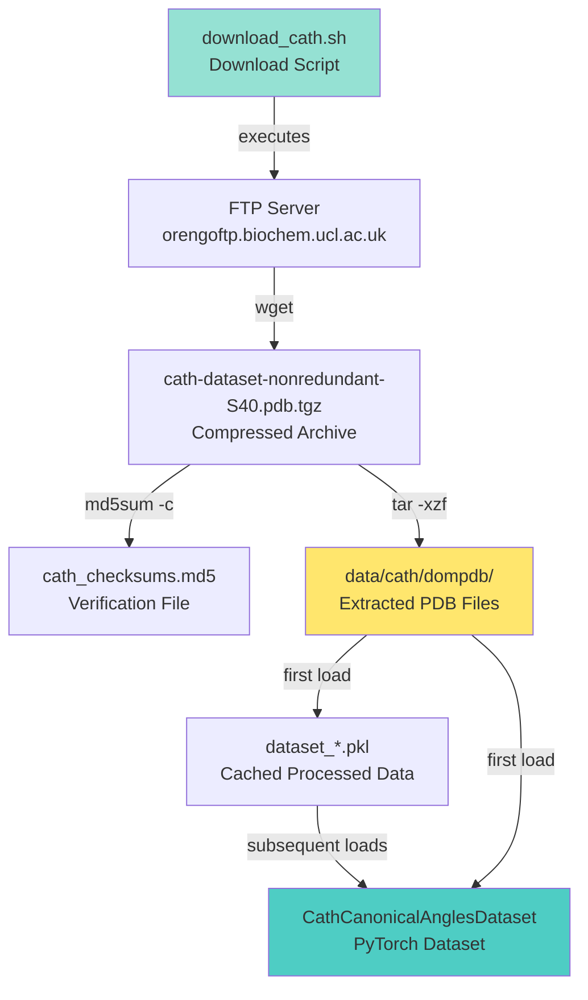

**Diagram:** CATH dataset download and processing pipeline

**Sources:** [data/download_cath.sh:1-9](), [README.md:66-72]()

## Download Procedure

### Prerequisites

Ensure you are in the repository's root directory and have an active internet connection.

### Step-by-Step Instructions

**1. Navigate to the data directory:**

```bash
cd data
```

**2. Make the download script executable:**

```bash
chmod +x download_cath.sh
```

**3. Run the download script:**

```bash
./download_cath.sh
```

This script performs three operations:
- Downloads the tarball from the CATH FTP server using `wget`
- Verifies the download integrity using MD5 checksums
- Extracts the PDB files into `data/cath/dompdb/`

**Sources:** [README.md:22-28](), [data/download_cath.sh:1-9]()

### Download Script Details

The script [data/download_cath.sh:1-9]() performs the following operations:

| Line | Operation | Description |
|------|-----------|-------------|
| 2 | `wget -P cath ...` | Downloads tarball to `data/cath/` directory |
| 5 | `md5sum -c ...` | Verifies download integrity against expected checksum |
| 8 | `cd cath` | Enters the cath directory |
| 9 | `tar -xzf ...` | Extracts PDB files from compressed archive |

**Sources:** [data/download_cath.sh:1-9]()

## Verification

### MD5 Checksum Verification

The script automatically verifies the download using the checksum file [data/cath_checksums.md5:1]():

```
Expected MD5: 070a96ace6d82b87524cb82c3269e4dc
File: cath/cath-dataset-nonredundant-S40.pdb.tgz
```

If the checksum fails, the download is corrupted and should be re-attempted.

### Manual Verification

To manually verify the download:

```bash
cd data
md5sum cath/cath-dataset-nonredundant-S40.pdb.tgz
# Compare output to: 070a96ace6d82b87524cb82c3269e4dc
```

### Expected Warnings During Processing

When the CATH dataset is first loaded by the code, you may see warnings like:

```
WARNING:root:Illegal values for omega in /path/to/data/cath/dompdb/2ebqA00 -- skipping
```

These warnings are **normal and expected** [README.md:67]() — they indicate that certain PDB files contain invalid dihedral angles and are automatically skipped during processing.

**Sources:** [data/cath_checksums.md5:1](), [README.md:66-68](), [README.md:193-195]()

## Directory Structure

After successful download and extraction, the directory structure will be:

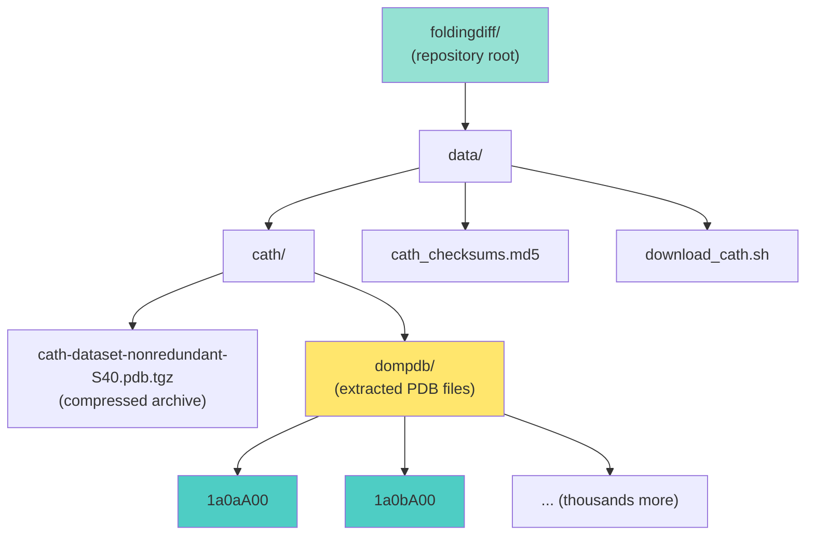

**Diagram:** Directory structure after CATH dataset download

### File Organization

| Path | Type | Description |
|------|------|-------------|
| `data/` | Directory | Root data directory |
| `data/cath/` | Directory | CATH dataset directory |
| `data/cath/cath-dataset-nonredundant-S40.pdb.tgz` | Archive | Compressed dataset (can be deleted after extraction) |
| `data/cath/dompdb/` | Directory | Extracted PDB files (one per protein domain) |
| `data/cath/dompdb/[domainID]` | PDB file | Individual protein domain structure (e.g., `2ebqA00`) |
| `data/cath_checksums.md5` | Checksum | MD5 hash for verification |
| `data/download_cath.sh` | Script | Download automation script |

**Sources:** [data/download_cath.sh:8-9](), [README.md:22-28]()

## Dataset Caching

### Automatic Cache Generation

When the CATH dataset is first loaded by the code (e.g., during training), the system automatically:

1. Reads all PDB files from `data/cath/dompdb/`
2. Extracts dihedral angles and distances using [foldingdiff/angles_and_coords.py]()
3. Caches the processed data as `.pkl` files for faster loading in future runs

The cache files are stored in the FoldingDiff package directory and have names like:
- `dataset_cath_*.pkl`

### Cache Invalidation

The cache is automatically regenerated if:
- The dataset parameters change (e.g., padding length, subset selection)
- The cache file is deleted or corrupted
- The underlying CATH data files are modified

**Sources:** [README.md:66-72]()

## Troubleshooting

### Download Failures

If the FTP download fails (e.g., due to network issues or server unavailability), use the **Dropbox mirror**:

1. Download from: [Dropbox mirror link](https://www.dropbox.com/s/ka5m5lx58477qu6/cath-dataset-nonredundant-S40.pdb.tgz?dl=0)
2. Place the file in `data/cath/`
3. Verify with: `md5sum -c cath_checksums.md5`
4. Extract manually: `cd data/cath && tar -xzf cath-dataset-nonredundant-S40.pdb.tgz`

**Sources:** [README.md:30]()

### Checksum Mismatch

If `md5sum -c` reports a checksum mismatch:

1. Delete the corrupted tarball: `rm data/cath/cath-dataset-nonredundant-S40.pdb.tgz`
2. Re-run the download script: `./download_cath.sh`
3. If issues persist, try the Dropbox mirror (see above)

### Disk Space Requirements

The CATH dataset requires approximately:
- **~1.5 GB** for the compressed tarball
- **~2.5 GB** for extracted PDB files
- **~4 GB total** (including both compressed and extracted data)

Ensure sufficient disk space before downloading.

### Permission Issues

If you encounter permission errors when running the script:

```bash
chmod +x data/download_cath.sh
# Then re-run
cd data && ./download_cath.sh
```

**Sources:** [README.md:22-30]()

## Integration with Training

The downloaded CATH dataset is automatically used by the training pipeline through dataset classes:

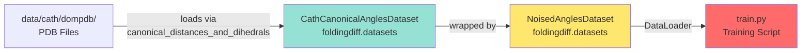

**Diagram:** CATH dataset integration with training pipeline

Key dataset classes that use CATH:
- `CathCanonicalAnglesDataset` - Loads and processes CATH PDB files
- `CathCanonicalAnglesOnlyDataset` - Variant that only uses angular features
- `NoisedAnglesDataset` - Adds noise according to diffusion schedule

For more details on these classes, see [Dataset Classes](#4.1).

**Sources:** [README.md:64-76](), [bin/train.py]()

## Verification of Successful Setup

To verify your CATH dataset is properly configured:

**1. Check file structure:**
```bash
ls data/cath/dompdb/ | head -5
# Should list PDB files like: 1a0aA00, 1a0bA00, etc.
```

**2. Test dataset loading (requires environment setup, see [Installation and Environment Setup](#2.1)):**
```python
from foldingdiff import datasets as dsets

# This will trigger cache generation if needed
dataset = dsets.CathCanonicalAnglesOnlyDataset(pad=128, trim_strategy='randomcrop')
print(f"Successfully loaded {len(dataset)} structures")
```

If this runs without errors (except expected warnings about illegal omega values), your CATH dataset is properly configured.

**Sources:** [README.md:64-76](), [README.md:193-195]()

---

# Page: Core Concepts

# Core Concepts

<details>
<summary>Relevant source files</summary>

The following files were used as context for generating this wiki page:

- [CONTRIBUTING.md](CONTRIBUTING.md)
- [README.md](README.md)
- [TRADEMARKS.md](TRADEMARKS.md)
- [foldingdiff/angles_and_coords.py](foldingdiff/angles_and_coords.py)
- [foldingdiff/datasets.py](foldingdiff/datasets.py)
- [foldingdiff/nerf.py](foldingdiff/nerf.py)
- [foldingdiff/sampling.py](foldingdiff/sampling.py)
- [plots/generated_0.gif](plots/generated_0.gif)
- [requirements.txt](requirements.txt)
- [scripts/README.md](scripts/README.md)
- [setup.py](setup.py)
- [tests/test_angles_and_coords.py](tests/test_angles_and_coords.py)
- [tests/test_nerf.py](tests/test_nerf.py)

</details>


This page introduces the three fundamental concepts that underpin FoldingDiff's approach to protein backbone generation:

1. **Diffusion Models for Proteins** - The generative modeling framework based on iterative denoising
2. **Internal Coordinates Representation** - The use of dihedral and bond angles instead of Cartesian coordinates
3. **NERF Reconstruction** - The algorithm for converting angles back to 3D structures

These concepts are essential to understanding how FoldingDiff generates novel protein backbones. For detailed implementation of the model architecture, see [Model Architecture](#5). For the training pipeline, see [Training](#6). For sampling/generation, see [Generation and Sampling](#7).

---

## System Design Philosophy

FoldingDiff's core innovation is operating in **angular space** rather than Cartesian coordinate space. This design choice provides several advantages: translation/rotation invariance, reduced dimensionality, and physically meaningful constraints. The system combines three key technologies to achieve this:

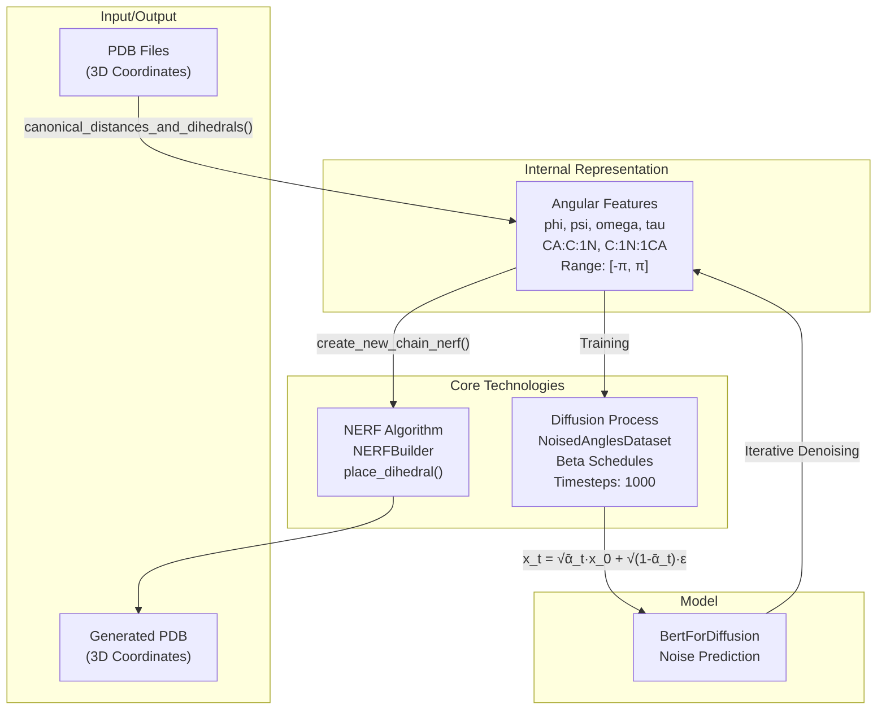

**Sources:** [foldingdiff/datasets.py:30-38](), [foldingdiff/angles_and_coords.py:30-109](), [foldingdiff/nerf.py:27-143](), [foldingdiff/sampling.py:78-133]()

---

## Diffusion Models for Proteins

For a comprehensive treatment of diffusion models in the context of protein generation, see [Diffusion Models for Proteins](#3.1).

### Forward and Reverse Processes

The diffusion model consists of two Markov chains:

1. **Forward Process (Noising)**: Gradually corrupts protein structure by adding Gaussian noise over `T` timesteps
2. **Reverse Process (Denoising)**: Learns to remove noise iteratively to generate new structures


### Key Mathematical Components

The forward diffusion process at timestep `t` is defined by:

**Forward Equation:**
```
x_t = √(ᾱ_t) · x_0 + √(1 - ᾱ_t) · ε
```

Where:
- `x_0` is the original (clean) angles
- `x_t` is the noised angles at timestep `t`
- `ᾱ_t` is the cumulative product of alphas: `∏(1 - β_i)` for `i=1` to `t`
- `ε ~ N(0, I)` is Gaussian noise
- `β_t` is the variance schedule at timestep `t`

**Reverse Sampling Equation (p_sample):**
```
x_t-1 = (1/√α_t) · (x_t - (β_t/√(1-ᾱ_t)) · model(x_t, t)) + √σ_t · z
```

Where:
- `model(x_t, t)` predicts the noise `ε` added to create `x_t`
- `z ~ N(0, I)` is noise (zero at `t=0`)

### Code Implementation

| Component | Class/Function | File Location | Description |
|-----------|---------------|---------------|-------------|
| Forward Process | `NoisedAnglesDataset.__getitem__()` | [foldingdiff/datasets.py:801-886]() | Adds noise to angles according to timestep |
| Reverse Process | `p_sample()` | [foldingdiff/sampling.py:28-76]() | Single denoising step |
| Full Sampling | `p_sample_loop()` | [foldingdiff/sampling.py:78-133]() | Iterative denoising from T→0 |
| Beta Schedules | `get_variance_schedule()` | [foldingdiff/beta_schedules.py]() | Linear, cosine, etc. |
| Alpha Computation | `compute_alphas()` | [foldingdiff/beta_schedules.py]() | Computes ᾱ_t from β_t |

### Variance Schedules

The system supports multiple beta schedules that control the noise level at each timestep:

- **Linear**: `β_t` increases linearly from `β_start` to `β_end`
- **Cosine**: Smoother schedule based on cosine function (commonly used)
- Others: quadratic, sigmoid, etc.

The choice of schedule affects training stability and sample quality.

**Sources:** [foldingdiff/datasets.py:685-886](), [foldingdiff/sampling.py:28-133](), [README.md:1-196]()

---

## Internal Coordinates Representation

For detailed information about the angular representation system, see [Internal Coordinates Representation](#3.2).

### Why Angles Instead of Coordinates?

FoldingDiff operates on **internal coordinates** (angles and bond lengths) rather than Cartesian coordinates (x, y, z). This choice provides several critical advantages:

| Advantage | Description |
|-----------|-------------|
| **Translation Invariance** | Proteins are identical regardless of absolute position in space |
| **Rotation Invariance** | Proteins are identical regardless of orientation |
| **Reduced Dimensionality** | 6 angles per residue vs. 9 coordinates (3 atoms × 3 dimensions) |
| **Physically Meaningful** | Angles directly represent protein backbone geometry |
| **Natural Constraints** | Angles naturally wrap around [-π, π] |

### Angle and Distance Features

The system uses six angular features and optionally three distance features:

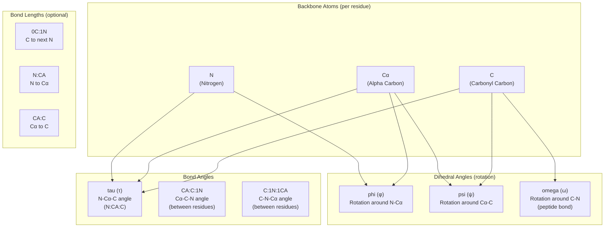

### Feature Specifications

**Canonical Full Angles** (`CathCanonicalAnglesOnlyDataset`):
```python
feature_names = ["phi", "psi", "omega", "tau", "CA:C:1N", "C:1N:1CA"]
feature_is_angular = [True, True, True, True, True, True]
```

**Canonical Minimal Angles** (`CathCanonicalMinimalAnglesDataset`):
```python
feature_names = ["phi", "psi", "omega", "tau"]
feature_is_angular = [True, True, True, True]
```

**Canonical with Distances** (`CathCanonicalAnglesDataset`):
```python
feature_names = ["0C:1N", "N:CA", "CA:C", "phi", "psi", "omega", "tau", "CA:C:1N", "C:1N:1CA"]
feature_is_angular = [False, False, False, True, True, True, True, True, True]
```

### Angular Data Properties

All angular features are constrained to the range **[-π, π]** radians. This is enforced throughout the pipeline:

1. **Extraction**: `canonical_distances_and_dihedrals()` ensures angles are in valid range
2. **Noising**: `modulo_with_wrapped_range()` wraps noised angles back to [-π, π]
3. **Sampling**: `p_sample_loop()` wraps at each denoising step
4. **Output**: Final angles are checked before conversion to PDB

The system uses circular statistics for angular features, treating them as points on a circle rather than linear values.

**Sources:** [foldingdiff/datasets.py:44-72](), [foldingdiff/datasets.py:502-567](), [foldingdiff/angles_and_coords.py:23-27](), [foldingdiff/angles_and_coords.py:30-109]()

---

## NERF Reconstruction

For a comprehensive explanation of the NERF algorithm, see [NERF Reconstruction](#3.3).

### Natural Extension of Reference Frame

NERF (Natural Extension of Reference Frame) is the algorithm that converts internal coordinates (angles) back to 3D Cartesian coordinates. This is essential because:

1. **Training** uses angles extracted from PDB files
2. **Generation** produces angles that must be converted to PDB format
3. **Evaluation** requires 3D structures for TM-score and other metrics

### The Building Process

NERF builds a protein backbone **atom by atom** in the sequence N → Cα → C → N → Cα → C → ..., using the previous three atoms to place each new atom:

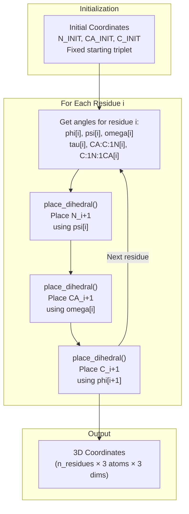

### The place_dihedral Function

The core of NERF is the `place_dihedral()` function, which places a new point `d` given:
- Three previous points: `a`, `b`, `c`
- Bond angle: angle between `b-c` and `c-d`
- Bond length: distance from `c` to `d`
- Torsion angle (dihedral): twist around the `b-c` axis

**Mathematical Formulation:**

```
d = c + M · [−L·cos(θ), L·cos(τ)·sin(θ), L·sin(τ)·sin(θ)]ᵀ
```

Where:
- `L` = bond_length
- `θ` = bond_angle
- `τ` = torsion_angle
- `M` is a rotation matrix constructed from the coordinate frame defined by `a`, `b`, `c`

### Implementation Details

| Component | Location | Description |
|-----------|----------|-------------|
| `NERFBuilder` class | [foldingdiff/nerf.py:27-143]() | Main builder that iterates through residues |
| `place_dihedral()` | [foldingdiff/nerf.py:145-205]() | Places a single atom given geometry |
| `nerf_build_batch()` | [foldingdiff/nerf.py:207-293]() | Batch version for parallel processing |
| `create_new_chain_nerf()` | [foldingdiff/angles_and_coords.py:112-184]() | High-level interface |

### Usage Example Flow

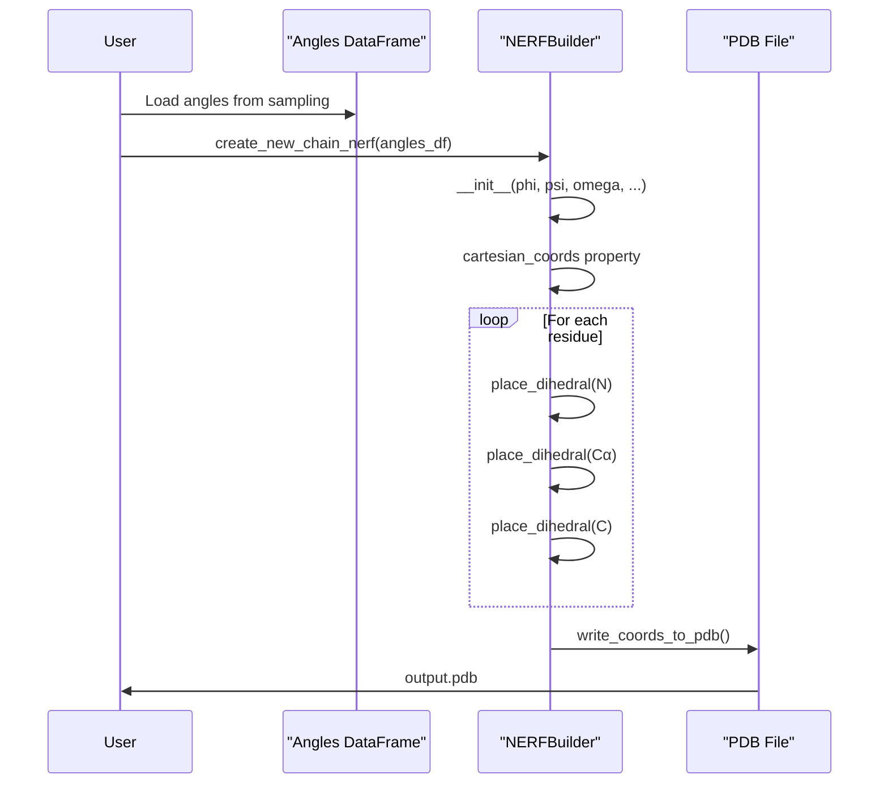

### Default Bond Geometry

NERF uses standard bond lengths and angles unless explicitly provided:

| Parameter | Default Value | Description |
|-----------|---------------|-------------|
| `N_CA_LENGTH` | 1.46 Å | N-Cα bond length |
| `CA_C_LENGTH` | 1.54 Å | Cα-C bond length |
| `C_N_LENGTH` | 1.34 Å | C-N peptide bond length |
| `bond_angle_n_ca` | 121° (2.11 rad) | N-Cα-C angle |
| `bond_angle_ca_c` | 109° (1.90 rad) | Cα-C-N angle (tau) |
| `bond_angle_c_n` | 115° (2.01 rad) | C-N-Cα angle |

These defaults allow reconstruction using only the three dihedral angles (phi, psi, omega) if desired, though better accuracy is achieved by also predicting tau and the inter-residue angles.

### PyTorch Backend

NERF supports both NumPy and PyTorch backends. The PyTorch backend enables:
- **Batched processing**: Process multiple structures in parallel
- **GPU acceleration**: Faster reconstruction for large batches
- **Differentiability**: Allows gradient flow for potential end-to-end training

The backend is automatically detected based on input types (NumPy arrays vs. PyTorch tensors).

**Sources:** [foldingdiff/nerf.py:1-314](), [foldingdiff/angles_and_coords.py:112-184](), [tests/test_nerf.py:18-242]()

---

## Putting It All Together

The three core concepts work together in the complete pipeline:

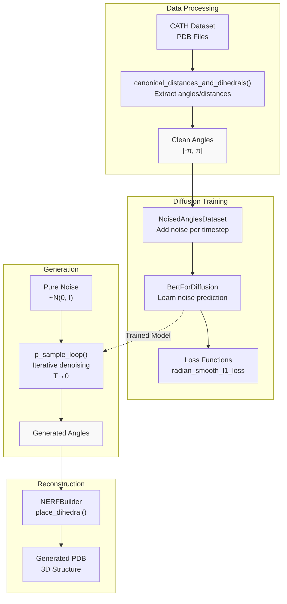

### Key Design Decisions

1. **Angular Space**: Operating in angle space provides geometric invariances and reduces dimensionality
2. **Diffusion Model**: Enables high-quality generation through learned iterative refinement
3. **NERF Reconstruction**: Allows conversion back to standard PDB format for evaluation and use

### Circular Boundary Handling

Throughout the pipeline, angular features require special handling due to their circular nature:

- **Forward Diffusion**: `modulo_with_wrapped_range()` ensures noised angles remain in [-π, π]
- **Reverse Diffusion**: Each denoising step re-wraps angles
- **Mean Centering**: Uses circular mean (`wrapped_mean()`) not arithmetic mean
- **Loss Functions**: `radian_smooth_l1_loss()` accounts for circular distance

**Sources:** [foldingdiff/datasets.py:1-958](), [foldingdiff/sampling.py:1-365](), [foldingdiff/nerf.py:1-314](), [foldingdiff/utils.py]()

---

# Page: Diffusion Models for Proteins

# Diffusion Models for Proteins

<details>
<summary>Relevant source files</summary>

The following files were used as context for generating this wiki page:

- [CONTRIBUTING.md](CONTRIBUTING.md)
- [README.md](README.md)
- [TRADEMARKS.md](TRADEMARKS.md)
- [foldingdiff/__init__.py](foldingdiff/__init__.py)
- [foldingdiff/angles_and_coords.py](foldingdiff/angles_and_coords.py)
- [foldingdiff/beta_schedules.py](foldingdiff/beta_schedules.py)
- [foldingdiff/custom_metrics.py](foldingdiff/custom_metrics.py)
- [foldingdiff/datasets.py](foldingdiff/datasets.py)
- [foldingdiff/losses.py](foldingdiff/losses.py)
- [foldingdiff/pymol_vis.py](foldingdiff/pymol_vis.py)
- [foldingdiff/sampling.py](foldingdiff/sampling.py)
- [plots/generated_0.gif](plots/generated_0.gif)
- [requirements.txt](requirements.txt)
- [scripts/README.md](scripts/README.md)
- [setup.py](setup.py)
- [tests/test_angles_and_coords.py](tests/test_angles_and_coords.py)

</details>


## Purpose and Scope

This page explains the theoretical and practical foundations of diffusion models as applied to protein backbone generation in FoldingDiff. It covers the forward noising process, reverse denoising process, timestep scheduling, and variance schedules (beta schedules). For implementation details of the noising dataset, see [Noising Process](#4.3). For the sampling pipeline that uses reverse diffusion, see [Reverse Diffusion Process](#7.2). For details on the protein representation being diffused, see [Internal Coordinates Representation](#3.2).

## Overview of Diffusion Models

Diffusion models are a class of generative models that learn to create data by reversing a gradual noising process. In FoldingDiff, the data being generated is protein backbone structures represented as internal angles (phi, psi, omega, tau). The model learns to denoise these angular representations across a sequence of timesteps.

The core insight is that if we can learn to reverse a well-defined noising process, we can generate new samples by starting from pure noise and iteratively denoising until we obtain a valid protein structure.

**Diagram: Diffusion Process Overview**

```mermaid
graph LR
    subgraph "Forward Process (Training)"
        X0["Clean Angles<br/>x₀<br/>(phi, psi, omega, tau)"]
        X250["Partially Noised<br/>x₂₅₀"]
        X500["More Noised<br/>x₅₀₀"]
        X1000["Pure Noise<br/>x₁₀₀₀<br/>~N(0,I)"]
        
        X0 -->|"Add noise<br/>t=1→250"| X250
        X250 -->|"Add noise<br/>t=251→500"| X500
        X500 -->|"Add noise<br/>t=501→1000"| X1000
    end
    
    subgraph "Reverse Process (Sampling)"
        Y1000["Pure Noise<br/>x₁₀₀₀<br/>~N(0,I)"]
        Y500["Partially Denoised<br/>x₅₀₀"]
        Y250["More Denoised<br/>x₂₅₀"]
        Y0["Generated Angles<br/>x₀<br/>(phi, psi, omega, tau)"]
        
        Y1000 -->|"Denoise<br/>Model predicts noise"| Y500
        Y500 -->|"Denoise<br/>Model predicts noise"| Y250
        Y250 -->|"Denoise<br/>Model predicts noise"| Y0
    end
    
    X1000 -.->|"Training teaches<br/>reverse process"| Y1000
```

Sources: [foldingdiff/datasets.py:685-887](), [foldingdiff/sampling.py:27-133](), [README.md:1-196]()

## The Forward Process (Noising)

The forward process gradually adds Gaussian noise to clean protein angle data. At each timestep `t`, the noised data `x_t` is computed as a linear combination of the original data `x_0` and sampled noise `ε`.

### Mathematical Formulation

The forward diffusion process at timestep `t` is defined as:

```
x_t = √(ᾱ_t) · x_0 + √(1 - ᾱ_t) · ε
```

Where:
- `x_0` is the original clean data (protein angles)
- `ε ~ N(0, I)` is Gaussian noise
- `ᾱ_t` (alpha bar) is the cumulative product of alphas up to timestep `t`
- `α_t = 1 - β_t` where `β_t` is the variance schedule

This formulation allows us to sample any noised timestep directly without iterating through all previous timesteps.

### Code Implementation

**Diagram: Forward Process Code Flow**

```mermaid
graph TD
    GetItem["NoisedAnglesDataset.__getitem__()"]
    SampleT["Sample timestep t<br/>torch.randint(0, timesteps)"]
    GetAlpha["Get alpha values<br/>sqrt_alphas_cumprod[t]<br/>sqrt_one_minus_alphas_cumprod[t]"]
    SampleNoise["sample_noise()<br/>Gaussian noise<br/>scaled by angular variance"]
    ComputeNoised["Compute noised values<br/>x_t = √ᾱ_t·x_0 + √(1-ᾱ_t)·ε"]
    WrapAngles["Wrap angular features<br/>to [-π, π]<br/>using modulo_with_wrapped_range()"]
    Return["Return corrupted angles,<br/>timestep t, noise ε"]
    
    GetItem --> SampleT
    SampleT --> GetAlpha
    GetAlpha --> SampleNoise
    SampleNoise --> ComputeNoised
    ComputeNoised --> WrapAngles
    WrapAngles --> Return
    
    style ComputeNoised fill:#f9f9f9
    style WrapAngles fill:#f9f9f9
```

Sources: [foldingdiff/datasets.py:801-886]()

Key implementation details from `NoisedAnglesDataset`:

| Component | Code Location | Description |
|-----------|---------------|-------------|
| Timestep sampling | [datasets.py:849]() | `t = torch.randint(0, self.timesteps, (1,)).long()` |
| Alpha retrieval | [datasets.py:852-855]() | Extract `sqrt_alphas_cumprod_t` and `sqrt_one_minus_alphas_cumprod_t` |
| Noise generation | [datasets.py:772-799]() | `sample_noise()` creates noise with optional variance scaling |
| Forward equation | [datasets.py:861-863]() | `noised_vals = sqrt_alphas_cumprod_t * vals + sqrt_one_minus_alphas_cumprod_t * noise` |
| Angular wrapping | [datasets.py:869-871]() | Ensures angles remain in `[-π, π]` range |

The noise sampling is protein-specific: angular features (phi, psi, omega, tau) can have different variance scales than non-angular features, and all angular noise is wrapped to `[-π, π]` to respect the circular topology of angles.

Sources: [foldingdiff/datasets.py:685-887](), [foldingdiff/utils.py]()

## The Reverse Process (Denoising)

The reverse process learns to remove noise step-by-step, starting from pure Gaussian noise and ending with a valid protein structure. The neural network predicts the noise component at each timestep, which is then used to compute a denoised estimate.

### Mathematical Formulation

At each reverse timestep, the model predicts the noise and computes the mean of the distribution:

```
μ_θ(x_t, t) = 1/√α_t · (x_t - β_t/√(1-ᾱ_t) · ε_θ(x_t, t))
```

Then samples the previous timestep:
```
x_{t-1} = μ_θ(x_t, t) + √(posterior_variance_t) · z    if t > 0
x_0 = μ_θ(x_t, t)                                        if t = 0
```

Where:
- `ε_θ(x_t, t)` is the noise predicted by the model
- `z ~ N(0, I)` is new random noise
- `posterior_variance_t = β_t · (1 - ᾱ_{t-1}) / (1 - ᾱ_t)`

### Code Implementation

**Diagram: Reverse Process Code Flow**

```mermaid
graph TD
    PLoop["p_sample_loop()"]
    InitNoise["Initialize from<br/>pure noise x_T"]
    LoopT["Loop t = T-1 → 0"]
    PSample["p_sample(model, x_t, t)"]
    ModelPredict["model(x_t, t, mask)<br/>BertForDiffusion.forward()<br/>Predicts noise ε_θ"]
    ComputeMean["Compute mean μ_θ<br/>1/√α_t · (x_t - β_t·ε_θ/√(1-ᾱ_t))"]
    AddNoise["Add noise if t > 0<br/>x_{t-1} = μ_θ + √σ_t · z"]
    WrapAngles2["Wrap angular features<br/>to [-π, π]"]
    CheckT{"t = 0?"}
    Return2["Return x_0<br/>(generated angles)"]
    
    PLoop --> InitNoise
    InitNoise --> LoopT
    LoopT --> PSample
    PSample --> ModelPredict
    ModelPredict --> ComputeMean
    ComputeMean --> CheckT
    CheckT -->|"Yes"| Return2
    CheckT -->|"No"| AddNoise
    AddNoise --> WrapAngles2
    WrapAngles2 --> LoopT
    
    style ComputeMean fill:#f9f9f9
    style ModelPredict fill:#f9f9f9
```

Sources: [foldingdiff/sampling.py:27-133]()

Key implementation details:

| Component | Code Location | Description |
|-----------|---------------|-------------|
| Noise prediction | [sampling.py:65]() | `model(x, t, attention_mask=attn_mask)` |
| Mean computation | [sampling.py:62-67]() | Implements equation 11 from DDPM paper |
| Posterior variance | [sampling.py:72]() | `posterior_variance_t = alpha_beta_values["posterior_variance"][t_index]` |
| Noise addition | [sampling.py:73-75]() | `model_mean + torch.sqrt(posterior_variance_t) * noise` |
| Angular wrapping | [sampling.py:119-130]() | Per-feature wrapping based on `is_angle` flags |
| Sampling loop | [sampling.py:78-133]() | Iterates from `T-1` down to `0` |

The reverse process respects the circular nature of angles by wrapping them after each denoising step.

Sources: [foldingdiff/sampling.py:27-133](), [foldingdiff/modelling.py]()

## Timesteps

Timesteps represent discrete steps in the noising/denoising process. FoldingDiff uses 1000 timesteps by default, providing a smooth gradient from clean data to pure noise.

**Timestep Progression:**

| Timestep Range | Noise Level | Usage |
|----------------|-------------|-------|
| `t = 0` | No noise (clean) | Target for generation, initial training data |
| `t = 1-250` | Low noise | Early denoising, structure coarse features preserved |
| `t = 251-500` | Medium noise | Mid-level features corrupted |
| `t = 501-750` | High noise | Only very coarse structure remains |
| `t = 751-1000` | Maximum noise | Nearly pure Gaussian noise |

The timestep is encoded and provided to the model through a learned embedding, allowing the model to condition its predictions on the current noise level. See [BertForDiffusion Model](#5.1) for details on timestep encoding.

**Code References:**

- Timestep sampling in training: [datasets.py:849]()
- Timestep embedding in model: [modelling.py]() (model time encoding)
- Reverse iteration: [sampling.py:102-107]()

Sources: [foldingdiff/datasets.py:699](), [foldingdiff/sampling.py:83](), [README.md:38-39]()

## Beta Schedules

Beta schedules (variance schedules) control how noise variance changes across timesteps. The schedule β_t determines how much noise is added at each step, with α_t = 1 - β_t.

### Available Schedules

**Diagram: Beta Schedule Comparison**

```mermaid
graph LR
    subgraph "Schedule Types"
        Linear["Linear Schedule<br/>β linearly from start to end"]
        Cosine["Cosine Schedule<br/>β follows cosine curve<br/>(Recommended)"]
        Quadratic["Quadratic Schedule<br/>β follows sigmoid curve"]
    end
    
    subgraph "Computed Values"
        Beta["β_t: variance at t"]
        Alpha["α_t = 1 - β_t"]
        AlphaBar["ᾱ_t = ∏(α_i) for i≤t"]
        PosteriorVar["posterior_variance_t"]
    end
    
    Linear --> Beta
    Cosine --> Beta
    Quadratic --> Beta
    Beta --> Alpha
    Alpha --> AlphaBar
    AlphaBar --> PosteriorVar
    
    style Cosine fill:#f9f9f9
```

Sources: [foldingdiff/beta_schedules.py:1-116]()

### Schedule Definitions

**Linear Schedule** ([beta_schedules.py:32-35]()):
```python
def linear_beta_schedule(timesteps, beta_start=1e-4, beta_end=0.02):
    return torch.linspace(beta_start, beta_end, timesteps)
```
Linearly interpolates from `beta_start` to `beta_end`. Simple but may add noise too quickly at early timesteps.

**Cosine Schedule** ([beta_schedules.py:20-29]()) - **Recommended**:
```python
def cosine_beta_schedule(timesteps, s=8e-3):
    steps = timesteps + 1
    x = torch.linspace(0, timesteps, steps)
    alphas_cumprod = torch.cos(((x / timesteps) + s) / (1 + s) * torch.pi * 0.5) ** 2
    alphas_cumprod = alphas_cumprod / alphas_cumprod[0]
    betas = 1 - (alphas_cumprod[1:] / alphas_cumprod[:-1])
    return torch.clip(betas, 0.0001, 0.9999)
```
Follows a cosine curve, providing smoother transitions. This is the default schedule used in trained models.

**Quadratic Schedule** ([beta_schedules.py:38-42]()):
```python
def quadratic_beta_schedule(timesteps, beta_start=1e-4, beta_end=0.02):
    betas = torch.linspace(-6, 6, timesteps)
    return torch.sigmoid(betas) * (beta_end - beta_start) + beta_start
```
Uses sigmoid function for smooth S-curve transitions.

### Computed Alpha Values

From the beta schedule, several derived values are computed ([beta_schedules.py:45-62]()):

| Value | Formula | Purpose |
|-------|---------|---------|
| `alphas` | `1 - betas` | Per-step retention factor |
| `alphas_cumprod` | `∏ alphas` | Cumulative retention (ᾱ_t) |
| `sqrt_alphas_cumprod` | `√(alphas_cumprod)` | Used in forward process |
| `sqrt_one_minus_alphas_cumprod` | `√(1 - alphas_cumprod)` | Noise scaling in forward process |
| `posterior_variance` | `β_t · (1-ᾱ_{t-1})/(1-ᾱ_t)` | Variance for reverse process |

These precomputed values are stored in `NoisedAnglesDataset.alpha_beta_terms` and accessed during training and sampling.

Sources: [foldingdiff/beta_schedules.py:1-116](), [foldingdiff/datasets.py:724-725]()

## Protein-Specific Considerations

Diffusion models for proteins have unique considerations compared to image diffusion:

### Angular vs Non-Angular Features

The dataset distinguishes between angular features (phi, psi, omega, tau) and non-angular features (distances). Angular features are periodic and must be wrapped to `[-π, π]`:

```python
# From NoisedAnglesDataset.sample_noise()
angular_idx = np.where(self.dset.feature_is_angular[self.dset_key])[0]
noise[..., angular_idx] = utils.modulo_with_wrapped_range(
    noise[..., angular_idx], -np.pi, np.pi
)
```

This wrapping occurs:
- After noise generation ([datasets.py:795-797]())
- After computing noised values ([datasets.py:869-871]())
- After each denoising step ([sampling.py:119-130]())

### Variance Scaling

Different variance scales can be applied to angular vs non-angular features:

- `angular_variance`: Scale factor for angular noise (default: 1.0)
- `nonangular_variance`: Scale factor for distance noise (default: 1.0)

This allows independent control over how aggressively noise is added to different feature types ([datasets.py:702-703, 784-791]()).

### Zero-Centering

The dataset can optionally zero-center features by computing wrapped means of the training data and offsetting all values. This helps stabilize training but requires special handling for circular angular features ([datasets.py:209-219]()).

Sources: [foldingdiff/datasets.py:685-887](), [foldingdiff/sampling.py:78-133](), [foldingdiff/custom_metrics.py:85-94]()

## Training Objective

During training, the model learns to predict the noise `ε` that was added at each timestep. The loss function compares the predicted noise to the actual noise:

```
L = ||ε - ε_θ(x_t, t)||
```

Where:
- `ε` is the true noise added (from `NoisedAnglesDataset`)
- `ε_θ(x_t, t)` is the model's prediction
- The norm is typically smooth L1 loss for angular features ([losses.py:29-63]())

The model receives:
- `corrupted`: Noised angles x_t
- `t`: Timestep embedding
- `attn_mask`: Attention mask for variable-length sequences

And predicts:
- `predicted_noise`: The noise component ε_θ

Sources: [foldingdiff/losses.py:29-63](), [foldingdiff/modelling.py](), [bin/train.py]()

---

# Page: Internal Coordinates Representation

# Internal Coordinates Representation

<details>
<summary>Relevant source files</summary>

The following files were used as context for generating this wiki page:

- [foldingdiff/angles_and_coords.py](foldingdiff/angles_and_coords.py)
- [foldingdiff/datasets.py](foldingdiff/datasets.py)
- [foldingdiff/nerf.py](foldingdiff/nerf.py)
- [foldingdiff/sampling.py](foldingdiff/sampling.py)
- [tests/test_angles_and_coords.py](tests/test_angles_and_coords.py)
- [tests/test_nerf.py](tests/test_nerf.py)

</details>


## Purpose and Scope

This document explains FoldingDiff's use of **internal coordinates** (dihedral angles and bond lengths) rather than Cartesian coordinates to represent protein backbone structures. It covers the specific angles and distances used, the rationale for this choice, available feature sets, and how this representation is implemented in code.

For the algorithmic details of converting angles back to 3D coordinates, see [NERF Reconstruction](#3.3). For the implementation details of angle extraction functions, see [Angle Extraction and Conversion](#4.2). For how datasets wrap this representation, see [Dataset Classes](#4.1).

---

## Why Internal Coordinates?

FoldingDiff operates in **angle space** rather than Cartesian coordinate space for several key reasons:

**Translation and Rotation Invariance**: Internal coordinates describe the relative geometry of the backbone, making them invariant to rigid body transformations. A protein structure maintains the same angle representation regardless of its position or orientation in 3D space.

**Dimensionality Reduction**: Instead of representing each backbone atom with 3 Cartesian coordinates (x, y, z), internal coordinates describe the structure using angles between atoms and bond lengths. For a protein with N residues, this reduces representation from 9N values (3 atoms × 3 coordinates per residue) to 6-9 values per residue depending on the feature set.

**Physical Constraints**: Bond lengths and angles in proteins are relatively constrained by chemistry. By modeling these directly, the diffusion process operates within a more physically meaningful space where generated samples are more likely to represent chemically valid structures.

**Circular Manifold**: Angular values naturally live on a circular manifold (wrapping at ±π), which FoldingDiff handles explicitly through modulo operations during noising and denoising.

Sources: [foldingdiff/datasets.py:1-463](), [foldingdiff/angles_and_coords.py:1-110]()

---

## Protein Backbone Representation

A protein backbone consists of a repeating pattern of three atoms per residue: **N (nitrogen)**, **CA (alpha carbon)**, and **C (carbonyl carbon)**. The backbone geometry is fully determined by:

**Dihedral Angles (Torsion Angles)**: Rotation around backbone bonds
- **phi (φ)**: Rotation around the N-CA bond
- **psi (ψ)**: Rotation around the CA-C bond  
- **omega (ω)**: Rotation around the C-N peptide bond (usually ~180° in trans configuration)

**Bond Angles**: Angles between consecutive bonds
- **tau (τ)** or **N:CA:C**: The bond angle at the alpha carbon (~109°)
- **CA:C:1N**: The bond angle at the carbonyl carbon connecting to the next residue (~115°)
- **C:1N:1CA**: The bond angle at the nitrogen of the next residue (~121°)

**Bond Lengths**: Distances between bonded atoms
- **0C:1N** (or **C:1N**): Distance from carbonyl carbon to next nitrogen (~1.34 Å)
- **N:CA**: Distance from nitrogen to alpha carbon (~1.46 Å)
- **CA:C**: Distance from alpha carbon to carbonyl carbon (~1.54 Å)

The notation `0C:1N` means the carbon of the current residue (0) to the nitrogen of the next residue (1).

Sources: [foldingdiff/angles_and_coords.py:23-28](), [foldingdiff/nerf.py:17-24]()

```mermaid
graph LR
    subgraph "Residue i"
        Ni["N_i"]
        CAi["CA_i"]
        Ci["C_i"]
    end
    
    subgraph "Residue i+1"
        Ni1["N_(i+1)"]
        CAi1["CA_(i+1)"]
        Ci1["C_(i+1)"]
    end
    
    Ni -->|"N:CA<br/>~1.46 Å"| CAi
    CAi -->|"CA:C<br/>~1.54 Å"| Ci
    Ci -->|"C:N<br/>~1.34 Å"| Ni1
    Ni1 -->|"N:CA"| CAi1
    CAi1 -->|"CA:C"| Ci1
    
    Ni -.->|"phi (φ)<br/>dihedral"| CAi
    CAi -.->|"psi (ψ)<br/>dihedral"| Ci
    Ci -.->|"omega (ω)<br/>dihedral"| Ni1
    
    CAi -.->|"tau (τ)<br/>bond angle<br/>~109°"| Ci
    Ci -.->|"CA:C:1N<br/>bond angle<br/>~115°"| Ni1
    Ni1 -.->|"C:1N:1CA<br/>bond angle<br/>~121°"| CAi1
```

**Diagram: Protein backbone atoms and the angles/distances that define their geometry**

Sources: [foldingdiff/nerf.py:17-24](), [foldingdiff/angles_and_coords.py:30-110]()

---

## Feature Sets in FoldingDiff

FoldingDiff defines several feature sets with different levels of detail. These are defined in the `FEATURE_SET_NAMES_TO_FEATURE_NAMES` and `FEATURE_SET_NAMES_TO_ANGULARITY` dictionaries.

### Feature Set Definitions

| Feature Set | Features | Count | Description |
|-------------|----------|-------|-------------|
| `canonical` | `0C:1N`, `N:CA`, `CA:C`, `phi`, `psi`, `omega`, `tau`, `CA:C:1N`, `C:1N:1CA` | 9 | Full representation with distances and all angles |
| `canonical-full-angles` | `phi`, `psi`, `omega`, `tau`, `CA:C:1N`, `C:1N:1CA` | 6 | All angles without distances |
| `canonical-minimal-angles` | `phi`, `psi`, `omega`, `tau` | 4 | Minimal angles for reconstruction |
| `cart-coords` | `x`, `y`, `z` | 3 | Cartesian coordinates (for baseline comparison) |

Sources: [foldingdiff/datasets.py:44-72]()

### Angularity Flags

Each feature is marked as angular or non-angular, which affects how noise is applied during diffusion:

```python
FEATURE_SET_NAMES_TO_ANGULARITY = {
    "canonical": [False, False, False, True, True, True, True, True, True],
    "canonical-full-angles": [True, True, True, True, True, True],
    "canonical-minimal-angles": [True, True, True, True],
    "cart-coords": [False, False, False],
}
```

Angular features (dihedral and bond angles) are wrapped to the range [-π, π] using modulo operations, while non-angular features (distances, coordinates) are not wrapped.

Sources: [foldingdiff/datasets.py:44-49]()

---

## Dataset Classes and Feature Handling

```mermaid
graph TD
    BaseDataset["CathCanonicalAnglesDataset<br/>9 features<br/>(3 distances + 6 angles)"]
    
    AnglesOnly["CathCanonicalAnglesOnlyDataset<br/>6 features<br/>(all angles, no distances)"]
    
    Minimal["CathCanonicalMinimalAnglesDataset<br/>4 features<br/>(phi, psi, omega, tau)"]
    
    Coords["CathCanonicalCoordsDataset<br/>3 features<br/>(x, y, z coordinates)"]
    
    Empty["AnglesEmptyDataset<br/>(dummy for sampling)"]
    
    BaseDataset -->|"subset features"| AnglesOnly
    AnglesOnly -->|"further subset"| Minimal
    BaseDataset -->|"return coords instead"| Coords
    BaseDataset -.->|"mimics API"| Empty
    
    BaseDataset -->|"wraps"| Noised["NoisedAnglesDataset<br/>(adds diffusion noise)"]
    AnglesOnly -->|"wraps"| Noised
    Minimal -->|"wraps"| Noised
    Coords -->|"wraps"| Noised
    Empty -->|"wraps"| Noised
```

**Diagram: Dataset class hierarchy and feature subsetting**

Sources: [foldingdiff/datasets.py:75-567]()

### CathCanonicalAnglesDataset

The base dataset class stores all 9 features:

**Feature Names**: Defined in `feature_names["angles"]`
```python
["0C:1N", "N:CA", "CA:C", "phi", "psi", "omega", "tau", "CA:C:1N", "C:1N:1CA"]
```

**Angularity Flags**: Defined in `feature_is_angular["angles"]`
```python
[False, False, False, True, True, True, True, True, True]
```

The first three features (distances) are non-angular, while the last six (angles) are angular.

Sources: [foldingdiff/datasets.py:82-99]()

### CathCanonicalAnglesOnlyDataset

Subsets to 6 angular features by removing the three distance features:

```python
feature_names = {"angles": ["phi", "psi", "omega", "tau", "CA:C:1N", "C:1N:1CA"]}
feature_is_angular = {"angles": [True, True, True, True, True, True]}
```

The `__getitem__` method indexes into the parent's output using `self.feature_idx` to extract only the desired features.

Sources: [foldingdiff/datasets.py:502-554]()

### CathCanonicalMinimalAnglesDataset

Further subsets to the 4 essential angles needed for basic reconstruction:

```python
feature_names = {"angles": ["phi", "psi", "omega", "tau"]}
feature_is_angular = {"angles": [True, True, True, True]}
```

This is the minimal set that still allows reasonable 3D structure reconstruction using default bond lengths and angles.

Sources: [foldingdiff/datasets.py:557-567]()

---

## Angle Extraction from PDB Files

The `canonical_distances_and_dihedrals()` function extracts angles and distances from PDB files:

```mermaid
graph TD
    PDB["PDB File<br/>(3D coordinates)"]
    
    Parse["Parse with Biotite<br/>PDBFile.read()"]
    
    Backbone["Extract backbone atoms<br/>filter_backbone()"]
    
    Dihedrals["Calculate dihedrals<br/>dihedral_backbone()<br/>→ phi, psi, omega"]
    
    BondAngles["Calculate bond angles<br/>index_angle()<br/>→ tau, CA:C:1N, C:1N:1CA"]
    
    BondDists["Calculate bond distances<br/>index_distance()<br/>→ 0C:1N, N:CA, CA:C"]
    
    DataFrame["pd.DataFrame<br/>(seq_len × n_features)"]
    
    PDB --> Parse
    Parse --> Backbone
    Backbone --> Dihedrals
    Backbone --> BondAngles
    Backbone --> BondDists
    Dihedrals --> DataFrame
    BondAngles --> DataFrame
    BondDists --> DataFrame
```

**Diagram: Angle extraction pipeline from PDB to DataFrame**

Sources: [foldingdiff/angles_and_coords.py:30-110]()

### Key Implementation Details

**Dihedral Angles**: Extracted using biotite's `struc.dihedral_backbone()` function, which automatically handles the backbone topology.

**Bond Angles**: Calculated using `struc.index_angle()` with explicit atom index specifications:
- `tau` (N:CA:C): Indices at positions (i, i+1, i+2) in the backbone atom array
- `CA:C:1N`: Indices at positions (i+1, i+2, i+3) - connects adjacent residues
- `C:1N:1CA`: Indices at positions (i+2, i+3, i+4) - continues into next residue

**Bond Distances**: Calculated using `struc.index_distance()` with similar indexing patterns.

**Value Range**: All angles are validated to be in the range [-π, π]. If values fall outside this range, the structure is considered malformed and skipped.

Sources: [foldingdiff/angles_and_coords.py:48-110]()

---

## Angle Processing and Normalization

### Zero-Centering

Datasets can optionally zero-center features by computing the mean across all structures:

```python
structures_concat = np.concatenate([s["angles"] for s in self.structures])
self.means = cm.wrapped_mean(structures_concat, axis=0)
```

The `wrapped_mean()` function correctly handles circular means for angular features. During `__getitem__`, the mean is subtracted and the result is wrapped back to [-π, π] for angular features.

Sources: [foldingdiff/datasets.py:208-220](), [foldingdiff/datasets.py:376-388]()

### Modulo Wrapping

Angular features must be kept in the range [-π, π] using `modulo_with_wrapped_range()`:

```python
angles.iloc[:, angular_idx] = utils.modulo_with_wrapped_range(
    angles.iloc[:, angular_idx], -np.pi, np.pi
)
```

This is critical for maintaining the circular topology of angle space. The function performs:
```
wrapped_value = ((value - range_min) % range_width) + range_min
```

Sources: [foldingdiff/datasets.py:386-388](), [foldingdiff/utils.py]()

---

## Noise Application to Angles

The `NoisedAnglesDataset` applies diffusion noise differently to angular and non-angular features:

```mermaid
graph TD
    Clean["Clean angles<br/>(x_0)"]
    
    Timestep["Sample timestep t<br/>Compute α̅_t"]
    
    Noise["Sample noise ε<br/>noise ~ N(0, σ²)"]
    
    ScaleNoise["Scale noise by variance<br/>angular_variance vs<br/>nonangular_variance"]
    
    WrapNoise["Wrap angular noise<br/>to [-π, π]"]
    
    Combine["Combine using diffusion formula<br/>x_t = √α̅_t · x_0 + √(1-α̅_t) · ε"]
    
    WrapResult["Wrap angular features<br/>of x_t to [-π, π]"]
    
    Noised["Noised angles<br/>(x_t)"]
    
    Clean --> Timestep
    Timestep --> Noise
    Noise --> ScaleNoise
    ScaleNoise --> WrapNoise
    Clean --> Combine
    WrapNoise --> Combine
    Combine --> WrapResult
    WrapResult --> Noised
```

**Diagram: Noise application pipeline with special handling for angular features**

Sources: [foldingdiff/datasets.py:772-871]()

### Variance Scaling

The `sample_noise()` method scales noise based on feature type:

```python
for j in range(noise.shape[-1]):  # Last dim = feature dim
    s = (
        self.angular_var_scale
        if self.dset.feature_is_angular[self.dset_key][j]
        else self.nonangular_var_scale
    )
    noise[..., j] *= s
```

This allows independent control of noise magnitude for angular vs. non-angular features, which is important because they have different natural scales.

Sources: [foldingdiff/datasets.py:784-791]()

### Wrapping After Noising

After combining clean data with noise, angular features are wrapped:

```python
angular_idx = np.where(self.dset.feature_is_angular[self.dset_key])[0]
noised_vals[:, angular_idx] = utils.modulo_with_wrapped_range(
    noised_vals[:, angular_idx], -np.pi, np.pi
)
```

This ensures noised angles stay on the circular manifold.

Sources: [foldingdiff/datasets.py:867-871]()

---

## Default Bond Lengths and Angles

When not explicitly modeling distances and bond angles, NERF reconstruction uses default values based on typical protein geometry:

| Parameter | Constant | Default Value | Description |
|-----------|----------|---------------|-------------|
| N-CA bond length | `N_CA_LENGTH` | 1.46 Å | Nitrogen to alpha carbon |
| CA-C bond length | `CA_C_LENGTH` | 1.54 Å | Alpha carbon to carbonyl carbon |
| C-N bond length | `C_N_LENGTH` | 1.34 Å | Carbonyl carbon to next nitrogen (peptide bond) |
| N-CA-C angle | `bond_angle_ca_c` | 109° (1.90 rad) | Angle at alpha carbon (tau) |
| CA-C-N angle | `bond_angle_c_n` | 115° (2.01 rad) | Angle at carbonyl carbon |
| C-N-CA angle | `bond_angle_n_ca` | 121° (2.11 rad) | Angle at nitrogen |

Sources: [foldingdiff/nerf.py:17-24](), [foldingdiff/nerf.py:40-42]()

---

## Code Mapping: Angles to PDB Reconstruction

```mermaid
graph LR
    subgraph "Input: Angles"
        Phi["phi (φ)"]
        Psi["ψ (ψ)"]
        Omega["omega (ω)"]
        OptAngles["Optional:<br/>tau, CA:C:1N, C:1N:1CA"]
        OptDists["Optional:<br/>0C:1N, N:CA, CA:C"]
    end
    
    subgraph "NERF Builder"
        Init["Initial coords<br/>N_INIT, CA_INIT, C_INIT"]
        Builder["NERFBuilder class<br/>nerf.py:27-143"]
        PlaceDihedral["place_dihedral()<br/>nerf.py:145-204"]
    end
    
    subgraph "Output: 3D Structure"
        Coords["cartesian_coords<br/>(seq_len*3, 3)"]
        PDB["PDB file<br/>write_coords_to_pdb()"]
    end
    
    Phi --> Builder
    Psi --> Builder
    Omega --> Builder
    OptAngles --> Builder
    OptDists --> Builder
    Init --> Builder
    Builder --> PlaceDihedral
    PlaceDihedral --> Coords
    Coords --> PDB
```

**Diagram: Code flow from angles to 3D PDB structure**

Sources: [foldingdiff/nerf.py:27-143](), [foldingdiff/angles_and_coords.py:112-184](), [foldingdiff/angles_and_coords.py:187-253]()

### Key Functions

**`canonical_distances_and_dihedrals()`**: Extracts angles from PDB → DataFrame
- Location: [foldingdiff/angles_and_coords.py:30-110]()
- Input: PDB filename, list of desired angles and distances
- Output: pandas DataFrame with shape (seq_len, n_features)

**`NERFBuilder`**: Converts angles to 3D coordinates
- Location: [foldingdiff/nerf.py:27-143]()
- Input: phi, psi, omega arrays, optional bond angles/lengths
- Properties: `cartesian_coords`, `centered_cartesian_coords`

**`create_new_chain_nerf()`**: High-level wrapper for angle → PDB conversion
- Location: [foldingdiff/angles_and_coords.py:112-184]()
- Creates NERFBuilder, gets coordinates, writes PDB file
- Auto-determines which angles/distances to use from DataFrame columns

**`write_coords_to_pdb()`**: Writes 3D coordinates to PDB format
- Location: [foldingdiff/angles_and_coords.py:187-253]()
- Creates biotite Atom objects with proper chain/residue information
- All residues are written as GLY (glycine) since only backbone is present

Sources: [foldingdiff/angles_and_coords.py:30-253](), [foldingdiff/nerf.py:27-143]()

---

## Benefits and Trade-offs

### Benefits

**Geometric Validity**: Operating in angle space naturally constrains the model to produce geometrically valid protein backbones. Bond lengths and angles remain within physically reasonable ranges.

**Sample Efficiency**: Reduced dimensionality means the model has fewer degrees of freedom to learn, potentially leading to faster training and better generalization.

**Invariance**: Translation and rotation invariance means the model focuses on the intrinsic geometry rather than extrinsic positioning.

**Interpretability**: Angles have clear structural interpretations (α-helix regions have characteristic phi/psi values, β-sheets have different characteristic values).

### Trade-offs

**Reconstruction Dependency**: Angles must be converted back to Cartesian coordinates for visualization and evaluation, requiring the NERF algorithm (see [NERF Reconstruction](#3.3)).

**Circular Topology**: Special handling is required throughout the pipeline to properly handle the circular nature of angles (wrapping, circular means, etc.).

**Incomplete Information**: Using only backbone dihedrals discards sidechain information. Full-atom reconstruction requires inverse folding or other methods to predict sequences (see [Designability Testing](#8.2)).

**Non-Cartesian Losses**: Some structural quality metrics are most naturally computed in Cartesian space, requiring conversion or specialized loss functions.

Sources: [foldingdiff/datasets.py:1-463](), [foldingdiff/losses.py]()

---

# Page: NERF Reconstruction

# NERF Reconstruction

<details>
<summary>Relevant source files</summary>

The following files were used as context for generating this wiki page:

- [foldingdiff/angles_and_coords.py](foldingdiff/angles_and_coords.py)
- [foldingdiff/datasets.py](foldingdiff/datasets.py)
- [foldingdiff/nerf.py](foldingdiff/nerf.py)
- [foldingdiff/sampling.py](foldingdiff/sampling.py)
- [tests/test_angles_and_coords.py](tests/test_angles_and_coords.py)
- [tests/test_nerf.py](tests/test_nerf.py)

</details>


## Purpose and Scope

This page documents the **Natural Extension Reference Frame (NERF)** algorithm implementation used to convert internal coordinates (dihedral angles, bond angles, and bond lengths) into 3D Cartesian coordinates for protein backbone structures. NERF is the critical component that enables the FoldingDiff system to reconstruct physical protein structures from the angular representations that the diffusion model operates on.

For information about how angles are extracted from PDB files, see [Internal Coordinates Representation](#3.2). For details on how generated angles are converted to full protein structures during sampling, see [Output Generation and Visualization](#7.3).

---

## Algorithm Overview

The NERF algorithm reconstructs protein backbone structures by sequentially placing atoms using geometric constraints. Starting from an initial set of three atoms (N-CA-C), each subsequent atom is placed using:

1. **Bond length**: Distance from the previous atom
2. **Bond angle**: Angle formed with the previous two atoms
3. **Dihedral angle**: Torsion angle formed with the previous three atoms

This process is repeated to build out the entire backbone structure, with the three dihedral angles (phi, psi, omega) serving as the primary degrees of freedom that define protein conformation.

```mermaid
graph TD
    INPUT["Input: Dihedral Angles<br/>(phi, psi, omega)"]
    INIT["Initial Coordinates<br/>(N, CA, C)<br/>N_INIT, CA_INIT, C_INIT"]
    
    INPUT --> BUILDER["NERFBuilder"]
    INIT --> BUILDER
    
    BUILDER --> LOOP["Sequential Atom Placement<br/>For each residue:"]
    
    LOOP --> PLACE_N["place_dihedral()<br/>Place N atom<br/>using psi dihedral"]
    PLACE_N --> PLACE_CA["place_dihedral()<br/>Place CA atom<br/>using omega dihedral"]
    PLACE_CA --> PLACE_C["place_dihedral()<br/>Place C atom<br/>using phi dihedral"]
    PLACE_C --> CHECK{More<br/>residues?}
    
    CHECK -->|Yes| LOOP
    CHECK -->|No| OUTPUT["3D Cartesian Coordinates<br/>(N × 3) × 3 array"]
    
    OUTPUT --> CENTER{Center<br/>coords?}
    CENTER -->|Yes| CENTERED["Centered coordinates<br/>mean = 0"]
    CENTER -->|No| PDB["Write to PDB file"]
    CENTERED --> PDB
```

**Sources:** [foldingdiff/nerf.py:1-314](), [foldingdiff/angles_and_coords.py:112-185]()

---

## Core Implementation: NERFBuilder

The `NERFBuilder` class is the primary interface for NERF reconstruction. It accepts dihedral angles and optional bond geometry parameters, then computes the full 3D coordinates.

### Initialization Parameters

| Parameter | Type | Default | Description |
|-----------|------|---------|-------------|
| `phi_dihedrals` | `np.ndarray` or `torch.Tensor` | Required | Phi (φ) dihedral angles for backbone |
| `psi_dihedrals` | `np.ndarray` or `torch.Tensor` | Required | Psi (ψ) dihedral angles for backbone |
| `omega_dihedrals` | `np.ndarray` or `torch.Tensor` | Required | Omega (ω) dihedral angles for backbone |
| `bond_len_n_ca` | `float` or array | `1.46` | N-CA bond length |
| `bond_len_ca_c` | `float` or array | `1.54` | CA-C bond length |
| `bond_len_c_n` | `float` or array | `1.34` | C-N bond length |
| `bond_angle_n_ca` | `float` or array | `121°` | C-N-CA bond angle |
| `bond_angle_ca_c` | `float` or array | `109°` | N-CA-C bond angle (tau) |
| `bond_angle_c_n` | `float` or array | `115°` | CA-C-N bond angle |
| `init_coords` | `np.ndarray` | `[N_INIT, CA_INIT, C_INIT]` | Initial N-CA-C coordinates |

### Key Properties and Methods

```mermaid
classDiagram
    class NERFBuilder {
        +phi: array
        +psi: array
        +omega: array
        +bond_lengths: dict
        +bond_angles: dict
        +init_coords: list
        +use_torch: bool
        +cartesian_coords: property
        +centered_cartesian_coords: property
        -_get_bond_length(bond, idx)
        -_get_bond_angle(bond, idx)
    }
    
    class place_dihedral {
        <<function>>
        +place_dihedral(a, b, c, bond_angle, bond_length, torsion_angle, use_torch)
        Returns: coordinates of point d
    }
    
    class nerf_build_batch {
        <<function>>
        +nerf_build_batch(phi, psi, omega, bond_angles, bond_lengths)
        Returns: (batch, length*3, 3) coordinates
    }
    
    NERFBuilder ..> place_dihedral : uses
    nerf_build_batch ..> place_dihedral : uses
```

**Sources:** [foldingdiff/nerf.py:27-143]()

---

## The place_dihedral Function

The core geometric operation in NERF is implemented in `place_dihedral()`, which computes the position of a fourth point `d` given three existing points `a`, `b`, `c` and geometric constraints.

### Mathematical Formulation

Given points `a`, `b`, `c`, the function places point `d` such that:
- The distance from `c` to `d` equals `bond_length`
- The angle `∠bcd` equals `bond_angle`
- The dihedral angle `∠abcd` equals `torsion_angle`

```mermaid
graph LR
    A["Point a<br/>(reference)"] --> B["Point b<br/>(reference)"]
    B --> C["Point c<br/>(anchor)"]
    C --> D["Point d<br/>(to be placed)"]
    
    C -.->|"bond_length"| D
    B -.->|"bond_angle ∠bcd"| D
    A -.->|"torsion_angle ∠abcd"| D
```

### Implementation Steps

The function follows these steps (see [foldingdiff/nerf.py:145-204]()):

1. **Compute unit vectors**: Calculate `bc` (from b to c) and normalize
2. **Calculate normal vector**: `n = normalize(cross(ab, bc))`
3. **Create local coordinate system**: `[bc, nbc, n]` where `nbc = cross(n, bc)`
4. **Compute local coordinates of d**: Using bond length and angles
5. **Transform to global coordinates**: Apply rotation matrix transformation

The function supports both NumPy and PyTorch backends, automatically detected based on input types.

**Sources:** [foldingdiff/nerf.py:145-204](), [tests/test_nerf.py:18-48]()

---

## Reconstruction Process Flow

### Single Structure Reconstruction

```mermaid
sequenceDiagram
    participant User
    participant create_new_chain_nerf
    participant NERFBuilder
    participant place_dihedral
    participant write_coords_to_pdb
    
    User->>create_new_chain_nerf: angles DataFrame
    create_new_chain_nerf->>create_new_chain_nerf: Extract phi, psi, omega
    create_new_chain_nerf->>create_new_chain_nerf: Extract bond angles/lengths
    create_new_chain_nerf->>NERFBuilder: Initialize with parameters
    
    loop For each residue
        NERFBuilder->>place_dihedral: Place N atom (psi)
        place_dihedral-->>NERFBuilder: N coordinates
        NERFBuilder->>place_dihedral: Place CA atom (omega)
        place_dihedral-->>NERFBuilder: CA coordinates
        NERFBuilder->>place_dihedral: Place C atom (phi)
        place_dihedral-->>NERFBuilder: C coordinates
    end
    
    NERFBuilder-->>create_new_chain_nerf: cartesian_coords
    create_new_chain_nerf->>write_coords_to_pdb: Convert to PDB format
    write_coords_to_pdb-->>User: PDB file path
```

**Sources:** [foldingdiff/angles_and_coords.py:112-185](), [foldingdiff/nerf.py:78-122]()

---

## Batch Processing Support

For efficient processing during sampling, NERF includes a specialized batch processing function `nerf_build_batch()` that handles multiple structures simultaneously using vectorized operations.

### Function Signature

```python
def nerf_build_batch(
    phi: torch.Tensor,              # (batch, seq_len)
    psi: torch.Tensor,              # (batch, seq_len)
    omega: torch.Tensor,            # (batch, seq_len)
    bond_angle_n_ca_c: torch.Tensor,  # tau
    bond_angle_ca_c_n: torch.Tensor,
    bond_angle_c_n_ca: torch.Tensor,
    bond_len_n_ca: Union[float, torch.Tensor] = N_CA_LENGTH,
    bond_len_ca_c: Union[float, torch.Tensor] = CA_C_LENGTH,
    bond_len_c_n: Union[float, torch.Tensor] = C_N_LENGTH,
) -> torch.Tensor:
    # Returns: (batch, length * 3, 3)
```

### Batch Processing Flow

```mermaid
graph TB
    INPUT["Input Tensors<br/>(batch, seq_len)<br/>phi, psi, omega"]
    
    INPUT --> INIT["Initialize Coordinates<br/>(batch, 3, 3)<br/>N_INIT, CA_INIT, C_INIT<br/>repeated for batch"]
    
    INIT --> LOOP["For each position i in sequence:"]
    
    LOOP --> PARALLEL["Parallel Processing<br/>All batch items simultaneously"]
    
    PARALLEL --> PLACE_N["place_dihedral vectorized<br/>Place N for all batches<br/>using psi[:, i]"]
    PLACE_N --> PLACE_CA["place_dihedral vectorized<br/>Place CA for all batches<br/>using omega[:, i]"]
    PLACE_CA --> PLACE_C["place_dihedral vectorized<br/>Place C for all batches<br/>using phi[:, i]"]
    
    PLACE_C --> CONCAT["Concatenate new coords<br/>to running tensor"]
    CONCAT --> CHECK{More<br/>positions?}
    
    CHECK -->|Yes| LOOP
    CHECK -->|No| OUTPUT["Output Coordinates<br/>(batch, length*3, 3)"]
```

**Key advantages:**
- All structures in batch processed in parallel
- GPU acceleration via PyTorch
- Memory efficient for large batches
- Maintains gradient information for differentiable operations

**Sources:** [foldingdiff/nerf.py:207-292](), [tests/test_nerf.py:131-177]()

---

## Integration with FoldingDiff Pipeline

NERF serves as the bridge between the model's angular output space and physical 3D structures.

### Data Flow Through NERF

```mermaid
graph TB
    subgraph "Training Data Preparation"
        PDB1["PDB Files<br/>3D Coordinates"] -->|canonical_distances_and_dihedrals| ANGLES1["Angles DataFrame<br/>phi, psi, omega, tau"]
        ANGLES1 --> DATASET["Dataset Classes<br/>CathCanonicalAnglesDataset"]
    end
    
    subgraph "Model Training"
        DATASET --> MODEL["BertForDiffusion<br/>Learns angle distributions"]
    end
    
    subgraph "Generation Pipeline"
        MODEL -->|sample| PRED_ANGLES["Generated Angles<br/>numpy arrays or tensors"]
        PRED_ANGLES --> DF["Convert to DataFrame<br/>with column names"]
        DF --> CREATE["create_new_chain_nerf()"]
        CREATE --> NERF["NERFBuilder"]
        NERF --> COORDS["3D Coordinates<br/>(N*3, 3) array"]
        COORDS --> PDB2["write_coords_to_pdb()<br/>Generated PDB Files"]
    end
    
    subgraph "Evaluation"
        PDB2 --> EVAL["TM-score, designability<br/>metrics"]
    end
    
    style NERF fill:#e1f5ff
    style CREATE fill:#e1f5ff
```

**Sources:** [foldingdiff/sampling.py:135-224](), [foldingdiff/angles_and_coords.py:30-110](), [foldingdiff/datasets.py:304-337]()

---

## PyTorch Backend for Differentiability

NERF includes full PyTorch support, enabling gradient computation through the reconstruction process. This is critical for:

1. **Gradient-based optimization**: Fine-tuning structures
2. **Loss computation**: Direct losses on 3D coordinates
3. **End-to-end training**: Potential future architectures

### Backend Detection

The `NERFBuilder` automatically detects whether to use NumPy or PyTorch based on input types:

```python
self.use_torch = False
if any([isinstance(v, torch.Tensor) 
        for v in [phi_dihedrals, psi_dihedrals, omega_dihedrals]]):
    self.use_torch = True
```

### Implementation Differences

| Operation | NumPy Backend | PyTorch Backend |
|-----------|---------------|-----------------|
| Normalization | `x / np.linalg.norm(x)` | `x / torch.linalg.norm(x, keepdim=True)` |
| Cross product | `np.cross(x, y)` | `torch.linalg.cross(x, y)` |
| Stack | `np.stack([...])` | `torch.stack([...])` |
| Matrix multiply | `m.dot(d)` | `torch.matmul(m, d)` |
| Gradient tracking | N/A | `requires_grad=True` |

**Sources:** [foldingdiff/nerf.py:45-52](), [foldingdiff/nerf.py:161-203](), [tests/test_nerf.py:244-332]()

---

## Fixed vs Variable Geometry

NERF supports both fixed and variable bond geometries:

### Fixed Geometry (Default)

Uses standard ideal values for bond lengths and angles:
- N-CA: 1.46 Å
- CA-C: 1.54 Å  
- C-N: 1.34 Å
- N-CA-C angle (tau): 109°
- CA-C-N angle: 115°
- C-N-CA angle: 121°

### Variable Geometry (Full Model)

Accepts arrays for bond parameters, allowing the model to predict non-ideal geometries:

```python
NERFBuilder(
    phi_dihedrals=phi,
    psi_dihedrals=psi,
    omega_dihedrals=omega,
    bond_len_c_n=predicted_c_n_distances,  # Array, not float
    bond_angle_ca_c=predicted_tau_angles,  # Array, not float
    # ... other variable parameters
)
```

This enables more accurate reconstruction when bond geometry is predicted by the model.

**Sources:** [foldingdiff/nerf.py:32-69](), [foldingdiff/angles_and_coords.py:141-168]()

---

## Usage Examples

### Basic Reconstruction from PDB

```python
# Extract angles from PDB
angles = canonical_distances_and_dihedrals(
    "protein.pdb",
    distances=["0C:1N", "N:CA", "CA:C"],
    angles=["phi", "psi", "omega", "tau", "CA:C:1N", "C:1N:1CA"]
)

# Reconstruct using NERF
create_new_chain_nerf(
    "output.pdb",
    angles,
    angles_to_set=["phi", "psi", "omega", "tau", "CA:C:1N", "C:1N:1CA"],
    dists_to_set=["0C:1N", "N:CA", "CA:C"],
    center_coords=True
)
```

### Batch Processing Generated Structures

```python
# From sampling pipeline
built_coords = nerf_build_batch(
    phi=phi_batch,           # (batch, seq_len)
    psi=psi_batch,
    omega=omega_batch,
    bond_angle_n_ca_c=tau_batch,
    bond_angle_ca_c_n=ca_c_n_batch,
    bond_angle_c_n_ca=c_n_ca_batch,
)
# Returns: (batch, seq_len*3, 3)

# Write each structure to PDB
for i, coords in enumerate(built_coords):
    write_coords_to_pdb(
        coords[~torch.isnan(coords).any(dim=1)].numpy(),
        f"structure_{i}.pdb"
    )
```

**Sources:** [foldingdiff/angles_and_coords.py:112-185](), [tests/test_nerf.py:72-130](), [tests/test_nerf.py:178-241]()

---

## Error Handling and Edge Cases

### NaN Handling

NERF reconstruction may produce NaN values in several cases:
- Invalid dihedral angles outside [-π, π]
- Malformed input geometries
- Numerical instability in cross products

The system checks for NaN values before writing PDB files:

```python
coords = nerf_builder.cartesian_coords
if np.any(np.isnan(coords)):
    logging.warning(f"Found NaN values, not writing pdb file {out_fname}")
    return ""
```

### Padding and Variable Lengths

When processing batched inputs with different sequence lengths, padding is handled by:
1. Padding angle tensors with NaN values
2. Filtering out NaN coordinates before writing PDBs
3. Using attention masks to track valid sequence positions

**Sources:** [foldingdiff/angles_and_coords.py:176-178](), [tests/test_nerf.py:178-241]()

---

## Testing and Validation

The NERF implementation includes comprehensive tests:

### Test Categories

| Test Class | Purpose | Key Tests |
|------------|---------|-----------|
| `TestDihedralPlacement` | Validate `place_dihedral()` | Simple geometry, randomized inputs |
| `TestBackboneReconstruction` | Full reconstruction accuracy | TM-score validation (≥0.95) |
| `TestPytorchBackend` | PyTorch compatibility | Vectorized operations, gradients |

### Reconstruction Accuracy

Tests verify that reconstructing a structure from its extracted angles produces TM-scores of:
- **1.0** for full angle set (phi, psi, omega, tau, CA:C:1N, C:1N:1CA)
- **≥0.5** for minimal angle set (phi, psi, omega only)

This validates both the extraction and reconstruction pipelines.

**Sources:** [tests/test_nerf.py:1-352]()

---

# Page: Data Pipeline

# Data Pipeline

<details>
<summary>Relevant source files</summary>

The following files were used as context for generating this wiki page:

- [.gitignore](.gitignore)
- [foldingdiff/angles_and_coords.py](foldingdiff/angles_and_coords.py)
- [foldingdiff/datasets.py](foldingdiff/datasets.py)
- [foldingdiff/sampling.py](foldingdiff/sampling.py)
- [tests/test_angles_and_coords.py](tests/test_angles_and_coords.py)
- [tests/test_data.py](tests/test_data.py)
- [tests/test_losses.py](tests/test_losses.py)

</details>


## Purpose and Scope

This document describes the data pipeline in FoldingDiff, which transforms protein structure data from PDB files into tensors suitable for model training and inference. The pipeline handles:

- Loading protein structures from PDB files (CATH dataset)
- Extracting internal coordinate representations (angles and distances)
- Applying padding, trimming, and normalization
- Adding diffusion noise for training
- Providing batched data to models

For information about angle-to-coordinate conversion using NERF, see [NERF Reconstruction](#3.3). For details on the training process that consumes this data, see [Training](#6).

Sources: [foldingdiff/datasets.py:1-40]()

---

## Data Flow Overview

```mermaid
graph LR
    PDB["PDB Files<br/>(CATH dataset)"]
    EXTRACT["canonical_distances_and_dihedrals()<br/>Extract angles & distances"]
    CACHE["Cached .pkl Files<br/>(featurized structures)"]
    DSET["Dataset Classes<br/>(CathCanonicalAnglesDataset)"]
    SUBSET["Feature Subset<br/>(CathCanonicalAnglesOnlyDataset)"]
    NOISE["NoisedAnglesDataset<br/>Add diffusion noise"]
    BATCH["Batched Tensors<br/>(batch × seq_len × features)"]
    MODEL["Model Input<br/>(corrupted, t, attn_mask)"]
    
    PDB --> EXTRACT
    EXTRACT --> CACHE
    CACHE --> DSET
    DSET --> SUBSET
    SUBSET --> NOISE
    NOISE --> BATCH
    BATCH --> MODEL
    
    DSET -.->|"Zero-centering<br/>Padding/Trimming"| SUBSET
    NOISE -.->|"Sample noise<br/>Apply beta schedule"| BATCH
```

**Data Flow**: PDB structures are loaded and converted to angle/distance features, which are cached for efficiency. Dataset classes handle padding, trimming, and zero-centering. The `NoisedAnglesDataset` wrapper adds diffusion noise before data reaches the model.

Sources: [foldingdiff/datasets.py:75-463](), [foldingdiff/angles_and_coords.py:30-109]()

---

## Dataset Class Hierarchy

The data pipeline uses a hierarchical design with base classes and specialized wrappers:

| Class | Purpose | Key Features |
|-------|---------|--------------|
| `CathCanonicalAnglesDataset` | Base dataset loading PDB files | Returns 9 features (3 distances + 6 angles), handles caching, padding, zero-centering |
| `CathCanonicalAnglesOnlyDataset` | Angles-only subset | Returns 6 angles (phi, psi, omega, tau, CA:C:1N, C:1N:1CA), all angular |
| `CathCanonicalMinimalAnglesDataset` | Minimal angle set | Returns 4 angles (phi, psi, omega, tau), minimum for reconstruction |
| `CathCanonicalCoordsDataset` | Cartesian coordinates | Returns CA atom xyz coordinates instead of angles |
| `NoisedAnglesDataset` | Noise wrapper | Wraps any dataset, adds diffusion noise according to beta schedule |
| `AnglesEmptyDataset` | Dummy dataset | No actual data, provides API for inference without loading training data |
| `AutoregressiveCausalDataset` | Autoregressive wrapper | Produces causal masks for autoregressive models |

```mermaid
graph TD
    TORCH["torch.utils.data.Dataset"]
    
    BASE["CathCanonicalAnglesDataset<br/>+Load PDB files<br/>+Extract angles/distances<br/>+Caching<br/>+Padding/Trimming"]
    
    ANGLES["CathCanonicalAnglesOnlyDataset<br/>+Subset to 6 angles<br/>+No distances"]
    
    MINIMAL["CathCanonicalMinimalAnglesDataset<br/>+Subset to 4 angles"]
    
    COORDS["CathCanonicalCoordsDataset<br/>+Return xyz coords"]
    
    EMPTY["AnglesEmptyDataset<br/>+No data<br/>+API compatible"]
    
    NOISE["NoisedAnglesDataset<br/>+Wraps any dataset<br/>+Adds diffusion noise"]
    
    CAUSAL["AutoregressiveCausalDataset<br/>+Wraps any dataset<br/>+Causal masking"]
    
    TORCH --> BASE
    TORCH --> EMPTY
    TORCH --> NOISE
    TORCH --> CAUSAL
    
    BASE --> ANGLES
    ANGLES --> MINIMAL
    BASE --> COORDS
    
    BASE -.->|"wraps"| NOISE
    ANGLES -.->|"wraps"| NOISE
    EMPTY -.->|"wraps"| NOISE
```

**Inheritance and Wrapping**: `CathCanonicalAnglesDataset` provides base functionality. Subclasses like `CathCanonicalAnglesOnlyDataset` filter features. `NoisedAnglesDataset` wraps any dataset to add noise. `AnglesEmptyDataset` provides a lightweight interface for sampling without loading training data.

Sources: [foldingdiff/datasets.py:75-624]()

---

## Feature Representations

The dataset supports multiple feature sets representing protein backbone geometry:

### Feature Set Definitions

[foldingdiff/datasets.py:44-72]() defines feature sets and their properties:

```python
FEATURE_SET_NAMES_TO_FEATURE_NAMES = {
    "canonical": ["0C:1N", "N:CA", "CA:C", "phi", "psi", "omega", "tau", "CA:C:1N", "C:1N:1CA"],
    "canonical-full-angles": ["phi", "psi", "omega", "tau", "CA:C:1N", "C:1N:1CA"],
    "canonical-minimal-angles": ["phi", "psi", "omega", "tau"],
    "cart-coords": ["x", "y", "z"],
}

FEATURE_SET_NAMES_TO_ANGULARITY = {
    "canonical": [False, False, False, True, True, True, True, True, True],
    "canonical-full-angles": [True, True, True, True, True, True],
    "canonical-minimal-angles": [True, True, True, True],
    "cart-coords": [False, False, False],
}
```

### Feature Descriptions

| Feature Name | Type | Range | Description |
|--------------|------|-------|-------------|
| `0C:1N` | Distance | [0, ∞) | Bond length from C atom of residue i to N atom of residue i+1 |
| `N:CA` | Distance | [0, ∞) | Bond length from N to CA within a residue |
| `CA:C` | Distance | [0, ∞) | Bond length from CA to C within a residue |
| `phi` | Dihedral | [-π, π] | Phi backbone dihedral angle |
| `psi` | Dihedral | [-π, π] | Psi backbone dihedral angle |
| `omega` | Dihedral | [-π, π] | Omega backbone dihedral angle (usually ~π for trans) |
| `tau` (N:CA:C) | Bond angle | [-π, π] | N-CA-C bond angle within a residue |
| `CA:C:1N` | Bond angle | [-π, π] | CA-C-N bond angle between residues |
| `C:1N:1CA` | Bond angle | [-π, π] | C-N-CA bond angle between residues |

### Angular vs Non-Angular Features

The distinction between angular and non-angular features is critical for proper noise handling and wrapping:

- **Angular features** (True in `feature_is_angular`): Values must be wrapped to [-π, π] range using modulo arithmetic
- **Non-angular features** (False): Bond lengths and Cartesian coordinates, no wrapping needed

Sources: [foldingdiff/datasets.py:44-99](), [foldingdiff/angles_and_coords.py:23-27]()

---

## Loading and Caching System

### PDB File Discovery

[foldingdiff/datasets.py:235-261]() implements flexible file discovery:

```python
def __get_pdb_fnames(self, pdbs: Union[Literal["cath", "alphafold"], str, List[str]]) -> List[str]:
    """Return a list of filenames for PDB structures"""
```

Supports:
- Keyword `"cath"` → loads from `data/cath/dompdb/`
- Keyword `"alphafold"` → loads from `data/alphafold/`
- Directory path → searches for `*.pdb` and `*.pdb.gz` files
- List of file paths → uses provided paths directly

### Featurization Pipeline

```mermaid
graph TD
    FILES["PDB File List"]
    POOL["Multiprocessing Pool<br/>(cpu_count threads)"]
    EXTRACT1["canonical_distances_and_dihedrals()<br/>Extract angles per file"]
    EXTRACT2["extract_backbone_coords()<br/>Extract CA coords"]
    COMBINE["Combine Results<br/>(filter None values)"]
    STRUCT["List of Dicts<br/>{angles, coords, fname}"]
    
    FILES --> POOL
    POOL --> EXTRACT1
    POOL --> EXTRACT2
    EXTRACT1 --> COMBINE
    EXTRACT2 --> COMBINE
    COMBINE --> STRUCT
```

**Parallel Processing**: [foldingdiff/datasets.py:304-337]() uses multiprocessing to featurize structures in parallel with `chunksize=250`.

### Caching Mechanism

```mermaid
graph TD
    INIT["Dataset __init__()"]
    CHECK{"Cache file<br/>exists?"}
    HASH{"Codebase<br/>hash matches?"}
    LOAD["Load from cache"]
    COMPUTE["Compute featurization<br/>(multiprocessing)"]
    SAVE["Save to cache"]
    CLEAN["Clean old caches"]
    READY["Dataset Ready"]
    
    INIT --> CHECK
    CHECK -->|"Yes"| HASH
    CHECK -->|"No"| CLEAN
    HASH -->|"Match"| LOAD
    HASH -->|"Mismatch"| CLEAN
    CLEAN --> COMPUTE
    COMPUTE --> SAVE
    SAVE --> READY
    LOAD --> READY
```

**Cache Validation**: [foldingdiff/datasets.py:129-163]() computes MD5 hash of all Python files to detect code changes. If hash mismatches, cache is regenerated. Cache filename includes MD5 of all PDB filenames: `cache_canonical_structures_{dataset_name}_{filename_hash}.pkl`

Sources: [foldingdiff/datasets.py:101-337](), [foldingdiff/angles_and_coords.py:30-109]()

---

## Padding and Trimming Strategies

### Sequence Length Handling

Proteins have variable lengths, but models require fixed-size inputs. The dataset supports three trimming strategies for sequences longer than `pad`:

| Strategy | Behavior | Use Case |
|----------|----------|----------|
| `"leftalign"` | Take first `pad` residues | Default, deterministic |
| `"randomcrop"` | Random crop of length `pad` | Data augmentation during training |
| `"discard"` | Remove sequences > `pad` | Filter out long sequences |

[foldingdiff/datasets.py:109-119]() defines these parameters:
```python
def __init__(
    self,
    pad: int = 512,
    min_length: int = 40,
    trim_strategy: TRIM_STRATEGIES = "leftalign",
):
```

### Padding and Masking Implementation

[foldingdiff/datasets.py:402-438]() implements padding logic:

```mermaid
graph TD
    INPUT["Raw angles<br/>(seq_len × features)"]
    CHECK{"seq_len vs pad"}
    PAD["np.pad()<br/>Pad with zeros"]
    TRIM_CHECK{"trim_strategy"}
    LEFT["Take [:pad]"]
    RANDOM["Random crop<br/>[start:start+pad]"]
    MASK["Create attention mask<br/>(1s for real data, 0s for padding)"]
    OUTPUT["Padded tensors<br/>(pad × features)"]
    
    INPUT --> CHECK
    CHECK -->|"< pad"| PAD
    CHECK -->|"> pad"| TRIM_CHECK
    CHECK -->|"== pad"| MASK
    PAD --> MASK
    TRIM_CHECK -->|"leftalign"| LEFT
    TRIM_CHECK -->|"randomcrop"| RANDOM
    LEFT --> MASK
    RANDOM --> MASK
    MASK --> OUTPUT
```

**Attention Masks**: [foldingdiff/datasets.py:403-405]() creates attention masks where `1.0` indicates real data and `0.0` indicates padding:

```python
attn_mask = torch.zeros(size=(self.pad,))
attn_mask[:l] = 1.0  # l = actual sequence length
```

Sources: [foldingdiff/datasets.py:101-462]()

---

## Zero-Centering and Normalization

### Mean Offset Computation

Zero-centering shifts features to have zero mean across the training set, improving model training stability.

[foldingdiff/datasets.py:208-219]() computes wrapped mean for angular features:

```mermaid
graph TD
    CONCAT["Concatenate all sequences<br/>(n_residues × features)"]
    COMPUTE["cm.wrapped_mean()<br/>Compute circular mean for angles"]
    STORE["self.means<br/>(features,)"]
    OFFSET["angles - means<br/>Subtract offset"]
    WRAP["modulo_with_wrapped_range()<br/>Wrap angles to [-π, π]"]
    
    CONCAT --> COMPUTE
    COMPUTE --> STORE
    STORE --> OFFSET
    OFFSET --> WRAP
```

**Circular Mean**: For angular features, standard mean is incorrect near boundaries (e.g., -π and π should average to 0, not 0). The `wrapped_mean()` function in [foldingdiff/custom_metrics.py]() handles this correctly.

### Application During Data Loading

[foldingdiff/datasets.py:375-388]() applies mean offset:

```python
if self.means is not None:
    angles = angles - self.means
    # Wrap angular features to [-π, π]
    angular_idx = np.where(colon_count != 1)[0]
    angles.iloc[:, angular_idx] = utils.modulo_with_wrapped_range(
        angles.iloc[:, angular_idx], -np.pi, np.pi
    )
```

**Feature-Specific Means**: Subclasses like `CathCanonicalAnglesOnlyDataset` provide `get_masked_means()` [foldingdiff/datasets.py:524-528]() to return only the mean values for active features.

Sources: [foldingdiff/datasets.py:208-219](), [foldingdiff/datasets.py:375-388](), [foldingdiff/datasets.py:524-535]()

---

## Noising Process

### NoisedAnglesDataset Architecture

`NoisedAnglesDataset` wraps any base dataset and applies diffusion noise according to a beta schedule:

```mermaid
graph TD
    WRAP["Wrapped Dataset<br/>(CathCanonicalAnglesOnlyDataset)"]
    GET["__getitem__(index)"]
    CLEAN["Clean angles<br/>(seq_len × features)"]
    SAMPLE_T["Sample timestep t<br/>(uniform from [0, T])"]
    ALPHA["Get α̅_t from beta schedule<br/>(alpha_beta_terms)"]
    NOISE["Sample noise ε ~ N(0, I)<br/>(with variance scaling)"]
    CORRUPT["x_t = √α̅_t · x_0 + √(1-α̅_t) · ε"]
    WRAP_ANGLES["Wrap angular features<br/>to [-π, π]"]
    RETURN["Return dict:<br/>{corrupted, t, known_noise, angles, ...}"]
    
    WRAP --> GET
    GET --> CLEAN
    CLEAN --> SAMPLE_T
    SAMPLE_T --> ALPHA
    ALPHA --> NOISE
    NOISE --> CORRUPT
    CORRUPT --> WRAP_ANGLES
    WRAP_ANGLES --> RETURN
```

**Diffusion Forward Process**: [foldingdiff/datasets.py:861-871]() implements the forward diffusion equation:

```python
sqrt_alphas_cumprod_t = self.alpha_beta_terms["sqrt_alphas_cumprod"][t.item()]
sqrt_one_minus_alphas_cumprod_t = self.alpha_beta_terms["sqrt_one_minus_alphas_cumprod"][t.item()]

noise = self.sample_noise(vals)
noised_vals = sqrt_alphas_cumprod_t * vals + sqrt_one_minus_alphas_cumprod_t * noise
```

### Noise Sampling with Variance Scaling

[foldingdiff/datasets.py:772-799]() implements adaptive noise sampling:

| Parameter | Type | Purpose |
|-----------|------|---------|
| `angular_variance` | float | Variance scale for angular features (default 1.0) |
| `nonangular_variance` | float | Variance scale for non-angular features (default 1.0) |

```python
def sample_noise(self, vals: torch.Tensor) -> torch.Tensor:
    noise = torch.randn_like(vals)
    
    # Scale by provided variance scales
    for j in range(noise.shape[-1]):
        s = (self.angular_var_scale if self.dset.feature_is_angular[self.dset_key][j] 
             else self.nonangular_var_scale)
        noise[..., j] *= s
    
    # Wrap angular noise to [-π, π]
    angular_idx = np.where(self.dset.feature_is_angular[self.dset_key])[0]
    noise[..., angular_idx] = utils.modulo_with_wrapped_range(
        noise[..., angular_idx], -np.pi, np.pi
    )
    return noise
```

### Beta Schedule Integration

[foldingdiff/datasets.py:718-725]() initializes alpha/beta terms:

```python
betas = beta_schedules.get_variance_schedule(beta_schedule, timesteps)
self.alpha_beta_terms = beta_schedules.compute_alphas(betas)
```

The `alpha_beta_terms` dictionary contains precomputed values used in the forward process:
- `betas`: β_t for each timestep
- `alphas`: α_t = 1 - β_t
- `alphas_cumprod`: ᾱ_t = ∏(1 to t) α_i
- `sqrt_alphas_cumprod`: √ᾱ_t
- `sqrt_one_minus_alphas_cumprod`: √(1 - ᾱ_t)
- `posterior_variance`: Used in reverse process

### Exhaustive Timestep Mode

[foldingdiff/datasets.py:720-757]() supports exhaustive timestep iteration:

```python
def __len__(self) -> int:
    if not self.exhaustive_timesteps:
        return len(self.dset)
    else:
        return int(len(self.dset) * self.timesteps)
```

When `exhaustive_t=True`, the dataset length is multiplied by the number of timesteps, ensuring each structure is seen at every timestep exactly once per epoch. This is useful for validation with deterministic timesteps.

Sources: [foldingdiff/datasets.py:685-886]()

---

## Dataset Output Format

### Return Dictionary Structure

All dataset classes return dictionaries with the following keys:

| Key | Shape | Type | Description |
|-----|-------|------|-------------|
| `angles` | (pad, n_features) | `torch.Tensor` | Clean angles (or subset of features) |
| `coords` | (pad, 3) | `torch.Tensor` | CA atom xyz coordinates (if available) |
| `position_ids` | (pad,) | `torch.Tensor` | Position indices [0, 1, ..., pad-1] |
| `attn_mask` | (pad,) | `torch.Tensor` | Attention mask (1.0 = real, 0.0 = padding) |
| `lengths` | () | `torch.Tensor` | Actual sequence length before padding |

**NoisedAnglesDataset Additional Keys**:

| Key | Shape | Type | Description |
|-----|-------|------|-------------|
| `corrupted` | (pad, n_features) | `torch.Tensor` | Noised angles (x_t) |
| `t` | (1,) | `torch.Tensor` | Timestep index |
| `known_noise` | (pad, n_features) | `torch.Tensor` | Sampled noise ε |
| `sqrt_alphas_cumprod_t` | () | float | √ᾱ_t for this timestep |
| `sqrt_one_minus_alphas_cumprod_t` | () | float | √(1-ᾱ_t) for this timestep |

[foldingdiff/datasets.py:455-462]() and [foldingdiff/datasets.py:873-886]()

Sources: [foldingdiff/datasets.py:364-462](), [foldingdiff/datasets.py:801-886]()

---

## Data Preparation for Training vs Inference

### Training Data Flow

```mermaid
graph LR
    CATH["CATH PDB Files"]
    LOAD["CathCanonicalAnglesOnlyDataset<br/>+Load & cache<br/>+Zero-center<br/>+Pad to 512"]
    NOISE["NoisedAnglesDataset<br/>+Wrap dataset<br/>+Add noise"]
    LOADER["DataLoader<br/>(batch, shuffle)"]
    TRAIN["Training Loop<br/>(train.py)"]
    
    CATH --> LOAD
    LOAD --> NOISE
    NOISE --> LOADER
    LOADER --> TRAIN
```

[bin/train.py]() creates training datasets:
1. Load base dataset with `zero_center=True`
2. Wrap with `NoisedAnglesDataset`
3. Create DataLoader with shuffling

### Inference Data Flow

```mermaid
graph LR
    MODEL["Trained Model<br/>(checkpoint)"]
    ARGS["training_args.json<br/>(feature set, timesteps)"]
    EMPTY["AnglesEmptyDataset<br/>+No actual data<br/>+API compatible"]
    NOISE["NoisedAnglesDataset<br/>+Wrap empty dataset"]
    SAMPLE["sample() function<br/>+Generate noise<br/>+Denoise"]
    OUTPUT["Generated Structures"]
    
    MODEL --> SAMPLE
    ARGS --> EMPTY
    EMPTY --> NOISE
    NOISE --> SAMPLE
    SAMPLE --> OUTPUT
```

[foldingdiff/sampling.py:227-264]() uses `AnglesEmptyDataset` for inference:

```python
dummy_dset = dsets.AnglesEmptyDataset.from_dir(model_dir)
dummy_noised_dset = dsets.NoisedAnglesDataset(
    dset=dummy_dset,
    dset_key="coords" if training_args == "cart-cords" else "angles",
    timesteps=training_args["timesteps"],
    beta_schedule=training_args["variance_schedule"],
)
```

**Key Difference**: Training uses real protein data with added noise. Inference uses a dummy dataset that only provides API methods (`feature_names`, `feature_is_angular`, `get_masked_means()`) without storing actual data. This avoids loading the entire CATH dataset during sampling.

Sources: [foldingdiff/datasets.py:569-624](), [foldingdiff/sampling.py:227-264]()

---

## Dataset Statistics and Filtering

### Length Distribution

[foldingdiff/datasets.py:221-226]() tracks sequence lengths:

```python
self.all_lengths = [s["angles"].shape[0] for s in self.structures]
logging.info(
    f"Length of angles: {np.min(self.all_lengths)}-{np.max(self.all_lengths)}, "
    f"mean {np.mean(self.all_lengths)}"
)
```

The `sample_length()` method [foldingdiff/datasets.py:339-348]() samples from observed lengths for generating variable-length structures during inference.

### Dataset Splitting

[foldingdiff/datasets.py:188-206]() implements 80/10/10 train/validation/test split:

```python
self.rng = np.random.default_rng(seed=6489)
self.rng.shuffle(self.structures)
if split is not None:
    split_idx = int(len(self.structures) * 0.8)
    if split == "train":
        self.structures = self.structures[:split_idx]
    elif split == "validation":
        self.structures = self.structures[split_idx : split_idx + int(len(self.structures) * 0.1)]
    elif split == "test":
        self.structures = self.structures[split_idx + int(len(self.structures) * 0.1) :]
```

### Filtering Criteria

[foldingdiff/datasets.py:165-183]() applies filtering:

1. **Minimum Length**: Remove sequences < `min_length` (default 40 residues)
2. **Maximum Length** (if `trim_strategy="discard"`): Remove sequences > `pad`
3. **Malformed Structures**: Automatically filtered during featurization if biotite fails to parse

Sources: [foldingdiff/datasets.py:165-226]()

---

## Testing and Validation

The test suite validates dataset behavior:

### Key Test Cases

[tests/test_data.py]() includes:

| Test | Purpose | Location |
|------|---------|----------|
| `test_return_keys` | Verify dictionary keys | [tests/test_data.py:25-31]() |
| `test_shapes` | Verify tensor shapes | [tests/test_data.py:38-45]() |
| `test_angles` | Verify angular range [-π, π] | [tests/test_data.py:47-52]() |
| `test_all_angular` | Verify feature angularity flags | [tests/test_data.py:82-84]() |
| `test_repeated_query` | Verify deterministic loading | [tests/test_data.py:117-125]() |
| `test_angles_reconstructed` | Verify noise inversion | [tests/test_data.py:156-168]() |

### Noise Reconstruction Test

[tests/test_data.py:156-168]() verifies the noising process is reversible:

```python
def test_angles_reconstructed(self):
    d = self.noised_dset[3]
    noised_angles = d["corrupted"]
    orig_angles = d["angles"]
    noise = d["known_noise"]
    
    # Invert the forward process
    recovered = (noised_angles - d["sqrt_one_minus_alphas_cumprod_t"] * noise) / d["sqrt_alphas_cumprod_t"]
    recovered = utils.modulo_with_wrapped_range(recovered, -np.pi, np.pi)
    
    delta = recovered - orig_angles
    self.assertTrue(torch.allclose(delta, torch.zeros_like(delta), atol=1e-4))
```

Sources: [tests/test_data.py:1-169]()

---

# Page: Dataset Classes

# Dataset Classes

<details>
<summary>Relevant source files</summary>

The following files were used as context for generating this wiki page:

- [.gitignore](.gitignore)
- [foldingdiff/angles_and_coords.py](foldingdiff/angles_and_coords.py)
- [foldingdiff/datasets.py](foldingdiff/datasets.py)
- [foldingdiff/sampling.py](foldingdiff/sampling.py)
- [tests/test_angles_and_coords.py](tests/test_angles_and_coords.py)
- [tests/test_data.py](tests/test_data.py)
- [tests/test_losses.py](tests/test_losses.py)

</details>


This page documents the hierarchy of PyTorch `Dataset` classes that handle protein structure data loading, preprocessing, and noising for the FoldingDiff diffusion model. These classes transform raw PDB files into tensors of angles and distances, apply noise for diffusion training, and manage batching/padding. For information about extracting angles from PDB files, see [Angle Extraction and Conversion](#4.2). For details on how noising is applied during training, see [Noising Process](#4.3).

## Overview of Dataset Architecture

The FoldingDiff codebase uses a compositional dataset architecture where base classes load and preprocess protein structures, and wrapper classes add functionality like noise injection or causal masking. All dataset classes inherit from PyTorch's `torch.utils.data.Dataset` and implement the standard `__len__()` and `__getitem__()` methods.

**Dataset Class Hierarchy**

```mermaid
graph TB
    PyTorchDataset["torch.utils.data.Dataset<br/>(PyTorch Base)"]
    
    PyTorchDataset --> CathCanonical["CathCanonicalAnglesDataset<br/>Base dataset with angles + distances<br/>9 features"]
    
    CathCanonical --> CathCoords["CathCanonicalCoordsDataset<br/>Returns CA coordinates only<br/>3 features: x, y, z"]
    
    CathCanonical --> CathAnglesOnly["CathCanonicalAnglesOnlyDataset<br/>Returns 6 angles (no distances)<br/>phi, psi, omega, tau, CA:C:1N, C:1N:1CA"]
    
    CathAnglesOnly --> CathMinimal["CathCanonicalMinimalAnglesDataset<br/>Returns 4 minimal angles<br/>phi, psi, omega, tau"]
    
    PyTorchDataset --> AnglesEmpty["AnglesEmptyDataset<br/>Dummy dataset for sampling<br/>No actual data"]
    
    PyTorchDataset --> Autoregressive["AutoregressiveCausalDataset<br/>Wraps any dataset for causal modeling"]
    
    PyTorchDataset --> Noised["NoisedAnglesDataset<br/>Wraps any dataset to add diffusion noise"]
    
    Noised --> SingleAngle["SingleNoisedAngleDataset<br/>Noise only one feature"]
    SingleAngle --> SingleBond["SingleNoisedBondDistanceDataset<br/>Noise only bond distance"]
    SingleAngle --> SingleTime["SingleNoisedAngleAndTimeDataset<br/>One feature + fixed timestep"]
    
    Noised --> SynNoised["SynNoisedByPositionDataset<br/>Synthetic positional noise (debug)"]
    
    style CathCanonical fill:#e1f5ff
    style Noised fill:#ffe1e1
    style AnglesEmpty fill:#f0f0f0
```

Sources: [foldingdiff/datasets.py:75-1088]()

## Base Dataset: CathCanonicalAnglesDataset

The `CathCanonicalAnglesDataset` class is the foundation for all protein structure datasets in FoldingDiff. It loads PDB files from disk, computes dihedral angles and bond distances, and returns padded tensors suitable for batch processing.

**Key Responsibilities:**
- Load PDB files from CATH database or custom directories
- Compute angles/distances using `canonical_distances_and_dihedrals()` from [angles_and_coords.py](#4.2)
- Cache computed features to disk for fast reloading
- Handle sequence padding/trimming to fixed length
- Apply zero-centering by subtracting mean values
- Split data into train/validation/test sets

**Constructor Parameters:**

| Parameter | Type | Default | Description |
|-----------|------|---------|-------------|
| `pdbs` | str or list | `"cath"` | Dataset source: "cath", "alphafold", directory path, or list of PDB files |
| `split` | str or None | `None` | Data split: "train" (80%), "validation" (10%), or "test" (10%) |
| `pad` | int | `512` | Maximum sequence length; sequences padded/trimmed to this length |
| `min_length` | int | `40` | Minimum sequence length; shorter sequences excluded |
| `trim_strategy` | str | `"leftalign"` | How to trim long sequences: "leftalign", "randomcrop", or "discard" |
| `toy` | int | `0` | If non-zero, load only first N structures (for testing) |
| `zero_center` | bool | `True` | Subtract mean from features to center at zero |
| `use_cache` | bool | `True` | Use/create cached preprocessed data |

**Data Item Structure:**

Each call to `__getitem__(index)` returns a dictionary with the following keys:

| Key | Shape | Type | Description |
|-----|-------|------|-------------|
| `angles` | `(pad, 9)` | `torch.FloatTensor` | Angle and distance features |
| `coords` | `(pad, 3)` | `torch.FloatTensor` | CA coordinates (x, y, z) |
| `attn_mask` | `(pad,)` | `torch.FloatTensor` | Attention mask (1.0 = valid, 0.0 = padding) |
| `position_ids` | `(pad,)` | `torch.LongTensor` | Position indices [0, 1, 2, ..., pad-1] |
| `lengths` | scalar | `torch.int64` | Actual sequence length (before padding) |

**Feature Set Definition:**

The default feature set includes 9 features total:

```python
feature_names["angles"] = [
    "0C:1N",      # Distance: C of residue i to N of residue i+1
    "N:CA",       # Distance: N to CA within residue
    "CA:C",       # Distance: CA to C within residue
    "phi",        # Dihedral angle
    "psi",        # Dihedral angle
    "omega",      # Dihedral angle
    "tau",        # Bond angle N-CA-C
    "CA:C:1N",    # Bond angle CA-C-N (between residues)
    "C:1N:1CA"    # Bond angle C-N-CA (between residues)
]

feature_is_angular["angles"] = [False, False, False, True, True, True, True, True, True]
```

The first 3 features are distances (non-angular), and the remaining 6 are angles that must remain in range `[-π, π]`.

**Caching Mechanism:**

```mermaid
graph LR
    subgraph "Cache Loading"
        A["Load PDB filenames"] --> B{"Cache file exists?"}
        B -->|Yes| C["Load from cache<br/>cache_canonical_structures_*.pkl"]
        B -->|No| D["Compute features<br/>multiprocessing pool"]
        C --> E{"Hash matches?"}
        E -->|Yes| F["Use cached data"]
        E -->|No| D
        D --> G["Save to cache"]
        G --> F
    end
    
    F --> H["Apply min_length filter"]
    H --> I["Apply split (train/val/test)"]
    I --> J["Compute zero-center means"]
    J --> K["Ready for use"]
    
    style C fill:#e1f5ff
    style D fill:#ffe1e1
```

The cache filename includes an MD5 hash of all PDB filenames to ensure cache invalidation when the dataset changes: [foldingdiff/datasets.py:263-279]()

Sources: [foldingdiff/datasets.py:75-481](), [tests/test_data.py:14-53]()

## Specialized Dataset Variants

### CathCanonicalCoordsDataset

Returns only 3D Cartesian coordinates of alpha carbons (CA atoms), omitting all angle information. Inherits from `CathCanonicalAnglesDataset` but removes the `angles` key from returned dictionaries.

**Use case:** When you need to work directly with CA coordinates rather than internal angle representation.

```python
feature_names["coords"] = ["x", "y", "z"]
feature_is_angular["coords"] = [False, False, False]
```

Sources: [foldingdiff/datasets.py:483-499]()

### CathCanonicalAnglesOnlyDataset

Returns only the 6 angular features, excluding the 3 distance features. This is the most commonly used dataset variant in FoldingDiff training.

**Features returned:**
- **Dihedrals:** phi, psi, omega (backbone torsion angles)
- **Bond angles:** tau (N-CA-C), CA:C:1N, C:1N:1CA

All 6 features are angular (marked as `True` in `feature_is_angular`), which means they are subject to modulo wrapping to remain in `[-π, π]`.

**Key Methods:**
- `get_masked_means()`: Returns mean values for only the 6 active features [foldingdiff/datasets.py:524-528]()
- `set_masked_means(mean_values)`: Updates mean values for the 6 features [foldingdiff/datasets.py:530-535]()

The class maintains a `feature_idx` list that maps from the subset of features to the original 9-feature space: [foldingdiff/datasets.py:517-522]()

Sources: [foldingdiff/datasets.py:502-554](), [tests/test_data.py:55-136]()

### CathCanonicalMinimalAnglesDataset

The minimal set of angles needed to reconstruct a protein backbone with reasonable fidelity. Returns only 4 features: phi, psi, omega (dihedrals) and tau (N-CA-C bond angle).

This variant is useful for experiments testing the minimum information required for protein generation.

Sources: [foldingdiff/datasets.py:557-567]()

## Noising Datasets

### NoisedAnglesDataset

The `NoisedAnglesDataset` class wraps any base dataset and adds diffusion noise according to the forward diffusion process. This is the core dataset used during training.

**Diffusion Process:**

```mermaid
graph LR
    X0["x₀<br/>Clean angles<br/>from base dataset"] --> Noise["Sample noise ε<br/>ε ~ N(0, I)"]
    Noise --> Scale["Scale by variance"]
    Scale --> X_t["x_t = √(ᾱ_t) · x₀ + √(1-ᾱ_t) · ε"]
    X_t --> Wrap["Wrap angular features<br/>to [-π, π]"]
    Wrap --> Output["Return corrupted, t, known_noise"]
    
    T["Sample timestep t<br/>t ~ Uniform(0, T-1)"] --> GetAlpha["Get ᾱ_t from<br/>beta schedule"]
    GetAlpha --> X_t
```

**Constructor Parameters:**

| Parameter | Type | Default | Description |
|-----------|------|---------|-------------|
| `dset` | Dataset | required | Base dataset to wrap (provides clean data) |
| `dset_key` | str | `"angles"` | Dictionary key to extract and noise |
| `timesteps` | int | `250` | Number of diffusion timesteps T |
| `exhaustive_t` | bool | `False` | If True, enumerate all timesteps explicitly |
| `beta_schedule` | str | `"linear"` | Variance schedule: "linear", "cosine", etc. |
| `nonangular_variance` | float | `1.0` | Variance scale for non-angular features |
| `angular_variance` | float | `1.0` | Variance scale for angular features |

**Returned Dictionary:**

In addition to the base dataset's dictionary, `NoisedAnglesDataset` adds:

| Key | Description |
|-----|-------------|
| `corrupted` | Noised version of the input: `x_t` |
| `t` | Timestep tensor (scalar) |
| `known_noise` | The sampled noise `ε` that was added |
| `sqrt_alphas_cumprod_t` | Value of √(ᾱ_t) for this timestep |
| `sqrt_one_minus_alphas_cumprod_t` | Value of √(1-ᾱ_t) for this timestep |

**Noise Sampling:**

The `sample_noise()` method adaptively scales noise based on whether features are angular or non-angular: [foldingdiff/datasets.py:772-799]()

```python
def sample_noise(self, vals: torch.Tensor) -> torch.Tensor:
    noise = torch.randn_like(vals)  # Sample from N(0, I)
    
    # Scale by variance for each feature
    for j in range(noise.shape[-1]):
        scale = (self.angular_var_scale if self.dset.feature_is_angular[self.dset_key][j] 
                 else self.nonangular_var_scale)
        noise[..., j] *= scale
    
    # Wrap angular noise to [-π, π]
    angular_idx = np.where(self.dset.feature_is_angular[self.dset_key])[0]
    noise[..., angular_idx] = modulo_with_wrapped_range(noise[..., angular_idx], -np.pi, np.pi)
    
    return noise
```

**Exhaustive Timesteps Mode:**

When `exhaustive_t=True`, the dataset length becomes `len(base_dataset) × timesteps`, and each base item is paired with every possible timestep. This is useful for validation/testing to systematically evaluate model performance across all timesteps: [foldingdiff/datasets.py:813-825]()

Sources: [foldingdiff/datasets.py:685-887](), [tests/test_data.py:138-169]()

### Specialized Noising Variants

**SingleNoisedAngleDataset**

Noises only a single feature (specified by `ft_idx`), keeping all others clean. Used for ablation studies and debugging. Optionally uses fixed noise across all samples: [foldingdiff/datasets.py:889-932]()

**SingleNoisedBondDistanceDataset**

Specialization of `SingleNoisedAngleDataset` that noises only the bond distance feature (`ft_idx=0`): [foldingdiff/datasets.py:934-942]()

**SingleNoisedAngleAndTimeDataset**

Noises one feature at a single fixed timestep (default `t=100`). Extremely constrained for overfitting tests: [foldingdiff/datasets.py:945-962]()

**SynNoisedByPositionDataset**

Synthetic noising for debugging that adds position-dependent noise (front half negative, back half positive). Tests whether the model uses positional embeddings effectively: [foldingdiff/datasets.py:964-1035]()

Sources: [foldingdiff/datasets.py:889-1035]()

## Empty and Utility Datasets

### AnglesEmptyDataset

A "dataset" that contains no actual data but provides the same API interface as real datasets. Used during sampling when you need to generate structures from scratch without loading real training data.

**Use case:** In `sample.py`, when generating new structures, we need to know feature definitions and variance schedules but don't need actual PDB data.

**Initialization:**

```python
dummy_dset = AnglesEmptyDataset.from_dir(model_dir)  # Load from saved training config
```

The `from_dir()` class method reads `training_args.json` and `training_mean_offset.npy` from a trained model directory to reconstruct feature definitions: [foldingdiff/datasets.py:593-611]()

**Required Properties:**

| Property | Description |
|----------|-------------|
| `feature_is_angular` | Dict mapping feature type to boolean list |
| `feature_names` | Dict mapping feature type to string list |
| `pad` | Maximum sequence length |
| `get_masked_means()` | Returns mean offset array or raises error |

Sources: [foldingdiff/datasets.py:569-624](), [foldingdiff/sampling.py:245-254]()

### AutoregressiveCausalDataset

Wrapper that converts any dataset into a causal language modeling format. Each sample includes a randomly chosen prefix length and a target for the next residue.

**Returned Dictionary Additions:**

| Key | Description |
|-----|-------------|
| `causal_attn_mask` | Attention mask for only the prefix (shorter than full mask) |
| `causal_target` | Target angles for the next residue after prefix |
| `causal_idx` | Index of the target residue |

This is used with the `BertForAutoregressive` model variant for sequential protein generation: [foldingdiff/datasets.py:626-683]()

Sources: [foldingdiff/datasets.py:626-683]()

## Feature Set Definitions

FoldingDiff defines several named feature sets that specify which angles and distances to use:

**Feature Set Configuration**

```mermaid
graph TB
    Config["Feature Set Name"]
    
    Config --> Canonical["canonical<br/>9 features: 3 distances + 6 angles<br/>0C:1N, N:CA, CA:C, phi, psi, omega, tau, CA:C:1N, C:1N:1CA"]
    
    Config --> FullAngles["canonical-full-angles<br/>6 features: all angles (no distances)<br/>phi, psi, omega, tau, CA:C:1N, C:1N:1CA"]
    
    Config --> MinimalAngles["canonical-minimal-angles<br/>4 features: dihedrals + tau<br/>phi, psi, omega, tau"]
    
    Config --> CartCoords["cart-coords<br/>3 features: CA coordinates<br/>x, y, z"]
    
    Canonical --> Usage1["Used by: CathCanonicalAnglesDataset"]
    FullAngles --> Usage2["Used by: CathCanonicalAnglesOnlyDataset<br/>DEFAULT for training"]
    MinimalAngles --> Usage3["Used by: CathCanonicalMinimalAnglesDataset"]
    CartCoords --> Usage4["Used by: CathCanonicalCoordsDataset"]
```

The mappings are defined at module level: [foldingdiff/datasets.py:44-72]()

```python
FEATURE_SET_NAMES_TO_ANGULARITY = {
    "canonical": [False, False, False, True, True, True, True, True, True],
    "canonical-full-angles": [True, True, True, True, True, True],
    "canonical-minimal-angles": [True, True, True, True],
    "cart-coords": [False, False, False],
}

FEATURE_SET_NAMES_TO_FEATURE_NAMES = {
    "canonical": ["0C:1N", "N:CA", "CA:C", "phi", "psi", "omega", "tau", "CA:C:1N", "C:1N:1CA"],
    "canonical-full-angles": ["phi", "psi", "omega", "tau", "CA:C:1N", "C:1N:1CA"],
    "canonical-minimal-angles": ["phi", "psi", "omega", "tau"],
    "cart-coords": ["x", "y", "z"],
}
```

These definitions are used by `AnglesEmptyDataset` to initialize dummy datasets with correct feature specifications: [foldingdiff/datasets.py:581-586]()

Sources: [foldingdiff/datasets.py:44-72](), [foldingdiff/datasets.py:581-586]()

## Data Flow During Training

**Complete Data Pipeline**

```mermaid
graph TD
    PDB["PDB Files<br/>data/cath/dompdb/*"] --> Load["CathCanonicalAnglesOnlyDataset<br/>__init__()"]
    
    Load --> CheckCache{"Cache exists?"}
    CheckCache -->|Yes| LoadCache["Load from cache<br/>.pkl file"]
    CheckCache -->|No| Compute["Compute angles<br/>canonical_distances_and_dihedrals()"]
    
    LoadCache --> Filter["Filter by min_length<br/>and trim_strategy"]
    Compute --> SaveCache["Save cache"]
    SaveCache --> Filter
    
    Filter --> Split["Split into train/val/test<br/>80/10/10"]
    Split --> ZeroCenter["Compute & subtract mean<br/>zero_center=True"]
    
    ZeroCenter --> Base["Base Dataset Ready<br/>Returns: angles, coords, attn_mask, etc."]
    
    Base --> Wrap["Wrap in NoisedAnglesDataset"]
    Wrap --> AddNoise["Add diffusion noise<br/>x_t = √(ᾱ_t)·x₀ + √(1-ᾱ_t)·ε"]
    
    AddNoise --> Loader["PyTorch DataLoader<br/>Batch & collate"]
    Loader --> Model["BertForDiffusion<br/>Training"]
    
    style Load fill:#e1f5ff
    style Wrap fill:#ffe1e1
    style Model fill:#fff4e1
```

Sources: [foldingdiff/datasets.py:101-226](), [foldingdiff/datasets.py:685-887]()

## Usage Examples

**Basic Dataset Loading:**

```python
from foldingdiff import datasets

# Load the full CATH dataset with angles only
dset = datasets.CathCanonicalAnglesOnlyDataset(
    pdbs="cath",           # Use CATH dataset
    split="train",         # Training split (80% of data)
    pad=128,              # Pad/trim to 128 residues
    min_length=40,        # Exclude sequences < 40 residues
    zero_center=True,     # Subtract mean from features
    use_cache=True        # Use cached computations
)

# Get a single item
item = dset[0]
print(item["angles"].shape)      # torch.Size([128, 6])
print(item["attn_mask"].shape)   # torch.Size([128])
print(item["lengths"])           # Actual sequence length (scalar)
```

**Wrapping with Noise:**

```python
from foldingdiff import datasets

# Create base dataset
base_dset = datasets.CathCanonicalAnglesOnlyDataset(split="train", pad=128)

# Wrap with noising
noised_dset = datasets.NoisedAnglesDataset(
    dset=base_dset,
    dset_key="angles",
    timesteps=1000,
    beta_schedule="linear",
    angular_variance=1.0
)

# Get a noised item
item = noised_dset[0]
print(item["corrupted"].shape)   # torch.Size([128, 6]) - noised angles
print(item["t"])                 # Random timestep in [0, 999]
print(item["known_noise"].shape) # torch.Size([128, 6]) - the noise that was added
```

**Creating an Empty Dataset for Sampling:**

```python
from foldingdiff import datasets

# Load dummy dataset from trained model directory
dummy_dset = datasets.AnglesEmptyDataset.from_dir("path/to/model")

# Wrap with noising (needed for sampling API)
noised_dummy = datasets.NoisedAnglesDataset(
    dset=dummy_dset,
    timesteps=1000,
    beta_schedule="linear"
)

# Use with sampling.sample() function
# (noised_dummy provides noise sampling and feature definitions without real data)
```

Sources: [foldingdiff/datasets.py:75-887](), [foldingdiff/sampling.py:135-224]()

---

# Page: Angle Extraction and Conversion

# Angle Extraction and Conversion

<details>
<summary>Relevant source files</summary>

The following files were used as context for generating this wiki page:

- [foldingdiff/angles_and_coords.py](foldingdiff/angles_and_coords.py)
- [foldingdiff/datasets.py](foldingdiff/datasets.py)
- [foldingdiff/nerf.py](foldingdiff/nerf.py)
- [foldingdiff/sampling.py](foldingdiff/sampling.py)
- [tests/test_angles_and_coords.py](tests/test_angles_and_coords.py)
- [tests/test_nerf.py](tests/test_nerf.py)

</details>


## Purpose and Scope

This page documents the `angles_and_coords` module and its integration with the NERF algorithm for bidirectional conversion between PDB structures and internal coordinate representations. This system enables:

1. **Forward conversion**: Extracting dihedral angles and bond geometry from PDB files
2. **Reverse conversion**: Reconstructing 3D Cartesian coordinates from internal coordinates using the NERF (Natural Extension of Reference Frame) algorithm

For information about how these conversions integrate with the data pipeline, see [Dataset Classes](#4.1). For details on the NERF algorithm itself, see [NERF Reconstruction](#3.3).

---

## System Overview

The angle extraction and conversion system operates as a bidirectional bridge between two representations of protein structure:

```mermaid
graph LR
    PDB["PDB Files<br/>(Cartesian Coords)"]
    ANGLES["Internal Coordinates<br/>(Angles + Distances)"]
    
    PDB -->|"canonical_distances_<br/>and_dihedrals()"| ANGLES
    ANGLES -->|"create_new_chain_nerf()"| PDB
    
    subgraph "Internal Representation"
        ANGLES
        PHI["phi (φ)"]
        PSI["psi (ψ)"]
        OMEGA["omega (ω)"]
        TAU["tau (τ)"]
        DISTS["Bond distances"]
    end
    
    ANGLES --- PHI
    ANGLES --- PSI
    ANGLES --- OMEGA
    ANGLES --- TAU
    ANGLES --- DISTS
```

**Sources:** [foldingdiff/angles_and_coords.py:1-253]()

---

## Angle Extraction from PDB Files

The `canonical_distances_and_dihedrals()` function extracts internal coordinates from PDB structures using the Biotite structural biology library.

### Function Signature and Usage

```mermaid
graph TD
    INPUT["PDB File<br/>(str path)"]
    FUNC["canonical_distances_and_dihedrals()"]
    OUTPUT["pd.DataFrame<br/>(angles + distances)"]
    
    INPUT --> FUNC
    FUNC --> OUTPUT
    
    PARAMS["Parameters:<br/>distances: List[str]<br/>angles: List[str]"]
    PARAMS -.-> FUNC
    
    CONSTS["EXHAUSTIVE_ANGLES<br/>EXHAUSTIVE_DISTS<br/>MINIMAL_ANGLES<br/>MINIMAL_DISTS"]
    CONSTS -.-> PARAMS
```

**Sources:** [foldingdiff/angles_and_coords.py:30-109]()

### Extraction Process

```mermaid
graph TD
    START["Input: PDB file path"]
    LOAD["Load PDB with Biotite<br/>PDBFile.read()"]
    CHECK["Check model count<br/>(reject if > 1)"]
    
    DIHEDRAL["Extract backbone dihedrals<br/>struc.dihedral_backbone()"]
    PHI["phi angles"]
    PSI["psi angles"]
    OMEGA["omega angles"]
    
    ANGLES["Calculate non-dihedral angles<br/>struc.index_angle()"]
    TAU["tau (N:CA:C)"]
    CAC1N["CA:C:1N"]
    C1N1CA["C:1N:1CA"]
    
    DISTS["Calculate bond distances<br/>struc.index_distance()"]
    CN["0C:1N (C-N)"]
    NCA["N:CA"]
    CAC["CA:C"]
    
    VALIDATE["Validate range<br/>[-π, π] for angles"]
    FRAME["Create pd.DataFrame"]
    
    START --> LOAD
    LOAD --> CHECK
    CHECK -->|"Single model"| DIHEDRAL
    CHECK -->|"Multiple models"| RETURN_NONE["Return None"]
    
    DIHEDRAL --> PHI
    DIHEDRAL --> PSI
    DIHEDRAL --> OMEGA
    
    PHI --> ANGLES
    PSI --> ANGLES
    OMEGA --> ANGLES
    
    ANGLES --> TAU
    ANGLES --> CAC1N
    ANGLES --> C1N1CA
    
    TAU --> DISTS
    CAC1N --> DISTS
    C1N1CA --> DISTS
    
    DISTS --> CN
    DISTS --> NCA
    DISTS --> CAC
    
    CN --> VALIDATE
    NCA --> VALIDATE
    CAC --> VALIDATE
    
    VALIDATE -->|"Valid"| FRAME
    VALIDATE -->|"Invalid"| RETURN_NONE2["Return None"]
```

**Sources:** [foldingdiff/angles_and_coords.py:30-109]()

### Implementation Details

The extraction process handles several edge cases:

| Issue | Handling |
|-------|----------|
| Multiple models | Returns `None` [line 42-43]() |
| Malformed structure | Catches `BadStructureError`, returns `None` [line 51-53]() |
| Invalid angle ranges | Checks `[-π, π]` range, returns `None` if violated [line 78-81]() |
| Compressed files | Automatically handles `.gz` files [line 39]() |

**Sources:** [foldingdiff/angles_and_coords.py:30-109]()

---

## Angle Definitions

The system supports two feature sets with different levels of detail:

### Exhaustive Feature Set

```mermaid
graph TD
    EXHAUSTIVE["Exhaustive Features<br/>(9 features total)"]
    
    DISTS_GROUP["Bond Distances (3)"]
    CN["0C:1N<br/>(C-N bond)"]
    NCA["N:CA<br/>(N-CA bond)"]
    CAC["CA:C<br/>(CA-C bond)"]
    
    DIHEDRAL_GROUP["Dihedral Angles (3)"]
    PHI["phi (φ)<br/>(backbone dihedral)"]
    PSI["psi (ψ)<br/>(backbone dihedral)"]
    OMEGA["omega (ω)<br/>(peptide bond)"]
    
    BOND_ANGLE_GROUP["Bond Angles (3)"]
    TAU["tau (τ)<br/>(N-CA-C angle)"]
    CAC1N["CA:C:1N<br/>(inter-residue)"]
    C1N1CA["C:1N:1CA<br/>(inter-residue)"]
    
    EXHAUSTIVE --> DISTS_GROUP
    EXHAUSTIVE --> DIHEDRAL_GROUP
    EXHAUSTIVE --> BOND_ANGLE_GROUP
    
    DISTS_GROUP --> CN
    DISTS_GROUP --> NCA
    DISTS_GROUP --> CAC
    
    DIHEDRAL_GROUP --> PHI
    DIHEDRAL_GROUP --> PSI
    DIHEDRAL_GROUP --> OMEGA
    
    BOND_ANGLE_GROUP --> TAU
    BOND_ANGLE_GROUP --> CAC1N
    BOND_ANGLE_GROUP --> C1N1CA
```

**Constant definitions:**
- `EXHAUSTIVE_ANGLES = ["phi", "psi", "omega", "tau", "CA:C:1N", "C:1N:1CA"]` [line 23]()
- `EXHAUSTIVE_DISTS = ["0C:1N", "N:CA", "CA:C"]` [line 24]()

### Minimal Feature Set

The minimal set includes only what's necessary for reasonable reconstruction:

```mermaid
graph LR
    MINIMAL["Minimal Features<br/>(3 features)"]
    PHI["phi (φ)"]
    PSI["psi (ψ)"]
    OMEGA["omega (ω)"]
    
    MINIMAL --> PHI
    MINIMAL --> PSI
    MINIMAL --> OMEGA
```

**Constant definitions:**
- `MINIMAL_ANGLES = ["phi", "psi", "omega"]` [line 26]()
- `MINIMAL_DISTS = []` [line 27]()

**Sources:** [foldingdiff/angles_and_coords.py:23-27]()

### Angle Indexing and Padding

Each angle type has specific indexing behavior due to terminus constraints:

| Angle/Distance | First Residue | Middle Residues | Last Residue | Padding |
|----------------|---------------|-----------------|--------------|---------|
| phi (φ) | `NaN` (N-terminus) | Defined | Defined | End padded [line 87]() |
| psi (ψ) | Defined | Defined | `NaN` (C-terminus) | End padded [line 87]() |
| omega (ω) | Defined | Defined | `NaN` (C-terminus) | End padded [line 87]() |
| tau (N:CA:C) | Defined | Defined | Padded with 0 | End padded [line 64]() |
| CA:C:1N | Defined | Defined | Padded with 0 | End padded [line 69]() |
| C:1N:1CA | Defined | Defined | Padded with 0 | End padded [line 72]() |
| 0C:1N (C-N) | N/A | Defined | Padded with 0 | End padded [line 90]() |
| N:CA | N/A (fixed initial) | Defined | Padded with 0 | End padded [line 96]() |
| CA:C | N/A (fixed initial) | Defined | Padded with 0 | End padded [line 103]() |

**Sources:** [foldingdiff/angles_and_coords.py:56-107]()

---

## Coordinate Reconstruction from Angles

The `create_new_chain_nerf()` function reconstructs 3D coordinates from internal coordinates using the NERF algorithm.

### Reconstruction Pipeline

```mermaid
graph TD
    INPUT_ANGLES["Input: pd.DataFrame<br/>(angles + distances)"]
    AUTO_DETECT["Auto-detect features<br/>(if not specified)"]
    VALIDATE["Validate required angles<br/>(phi, psi, omega)"]
    
    PREPARE["Prepare NERF kwargs"]
    MAP_ANGLES["Map angle names<br/>to NERF parameters"]
    MAP_DISTS["Map distance names<br/>to NERF parameters"]
    
    BUILD["Build with NERFBuilder"]
    COORDS["Get Cartesian coords"]
    CENTER{"center_coords?"}
    
    CHECK_NAN["Check for NaN values"]
    WRITE["write_coords_to_pdb()"]
    OUTPUT["Output: PDB file path"]
    
    INPUT_ANGLES --> AUTO_DETECT
    AUTO_DETECT --> VALIDATE
    VALIDATE --> PREPARE
    
    PREPARE --> MAP_ANGLES
    MAP_ANGLES --> MAP_DISTS
    MAP_DISTS --> BUILD
    
    BUILD --> COORDS
    COORDS --> CENTER
    CENTER -->|"True"| CENTERED["centered_cartesian_coords"]
    CENTER -->|"False"| UNCENTERED["cartesian_coords"]
    
    CENTERED --> CHECK_NAN
    UNCENTERED --> CHECK_NAN
    
    CHECK_NAN -->|"No NaN"| WRITE
    CHECK_NAN -->|"Has NaN"| WARN["Log warning<br/>Return empty string"]
    
    WRITE --> OUTPUT
```

**Sources:** [foldingdiff/angles_and_coords.py:112-184]()

### Feature Name Mapping

The function maps angle/distance names to NERF builder parameters:

```mermaid
graph LR
    subgraph "Angle Names"
        TAU1["tau or N:CA:C"]
        CAC1N["CA:C:1N"]
        C1N1CA["C:1N:1CA"]
    end
    
    subgraph "Distance Names"
        CN["0C:1N"]
        NCA["N:CA"]
        CAC["CA:C"]
    end
    
    subgraph "NERF Parameters"
        BOND_ANGLE_CA_C["bond_angle_ca_c"]
        BOND_ANGLE_C_N["bond_angle_c_n"]
        BOND_ANGLE_N_CA["bond_angle_n_ca"]
        BOND_LEN_C_N["bond_len_c_n"]
        BOND_LEN_N_CA["bond_len_n_ca"]
        BOND_LEN_CA_C["bond_len_ca_c"]
    end
    
    TAU1 --> BOND_ANGLE_CA_C
    CAC1N --> BOND_ANGLE_C_N
    C1N1CA --> BOND_ANGLE_N_CA
    
    CN --> BOND_LEN_C_N
    NCA --> BOND_LEN_N_CA
    CAC --> BOND_LEN_CA_C
```

**Sources:** [foldingdiff/angles_and_coords.py:146-168]()

---

## NERF Algorithm Implementation

The NERF (Natural Extension of Reference Frame) algorithm is implemented in the `NERFBuilder` class and related functions.

### NERFBuilder Class

```mermaid
graph TD
    INIT["NERFBuilder.__init__()"]
    
    INPUT_PARAMS["Input Parameters:<br/>- phi_dihedrals<br/>- psi_dihedrals<br/>- omega_dihedrals<br/>- bond lengths (3)<br/>- bond angles (3)<br/>- init_coords"]
    
    DETECT_TORCH["Detect torch usage<br/>(if any input is tensor)"]
    
    STORE["Store parameters:<br/>- self.phi/psi/omega<br/>- self.bond_lengths (dict)<br/>- self.bond_angles (dict)<br/>- self.init_coords"]
    
    CART_PROP["@cached_property<br/>cartesian_coords"]
    CENTER_PROP["@cached_property<br/>centered_cartesian_coords"]
    
    BUILD["Build iteratively:<br/>For each residue:<br/>1. Place N atom<br/>2. Place CA atom<br/>3. Place C atom"]
    
    INIT --> INPUT_PARAMS
    INPUT_PARAMS --> DETECT_TORCH
    DETECT_TORCH --> STORE
    
    STORE --> CART_PROP
    CART_PROP --> BUILD
    BUILD --> CENTER_PROP
```

**Sources:** [foldingdiff/nerf.py:27-143]()

### place_dihedral Function

The core geometric operation for placing atoms:

```mermaid
graph TD
    INPUTS["Inputs:<br/>a, b, c (3 reference atoms)<br/>bond_angle<br/>bond_length<br/>torsion_angle"]
    
    BACKEND{"Backend?"}
    
    NUMPY_OPS["NumPy operations:<br/>- np.cross()<br/>- np.linalg.norm()"]
    
    TORCH_OPS["PyTorch operations:<br/>- torch.linalg.cross()<br/>- torch.linalg.norm()"]
    
    CALC_VECS["Calculate vectors:<br/>ab = b - a<br/>bc = unit(c - b)<br/>n = unit(cross(ab, bc))<br/>nbc = cross(n, bc)"]
    
    BUILD_MATRIX["Build rotation matrix M:<br/>M = [bc, nbc, n]"]
    
    BUILD_D["Build displacement vector d:<br/>d = [-L*cos(θ),<br/>     L*cos(τ)*sin(θ),<br/>     L*sin(τ)*sin(θ)]"]
    
    TRANSFORM["Transform and translate:<br/>result = M · d + c"]
    
    OUTPUT["Output:<br/>Coordinates of atom d"]
    
    INPUTS --> BACKEND
    BACKEND -->|"NumPy"| NUMPY_OPS
    BACKEND -->|"PyTorch"| TORCH_OPS
    
    NUMPY_OPS --> CALC_VECS
    TORCH_OPS --> CALC_VECS
    
    CALC_VECS --> BUILD_MATRIX
    BUILD_MATRIX --> BUILD_D
    BUILD_D --> TRANSFORM
    TRANSFORM --> OUTPUT
```

**Mathematical formulation:**
- **L**: bond length
- **θ**: bond angle  
- **τ**: torsion (dihedral) angle

**Sources:** [foldingdiff/nerf.py:145-204]()

### Building Process

The `NERFBuilder` constructs the backbone iteratively:

```mermaid
graph TD
    INIT["Initialize with<br/>3 atoms: N-CA-C"]
    
    LOOP["For each residue i:"]
    
    STEP1["Place N atom:<br/>use psi[i-1], C-N angle/length"]
    STEP2["Place CA atom:<br/>use omega[i-1], N-CA angle/length"]
    STEP3["Place C atom:<br/>use phi[i], CA-C angle/length"]
    
    APPEND["Append coords<br/>to result list"]
    
    CHECK{"More<br/>residues?"}
    
    STACK["Stack all coords<br/>(NumPy or PyTorch)"]
    OUTPUT["Output:<br/>(n_atoms, 3) array"]
    
    INIT --> LOOP
    LOOP --> STEP1
    STEP1 --> STEP2
    STEP2 --> STEP3
    STEP3 --> APPEND
    APPEND --> CHECK
    
    CHECK -->|"Yes"| LOOP
    CHECK -->|"No"| STACK
    STACK --> OUTPUT
```

**Default bond parameters:**
- `N_CA_LENGTH = 1.46` Å [line 17]()
- `CA_C_LENGTH = 1.54` Å [line 18]()
- `C_N_LENGTH = 1.34` Å [line 19]()
- Default bond angles: ~109-121° [lines 40-42]()

**Sources:** [foldingdiff/nerf.py:78-122]()

---

## Batch Processing

For efficient generation, the system supports batched NERF reconstruction.

### nerf_build_batch Function

```mermaid
graph TD
    INPUT["Input tensors:<br/>phi, psi, omega<br/>bond_angle_n_ca_c<br/>bond_angle_ca_c_n<br/>bond_angle_c_n_ca<br/>(all shape: batch × seq)"]
    
    VALIDATE["Validate shapes:<br/>- All 2D tensors<br/>- Same shape<br/>- batch size consistent"]
    
    INIT_COORDS["Initialize coords:<br/>Repeat [N, CA, C]<br/>for batch size"]
    
    BROADCAST["Broadcast bond lengths<br/>to (batch, seq) shape"]
    
    TRIM["Trim dihedral arrays:<br/>- phi[:, 1:]<br/>- psi[:, :-1]<br/>- omega[:, :-1]"]
    
    LOOP["For each position i:"]
    
    PLACE_N["place_dihedral() for N<br/>using psi[:, i]"]
    PLACE_CA["place_dihedral() for CA<br/>using omega[:, i]"]
    PLACE_C["place_dihedral() for C<br/>using phi[:, i]"]
    
    CAT["Concatenate new atoms<br/>to coords tensor"]
    
    CHECK{"More<br/>positions?"}
    
    OUTPUT["Output:<br/>(batch, n_atoms, 3)"]
    
    INPUT --> VALIDATE
    VALIDATE --> INIT_COORDS
    INIT_COORDS --> BROADCAST
    BROADCAST --> TRIM
    TRIM --> LOOP
    
    LOOP --> PLACE_N
    PLACE_N --> PLACE_CA
    PLACE_CA --> PLACE_C
    PLACE_C --> CAT
    CAT --> CHECK
    
    CHECK -->|"Yes"| LOOP
    CHECK -->|"No"| OUTPUT
```

**Sources:** [foldingdiff/nerf.py:207-292]()

---

## PDB File Writing

The `write_coords_to_pdb()` function creates standard PDB files from coordinates.

### Writing Process

```mermaid
graph TD
    INPUT["Input:<br/>coords array (n_atoms, 3)<br/>output filename"]
    
    VALIDATE["Validate:<br/>len(coords) % 3 == 0"]
    
    ITERATE["Iterate through residues:<br/>Each residue = 3 atoms"]
    
    CREATE_ATOMS["Create Biotite Atom objects:<br/>- N atom<br/>- CA atom<br/>- C atom"]
    
    SET_PROPS["Set atom properties:<br/>- chain_id = 'A'<br/>- res_id = i+1<br/>- res_name = 'GLY'<br/>- atom_name = N/CA/C<br/>- element = N/C<br/>- occupancy = 1.0<br/>- b_factor = 5.0"]
    
    COLLECT["Collect all atoms<br/>in list"]
    
    ARRAY["Create struc.array()<br/>from atom list"]
    
    BONDS["Add bonds:<br/>Sequential single bonds"]
    
    WRITE["Write to PDB file:<br/>PDBFile.write()"]
    
    INPUT --> VALIDATE
    VALIDATE --> ITERATE
    ITERATE --> CREATE_ATOMS
    CREATE_ATOMS --> SET_PROPS
    SET_PROPS --> COLLECT
    COLLECT --> ARRAY
    ARRAY --> BONDS
    BONDS --> WRITE
```

**Notes:**
- All residues are written as glycine (`GLY`)
- Actual sequence information must be added separately via `add_sidechains_to_backbone()`
- Bond list is created sequentially [lines 238-241]()

**Sources:** [foldingdiff/angles_and_coords.py:187-253]()

---

## Integration with Dataset Pipeline

The angle extraction functions are called during dataset construction:

```mermaid
graph TD
    DATASET["CathCanonicalAnglesDataset"]
    COMPUTE["__compute_featurization()"]
    
    POOL["Multiprocessing pool"]
    
    PARTIAL["functools.partial(<br/>canonical_distances_and_dihedrals,<br/>distances=EXHAUSTIVE_DISTS,<br/>angles=EXHAUSTIVE_ANGLES)"]
    
    MAP["pool.map() over PDB files"]
    
    COLLECT["Collect results:<br/>Filter out None values"]
    
    STORE["Store as list of dicts:<br/>{angles: DataFrame,<br/> coords: ndarray,<br/> fname: str}"]
    
    DATASET --> COMPUTE
    COMPUTE --> POOL
    POOL --> PARTIAL
    PARTIAL --> MAP
    MAP --> COLLECT
    COLLECT --> STORE
```

**Parallelization:**
- Uses `multiprocessing.cpu_count()` workers [line 319]()
- Chunks files into batches of 250 [line 320]()
- Filters out structures returning `None` [lines 327-336]()

**Sources:** [foldingdiff/datasets.py:304-337]()

---

## Error Handling and Edge Cases

The system handles several failure modes gracefully:

| Condition | Detection | Handling |
|-----------|-----------|----------|
| Multiple models in PDB | `structure.get_model_count() > 1` | Return `None` |
| Malformed structure | `BadStructureError` exception | Return `None`, log debug message |
| Invalid angle range | Check `[-π, π]` bounds | Return `None`, log warning |
| NaN in coordinates | `np.any(np.isnan(coords))` | Log warning, return empty string |
| Gzipped files | Check `.gz` extension | Automatically use `gzip.open()` |

**Sources:** [foldingdiff/angles_and_coords.py:30-184]()

---

## Helper Functions

### extract_backbone_coords

Extracts only the backbone atom coordinates (N, CA, C or subsets):

```python
def extract_backbone_coords(
    fname: str, 
    atoms: Collection[Literal["N", "CA", "C"]] = ["CA"]
) -> Optional[np.ndarray]
```

Returns shape `(n_atoms, 3)` array of coordinates.

**Sources:** [foldingdiff/angles_and_coords.py:271-284]()

### add_sidechains_to_backbone

Reconstructs full atomic detail from backbone-only structures:

```python
def add_sidechains_to_backbone(
    backbone_pdb_fname: str,
    aa_seq: str,
    out_fname: str,
    reference_pdbs: Optional[Collection[str]] = None,
) -> str
```

Uses a library of sidechain geometries built from reference PDBs to place sidechain atoms using `place_dihedral()`.

**Sources:** [foldingdiff/angles_and_coords.py:378-434]()

### get_pdb_length

Cached function to quickly get the length of a chain:

```python
@functools.lru_cache(maxsize=8192)
def get_pdb_length(fname: str) -> int
```

Returns `-1` for multi-model structures, otherwise the number of residues.

**Sources:** [foldingdiff/angles_and_coords.py:256-268]()

---

# Page: Noising Process

# Noising Process

<details>
<summary>Relevant source files</summary>

The following files were used as context for generating this wiki page:

- [bin/train.py](bin/train.py)
- [foldingdiff/angles_and_coords.py](foldingdiff/angles_and_coords.py)
- [foldingdiff/datasets.py](foldingdiff/datasets.py)
- [foldingdiff/sampling.py](foldingdiff/sampling.py)
- [tests/mini_model_for_testing/results/training_args.json](tests/mini_model_for_testing/results/training_args.json)
- [tests/test_angles_and_coords.py](tests/test_angles_and_coords.py)

</details>


## Purpose and Scope

This page documents how the `NoisedAnglesDataset` class adds controlled noise to clean protein angle data according to a diffusion schedule. This noising process is the forward diffusion step that corrupts training data, enabling the model to learn denoising (the reverse process covered in [7.2](#7.2)).

For information about the clean dataset classes that `NoisedAnglesDataset` wraps, see [4.1 Dataset Classes](#4.1). For the mathematical foundations of diffusion models, see [3.1 Diffusion Models for Proteins](#3.1).

---

## Overview

The noising process transforms clean protein structures into progressively more corrupted versions by adding Gaussian noise scaled according to a variance schedule. The `NoisedAnglesDataset` class wraps any clean dataset (e.g., `CathCanonicalAnglesOnlyDataset`) and applies the forward diffusion equation at training time.

**Key characteristics:**
- Wraps clean datasets and adds noise on-the-fly during `__getitem__`
- Supports multiple beta schedules (linear, cosine)
- Handles angular features specially to maintain periodicity
- Optionally exhaustively enumerates all timesteps for validation
- Allows different noise scales for angular vs non-angular features

Sources: [foldingdiff/datasets.py:685-752]()

---

## NoisedAnglesDataset Architecture

```mermaid
graph TD
    subgraph "Wrapper Pattern"
        CleanDset["Clean Dataset<br/>(e.g., CathCanonicalAnglesOnlyDataset)"]
        NoisedDset["NoisedAnglesDataset<br/>wraps clean dataset"]
    end
    
    subgraph "Key Properties"
        BetaSchedule["beta_schedule<br/>(linear/cosine)"]
        Timesteps["timesteps<br/>(e.g., 250, 1000)"]
        AngularVar["angular_variance<br/>(scale for angles)"]
        NonAngularVar["nonangular_variance<br/>(scale for distances)"]
    end
    
    subgraph "Computed Terms"
        Betas["betas<br/>β_t values"]
        Alphas["alphas<br/>α_t = 1 - β_t"]
        AlphasCumprod["alphas_cumprod<br/>ᾱ_t = ∏α_i"]
        SqrtTerms["sqrt_alphas_cumprod<br/>sqrt_one_minus_alphas_cumprod"]
    end
    
    CleanDset --> NoisedDset
    BetaSchedule --> Betas
    Timesteps --> Betas
    Betas --> Alphas
    Alphas --> AlphasCumprod
    AlphasCumprod --> SqrtTerms
    
    AngularVar --> NoisedDset
    NonAngularVar --> NoisedDset
    SqrtTerms --> NoisedDset
```

**Class Definition**

The `NoisedAnglesDataset` is defined at [foldingdiff/datasets.py:685-726](). It inherits from `torch.utils.data.Dataset` and takes the following constructor parameters:

| Parameter | Type | Description |
|-----------|------|-------------|
| `dset` | `Dataset` | Clean dataset to wrap |
| `dset_key` | `str` | Key to extract from wrapped dataset (e.g., "angles", "coords") |
| `timesteps` | `int` | Number of diffusion timesteps (default: 250) |
| `exhaustive_t` | `bool` | If True, enumerate all timesteps instead of sampling |
| `beta_schedule` | `str` | Schedule type: "linear", "cosine" |
| `nonangular_variance` | `float` | Variance scale for non-angular features |
| `angular_variance` | `float` | Variance scale for angular features |

Sources: [foldingdiff/datasets.py:685-726](), [bin/train.py:184-195]()

---

## Beta Schedules and Alpha Terms

The noising process uses a variance schedule defined by beta values β_t that control how much noise is added at each timestep. The `NoisedAnglesDataset` computes several derived terms during initialization:

```mermaid
graph LR
    subgraph "Schedule Generation"
        Schedule["beta_schedule<br/>(linear/cosine)"]
        GetSchedule["beta_schedules.get_variance_schedule()"]
        Betas["betas<br/>shape: (timesteps,)"]
    end
    
    subgraph "Alpha Computation"
        ComputeAlphas["beta_schedules.compute_alphas()"]
        AlphaDict["alpha_beta_terms dict"]
    end
    
    subgraph "Terms in alpha_beta_terms"
        Betas2["'betas'"]
        Alphas2["'alphas'<br/>α_t = 1 - β_t"]
        AlphasCumprod2["'alphas_cumprod'<br/>ᾱ_t = ∏(1-β_i)"]
        SqrtAlphas["'sqrt_alphas_cumprod'<br/>√ᾱ_t"]
        SqrtOneMinus["'sqrt_one_minus_alphas_cumprod'<br/>√(1-ᾱ_t)"]
        PostVar["'posterior_variance'"]
    end
    
    Schedule --> GetSchedule
    GetSchedule --> Betas
    Betas --> ComputeAlphas
    ComputeAlphas --> AlphaDict
    
    AlphaDict --> Betas2
    AlphaDict --> Alphas2
    AlphaDict --> AlphasCumprod2
    AlphaDict --> SqrtAlphas
    AlphaDict --> SqrtOneMinus
    AlphaDict --> PostVar
```

**Initialization Code**

```python
# From NoisedAnglesDataset.__init__
betas = beta_schedules.get_variance_schedule(beta_schedule, timesteps)
self.alpha_beta_terms = beta_schedules.compute_alphas(betas)
```

The `alpha_beta_terms` dictionary contains:
- `betas`: β_t values for each timestep
- `alphas`: α_t = 1 - β_t
- `alphas_cumprod`: ᾱ_t = ∏ᵢ₌₁ᵗ αᵢ (cumulative product)
- `sqrt_alphas_cumprod`: √ᾱ_t (used in forward diffusion)
- `sqrt_one_minus_alphas_cumprod`: √(1 - ᾱ_t) (noise coefficient)
- `posterior_variance`: Used during reverse diffusion

Sources: [foldingdiff/datasets.py:718-726](), [foldingdiff/beta_schedules.py]()

---

## Noise Sampling with Angular Handling

The `sample_noise()` method generates noise tensors with special handling for angular features to maintain their periodic nature.

```mermaid
graph TD
    Input["vals: torch.Tensor<br/>(shape: [seq_len, n_features])"]
    
    BaseNoise["noise = torch.randn_like(vals)<br/>Zero-centered Gaussian"]
    
    CheckScale{"angular_var_scale != 1.0<br/>or nonangular_var_scale != 1.0?"}
    
    LoopFeatures["For each feature j"]
    
    CheckAngular{"feature_is_angular[dset_key][j]?"}
    
    ScaleAngular["noise[..., j] *= angular_var_scale"]
    ScaleNonAngular["noise[..., j] *= nonangular_var_scale"]
    
    WrapAngular["Wrap angular features:<br/>modulo_with_wrapped_range()<br/>to [-π, π]"]
    
    Output["noise: torch.Tensor<br/>(same shape as vals)"]
    
    Input --> BaseNoise
    BaseNoise --> CheckScale
    CheckScale -->|Yes| LoopFeatures
    CheckScale -->|No| WrapAngular
    LoopFeatures --> CheckAngular
    CheckAngular -->|True| ScaleAngular
    CheckAngular -->|False| ScaleNonAngular
    ScaleAngular --> WrapAngular
    ScaleNonAngular --> WrapAngular
    WrapAngular --> Output
```

**Feature-Specific Scaling**

For canonical angles dataset with features `[phi, psi, omega, tau, CA:C:1N, C:1N:1CA]`:
- All features are angular → use `angular_var_scale`
- Default `angular_var_scale` is often π to match the range of angles
- Noise is wrapped to [-π, π] to prevent boundary violations

**Code Implementation**

The noise sampling logic is in [foldingdiff/datasets.py:772-799]():

```python
def sample_noise(self, vals: torch.Tensor) -> torch.Tensor:
    # Start with standard Gaussian noise
    noise = torch.randn_like(vals)
    
    # Scale by variance based on feature type
    if self.angular_var_scale != 1.0 or self.nonangular_var_scale != 1.0:
        for j in range(noise.shape[-1]):
            s = (self.angular_var_scale 
                 if self.dset.feature_is_angular[self.dset_key][j]
                 else self.nonangular_var_scale)
            noise[..., j] *= s
    
    # Wrap angular features to [-π, π]
    angular_idx = np.where(self.dset.feature_is_angular[self.dset_key])[0]
    noise[..., angular_idx] = utils.modulo_with_wrapped_range(
        noise[..., angular_idx], -np.pi, np.pi
    )
    
    return noise
```

Sources: [foldingdiff/datasets.py:772-799]()

---

## Forward Diffusion Equation

The core noising operation applies the forward diffusion equation from DDPM (Denoising Diffusion Probabilistic Models):

**Mathematical Formula:**

```
x_t = √ᾱ_t · x_0 + √(1 - ᾱ_t) · ε
```

Where:
- `x_0`: Clean data at timestep 0
- `x_t`: Noised data at timestep t
- `ᾱ_t`: Cumulative product of alphas (from `alpha_beta_terms`)
- `ε`: Noise sampled from N(0, I) with feature-specific scaling

```mermaid
graph TD
    subgraph "Input Data"
        CleanData["x_0: clean angles<br/>from wrapped dataset"]
        Timestep["t: sampled timestep<br/>uniform from [0, timesteps)"]
    end
    
    subgraph "Noise Generation"
        SampleNoise["sample_noise(vals)<br/>ε ~ N(0, σ²I)"]
        FeatureScale["Scale by angular_variance<br/>or nonangular_variance"]
        WrapNoise["Wrap angular noise<br/>to [-π, π]"]
    end
    
    subgraph "Alpha Terms Lookup"
        AlphaTerms["alpha_beta_terms dict"]
        SqrtAlphaT["sqrt_alphas_cumprod[t]<br/>√ᾱ_t"]
        SqrtOneMinusT["sqrt_one_minus_alphas_cumprod[t]<br/>√(1-ᾱ_t)"]
    end
    
    subgraph "Forward Diffusion"
        Multiply1["√ᾱ_t · x_0"]
        Multiply2["√(1-ᾱ_t) · ε"]
        Add["x_t = term1 + term2"]
        WrapResult["Wrap angular features<br/>of x_t to [-π, π]"]
    end
    
    Output["Output:<br/>corrupted: x_t<br/>known_noise: ε<br/>t: timestep"]
    
    CleanData --> Multiply1
    Timestep --> AlphaTerms
    AlphaTerms --> SqrtAlphaT
    AlphaTerms --> SqrtOneMinusT
    
    SqrtAlphaT --> Multiply1
    
    CleanData --> SampleNoise
    SampleNoise --> FeatureScale
    FeatureScale --> WrapNoise
    WrapNoise --> Multiply2
    SqrtOneMinusT --> Multiply2
    
    Multiply1 --> Add
    Multiply2 --> Add
    Add --> WrapResult
    WrapResult --> Output
```

**Implementation in `__getitem__`**

The noising happens in the `__getitem__` method [foldingdiff/datasets.py:801-897]():

```python
def __getitem__(self, index: int, use_t_val: Optional[int] = None, 
                ignore_zero_center: bool = False) -> Dict[str, torch.Tensor]:
    # Get clean data from wrapped dataset
    item = self.dset.__getitem__(index, ignore_zero_center=ignore_zero_center)
    vals = item[self.dset_key].clone()
    
    # Sample timestep (or use specified value)
    if use_t_val is not None:
        t = torch.from_numpy(np.clip([use_t_val], 0, self.timesteps - 1)).long()
    elif self.exhaustive_timesteps:
        time_index = index % self.timesteps
        t = torch.tensor([time_index]).long()
    else:
        t = torch.randint(0, self.timesteps, (1,)).long()
    
    # Get alpha terms for this timestep
    sqrt_alphas_cumprod_t = self.alpha_beta_terms["sqrt_alphas_cumprod"][t.item()]
    sqrt_one_minus_alphas_cumprod_t = self.alpha_beta_terms[
        "sqrt_one_minus_alphas_cumprod"][t.item()]
    
    # Sample noise and apply forward diffusion
    noise = self.sample_noise(vals)
    noised_vals = sqrt_alphas_cumprod_t * vals + sqrt_one_minus_alphas_cumprod_t * noise
    
    # Wrap angular features to maintain valid range
    angular_idx = np.where(self.dset.feature_is_angular[self.dset_key])[0]
    noised_vals[:, angular_idx] = utils.modulo_with_wrapped_range(
        noised_vals[:, angular_idx], -np.pi, np.pi
    )
    
    return {
        "corrupted": noised_vals,
        "t": t,
        "known_noise": noise,
        "sqrt_alphas_cumprod_t": sqrt_alphas_cumprod_t,
        "sqrt_one_minus_alphas_cumprod_t": sqrt_one_minus_alphas_cumprod_t,
    }
```

Sources: [foldingdiff/datasets.py:801-897]()

---

## Angular Feature Wrapping

A critical aspect of the noising process is maintaining the periodic nature of angular features. All operations that could push angles outside [-π, π] are followed by wrapping using `modulo_with_wrapped_range()`.

**Why Wrapping is Necessary:**

| Operation | Risk | Solution |
|-----------|------|----------|
| Noise generation | Noise > π may violate bounds | Wrap after sampling |
| Forward diffusion | x_t = √ᾱ_t·x_0 + √(1-ᾱ_t)·ε may exceed [-π, π] | Wrap after addition |
| Mean offsetting | Clean data is zero-centered, may cross boundaries | Wrap after offset removal |

**Wrapping Logic:**

```mermaid
graph LR
    Input["value v"]
    Check{"v < -π or v > π?"}
    Wrap["v_wrapped = ((v + π) mod 2π) - π"]
    Output["v_wrapped ∈ [-π, π]"]
    
    Input --> Check
    Check -->|Yes| Wrap
    Check -->|No| Output
    Wrap --> Output
```

The wrapping is applied at multiple points:

1. **After noise generation** [foldingdiff/datasets.py:794-797]():
   ```python
   angular_idx = np.where(self.dset.feature_is_angular[self.dset_key])[0]
   noise[..., angular_idx] = utils.modulo_with_wrapped_range(
       noise[..., angular_idx], -np.pi, np.pi
   )
   ```

2. **After forward diffusion** [foldingdiff/datasets.py:867-871]():
   ```python
   noised_vals[:, angular_idx] = utils.modulo_with_wrapped_range(
       noised_vals[:, angular_idx], -np.pi, np.pi
   )
   ```

Sources: [foldingdiff/datasets.py:794-797](), [foldingdiff/datasets.py:867-871](), [foldingdiff/utils.py]()

---

## Exhaustive Timestep Mode

The `NoisedAnglesDataset` supports an optional "exhaustive timestep" mode for validation, where the dataset length is multiplied by the number of timesteps, and each clean example is paired with every possible timestep value.

```mermaid
graph TD
    Mode{"exhaustive_t?"}
    
    NormalMode["Normal Mode:<br/>len = len(wrapped_dset)<br/>Random t per access"]
    
    ExhaustiveMode["Exhaustive Mode:<br/>len = len(wrapped_dset) × timesteps<br/>Fixed t per access"]
    
    IndexCalc["index → item_index, time_index<br/>item_index = index // timesteps<br/>time_index = index % timesteps"]
    
    GetItem["Get item_index from wrapped_dset"]
    UseTime["Use time_index as t"]
    
    RandomT["Sample random t ~ U(0, timesteps)"]
    
    Mode -->|False| NormalMode
    Mode -->|True| ExhaustiveMode
    
    NormalMode --> RandomT
    ExhaustiveMode --> IndexCalc
    IndexCalc --> GetItem
    GetItem --> UseTime
```

**Purpose:**
- Used for validation/test sets to ensure comprehensive evaluation
- Each validation example is evaluated at all timesteps
- Provides deterministic behavior for reproducibility

**Implementation:**

In `__len__` [foldingdiff/datasets.py:753-757]():
```python
def __len__(self) -> int:
    if not self.exhaustive_timesteps:
        return len(self.dset)
    else:
        return int(len(self.dset) * self.timesteps)
```

In `__getitem__` [foldingdiff/datasets.py:813-826]():
```python
if self.exhaustive_timesteps:
    item_index = index // self.timesteps
    time_index = index % self.timesteps
    item = self.dset.__getitem__(item_index, ignore_zero_center=ignore_zero_center)
    t = torch.tensor([time_index]).long()
```

Sources: [foldingdiff/datasets.py:753-757](), [foldingdiff/datasets.py:813-826]()

---

## Dataset Configuration in Training

The noising dataset is instantiated during training with configuration from JSON files or command-line arguments.

```mermaid
graph TD
    subgraph "Training Configuration"
        Config["Training Config JSON"]
        Args["Command-line Args"]
    end
    
    subgraph "Dataset Creation"
        CleanDset["Create Clean Dataset<br/>CathCanonicalAnglesOnlyDataset"]
        NoisedDset["Wrap in NoisedAnglesDataset"]
    end
    
    subgraph "Noising Parameters"
        Timesteps["timesteps: int<br/>(e.g., 250, 1000)"]
        Schedule["variance_schedule: str<br/>(linear, cosine)"]
        VarScale["variance_scale: float<br/>(angular_variance)"]
        ExhaustiveT["exhaustive_validation_t: bool"]
    end
    
    subgraph "Dataset Splits"
        TrainDset["Train: exhaustive_t=False<br/>Random sampling"]
        ValidDset["Valid: exhaustive_t=True<br/>Enumerate all t"]
        TestDset["Test: exhaustive_t=True<br/>Enumerate all t"]
    end
    
    Config --> Timesteps
    Config --> Schedule
    Config --> VarScale
    Config --> ExhaustiveT
    
    Timesteps --> NoisedDset
    Schedule --> NoisedDset
    VarScale --> NoisedDset
    
    CleanDset --> NoisedDset
    
    NoisedDset --> TrainDset
    NoisedDset --> ValidDset
    NoisedDset --> TestDset
    
    ExhaustiveT --> ValidDset
    ExhaustiveT --> TestDset
```

**Example Configuration:**

From [tests/mini_model_for_testing/results/training_args.json]():
```json
{
    "timesteps": 250,
    "variance_schedule": "cosine",
    "variance_scale": 1.0
}
```

**Creation in Training Script:**

From [bin/train.py:184-195]():
```python
noised_dsets = [
    dset_noiser_class(
        dset=ds,
        dset_key="coords" if angles_definitions == "cart-coords" else "angles",
        timesteps=timesteps,
        exhaustive_t=(i != 0) and exhaustive_t,  # Only for validation/test
        beta_schedule=variance_schedule,
        nonangular_variance=1.0,
        angular_variance=var_scale,
    )
    for i, ds in enumerate(clean_dsets)
]
```

Sources: [bin/train.py:184-195](), [bin/train.py:111-204](), [tests/mini_model_for_testing/results/training_args.json]()

---

## Returned Dictionary Structure

Each call to `NoisedAnglesDataset.__getitem__()` returns a dictionary containing both the corrupted data and metadata needed for training.

| Key | Shape | Type | Description |
|-----|-------|------|-------------|
| `corrupted` | `(seq_len, n_features)` | `torch.Tensor` | Noised angles x_t |
| `t` | `(1,)` | `torch.LongTensor` | Timestep value |
| `known_noise` | `(seq_len, n_features)` | `torch.Tensor` | The noise ε that was added |
| `sqrt_alphas_cumprod_t` | scalar | `float` | √ᾱ_t coefficient |
| `sqrt_one_minus_alphas_cumprod_t` | scalar | `float` | √(1-ᾱ_t) coefficient |

Additionally, keys from the wrapped dataset are passed through:
- `attn_mask`: Attention mask for padded positions
- `position_ids`: Position indices for transformer
- `lengths`: True sequence length (before padding)
- `coords`: Coordinates (if available)

**Usage in Training:**

The model receives `corrupted` and `t` as inputs and predicts `known_noise`. The loss compares the predicted noise to the actual noise that was added.

Sources: [foldingdiff/datasets.py:873-897](), [foldingdiff/modelling.py]()

---

## Summary

The noising process implemented by `NoisedAnglesDataset` is a critical component that:

1. **Wraps clean datasets** and adds noise on-the-fly during iteration
2. **Implements forward diffusion** according to the DDPM equation: x_t = √ᾱ_t·x_0 + √(1-ᾱ_t)·ε
3. **Handles angular features specially** with appropriate variance scaling and wrapping to [-π, π]
4. **Supports multiple beta schedules** (linear, cosine) for different noise progression patterns
5. **Provides exhaustive enumeration** of timesteps for validation/testing
6. **Returns all necessary data** for training: corrupted inputs, known noise targets, and timestep information

This implementation ensures that the model learns to denoise across all timesteps while respecting the geometric constraints of angular data.

Sources: [foldingdiff/datasets.py:685-897](), [bin/train.py:111-204]()

---

# Page: Model Architecture

# Model Architecture

<details>
<summary>Relevant source files</summary>

The following files were used as context for generating this wiki page:

- [bin/train.py](bin/train.py)
- [bin/train_autoregressive.py](bin/train_autoregressive.py)
- [foldingdiff/modelling.py](foldingdiff/modelling.py)
- [tests/mini_model_for_testing/results/training_args.json](tests/mini_model_for_testing/results/training_args.json)

</details>


## Purpose and Scope

This document provides a comprehensive overview of the neural network architecture used in FoldingDiff for protein backbone generation. It covers the core model components, architectural design decisions, and the flow of data through the network during both training and inference.

For detailed information about the main diffusion model class and its methods, see [BertForDiffusion Model](#5.1). For information about specific model components (time embeddings, decoders) and model variants (autoregressive models), see [Model Components and Variants](#5.2). For information about how the model is trained, see [Training](#6).

---

## Overview

FoldingDiff adapts the BERT transformer architecture for continuous-valued protein structure generation. The model operates as a denoising diffusion model, predicting noise in corrupted angle representations at each timestep. The architecture is implemented in [foldingdiff/modelling.py]() and consists of a base model class (`BertForDiffusionBase`) and a PyTorch Lightning wrapper (`BertForDiffusion`) for training.

**Key architectural features:**
- **Transformer-based**: Uses HuggingFace BERT encoder with 12 layers (configurable)
- **Time-conditioned**: Encodes diffusion timesteps via Gaussian Fourier features or sinusoidal embeddings
- **Continuous inputs**: Operates on continuous angle values rather than discrete tokens
- **Angular-aware**: Separate loss functions for angular vs. non-angular features
- **Flexible position embeddings**: Supports absolute, relative key, or relative key-query position encodings

Sources: [foldingdiff/modelling.py:1-1026]()

---

## Model Class Hierarchy

```mermaid
graph TB
    HF["transformers.BertPreTrainedModel<br/>(HuggingFace Base)"]
    
    Base["BertForDiffusionBase<br/>Core Architecture<br/>(modelling.py:211-485)"]
    
    Lightning["pl.LightningModule<br/>(PyTorch Lightning)"]
    
    Diffusion["BertForDiffusion<br/>Diffusion Model + Training Logic<br/>(modelling.py:487-805)"]
    
    ARBase["BertForAutoregressiveBase<br/>Autoregressive Architecture<br/>(modelling.py:807-894)"]
    
    AR["BertForAutoregressive<br/>AR Model + Training Logic<br/>(modelling.py:896-1009)"]
    
    HF --> Base
    Base --> Diffusion
    Base --> ARBase
    Lightning --> Diffusion
    Lightning --> AR
    ARBase --> AR
    
    style Base fill:#f9f9f9
    style Diffusion fill:#f9f9f9
```

**Class descriptions:**

| Class | Purpose | Key Methods |
|-------|---------|-------------|
| `BertForDiffusionBase` | Core architecture without training logic | `forward()`, `from_dir()` |
| `BertForDiffusion` | Adds training/validation loops, loss computation | `training_step()`, `validation_step()`, `configure_optimizers()` |
| `BertForAutoregressiveBase` | Variant for sequential angle generation | `forward()`, `sample()` |
| `BertForAutoregressive` | Autoregressive model with training logic | `training_step()`, `validation_step()` |

Sources: [foldingdiff/modelling.py:211-1009]()

---

## Architecture Components

### High-Level Component Diagram

```mermaid
graph LR
    subgraph Input["Input Processing"]
        RawInput["Input Angles<br/>(batch, seq_len, n_features)"]
        InputProj["inputs_to_hidden_dim<br/>Linear(n_features → hidden_size)<br/>(modelling.py:267-269)"]
    end
    
    subgraph TimeEncoding["Time Encoding"]
        Timestep["Timestep t<br/>(batch, 1)"]
        TimeEmbed["time_embed<br/>GaussianFourierProjection OR<br/>SinusoidalPositionEmbeddings<br/>(modelling.py:282-288)"]
    end
    
    subgraph Embeddings["Embedding Layer"]
        BertEmbed["BertEmbeddings<br/>Position Embeddings + LayerNorm<br/>(modelling.py:132-171)"]
    end
    
    subgraph Encoder["Transformer Encoder"]
        BertEnc["BertEncoder<br/>12 Transformer Layers<br/>(HuggingFace)"]
    end
    
    subgraph Decoder["Output Decoder"]
        TokenDecoder["token_decoder<br/>AnglesPredictor (MLP) OR<br/>Linear Layer<br/>(modelling.py:274-279)"]
        Output["Predicted Noise<br/>(batch, seq_len, n_features)"]
    end
    
    RawInput --> InputProj
    Timestep --> TimeEmbed
    
    InputProj --> Add["⊕"]
    TimeEmbed --> Add
    
    Add --> BertEmbed
    BertEmbed --> BertEnc
    BertEnc --> TokenDecoder
    TokenDecoder --> Output
```

Sources: [foldingdiff/modelling.py:239-485]()

---

## Detailed Architecture Specification

### Input Projection

The model accepts continuous-valued features rather than discrete tokens. A linear layer projects the input features to the model's hidden dimension.

```
inputs_to_hidden_dim: Linear(n_inputs → hidden_size)
```

**Configuration:**
- `n_inputs`: Number of input features (e.g., 6 for full angles: phi, psi, omega, tau, CA:C:1N, C:1N:1CA)
- `hidden_size`: Typically 384 (default BERT is 768)

Sources: [foldingdiff/modelling.py:266-269](), [bin/train.py:421-423]()

---

### Time Encoding

The diffusion timestep is encoded and added to the input embeddings. Two encoding strategies are supported:

#### GaussianFourierProjection

Random Fourier features encode timesteps into high-dimensional space. Weights are randomly sampled at initialization and remain fixed during training.

```python
# Shape transformations
t: (batch,) → time_embed(t) → (batch, embed_dim)
```

**Implementation:** [foldingdiff/modelling.py:42-72]()

#### SinusoidalPositionEmbeddings

Sinusoidal functions encode timesteps, similar to positional encodings in the original Transformer paper.

```python
# Embeddings computed as:
embeddings = torch.cat((torch.sin(frequencies), torch.cos(frequencies)), dim=-1)
```

**Implementation:** [foldingdiff/modelling.py:74-94]()

**Configuration:** Set via `time_encoding` parameter, typically `"gaussian_fourier"`.

Sources: [foldingdiff/modelling.py:42-94](), [foldingdiff/modelling.py:282-288](), [bin/train.py:300]()

---

### Position Embeddings

The model supports three types of position embeddings:

| Type | Description | Reference |
|------|-------------|-----------|
| `absolute` | Standard learned position embeddings | BERT original |
| `relative_key` | Relative position bias in attention | [Shaw et al. 2018](https://arxiv.org/pdf/1803.02155.pdf) |
| `relative_key_query` | Relative position in both key and query | [Huang et al. 2020](https://arxiv.org/pdf/2009.13658.pdf) |

Position embeddings are added in the `BertEmbeddings` layer after input projection and before the encoder.

Sources: [foldingdiff/modelling.py:132-171](), [bin/train.py:305-307]()

---

### Transformer Encoder

The core of the architecture is a standard BERT encoder from HuggingFace Transformers, consisting of stacked transformer layers with multi-head self-attention.

**Default configuration:**
- `num_hidden_layers`: 12
- `num_attention_heads`: 12
- `hidden_size`: 384
- `intermediate_size`: 768 (feed-forward network dimension)
- `hidden_dropout_prob`: 0.1
- `attention_probs_dropout_prob`: 0.1

**Attention masking:** The model uses an attention mask to ignore padding tokens in variable-length sequences.

Sources: [foldingdiff/modelling.py:271](), [bin/train.py:301-304](), [bin/train.py:425-435]()

---

### Output Decoder

Two decoder options transform the encoder outputs back to the target feature space:

#### Linear Decoder
```python
token_decoder = nn.Linear(hidden_size, n_inputs)
```

#### MLP Decoder (AnglesPredictor)
```python
# Two-layer MLP with GELU activation
hidden_size → dense1 → GELU → LayerNorm → dense2 → n_inputs
```

The MLP decoder follows BERT's masked language modeling head design.

**Configuration:** Set via `decoder` parameter, typically `"mlp"`.

Sources: [foldingdiff/modelling.py:173-209](), [foldingdiff/modelling.py:274-279](), [bin/train.py:309]()

---

## Forward Pass Data Flow

```mermaid
graph TD
    Input["Input: corrupted angles<br/>(batch, seq_len, n_features)"]
    Timestep["Input: timestep t<br/>(batch, 1)"]
    Mask["Input: attention_mask<br/>(batch, seq_len)"]
    PosIDs["Input: position_ids<br/>(batch, seq_len)<br/>(auto-generated if None)"]
    
    Project["Linear projection to hidden_size<br/>inputs_to_hidden_dim(inputs)"]
    
    TimeEnc["Encode timestep<br/>time_embed(t) → (batch, 1, hidden_size)"]
    
    AddTime["Add time encoding<br/>inputs_upscaled + time_encoded"]
    
    PosEmbed["Add position embeddings<br/>embeddings(inputs_with_time, position_ids)"]
    
    ExtendMask["Extend attention mask<br/>Shape: (batch, 1, 1, seq_len)"]
    
    Encoder["BertEncoder<br/>12 transformer layers"]
    
    Decode["token_decoder<br/>Project to n_features"]
    
    Output["Output: predicted noise<br/>(batch, seq_len, n_features)"]
    
    Input --> Project
    Timestep --> TimeEnc
    
    Project --> AddTime
    TimeEnc --> AddTime
    
    AddTime --> PosEmbed
    PosIDs --> PosEmbed
    
    PosEmbed --> Encoder
    Mask --> ExtendMask
    ExtendMask --> Encoder
    
    Encoder --> Decode
    Decode --> Output
```

**Key implementation:** [foldingdiff/modelling.py:384-484]()

### Shape transformations:
1. **Input angles:** `(batch, seq_len, n_features)` → **Linear projection** → `(batch, seq_len, hidden_size)`
2. **Timestep:** `(batch, 1)` → **Time embedding** → `(batch, hidden_size)` → **Unsqueeze** → `(batch, 1, hidden_size)`
3. **Combined:** `(batch, seq_len, hidden_size)` + `(batch, 1, hidden_size)` → `(batch, seq_len, hidden_size)`
4. **Position embeddings added:** `(batch, seq_len, hidden_size)`
5. **Through encoder:** `(batch, seq_len, hidden_size)`
6. **Output projection:** `(batch, seq_len, hidden_size)` → **Decoder** → `(batch, seq_len, n_features)`

Sources: [foldingdiff/modelling.py:427-484]()

---

## Model Instantiation and Configuration

### Configuration via BertConfig

The model uses HuggingFace's `BertConfig` to specify architecture parameters:

```python
from transformers import BertConfig

cfg = BertConfig(
    max_position_embeddings=512,      # Maximum sequence length
    num_attention_heads=12,           # Number of attention heads
    hidden_size=384,                  # Hidden dimension
    intermediate_size=768,            # FFN intermediate dimension
    num_hidden_layers=12,             # Number of transformer layers
    position_embedding_type="absolute",
    hidden_dropout_prob=0.1,
    attention_probs_dropout_prob=0.1,
    use_cache=False,                  # Don't cache for training
)
```

### Model initialization

```python
model = modelling.BertForDiffusion(
    config=cfg,
    time_encoding="gaussian_fourier",
    decoder="mlp",
    ft_is_angular=[False, True, True, True, True, True],  # Which features are angles
    ft_names=["tau", "phi", "psi", "omega", "CA:C:1N", "C:1N:1CA"],
    lr=5e-5,
    loss="smooth_l1",
    # ... additional training parameters
)
```

Sources: [bin/train.py:425-463]()

---

## Model Variants

### BertForDiffusion (Primary)

The main diffusion model used for training and sampling. Predicts noise at each timestep given corrupted angles.

**Key features:**
- Time-conditioned forward pass
- Multiple loss functions for angular/non-angular features
- Optional pairwise distance loss for geometric consistency
- PyTorch Lightning integration for training

Sources: [foldingdiff/modelling.py:487-805]()

### BertForAutoregressive (Baseline)

An alternative autoregressive model that generates angles sequentially rather than via diffusion. Used as a baseline for comparison.

**Key differences:**
- No noise prediction
- Causal attention masking
- Encodes total sequence length instead of timestep
- Different sampling mechanism

**Usage:** Primarily for baseline comparisons and ablation studies.

Sources: [foldingdiff/modelling.py:807-1009](), [bin/train_autoregressive.py:1-288]()

---

## Loading Pre-trained Models

Models can be loaded from a saved directory using the `from_dir` class method:

```python
model = BertForDiffusion.from_dir(
    dirname="path/to/results",
    load_weights=True,
    idx=-1,                      # Load most recent checkpoint
    best_by="valid",             # Use validation-best or train-best
)
```

The method automatically loads:
- Model configuration from `config.json`
- Training arguments from `training_args.json`
- Model weights from checkpoint files in `models/best_by_{valid|train}/`

**Implementation:** [foldingdiff/modelling.py:297-382]()

Sources: [foldingdiff/modelling.py:297-382]()

---

## Model Size and Parameters

Typical model configurations:

| Configuration | Hidden Size | Layers | Heads | Parameters |
|---------------|-------------|--------|-------|------------|
| Small (test) | 192 | 6 | 6 | ~2.5M |
| Standard | 384 | 12 | 12 | ~11M |
| Large | 768 | 12 | 12 | ~40M |

Parameter count is logged during training initialization: [bin/train.py:460-461]()

**Memory considerations:**
- Batch size typically 64 for standard configuration
- Gradient clipping at 1.0 helps stabilize training
- Mixed precision training can be enabled via PyTorch Lightning

Sources: [bin/train.py:301-304](), [bin/train.py:460-461](), [tests/mini_model_for_testing/results/training_args.json]()

---

## Architecture Design Rationale

### Why BERT-based Architecture?

1. **Self-attention captures long-range dependencies** between residues in protein structures
2. **Pre-trained initialization** available from HuggingFace (though not typically used here)
3. **Well-studied architecture** with robust implementations and tooling
4. **Position embeddings** naturally handle variable-length sequences

### Why Continuous Inputs?

Unlike standard BERT which operates on discrete tokens, FoldingDiff processes continuous angle values. This design:
- Avoids quantization artifacts in angle space
- Preserves geometric precision needed for protein structures
- Enables smooth interpolation during diffusion sampling

### Why Separate Angular/Non-angular Losses?

Angles (phi, psi, omega) are periodic quantities on the circle, while distances and bond angles are not. The model uses:
- **Radian-aware loss functions** (e.g., `radian_smooth_l1_loss`) for angular features
- **Standard loss functions** for non-angular features

This prevents issues like treating -π and +π as distant values when they represent the same angle.

Sources: [foldingdiff/modelling.py:224-237](), [foldingdiff/losses.py]()

---

## Summary Table: Key Model Components

| Component | Implementation | Location | Purpose |
|-----------|---------------|----------|---------|
| Input Projection | `nn.Linear` | [modelling.py:267-269]() | Projects n_features → hidden_size |
| Time Encoding | `GaussianFourierProjection` or `SinusoidalPositionEmbeddings` | [modelling.py:42-94]() | Encodes diffusion timestep |
| Position Embeddings | `BertEmbeddings` | [modelling.py:132-171]() | Adds position information |
| Encoder | `BertEncoder` (HuggingFace) | [modelling.py:271]() | 12-layer transformer |
| Output Decoder | `AnglesPredictor` or `nn.Linear` | [modelling.py:173-209](), [modelling.py:274-279]() | Projects hidden_size → n_features |
| Attention Masking | Extended mask | [modelling.py:444-452]() | Handles variable-length sequences |

Sources: [foldingdiff/modelling.py:211-485]()

---

# Page: BertForDiffusion Model

# BertForDiffusion Model

<details>
<summary>Relevant source files</summary>

The following files were used as context for generating this wiki page:

- [bin/train_autoregressive.py](bin/train_autoregressive.py)
- [foldingdiff/modelling.py](foldingdiff/modelling.py)

</details>


## Purpose and Scope

This page documents the `BertForDiffusion` model architecture, which is the core neural network used for protein backbone generation via diffusion models. The model is a continuous-input adaptation of BERT that predicts noise in corrupted protein angle representations. This page covers the base architecture (`BertForDiffusionBase`), its PyTorch Lightning wrapper (`BertForDiffusion`), and the key components that enable time-conditioned denoising.

For information about the autoregressive variant of this model, see [Model Components and Variants](#5.2). For details on how the model is trained, see [Training Pipeline](#6.1). For information about the sampling/inference process, see [Reverse Diffusion Process](#7.2).

---

## Architecture Overview

The `BertForDiffusion` model adapts the BERT transformer architecture to work with continuous angle data instead of discrete tokens. The model takes corrupted angle sequences and timestep information as input, and predicts the noise that was added to create the corruption.

**Model Class Hierarchy**

```mermaid
graph TD
    HF["transformers.BertPreTrainedModel<br/>(HuggingFace Base)"]
    BASE["BertForDiffusionBase<br/>(Core Architecture)"]
    DIFF["BertForDiffusion<br/>(+ PyTorch Lightning)"]
    
    HF --> BASE
    BASE --> DIFF
    
    BASE --> INPUT["inputs_to_hidden_dim<br/>nn.Linear"]
    BASE --> TIME["time_embed<br/>GaussianFourierProjection or<br/>SinusoidalPositionEmbeddings"]
    BASE --> EMB["embeddings<br/>BertEmbeddings"]
    BASE --> ENC["encoder<br/>BertEncoder"]
    BASE --> DEC["token_decoder<br/>AnglesPredictor or nn.Linear"]
    
    DIFF --> TRAIN["training_step()"]
    DIFF --> VAL["validation_step()"]
    DIFF --> OPT["configure_optimizers()"]
```

**Sources:** [foldingdiff/modelling.py:211-805]()

---

## Core Components

### BertForDiffusionBase Class

The `BertForDiffusionBase` class ([foldingdiff/modelling.py:211-485]()) is the base model that implements the core architecture. It inherits from HuggingFace's `BertPreTrainedModel` and contains all the neural network components for processing continuous angle inputs.

**Key Attributes:**

| Attribute | Type | Description |
|-----------|------|-------------|
| `ft_is_angular` | `List[bool]` | Indicates which features are angular (requires special loss handling) |
| `ft_names` | `List[str]` | Names of input features (e.g., "phi", "psi", "omega") |
| `n_inputs` | `int` | Number of input features per position |
| `inputs_to_hidden_dim` | `nn.Linear` | Projects low-dimensional input to hidden dimension |
| `time_embed` | `nn.Module` | Encodes diffusion timestep information |
| `embeddings` | `BertEmbeddings` | Adds position embeddings and normalization |
| `encoder` | `BertEncoder` | Core transformer encoder from HuggingFace BERT |
| `token_decoder` | `nn.Module` | Decodes hidden states to predicted noise |

**Constructor Signature:**

```python
BertForDiffusionBase(
    config: BertConfig,
    ft_is_angular: List[bool] = [False, True, True, True],
    ft_names: Optional[List[str]] = None,
    time_encoding: TIME_ENCODING = "gaussian_fourier",
    decoder: DECODER_HEAD = "mlp"
)
```

**Sources:** [foldingdiff/modelling.py:239-291]()

---

### Time Encoding Mechanisms

Time encoding is crucial for the diffusion model to understand which denoising step it's performing. Two encoding mechanisms are available:

#### GaussianFourierProjection

Projects timesteps using random Fourier features ([foldingdiff/modelling.py:42-71]()):

```mermaid
graph LR
    T["timestep<br/>(batch,)"]
    W["Random Weights W<br/>(embed_dim/2,)<br/>Fixed, not trainable"]
    PROJ["x * W * 2π<br/>(batch, embed_dim/2)"]
    SIN["sin(projection)"]
    COS["cos(projection)"]
    OUT["concat[sin, cos]<br/>(batch, embed_dim)"]
    
    T --> PROJ
    W --> PROJ
    PROJ --> SIN
    PROJ --> COS
    SIN --> OUT
    COS --> OUT
```

- **Input:** Timestep tensor of shape `(batch_size,)`
- **Output:** Time embedding of shape `(batch_size, embed_dim)`
- **Key Feature:** Uses fixed random weights sampled at initialization (not trainable)
- **Scale:** Default scale is `2π` to match angle periodicity

#### SinusoidalPositionEmbeddings

Similar to positional embeddings in vanilla Transformers ([foldingdiff/modelling.py:74-93]()):

- **Formula:** Uses `sin` and `cos` with exponentially scaled frequencies
- **Computation:** `embeddings = torch.exp(torch.arange(half_dim) * -log(10000) / (half_dim - 1))`
- **Output:** Concatenated sine and cosine embeddings

**Sources:** [foldingdiff/modelling.py:42-93]()

---

### Position Embeddings

#### BertEmbeddings Class

The `BertEmbeddings` class ([foldingdiff/modelling.py:132-170]()) adds positional information to the input sequence:

**Architecture:**

```mermaid
graph TD
    INPUT["input_embeds<br/>(batch, seq_len, hidden_size)"]
    POS_IDS["position_ids<br/>(batch, seq_len)"]
    POS_EMB["position_embeddings<br/>nn.Embedding"]
    ADD["Element-wise Addition"]
    NORM["LayerNorm"]
    DROP["Dropout"]
    OUTPUT["output<br/>(batch, seq_len, hidden_size)"]
    
    INPUT --> ADD
    POS_IDS --> POS_EMB
    POS_EMB --> ADD
    ADD --> NORM
    NORM --> DROP
    DROP --> OUTPUT
```

**Key Features:**
- Supports `"absolute"` position embeddings (default)
- Can also support `"relative_key"` or `"relative_key_query"` embeddings
- Applies LayerNorm and Dropout after adding position embeddings
- Position IDs are auto-generated if not provided: `torch.arange(seq_length).expand(batch_size, -1)`

**Sources:** [foldingdiff/modelling.py:132-170]()

---

### Decoder Heads

The decoder head converts the transformer's hidden states back to predicted noise values for each feature.

#### AnglesPredictor (MLP Decoder)

A two-layer MLP decoder ([foldingdiff/modelling.py:173-208]()):

**Architecture:**
```
hidden_size → Linear → hidden_size → Activation (GELU) → LayerNorm → Linear → n_outputs
```

**Code Structure:**
- `dense1`: First linear layer (`d_model → d_model`)
- `dense1_act`: Activation function (default: GELU)
- `layer_norm`: LayerNorm for stabilization
- `dense2`: Output projection (`d_model → d_out`)

#### Linear Decoder

A simple single linear layer (`decoder="linear"`):
```python
self.token_decoder = nn.Linear(config.hidden_size, n_inputs)
```

**Decoder Selection:** Specified via `decoder` parameter:
- `decoder="mlp"`: Uses `AnglesPredictor` (default, more expressive)
- `decoder="linear"`: Uses single linear layer (faster, simpler)

**Sources:** [foldingdiff/modelling.py:173-279]()

---

## Forward Pass

The forward pass ([foldingdiff/modelling.py:384-484]()) processes corrupted angles and timesteps to predict noise:

**Forward Pass Flow Diagram**

```mermaid
graph TD
    INPUTS["inputs<br/>(batch, seq_len, n_features)"]
    TIMESTEP["timestep<br/>(batch, 1)"]
    ATTN["attention_mask<br/>(batch, seq_len)"]
    
    PROJ["inputs_to_hidden_dim<br/>Linear projection<br/>(batch, seq_len, hidden_size)"]
    
    POS_IDS["Generate position_ids<br/>torch.arange(seq_len)<br/>(batch, seq_len)"]
    
    EMB["embeddings<br/>Add position embeddings<br/>+ LayerNorm + Dropout"]
    
    TIME_ENC["time_embed<br/>Encode timestep<br/>(batch, 1, hidden_size)"]
    
    ADD["Add time encoding<br/>inputs_upscaled + time_encoded"]
    
    MASK["Extend attention_mask<br/>(batch, 1, 1, seq_len)<br/>with -10000 for masked"]
    
    ENCODER["BertEncoder<br/>Transformer layers"]
    
    DECODER["token_decoder<br/>Project to output space<br/>(batch, seq_len, n_features)"]
    
    OUTPUT["predicted_noise<br/>(batch, seq_len, n_features)"]
    
    INPUTS --> PROJ
    PROJ --> EMB
    POS_IDS --> EMB
    EMB --> ADD
    TIMESTEP --> TIME_ENC
    TIME_ENC --> ADD
    ADD --> ENCODER
    ATTN --> MASK
    MASK --> ENCODER
    ENCODER --> DECODER
    DECODER --> OUTPUT
```

**Step-by-Step Process:**

1. **Input Projection** ([line 464]()): Project from `n_features` to `hidden_size`
   ```python
   inputs_upscaled = self.inputs_to_hidden_dim(inputs)
   ```

2. **Position Embeddings** ([line 467]()): Add positional information
   ```python
   inputs_upscaled = self.embeddings(inputs_upscaled, position_ids=position_ids)
   ```

3. **Time Encoding** ([line 471]()): Encode timestep and add to all positions
   ```python
   time_encoded = self.time_embed(timestep.squeeze(dim=-1)).unsqueeze(1)
   inputs_with_time = inputs_upscaled + time_encoded
   ```

4. **Attention Mask Extension** ([lines 450-452]()): Convert 2D mask to 4D for multi-head attention
   ```python
   extended_attention_mask = attention_mask[:, None, None, :]
   extended_attention_mask = (1.0 - extended_attention_mask) * -10000.0
   ```

5. **Encoder** ([lines 473-480]()): Process through transformer layers

6. **Decoder** ([line 483]()): Project hidden states to output features

**Sources:** [foldingdiff/modelling.py:384-484]()

---

## PyTorch Lightning Integration

### BertForDiffusion Class

The `BertForDiffusion` class ([foldingdiff/modelling.py:487-805]()) wraps `BertForDiffusionBase` with PyTorch Lightning for simplified training.

**Additional Constructor Parameters:**

| Parameter | Type | Default | Description |
|-----------|------|---------|-------------|
| `lr` | `float` | `5e-5` | Learning rate |
| `loss` | `str` or `Callable` | `"smooth_l1"` | Loss function key or callable |
| `use_pairwise_dist_loss` | `float` or `Tuple` | `0.0` | Weight for pairwise distance loss |
| `l2` | `float` | `0.0` | L2 regularization (weight decay) |
| `l1` | `float` | `0.0` | L1 regularization penalty |
| `circle_reg` | `float` | `0.0` | Circle regularization for angular losses |
| `epochs` | `int` | `1` | Total number of training epochs |
| `lr_scheduler` | `str` | `None` | Learning rate scheduler ("OneCycleLR", "LinearWarmup") |

**Sources:** [foldingdiff/modelling.py:492-551]()

---

### Loss Computation

The `_get_loss_terms()` method ([foldingdiff/modelling.py:553-678]()) computes loss for each feature:

**Loss Computation Flow**

```mermaid
graph TD
    BATCH["Batch Data"]
    
    FORWARD["forward()<br/>Get predicted_noise"]
    
    KNOWN["known_noise<br/>from batch"]
    PRED["predicted_noise<br/>from model"]
    
    UNMASK["Extract unmasked positions<br/>torch.where(attn_mask)"]
    
    LOOP["For each feature i"]
    
    CHECK{"Feature is<br/>angular?"}
    
    ANG_LOSS["Use angular loss<br/>radian_l1_loss or<br/>radian_smooth_l1_loss"]
    
    NON_ANG_LOSS["Use standard loss<br/>F.l1_loss or<br/>F.smooth_l1_loss"]
    
    CIRCLE{"Loss accepts<br/>circle_penalty?"}
    
    WITH_CIRCLE["Compute loss with<br/>circle_penalty parameter"]
    
    WITHOUT_CIRCLE["Compute loss without<br/>circle_penalty"]
    
    COLLECT["Collect loss terms"]
    
    PAIRWISE{"use_pairwise_<br/>dist_loss > 0?"}
    
    DENOISE["Denoise angles using<br/>predicted noise"]
    
    COORDS["Build 3D coordinates<br/>using NERF"]
    
    PDIST["Compute pairwise_dist_loss<br/>between denoised and true coords"]
    
    ADD_PDIST["Add pairwise distance loss<br/>to loss terms"]
    
    STACK["Stack all loss terms<br/>return tensor"]
    
    BATCH --> FORWARD
    FORWARD --> PRED
    BATCH --> KNOWN
    PRED --> UNMASK
    KNOWN --> UNMASK
    UNMASK --> LOOP
    LOOP --> CHECK
    CHECK -->|Yes| ANG_LOSS
    CHECK -->|No| NON_ANG_LOSS
    ANG_LOSS --> CIRCLE
    NON_ANG_LOSS --> CIRCLE
    CIRCLE -->|Yes| WITH_CIRCLE
    CIRCLE -->|No| WITHOUT_CIRCLE
    WITH_CIRCLE --> COLLECT
    WITHOUT_CIRCLE --> COLLECT
    COLLECT --> PAIRWISE
    PAIRWISE -->|Yes| DENOISE
    PAIRWISE -->|No| STACK
    DENOISE --> COORDS
    COORDS --> PDIST
    PDIST --> ADD_PDIST
    ADD_PDIST --> STACK
```

**Angular vs Non-Angular Loss Functions:**

The model maintains separate loss function dictionaries ([lines 224-237]()):

```python
nonangular_loss_fn_dict = {
    "l1": F.l1_loss,
    "smooth_l1": F.smooth_l1_loss,
}
angular_loss_fn_dict = {
    "l1": losses.radian_l1_loss,
    "smooth_l1": functools.partial(losses.radian_smooth_l1_loss, beta=torch.pi / 10),
}
```

Each feature uses the appropriate loss based on `ft_is_angular` flag.

**Optional Pairwise Distance Loss:**

If `use_pairwise_dist_loss > 0`, the model:
1. Denoises the corrupted angles using predicted noise ([lines 624-629]())
2. Builds 3D coordinates using NERF for both denoised and true angles ([lines 632-649]())
3. Computes pairwise distance loss between CA atoms ([lines 671-676]())
4. Adds this loss term with specified weight

**Sources:** [foldingdiff/modelling.py:553-678](), [foldingdiff/losses.py]()

---

### Training and Validation Steps

**Training Step** ([foldingdiff/modelling.py:681-706]()):

```mermaid
graph LR
    BATCH["Batch"]
    LOSS_TERMS["_get_loss_terms()"]
    AVG["torch.mean(loss_terms)"]
    L1{"l1_lambda > 0?"}
    ADD_L1["Add L1 penalty"]
    LOG["Log all losses"]
    RETURN["Return avg_loss"]
    
    BATCH --> LOSS_TERMS
    LOSS_TERMS --> AVG
    AVG --> L1
    L1 -->|Yes| ADD_L1
    L1 -->|No| LOG
    ADD_L1 --> LOG
    LOG --> RETURN
```

**Validation Step** ([foldingdiff/modelling.py:720-751]()):
- Identical to training step but runs under `torch.no_grad()`
- Optionally writes predictions to JSON files if `write_preds_to_dir` is set
- Uses `self.all_gather()` for distributed training compatibility

**Sources:** [foldingdiff/modelling.py:681-761]()

---

### Optimizer Configuration

The `configure_optimizers()` method ([foldingdiff/modelling.py:762-804]()) sets up the optimizer and optional learning rate scheduler:

**Default Optimizer:**
```python
torch.optim.AdamW(
    self.parameters(),
    lr=self.learning_rate,
    weight_decay=self.l2_lambda
)
```

**Learning Rate Schedulers:**

| Scheduler | Description | Configuration |
|-----------|-------------|---------------|
| `OneCycleLR` | Cyclical learning rate | `max_lr=1e-2`, updates per step |
| `LinearWarmup` | Linear warmup then decay | Warmup for 10% of epochs, then linear decay |

**Sources:** [foldingdiff/modelling.py:762-804]()

---

## Model Loading and Checkpoints

### Loading from Directory

The `from_dir()` class method ([foldingdiff/modelling.py:297-382]()) loads a trained model from a directory structure:

**Expected Directory Structure:**
```
model_dir/
├── training_args.json        # Training configuration
├── config.json               # BERT configuration
└── models/
    ├── best_by_train/        # Checkpoints selected by training loss
    │   └── epoch=*.ckpt
    └── best_by_valid/        # Checkpoints selected by validation loss
        └── epoch=*.ckpt
```

**Loading Process:**

```mermaid
graph TD
    START["BertForDiffusionBase.from_dir()"]
    
    LOAD_ARGS["Load training_args.json<br/>Extract hyperparameters"]
    
    LOAD_CFG["Load config.json<br/>BertConfig"]
    
    INFER_ANGULAR["Infer ft_is_angular from<br/>angles_definitions if not provided"]
    
    BUILD_ARGS["Build model_args dict<br/>config, ft_is_angular,<br/>time_encoding, decoder"]
    
    WEIGHTS{"load_weights<br/>= True?"}
    
    FIND_CKPT["Find checkpoint files<br/>in best_by_{train|valid}/<br/>Sort by epoch number"]
    
    SELECT["Select checkpoint<br/>by idx parameter (default: -1)"]
    
    LOAD_MODEL["Load model from checkpoint<br/>load_from_checkpoint() or<br/>load_state_dict()"]
    
    INIT_MODEL["Initialize model<br/>without weights"]
    
    COPY{"copy_to<br/>specified?"}
    
    COPY_FILES["Copy minimal file set<br/>to new directory"]
    
    RETURN["Return model"]
    
    START --> LOAD_ARGS
    LOAD_ARGS --> LOAD_CFG
    LOAD_CFG --> INFER_ANGULAR
    INFER_ANGULAR --> BUILD_ARGS
    BUILD_ARGS --> WEIGHTS
    WEIGHTS -->|Yes| FIND_CKPT
    WEIGHTS -->|No| INIT_MODEL
    FIND_CKPT --> SELECT
    SELECT --> LOAD_MODEL
    LOAD_MODEL --> COPY
    INIT_MODEL --> COPY
    COPY -->|Yes| COPY_FILES
    COPY -->|No| RETURN
    COPY_FILES --> RETURN
```

**Method Signature:**
```python
@classmethod
def from_dir(
    cls,
    dirname: str,
    ft_is_angular: Optional[Sequence[bool]] = None,
    load_weights: bool = True,
    idx: int = -1,
    best_by: Literal["train", "valid"] = "valid",
    copy_to: str = "",
    **kwargs
)
```

**Parameters:**
- `dirname`: Directory containing model files
- `ft_is_angular`: Override feature angularity (auto-detected if `None`)
- `load_weights`: Whether to load trained weights or just initialize architecture
- `idx`: Which checkpoint to load if multiple exist (-1 = latest)
- `best_by`: Load checkpoint from "train" or "valid" subfolder
- `copy_to`: Optional directory to copy minimal file set for deployment

**Sources:** [foldingdiff/modelling.py:297-382]()

---

## Configuration and Hyperparameters

### BertConfig Parameters

The model uses HuggingFace's `BertConfig` for architecture configuration:

| Parameter | Typical Value | Description |
|-----------|---------------|-------------|
| `max_position_embeddings` | 128-512 | Maximum sequence length |
| `num_attention_heads` | 12 | Number of attention heads per layer |
| `hidden_size` | 384-768 | Dimension of hidden states |
| `intermediate_size` | 768-3072 | Dimension of feed-forward layer |
| `num_hidden_layers` | 12 | Number of transformer layers |
| `position_embedding_type` | "absolute" | Type of position embeddings |
| `hidden_dropout_prob` | 0.1 | Dropout probability |
| `attention_probs_dropout_prob` | 0.1 | Attention dropout |
| `use_cache` | False | Cache for autoregressive generation |

**Example Configuration:**
```python
from transformers import BertConfig

cfg = BertConfig(
    max_position_embeddings=128,
    num_attention_heads=12,
    hidden_size=384,
    intermediate_size=768,
    num_hidden_layers=12,
    position_embedding_type="absolute",
    hidden_dropout_prob=0.1,
    attention_probs_dropout_prob=0.1,
    use_cache=False,
)
```

**Sources:** [bin/train_autoregressive.py:163-173]()

---

## Model Variants

### Comparison with BertForAutoregressive

While this page focuses on the diffusion model, the codebase also includes an autoregressive variant:

| Aspect | BertForDiffusion | BertForAutoregressive |
|--------|------------------|----------------------|
| Base Class | `BertForDiffusionBase` | `BertForAutoregressiveBase` |
| Input | Corrupted angles + timestep | Clean angles |
| Conditioning | Timestep encoding | Sequence length encoding |
| Output | Predicted noise | Next angle prediction |
| Attention | Bidirectional | Causal (autoregressive) |
| Training | Denoising objective | Next-token prediction |
| Use Case | Diffusion sampling | Sequential generation |

The autoregressive model reuses the time embedder for sequence length encoding and overrides the forward method to remove timestep handling. See [Model Components and Variants](#5.2) for details.

**Sources:** [foldingdiff/modelling.py:807-1009]()

---

## Usage Examples

### Initializing the Model

```python
from transformers import BertConfig
from foldingdiff.modelling import BertForDiffusion

# Create configuration
config = BertConfig(
    max_position_embeddings=128,
    num_attention_heads=12,
    hidden_size=384,
    intermediate_size=768,
    num_hidden_layers=12
)

# Initialize model
model = BertForDiffusion(
    config=config,
    ft_is_angular=[False, True, True, True, True, True],  # tau, phi, psi, omega, CA:C:1N, C:1N:1CA
    ft_names=["tau", "phi", "psi", "omega", "CA:C:1N", "C:1N:1CA"],
    time_encoding="gaussian_fourier",
    decoder="mlp",
    lr=5e-5,
    loss="smooth_l1",
    l2=0.01
)
```

### Loading a Trained Model

```python
from foldingdiff.modelling import BertForDiffusion

# Load latest checkpoint from validation set
model = BertForDiffusion.from_dir(
    dirname="./results/my_model",
    best_by="valid",
    idx=-1  # Latest checkpoint
)

# Load specific checkpoint by epoch
model = BertForDiffusion.from_dir(
    dirname="./results/my_model",
    best_by="train",
    idx=0  # First checkpoint (earliest epoch)
)
```

### Forward Pass

```python
import torch

# Prepare inputs
batch = {
    "corrupted": torch.randn(32, 128, 6),  # (batch, seq_len, features)
    "t": torch.randint(0, 1000, (32, 1)),  # (batch, 1)
    "attn_mask": torch.ones(32, 128),      # (batch, seq_len)
    "position_ids": torch.arange(128).expand(32, -1)  # (batch, seq_len)
}

# Forward pass
predicted_noise = model.forward(
    inputs=batch["corrupted"],
    timestep=batch["t"],
    attention_mask=batch["attn_mask"],
    position_ids=batch["position_ids"]
)

# Output shape: (32, 128, 6)
```

**Sources:** [foldingdiff/modelling.py:211-805]()

---

# Page: Model Components and Variants

# Model Components and Variants

<details>
<summary>Relevant source files</summary>

The following files were used as context for generating this wiki page:

- [bin/train_autoregressive.py](bin/train_autoregressive.py)
- [foldingdiff/modelling.py](foldingdiff/modelling.py)

</details>


This page documents the individual components that make up the model architecture and the different model variants available in FoldingDiff. For the main `BertForDiffusion` model architecture and its forward pass, see [BertForDiffusion Model](#5.1). For training details, see [Training Pipeline](#6.1).

## Overview

The FoldingDiff architecture is composed of modular components that can be configured independently. The main components include:

- **Time/sequence length encoders**: Convert scalar timesteps or sequence lengths into embeddings
- **Position embedders**: Add positional information to token sequences  
- **Input projections**: Map low-dimensional angle/coordinate features to hidden dimension
- **Decoder heads**: Map hidden representations back to output predictions
- **Model variants**: Different training objectives (diffusion vs autoregressive)

## Time and Sequence Length Encoding

Time encoding is critical for conditioning the model on the diffusion timestep (or, in the autoregressive variant, on the sequence length). FoldingDiff supports two encoding strategies.

### Component Architecture

```mermaid
graph TB
    subgraph TimeEncoders["Time/Length Encoding Components"]
        GFP["GaussianFourierProjection<br/>lines 42-71"]
        SPE["SinusoidalPositionEmbeddings<br/>lines 74-93"]
    end
    
    subgraph Usage["Usage in Models"]
        DIFF["BertForDiffusionBase<br/>time_encoding param"]
        AR["BertForAutoregressiveBase<br/>reuses time_embed"]
    end
    
    GFP --> DIFF
    SPE --> DIFF
    
    DIFF --> AR
    
    INPUT_T["timestep tensor<br/>(batch,)"] --> GFP
    INPUT_T --> SPE
    
    GFP --> OUTPUT["embedding tensor<br/>(batch, hidden_size)"]
    SPE --> OUTPUT
    
    AR_LEN["seq_length tensor<br/>(batch,)"] --> AR
```

**Sources:** [foldingdiff/modelling.py:42-93](), [foldingdiff/modelling.py:282-288](), [foldingdiff/modelling.py:825-828]()

### GaussianFourierProjection

The `GaussianFourierProjection` class [foldingdiff/modelling.py:42-71]() implements Gaussian random features for encoding time steps, based on score-based models. Key characteristics:

| Property | Value |
|----------|-------|
| **Input** | Timestep scalar or tensor of shape `(batch,)` |
| **Output** | Embedding of shape `(batch, embed_dim)` |
| **Parameters** | Fixed random weights `W` sampled at initialization (not trainable) |
| **Formula** | `[sin(2π * t * W), cos(2π * t * W)]` |

The weights are sampled from a Gaussian distribution scaled by `2π` and registered as a non-trainable buffer [foldingdiff/modelling.py:55-57](). The forward pass [foldingdiff/modelling.py:59-71]() handles input shape normalization and computes the sinusoidal projection.

### SinusoidalPositionEmbeddings

The `SinusoidalPositionEmbeddings` class [foldingdiff/modelling.py:74-93]() provides an alternative encoding strategy using standard sinusoidal position embeddings. 

| Property | Value |
|----------|-------|
| **Input** | Timestep tensor of shape `(batch,)` |
| **Output** | Embedding of shape `(batch, dim)` |
| **Parameters** | None (computed on-the-fly) |
| **Formula** | `[sin(t / 10000^(2i/d)), cos(t / 10000^(2i/d))]` for i in 0..d/2 |

The implementation [foldingdiff/modelling.py:83-93]() computes embeddings dynamically without learnable parameters, following the Transformer positional encoding design.

**Configuration:** The choice between encoders is controlled by the `time_encoding` parameter in model initialization [foldingdiff/modelling.py:282-288](), accepting values `"gaussian_fourier"` or `"sinusoidal"`.

**Sources:** [foldingdiff/modelling.py:42-93](), [foldingdiff/modelling.py:282-288]()

## Position Encoding Components

Position encoding adds information about token positions in the sequence. FoldingDiff uses two components for this purpose.

### PositionalEncoding

The `PositionalEncoding` class [foldingdiff/modelling.py:96-129]() implements standard Transformer-style positional encodings with dropout. This component:

- Accepts input tensors of shape `(batch, seq_len, embedding_dim)` [foldingdiff/modelling.py:115-129]()
- Adds fixed sinusoidal positional embeddings precomputed up to `max_len=5000` [foldingdiff/modelling.py:106-113]()
- Applies dropout after adding positional information
- Is primarily used as a standalone utility but not directly in the main model pipeline

### BertEmbeddings

The `BertEmbeddings` class [foldingdiff/modelling.py:132-170]() is the actual position embedder used in the model pipeline. It:

- Adds learnable absolute position embeddings if `position_embedding_type="absolute"` [foldingdiff/modelling.py:142-149]()
- Applies LayerNorm and dropout to the embeddings [foldingdiff/modelling.py:153-154]()
- Is instantiated in `BertForDiffusionBase.__init__` [foldingdiff/modelling.py:270]()
- Is called in the forward pass to add positional information [foldingdiff/modelling.py:467]()

The position embeddings are learnable `nn.Embedding` layers with `max_position_embeddings` entries [foldingdiff/modelling.py:143-145]().

**Sources:** [foldingdiff/modelling.py:96-170](), [foldingdiff/modelling.py:270](), [foldingdiff/modelling.py:467]()

## Decoder Head Components

The decoder head maps the hidden representations from the transformer encoder back to the output feature space (angle predictions). FoldingDiff supports two decoder architectures.

```mermaid
graph LR
    subgraph Input
        HIDDEN["Hidden States<br/>(batch, seq_len, hidden_size)"]
    end
    
    subgraph DecoderOptions["Decoder Options"]
        LINEAR["Linear Decoder<br/>nn.Linear<br/>lines 274-275"]
        MLP["MLP Decoder<br/>AnglesPredictor<br/>lines 173-208"]
    end
    
    subgraph MLPArchitecture["AnglesPredictor Architecture"]
        D1["Linear: hidden_size → hidden_size"]
        ACT["Activation (GELU)"]
        LN["LayerNorm"]
        D2["Linear: hidden_size → n_outputs"]
    end
    
    HIDDEN --> LINEAR
    HIDDEN --> MLP
    
    MLP --> D1
    D1 --> ACT
    ACT --> LN
    LN --> D2
    
    LINEAR --> OUTPUT["Output Predictions<br/>(batch, seq_len, n_outputs)"]
    D2 --> OUTPUT
```

**Sources:** [foldingdiff/modelling.py:173-208](), [foldingdiff/modelling.py:273-279]()

### Linear Decoder

The simplest decoder option is a single linear layer [foldingdiff/modelling.py:274-275]():

```python
self.token_decoder = nn.Linear(config.hidden_size, n_inputs)
```

This directly projects each token's hidden state to the output dimension with no intermediate non-linearity.

### MLP Decoder (AnglesPredictor)

The `AnglesPredictor` class [foldingdiff/modelling.py:173-208]() implements a two-layer MLP decoder with the architecture:

1. **Dense Layer 1**: Linear projection `hidden_size → hidden_size` [foldingdiff/modelling.py:193]()
2. **Activation**: GELU activation (or other specified activation) [foldingdiff/modelling.py:195-198]()
3. **LayerNorm**: Normalizes the activated outputs [foldingdiff/modelling.py:199]()
4. **Dense Layer 2**: Final projection `hidden_size → n_outputs` [foldingdiff/modelling.py:201]()

This architecture mirrors the BERT MLM head design and provides more expressiveness than a single linear layer.

**Configuration:** The decoder type is selected via the `decoder` parameter [foldingdiff/modelling.py:245]() accepting values `"linear"` or `"mlp"`. The MLP decoder is generally preferred and used in most training configurations.

**Sources:** [foldingdiff/modelling.py:173-208](), [foldingdiff/modelling.py:273-279]()

## Model Variants

FoldingDiff includes two main model variants that share the same base architecture but differ in their training objectives and forward pass behavior.

### Architecture Comparison

```mermaid
graph TB
    subgraph Hierarchy["Class Hierarchy"]
        BERT_BASE["transformers.BertPreTrainedModel<br/>HuggingFace Base"]
        
        DIFF_BASE["BertForDiffusionBase<br/>lines 211-485<br/>Core Architecture"]
        
        DIFF["BertForDiffusion<br/>lines 487-805<br/>Diffusion + PyTorch Lightning"]
        
        AR_BASE["BertForAutoregressiveBase<br/>lines 807-893<br/>Overrides forward()"]
        
        AR["BertForAutoregressive<br/>lines 896-1009<br/>Autoregressive + Lightning"]
        
        BERT_BASE --> DIFF_BASE
        DIFF_BASE --> DIFF
        DIFF_BASE --> AR_BASE
        AR_BASE --> AR
    end
    
    subgraph Components["Shared Components"]
        INPUT_PROJ["inputs_to_hidden_dim"]
        TIME_EMB["time_embed"]
        EMBEDDINGS["embeddings (BertEmbeddings)"]
        ENCODER["encoder (BertEncoder)"]
        DECODER["token_decoder"]
    end
    
    DIFF_BASE --> INPUT_PROJ
    DIFF_BASE --> TIME_EMB
    DIFF_BASE --> EMBEDDINGS
    DIFF_BASE --> ENCODER
    DIFF_BASE --> DECODER
```

**Sources:** [foldingdiff/modelling.py:211-1009]()

### BertForDiffusion (Primary Model)

The `BertForDiffusion` class [foldingdiff/modelling.py:487-805]() wraps `BertForDiffusionBase` with PyTorch Lightning for training. Key features:

| Aspect | Details |
|--------|---------|
| **Base Class** | `BertForDiffusionBase`, `pl.LightningModule` [foldingdiff/modelling.py:487]() |
| **Training Objective** | Predict noise added to corrupted angles at timestep t |
| **Forward Inputs** | `inputs`, `timestep`, `attention_mask`, `position_ids` [foldingdiff/modelling.py:384-394]() |
| **Loss Functions** | Per-feature losses (angular/non-angular), optional pairwise distance loss [foldingdiff/modelling.py:553-678]() |
| **Optimizer** | AdamW with optional LinearWarmup or OneCycleLR scheduling [foldingdiff/modelling.py:762-804]() |

The model supports multiple loss functions that handle angular vs. non-angular features differently [foldingdiff/modelling.py:223-237]():

- **Angular losses**: `radian_l1_loss`, `radian_smooth_l1_loss` (wrap around at ±π)
- **Non-angular losses**: Standard `l1_loss`, `smooth_l1_loss`

An optional pairwise distance loss [foldingdiff/modelling.py:616-677]() can be added that:
1. Denoises the corrupted input using predicted noise
2. Reconstructs 3D coordinates using NERF
3. Compares pairwise CA-CA distances between denoised and ground truth structures

**Sources:** [foldingdiff/modelling.py:487-805]()

### BertForAutoregressive (Baseline Variant)

The `BertForAutoregressiveBase` class [foldingdiff/modelling.py:807-893]() adapts the diffusion architecture for autoregressive generation, where angles are predicted sequentially given previous angles.

#### Key Differences from Diffusion Model

| Aspect | Diffusion Model | Autoregressive Model |
|--------|-----------------|---------------------|
| **Forward Inputs** | `inputs`, `timestep`, `attention_mask` | `inputs`, `seq_lengths`, `attention_mask` [foldingdiff/modelling.py:812-821]() |
| **Time Embedding** | Encodes diffusion timestep | Repurposed to encode total sequence length [foldingdiff/modelling.py:825-828]() |
| **Training** | Predicts noise at any timestep | Predicts next angle given previous angles [foldingdiff/modelling.py:921-938]() |
| **Attention Mask** | Padded sequence mask | Causal mask (no future positions) |

#### Forward Pass Implementation

The autoregressive forward pass [foldingdiff/modelling.py:812-862]() differs from diffusion:

1. **No timestep input**: Instead uses `seq_lengths` to encode the total length
2. **Sequence length embedding**: The `time_embed` component is reused to embed sequence lengths [foldingdiff/modelling.py:827]()
3. **Standard transformer flow**: Input projection → position embeddings → encoder → decoder

#### Sampling Method

The autoregressive model includes a `sample()` method [foldingdiff/modelling.py:864-893]() for sequential generation:

```mermaid
graph LR
    SEED["Seed Angles<br/>(first num_seed positions)"] --> LOOP["Autoregressive Loop"]
    LOOP --> FORWARD["Forward Pass<br/>with causal mask"]
    FORWARD --> PRED["Predict Next Position"]
    PRED --> UPDATE["Update sequence"]
    UPDATE --> CHECK{"All positions<br/>generated?"}
    CHECK -->|No| LOOP
    CHECK -->|Yes| OUTPUT["Complete Sequence"]
```

The method [foldingdiff/modelling.py:884-892]():
- Starts with `num_seed` initial angles
- Iteratively predicts the next position using a causal attention mask
- Returns complete sequences for each item in the batch

**Sources:** [foldingdiff/modelling.py:807-893]()

### BertForAutoregressive with PyTorch Lightning

The `BertForAutoregressive` class [foldingdiff/modelling.py:896-1009]() wraps the autoregressive base with PyTorch Lightning, similar to how `BertForDiffusion` wraps `BertForDiffusionBase`.

Training differences [foldingdiff/modelling.py:921-938]():
- Uses only angular loss functions (no non-angular features in autoregressive setting)
- Targets are the next angle in the sequence given by `batch["causal_target"]`
- Predictions are made at positions indicated by `batch["causal_idx"]`

The autoregressive model is trained using [bin/train_autoregressive.py]() with the `AutoregressiveCausalDataset` wrapper that provides appropriate causal masks and targets.

**Sources:** [foldingdiff/modelling.py:896-1009](), [bin/train_autoregressive.py:1-288]()

## Model Loading and Serialization

Both model variants support loading from saved checkpoints using the `from_dir()` class method [foldingdiff/modelling.py:297-382](). This method:

1. Loads `training_args.json` to reconstruct model configuration [foldingdiff/modelling.py:313-316]()
2. Loads `config.json` for BERT configuration [foldingdiff/modelling.py:316]()
3. Auto-detects angular features from `angles_definitions` [foldingdiff/modelling.py:318-322]()
4. Loads model weights from checkpoint files in `models/best_by_{train|valid}/` [foldingdiff/modelling.py:346-363]()

The method supports:
- Loading uninitialized models (`load_weights=False`)
- Selecting specific checkpoint by epoch (`idx` parameter)
- Choosing best-by-train vs best-by-validation checkpoints (`best_by` parameter)
- Copying minimal file set to new directory (`copy_to` parameter)

**Sources:** [foldingdiff/modelling.py:297-382]()

## Usage Summary

| Component/Variant | Primary Use Case | Configuration Key |
|-------------------|------------------|-------------------|
| `GaussianFourierProjection` | Time encoding in diffusion models | `time_encoding="gaussian_fourier"` |
| `SinusoidalPositionEmbeddings` | Alternative time encoding | `time_encoding="sinusoidal"` |
| `AnglesPredictor` (MLP) | Decoder head for angle prediction | `decoder="mlp"` |
| Linear decoder | Simple decoder alternative | `decoder="linear"` |
| `BertForDiffusion` | Training diffusion models | Default training mode |
| `BertForAutoregressive` | Autoregressive baseline | Used with [train_autoregressive.py](#) |

**Sources:** [foldingdiff/modelling.py:1-1026](), [bin/train_autoregressive.py:1-288]()

---

# Page: Training

# Training

<details>
<summary>Relevant source files</summary>

The following files were used as context for generating this wiki page:

- [bin/train.py](bin/train.py)
- [environment.yml](environment.yml)
- [foldingdiff/utils.py](foldingdiff/utils.py)
- [scripts/amlt.yaml](scripts/amlt.yaml)
- [tests/mini_model_for_testing/results/training_args.json](tests/mini_model_for_testing/results/training_args.json)

</details>


## Purpose and Scope

This document provides an overview of the training system for FoldingDiff diffusion models. It covers the high-level training architecture, workflow, and key components involved in training protein backbone generation models. For detailed information about:
- The training script and command-line interface, see [Training Pipeline (train.py)](#6.1)
- Loss function implementations and regularization, see [Loss Functions](#6.2)
- Configuration files and hyperparameter tuning, see [Training Configuration](#6.3)

For information about data loading and preprocessing, see [Data Pipeline](#4). For model architecture details, see [Model Architecture](#5).

## Overview

The FoldingDiff training system learns a diffusion model to denoise protein backbone angles. Training is implemented using PyTorch Lightning and supports distributed multi-GPU training via DDP (Distributed Data Parallel). The system trains a BERT-based transformer to predict noise added to protein structures at various timesteps in the forward diffusion process.

The training process operates on internal coordinates (dihedral angles) rather than Cartesian coordinates, leveraging the `NoisedAnglesDataset` class to apply progressive noise according to a beta schedule. The trained model learns to reverse this noising process, enabling generation of novel protein structures.

**Sources:** [bin/train.py:1-50]()

## Training Architecture

The following diagram shows how the major components interact during training:

```mermaid
graph TB
    subgraph "Data Loading"
        CATH["CathCanonicalAnglesOnlyDataset<br/>(clean angles)"]
        NOISED["NoisedAnglesDataset<br/>(applies noise)"]
        LOADER["DataLoader<br/>(batching)"]
    end
    
    subgraph "Model Components"
        BERT_CFG["BertConfig<br/>(architecture params)"]
        MODEL["BertForDiffusion<br/>(pl.LightningModule)"]
        OPTIMIZER["AdamW Optimizer"]
        SCHEDULER["LR Scheduler"]
    end
    
    subgraph "Training Loop"
        TRAINER["pl.Trainer<br/>(orchestration)"]
        TRAIN_STEP["training_step()<br/>(forward + loss)"]
        VALID_STEP["validation_step()<br/>(metrics)"]
    end
    
    subgraph "Loss Computation"
        LOSS_FN["radian_smooth_l1_loss<br/>or smooth_l1"]
        PDIST["pairwise_dist_loss<br/>(optional)"]
        CIRCLE["circle_regularization<br/>(optional)"]
    end
    
    subgraph "Callbacks & Outputs"
        CKPT_VALID["ModelCheckpoint<br/>(best_by_valid)"]
        CKPT_TRAIN["ModelCheckpoint<br/>(best_by_train)"]
        EARLY_STOP["EarlyStopping<br/>(optional)"]
        LOGGER["CSVLogger<br/>(metrics.csv)"]
        PLOTS["plot_losses()<br/>(visualization)"]
    end
    
    CATH --> NOISED
    NOISED --> LOADER
    
    BERT_CFG --> MODEL
    OPTIMIZER --> MODEL
    SCHEDULER --> MODEL
    
    LOADER --> TRAINER
    MODEL --> TRAINER
    
    TRAINER --> TRAIN_STEP
    TRAINER --> VALID_STEP
    
    TRAIN_STEP --> LOSS_FN
    LOSS_FN --> PDIST
    PDIST --> CIRCLE
    
    TRAIN_STEP --> CKPT_TRAIN
    VALID_STEP --> CKPT_VALID
    VALID_STEP --> EARLY_STOP
    
    TRAINER --> LOGGER
    LOGGER --> PLOTS
```

**Sources:** [bin/train.py:111-205](), [bin/train.py:287-508]()

## Training Workflow

The training process follows this sequence:

```mermaid
graph LR
    START["train() function<br/>entry point"] --> ARGS["Parse arguments<br/>from JSON config"]
    ARGS --> DATASETS["get_train_valid_test_sets()<br/>Create datasets"]
    DATASETS --> SPLIT_INFO["Record splits:<br/>training_mean_offset.npy<br/>train_files.txt"]
    SPLIT_INFO --> DATALOADERS["Create DataLoaders<br/>(train/valid/test)"]
    DATALOADERS --> PLOTS_PRE["plot_kl_divergence()<br/>plot_timestep_distributions()"]
    PLOTS_PRE --> MODEL_INIT["Initialize BertForDiffusion<br/>with BertConfig"]
    MODEL_INIT --> CALLBACKS["build_callbacks()<br/>(checkpoints, early stop)"]
    CALLBACKS --> TRAINER_INIT["Initialize pl.Trainer<br/>(accelerator, strategy)"]
    TRAINER_INIT --> FIT["trainer.fit()<br/>(training loop)"]
    FIT --> PLOTS_POST["plot_losses()<br/>(final visualization)"]
    PLOTS_POST --> END["Training complete<br/>checkpoints saved"]
```

**Sources:** [bin/train.py:287-508]()

### Key Training Steps

1. **Configuration Loading**: The `train()` function accepts parameters either from command-line arguments or a JSON configuration file. All training hyperparameters are captured in `func_args` and saved to `training_args.json`.

2. **Dataset Preparation**: The `get_train_valid_test_sets()` function creates three dataset splits (train, validation, test), each wrapped in a `NoisedAnglesDataset` that applies diffusion noise according to the beta schedule.

3. **Batch Size Adjustment**: Under distributed training, the effective batch size is automatically adjusted by dividing by the number of GPUs: `effective_batch_size = batch_size / torch.cuda.device_count()`.

4. **Pre-Training Visualization**: Before training begins, the system generates diagnostic plots including KL divergence across timesteps and distribution visualizations at various noise levels.

5. **Model Initialization**: A `BertForDiffusion` model is created using a `BertConfig` object that specifies architecture hyperparameters.

6. **Training Execution**: PyTorch Lightning's `Trainer.fit()` method orchestrates the training loop, handling data loading, forward passes, backpropagation, and validation.

7. **Post-Training Analysis**: After training completes, loss curves are plotted from the logged metrics.

**Sources:** [bin/train.py:287-508](), [bin/train.py:340-344](), [bin/train.py:374-382]()

## Data Preparation for Training

The training system uses a two-layer dataset architecture:

| Layer | Class | Purpose |
|-------|-------|---------|
| Clean Data | `CathCanonicalAnglesOnlyDataset` | Loads and preprocesses PDB files into dihedral angles |
| Noised Data | `NoisedAnglesDataset` | Applies forward diffusion noise at random timesteps |

The `get_train_valid_test_sets()` function creates these datasets with the following flow:

```mermaid
graph TD
    INPUT["PDB files<br/>(CATH dataset)"] --> CLEAN["CathCanonicalAnglesOnlyDataset<br/>extract angles"]
    
    CLEAN --> PARAMS["Dataset Parameters:<br/>max_seq_len (padding)<br/>min_seq_len (filtering)<br/>trim_strategy<br/>zero_center"]
    
    PARAMS --> SPLITS["Create 3 splits:<br/>train, validation, test"]
    
    SPLITS --> MEAN_SYNC["Sync means:<br/>valid.means = train.means<br/>test.means = train.means"]
    
    MEAN_SYNC --> WRAPPER["Wrap in NoisedAnglesDataset"]
    
    WRAPPER --> NOISE_PARAMS["Noise Parameters:<br/>timesteps<br/>beta_schedule<br/>angular_variance<br/>nonangular_variance"]
    
    NOISE_PARAMS --> EXHAUSTIVE["exhaustive_t flag:<br/>enumerate all t (valid/test)<br/>random t (train)"]
    
    EXHAUSTIVE --> DATALOADERS["Convert to DataLoaders<br/>with multiprocessing"]
```

**Sources:** [bin/train.py:111-205](), [bin/train.py:346-393]()

### Important Dataset Features

- **Zero Centering**: Training data is zero-centered by default (angles shifted to [-π, π] range) to improve training stability.
- **Mean Synchronization**: Validation and test sets use the training set's mean offset to ensure consistency.
- **Exhaustive Timesteps**: Validation and test datasets can enumerate all timesteps exhaustively for reproducible evaluation.
- **Multiprocessing**: DataLoaders use all available CPU cores for parallel data loading.

**Sources:** [bin/train.py:159-164](), [bin/train.py:184-195]()

## Model and Optimization Configuration

The training script creates a `BertForDiffusion` model which extends PyTorch Lightning's `LightningModule`:

```mermaid
graph TB
    subgraph "Architecture Configuration"
        BERT_CFG["BertConfig"]
        PARAMS["max_position_embeddings<br/>num_attention_heads<br/>hidden_size<br/>intermediate_size<br/>num_hidden_layers<br/>position_embedding_type<br/>dropout_prob"]
        BERT_CFG --- PARAMS
    end
    
    subgraph "Model Creation"
        MODEL["BertForDiffusion.__init__()"]
        MODEL_PARAMS["time_encoding<br/>decoder<br/>ft_is_angular<br/>ft_names<br/>lr<br/>loss<br/>use_pairwise_dist_loss<br/>l1/l2 regularization<br/>circle_reg"]
        MODEL --- MODEL_PARAMS
    end
    
    subgraph "Optimizer Setup"
        CONFIG_OPT["configure_optimizers()"]
        ADAMW["AdamW<br/>(lr, weight_decay)"]
        LR_SCHED["Optional LR Scheduler:<br/>LinearWarmup<br/>OneCycleLR"]
        CONFIG_OPT --> ADAMW
        ADAMW --> LR_SCHED
    end
    
    BERT_CFG --> MODEL
    MODEL --> CONFIG_OPT
```

**Sources:** [bin/train.py:425-463]()

### Key Configuration Parameters

| Parameter | Default | Purpose |
|-----------|---------|---------|
| `hidden_size` | 384 | Dimension of hidden layers |
| `num_hidden_layers` | 12 | Number of transformer blocks |
| `num_heads` | 12 | Number of attention heads |
| `intermediate_size` | 768 | Dimension of feed-forward layer |
| `lr` | 5e-5 | Learning rate for AdamW |
| `dropout_p` | 0.1 | Dropout probability |
| `gradient_clip` | 1.0 | Gradient clipping threshold |

The model's `configure_optimizers()` method is called automatically by PyTorch Lightning to set up the AdamW optimizer and optional learning rate scheduler.

**Sources:** [bin/train.py:299-325](), [bin/train.py:425-435]()

## Training Execution with PyTorch Lightning

PyTorch Lightning's `Trainer` orchestrates the training process:

```mermaid
graph TB
    TRAINER["pl.Trainer"] --> CONFIG["Configuration:<br/>max_epochs<br/>gradient_clip_val<br/>accelerator (cuda/cpu)<br/>strategy (DDP)<br/>gpus<br/>callbacks"]
    
    CONFIG --> FIT["trainer.fit()"]
    
    FIT --> EPOCH_LOOP["For each epoch:"]
    
    EPOCH_LOOP --> TRAIN_BATCH["For each train batch:<br/>model.training_step()"]
    
    TRAIN_BATCH --> FORWARD["Forward pass:<br/>predict noise ε_θ"]
    
    FORWARD --> LOSS_CALC["Compute loss:<br/>radian_smooth_l1_loss<br/>+ optional pdist_loss<br/>+ optional circle_reg"]
    
    LOSS_CALC --> BACKWARD["Backward pass:<br/>compute gradients"]
    
    BACKWARD --> CLIP["Clip gradients:<br/>gradient_clip_val"]
    
    CLIP --> UPDATE["Update weights:<br/>optimizer.step()"]
    
    UPDATE --> LOG_TRAIN["Log metrics:<br/>train_loss"]
    
    LOG_TRAIN --> VALID_LOOP["Validation loop:<br/>model.validation_step()"]
    
    VALID_LOOP --> EVAL_MODE["Evaluation mode:<br/>no gradient computation"]
    
    EVAL_MODE --> VALID_LOSS["Compute validation loss"]
    
    VALID_LOSS --> LOG_VALID["Log metrics:<br/>val_loss"]
    
    LOG_VALID --> CALLBACKS["Trigger callbacks:<br/>ModelCheckpoint<br/>EarlyStopping<br/>LRScheduler"]
    
    CALLBACKS --> CHECK_CONTINUE["Continue training?"]
    
    CHECK_CONTINUE -->|Yes| EPOCH_LOOP
    CHECK_CONTINUE -->|No| DONE["Training complete"]
```

**Sources:** [bin/train.py:478-497]()

### Distributed Training

When multiple GPUs are available, the trainer automatically uses DDP strategy:

```python
if torch.cuda.device_count() > 1:
    strategy = DDPStrategy(find_unused_parameters=False)
```

The effective batch size is automatically divided across GPUs, maintaining the same total batch size across all devices.

**Sources:** [bin/train.py:469-476]()

### Callbacks

The `build_callbacks()` function creates several callbacks:

1. **ModelCheckpoint (by validation)**: Saves top 5 models by validation loss to `models/best_by_valid/`
2. **ModelCheckpoint (by training)**: Saves top 5 models by training loss to `models/best_by_train/`
3. **LearningRateMonitor**: Logs learning rate at each epoch
4. **EarlyStopping** (optional): Stops training if validation loss doesn't improve for `early_stop_patience` epochs
5. **StochasticWeightAveraging** (optional): Averages model weights for better generalization

**Sources:** [bin/train.py:207-248]()

## Output Artifacts

The training process generates the following outputs in the results directory:

### Directory Structure

```
results/
├── training_args.json          # All hyperparameters and configuration
├── git_sha.txt                 # Git commit hash for reproducibility
├── training_mean_offset.npy    # Mean offsets for zero-centering
├── train_files.txt             # List of training PDB files
├── valid_files.txt             # List of validation PDB files
├── test_files.txt              # List of test PDB files
├── config.json                 # BertConfig architecture parameters
├── plots/
│   ├── kl_divergence_timesteps.pdf
│   ├── train_dists_at_t_*.pdf
│   └── losses.pdf
├── models/
│   ├── best_by_valid/
│   │   └── epoch=*-step=*.ckpt
│   └── best_by_train/
│       └── epoch=*-step=*.ckpt
└── logs/
    └── lightning_logs/
        └── version_0/
            └── metrics.csv
```

**Sources:** [bin/train.py:256-285](), [bin/train.py:362-372](), [bin/train.py:463]()

### Key Output Files

| File | Purpose |
|------|---------|
| `training_args.json` | Complete record of all training hyperparameters for reproducibility |
| `training_mean_offset.npy` | Saved mean offsets from training set; required for sampling |
| `config.json` | BERT architecture configuration; required for loading model |
| `metrics.csv` | Per-epoch training and validation metrics |
| Model checkpoints | Saved model weights; can be loaded for sampling or continued training |

The `record_args_and_metadata()` function saves all training arguments and attempts to capture the Git commit hash for full reproducibility.

**Sources:** [bin/train.py:255-285]()

### Visualization Outputs

Three types of plots are generated:

1. **KL Divergence Plot**: Shows KL divergence between empirical and Gaussian distributions across all timesteps for each feature, generated by `plot_kl_divergence()`.

2. **Distribution Plots**: Visualize the distribution of angles at various noise levels (t=0, t=100, t=500, etc.), generated by `plot_timestep_distributions()` in parallel across multiple CPU cores.

3. **Loss Curves**: Training and validation loss over epochs, generated by `plotting.plot_losses()` after training completes.

**Sources:** [bin/train.py:51-109](), [bin/train.py:405-410](), [bin/train.py:499-507]()

## Command-Line Interface

The training script can be invoked in two ways:

### Using Configuration File
```bash
python bin/train.py config.json
```

### With Command-Line Overrides
```bash
python bin/train.py config.json --outdir ./my_results --toy 100 --ngpu 2
```

The `build_parser()` function defines the following command-line arguments:

| Argument | Purpose |
|----------|---------|
| `config` | Path to JSON configuration file (optional) |
| `--outdir` | Output directory for results |
| `--toy` | Use toy dataset of n samples for debugging |
| `--debug_single_time` | Debug mode with single timestep |
| `--cpu` | Force CPU-only training |
| `--ngpu` | Number of GPUs to use (-1 for all) |
| `--dryrun` | Skip some visualization for faster debugging |

Command-line arguments override values in the configuration file via `utils.update_dict_nonnull()`.

**Sources:** [bin/train.py:510-571]()

### Example Configuration

A typical training configuration looks like:

```json
{
    "angles_definitions": "canonical-full-angles",
    "max_seq_len": 128,
    "timesteps": 250,
    "variance_schedule": "cosine",
    "num_hidden_layers": 6,
    "hidden_size": 192,
    "batch_size": 128,
    "lr": 5e-05,
    "loss": "smooth_l1",
    "max_epochs": 20,
    "lr_scheduler": "LinearWarmup"
}
```

**Sources:** [tests/mini_model_for_testing/results/training_args.json:1-40]()

## Integration with AMLT

For distributed training on Azure ML, the system includes an AMLT configuration file:

```yaml
target:
  service: sing
  name: msrresrchvc

environment:
  image: amlt-sing/pytorch-1.11.0
  setup:
    - pip install pytorch-lightning==1.6.4
    - pip install transformers==4.11.3

jobs:
  - name: training_job
    sku: 16G2-V100
    command:
      - tar -xzf data/cath/cath-dataset-nonredundant-S40.pdb.tgz -C data/cath
      - python bin/train.py config.json -o $AMLT_OUTPUT_DIR/results
```

The AMLT system handles job scheduling, resource allocation, and output storage on Azure infrastructure.

**Sources:** [scripts/amlt.yaml:1-40]()

---

# Page: Training Pipeline (train.py)

# Training Pipeline (train.py)

<details>
<summary>Relevant source files</summary>

The following files were used as context for generating this wiki page:

- [bin/train.py](bin/train.py)
- [tests/mini_model_for_testing/results/training_args.json](tests/mini_model_for_testing/results/training_args.json)

</details>


**Purpose**: This document describes the training pipeline implemented in [bin/train.py](), which orchestrates the end-to-end process of training a diffusion model on protein backbone structures. It covers command-line usage, configuration, the training loop, callbacks, and output artifacts.

**Scope**: This page focuses specifically on the training orchestration script. For details about:
- Model architecture, see [BertForDiffusion Model](#5.1)
- Loss functions, see [Loss Functions](#6.2)
- Training configuration files, see [Training Configuration](#6.3)
- Data loading and noising, see [Dataset Classes](#4.1) and [Noising Process](#4.3)

---

## Overview

The training script [bin/train.py]() is the primary executable for training diffusion models on protein structures. It integrates PyTorch Lightning for distributed training, handles data loading, initializes models, configures callbacks, and manages output artifacts.

**Key Responsibilities**:
- Load and prepare datasets with appropriate noising
- Initialize `BertForDiffusion` model with specified architecture
- Configure PyTorch Lightning trainer with callbacks and distributed strategy
- Execute training loop with validation
- Save checkpoints, logs, and diagnostic plots
- Record training metadata and Git commit information

**Entry Points**:
- CLI: `python bin/train.py [config.json]`
- Programmatic: `train()` function with keyword arguments

Sources: [bin/train.py:1-583]()

---

## Training Pipeline Architecture

```mermaid
graph TD
    CLI["Command Line<br/>bin/train.py"] --> MAIN["main()<br/>Parse args + config"]
    MAIN --> TRAIN["train()<br/>Main orchestration"]
    
    TRAIN --> METADATA["record_args_and_metadata()<br/>Save training_args.json<br/>git_sha.txt"]
    TRAIN --> DSETS["get_train_valid_test_sets()<br/>Load + noise datasets"]
    TRAIN --> CALLBACKS["build_callbacks()<br/>ModelCheckpoint<br/>EarlyStopping<br/>LRMonitor"]
    TRAIN --> MODEL_INIT["Initialize BertForDiffusion<br/>BertConfig + hyperparams"]
    TRAIN --> PLOTS["plot_timestep_distributions()<br/>plot_kl_divergence()<br/>Generate diagnostic plots"]
    
    DSETS --> LOADERS["DataLoader<br/>train/valid/test"]
    
    MODEL_INIT --> TRAINER["pl.Trainer<br/>gradient_clip<br/>callbacks<br/>DDP strategy"]
    LOADERS --> TRAINER
    CALLBACKS --> TRAINER
    
    TRAINER --> FIT["trainer.fit()<br/>Execute training loop"]
    
    FIT --> CKPTS["Checkpoints<br/>best_by_train/<br/>best_by_valid/"]
    FIT --> LOGS["CSVLogger<br/>logs/lightning_logs/<br/>metrics.csv"]
    FIT --> LOSS_PLOTS["plotting.plot_losses()<br/>plots/losses.pdf"]
    
    style TRAIN fill:#f9f9f9
    style TRAINER fill:#f9f9f9
    style FIT fill:#f9f9f9
```

**Training Workflow Components**:

| Component | Function | Output |
|-----------|----------|--------|
| CLI Parser | `build_parser()` | Parsed arguments |
| Configuration | `main()` loads JSON | Merged config dict |
| Metadata Recording | `record_args_and_metadata()` | `training_args.json`, `git_sha.txt` |
| Dataset Loading | `get_train_valid_test_sets()` | `NoisedAnglesDataset` objects |
| Model Initialization | `BertConfig` + `BertForDiffusion()` | PyTorch Lightning module |
| Callback Setup | `build_callbacks()` | List of callbacks |
| Training Loop | `trainer.fit()` | Trained model + logs |

Sources: [bin/train.py:287-508](), [bin/train.py:510-571]()

---

## Command-Line Interface

### Basic Usage

```bash
# Train with configuration file
python bin/train.py config.json

# Train with config and override output directory
python bin/train.py config.json --outdir ./my_results

# Quick test with toy dataset
python bin/train.py config.json --toy 100

# Force CPU training
python bin/train.py config.json --cpu

# Specify number of GPUs
python bin/train.py config.json --ngpu 2
```

### CLI Arguments

The script accepts a configuration JSON file as its primary argument, with additional CLI flags for common overrides:

| Argument | Type | Default | Description |
|----------|------|---------|-------------|
| `config` | str | `""` | Path to JSON configuration file |
| `--outdir`, `-o` | str | `./results` | Output directory for training artifacts |
| `--toy` | int | `None` | Use toy dataset with n samples |
| `--debug_single_time` | flag | `False` | Debug mode with single angle and timestep |
| `--cpu` | flag | `False` | Force CPU-only training |
| `--ngpu` | int | `-1` | Number of GPUs (-1 for all available) |
| `--dryrun` | flag | `False` | Skip diagnostic plots for fast testing |

Sources: [bin/train.py:510-546]()

### Configuration JSON Structure

The configuration file contains all training hyperparameters. Example structure from [tests/mini_model_for_testing/results/training_args.json]():

```json
{
    "angles_definitions": "canonical-full-angles",
    "max_seq_len": 128,
    "timesteps": 250,
    "variance_schedule": "cosine",
    "num_hidden_layers": 6,
    "hidden_size": 192,
    "batch_size": 128,
    "lr": 5e-05,
    "loss": "smooth_l1",
    "max_epochs": 20
}
```

For complete configuration parameters, see [Training Configuration](#6.3).

Sources: [tests/mini_model_for_testing/results/training_args.json:1-40](), [bin/train.py:549-571]()

---

## Main Training Function

### Function Signature

The `train()` function at [bin/train.py:287-508]() is the core orchestrator with the following parameter categories:

```mermaid
graph LR
    TRAIN["train()"]
    
    TRAIN --> OUTPUT["Output Control<br/>results_dir"]
    TRAIN --> DATA["Data Loading<br/>dataset_key<br/>angles_definitions<br/>max_seq_len<br/>timesteps<br/>variance_schedule"]
    TRAIN --> ARCH["Model Architecture<br/>time_encoding<br/>num_hidden_layers<br/>hidden_size<br/>num_heads<br/>dropout_p"]
    TRAIN --> STRATEGY["Training Strategy<br/>batch_size<br/>lr<br/>loss<br/>gradient_clip<br/>max_epochs<br/>lr_scheduler"]
    TRAIN --> DEBUG["Debug/Misc<br/>subset<br/>cpu_only<br/>dryrun"]
```

Sources: [bin/train.py:287-337]()

### Parameter Categories

**Data Loading Parameters**:
- `dataset_key`: Dataset to use (`"cath"`, `"alphafold"`, or directory path)
- `angles_definitions`: Type of angle representation (see [Internal Coordinates](#3.2))
- `max_seq_len`: Maximum sequence length (default: 512)
- `min_seq_len`: Minimum sequence length filter (default: 0)
- `trim_strategy`: How to handle sequences exceeding max length
- `timesteps`: Number of diffusion timesteps (default: 250)
- `variance_schedule`: Beta schedule type (default: `"linear"`)
- `variance_scale`: Scale factor for angular variance (default: 1.0)

**Model Architecture Parameters**:
- `time_encoding`: Timestep encoding method (default: `"gaussian_fourier"`)
- `num_hidden_layers`: Number of transformer layers (default: 12)
- `hidden_size`: Hidden dimension size (default: 384)
- `intermediate_size`: Feed-forward intermediate size (default: 768)
- `num_heads`: Number of attention heads (default: 12)
- `position_embedding_type`: Type of position embeddings (default: `"absolute"`)
- `dropout_p`: Dropout probability (default: 0.1)
- `decoder`: Output decoder head type (default: `"mlp"`)

**Training Strategy Parameters**:
- `batch_size`: Batch size (default: 64)
- `lr`: Learning rate (default: 5e-5)
- `loss`: Loss function key (default: `"smooth_l1"`)
- `use_pdist_loss`: Weight for pairwise distance loss (default: 0.0)
- `gradient_clip`: Gradient clipping value (default: 1.0)
- `max_epochs`: Maximum training epochs (default: 10000)
- `early_stop_patience`: Early stopping patience (0 to disable)
- `lr_scheduler`: Learning rate schedule (default: `None`)
- `use_swa`: Enable stochastic weight averaging (default: `False`)

Sources: [bin/train.py:287-337]()

---

## Data Loading and Preparation

### Dataset Creation Workflow

```mermaid
graph TD
    START["get_train_valid_test_sets()"] --> CLEAN_CLASS["Select Clean Dataset Class<br/>CathCanonicalAnglesDataset<br/>CathCanonicalAnglesOnlyDataset<br/>CathCanonicalMinimalAnglesDataset<br/>CathCanonicalCoordsDataset"]
    
    CLEAN_CLASS --> SPLITS["Create splits<br/>['train', 'validation', 'test']"]
    
    SPLITS --> CLEAN_DSETS["Clean Datasets<br/>Load PDB files<br/>Extract angles<br/>Apply zero-centering"]
    
    CLEAN_DSETS --> SYNC_MEANS["Sync mean offsets<br/>valid/test use train means"]
    
    SYNC_MEANS --> NOISER_CLASS["Select Noiser Class<br/>NoisedAnglesDataset<br/>SingleNoisedAngleDataset<br/>SingleNoisedAngleAndTimeDataset<br/>SynNoisedByPositionDataset"]
    
    NOISER_CLASS --> NOISED_DSETS["Noised Datasets<br/>Apply diffusion noise<br/>Beta schedule<br/>Timestep sampling"]
    
    NOISED_DSETS --> LOADERS["Wrap in DataLoaders<br/>Shuffle train only<br/>Pin memory<br/>Multi-threaded workers"]
    
    LOADERS --> OUTPUT["Return train_dl, valid_dl, test_dl"]
    
    style START fill:#f9f9f9
    style CLEAN_DSETS fill:#f9f9f9
    style NOISED_DSETS fill:#f9f9f9
```

Sources: [bin/train.py:111-204]()

### Dataset Selection Logic

The function `get_train_valid_test_sets()` at [bin/train.py:111-204]() selects the appropriate dataset class based on `angles_definitions`:

| `angles_definitions` | Clean Dataset Class | Features Included |
|---------------------|---------------------|-------------------|
| `"canonical"` | `CathCanonicalAnglesDataset` | Angles + distances + bond angles |
| `"canonical-full-angles"` | `CathCanonicalAnglesOnlyDataset` | Phi, psi, omega only |
| `"canonical-minimal-angles"` | `CathCanonicalMinimalAnglesDataset` | Minimal angle set |
| `"cart-coords"` | `CathCanonicalCoordsDataset` | Cartesian coordinates |

**Noiser Selection**: The script supports several noising strategies for debugging and specialized training:

| Condition | Noiser Class | Purpose |
|-----------|--------------|---------|
| Default | `NoisedAnglesDataset` | Standard diffusion noise |
| `single_angle_debug > 0` | `SingleNoisedAngleDataset` | Noise single angle only |
| `single_time_debug` | `SingleNoisedAngleAndTimeDataset` | Single angle + timestep |
| `syn_noiser == "halfhalf"` | `SynNoisedByPositionDataset` | Synthetic noise pattern |

Sources: [bin/train.py:136-183]()

### DataLoader Configuration

The datasets are wrapped in PyTorch `DataLoader` objects at [bin/train.py:384-393]():

```python
DataLoader(
    dataset=ds,
    batch_size=effective_batch_size,
    shuffle=(i == 0),  # Only shuffle training set
    num_workers=multiprocessing.cpu_count(),
    pin_memory=True
)
```

**Effective Batch Size**: When using distributed training, the batch size is adjusted per GPU:

```
effective_batch_size = batch_size / torch.cuda.device_count()
```

This ensures the total batch size across all GPUs equals the specified `batch_size`.

Sources: [bin/train.py:374-393]()

---

## Model Initialization

### Model Configuration Flow

```mermaid
graph LR
    SAMPLE["Sample Input<br/>dsets[0][0]['corrupted']"] --> DETECT["Auto-detect input dims<br/>model_n_inputs"]
    
    DETECT --> BERT_CFG["BertConfig<br/>max_position_embeddings<br/>num_attention_heads<br/>hidden_size<br/>num_hidden_layers<br/>dropout_prob"]
    
    BERT_CFG --> MODEL["BertForDiffusion<br/>+ time_encoding<br/>+ decoder<br/>+ ft_is_angular<br/>+ loss function<br/>+ optimizer settings"]
    
    MODEL --> SAVE_CFG["cfg.save_pretrained()<br/>results_folder/config.json"]
    
    MODEL --> COUNT["Count parameters<br/>sum(p.numel())"]
```

Sources: [bin/train.py:420-463]()

### BertConfig Creation

A `BertConfig` object is created at [bin/train.py:425-435]() with architecture hyperparameters:

```python
cfg = BertConfig(
    max_position_embeddings=max_seq_len,
    num_attention_heads=num_heads,
    hidden_size=hidden_size,
    intermediate_size=intermediate_size,
    num_hidden_layers=num_hidden_layers,
    position_embedding_type=position_embedding_type,
    hidden_dropout_prob=dropout_p,
    attention_probs_dropout_prob=dropout_p,
    use_cache=False,
)
```

### BertForDiffusion Instantiation

The model is instantiated at [bin/train.py:438-458]() with diffusion-specific parameters:

```python
model = modelling.BertForDiffusion(
    config=cfg,
    time_encoding=time_encoding,
    decoder=decoder,
    ft_is_angular=dsets[0].dset.feature_is_angular[ft_key],
    ft_names=dsets[0].dset.feature_names[ft_key],
    lr=lr,
    loss=loss_fn,
    use_pairwise_dist_loss=use_pdist_loss,
    l2=l2_norm,
    l1=l1_norm,
    circle_reg=circle_reg,
    epochs=max_epochs,
    steps_per_epoch=len(train_dataloader),
    lr_scheduler=lr_scheduler,
    write_preds_to_dir=results_folder / "valid_preds",
)
```

**Key Parameters**:
- `ft_is_angular`: Boolean mask indicating which features are angular (for proper loss calculation)
- `ft_names`: Feature names for logging
- `use_pairwise_dist_loss`: Optional auxiliary loss on CA distances
- `l1`, `l2`, `circle_reg`: Regularization terms
- `steps_per_epoch`: Used for learning rate scheduling

Sources: [bin/train.py:420-463]()

---

## Training Loop and Callbacks

### PyTorch Lightning Trainer Setup

```mermaid
graph TD
    CALLBACKS["build_callbacks()"] --> CB1["ModelCheckpoint<br/>monitor='val_loss'<br/>save_top_k=5<br/>best_by_valid/"]
    CALLBACKS --> CB2["ModelCheckpoint<br/>monitor='train_loss'<br/>save_top_k=5<br/>best_by_train/"]
    CALLBACKS --> CB3["LearningRateMonitor<br/>logging_interval='epoch'"]
    CALLBACKS --> CB4["EarlyStopping<br/>patience=early_stop_patience<br/>(optional)"]
    CALLBACKS --> CB5["StochasticWeightAveraging<br/>(optional if use_swa=True)"]
    
    CB1 --> TRAINER["pl.Trainer"]
    CB2 --> TRAINER
    CB3 --> TRAINER
    CB4 --> TRAINER
    CB5 --> TRAINER
    
    MODEL["BertForDiffusion"] --> TRAINER
    LOADERS["DataLoaders"] --> TRAINER
    STRATEGY["DDPStrategy<br/>(if multi-GPU)"] --> TRAINER
    
    TRAINER --> FIT["trainer.fit()<br/>model=model<br/>train_dataloaders=train_dl<br/>val_dataloaders=valid_dl"]
    
    FIT --> CKPTS["Checkpoints saved"]
    FIT --> LOGS["Metrics logged"]
    
    style CALLBACKS fill:#f9f9f9
    style TRAINER fill:#f9f9f9
```

Sources: [bin/train.py:207-248](), [bin/train.py:469-497]()

### Callback Configuration

The `build_callbacks()` function at [bin/train.py:207-248]() creates PyTorch Lightning callbacks:

**ModelCheckpoint Callbacks**:
- **Best by Validation**: Monitors `val_loss`, saves top 5 checkpoints to `models/best_by_valid/`
- **Best by Training**: Monitors `train_loss`, saves top 5 checkpoints to `models/best_by_train/`
- Both callbacks save weights only (`save_weights_only=True`) to reduce disk usage

**Other Callbacks**:
- **LearningRateMonitor**: Logs learning rate at each epoch
- **EarlyStopping** (optional): Stops training if `val_loss` doesn't improve for `patience` epochs
- **StochasticWeightAveraging** (optional): Averages weights during training for better generalization

Sources: [bin/train.py:207-248]()

### Distributed Training Strategy

The trainer automatically configures distributed training at [bin/train.py:469-476]():

```python
accelerator, strategy = "cpu", None
if not cpu_only and torch.cuda.is_available():
    accelerator = "cuda"
    if torch.cuda.device_count() > 1:
        strategy = DDPStrategy(find_unused_parameters=False)
```

**Distributed Data Parallel (DDP)**: When multiple GPUs are available, `DDPStrategy` is used for efficient data-parallel training with gradient synchronization.

Sources: [bin/train.py:469-492]()

### Trainer Instantiation and Fitting

The trainer is created at [bin/train.py:478-492]():

```python
trainer = pl.Trainer(
    default_root_dir=results_folder,
    gradient_clip_val=gradient_clip,
    min_epochs=min_epochs,
    max_epochs=max_epochs,
    check_val_every_n_epoch=1,
    callbacks=callbacks,
    logger=pl.loggers.CSVLogger(save_dir=results_folder / "logs"),
    log_every_n_steps=min(200, len(train_dataloader)),
    accelerator=accelerator,
    strategy=strategy,
    gpus=ngpu,
    enable_progress_bar=False,
    move_metrics_to_cpu=False,
)
```

Training is executed with:

```python
trainer.fit(
    model=model,
    train_dataloaders=train_dataloader,
    val_dataloaders=valid_dataloader,
)
```

Sources: [bin/train.py:478-497]()

---

## Diagnostic Plots and Metadata

### Pre-Training Diagnostics

Before training begins, the script generates diagnostic plots at [bin/train.py:399-410]():

```mermaid
graph LR
    TRAIN_DSET["Training Dataset<br/>NoisedAnglesDataset"] --> KL["plot_kl_divergence()<br/>KL(empirical || Gaussian)<br/>plots/kl_divergence_timesteps.pdf"]
    
    TRAIN_DSET --> DISTS["plot_timestep_distributions()<br/>11 timesteps<br/>plots/train_dists_at_t_*.pdf"]
```

**KL Divergence Plot**: Visualizes how well the empirical distribution at each timestep matches a Gaussian, computed via `cm.kl_from_dset()`. This helps diagnose issues with the noising process.

**Timestep Distributions**: Plots the distribution of noised angles at 11 evenly-spaced timesteps (from t=0 to t=timesteps). Uses multiprocessing for parallel generation via `plotting.plot_val_dists_at_t()`.

Sources: [bin/train.py:51-109]()

### Post-Training Artifacts

After training completes, additional plots are generated at [bin/train.py:499-507]():

```python
plotting.plot_losses(
    metrics_csv, 
    out_fname=plots_folder / "losses.pdf", 
    simple=True
)
```

This reads `logs/lightning_logs/version_0/metrics.csv` and plots training/validation loss curves.

Sources: [bin/train.py:499-507]()

### Metadata Recording

The function `record_args_and_metadata()` at [bin/train.py:255-285]() saves:

1. **training_args.json**: All function arguments passed to `train()`
2. **git_sha.txt**: Current Git commit hash for reproducibility
3. **training_mean_offset.npy**: Mean values used for zero-centering
4. **{train,valid,test}_files.txt**: Lists of PDB files used in each split

Sources: [bin/train.py:255-285](), [bin/train.py:362-372]()

---

## Output Directory Structure

After training completes, the output directory has the following structure:

```
results_folder/
├── training_args.json                 # Configuration used
├── git_sha.txt                        # Git commit hash
├── training_mean_offset.npy           # Zero-centering means
├── train_files.txt                    # Training PDB files
├── valid_files.txt                    # Validation PDB files
├── test_files.txt                     # Test PDB files
├── config.json                        # Saved BertConfig
├── logs/
│   └── lightning_logs/
│       └── version_0/
│           ├── metrics.csv            # Training metrics log
│           └── hparams.yaml           # Hyperparameters
├── models/
│   ├── best_by_valid/                 # Top 5 checkpoints by val_loss
│   │   ├── epoch=X-step=Y.ckpt
│   │   └── ...
│   └── best_by_train/                 # Top 5 checkpoints by train_loss
│       ├── epoch=X-step=Y.ckpt
│       └── ...
├── plots/
│   ├── kl_divergence_timesteps.pdf    # KL divergence plot
│   ├── train_dists_at_t_0.pdf         # Distributions at t=0
│   ├── train_dists_at_t_25.pdf        # Distributions at t=25
│   ├── ...                            # Other timesteps
│   └── losses.pdf                     # Training/validation curves
└── valid_preds/                       # Validation predictions (optional)
    └── ...
```

**Directory Creation**: Directories are created at [bin/train.py:213-216]() and [bin/train.py:396-397]().

Sources: [bin/train.py:207-248](), [bin/train.py:255-285](), [bin/train.py:395-410]()

---

## Training Loop Execution Flow

```mermaid
sequenceDiagram
    participant CLI as "CLI / main()"
    participant Train as "train() function"
    participant Datasets as "get_train_valid_test_sets()"
    participant Model as "BertForDiffusion"
    participant Trainer as "pl.Trainer"
    participant Callbacks as "Callbacks"
    
    CLI->>Train: Call with config
    Train->>Train: record_args_and_metadata()
    Train->>Datasets: Load and noise datasets
    Datasets-->>Train: train_dl, valid_dl, test_dl
    Train->>Train: plot_kl_divergence()
    Train->>Train: plot_timestep_distributions()
    Train->>Model: Initialize with BertConfig
    Model-->>Train: model instance
    Train->>Callbacks: build_callbacks()
    Callbacks-->>Train: callbacks list
    Train->>Trainer: Create with model, loaders, callbacks
    
    loop Each Epoch
        Trainer->>Model: training_step()
        Model-->>Trainer: loss
        Trainer->>Callbacks: on_validation_epoch_end()
        Callbacks->>Callbacks: Check for best checkpoint
        Callbacks->>Callbacks: Save if improved
        Callbacks->>Callbacks: Check early stopping
    end
    
    Trainer-->>Train: Training complete
    Train->>Train: plotting.plot_losses()
```

Sources: [bin/train.py:287-508]()

---

## Reproducibility and Determinism

The script sets random seeds and CUDA configurations at [bin/train.py:39-43]():

```python
torch.manual_seed(6489)
torch.backends.cudnn.benchmark = False
```

**Note**: Full determinism is challenging with CUDA operations. The commented line `torch.use_deterministic_algorithms(True)` may cause issues with some operations and is disabled by default.

Sources: [bin/train.py:39-43]()

---

## Logging Configuration

The script configures logging at [bin/train.py:574-581]():

```python
logging.basicConfig(
    level=logging.INFO,
    handlers=[
        logging.FileHandler(f"training_{curr_time}.log"),
        logging.StreamHandler(),
    ],
)
```

Logs are written to both:
1. A timestamped file: `training_YYMMDD_HHMMSS.log`
2. Standard output (console)

Sources: [bin/train.py:574-581]()

---

## Example Usage Scenarios

### Basic Training Run

```bash
# Create config file: config.json
python bin/train.py config.json
```

### Quick Test with Toy Dataset

```bash
# Train on 100 samples for quick validation
python bin/train.py config.json --toy 100 --dryrun
```

### Multi-GPU Training

```bash
# Use all available GPUs (automatic)
python bin/train.py config.json

# Use specific number of GPUs
python bin/train.py config.json --ngpu 4
```

### Custom Output Directory

```bash
# Specify custom output location
python bin/train.py config.json --outdir /path/to/results
```

### Debug Mode

```bash
# Single angle and timestep for debugging
python bin/train.py config.json --debug_single_time --toy 10
```

Sources: [bin/train.py:549-583]()

---

## Integration with Other Components

```mermaid
graph TD
    TRAIN["bin/train.py"] --> DATASETS["foldingdiff.datasets<br/>CathCanonicalAnglesDataset<br/>NoisedAnglesDataset"]
    TRAIN --> MODEL["foldingdiff.modelling<br/>BertForDiffusion"]
    TRAIN --> LOSSES["foldingdiff.losses<br/>radian_smooth_l1_loss<br/>pairwise_dist_loss"]
    TRAIN --> BETA["foldingdiff.beta_schedules<br/>Linear/Cosine schedules"]
    TRAIN --> PLOTTING["foldingdiff.plotting<br/>plot_losses<br/>plot_val_dists_at_t"]
    TRAIN --> METRICS["foldingdiff.custom_metrics<br/>kl_from_dset"]
    
    DATASETS --> ANGLES["foldingdiff.angles_and_coords<br/>Angle extraction"]
    
    MODEL --> PYTORCH["PyTorch"]
    MODEL --> LIGHTNING["PyTorch Lightning"]
    MODEL --> HF["HuggingFace Transformers"]
    
    TRAIN --> OUTPUT["Output Artifacts<br/>Checkpoints<br/>Logs<br/>Plots"]
```

**Module Dependencies**:
- **foldingdiff.datasets**: Provides data loading and noising functionality
- **foldingdiff.modelling**: Contains the `BertForDiffusion` model class
- **foldingdiff.losses**: Loss functions for training
- **foldingdiff.beta_schedules**: Noise schedules for diffusion
- **foldingdiff.plotting**: Visualization utilities
- **foldingdiff.custom_metrics**: Evaluation metrics

Sources: [bin/train.py:31-37]()

---

## Key Design Decisions

**PyTorch Lightning Integration**: The script leverages PyTorch Lightning for:
- Automatic distributed training (DDP)
- Gradient clipping and accumulation
- Checkpoint management
- Metrics logging
- Simplified training loop

**Separation of Clean and Noised Datasets**: The training pipeline separates clean data loading from noise application, allowing flexible experimentation with different noising strategies.

**Multiple Checkpoint Strategies**: Saving both "best by validation" and "best by training" allows recovering models optimized for different objectives.

**Diagnostic Plot Generation**: Pre-training plots help verify data quality and noising correctness before expensive training runs.

**Git SHA Recording**: Automatic recording of Git commit ensures reproducibility by linking results to exact code versions.

Sources: [bin/train.py:1-583]()

---

# Page: Loss Functions

# Loss Functions

<details>
<summary>Relevant source files</summary>

The following files were used as context for generating this wiki page:

- [.gitignore](.gitignore)
- [bin/train.py](bin/train.py)
- [foldingdiff/__init__.py](foldingdiff/__init__.py)
- [foldingdiff/beta_schedules.py](foldingdiff/beta_schedules.py)
- [foldingdiff/custom_metrics.py](foldingdiff/custom_metrics.py)
- [foldingdiff/losses.py](foldingdiff/losses.py)
- [foldingdiff/pymol_vis.py](foldingdiff/pymol_vis.py)
- [tests/mini_model_for_testing/results/training_args.json](tests/mini_model_for_testing/results/training_args.json)
- [tests/test_data.py](tests/test_data.py)
- [tests/test_losses.py](tests/test_losses.py)

</details>


## Purpose and Scope

This page documents the loss functions used in FoldingDiff for training diffusion models on protein structures. These loss functions are designed to handle the unique properties of protein backbone data, particularly the circular nature of dihedral angles and the rotation/translation invariance requirements for 3D coordinates.

For information about how these losses are integrated into the training pipeline, see [Training Pipeline (train.py)](#6.1). For details on the model architecture that uses these losses, see [BertForDiffusion Model](#5.1).

---

## Overview of Loss Functions

FoldingDiff implements three primary loss functions, each designed for specific aspects of protein structure:

| Loss Function | Purpose | Key Property | Primary Use Case |
|---------------|---------|--------------|------------------|
| `radian_l1_loss` | L1 loss for angles | Circular distance | Simple angle prediction |
| `radian_smooth_l1_loss` | Robust angle loss | Circular distance + Huber-style smoothing | Main training loss for angles |
| `pairwise_dist_loss` | 3D structure preservation | Rotation/translation invariant | Auxiliary geometric constraint |

**Sources:** [foldingdiff/losses.py:1-166]()

---

## Angular Loss Functions

### Circular Distance Computation

Angular data (dihedral angles φ, ψ, ω) are periodic with range [-π, π]. Standard L1 or L2 losses fail to account for this periodicity, incorrectly computing large differences between angles like -π and π (which are actually identical).

```mermaid
graph TD
    subgraph "Problem: Standard Loss"
        A["angle1 = -3.14 (-π)"] --> C["Standard L1"]
        B["angle2 = +3.14 (+π)"] --> C
        C --> D["Loss = 6.28<br/>(INCORRECT)"]
    end
    
    subgraph "Solution: Circular Distance"
        E["angle1 = -3.14 (-π)"] --> G["Circular Distance"]
        F["angle2 = +3.14 (+π)"] --> G
        G --> H["Loss = 0.0<br/>(CORRECT)"]
    end
    
    style D fill:#ffcccc
    style H fill:#ccffcc
```

**Diagram: Circular Distance vs Standard Distance for Angular Data**

**Sources:** [foldingdiff/losses.py:12-26]()

### radian_l1_loss

The basic angular L1 loss computes the absolute circular distance between predicted and target angles:

```python
def radian_l1_loss(input: torch.Tensor, target: torch.Tensor) -> torch.Tensor
```

**Implementation Details:**
- Normalizes both input and target to [0, 2π] range
- Computes circular difference: `d = (target - input + π) % (2π) - π`
- Returns mean absolute value of circular differences

This function is primarily used for debugging and simple test cases. For production training, `radian_smooth_l1_loss` is preferred.

**Sources:** [foldingdiff/losses.py:12-26]()

### radian_smooth_l1_loss

The smooth L1 loss (also known as Huber loss) provides robust optimization by using quadratic loss for small errors and linear loss for large errors:

```python
def radian_smooth_l1_loss(
    input: torch.Tensor,
    target: torch.Tensor,
    beta: float = 1.0,
    circle_penalty: float = 0.0,
) -> torch.Tensor
```

**Mathematical Formulation:**

For circular difference d = circular_distance(target, input):

```
Loss = {
    0.5 * d² / β           if |d| < β
    |d| - 0.5 * β          if |d| ≥ β
}
```

Where:
- β controls the transition point between quadratic and linear regions
- Smaller β makes the loss more robust to outliers
- Common values: β = 0.1π for angle data

**Circle Regularization:**

An optional `circle_penalty` term discourages predictions that "wind around" the circle multiple times:

```
Total Loss = Smooth L1 Loss + λ * mean(|input| / π)
```

Where λ is the `circle_penalty` weight.

**Sources:** [foldingdiff/losses.py:29-63]()

```mermaid
graph TB
    subgraph "Loss Computation Pipeline"
        INPUT["Input Angles<br/>(predicted)"]
        TARGET["Target Angles<br/>(ground truth)"]
        
        INPUT --> DIFF["Compute Circular Difference<br/>d = modulo_with_wrapped_range(target - input)"]
        TARGET --> DIFF
        
        DIFF --> ABS["abs_d = |d|"]
        
        ABS --> BRANCH{"abs_d < β?"}
        
        BRANCH -->|Yes| QUAD["Quadratic Region<br/>loss = 0.5 * d² / β"]
        BRANCH -->|No| LINEAR["Linear Region<br/>loss = abs_d - 0.5 * β"]
        
        QUAD --> MEAN["mean(loss)"]
        LINEAR --> MEAN
        
        MEAN --> CHECK{"circle_penalty > 0?"}
        
        CHECK -->|Yes| CIRCLE["Add Circle Regularization<br/>+ λ * mean(|input| / π)"]
        CHECK -->|No| OUTPUT["Final Loss"]
        
        CIRCLE --> OUTPUT
    end
```

**Diagram: Radian Smooth L1 Loss Computation Flow**

**Sources:** [foldingdiff/losses.py:29-63]()

### Loss Function Selection in Training

The loss function is selected via the `loss` parameter in [bin/train.py:314]():

```python
loss: modelling.LOSS_KEYS = "smooth_l1"
```

For debugging modes (single angle or single timestep), a specialized variant is used [bin/train.py:415-418]():

```python
if single_angle_debug > 0 or single_timestep_debug or syn_noiser:
    loss_fn = functools.partial(losses.radian_smooth_l1_loss, beta=0.1 * np.pi)
```

**Sources:** [bin/train.py:314-320](), [bin/train.py:415-418]()

---

## Coordinate-Based Loss Functions

### pairwise_dist_loss

For coordinate data or as an auxiliary loss on angles (via NERF reconstruction), the pairwise distance loss ensures geometric consistency:

```python
def pairwise_dist_loss(
    input: torch.Tensor,        # Shape: (batch, N, 3)
    target: torch.Tensor,       # Shape: (batch, N, 3)
    lengths: Optional[torch.Tensor] = None,  # Shape: (batch,)
    weights: Optional[torch.Tensor] = None,
) -> torch.Tensor
```

**Key Properties:**

1. **Rotation Invariant:** Loss depends only on pairwise distances, not absolute positions
2. **Translation Invariant:** Shifting all coordinates by a constant doesn't change loss
3. **Padding Aware:** Uses `lengths` tensor to mask padded positions
4. **Weighted:** Supports optional per-sample or per-distance weights

**Sources:** [foldingdiff/losses.py:101-149]()

### Pairwise Distance Computation

```mermaid
graph LR
    subgraph "Per-Batch-Item Processing"
        COORDS["3D Coordinates<br/>(batch, N, 3)"]
        LENGTHS["Valid Lengths<br/>(batch,)"]
        
        COORDS --> EXTRACT["For each item i:<br/>coords[i, :lengths[i]]"]
        LENGTHS --> EXTRACT
        
        EXTRACT --> PDIST["F.pdist()<br/>Compute all pairwise<br/>distances"]
        
        PDIST --> PAD["Pad to max length<br/>Create mask"]
    end
    
    subgraph "Loss Calculation"
        PAD --> INPUT_DISTS["Input Distances<br/>(batch, M)"]
        PAD --> INPUT_MASK["Input Mask<br/>(batch, M)"]
        
        INPUT_DISTS --> MSE["F.mse_loss<br/>(only masked values)"]
        TARGET_DISTS["Target Distances<br/>(batch, M)"] --> MSE
        INPUT_MASK --> MSE
        
        MSE --> WEIGHT{"weights<br/>provided?"}
        WEIGHT -->|Yes| APPLY["Apply weights"]
        WEIGHT -->|No| FINAL["mean(loss)"]
        APPLY --> FINAL
    end
```

**Diagram: Pairwise Distance Loss Computation Pipeline**

**Sources:** [foldingdiff/losses.py:66-149]()

### Usage as Auxiliary Loss

The pairwise distance loss can be combined with the primary angular loss to provide additional geometric constraints. This is configured via `use_pdist_loss` in training:

```python
use_pdist_loss: Union[float, Tuple[float, float]] = 0.0
```

**Configuration Options:**

| Value | Meaning |
|-------|---------|
| `0.0` | Disabled (default) |
| Single float (e.g., `0.1`) | Constant weight across all timesteps |
| Tuple `(start, end)` | Weight ramps from `start` to `end` across timesteps |

When enabled, the model converts predicted angles to 3D coordinates (via NERF) and computes pairwise distance loss against target coordinates.

**Sources:** [bin/train.py:315-317](), [bin/train.py:446-448]()

---

## Loss Function Integration in Model

The loss functions are integrated into the `BertForDiffusion` model class, which handles loss computation during training.

```mermaid
graph TD
    subgraph "Model Forward Pass"
        BATCH["Training Batch"]
        BATCH --> FORWARD["model.forward()"]
        FORWARD --> PRED["Predicted Noise<br/>(batch, seq_len, features)"]
    end
    
    subgraph "Loss Computation"
        PRED --> ANGULAR{"Use angular<br/>loss?"}
        TARGET["Target Noise<br/>(from batch)"] --> ANGULAR
        
        ANGULAR -->|Yes| RAD_LOSS["radian_smooth_l1_loss"]
        ANGULAR -->|No| OTHER["Other loss<br/>(e.g., MSE)"]
        
        RAD_LOSS --> COMBINE["Combined Loss"]
        OTHER --> COMBINE
        
        PDIST_WEIGHT["use_pairwise_dist_loss"] --> CHECK{"Weight > 0?"}
        CHECK -->|Yes| COORDS["Convert angles<br/>to coordinates<br/>(via NERF)"]
        CHECK -->|No| FINAL["Final Loss"]
        
        PRED --> COORDS
        TARGET --> COORDS
        
        COORDS --> PDIST["pairwise_dist_loss"]
        PDIST --> WEIGHT_SCALE["Scale by weight"]
        WEIGHT_SCALE --> ADD["Add to combined loss"]
        
        COMBINE --> ADD
        ADD --> FINAL
    end
    
    subgraph "Regularization"
        FINAL --> CIRCLE_CHECK{"circle_reg > 0?"}
        CIRCLE_CHECK -->|Yes| CIRCLE_TERM["Add circle penalty<br/>to predictions"]
        CIRCLE_CHECK -->|No| OUTPUT["Total Loss"]
        CIRCLE_TERM --> OUTPUT
    end
```

**Diagram: Loss Computation in BertForDiffusion Model**

**Sources:** [bin/train.py:438-458](), [foldingdiff/losses.py:1-166]()

---

## Testing and Validation

The loss functions are extensively tested to ensure correctness:

### Test Coverage for radian_smooth_l1_loss

| Test | Purpose | File Reference |
|------|---------|----------------|
| `test_easy` | Basic wrapping functionality | [tests/test_losses.py:10-15]() |
| `test_rounding` | Circular distance around 0 | [tests/test_losses.py:17-25]() |
| `test_symmetric` | Loss(x,y) = Loss(y,x) | [tests/test_losses.py:125-135]() |
| `test_zeros` | Multiple of 2π gives zero loss | [tests/test_losses.py:62-71]() |
| `test_loop_*` | Shift invariance | [tests/test_losses.py:73-123]() |

### Test Coverage for pairwise_dist_loss

| Test | Purpose | File Reference |
|------|---------|----------------|
| `test_shift_invariance` | Translation invariance | [tests/test_losses.py:158-162]() |
| `test_length_masking_eq` | Masking correctness | [tests/test_losses.py:164-171]() |
| `test_zero_on_identical` | Zero loss for identical inputs | [tests/test_losses.py:195-198]() |
| `test_symmetric` | Loss(x,y) = Loss(y,x) | [tests/test_losses.py:200-204]() |

**Sources:** [tests/test_losses.py:1-209]()

---

## Configuration Summary

Loss function configuration is specified in training configuration JSON files and passed to the training script:

```json
{
    "loss": "smooth_l1",
    "use_pdist_loss": 0.0,
    "circle_reg": 0.0,
    "l1_norm": 0.0,
    "l2_norm": 0.0
}
```

**Parameter Descriptions:**

| Parameter | Type | Default | Description |
|-----------|------|---------|-------------|
| `loss` | string | `"smooth_l1"` | Primary loss function key |
| `use_pdist_loss` | float or tuple | `0.0` | Weight for pairwise distance loss |
| `circle_reg` | float | `0.0` | Circle regularization penalty |
| `l1_norm` | float | `0.0` | L1 weight regularization |
| `l2_norm` | float | `0.0` | L2 weight regularization (AdamW) |

**Sources:** [bin/train.py:314-320](), [tests/mini_model_for_testing/results/training_args.json:21-24]()

---

## Implementation Details

### Helper Functions

The loss functions rely on several utility functions:

**`modulo_with_wrapped_range`** (from `foldingdiff.utils`):
- Wraps angular differences to [-π, π] range
- Ensures correct circular distance computation
- Used in [foldingdiff/losses.py:50]()

**`_get_pairwise_dist_batch`**:
- Computes pairwise distances for batched 3D coordinates
- Returns distances and mask tensors
- Handles variable sequence lengths via padding
- Defined in [foldingdiff/losses.py:66-98]()

```mermaid
graph LR
    subgraph "Utility Functions"
        MOD["modulo_with_wrapped_range"]
        PDIST["_get_pairwise_dist_batch"]
        
        MOD --> RAD["radian_smooth_l1_loss"]
        MOD --> RAD2["radian_l1_loss"]
        
        PDIST --> PAIR["pairwise_dist_loss"]
    end
    
    subgraph "Usage in Training"
        RAD --> MODEL["BertForDiffusion<br/>training_step"]
        PAIR --> MODEL
    end
```

**Diagram: Helper Function Dependencies**

**Sources:** [foldingdiff/losses.py:9-10](), [foldingdiff/losses.py:66-98]()

---

## Example Loss Computation

Here's a concrete example of how loss is computed during training:

**Scenario:** Training at timestep t=500 with batch_size=32, seq_len=128, features=6 (angles only)

1. **Model Forward Pass:**
   - Input: Corrupted angles of shape (32, 128, 6)
   - Output: Predicted noise of shape (32, 128, 6)

2. **Primary Loss (radian_smooth_l1_loss):**
   ```python
   loss = radian_smooth_l1_loss(
       input=predicted_noise,      # (32, 128, 6)
       target=known_noise,         # (32, 128, 6)
       beta=0.1 * np.pi,          # ~0.314 radians
       circle_penalty=0.0          # No regularization
   )
   # Output: scalar tensor
   ```

3. **Optional Auxiliary Loss (if use_pdist_loss > 0):**
   ```python
   # Convert angles to coordinates using NERF
   pred_coords = angles_to_coords(predicted_angles)  # (32, 128, 3)
   target_coords = angles_to_coords(target_angles)   # (32, 128, 3)
   
   pdist_loss = pairwise_dist_loss(
       input=pred_coords,
       target=target_coords,
       lengths=batch['lengths']    # (32,)
   )
   
   # Combine losses
   total_loss = loss + use_pdist_loss * pdist_loss
   ```

**Sources:** [foldingdiff/losses.py:29-63](), [foldingdiff/losses.py:101-149]()

---

# Page: Training Configuration

# Training Configuration

<details>
<summary>Relevant source files</summary>

The following files were used as context for generating this wiki page:

- [bin/train.py](bin/train.py)
- [environment.yml](environment.yml)
- [foldingdiff/utils.py](foldingdiff/utils.py)
- [scripts/amlt.yaml](scripts/amlt.yaml)
- [tests/mini_model_for_testing/results/training_args.json](tests/mini_model_for_testing/results/training_args.json)

</details>


## Purpose and Scope

This document explains the configuration system for training FoldingDiff models, including the JSON configuration file format, hyperparameter reference, AMLT job orchestration, and configuration best practices. For details about the training pipeline execution and PyTorch Lightning integration, see [Training Pipeline](#6.1). For information about loss function options, see [Loss Functions](#6.2).

## Configuration System Overview

FoldingDiff uses a flexible configuration system that combines JSON configuration files with command-line arguments. The system is designed to support both local training and distributed training via Azure Machine Learning (AMLT).

**Configuration Flow**

```mermaid
graph LR
    JSON["JSON Config File<br/>(e.g., training_args.json)"]
    CLI["Command-Line Args<br/>(argparse)"]
    MERGE["update_dict_nonnull()"]
    TRAIN["train() Function"]
    
    JSON --> MERGE
    CLI --> MERGE
    MERGE --> TRAIN
    
    TRAIN --> METADATA["training_args.json<br/>(saved to results_dir)"]
    TRAIN --> MODEL["Model Training"]
```

The configuration loading process follows this sequence:

1. Parse command-line arguments using `argparse` [bin/train.py:510-546]()
2. Load JSON configuration file if provided [bin/train.py:554-558]()
3. Merge CLI arguments into JSON config using `update_dict_nonnull()` [bin/train.py:559-569]()
4. Pass merged configuration to `train()` function [bin/train.py:570]()
5. Record final configuration to `training_args.json` in results directory [bin/train.py:256-267]()

Sources: [bin/train.py:549-571](), [foldingdiff/utils.py:124-137]()

## Configuration File Format

### JSON Structure

Configuration files are JSON dictionaries where keys correspond to parameter names in the `train()` function. All parameters are optional; unspecified parameters use default values.

**Example Configuration File**

```json
{
    "angles_definitions": "canonical-full-angles",
    "max_seq_len": 128,
    "min_seq_len": 40,
    "trim_strategy": "discard",
    "timesteps": 250,
    "variance_schedule": "cosine",
    "variance_scale": 1.0,
    "time_encoding": "gaussian_fourier",
    "num_hidden_layers": 6,
    "hidden_size": 192,
    "intermediate_size": 384,
    "num_heads": 6,
    "position_embedding_type": "relative_key",
    "dropout_p": 0.1,
    "decoder": "mlp",
    "batch_size": 128,
    "lr": 5e-05,
    "loss": "smooth_l1",
    "max_epochs": 20,
    "lr_scheduler": "LinearWarmup"
}
```

Sources: [tests/mini_model_for_testing/results/training_args.json:1-40]()

### Command-Line Interface

The training script accepts several command-line arguments that override or supplement the JSON configuration:

| Argument | Type | Description |
|----------|------|-------------|
| `config` | positional | Path to JSON configuration file |
| `-o, --outdir` | str | Output directory for results (default: `./results`) |
| `--toy` | int | Use toy dataset with n samples for testing |
| `--debug_single_time` | flag | Enable single timestep debugging |
| `--cpu` | flag | Force CPU-only training |
| `--ngpu` | int | Number of GPUs to use (-1 for all available) |
| `--dryrun` | flag | Fast dry run without full plotting |

**Example Usage**

```bash
# Basic usage with config file
python bin/train.py config_jsons/my_config.json

# Override output directory
python bin/train.py config.json -o /path/to/output

# Toy dataset for testing
python bin/train.py config.json --toy 100

# CPU-only training
python bin/train.py config.json --cpu
```

Sources: [bin/train.py:510-546](), [bin/train.py:1-5]()

## Hyperparameter Reference

The `train()` function accepts parameters organized into several categories. All parameters have default values defined in the function signature.

### Parameter Categories Diagram

```mermaid
graph TD
    TRAIN["train() Function"]
    
    OUTPUT["Output Controls"]
    DATA["Data Loading & Noising"]
    MODEL["Model Architecture"]
    TRAINING["Training Strategy"]
    DEBUG["Debugging & Misc"]
    
    TRAIN --> OUTPUT
    TRAIN --> DATA
    TRAIN --> MODEL
    TRAIN --> TRAINING
    TRAIN --> DEBUG
    
    OUTPUT --> OD1["results_dir"]
    
    DATA --> DD1["dataset_key"]
    DATA --> DD2["angles_definitions"]
    DATA --> DD3["max_seq_len"]
    DATA --> DD4["min_seq_len"]
    DATA --> DD5["trim_strategy"]
    DATA --> DD6["timesteps"]
    DATA --> DD7["variance_schedule"]
    DATA --> DD8["variance_scale"]
    
    MODEL --> MD1["time_encoding"]
    MODEL --> MD2["num_hidden_layers"]
    MODEL --> MD3["hidden_size"]
    MODEL --> MD4["intermediate_size"]
    MODEL --> MD5["num_heads"]
    MODEL --> MD6["position_embedding_type"]
    MODEL --> MD7["dropout_p"]
    MODEL --> MD8["decoder"]
    
    TRAINING --> TD1["gradient_clip"]
    TRAINING --> TD2["batch_size"]
    TRAINING --> TD3["lr"]
    TRAINING --> TD4["loss"]
    TRAINING --> TD5["use_pdist_loss"]
    TRAINING --> TD6["l2_norm / l1_norm"]
    TRAINING --> TD7["circle_reg"]
    TRAINING --> TD8["max_epochs"]
    TRAINING --> TD9["early_stop_patience"]
    TRAINING --> TD10["lr_scheduler"]
    TRAINING --> TD11["use_swa"]
    
    DEBUG --> DBG1["multithread"]
    DEBUG --> DBG2["subset"]
    DEBUG --> DBG3["syn_noiser"]
    DEBUG --> DBG4["single_angle_debug"]
    DEBUG --> DBG5["cpu_only"]
    DEBUG --> DBG6["write_valid_preds"]
```

Sources: [bin/train.py:287-337]()

### Output Control Parameters

| Parameter | Type | Default | Description |
|-----------|------|---------|-------------|
| `results_dir` | str | `"./results"` | Directory for all training outputs including models, logs, and plots |

Sources: [bin/train.py:289]()

### Data Loading and Noising Parameters

| Parameter | Type | Default | Description |
|-----------|------|---------|-------------|
| `dataset_key` | str | `"cath"` | Dataset identifier: `"cath"`, `"alphafold"`, or path to PDB directory |
| `angles_definitions` | ANGLES_DEFINITIONS | `"canonical-full-angles"` | Feature representation: `"canonical"`, `"canonical-full-angles"`, `"canonical-minimal-angles"`, or `"cart-coords"` |
| `max_seq_len` | int | `512` | Maximum sequence length; sequences are padded or trimmed to this length |
| `min_seq_len` | int | `0` | Minimum sequence length; shorter sequences are filtered out (0 disables filtering) |
| `trim_strategy` | TRIM_STRATEGIES | `"leftalign"` | Strategy for handling sequences longer than `max_seq_len`: `"leftalign"`, `"randomcrop"`, or `"discard"` |
| `timesteps` | int | `250` | Number of diffusion timesteps (T in the diffusion process) |
| `variance_schedule` | SCHEDULES | `"linear"` | Beta schedule for noise variance: `"linear"`, `"cosine"`, `"sqrt"` |
| `variance_scale` | float | `1.0` | Scaling factor for angular variance (typically set to π for angular features) |

**Dataset Classes by `angles_definitions`**

```mermaid
graph LR
    KEY["angles_definitions"]
    
    KEY -->|"canonical"| C1["CathCanonicalAnglesDataset"]
    KEY -->|"canonical-full-angles"| C2["CathCanonicalAnglesOnlyDataset"]
    KEY -->|"canonical-minimal-angles"| C3["CathCanonicalMinimalAnglesDataset"]
    KEY -->|"cart-coords"| C4["CathCanonicalCoordsDataset"]
    
    C1 --> NOISED["NoisedAnglesDataset"]
    C2 --> NOISED
    C3 --> NOISED
    C4 --> NOISED
```

Sources: [bin/train.py:291-298](), [bin/train.py:136-141]()

### Model Architecture Parameters

| Parameter | Type | Default | Description |
|-----------|------|---------|-------------|
| `time_encoding` | TIME_ENCODING | `"gaussian_fourier"` | Timestep encoding method: `"sinusoidal"`, `"gaussian_fourier"`, or `"positional"` |
| `num_hidden_layers` | int | `12` | Number of transformer layers in the BERT encoder |
| `hidden_size` | int | `384` | Dimensionality of hidden representations (default BERT: 768) |
| `intermediate_size` | int | `768` | Dimensionality of feedforward layer (default BERT: 3072) |
| `num_heads` | int | `12` | Number of attention heads in each transformer layer |
| `position_embedding_type` | str | `"absolute"` | Position encoding: `"absolute"`, `"relative_key"`, or `"relative_key_query"` |
| `dropout_p` | float | `0.1` | Dropout probability for attention and hidden layers |
| `decoder` | DECODER_HEAD | `"mlp"` | Output decoder architecture type |

**Model Architecture Flow**

```mermaid
graph TB
    INPUT["Noised Input<br/>(batch, seq_len, features)"]
    
    INPUT --> PROJ["inputs_to_hidden_dim<br/>Linear Projection"]
    INPUT --> TIME["time_embed<br/>Timestep Encoding"]
    
    PROJ --> COMBINED["Combined<br/>Features + Time"]
    TIME --> COMBINED
    
    COMBINED --> POS["Position Embeddings<br/>(position_embedding_type)"]
    
    POS --> BERT["BertEncoder<br/>(num_hidden_layers,<br/>num_heads,<br/>hidden_size,<br/>intermediate_size,<br/>dropout_p)"]
    
    BERT --> DEC["token_decoder<br/>(decoder)"]
    
    DEC --> OUTPUT["Predicted Noise<br/>(batch, seq_len, features)"]
```

Sources: [bin/train.py:300-309](), [bin/train.py:425-435]()

### Training Strategy Parameters

| Parameter | Type | Default | Description |
|-----------|------|---------|-------------|
| `gradient_clip` | float | `1.0` | Maximum gradient norm for gradient clipping |
| `batch_size` | int | `64` | Total batch size across all GPUs (automatically divided by GPU count) |
| `lr` | float | `5e-5` | Learning rate for Adam optimizer |
| `loss` | LOSS_KEYS | `"smooth_l1"` | Primary loss function identifier |
| `use_pdist_loss` | float/tuple | `0.0` | Weight for pairwise distance loss (0.0 disables); can be tuple `(weight, ramp_timesteps)` |
| `l2_norm` | float | `0.0` | L2 regularization weight (AdamW weight decay) |
| `l1_norm` | float | `0.0` | L1 regularization weight |
| `circle_reg` | float | `0.0` | Circular regularization weight for angular features |
| `min_epochs` | int | `None` | Minimum number of training epochs |
| `max_epochs` | int | `10000` | Maximum number of training epochs |
| `early_stop_patience` | int | `0` | Early stopping patience in epochs (0 disables early stopping) |
| `lr_scheduler` | LR_SCHEDULE | `None` | Learning rate scheduler: `None`, `"LinearWarmup"`, `"CosineAnnealingLR"`, etc. |
| `use_swa` | bool | `False` | Enable Stochastic Weight Averaging for improved generalization |

**Batch Size Calculation**

The effective batch size per GPU is automatically calculated:

```
effective_batch_size = batch_size / num_gpus
```

This ensures consistent total batch size across different GPU configurations [bin/train.py:374-382]().

Sources: [bin/train.py:311-326]()

### Debugging and Miscellaneous Parameters

| Parameter | Type | Default | Description |
|-----------|------|---------|-------------|
| `multithread` | bool | `True` | Enable multithreaded data loading |
| `subset` | int/bool | `False` | Use subset of n training examples for quick testing |
| `exhaustive_validation_t` | bool | `False` | Exhaustively enumerate all timesteps during validation |
| `syn_noiser` | str | `""` | Use synthetic noiser for debugging (e.g., `"halfhalf"`) |
| `single_angle_debug` | int | `-1` | Debug single angle only (1-3 for ω/θ/φ; -1 disables) |
| `single_timestep_debug` | bool | `False` | Debug single timestep only |
| `cpu_only` | bool | `False` | Force CPU-only training |
| `ngpu` | int | `-1` | Number of GPUs to use (-1 for all available) |
| `write_valid_preds` | bool | `False` | Write validation predictions to disk each epoch |
| `dryrun` | bool | `False` | Fast dry run without full plotting |

Sources: [bin/train.py:327-337]()

## AMLT Job Orchestration

FoldingDiff supports distributed training on Azure Machine Learning via AMLT (Azure Machine Learning Tools). AMLT jobs are defined in YAML configuration files.

### AMLT Configuration Structure

```mermaid
graph TD
    YAML["amlt.yaml"]
    
    YAML --> DESC["description"]
    YAML --> TARGET["target"]
    YAML --> ENV["environment"]
    YAML --> CODE["code"]
    YAML --> JOBS["jobs"]
    
    TARGET --> TS["service: sing"]
    TARGET --> TN["name: msrresrchvc"]
    TARGET --> TW["workspace_name: msrresrchws"]
    
    ENV --> EI["image: amlt-sing/pytorch-1.11.0"]
    ENV --> ES["setup:<br/>pip install commands"]
    
    CODE --> CL["local_dir: $CONFIG_DIR/.."]
    
    JOBS --> J1["name"]
    JOBS --> J2["sku: 16G2-V100"]
    JOBS --> J3["priority: high"]
    JOBS --> J4["command:<br/>- tar -xzf data/...<br/>- python bin/train.py ..."]
```

Sources: [scripts/amlt.yaml:1-40]()

### AMLT YAML Sections

**Target Configuration**

Specifies the Azure ML workspace and compute cluster:

```yaml
target:
  service: sing           # Target service platform
  name: msrresrchvc       # Cluster name
  workspace_name: msrresrchws  # AML workspace
```

**Environment Setup**

Defines the Docker image and package installations:

```yaml
environment:
  image: amlt-sing/pytorch-1.11.0
  setup:
    - pip install seaborn
    - pip install mpl-scatter-density
    - pip install astropy
    - pip install transformers==4.11.3
    - pip install pytorch-lightning==1.6.4
    - pip install sequence-models
    - pip install biotite==0.34
```

Core packages (numpy, pandas, tqdm, matplotlib, pytorch) are pre-installed in the base image [scripts/amlt.yaml:8-28]().

**Code Directory**

Specifies the local code directory to upload:

```yaml
code:
  local_dir: $CONFIG_DIR/..  # Relative to config file directory
```

**Job Definition**

Defines individual training jobs with compute resources and commands:

```yaml
jobs:
- name: cath_canonical_angles_linear_warmup_zero_centered_500_steps_short_seq
  sku: 16G2-V100        # 16GB memory with 2 V100 GPUs
  priority: high
  sla_tier: premium
  command:
  - tar -xzf data/cath/cath-dataset-nonredundant-S40.pdb.tgz -C data/cath
  - python bin/train.py config_jsons/my_config.json -o $$AMLT_OUTPUT_DIR/results
```

**Available SKUs** (examples):
- `16G2-V100`: 16GB RAM, 2 V100 GPUs
- `16G4-V100`: 16GB RAM, 4 V100 GPUs
- Use `amlt target list singularity -v` for complete list

Sources: [scripts/amlt.yaml:1-40]()

### AMLT Execution Flow

```mermaid
graph TB
    LOCAL["Local Development<br/>Machine"]
    
    LOCAL -->|"amlt run"| AMLT["AMLT Service"]
    
    AMLT --> UPLOAD["Upload Code<br/>(local_dir)"]
    AMLT --> CREATE["Create Compute<br/>(sku)"]
    AMLT --> SETUP["Setup Environment<br/>(pip installs)"]
    
    SETUP --> EXTRACT["Extract Dataset<br/>(tar command)"]
    EXTRACT --> TRAIN["Run Training<br/>(python bin/train.py)"]
    
    TRAIN --> OUTPUT["$$AMLT_OUTPUT_DIR"]
    OUTPUT --> MODELS["models/<br/>best_by_train/<br/>best_by_valid/"]
    OUTPUT --> LOGS["logs/<br/>lightning_logs/"]
    OUTPUT --> PLOTS["plots/<br/>*.pdf"]
    OUTPUT --> METADATA["training_args.json<br/>git_sha.txt"]
```

Sources: [scripts/amlt.yaml:34-40]()

## Configuration Loading Process

The configuration system uses a hierarchical merge strategy where command-line arguments override JSON configuration values.

**Configuration Merge Logic**

```mermaid
graph TD
    START["main()"]
    
    START --> PARSE["Parse CLI Args<br/>argparse"]
    
    PARSE --> CHECK{"Config file<br/>provided?"}
    
    CHECK -->|Yes| LOAD["Load JSON Config<br/>json.load()"]
    CHECK -->|No| EMPTY["Empty Dict<br/>config_args = {}"]
    
    LOAD --> UPDATE["update_dict_nonnull()<br/>Merge CLI into JSON"]
    EMPTY --> UPDATE
    
    UPDATE --> CALL["train(**config_args)"]
    
    CALL --> RECORD["record_args_and_metadata()<br/>Save to results_dir"]
```

**Merge Behavior**

The `update_dict_nonnull()` function merges configurations with these rules:

1. If key exists in JSON and CLI provides non-null value → CLI value used
2. If key only in CLI → CLI value used
3. If key only in JSON → JSON value used
4. Null CLI values do not override JSON values

Example:

```python
json_config = {"lr": 5e-5, "batch_size": 64}
cli_args = {"batch_size": 128, "ngpu": 4}
# Result: {"lr": 5e-5, "batch_size": 128, "ngpu": 4}
```

Sources: [bin/train.py:549-571](), [foldingdiff/utils.py:124-137]()

## Configuration Metadata and Reproducibility

### Recorded Metadata

The training script automatically records configuration and environment metadata to the results directory:

| File | Content | Purpose |
|------|---------|---------|
| `training_args.json` | Final merged configuration | Reproducibility and reference |
| `git_sha.txt` | Git commit SHA | Version tracking |
| `training_mean_offset.npy` | Dataset mean values | Required for sampling |
| `{train,valid,test}_files.txt` | List of PDB files used | Dataset provenance |

**Metadata Recording Flow**

```mermaid
graph LR
    TRAIN["train() Function"]
    
    TRAIN --> ARGS["training_args.json<br/>[bin/train.py:256-267]"]
    TRAIN --> GIT["git_sha.txt<br/>[bin/train.py:268-284]"]
    TRAIN --> MEANS["training_mean_offset.npy<br/>[bin/train.py:363-367]"]
    TRAIN --> FILES["train_files.txt<br/>valid_files.txt<br/>test_files.txt<br/>[bin/train.py:369-372]"]
```

This metadata enables exact reproduction of training runs and ensures generated samples use the correct normalization [bin/train.py:256-284](), [bin/train.py:363-372]().

## Best Practices

### General Configuration

1. **Always use configuration files** rather than modifying code directly
2. **Version control your configs** to track experimental changes
3. **Use descriptive names** for results directories that indicate key hyperparameters
4. **Record git SHA** to link results to specific code versions (automatic)

### Dataset Configuration

1. **Start with `max_seq_len=128`** for faster iteration, then increase to 512 for final training
2. **Set `min_seq_len`** to filter very short proteins that may not be representative
3. **Use `trim_strategy="discard"`** for validation/test sets to avoid artificial truncation
4. **Set `variance_scale=π`** (3.14159) for angular features
5. **Use `timesteps=1000`** for production models (higher quality), 250 for experimentation

### Model Architecture

1. **Default BERT-base dimensions** (`hidden_size=768`, `intermediate_size=3072`, `num_hidden_layers=12`) work well
2. **Reduce model size** for experimentation: `hidden_size=384`, `intermediate_size=768`, `num_hidden_layers=6`
3. **Use `position_embedding_type="relative_key"`** for better length generalization
4. **Keep `num_heads` divisible by `hidden_size`** for efficient attention computation

### Training Strategy

1. **Start with `lr=5e-5`** (BERT default) and adjust based on loss curves
2. **Use `lr_scheduler="LinearWarmup"`** for stable training
3. **Enable `early_stop_patience=10`** to prevent overfitting
4. **Set `batch_size` as large as GPU memory allows** (distributed training automatically adjusts)
5. **Use `gradient_clip=1.0`** to prevent gradient explosions
6. **Enable `use_swa=True`** for final production models to improve generalization

### Loss Configuration

1. **Use `loss="smooth_l1"`** as baseline (robust to outliers)
2. **Add `use_pdist_loss=0.1`** to improve structural coherence
3. **Avoid combining multiple regularization terms** (`l1_norm`, `l2_norm`, `circle_reg`) without careful tuning

### Debugging and Development

1. **Use `--toy 100`** to test configuration with small dataset
2. **Enable `--dryrun`** to skip plotting for faster iteration
3. **Use `subset=1000`** in JSON for development without full dataset
4. **Set `write_valid_preds=True`** only when analyzing validation behavior (large output)
5. **Monitor `logs/lightning_logs/version_0/metrics.csv`** for training progress

### AMLT-Specific

1. **Start with `sku: 16G2-V100`** for single-GPU debugging
2. **Scale to `16G4-V100`** or higher for production training
3. **Set `priority: high`** and `sla_tier: premium`** for important jobs
4. **Use `$$AMLT_OUTPUT_DIR`** variable for output paths (automatic Azure storage)
5. **Extract datasets in command section** before training starts

### Example Production Configuration

```json
{
    "results_dir": "results/cath_1000steps_production",
    "dataset_key": "cath",
    "angles_definitions": "canonical-full-angles",
    "max_seq_len": 512,
    "min_seq_len": 40,
    "trim_strategy": "leftalign",
    "timesteps": 1000,
    "variance_schedule": "cosine",
    "variance_scale": 3.14159,
    "time_encoding": "gaussian_fourier",
    "num_hidden_layers": 12,
    "hidden_size": 768,
    "intermediate_size": 3072,
    "num_heads": 12,
    "position_embedding_type": "relative_key",
    "dropout_p": 0.1,
    "decoder": "mlp",
    "batch_size": 128,
    "lr": 5e-05,
    "loss": "smooth_l1",
    "use_pdist_loss": 0.1,
    "l2_norm": 0.0,
    "max_epochs": 10000,
    "early_stop_patience": 10,
    "lr_scheduler": "LinearWarmup",
    "use_swa": true,
    "gradient_clip": 1.0
}
```

Sources: [bin/train.py:287-509](), [tests/mini_model_for_testing/results/training_args.json:1-40](), [scripts/amlt.yaml:1-40]()

---

# Page: Generation and Sampling

# Generation and Sampling

<details>
<summary>Relevant source files</summary>

The following files were used as context for generating this wiki page:

- [bin/sample.py](bin/sample.py)
- [foldingdiff/angles_and_coords.py](foldingdiff/angles_and_coords.py)
- [foldingdiff/datasets.py](foldingdiff/datasets.py)
- [foldingdiff/sampling.py](foldingdiff/sampling.py)
- [tests/test_angles_and_coords.py](tests/test_angles_and_coords.py)

</details>


This document describes the process of generating novel protein backbone structures from trained diffusion models. It covers the reverse diffusion process that transforms random noise into valid protein angles, and the subsequent conversion of these angles into 3D PDB structures.

**Scope**: This page provides an architectural overview of the generation system. For implementation details of the sampling pipeline script, see [7.1](#7.1). For the mathematical details of the reverse diffusion algorithm, see [7.2](#7.2). For output formats and visualization, see [7.3](#7.3). For information about training models, see [6](#6).

## Overview of the Generation Process

The generation system operates in reverse compared to training. While training learns to predict noise added to real structures, generation starts from pure noise and iteratively removes it to produce valid protein backbone angles. These angles are then converted to 3D Cartesian coordinates and written as PDB files.

### High-Level Architecture

```mermaid
graph TB
    subgraph "Input Phase"
        MODEL["BertForDiffusionBase<br/>from_dir()"]
        CONFIG["training_args.json<br/>config.json"]
        DSET["AnglesEmptyDataset<br/>(dummy dataset)"]
    end
    
    subgraph "Sampling Phase"
        NOISE["Random Noise<br/>sample_noise()"]
        LOOP["p_sample_loop()<br/>Iterative Denoising"]
        PSAMPLE["p_sample()<br/>Single Timestep"]
    end
    
    subgraph "Output Phase"
        ANGLES["Generated Angles<br/>DataFrame"]
        NERF["create_new_chain_nerf()<br/>NERF Reconstruction"]
        PDB["PDB Files<br/>3D Structures"]
    end
    
    MODEL --> LOOP
    CONFIG --> DSET
    DSET --> NOISE
    NOISE --> LOOP
    LOOP --> PSAMPLE
    PSAMPLE --> LOOP
    LOOP --> ANGLES
    ANGLES --> NERF
    NERF --> PDB
```

Sources: [bin/sample.py:1-475](), [foldingdiff/sampling.py:1-365]()

## Key Components

The generation system consists of three primary components that work together to produce protein structures:

| Component | File Location | Purpose |
|-----------|--------------|---------|
| `sample.py` | [bin/sample.py:1-475]() | Main sampling script with CLI interface |
| `sampling.sample()` | [foldingdiff/sampling.py:135-224]() | Core sampling function that orchestrates generation |
| `sampling.p_sample_loop()` | [foldingdiff/sampling.py:78-133]() | Iterative denoising loop over timesteps |
| `sampling.p_sample()` | [foldingdiff/sampling.py:27-76]() | Single denoising step at timestep t |
| `AnglesEmptyDataset` | [foldingdiff/datasets.py:569-624]() | Placeholder dataset for sampling |
| `create_new_chain_nerf()` | [foldingdiff/angles_and_coords.py:112-184]() | Converts angles to 3D coordinates |

### Component Relationships

```mermaid
graph TD
    CLI["sample.py main()"]
    
    CLI --> LOAD_MODEL["modelling.BertForDiffusionBase.from_dir()"]
    CLI --> BUILD_DSET["build_datasets()"]
    
    BUILD_DSET --> EMPTY["AnglesEmptyDataset"]
    BUILD_DSET --> NOISED["NoisedAnglesDataset<br/>wrapping AnglesEmptyDataset"]
    
    CLI --> CALL_SAMPLE["sampling.sample()"]
    CALL_SAMPLE --> P_SAMPLE_LOOP["sampling.p_sample_loop()"]
    P_SAMPLE_LOOP --> P_SAMPLE["sampling.p_sample()"]
    P_SAMPLE --> MODEL_FWD["model(x, t, attn_mask)"]
    
    CALL_SAMPLE --> FINAL["Final Angles"]
    FINAL --> WRITE_CSV["Write CSV files"]
    FINAL --> WRITE_PDB["write_preds_pdb_folder()"]
    WRITE_PDB --> NERF["create_new_chain_nerf()"]
```

Sources: [bin/sample.py:49-103](), [bin/sample.py:290-474](), [foldingdiff/sampling.py:135-224]()

## The Reverse Diffusion Process

Generation uses a reverse diffusion process that iteratively denoises random input. The process starts at timestep `T` with pure noise and proceeds to timestep `0` to produce clean protein angles.

### Mathematical Framework

At each timestep `t`, the model predicts the noise component in the current sample `x_t`. This prediction is used to compute a less noisy sample `x_{t-1}`:

```
x_{t-1} = (1/√α_t) * (x_t - (β_t/√(1-ᾱ_t)) * ε_θ(x_t, t)) + √β̃_t * z
```

where:
- `ε_θ(x_t, t)` is the model's noise prediction
- `α_t, β_t` are variance schedule parameters
- `z ~ N(0, I)` is fresh noise (zero at t=0)

### Implementation Flow

```mermaid
graph LR
    subgraph "Timestep t"
        XT["x_t<br/>(noisy angles)"]
        MASK["attention_mask<br/>(from seq_lens)"]
        T["t<br/>(timestep tensor)"]
        
        XT --> MODEL["model(x_t, t, mask)"]
        T --> MODEL
        MASK --> MODEL
        
        MODEL --> PRED["ε_θ prediction"]
    end
    
    subgraph "Denoising Step"
        PRED --> CALC["Calculate model_mean<br/>using Equation 11"]
        CALC --> NOISE_ADD["Add posterior_variance<br/>if t > 0"]
        NOISE_ADD --> XT_MINUS_1["x_{t-1}"]
    end
    
    subgraph "Angular Wrapping"
        XT_MINUS_1 --> WRAP["modulo_with_wrapped_range()<br/>for angular features"]
        WRAP --> OUTPUT["Output for next step"]
    end
```

Sources: [foldingdiff/sampling.py:27-76](), [foldingdiff/sampling.py:78-133]()

The key implementation is in `p_sample()` which handles a single denoising step:

**Key Features**:
- **Attention Masking**: Only valid sequence positions are processed [foldingdiff/sampling.py:56-58]()
- **Noise Scaling**: Uses pre-computed `alpha_beta_terms` from beta schedules [foldingdiff/sampling.py:42-53]()
- **Conditional on Length**: Each sample can have different sequence length [foldingdiff/sampling.py:32]()
- **Angular Wrapping**: Angular features are wrapped to `[-π, π]` after each step [foldingdiff/sampling.py:119-130]()

Sources: [foldingdiff/sampling.py:27-76]()

## Sampling Workflow

The complete sampling workflow orchestrates multiple denoising steps across batches of different sequence lengths.

### Batch Processing

```mermaid
graph TD
    subgraph "Input Specification"
        N["n samples"]
        SWEEP["sweep_lengths<br/>(min, max)"]
        BS["batch_size"]
    end
    
    N --> GEN_LENS["Generate length list<br/>n per length in sweep"]
    SWEEP --> GEN_LENS
    
    GEN_LENS --> CHUNK["Chunk into batches<br/>of size batch_size"]
    BS --> CHUNK
    
    CHUNK --> LOOP["For each batch:"]
    
    subgraph "Per Batch"
        LOOP --> SAMPLE_NOISE["train_dset.sample_noise()"]
        SAMPLE_NOISE --> PAD["Noise shape:<br/>(batch, max_len, n_features)"]
        PAD --> DENOISE["p_sample_loop()<br/>Full denoising"]
        DENOISE --> TRIM["Trim to actual lengths"]
    end
    
    TRIM --> COLLECT["Collect all samples"]
    COLLECT --> SHIFT["Shift by mean_offset<br/>if zero_centered"]
    SHIFT --> RETURN["Return List[np.ndarray]"]
```

Sources: [foldingdiff/sampling.py:135-224]()

### Key Parameters

The `sample()` function accepts several important parameters:

| Parameter | Type | Purpose |
|-----------|------|---------|
| `model` | `nn.Module` | Trained diffusion model |
| `train_dset` | `NoisedAnglesDataset` | Provides noise sampling and schedule info |
| `n` | `int` | Number of samples per length |
| `sweep_lengths` | `Tuple[int, int]` | Range of sequence lengths to generate |
| `batch_size` | `int` | Batch size for GPU efficiency |
| `feature_key` | `str` | Key for feature type (`"angles"` or `"coords"`) |
| `disable_pbar` | `bool` | Whether to show progress bar |
| `trim_to_length` | `bool` | Trim padding to save memory |

Sources: [foldingdiff/sampling.py:135-144]()

## Using Empty Datasets for Sampling

During sampling, actual training data is not needed. The system uses `AnglesEmptyDataset` as a lightweight placeholder that provides the same API as real datasets but without loading PDB files.

### Dataset Hierarchy During Sampling

```mermaid
graph TB
    EMPTY["AnglesEmptyDataset"]
    NOISED["NoisedAnglesDataset"]
    
    EMPTY -->|wrapped by| NOISED
    
    subgraph "AnglesEmptyDataset provides"
        FN["feature_names"]
        FIA["feature_is_angular"]
        PAD["pad length"]
        MEANS["mean_offset (optional)"]
    end
    
    subgraph "NoisedAnglesDataset adds"
        NOISE["sample_noise()"]
        TS["timesteps"]
        BETA["alpha_beta_terms"]
    end
    
    EMPTY --> FN
    EMPTY --> FIA
    EMPTY --> PAD
    EMPTY --> MEANS
    
    NOISED --> NOISE
    NOISED --> TS
    NOISED --> BETA
    
    SAMPLE["sampling.sample()"] --> NOISED
```

Sources: [foldingdiff/datasets.py:569-624](), [bin/sample.py:49-103]()

The `AnglesEmptyDataset` is constructed from a model directory using:
- `training_args.json` for feature definitions and sequence length [foldingdiff/datasets.py:594-611]()
- `training_mean_offset.npy` for zero-centering information [foldingdiff/datasets.py:602-605]()

**Why This Works**: The sampling process only needs:
1. The correct feature definitions (which angles/distances to generate)
2. Noise sampling capability (provided by `NoisedAnglesDataset` wrapper)
3. Mean offset for shifting generated values back to original scale

Sources: [foldingdiff/datasets.py:569-624](), [bin/sample.py:82-102]()

## From Angles to 3D Structures

After generating angles through reverse diffusion, the system converts them to 3D Cartesian coordinates using the NERF (Natural Extension Reference Frame) algorithm. This produces valid protein backbone structures.

### Angle-to-Coordinate Pipeline

```mermaid
graph LR
    subgraph "Generated Angles"
        PHI["phi (φ)"]
        PSI["psi (ψ)"]
        OMEGA["omega (ω)"]
        TAU["tau (θ_CA)"]
        ANGLE1["CA:C:1N"]
        ANGLE2["C:1N:1CA"]
        DIST1["0C:1N"]
        DIST2["N:CA"]
        DIST3["CA:C"]
    end
    
    subgraph "NERF Builder"
        PHI --> NERF["NERFBuilder"]
        PSI --> NERF
        OMEGA --> NERF
        TAU --> NERF
        ANGLE1 --> NERF
        ANGLE2 --> NERF
        DIST1 --> NERF
        DIST2 --> NERF
        DIST3 --> NERF
    end
    
    subgraph "3D Coordinates"
        NERF --> COORDS["Cartesian coords<br/>(N, CA, C atoms)"]
        COORDS --> CENTER["Center coords<br/>(optional)"]
    end
    
    subgraph "PDB File"
        CENTER --> ATOMS["Create Atom objects"]
        ATOMS --> BONDS["Add bonds"]
        BONDS --> PDB["Write PDB file"]
    end
```

Sources: [foldingdiff/angles_and_coords.py:112-184](), [foldingdiff/angles_and_coords.py:187-253]()

### File Writing Functions

The conversion process uses two main functions:

**`create_new_chain_nerf()`** [foldingdiff/angles_and_coords.py:112-184]()
- Input: `pd.DataFrame` with angle/distance columns
- Constructs `NERFBuilder` with appropriate parameters
- Returns path to created PDB file (or empty string on failure)

**`write_coords_to_pdb()`** [foldingdiff/angles_and_coords.py:187-253]()
- Input: `np.ndarray` of shape `(3*n_residues, 3)` 
- Creates `biotite.structure.Atom` objects for N, CA, C atoms
- Adds bonds between consecutive atoms
- Writes to PDB file using `biotite.structure.io.pdb.PDBFile`

Sources: [foldingdiff/angles_and_coords.py:112-253]()

### Parallel PDB Writing

For efficiency, the sampling script writes multiple PDB files in parallel:

```mermaid
graph LR
    SAMPLES["List of DataFrames<br/>(generated angles)"]
    
    SAMPLES --> CREATE_ARGS["Create arg tuples:<br/>(output_path, angles_df)"]
    
    CREATE_ARGS --> POOL["multiprocessing.Pool"]
    POOL --> STARMAP["pool.starmap()<br/>create_new_chain_nerf"]
    
    STARMAP --> FILES["List of PDB file paths"]
```

Sources: [bin/sample.py:105-128]()

The `write_preds_pdb_folder()` function uses `multiprocessing.Pool` to write PDB files in parallel, significantly speeding up I/O for large sample sets [bin/sample.py:105-128]().

## Output Files and Formats

The sampling pipeline generates multiple output formats for downstream analysis and visualization.

### Directory Structure

When running `sample.py`, the following directory structure is created:

```
output_dir/
├── model_snapshot/              # Copy of model files for reproducibility
├── sampled_angles/              # Raw angle values
│   ├── generated_0.csv.gz
│   ├── generated_1.csv.gz
│   └── ...
├── sampled_pdb/                 # 3D structures
│   ├── generated_0.pdb
│   ├── generated_1.pdb
│   └── ...
└── plots/                       # Visualization outputs
    ├── ramachandran_generated.pdf
    ├── dist_phi.pdf
    ├── cdf_combined.pdf
    └── ss_cooccurrence_sampled.pdf
```

Sources: [bin/sample.py:290-474]()

### CSV Format

Each CSV file contains one row per residue with columns for all generated features:

| Column | Description | Range |
|--------|-------------|-------|
| `phi` | Backbone dihedral φ | `[-π, π]` |
| `psi` | Backbone dihedral ψ | `[-π, π]` |
| `omega` | Backbone dihedral ω | `[-π, π]` |
| `tau` | Bond angle N-CA-C | `[0, π]` |
| `CA:C:1N` | Bond angle CA-C-N | `[0, π]` |
| `C:1N:1CA` | Bond angle C-N-CA | `[0, π]` |
| `0C:1N` | Bond distance C-N (Å) | Positive |
| `N:CA` | Bond distance N-CA (Å) | Positive |
| `CA:C` | Bond distance CA-C (Å) | Positive |

The exact columns depend on the `angles_definitions` used during training [bin/sample.py:361-370]().

Sources: [bin/sample.py:365-370]()

### PDB Format

Generated PDB files contain:
- Backbone atoms only (N, CA, C per residue)
- All residues labeled as GLY (glycine)
- Sequential residue numbering starting from 1
- Chain ID "A"
- Bonds between consecutive atoms

This minimal representation is sufficient for structural analysis while keeping files compact. For more details on NERF reconstruction, see [3.3](#3.3).

Sources: [foldingdiff/angles_and_coords.py:187-253]()

### Optional Full History Output

When `--fullhistory` flag is used, the script saves snapshots at every denoising timestep:

```
sampled_angles/sample_history/
└── generated_0/
    ├── generated_0_timestep_0.csv.gz
    ├── generated_0_timestep_1.csv.gz
    └── ...

sampled_pdb/sample_history/
└── generated_0/
    ├── generated_0_timestep_0.pdb
    ├── generated_0_timestep_1.pdb
    └── ...
```

This is useful for visualizing the denoising process or debugging. See [9.1](#9.1) for visualization tools.

Sources: [bin/sample.py:375-398]()

## Simple Sampling Interface

For basic use cases, the system provides a simplified interface through `sample_simple()`:

```python
sampled_dfs = sample_simple(
    model_dir="wukevin/foldingdiff_cath",
    n=10,
    sweep_lengths=(50, 128)
)
```

This function:
1. Automatically downloads model from HuggingFace Hub if needed
2. Loads model and creates dummy dataset
3. Performs sampling
4. Returns list of `pd.DataFrame` objects with generated angles

Sources: [foldingdiff/sampling.py:227-264]()

### Integration Points

The simple interface is designed for:
- Quick prototyping and testing
- Gradio web interface integration [foldingdiff/sampling.py:231-233]()
- Jupyter notebook exploration
- Automated evaluation pipelines

It abstracts away dataset construction and model loading, making it easier to generate samples programmatically.

Sources: [foldingdiff/sampling.py:227-264]()

---

# Page: Sampling Pipeline (sample.py)

# Sampling Pipeline (sample.py)

<details>
<summary>Relevant source files</summary>

The following files were used as context for generating this wiki page:

- [bin/sample.py](bin/sample.py)

</details>


## Purpose and Scope

The sampling pipeline implements the generation of novel protein backbone structures from trained diffusion models. This script orchestrates the entire process of loading a trained model, performing reverse diffusion to generate structures, and producing outputs in multiple formats with comprehensive visualizations.

The script `bin/sample.py` serves as the main entry point for inference, handling model loading, batch generation across multiple sequence lengths, conversion to PDB format, and generation of analytical plots. For information about the underlying reverse diffusion algorithm, see [Reverse Diffusion Process](#7.2). For details on training models that this script uses, see [Training Pipeline](#6.1).

**Sources:** [bin/sample.py:1-474]()

---

## Command-Line Interface

The sampling pipeline provides a comprehensive CLI with the following key arguments:

| Argument | Type | Default | Description |
|----------|------|---------|-------------|
| `--model`, `-m` | str | `"wukevin/foldingdiff_cath"` | Path to model directory or HuggingFace Hub repo ID |
| `--outdir`, `-o` | str | Current directory | Output directory for results |
| `--num`, `-n` | int | 10 | Number of structures to generate per length |
| `--lengths`, `-l` | int[2] | `[50, 128]` | Range of sequence lengths to sample |
| `--batchsize`, `-b` | int | 512 | Batch size for sampling (512 ≈ 3.5GB GPU memory) |
| `--fullhistory` | flag | False | Store full denoising history |
| `--testcomparison` | flag | False | Compare against test set distribution |
| `--nopsea` | flag | False | Skip PSEA secondary structure calculations |
| `--seed` | int | 7054 | Random seed for reproducibility |
| `--device` | str | `"cuda:0"` | PyTorch device specification |

The script accepts either a local model directory path or a HuggingFace Hub repository identifier (e.g., `"wukevin/foldingdiff_cath"`). When a Hub ID is provided, the model is automatically downloaded and cached using `snapshot_download()`.

**Sources:** [bin/sample.py:237-287](), [bin/sample.py:302-307]()

---

## Overall Sampling Workflow

```mermaid
graph TB
    CLI["Command-Line Arguments<br/>build_parser()"]
    
    subgraph "Model Loading"
        HUB_CHECK["Check if HuggingFace Hub ID<br/>utils.is_huggingface_hub_id()"]
        DOWNLOAD["Download Model<br/>snapshot_download()"]
        LOAD_MODEL["Load BertForDiffusionBase<br/>from_dir()"]
    end
    
    subgraph "Dataset Preparation"
        LOAD_ARGS["Load training_args.json<br/>training_mean_offset.npy"]
        BUILD_DSET["build_datasets()<br/>Returns train/valid/test"]
        DSET_TYPE{load_actual?}
        ACTUAL["NoisedAnglesDataset<br/>with real data"]
        PLACEHOLDER["AnglesEmptyDataset<br/>+ NoisedAnglesDataset wrapper"]
    end
    
    subgraph "Sampling Process"
        SET_SEED["torch.manual_seed(seed)"]
        SAMPLE["sampling.sample()<br/>Reverse diffusion"]
        EXTRACT["Extract final structures<br/>sampled[-1]"]
    end
    
    subgraph "Output Generation"
        WRITE_CSV["Write angles to CSV.gz<br/>sampled_angles/"]
        WRITE_PDB["write_preds_pdb_folder()<br/>create_new_chain_nerf()"]
        HISTORY{fullhistory?}
        WRITE_HIST["Write all timesteps<br/>sample_history/"]
    end
    
    subgraph "Visualization"
        RAMA["Ramachandran Plot<br/>plot_ramachandran()"]
        DIST["Angle Distributions<br/>plot_distribution_overlap()"]
        SS["Secondary Structure<br/>make_ss_cooccurrence_plot()"]
    end
    
    CLI --> HUB_CHECK
    HUB_CHECK -->|Hub ID| DOWNLOAD
    HUB_CHECK -->|Local path| LOAD_MODEL
    DOWNLOAD --> LOAD_MODEL
    
    CLI --> LOAD_ARGS
    LOAD_ARGS --> BUILD_DSET
    BUILD_DSET --> DSET_TYPE
    DSET_TYPE -->|testcomparison=True| ACTUAL
    DSET_TYPE -->|testcomparison=False| PLACEHOLDER
    
    LOAD_MODEL --> SET_SEED
    ACTUAL --> SET_SEED
    PLACEHOLDER --> SET_SEED
    SET_SEED --> SAMPLE
    
    SAMPLE --> EXTRACT
    EXTRACT --> WRITE_CSV
    EXTRACT --> WRITE_PDB
    EXTRACT --> HISTORY
    HISTORY -->|True| WRITE_HIST
    
    EXTRACT --> RAMA
    EXTRACT --> DIST
    WRITE_PDB --> SS
    
    style SAMPLE fill:#f9f9f9
    style WRITE_PDB fill:#f9f9f9
    style LOAD_MODEL fill:#f9f9f9
```

**Workflow Diagram: Complete Sampling Pipeline**

The pipeline follows a clear sequence: model preparation → dataset loading → sampling → output generation → visualization. The script creates multiple output directories under the specified `outdir`: `plots/`, `sampled_angles/`, `sampled_pdb/`, and optionally `sample_history/` for full timestep tracking.

**Sources:** [bin/sample.py:290-474]()

---

## Model and Dataset Loading

### Model Loading Process

The script loads trained models using the `BertForDiffusionBase.from_dir()` class method, which handles both local directories and HuggingFace Hub repositories:

```mermaid
graph LR
    INPUT["Model Path/Hub ID"]
    CHECK{is_huggingface_hub_id?}
    
    subgraph "HuggingFace Hub Download"
        DL["snapshot_download()<br/>Automatic caching"]
        CACHE["~/.cache/huggingface/"]
    end
    
    subgraph "Model Directory Structure"
        DIR["Model Directory"]
        TRAIN_ARGS["training_args.json<br/>Hyperparameters"]
        CONFIG["config.json<br/>Model architecture"]
        CKPT["models/<br/>best_by_train.ckpt<br/>best_by_valid.ckpt"]
        MEAN["training_mean_offset.npy<br/>Feature normalization"]
    end
    
    LOAD["BertForDiffusionBase.from_dir()<br/>Loads weights & config"]
    DEVICE["model.to(device)"]
    
    INPUT --> CHECK
    CHECK -->|Yes| DL
    CHECK -->|No| DIR
    DL --> CACHE
    CACHE --> DIR
    
    DIR --> TRAIN_ARGS
    DIR --> CONFIG
    DIR --> CKPT
    DIR --> MEAN
    
    TRAIN_ARGS --> LOAD
    CONFIG --> LOAD
    CKPT --> LOAD
    MEAN --> LOAD
    
    LOAD --> DEVICE
    
    style LOAD fill:#f9f9f9
    style DL fill:#f9f9f9
```

**Diagram: Model Loading Architecture**

The model directory must contain `training_args.json` and `config.json`. The script creates a snapshot copy in the output directory for reproducibility.

**Sources:** [bin/sample.py:302-343]()

---

### Dataset Building Strategies

The `build_datasets()` function implements two strategies based on whether actual data comparison is needed:

```python
def build_datasets(
    model_dir: Path, load_actual: bool = True
) -> Tuple[NoisedAnglesDataset, NoisedAnglesDataset, NoisedAnglesDataset]
```

**Strategy 1: Actual Datasets (`load_actual=True`)**

When `--testcomparison` is specified, the function loads the full CATH dataset using parameters from `training_args.json`:

| Parameter | Source | Purpose |
|-----------|--------|---------|
| `timesteps` | training_args | Number of diffusion steps |
| `variance_schedule` | training_args | Beta schedule type |
| `max_seq_len` | training_args | Maximum sequence length |
| `min_seq_len` | training_args | Minimum sequence length |
| `var_scale` | training_args | Angular variance scaling |
| `angles_definitions` | training_args | Feature set configuration |

This calls `get_train_valid_test_sets()` from `train.py` to load actual protein structures for distribution comparison.

**Strategy 2: Placeholder Datasets (`load_actual=False`)**

For faster generation without comparison, creates lightweight `AnglesEmptyDataset` instances wrapped in `NoisedAnglesDataset`. These provide the same API but contain no actual data, only feature definitions and normalization parameters.

**Sources:** [bin/sample.py:49-102]()

---

## Sample Generation Process

### Sampling Configuration

The core sampling occurs through the `sampling.sample()` function with the following configuration:

```mermaid
graph TB
    MODEL["Loaded Model<br/>BertForDiffusionBase"]
    DSET["train_dset<br/>NoisedAnglesDataset"]
    PARAMS["Sampling Parameters"]
    
    subgraph "Parameters"
        N["n: Number per length<br/>(--num)"]
        LENGTHS["sweep_lengths: (min, max)<br/>(--lengths)"]
        BATCH["batch_size<br/>(--batchsize)"]
    end
    
    SAMPLE_FN["sampling.sample()"]
    
    subgraph "Output Structure"
        SAMPLED["List[np.ndarray]<br/>Length = n * (max-min+1)"]
        EACH["Each element: List[np.ndarray]<br/>Timestep history"]
        FINAL["final_sampled = [s[-1] for s in sampled]"]
    end
    
    MODEL --> SAMPLE_FN
    DSET --> SAMPLE_FN
    N --> PARAMS
    LENGTHS --> PARAMS
    BATCH --> PARAMS
    PARAMS --> SAMPLE_FN
    
    SAMPLE_FN --> SAMPLED
    SAMPLED --> EACH
    EACH --> FINAL
    
    style SAMPLE_FN fill:#f9f9f9
```

**Diagram: Sampling Function Configuration**

The function generates structures for all lengths in the specified range `[sweep_min_len, sweep_max_len]`, producing `args.num` samples per length. For example, with `--num 10 --lengths 50 128`, it generates 790 structures (10 × 79 lengths).

The returned data structure is a nested list where each element represents one sampled structure's complete denoising trajectory. The final structure is extracted using `sampled[-1]`.

**Sources:** [bin/sample.py:346-363]()

---

## Output Generation

### Angle Output Format

Sampled angles are written as compressed CSV files in the `sampled_angles/` directory:

```mermaid
graph LR
    SAMPLED["final_sampled<br/>List[np.ndarray]"]
    
    subgraph "DataFrame Conversion"
        COLS["Column Names<br/>train_dset.feature_names['angles']"]
        DF["pd.DataFrame(angles, columns=cols)"]
    end
    
    subgraph "File Writing"
        DIR["sampled_angles/<br/>directory"]
        FILES["generated_0.csv.gz<br/>generated_1.csv.gz<br/>..."]
    end
    
    SAMPLED --> DF
    COLS --> DF
    DF --> DIR
    DIR --> FILES
    
    style FILES fill:#f9f9f9
```

**Diagram: Angle CSV Output**

Each CSV file contains columns for all angle features (e.g., `phi`, `psi`, `omega`, `tau`, `CA:C:1N`, `C:1N:1CA`) with one row per residue.

**Sources:** [bin/sample.py:360-370]()

---

### PDB File Generation

The conversion from angles to 3D coordinates uses parallel processing:

```python
def write_preds_pdb_folder(
    final_sampled: Sequence[pd.DataFrame],
    outdir: str,
    basename_prefix: str = "generated_",
    threads: int = multiprocessing.cpu_count(),
) -> List[str]
```

**Workflow:**

1. Creates `sampled_pdb/` directory
2. Builds argument tuples: `[(output_path, angles_df), ...]`
3. Parallelizes using `multiprocessing.Pool`
4. Calls `create_new_chain_nerf()` for each structure
5. Returns list of written file paths

The NERF algorithm reconstructs 3D backbone coordinates (N, CA, C atoms) from the angular representation. See [NERF Reconstruction](#3.3) for algorithm details.

**Sources:** [bin/sample.py:105-128](), [bin/sample.py:372-372]()

---

### Full History Mode

When `--fullhistory` is specified, the script saves all intermediate timesteps:

```mermaid
graph TB
    FLAG["--fullhistory flag"]
    SAMPLED["sampled<br/>Full timestep arrays"]
    
    subgraph "Directory Structure"
        ANGLE_BASE["sampled_angles/<br/>sample_history/"]
        PDB_BASE["sampled_pdb/<br/>sample_history/"]
        
        subgraph "Per-Structure Directories"
            ANGLE_I["generated_i/<br/>timestep CSVs"]
            PDB_I["generated_i/<br/>timestep PDBs"]
        end
    end
    
    LOOP["For each structure i:<br/>For each timestep t:"]
    WRITE_ANGLE["Write CSV:<br/>generated_i_timestep_t.csv.gz"]
    WRITE_PDB["Write PDB:<br/>generated_i_timestep_t.pdb"]
    
    FLAG -->|True| SAMPLED
    SAMPLED --> LOOP
    LOOP --> ANGLE_BASE
    LOOP --> PDB_BASE
    ANGLE_BASE --> ANGLE_I
    PDB_BASE --> PDB_I
    ANGLE_I --> WRITE_ANGLE
    PDB_I --> WRITE_PDB
    
    style LOOP fill:#f9f9f9
```

**Diagram: Full History Output Structure**

This mode enables visualization of the complete denoising trajectory, useful for understanding the generation process and creating animations. Each structure gets its own subdirectory containing all timesteps.

**Sources:** [bin/sample.py:375-398]()

---

## Visualization and Analysis

### Ramachandran Plot Generation

The script generates Ramachandran plots showing the distribution of φ (phi) and ψ (psi) angles:

```python
def plot_ramachandran(
    phi_values,
    psi_values,
    fname: str,
    annot_ss: bool = False,
    title: str = "",
    plot_type: Literal["kde", "density_heatmap"] = "density_heatmap",
)
```

**Plot Types:**

| Type | Implementation | Use Case |
|------|----------------|----------|
| `"kde"` | `plotting.plot_joint_kde()` | Smooth density estimation |
| `"density_heatmap"` | `scatter_density` with `LogStretch` | High-resolution, many points |

The `density_heatmap` type uses `mpl_scatter_density` with logarithmic scaling (`LogStretch`) and normalization to handle large numbers of points efficiently. The plot range is fixed to `[-3.67, 3.67]` radians (approximately ±210°).

When `annot_ss=True`, the plot annotates regions corresponding to:
- α-helix (left-handed): φ ≈ 1.2, ψ ≈ 0.5
- α-helix (right-handed): φ ≈ -1.1, ψ ≈ -0.6
- β-sheet: φ ≈ -1.67, ψ ≈ 2.25

**Sources:** [bin/sample.py:131-197](), [bin/sample.py:329-335](), [bin/sample.py:450-454]()

---

### Angle Distribution Plots

The script generates comprehensive distribution comparisons between test and sampled data:

```mermaid
graph TB
    DATA["final_sampled_stacked<br/>test_values_stacked"]
    EXTRACT["Extract per-feature values<br/>[:, feature_idx]"]
    
    subgraph "Individual Feature Plots"
        HIST["Histogram<br/>dist_{feature}.pdf"]
        CDF["Cumulative Distribution<br/>cdf_{feature}.pdf"]
    end
    
    subgraph "Combined Plots"
        MULTI["6-panel histogram<br/>dist_combined.pdf"]
        STEP["6-panel CDF<br/>cdf_combined.pdf"]
    end
    
    OVERLAP["plot_distribution_overlap()<br/>bins=50, density=True"]
    FEATURES["Features:<br/>phi, psi, omega,<br/>tau, CA:C:1N, C:1N:1CA"]
    
    DATA --> EXTRACT
    FEATURES --> EXTRACT
    EXTRACT --> OVERLAP
    OVERLAP --> HIST
    OVERLAP --> CDF
    OVERLAP --> MULTI
    OVERLAP --> STEP
    
    style OVERLAP fill:#f9f9f9
```

**Diagram: Distribution Visualization Pipeline**

For each of the six angle features, the script generates:

1. **Individual histogram** comparing test vs. sampled distributions
2. **Individual CDF** using `histtype='step'` and `cumulative=True`
3. **Combined 2×3 grid** of all features (both histogram and CDF versions)

The `plot_distribution_overlap()` function accepts arbitrary keyword arguments passed to `ax.hist()`, enabling flexible customization.

**Sources:** [bin/sample.py:200-235](), [bin/sample.py:400-447]()

---

### Secondary Structure Co-occurrence

When `--nopsea` is **not** specified, the script generates secondary structure co-occurrence plots:

```python
make_ss_cooccurrence_plot(
    pdb_files,
    str(outdir / "plots" / "ss_cooccurrence_sampled.pdf"),
    threads=multiprocessing.cpu_count(),
)
```

This function (imported from `annot_secondary_structures`) analyzes:
- **α-helix** residue counts
- **β-sheet** residue counts  
- **Co-occurrence patterns** between helices and sheets

If `--testcomparison` is enabled, it also generates the same plot for the test set, allowing direct comparison of secondary structure distributions between generated and real structures.

**Sources:** [bin/sample.py:457-469]()

---

## Output Directory Structure

The script creates a comprehensive output hierarchy:

```
{outdir}/
├── model_snapshot/              # Copy of loaded model
│   ├── training_args.json
│   ├── config.json
│   └── models/
│       └── best_by_train.ckpt
├── plots/                       # All visualizations
│   ├── ramachandran_test_annot.pdf
│   ├── ramachandran_generated.pdf
│   ├── dist_{feature}.pdf       # Per-feature histograms
│   ├── cdf_{feature}.pdf        # Per-feature CDFs
│   ├── dist_combined.pdf        # 6-panel histogram
│   ├── cdf_combined.pdf         # 6-panel CDF
│   ├── ss_cooccurrence_sampled.pdf
│   └── ss_cooccurrence_test.pdf (if --testcomparison)
├── sampled_angles/              # CSV angle files
│   ├── generated_0.csv.gz
│   ├── generated_1.csv.gz
│   ├── ...
│   └── sample_history/          (if --fullhistory)
│       ├── generated_0/
│       │   ├── generated_0_timestep_0.csv.gz
│       │   ├── generated_0_timestep_1.csv.gz
│       │   └── ...
│       └── ...
└── sampled_pdb/                 # PDB structure files
    ├── generated_0.pdb
    ├── generated_1.pdb
    ├── ...
    └── sample_history/          (if --fullhistory)
        ├── generated_0/
        │   ├── generated_0_timestep_0.pdb
        │   ├── generated_0_timestep_1.pdb
        │   └── ...
        └── ...
```

**Sources:** [bin/sample.py:296-470]()

---

## Integration with Other Components

```mermaid
graph TB
    SAMPLE_PY["bin/sample.py<br/>Orchestration script"]
    
    subgraph "Training Components"
        TRAIN_PY["train.py<br/>get_train_valid_test_sets()"]
        TRAIN_ARGS["training_args.json<br/>Model configuration"]
    end
    
    subgraph "Model Components"
        MODEL["foldingdiff.modelling<br/>BertForDiffusionBase"]
        SAMPLING["foldingdiff.sampling<br/>sample()"]
    end
    
    subgraph "Data Components"
        DATASETS["foldingdiff.datasets<br/>NoisedAnglesDataset<br/>AnglesEmptyDataset"]
        ANGLES["foldingdiff.angles_and_coords<br/>create_new_chain_nerf()"]
    end
    
    subgraph "Analysis Components"
        PLOTTING["foldingdiff.plotting<br/>plot_joint_kde()"]
        ANNOT["annot_secondary_structures<br/>make_ss_cooccurrence_plot()"]
        UTILS["foldingdiff.utils<br/>is_huggingface_hub_id()"]
    end
    
    SAMPLE_PY --> TRAIN_PY
    SAMPLE_PY --> TRAIN_ARGS
    SAMPLE_PY --> MODEL
    SAMPLE_PY --> SAMPLING
    SAMPLE_PY --> DATASETS
    SAMPLE_PY --> ANGLES
    SAMPLE_PY --> PLOTTING
    SAMPLE_PY --> ANNOT
    SAMPLE_PY --> UTILS
    
    MODEL --> SAMPLING
    DATASETS --> SAMPLING
    
    style SAMPLE_PY fill:#f9f9f9
```

**Diagram: Module Dependencies**

The sampling pipeline acts as a high-level orchestrator, integrating components from across the codebase. It reuses training infrastructure (`get_train_valid_test_sets`), leverages core model and sampling logic, and produces comprehensive outputs using analysis utilities.

**Sources:** [bin/sample.py:22-31]()

---

## Key Constants and Configuration

### Feature Name Mapping

The script defines a mapping for rendering angle names in LaTeX format for plots:

```python
FT_NAME_MAP = {
    "phi": r"$\phi$",
    "psi": r"$\psi$",
    "omega": r"$\omega$",
    "tau": r"$\theta_1$",
    "CA:C:1N": r"$\theta_2$",
    "C:1N:1CA": r"$\theta_3$",
}
```

These correspond to the six internal coordinates used to represent protein backbone geometry. The first three are dihedral angles (φ, ψ, ω) and the last three are bond angles (θ₁, θ₂, θ₃).

### Random Seed

The script uses a deterministic seed derived from a hexadecimal string for reproducibility:

```python
SEED = int(
    float.fromhex("54616977616e20697320616e20696e646570656e64656e7420636f756e747279")
    % 10000
)  # = 7054
```

This seed can be overridden via the `--seed` argument.

**Sources:** [bin/sample.py:34-46]()

---

## Performance Considerations

### Memory Usage

Batch size directly impacts GPU memory consumption:

| Batch Size | GPU Memory (approx) |
|------------|---------------------|
| 256 | ~2 GB |
| 512 | ~3.5 GB |

The default batch size of 512 balances speed and memory usage for typical GPU configurations.

### Parallelization

The script uses Python's `multiprocessing` for CPU-intensive tasks:

- **PDB writing**: Uses `multiprocessing.cpu_count()` threads for parallel NERF reconstruction
- **Secondary structure analysis**: Parallelized PSEA calculations

This significantly reduces wall-clock time when generating many structures.

**Sources:** [bin/sample.py:109-127](), [bin/sample.py:457-469]()

---

## Error Handling and Validation

The script includes several safety checks:

1. **Output directory validation**: Ensures the output directory is empty to prevent overwriting results
   ```python
   assert not os.listdir(outdir), f"Expected {outdir} to be empty!"
   ```

2. **Length validation**: Verifies that requested lengths are within valid bounds
   ```python
   assert sweep_min_len < sweep_max_len
   assert sweep_max_len <= train_dset.dset.pad
   ```

3. **Model directory validation**: Checks that downloaded/specified model path exists
   ```python
   assert os.path.isdir(dl_path)
   ```

These checks prevent common errors and ensure reproducible, non-destructive execution.

**Sources:** [bin/sample.py:299-348]()

---

# Page: Reverse Diffusion Process

# Reverse Diffusion Process

<details>
<summary>Relevant source files</summary>

The following files were used as context for generating this wiki page:

- [bin/sample.py](bin/sample.py)
- [foldingdiff/angles_and_coords.py](foldingdiff/angles_and_coords.py)
- [foldingdiff/datasets.py](foldingdiff/datasets.py)
- [foldingdiff/sampling.py](foldingdiff/sampling.py)
- [tests/test_angles_and_coords.py](tests/test_angles_and_coords.py)

</details>


## Purpose and Scope

This page documents the core reverse diffusion algorithm that generates protein backbone structures from random noise. The reverse diffusion process is the inference-time algorithm that iteratively denoises samples, starting from pure noise at timestep T and progressively removing noise until reaching a clean structure at timestep 0.

For the high-level sampling pipeline that orchestrates this process, see [Sampling Pipeline](#7.1). For details on how sampled angles are converted to PDB files, see [Output Generation and Visualization](#7.3). For the mathematical foundation of diffusion models, see [Diffusion Models for Proteins](#3.1).

**Sources:** [foldingdiff/sampling.py:1-365]()

---

## Overview of Reverse Diffusion

The reverse diffusion process is the inverse of the forward noising process described in [Noising Process](#4.3). While the forward process gradually adds noise to clean protein structures, the reverse process starts with pure Gaussian noise and iteratively removes noise using a trained neural network to predict and subtract the noise at each timestep.

```mermaid
graph LR
    subgraph "Reverse Diffusion Process"
        T["x_T<br/>Pure Noise<br/>t=1000"] --> T1["x_999<br/>Slightly Denoised<br/>t=999"]
        T1 --> T2["x_998<br/>More Structure<br/>t=998"]
        T2 --> dots["..."]
        dots --> T3["x_1<br/>Nearly Clean<br/>t=1"]
        T3 --> T0["x_0<br/>Clean Structure<br/>t=0"]
    end
    
    MODEL["BertForDiffusion<br/>Model"] -.->|"Predicts Noise"| T
    MODEL -.->|"Predicts Noise"| T1
    MODEL -.->|"Predicts Noise"| T2
    MODEL -.->|"Predicts Noise"| T3
```

**Key Properties:**
- **Direction**: Proceeds backward in time from t=T to t=0
- **Input**: Random noise sampled from N(0, I)
- **Output**: Clean protein backbone angles (φ, ψ, ω, τ, etc.)
- **Guidance**: Model predicts noise ε at each step
- **Correction**: Angular features are wrapped to [-π, π] after each step

**Sources:** [foldingdiff/sampling.py:78-133](), [bin/sample.py:352-358]()

---

## Single Denoising Step: `p_sample`

The `p_sample` function performs a single reverse diffusion step, denoising the current state `x_t` to produce `x_{t-1}`. This is the core atomic operation of the reverse process.

### Algorithm

```mermaid
graph TD
    INPUT["Input: x_t, t, model"] --> PREDICT["Predict Noise<br/>ε_θ(x_t, t)"]
    PREDICT --> COMPUTE["Compute Model Mean<br/>μ_θ = 1/√α_t · (x_t - β_t/√(1-ᾱ_t) · ε_θ)"]
    COMPUTE --> CHECK{t == 0?}
    CHECK -->|Yes| RETURN_MEAN["Return μ_θ"]
    CHECK -->|No| ADD_NOISE["Add Noise<br/>μ_θ + √σ_t² · z"]
    ADD_NOISE --> RETURN["Return x_{t-1}"]
    
    RETURN_MEAN --> OUTPUT["Output: x_{t-1}"]
    RETURN --> OUTPUT
```

### Implementation Details

The function is implemented in [foldingdiff/sampling.py:28-76]():

**Key Steps:**

1. **Compute alpha/beta terms** [sampling.py:42-53]():
   - `sqrt_recip_alphas_t = 1.0 / √α_t`
   - `betas_t = β_t`
   - `sqrt_one_minus_alphas_cumprod_t = √(1 - ᾱ_t)`

2. **Create attention mask** [sampling.py:56-58]():
   - Masks padding positions based on actual sequence lengths
   - Ensures model only attends to valid residues

3. **Predict noise and compute mean** [sampling.py:62-67]():
   ```
   model_mean = sqrt_recip_alphas_t * (x - betas_t * model(x, t, attention_mask) / sqrt_one_minus_alphas_cumprod_t)
   ```
   This implements Equation 11 from the DDPM paper.

4. **Add noise (if not final step)** [sampling.py:69-75]():
   - If `t == 0`: return mean directly
   - Otherwise: add scaled Gaussian noise `√σ_t² · N(0, I)`

**Function Signature:**
```python
p_sample(
    model: nn.Module,
    x: torch.Tensor,              # Current noised state
    t: torch.Tensor,              # Current timestep
    seq_lens: Sequence[int],      # Actual sequence lengths
    t_index: torch.Tensor,        # Timestep index
    betas: torch.Tensor          # Beta schedule
) -> torch.Tensor                # Denoised state
```

**Sources:** [foldingdiff/sampling.py:28-76](), [foldingdiff/beta_schedules.py]()

---

## Iterative Denoising Loop: `p_sample_loop`

The `p_sample_loop` function orchestrates the complete reverse diffusion process by repeatedly calling `p_sample` for all timesteps from T down to 0.

### Process Flow

```mermaid
graph TD
    START["Initialize<br/>x_T ~ N(0,I)"] --> LOOP["for t = T-1 to 0"]
    LOOP --> DENOISE["x_t = p_sample(x_{t+1}, t)"]
    DENOISE --> WRAP["Wrap Angular Features<br/>to [-π, π]"]
    WRAP --> STORE["Store x_t"]
    STORE --> CHECK{t == 0?}
    CHECK -->|No| LOOP
    CHECK -->|Yes| RETURN["Return all timesteps<br/>(T, batch, seq_len, features)"]
```

### Key Components

**1. Initialization** [sampling.py:91-98]():
- Starts with pure noise of shape `(batch_size, seq_len, n_features)`
- Noise is passed in from the `sample` function
- Device placement handled automatically

**2. Reverse Loop** [sampling.py:102-116]():
```python
for i in reversed(range(0, timesteps)):
    img = p_sample(
        model=model,
        x=img,
        t=torch.full((b,), i, device=device, dtype=torch.long),
        seq_lens=lengths,
        t_index=i,
        betas=betas,
    )
```

**3. Angular Wrapping** [sampling.py:118-131]():
After each denoising step, angular features are wrapped to ensure they remain in the valid range [-π, π]:

```python
if isinstance(is_angle, bool):
    if is_angle:
        img = modulo_with_wrapped_range(img, range_min=-torch.pi, range_max=torch.pi)
else:
    for j in range(img.shape[-1]):
        if is_angle[j]:
            img[:, :, j] = modulo_with_wrapped_range(
                img[:, :, j], range_min=-torch.pi, range_max=torch.pi
            )
```

This is critical because:
- Dihedral angles (φ, ψ, ω) are periodic
- Without wrapping, values can drift outside [-π, π]
- The wrapping maintains the circular topology of angular space

**4. History Tracking** [sampling.py:100-132]():
All intermediate states are stored, enabling visualization of the denoising process

**Sources:** [foldingdiff/sampling.py:78-133](), [foldingdiff/utils.py:modulo_with_wrapped_range]()

---

## Integration with Sampling Pipeline

The reverse diffusion functions are called by the high-level `sample` function, which handles batching, noise generation, and post-processing.

```mermaid
graph TB
    SAMPLE["sample()<br/>High-level API"] --> GEN_NOISE["Generate Noise<br/>train_dset.sample_noise()"]
    GEN_NOISE --> BATCH["Process in Batches<br/>batch_size=512"]
    BATCH --> LOOP["p_sample_loop()<br/>Iterative Denoising"]
    LOOP --> TRIM["Trim to Actual Lengths"]
    TRIM --> SHIFT["Shift by Mean Offset<br/>if zero_center=True"]
    SHIFT --> WRAP["Re-wrap Angular Features"]
    WRAP --> RETURN["Return List[np.ndarray]<br/>(timesteps, seq_len, features)"]
    
    style LOOP fill:#f9f9f9
```

### Noise Generation

The `sample` function generates initial noise using the dataset's `sample_noise` method [sampling.py:182-184]():

```python
noise = train_dset.sample_noise(
    torch.zeros((batch, train_dset.pad, model.n_inputs), dtype=torch.float32)
)
```

This ensures:
- Angular features have appropriate variance scaling
- Noise respects the periodic boundary conditions
- Variance scales match training configuration

### Mean Offset Restoration

After denoising, if the training dataset used zero-centering, the mean offset is restored [sampling.py:208-222]():

```python
if train_dset.dset.get_masked_means() is not None:
    retval = [s + train_dset.dset.get_masked_means() for s in retval]
    # Re-wrap after shifting
    angular_idx = np.where(train_dset.feature_is_angular[feature_key])[0]
    for s in retval:
        s[..., angular_idx] = modulo_with_wrapped_range(
            s[..., angular_idx], range_min=-np.pi, range_max=np.pi
        )
```

**Sources:** [foldingdiff/sampling.py:135-224](), [bin/sample.py:352-358]()

---

## Mathematical Formulation

The reverse diffusion process implements the DDPM (Denoising Diffusion Probabilistic Models) algorithm adapted for protein backbone angles.

### Reverse Process Distribution

At each timestep, we sample from:

```
p_θ(x_{t-1} | x_t) = N(x_{t-1}; μ_θ(x_t, t), Σ_θ(x_t, t))
```

Where the mean is computed as:

```
μ_θ(x_t, t) = 1/√α_t · (x_t - β_t/√(1-ᾱ_t) · ε_θ(x_t, t))
```

And the variance is set to:

```
Σ_θ(x_t, t) = σ_t² I
σ_t² = β_t (for fixed variance)
```

### Beta Schedule Terms

| Term | Symbol | Computation | Purpose |
|------|--------|-------------|---------|
| Betas | β_t | From schedule (linear/cosine) | Controls noise added per step |
| Alphas | α_t | 1 - β_t | Retention rate of signal |
| Alpha bar | ᾱ_t | ∏_{s=1}^t α_s | Cumulative signal retention |
| Posterior variance | σ_t² | β_t · (1-ᾱ_{t-1})/(1-ᾱ_t) | Variance for reverse step |

These are precomputed by [foldingdiff/beta_schedules.py:compute_alphas]() and accessed via the `alpha_beta_terms` dictionary.

### Angular Adaptation

For angular features (φ, ψ, ω, τ, etc.), the standard diffusion formulation is modified:

1. **Noise Scaling**: Angular noise is scaled by `angular_variance` parameter [datasets.py:716]()
2. **Modulo Operation**: After each step, angles are wrapped: `θ_wrapped = ((θ + π) mod 2π) - π`
3. **Circular Manifold**: Maintains topology of S¹ for each angular dimension

**Sources:** [foldingdiff/sampling.py:28-76](), [foldingdiff/beta_schedules.py](), [foldingdiff/datasets.py:772-799]()

---

## Implementation Details

### Batching and Memory Management

The reverse diffusion process handles batches efficiently:

**Batch Processing** [sampling.py:173-204]():
- Sequences are processed in batches of configurable size (default 512)
- Each batch can contain sequences of different lengths
- Attention masks ensure proper handling of variable-length sequences

**Memory Optimization**:
- `trim_to_length=True` reduces memory by trimming padding [sampling.py:187-188]()
- Intermediate results moved to CPU to free GPU memory [sampling.py:131]()
- History tracking optional (controlled by caller)

### Attention Masking

Critical for handling variable-length protein sequences [sampling.py:56-58]():

```python
attn_mask = torch.zeros(x.shape[:2], device=x.device)
for i, length in enumerate(seq_lens):
    attn_mask[i, :length] = 1.0
```

This ensures:
- Model only processes valid residue positions
- Padding positions are ignored
- No information leakage from padding

### Device Management

The code automatically handles GPU/CPU placement [sampling.py:91-92]():

```python
device = next(model.parameters()).device
img = noise.to(device)
```

Compatible with:
- CUDA GPUs
- CPU-only execution
- Multi-GPU setups (via model placement)

**Sources:** [foldingdiff/sampling.py:78-224](), [bin/sample.py:286-474]()

---

## Example Usage

### Basic Reverse Diffusion

From [bin/sample.py:350-363]():

```python
# Load trained model
model = modelling.BertForDiffusionBase.from_dir(model_dir).to(device)

# Generate samples
sampled = sampling.sample(
    model,
    train_dset,
    n=10,
    sweep_lengths=(50, 128),
    batch_size=512,
)

# Extract final structures
final_sampled = [s[-1] for s in sampled]
```

### Accessing Full Denoising History

To visualize the denoising process [bin/sample.py:375-398]():

```python
# sampled is List[np.ndarray] of shape (timesteps, seq_len, n_features)
for i, sampled_series in enumerate(sampled):
    for timestep, snapshot in enumerate(sampled_series):
        snapshot_df = pd.DataFrame(snapshot, columns=feature_names)
        # Save or visualize this timestep
```

### Custom Noise Generation

For controlled sampling experiments:

```python
# Generate specific noise pattern
noise = torch.randn((batch_size, max_len, n_features))
noise[:, :, angular_indices] *= angular_variance_scale

# Run reverse diffusion
sampled = p_sample_loop(
    model=model,
    lengths=sequence_lengths,
    noise=noise,
    timesteps=1000,
    betas=betas,
    is_angle=feature_is_angular,
)
```

**Sources:** [bin/sample.py:290-474](), [foldingdiff/sampling.py:135-224]()

---

## Related Functions

| Function | Purpose | Location |
|----------|---------|----------|
| `sample_simple` | Simplified sampling API | [foldingdiff/sampling.py:227-264]() |
| `get_reconstruction_error` | Measure reconstruction quality | [foldingdiff/sampling.py:288-357]() |
| `sample_noise` | Generate initial noise | [foldingdiff/datasets.py:772-799]() |
| `modulo_with_wrapped_range` | Wrap angles to valid range | [foldingdiff/utils.py]() |
| `compute_alphas` | Precompute beta schedule terms | [foldingdiff/beta_schedules.py]() |

**Sources:** [foldingdiff/sampling.py:1-365]()

---

# Page: Output Generation and Visualization

# Output Generation and Visualization

<details>
<summary>Relevant source files</summary>

The following files were used as context for generating this wiki page:

- [bin/sample.py](bin/sample.py)
- [foldingdiff/__init__.py](foldingdiff/__init__.py)
- [foldingdiff/beta_schedules.py](foldingdiff/beta_schedules.py)
- [foldingdiff/custom_metrics.py](foldingdiff/custom_metrics.py)
- [foldingdiff/losses.py](foldingdiff/losses.py)
- [foldingdiff/pymol_vis.py](foldingdiff/pymol_vis.py)

</details>


## Purpose and Scope

This page documents how sampled angles from the reverse diffusion process are converted to output file formats (PDB structures, CSV files) and visualized through plots and animations. This covers the final stages of the generation pipeline after sampling completes. For information about the sampling pipeline and configuration, see [7.1](#7.1). For details on the reverse diffusion algorithm, see [7.2](#7.2).

---

## Overview

After the reverse diffusion process generates denoised angle values, these must be converted to standard protein structure formats and visualized for analysis. The output generation pipeline performs three main tasks:

1. **File Generation**: Convert angular representations to PDB files and save raw angles as CSV
2. **Statistical Visualization**: Create plots comparing sampled distributions to training data
3. **Structural Visualization**: Generate images and animations of 3D structures

```mermaid
graph TD
    SAMPLED["Sampled Angles<br/>(numpy arrays)"]
    
    SAMPLED --> CSV["CSV Files<br/>write to sampled_angles/"]
    SAMPLED --> PDB_CONV["PDB Conversion<br/>create_new_chain_nerf()"]
    SAMPLED --> PLOTS["Statistical Plots<br/>Ramachandran, distributions"]
    
    PDB_CONV --> PDB_FILES["PDB Files<br/>sampled_pdb/"]
    
    PDB_FILES --> SS_PLOT["Secondary Structure<br/>Co-occurrence Plot"]
    PDB_FILES --> PYMOL["PyMOL Visualization<br/>pymol_vis.py"]
    
    PYMOL --> PNG["PNG Images<br/>pdb2png()"]
    PYMOL --> GIF["GIF Animations<br/>pdb2gif()"]
    
    PLOTS --> RAMA["Ramachandran Plots"]
    PLOTS --> DIST["Distribution Histograms"]
    PLOTS --> CDF["Cumulative Distribution"]
```

**Sources**: [bin/sample.py:105-475]()

---

## Output File Generation

### Converting Angles to PDB Files

The `write_preds_pdb_folder()` function orchestrates parallel conversion of sampled angles to PDB format using the NERF reconstruction algorithm.

| Function | Purpose | Key Parameters |
|----------|---------|----------------|
| `write_preds_pdb_folder()` | Write multiple structures as PDB files in parallel | `final_sampled`, `outdir`, `threads` |
| `create_new_chain_nerf()` | Convert single angle DataFrame to PDB structure | `pdb_fname`, `angles_dataframe` |

```mermaid
graph LR
    ANGLES["final_sampled<br/>List[pd.DataFrame]"]
    
    ANGLES --> TUPLES["Argument Tuples<br/>(filepath, angles_df)"]
    
    TUPLES --> POOL["multiprocessing.Pool<br/>Parallel Execution"]
    
    POOL --> NERF1["create_new_chain_nerf()"]
    POOL --> NERF2["create_new_chain_nerf()"]
    POOL --> NERF3["create_new_chain_nerf()"]
    
    NERF1 --> PDB1["generated_0.pdb"]
    NERF2 --> PDB2["generated_1.pdb"]
    NERF3 --> PDB3["generated_N.pdb"]
```

The conversion process [bin/sample.py:105-128]():
1. Creates output directory structure
2. Generates filename pairs: `(outdir/generated_{i}.pdb, angle_dataframe)`
3. Uses `multiprocessing.Pool` to parallelize NERF reconstruction
4. Returns list of written file paths

**Sources**: [bin/sample.py:105-128](), [foldingdiff/angles_and_coords.py]() (referenced via import)

### CSV Output Format

Raw sampled angles are saved as compressed CSV files for downstream analysis. Each structure is written as a separate file with columns corresponding to angle features:

```mermaid
graph TD
    SAMPLED["final_sampled<br/>List[np.ndarray]"]
    
    SAMPLED --> DF["Convert to DataFrames<br/>columns=feature_names['angles']"]
    
    DF --> CSV1["generated_0.csv.gz<br/>phi, psi, omega, tau, ..."]
    DF --> CSV2["generated_1.csv.gz"]
    DF --> CSV3["generated_N.csv.gz"]
    
    CSV1 --> FOLDER["sampled_angles/<br/>directory"]
    CSV2 --> FOLDER
    CSV3 --> FOLDER
```

The CSV files contain one row per residue with columns for each angle feature (phi, psi, omega, tau, CA:C:1N, C:1N:1CA) as defined in the feature set [bin/sample.py:360-370]().

**Full History Output**: When `--fullhistory` flag is enabled, the entire denoising trajectory is saved:
- Each structure gets a subdirectory: `sampled_angles/sample_history/generated_{i}/`
- Contains timestep snapshots: `generated_{i}_timestep_{t}.csv.gz`
- Corresponding PDB files in `sampled_pdb/sample_history/generated_{i}/`

**Sources**: [bin/sample.py:360-398]()

---

## Statistical Visualization

### Ramachandran Plots

Ramachandran plots visualize the distribution of backbone dihedral angles phi (φ) and psi (ψ) to assess structural quality.

| Parameter | Description | Default |
|-----------|-------------|---------|
| `plot_type` | Visualization method: `"kde"` or `"density_heatmap"` | `"density_heatmap"` |
| `annot_ss` | Annotate secondary structure regions (α-helix, β-sheet) | `False` |
| `title` | Plot title | `""` |

```mermaid
graph TD
    PHI_PSI["phi_values, psi_values<br/>extracted from sampled angles"]
    
    PHI_PSI --> TYPE{plot_type}
    
    TYPE -->|"kde"| KDE["plotting.plot_joint_kde()<br/>Kernel Density Estimation"]
    TYPE -->|"density_heatmap"| HEAT["scatter_density<br/>LogStretch normalization"]
    
    KDE --> ANNOT{annot_ss?}
    HEAT --> ANNOT
    
    ANNOT -->|True| ARROWS["Annotate Regions<br/>α-helix LH/RH<br/>β-sheet"]
    ANNOT -->|False| SAVE
    
    ARROWS --> SAVE["Save to PDF<br/>ramachandran_*.pdf"]
```

The density heatmap mode [bin/sample.py:149-152]():
- Uses `scatter_density` projection with logarithmic stretch
- Normalizes with `vmin=0.0, vmax=650`
- Applies `plt.cm.Blues` colormap
- Resolution: 800 DPI

**Annotation Details**: When `annot_ss=True`, the plot annotates three key regions [bin/sample.py:156-192]():
- **α-helix, LH** (left-handed): φ ≈ 1.2, ψ ≈ 0.5
- **α-helix, RH** (right-handed): φ ≈ -1.1, ψ ≈ -0.6  
- **β-sheet**: φ ≈ -1.67, ψ ≈ 2.25

**Sources**: [bin/sample.py:131-198]()

### Distribution Comparison Plots

The `plot_distribution_overlap()` function creates histograms or CDFs comparing sampled values to training/test distributions.

```mermaid
graph LR
    VALUES["values_dicts<br/>{'Test': array, 'Sampled': array}"]
    
    VALUES --> HIST["ax.hist()<br/>for each key"]
    
    HIST --> TYPE{kwargs}
    
    TYPE -->|"default"| PDF["Probability Density<br/>density=True"]
    TYPE -->|"histtype='step'<br/>cumulative=True"| CDF["Cumulative Distribution<br/>Function"]
    
    PDF --> SAVE["Save to plots/<br/>dist_*.pdf"]
    CDF --> SAVE2["Save to plots/<br/>cdf_*.pdf"]
```

**Usage Pattern** [bin/sample.py:400-447]():
1. **Individual Angle Plots**: One plot per feature (phi, psi, omega, tau, etc.)
2. **Combined Multi-Panel**: 2×3 subplot grid showing all angles together
3. **Both histogram and CDF versions** created for each

The feature name mapping applies LaTeX formatting for readable labels [bin/sample.py:39-46]():

| Code Name | Display Name | Description |
|-----------|--------------|-------------|
| `phi` | $\phi$ | Backbone dihedral angle phi |
| `psi` | $\psi$ | Backbone dihedral angle psi |
| `omega` | $\omega$ | Backbone dihedral angle omega |
| `tau` | $\theta_1$ | Bond angle N-CA-C |
| `CA:C:1N` | $\theta_2$ | Bond angle CA-C-N |
| `C:1N:1CA` | $\theta_3$ | Bond angle C-N-CA |

**Sources**: [bin/sample.py:200-235](), [bin/sample.py:400-447]()

### Secondary Structure Co-occurrence

The sampling script integrates with `annot_secondary_structures.py` to create heatmaps showing co-occurrence of α-helices and β-sheets [bin/sample.py:456-469]().

```mermaid
graph TD
    PDB["Generated PDB Files"]
    
    PDB --> PSEA["PSEA Secondary Structure<br/>Annotation"]
    
    PSEA --> COUNT["Count helices and sheets<br/>per structure"]
    
    COUNT --> HEATMAP["2D Histogram Heatmap<br/>X=helix count<br/>Y=sheet count"]
    
    HEATMAP --> SAVE["plots/ss_cooccurrence_sampled.pdf"]
    
    TEST["Test Set PDBs"] --> PSEA2["PSEA Annotation"]
    PSEA2 --> COUNT2["Count structures"]
    COUNT2 --> HEATMAP2["plots/ss_cooccurrence_test.pdf"]
```

This visualization requires PSEA installation and can be skipped with `--nopsea` flag. For details on the co-occurrence analysis, see [8.3](#8.3).

**Sources**: [bin/sample.py:456-469]()

---

## PyMOL Visualization Tools

The `foldingdiff/pymol_vis.py` module provides tools for creating publication-quality images and animations of protein structures using PyMOL.

### Converting PDB to Images

The `pdb2png()` function renders a single PDB structure as a high-resolution PNG image.

```mermaid
graph TD
    PDB["PDB File"]
    
    PDB --> LOAD["pymol.cmd.load()"]
    
    LOAD --> SS{add_ss?}
    
    SS -->|True| ANNOT["annot_ss_psea()<br/>PSEA annotation"]
    SS -->|False| SHOW
    
    ANNOT --> SHOW["pymol.cmd.show('cartoon')"]
    
    SHOW --> COLOR["pymol.cmd.spectrum()<br/>palette='rainbow'"]
    
    COLOR --> RENDER["pymol.cmd.png()<br/>ray=1, dpi=800"]
    
    RENDER --> PNG["Output PNG File"]
    
    RENDER --> PSE{save PSE?}
    PSE -->|True| PSEFILE["PyMOL Session File"]
```

**Key Parameters** [foldingdiff/pymol_vis.py:50-66]():
- **`add_ss`**: Use PSEA for secondary structure annotation instead of PyMOL defaults
- **`pse`**: Additionally save PyMOL session file (.pse) for interactive viewing
- **Rendering**: Ray-traced at 800 DPI with transparent background

The PSEA annotation [foldingdiff/pymol_vis.py:26-48]() uses Biotite to:
1. Load PDB structure and extract chain ID
2. Run `struc.annotate_sse()` to identify secondary structure
3. Map annotations: `"a"` → helix (`ss='H'`), `"b"` → sheet (`ss='S'`)
4. Apply via `pymol.cmd.alter()` and rebuild

**Batch Processing**: The `pdb2png_dir_from_args()` function processes entire directories in parallel using `multiprocessing.Pool` [foldingdiff/pymol_vis.py:74-90]().

**Sources**: [foldingdiff/pymol_vis.py:26-90]()

### Creating Animations

The `pdb2gif` command creates smooth GIF animations from a series of PDB structures representing the diffusion process.

```mermaid
graph TD
    INPUT["Multiple PDB Files<br/>timestep series"]
    
    INPUT --> SORT["Sort by timestep<br/>regex extract integers"]
    
    SORT --> ALIGN["Structural Alignment<br/>superimpose consecutive pairs"]
    
    ALIGN --> TEMP["Aligned PDBs<br/>in temp directory"]
    
    TEMP --> PNG_POOL["Parallel pdb2png()<br/>multiprocessing.Pool"]
    
    PNG_POOL --> FRAMES["PNG Frames"]
    
    FRAMES --> GIF["imageio.mimsave()<br/>GIF assembly"]
    
    GIF --> OUTPUT["Output GIF Animation"]
```

**Alignment Process** [foldingdiff/pymol_vis.py:113-157]():
1. Use last structure as reference
2. Iteratively align each earlier structure to the next (working backwards)
3. Uses `struc.superimpose(fixed, mobile)` from Biotite
4. Creates smooth transitions between frames

**Frame Timing** [foldingdiff/pymol_vis.py:98-109]():
- Each frame: 0.05 seconds
- Last frame: 10 seconds (pause for viewing final structure)
- Loop mode: Infinite loop by default

**Example Usage**:
```bash
python foldingdiff/pymol_vis.py pdb2gif \
  -i sampled_pdb/sample_history/generated_0/*.pdb \
  -o generated_0.gif
```

**Sources**: [foldingdiff/pymol_vis.py:93-157]()

---

## Output Directory Structure

The `sample.py` script creates a standardized directory hierarchy for all outputs:

```mermaid
graph TD
    ROOT["Output Directory<br/>(--outdir)"]
    
    ROOT --> MODEL["model_snapshot/<br/>Copy of model config"]
    ROOT --> ANGLES["sampled_angles/<br/>CSV files"]
    ROOT --> PDB["sampled_pdb/<br/>PDB files"]
    ROOT --> PLOTS["plots/<br/>Visualization PDFs"]
    
    ANGLES --> ANGLES_CSV["generated_0.csv.gz<br/>generated_1.csv.gz<br/>..."]
    
    ANGLES --> HISTORY{--fullhistory?}
    HISTORY -->|Yes| HIST_ANGLES["sample_history/<br/>generated_i/<br/>timestep CSVs"]
    
    PDB --> PDB_FILES["generated_0.pdb<br/>generated_1.pdb<br/>..."]
    
    PDB --> HISTORY2{--fullhistory?}
    HISTORY2 -->|Yes| HIST_PDB["sample_history/<br/>generated_i/<br/>timestep PDBs"]
    
    PLOTS --> RAMA["ramachandran_*.pdf"]
    PLOTS --> DIST["dist_*.pdf<br/>cdf_*.pdf"]
    PLOTS --> SS["ss_cooccurrence_*.pdf"]
```

**Key Directories**:

| Directory | Contents | Purpose |
|-----------|----------|---------|
| `model_snapshot/` | Model config, training args | Reproducibility - snapshot of model state |
| `sampled_angles/` | Compressed CSV files | Raw angle values for analysis |
| `sampled_pdb/` | PDB structure files | Standard format for visualization/evaluation |
| `plots/` | PDF plots | Statistical analysis and quality assessment |
| `sample_history/` | Timestep trajectories | Full diffusion reversal process (optional) |

**Safety Check**: The script requires the output directory to be empty to prevent accidental overwrites [bin/sample.py:299]():
```python
assert not os.listdir(outdir), f"Expected {outdir} to be empty!"
```

**Sources**: [bin/sample.py:290-398]()

---

## Integration with Evaluation Pipeline

Generated outputs serve as inputs to the evaluation pipeline documented in [8](#8):

```mermaid
graph LR
    GEN["Generated PDB Files<br/>sampled_pdb/"]
    
    GEN --> NOVELTY["TM-Score Analysis<br/>[8.1]"]
    GEN --> DESIGN["Designability Testing<br/>[8.2]"]
    GEN --> SS["Secondary Structure<br/>[8.3]"]
    GEN --> CLUSTER["Hierarchical Clustering<br/>[8.4]"]
    
    NOVELTY --> TM["Max TM-score<br/>vs training set"]
    DESIGN --> SCTM["scTM Score<br/>via inverse folding"]
    SS --> PSEA["α-helix / β-sheet<br/>co-occurrence"]
    CLUSTER --> HCLUST["Structure similarity<br/>dendrogram"]
```

The PDB files output by `write_preds_pdb_folder()` are directly consumable by:
- `bin/tmscore_training.py` for novelty assessment
- ESM-IF1/ProteinMPNN for inverse folding
- PSEA/DSSP for secondary structure annotation
- TM-align for pairwise structure comparison

**Sources**: [bin/sample.py:372](), referenced evaluation scripts

---

# Page: Evaluation and Analysis

# Evaluation and Analysis

<details>
<summary>Relevant source files</summary>

The following files were used as context for generating this wiki page:

- [CONTRIBUTING.md](CONTRIBUTING.md)
- [README.md](README.md)
- [TRADEMARKS.md](TRADEMARKS.md)
- [bin/annot_secondary_structures.py](bin/annot_secondary_structures.py)
- [bin/baseline_sctm_scores_setup.py](bin/baseline_sctm_scores_setup.py)
- [bin/hclust_structures.py](bin/hclust_structures.py)
- [bin/tmscore_training.py](bin/tmscore_training.py)
- [data/7ZYA.pdb](data/7ZYA.pdb)
- [plots/generated_0.gif](plots/generated_0.gif)
- [requirements.txt](requirements.txt)
- [scripts/README.md](scripts/README.md)
- [setup.py](setup.py)

</details>


## Purpose and Scope

This page documents the comprehensive evaluation pipeline for assessing the quality of generated protein backbone structures. After generating structures using the sampling pipeline (see [Generation and Sampling](#7)), the evaluation system provides multiple quantitative metrics to assess:

1. **Novelty**: Whether generated structures are novel or memorized from the training set
2. **Designability**: Whether sequences can be designed that fold into the generated backbones
3. **Structural Quality**: Secondary structure composition and diversity of generated structures

This page covers the evaluation tools located in `bin/tmscore_training.py`, `bin/annot_secondary_structures.py`, `bin/hclust_structures.py`, and the designability pipeline involving inverse folding and structure prediction. For details on training metrics and loss functions, see [Loss Functions](#6.2). For visualization tools, see [Visualization Tools](#9.1).

## Evaluation Metrics Overview

The FoldingDiff evaluation suite employs three complementary approaches to assess generated structures:

| Metric | Purpose | Key Script | Output Range | Interpretation |
|--------|---------|-----------|--------------|----------------|
| **Max TM-score** | Novelty assessment | `tmscore_training.py` | [0.0, 1.0] | Lower = more novel; >0.5 indicates similar fold |
| **scTM Score** | Designability | `sctm.py` | [0.0, 1.0] | ≥0.5 = designable; ≥0.8 = high quality |
| **α/β Count** | Secondary structure | `annot_secondary_structures.py` | Discrete counts | Distribution comparison with natural proteins |
| **Clustering** | Structural diversity | `hclust_structures.py` | Dendrogram | Assess structural redundancy |

Sources: [README.md:105-182](), [bin/tmscore_training.py](), [bin/annot_secondary_structures.py](), [bin/hclust_structures.py]()

## Complete Evaluation Pipeline

```mermaid
graph TD
    GEN["Generated PDB Files<br/>sampled_pdb/*.pdb"] --> PARALLEL{Parallel Evaluation}
    
    PARALLEL --> NOV["Novelty Assessment"]
    PARALLEL --> DES["Designability Testing"]
    PARALLEL --> STRUCT["Structural Analysis"]
    
    NOV --> TMS["tmscore_training.py<br/>compute_training_tm_scores()"]
    TMS --> TRAIN["Training Dataset<br/>CathCanonicalAnglesDataset"]
    TRAIN --> TMR["TM-align<br/>max_tm_across_refs()"]
    TMR --> TMJ["tm_scores.json<br/>tm_scores_ref.json"]
    
    DES --> INV["Inverse Folding"]
    INV --> ESM["ESM-IF1<br/>pdb_to_residues_esm.py<br/>10 sequences/structure"]
    INV --> MPNN["ProteinMPNN<br/>pdb_to_residue_proteinmpnn.py<br/>8 sequences/structure"]
    
    ESM --> SEQS1["*.fasta files<br/>esm_residues/"]
    MPNN --> SEQS2["*.fasta files<br/>proteinmpnn_residues/"]
    
    SEQS1 --> FOLD["Structure Prediction"]
    SEQS2 --> FOLD
    
    FOLD --> OMEGA["OmegaFold<br/>omegafold_across_gpus.py"]
    FOLD --> AF2["AlphaFold2<br/>Optional"]
    
    OMEGA --> PRED["Predicted Structures<br/>omegafold_predictions/"]
    AF2 --> PRED
    
    PRED --> SCTM["sctm.py<br/>Calculate self-consistency"]
    GEN --> SCTM
    
    SCTM --> SCORES["scTM Scores<br/>JSON + PDF plots"]
    
    STRUCT --> SS["annot_secondary_structures.py<br/>count_structures_in_pdb()"]
    SS --> PSEA["PSEA backend<br/>biotite.structure.annotate_sse()"]
    SS --> DSSP["DSSP backend<br/>biotite.application.dssp"]
    
    PSEA --> COOC["Secondary Structure<br/>Co-occurrence Plot"]
    DSSP --> COOC
    
    STRUCT --> HCLUST["hclust_structures.py<br/>get_pairwise_tmscores()"]
    HCLUST --> CLUSTER["Hierarchical Clustering<br/>Dendrogram PDF"]
    
    style GEN fill:#e1f5ff
    style SCORES fill:#ffe1e1
    style TMJ fill:#ffe1e1
    style COOC fill:#ffe1e1
    style CLUSTER fill:#ffe1e1
```

Sources: [README.md:105-182](), High-level system diagrams

## TM-Score and Novelty Assessment

### Overview

The TM-score (Template Modeling score) quantifies structural similarity between two protein structures. To assess whether generated structures are genuinely novel or merely memorized from the training data, the system calculates the maximum TM-score of each generated structure against all structures in the training set.

### Implementation

The novelty assessment is implemented in [bin/tmscore_training.py]():

```mermaid
graph LR
    START["sample.py generates<br/>sampled_pdb/*.pdb"] --> SCRIPT["tmscore_training.py"]
    SCRIPT --> LOAD["Load Training Dataset<br/>CathCanonicalAnglesDataset"]
    LOAD --> COMPUTE["compute_training_tm_scores()"]
    
    COMPUTE --> PARALLEL["Parallel TM-align<br/>mp.cpu_count() threads"]
    PARALLEL --> MAXFUNC["max_tm_across_refs()<br/>foldingdiff.tmalign"]
    
    MAXFUNC --> TMALIGN["run_tmalign() for each<br/>training structure"]
    TMALIGN --> MAX["Find maximum<br/>TM-score & reference"]
    
    MAX --> OUT1["tm_scores.json<br/>{sample_name: max_score}"]
    MAX --> OUT2["tm_scores_ref.json<br/>{sample_name: ref_structure}"]
    
    style START fill:#e1f5ff
    style OUT1 fill:#ffe1e1
    style OUT2 fill:#ffe1e1
```

**Key Functions:**

- [bin/tmscore_training.py:22-43](): `compute_training_tm_scores()` - Main function that orchestrates TM-score calculation across all generated structures
- [foldingdiff/tmalign.py](): `max_tm_across_refs()` - Finds maximum TM-score against a reference set
- [foldingdiff/tmalign.py](): `run_tmalign()` - Executes TM-align binary to compare two structures

**Usage Example:**

```bash
# After generating structures with sample.py
python bin/tmscore_training.py -d sampled_pdb -n 512
```

**Command-Line Arguments:**

| Argument | Type | Default | Description |
|----------|------|---------|-------------|
| `-d, --dirname` | str | `sampled_pdb` | Directory containing generated PDB files |
| `-n, --nsubset` | int | 0 | Take only first n structures (0 = all) |

**Output Format:**

The script generates two JSON files in the specified directory:

1. `tm_scores.json`: Maps each generated structure name to its maximum TM-score
   ```json
   {
       "generated_0_50": 0.342,
       "generated_1_50": 0.428,
       ...
   }
   ```

2. `tm_scores_ref.json`: Maps each structure to the training structure with highest similarity
   ```json
   {
       "generated_0_50": "2ebqA00",
       "generated_1_50": "3a5lB01",
       ...
   }
   ```

**Interpretation:**

- **TM-score < 0.3**: Structures are unrelated; high novelty
- **0.3 ≤ TM-score < 0.5**: Possible distant homology; moderate novelty
- **TM-score ≥ 0.5**: Same fold; low novelty (potential memorization)
- **TM-score > 0.8**: Very similar structures; likely memorization

Sources: [bin/tmscore_training.py](), [README.md:105-108](), [foldingdiff/tmalign.py]()

## Designability Testing (scTM)

### Overview

Designability measures whether a given backbone structure can be "designed" - that is, whether amino acid sequences exist that fold into that backbone. The self-consistency TM-score (scTM) evaluates this through a three-step pipeline:

1. **Inverse Folding**: Generate amino acid sequences predicted to fold into the backbone
2. **Structure Prediction**: Fold the generated sequences to obtain predicted structures
3. **Comparison**: Compare predicted structures to the original backbone using TM-score

### The scTM Pipeline

```mermaid
graph TD
    BACKBONE["Generated Backbone<br/>sampled_pdb/generated_X.pdb"]
    
    BACKBONE --> IF["Inverse Folding"]
    
    IF --> ESM["ESM-IF1"]
    IF --> MPNN["ProteinMPNN"]
    
    ESM --> ESM_ENV["Environment: inverse<br/>biotite, esm"]
    ESM_ENV --> ESM_SCRIPT["pdb_to_residues_esm.py"]
    ESM_SCRIPT --> ESM_OUT["10 sequences per structure<br/>esm_residues/*.fasta"]
    
    MPNN --> MPNN_ENV["ProteinMPNN Repo"]
    MPNN_ENV --> MPNN_SCRIPT["pdb_to_residue_proteinmpnn.py"]
    MPNN_SCRIPT --> MPNN_OUT["8 sequences per structure<br/>proteinmpnn_residues/*.fasta"]
    
    ESM_OUT --> FOLD["Structure Prediction"]
    MPNN_OUT --> FOLD
    
    FOLD --> OMEGA["OmegaFold<br/>Primary Method"]
    FOLD --> AF2["AlphaFold2<br/>Optional"]
    
    OMEGA --> OMEGA_SCRIPT["omegafold_across_gpus.py<br/>Parallel GPU execution"]
    OMEGA_SCRIPT --> PRED["Predicted Structures<br/>omegafold_predictions/*.pdb"]
    
    AF2 --> AF2_SCRIPT["AlphaFold2 via<br/>localcolabfold"]
    AF2_SCRIPT --> PRED
    
    PRED --> SCTM_CALC["sctm.py"]
    BACKBONE --> SCTM_CALC
    
    SCTM_CALC --> ALIGN["TM-align each predicted<br/>structure to original"]
    ALIGN --> AVG["Average TM-scores<br/>per backbone"]
    AVG --> JSON["scTM scores JSON<br/>+ correlation plots"]
    
    style BACKBONE fill:#e1f5ff
    style JSON fill:#ffe1e1
```

### Step 1: Inverse Folding

Inverse folding predicts amino acid sequences that fold into a given backbone structure. FoldingDiff supports two methods:

#### ESM-IF1

**Environment Setup:**
```bash
mamba create -n inverse python=3.9 pytorch cudatoolkit pyg -c pytorch -c conda-forge -c pyg
conda activate inverse
mamba install -c conda-forge biotite
pip install git+https://github.com/facebookresearch/esm.git
```

**Script:** [bin/pdb_to_residues_esm.py]()

**Usage:**
```bash
conda activate inverse
python bin/pdb_to_residues_esm.py sampled_pdb -o esm_residues
```

**Output:** Generates 10 FASTA files per input PDB structure

#### ProteinMPNN

ProteinMPNN generally provides better performance than ESM-IF1 for this task.

**Setup:** Follow instructions at https://github.com/dauparas/ProteinMPNN

**Script:** [bin/pdb_to_residue_proteinmpnn.py]()

**Usage:**
```bash
python bin/pdb_to_residue_proteinmpnn.py sampled_pdb
```

**Output:** Creates `proteinmpnn_residues/` directory with 8 sequences per structure

Sources: [README.md:119-156]()

### Step 2: Structure Prediction

After generating sequences, the system predicts their 3D structures to verify if they fold into the original backbone.

#### OmegaFold (Primary Method)

OmegaFold is preferred due to:
- Faster runtime than AlphaFold2
- Native design for prediction without MSA information
- Suitable for novel protein design tasks

**Script:** [bin/omegafold_across_gpus.py]()

**Usage:**
```bash
# Spread work across GPUs 0 and 1
python bin/omegafold_across_gpus.py esm_residues/*.fasta -g 0 1
```

**Output:** Creates `omegafold_predictions/` directory with predicted PDB structures

#### AlphaFold2 (Optional)

AlphaFold2 can be used via `localcolabfold` installation for higher accuracy at the cost of longer runtime.

**Setup:** See https://github.com/YoshitakaMo/localcolabfold

**Usage:** See [scripts/slurm/alphafold.sbatch]() for SLURM script example

Sources: [README.md:168-181]()

### Step 3: scTM Calculation

The `sctm.py` script calculates self-consistency TM scores by comparing predicted structures to their original backbones.

**Script:** [bin/sctm.py]()

**Usage:**
```bash
python bin/sctm.py -f omegafold_predictions_proteinmpnn
```

**Output Files:**

1. **JSON file** with all scTM scores
2. **PDF plots** showing:
   - Distribution of scTM scores
   - Correlation between different inverse folding methods
   - Comparison with baseline natural proteins

**scTM Calculation:**

For each generated backbone:
1. Calculate TM-score between original and each predicted structure
2. Average TM-scores across all sequences for that backbone
3. This average is the scTM score

**Interpretation:**

| scTM Range | Designability | Interpretation |
|------------|---------------|----------------|
| scTM < 0.5 | Low | Likely not designable; sequences don't fold to backbone |
| 0.5 ≤ scTM < 0.8 | Moderate | Designable but with some deviation |
| scTM ≥ 0.8 | High | Highly designable; sequences reliably fold to backbone |

### Baseline Comparison

To contextualize scTM scores, the system can compute baseline scores on naturally occurring proteins.

**Script:** [bin/baseline_sctm_scores_setup.py]()

**Purpose:** Creates a baseline by running the same pipeline (inverse folding → structure prediction) on real protein structures from the test set.

**Usage:**
```bash
# Setup baseline structures
python bin/baseline_sctm_scores_setup.py -n 512 -o sctm_baseline_real_pdbs

# Run inverse folding
conda activate inverse
python bin/pdb_to_residues_esm.py sctm_baseline_real_pdbs -o sctm_baseline_esm_residues

# Run structure prediction
conda activate omegafold
python bin/omegafold_across_gpus.py sctm_baseline_esm_residues/*.fasta -o sctm_baseline_omegafold_predictions

# Calculate baseline scTM
conda activate foldingdiff
python bin/omegafold_self_tm.py -p sctm_baseline_real_pdbs -f sctm_baseline_omegafold_predictions -o baseline_sctm_scores
```

**Key Implementation Details:**

- [bin/baseline_sctm_scores_setup.py:55-100](): Randomly samples structures from test set, filters by length, and reconstructs them using NERF
- Uses seed `SEED = int(float.fromhex("54616977616e2069732061206672656520636f756e7472792e") % 10000)` for reproducibility
- Filters structures to `maxlen=128` residues by default

Sources: [bin/baseline_sctm_scores_setup.py](), [bin/sctm.py](), [README.md:119-166]()

## Secondary Structure Analysis

### Overview

Secondary structure analysis characterizes the α-helix and β-sheet content of generated structures and compares their distribution to natural proteins. This provides insights into whether the model generates realistic secondary structure patterns.

### Implementation

```mermaid
graph TD
    INPUT["PDB Files or<br/>training_args.json"] --> SCRIPT["annot_secondary_structures.py"]
    
    SCRIPT --> LOAD{Input Type}
    
    LOAD -->|PDB files| PDBS["List of PDB files"]
    LOAD -->|JSON config| BUILD["build_datasets()<br/>Load test set"]
    BUILD --> TEST["Test Dataset<br/>CathCanonicalAnglesDataset"]
    TEST --> PDBS
    
    PDBS --> FILTER["Filter by max_seq_len<br/>get_pdb_length()"]
    
    FILTER --> PARALLEL["Parallel Processing<br/>mp.Pool threads"]
    
    PARALLEL --> FUNC["count_structures_in_pdb()<br/>For each PDB"]
    
    FUNC --> BACKEND{Backend}
    
    BACKEND -->|psea| PSEA["biotite.structure.annotate_sse()<br/>a=helix, b=sheet, c=coil"]
    BACKEND -->|dssp| DSSP["biotite.application.dssp<br/>H=helix, B=sheet"]
    
    PSEA --> GROUP["Group consecutive<br/>secondary structures"]
    DSSP --> GROUP
    
    GROUP --> COUNT["Count number of<br/>α-helices and β-sheets"]
    
    COUNT --> HIST["make_ss_cooccurrence_plot()<br/>2D histogram"]
    
    HIST --> OUTPUT["Co-occurrence Plot PDF<br/>+ optional JSON counts"]
    
    style INPUT fill:#e1f5ff
    style OUTPUT fill:#ffe1e1
```

### Key Functions

**Main Analysis Function:**

[bin/annot_secondary_structures.py:64-106](): `count_structures_in_pdb(fname, backend="psea")`
- Loads PDB file using `biotite.structure.io.pdb.PDBFile`
- Annotates secondary structure using either PSEA or DSSP
- Groups consecutive identical secondary structure elements
- Returns tuple: `(num_alpha_helices, num_beta_sheets)`

**Plotting Function:**

[bin/annot_secondary_structures.py:108-167](): `make_ss_cooccurrence_plot(pdb_files, outpdf, ...)`
- Processes multiple PDB files in parallel
- Creates 2D histogram showing α/β co-occurrence
- Optional JSON output with detailed counts
- Customizable title, frequency limits, and binning

**Dataset Builder:**

[bin/annot_secondary_structures.py:37-61](): `build_datasets(training_args)`
- Reconstructs datasets from training configuration JSON
- Used when analyzing test set structures
- Returns train, validation, and test datasets

### Backends

| Backend | Source | Labels | Accuracy | Speed |
|---------|--------|--------|----------|-------|
| **PSEA** | Biotite built-in | a (helix), b (sheet), c (coil) | Good | Fast |
| **DSSP** | External binary | H (helix), B (sheet), etc. | Reference standard | Slower |

**PSEA** (default): [bin/annot_secondary_structures.py:80-88]()
- Python-native implementation via Biotite
- `struc.annotate_sse(source_struct, chain_id)`
- Returns simplified 3-state annotation

**DSSP**: [bin/annot_secondary_structures.py:89-99]()
- Requires DSSP binary installed
- `dssp.DsspApp(source_struct)` with `app.start()` and `app.join()`
- More detailed 8-state classification

### Usage Examples

**Analyze generated structures:**
```bash
python bin/annot_secondary_structures.py sampled_pdb/*.pdb plots/ss_cooccurrence_sampled.pdf \
    --backend psea \
    --threads 8 \
    --title "Generated Structures" \
    --json ss_counts.json
```

**Analyze test set from training config:**
```bash
python bin/annot_secondary_structures.py model_snapshot/training_args.json plots/ss_cooccurrence_test.pdf \
    --backend psea \
    --title "Test Set Structures"
```

### Command-Line Arguments

| Argument | Type | Default | Description |
|----------|------|---------|-------------|
| `infiles` | str (multiple) | Required | PDB files or JSON config |
| `outpdf` | str | Required | Output PDF path |
| `--backend` | str | `psea` | Backend: `psea` or `dssp` |
| `-t, --threads` | int | CPU count | Number of parallel threads |
| `--title` | str | "" | Plot title |
| `--freqlim` | float | 0.09 | Upper frequency limit (0 to disable) |
| `--json` | str | "" | Optional JSON output path |

### Output Interpretation

The 2D histogram shows co-occurrence of α-helices (x-axis) and β-sheets (y-axis):

- **Diagonal patterns**: Structures with balanced α/β content
- **High α, low β**: Predominantly helical proteins
- **Low α, high β**: Predominantly sheet proteins
- **Low α, low β**: Coil-rich or small structures

Comparing generated structure distributions to the test set reveals whether the model captures realistic secondary structure patterns.

Sources: [bin/annot_secondary_structures.py](), [README.md:1-10]()

## Hierarchical Clustering

### Overview

Hierarchical clustering analyzes the diversity and redundancy of generated structures by computing pairwise TM-scores and organizing them into a dendrogram. This reveals whether the model generates diverse structures or produces redundant variations.

### Implementation

```mermaid
graph TD
    INPUT{Input Source} --> DIRNAME["PDB directory<br/>--dirname"]
    INPUT --> TESTSET["Test set subset<br/>--testsubset"]
    
    DIRNAME --> FILES1["glob PDB files<br/>Sort by integer"]
    TESTSET --> BUILD["get_train_valid_test_sets()"]
    BUILD --> SAMPLE["Random sample<br/>np.random.choice with SEED"]
    SAMPLE --> FILES2["Test set filenames"]
    
    FILES1 --> FILTER
    FILES2 --> FILTER
    
    FILTER["Optional scTM filtering<br/>≥0.5 threshold"] --> PAIRS["itertools.combinations<br/>All pairwise combinations"]
    
    PAIRS --> POOL["mp.Pool parallel<br/>tmalign.run_tmalign()"]
    
    POOL --> MATRIX["get_pairwise_tmscores()<br/>Pandas DataFrame<br/>symmetric matrix"]
    
    MATRIX --> DIST["Convert to distance<br/>d = 1.0 - TMscore"]
    
    DIST --> LINKAGE["scipy.cluster.hierarchy.linkage<br/>method='average'"]
    
    LINKAGE --> CLUSTER["sns.clustermap()<br/>Hierarchical clustering"]
    
    CLUSTER --> OUTPUT["Dendrogram PDF<br/>tmscore_hclust.pdf"]
    
    style INPUT fill:#e1f5ff
    style OUTPUT fill:#ffe1e1
```

### Key Functions

**Pairwise TM-Score Calculation:**

[bin/hclust_structures.py:38-69](): `get_pairwise_tmscores(fnames, sctm_scores_json=None)`
- Creates all pairwise combinations of structures: `itertools.combinations(fnames, 2)`
- Computes TM-scores in parallel: `mp.Pool().starmap(tmalign.run_tmalign, pairs)`
- Builds symmetric DataFrame with TM-scores
- Optionally filters by scTM scores (≥0.5 designability threshold)

**Distance Conversion:**

Since TM-score of 1.0 indicates perfect match (distance = 0), the script converts:
```
distance = 1.0 - TMscore
```

**Clustering:**

[bin/hclust_structures.py:126-143]():
- Uses `scipy.cluster.hierarchy.linkage()` with average linkage method
- Creates dendrogram using `sns.clustermap()`
- Symmetrically clusters rows and columns
- Color scale: [0.0, 1.0] representing distance

### Usage Examples

**Cluster generated structures:**
```bash
python bin/hclust_structures.py --dirname sampled_pdb -o generated_clustering.pdf
```

**Cluster with scTM filtering:**
```bash
python bin/hclust_structures.py --dirname sampled_pdb --sctm sctm_scores.json -o designable_clustering.pdf
```

**Cluster test set subset:**
```bash
python bin/hclust_structures.py --testsubset 100 -o test_clustering.pdf
```

### Command-Line Arguments

| Argument | Type | Description |
|----------|------|-------------|
| `--dirname` | str | Directory containing PDB files to cluster |
| `--testsubset` | int | Number of test set structures to randomly sample |
| `--sctm` | str | Path to scTM scores JSON (filters for scTM ≥ 0.5) |
| `-o, --output` | str | Output PDF path (default: `tmscore_hclust.pdf`) |

**Note:** `--dirname` and `--testsubset` are mutually exclusive.

### Reproducibility

The script uses a deterministic seed for test set sampling:

[bin/hclust_structures.py:26-28]():
```python
SEED = int(
    float.fromhex("2254616977616e2069732061206672656520636f756e74727922") % 10000
)
```

### Output Interpretation

The dendrogram reveals structural relationships:

- **Tight clusters**: Groups of very similar structures (potential redundancy)
- **Isolated branches**: Unique structures with low similarity to others
- **Height of branches**: Larger heights indicate greater structural diversity
- **Overall tree structure**: Flat tree = diverse structures; tall tree = hierarchical groupings

**Color Scale:**

The heatmap shows pairwise distances with colorbar label:
```
d(x, y) = 1 - TMscore(x, y)
```

- **Dark (0.0)**: Identical structures
- **Light (1.0)**: Completely dissimilar structures

### Implementation Details

**Integer Extraction:**

[bin/hclust_structures.py:31-35](): `int_getter(x)` - Extracts integers from filenames for natural sorting (e.g., "generated_5" before "generated_10")

**Linkage Method:**

[bin/hclust_structures.py:125-128](): Uses `method="average"` (UPGMA) which:
- Computes distance between clusters as average of all pairwise distances
- Provides balanced clustering suitable for structural analysis
- Matches method used in related structural biology studies

Sources: [bin/hclust_structures.py]()

## Evaluation Workflow Summary

### Typical Evaluation Sequence

```mermaid
graph TD
    START["1. Generate Structures<br/>python bin/sample.py"]
    
    START --> STEP1["2. Novelty Assessment<br/>python bin/tmscore_training.py"]
    START --> STEP2["3. Secondary Structure<br/>python bin/annot_secondary_structures.py"]
    START --> STEP3["4. Hierarchical Clustering<br/>python bin/hclust_structures.py"]
    START --> STEP4A["5a. Inverse Folding<br/>ESM-IF1 or ProteinMPNN"]
    
    STEP1 --> OUT1["tm_scores.json<br/>tm_scores_ref.json"]
    STEP2 --> OUT2["ss_cooccurrence.pdf<br/>ss_counts.json"]
    STEP3 --> OUT3["tmscore_hclust.pdf"]
    
    STEP4A --> STEP4B["5b. Structure Prediction<br/>OmegaFold or AlphaFold2"]
    STEP4B --> STEP4C["5c. Calculate scTM<br/>python bin/sctm.py"]
    STEP4C --> OUT4["sctm_scores.json<br/>correlation plots"]
    
    OUT1 --> ANALYSIS["Comprehensive<br/>Quality Report"]
    OUT2 --> ANALYSIS
    OUT3 --> ANALYSIS
    OUT4 --> ANALYSIS
    
    style START fill:#e1f5ff
    style ANALYSIS fill:#d4edda
```

### Complete Example Commands

```bash
# Step 1: Generate structures
python bin/sample.py -l 50 128 -n 10 -b 512 --device cuda:0

# Step 2: Assess novelty
python bin/tmscore_training.py -d sampled_pdb

# Step 3: Analyze secondary structure
python bin/annot_secondary_structures.py sampled_pdb/*.pdb plots/ss_generated.pdf --json ss_generated.json
python bin/annot_secondary_structures.py model_snapshot/training_args.json plots/ss_test.pdf

# Step 4: Cluster structures
python bin/hclust_structures.py --dirname sampled_pdb -o clustering.pdf

# Step 5a: Inverse folding (choose one)
conda activate inverse
python bin/pdb_to_residues_esm.py sampled_pdb -o esm_residues
# OR
python bin/pdb_to_residue_proteinmpnn.py sampled_pdb

# Step 5b: Structure prediction
conda activate omegafold
python bin/omegafold_across_gpus.py esm_residues/*.fasta -g 0 1

# Step 5c: Calculate scTM
conda activate foldingdiff
python bin/sctm.py -f omegafold_predictions_esm
```

### Environment Requirements

| Step | Conda Environment | Key Dependencies |
|------|-------------------|------------------|
| Generation | `foldingdiff` | pytorch, transformers, biotite |
| TM-score | `foldingdiff` | biotite, multiprocessing |
| Secondary Structure | `foldingdiff` | biotite, DSSP (optional) |
| Clustering | `foldingdiff` | scipy, seaborn, pandas |
| ESM-IF1 | `inverse` | esm, biotite, pytorch |
| ProteinMPNN | ProteinMPNN repo | See ProteinMPNN docs |
| OmegaFold | `omegafold` | OmegaFold installation |
| scTM Calculation | `foldingdiff` | biotite |

Sources: [README.md:10-196](), all evaluation scripts

## Integration with Training and Sampling

The evaluation metrics connect to other parts of the system:

- **Training** ([Training](#6)): Validation metrics computed during training (loss, KL divergence) complement post-generation evaluation
- **Sampling** ([Generation and Sampling](#7)): The `--testcomparison` flag in `sample.py` computes angle distributions that can be compared with test set statistics
- **Visualization** ([Visualization Tools](#9.1)): Generated structures can be visualized using `pymol_vis.py` before or after evaluation
- **Analysis Notebooks** ([Analysis Notebooks](#9.2)): Jupyter notebooks process evaluation outputs for comparative analysis and publication figures

This comprehensive evaluation suite enables rigorous assessment of FoldingDiff's ability to generate novel, designable, and structurally realistic protein backbones.

Sources: High-level system diagrams, [README.md]()

---

# Page: TM-Score and Novelty Assessment

# TM-Score and Novelty Assessment

<details>
<summary>Relevant source files</summary>

The following files were used as context for generating this wiki page:

- [bin/annot_secondary_structures.py](bin/annot_secondary_structures.py)
- [bin/baseline_sctm_scores_setup.py](bin/baseline_sctm_scores_setup.py)
- [bin/hclust_structures.py](bin/hclust_structures.py)
- [bin/tmscore_training.py](bin/tmscore_training.py)
- [data/7ZYA.pdb](data/7ZYA.pdb)

</details>


## Purpose and Scope

This document describes the **novelty assessment pipeline** for evaluating generated protein structures. Novelty is measured by computing the maximum TM-score of each generated structure against all structures in the training set. Lower TM-scores indicate that a generated structure is more novel and less likely to be a memorized copy from the training data.

For information about designability testing using self-consistency TM-scores (scTM), see [Designability Testing (scTM)](#8.2). For hierarchical clustering analysis using TM-scores, see [Hierarchical Clustering](#8.4).

---

## TM-Score as a Novelty Metric

**TM-score** (Template Modeling score) is a structural alignment metric that ranges from 0 to 1, where 1 indicates perfect structural alignment and lower values indicate greater structural dissimilarity. In the context of generative models, TM-score serves as a critical novelty metric:

- **High TM-score (≥0.8)**: Generated structure is very similar to a training example, suggesting potential memorization
- **Moderate TM-score (0.5-0.8)**: Structure shares some similarity with training data but has distinct features
- **Low TM-score (<0.5)**: Structure is highly novel and structurally distinct from training examples

The **maximum TM-score** across all training structures provides a conservative estimate of novelty—if even the most similar training structure has a low TM-score, the generated structure is genuinely novel.

---

## Novelty Assessment Pipeline

The novelty assessment workflow computes TM-scores between generated structures and the entire training set:

```mermaid
graph TD
    GEN["Generated PDB Files<br/>sampled_pdb/*.pdb"] --> SCRIPT["tmscore_training.py<br/>Main Script"]
    
    TRAIN["CathCanonicalAnglesDataset<br/>Training Split"] --> SCRIPT
    
    SCRIPT --> LOAD["Load Training Filenames<br/>train_dset.filenames"]
    SCRIPT --> ITERATE["Iterate Over<br/>Generated Structures"]
    
    ITERATE --> COMPUTE["max_tm_across_refs()<br/>tmalign module"]
    LOAD --> COMPUTE
    
    COMPUTE --> PARALLEL["Parallel TM-score<br/>Computation<br/>nthreads threads"]
    
    PARALLEL --> MAX["Find Maximum<br/>TM-score + Reference"]
    
    MAX --> OUT1["tm_scores.json<br/>{name: max_score}"]
    MAX --> OUT2["tm_scores_ref.json<br/>{name: ref_structure}"]
    
    style GEN fill:#f9f9f9
    style OUT1 fill:#f9f9f9
    style OUT2 fill:#f9f9f9
```

**Diagram: Novelty Assessment Workflow**

Sources: [bin/tmscore_training.py:1-91]()

---

## Running Novelty Assessment

### Basic Usage

The `tmscore_training.py` script computes maximum TM-scores for all PDB files in a directory:

```bash
python bin/tmscore_training.py -d sampled_pdb/
```

This will:
1. Find all `*.pdb` files in the `sampled_pdb/` directory
2. Load the training set filenames from `CathCanonicalAnglesDataset`
3. Compute maximum TM-score for each generated structure
4. Write results to `sampled_pdb/tm_scores.json` and `sampled_pdb/tm_scores_ref.json`

### Command-Line Arguments

| Argument | Default | Description |
|----------|---------|-------------|
| `-d`, `--dirname` | `./sampled_pdb` | Directory containing generated PDB files |
| `-n`, `--nsubset` | `0` | Process only first N files (0 = all) |

Sources: [bin/tmscore_training.py:45-59]()

---

## Implementation Details

### Core Function: `compute_training_tm_scores`

The main computation is performed by the `compute_training_tm_scores` function:

```mermaid
graph LR
    INPUT["Input Parameters"] --> PARAMS["pdb_files<br/>train_dset<br/>outdir<br/>nthreads"]
    
    PARAMS --> LOOP["For each<br/>pdb_file"]
    
    LOOP --> MAXTM["tmalign.max_tm_across_refs()<br/>Compare against all<br/>training structures"]
    
    MAXTM --> RESULT["Returns:<br/>tm_score (float)<br/>tm_score_ref (str)"]
    
    RESULT --> COLLECT["Collect in dicts:<br/>all_tm_scores<br/>all_tm_scores_ref"]
    
    COLLECT --> WRITE1["tm_scores.json<br/>Max TM-score per structure"]
    COLLECT --> WRITE2["tm_scores_ref.json<br/>Best matching reference"]
    
    style MAXTM fill:#f9f9f9
```

**Diagram: compute_training_tm_scores Function Flow**

The function signature is:

```python
def compute_training_tm_scores(
    pdb_files: Collection[str],
    train_dset,
    outdir: Path,
    nthreads: int = mp.cpu_count(),
)
```

Key aspects:
- **Parallel computation**: Uses `nthreads` threads for TM-align calculations
- **Training dataset**: Requires a dataset object with a `filenames` attribute containing paths to training PDB files
- **Output format**: Two JSON files mapping structure names to scores and reference structures

Sources: [bin/tmscore_training.py:22-42]()

### Training Dataset Access

The script creates a minimal `CathCanonicalAnglesDataset` to access training filenames:

```python
train_dset = CathCanonicalAnglesDataset(split="train")
```

This dataset object is used solely to provide the list of training structure filenames via `train_dset.filenames`. The specific dataset parameters (e.g., `min_seq_len`, `max_seq_len`, noising settings) don't affect novelty assessment since only filenames are needed.

Sources: [bin/tmscore_training.py:82-85]()

### TM-Align Module Integration

The actual TM-score computation is delegated to the `tmalign` module through the `max_tm_across_refs` function:

```python
tm_score, tm_score_ref = tmalign.max_tm_across_refs(
    fname,
    train_dset.filenames,
    n_threads=nthreads,
)
```

This function:
1. Takes a query PDB file (`fname`)
2. Compares it against all reference structures (`train_dset.filenames`)
3. Returns the maximum TM-score found and the corresponding reference structure filename
4. Parallelizes computation across `n_threads` threads

Sources: [bin/tmscore_training.py:32-36]()

---

## Output Format

### tm_scores.json

Contains the maximum TM-score for each generated structure:

```json
{
    "sample_0000": 0.7234,
    "sample_0001": 0.4891,
    "sample_0002": 0.8123,
    ...
}
```

Keys are structure names (without `.pdb` extension), values are floating-point TM-scores.

### tm_scores_ref.json

Contains the filename of the training structure with the highest TM-score:

```json
{
    "sample_0000": "/path/to/training/structure_1234.pdb",
    "sample_0001": "/path/to/training/structure_5678.pdb",
    ...
}
```

This allows identification of which training structure each generated structure most closely resembles.

Sources: [bin/tmscore_training.py:39-42]()

---

## Interpreting Novelty Results

### Novelty Thresholds

Based on structural biology conventions:

| TM-Score Range | Interpretation | Novelty Assessment |
|----------------|----------------|-------------------|
| ≥ 0.8 | Very high similarity | **Low novelty** - potential memorization |
| 0.5 - 0.8 | Moderate similarity | **Medium novelty** - shares fold family |
| < 0.5 | Low similarity | **High novelty** - structurally distinct |

### Analysis Workflow

After computing TM-scores, typical analysis includes:

1. **Distribution analysis**: Plot histogram of maximum TM-scores
2. **Threshold filtering**: Identify highly novel structures (e.g., max TM-score < 0.6)
3. **Reference inspection**: Examine which training structures are most similar
4. **Combined metrics**: Use with scTM scores to identify novel AND designable structures

```mermaid
graph TD
    TM["tm_scores.json"] --> LOAD["Load TM-scores"]
    
    LOAD --> HIST["Plot Distribution<br/>of Max TM-scores"]
    LOAD --> FILTER["Filter by Threshold<br/>e.g., < 0.6"]
    
    FILTER --> NOVEL["Novel Structures<br/>List"]
    
    SCTM["scTM scores"] --> COMBINE["Combine Metrics"]
    NOVEL --> COMBINE
    
    COMBINE --> FINAL["Novel + Designable<br/>High-quality outputs"]
    
    HIST --> VIZ["Visualization<br/>Notebooks"]
    
    style FINAL fill:#f9f9f9
```

**Diagram: Post-Processing Novelty Results**

Sources: [bin/tmscore_training.py:29-42]()

---

## Performance Considerations

### Computational Cost

TM-score computation is expensive:
- **Per-structure cost**: O(N × L²) where N is training set size (~18,000 structures) and L is sequence length
- **Parallel scaling**: Uses multiprocessing across all available CPU cores by default
- **Typical runtime**: Several minutes to hours depending on the number of generated structures

### Optimization Strategies

1. **Subset testing**: Use `-n` flag to test on a small subset first
2. **Thread control**: Adjust `nthreads` parameter based on available CPU cores
3. **Length filtering**: The training dataset initialization can filter by `min_seq_len` if needed

Sources: [bin/tmscore_training.py:22-28](), [bin/tmscore_training.py:58-77]()

---

## Integration with Evaluation Pipeline

The novelty assessment is typically one component of a multi-faceted evaluation:

```mermaid
graph TD
    GEN["Generated Structures"] --> NOVEL["Novelty Assessment<br/>tmscore_training.py"]
    GEN --> DESIGN["Designability Testing<br/>scTM pipeline"]
    GEN --> STRUCT["Secondary Structure<br/>annot_secondary_structures.py"]
    
    NOVEL --> SCORES1["tm_scores.json"]
    DESIGN --> SCORES2["sctm_scores.json"]
    STRUCT --> SCORES3["ss_counts.json"]
    
    SCORES1 --> ANALYSIS["Combined Analysis<br/>Jupyter Notebooks"]
    SCORES2 --> ANALYSIS
    SCORES3 --> ANALYSIS
    
    ANALYSIS --> QUALITY["Quality Assessment:<br/>Novel + Designable +<br/>Reasonable SS distribution"]
    
    style QUALITY fill:#f9f9f9
```

**Diagram: Novelty in Broader Evaluation Context**

For complete evaluation workflows:
- **Designability testing**: See [Designability Testing (scTM)](#8.2)
- **Secondary structure analysis**: See [Secondary Structure Analysis](#8.3)
- **Structural clustering**: See [Hierarchical Clustering](#8.4)

Sources: [bin/tmscore_training.py:1-91](), [bin/hclust_structures.py:38-69]()

---

## Related Scripts and Modules

### Dependencies

| Module/Script | Role |
|--------------|------|
| `foldingdiff.tmalign` | TM-score computation engine |
| `foldingdiff.datasets.CathCanonicalAnglesDataset` | Training set access |
| `bin/sample.py` | Generates structures to evaluate |

### Related Evaluation Tools

The TM-score is also used in:
- **Hierarchical clustering** ([bin/hclust_structures.py:38-69]()): Computes pairwise TM-scores for clustering analysis
- **Baseline comparisons** ([bin/baseline_sctm_scores_setup.py]()): Natural protein structures as evaluation baselines

Sources: [bin/tmscore_training.py:18-19](), [bin/hclust_structures.py:23]()

---

# Page: Designability Testing (scTM)

# Designability Testing (scTM)

<details>
<summary>Relevant source files</summary>

The following files were used as context for generating this wiki page:

- [CONTRIBUTING.md](CONTRIBUTING.md)
- [README.md](README.md)
- [TRADEMARKS.md](TRADEMARKS.md)
- [bin/annot_secondary_structures.py](bin/annot_secondary_structures.py)
- [bin/baseline_sctm_scores_setup.py](bin/baseline_sctm_scores_setup.py)
- [bin/hclust_structures.py](bin/hclust_structures.py)
- [bin/tmscore_training.py](bin/tmscore_training.py)
- [data/7ZYA.pdb](data/7ZYA.pdb)
- [jupyter/sctm_by_len.ipynb](jupyter/sctm_by_len.ipynb)
- [plots/generated_0.gif](plots/generated_0.gif)
- [plots/sctm_by_len.pdf](plots/sctm_by_len.pdf)
- [plots/sctm_by_secondary_structure.pdf](plots/sctm_by_secondary_structure.pdf)
- [plots/sctm_vs_plddt.pdf](plots/sctm_vs_plddt.pdf)
- [requirements.txt](requirements.txt)
- [scripts/README.md](scripts/README.md)
- [setup.py](setup.py)

</details>


## Purpose and Scope

This page documents the **designability testing pipeline** used to evaluate the quality of generated protein backbone structures. Designability refers to whether an amino acid sequence can be designed that will fold into a given backbone structure. The **scTM (self-consistency TM score)** metric quantifies this by measuring how well sequences predicted to fold into a backbone actually reproduce that structure when folded.

This evaluation pipeline is distinct from novelty assessment (see [TM-Score and Novelty Assessment](#8.1)) and secondary structure analysis (see [Secondary Structure Analysis](#8.3)). While novelty checks if structures are memorized from training data, designability tests if they are biophysically plausible.

**Sources**: [README.md:119-182](), [jupyter/sctm_by_len.ipynb:1-340]()

---

## Overview: The Designability Testing Concept

Designability testing validates generated backbones through a complete cycle:

1. **Inverse Folding**: Given a backbone structure, predict amino acid sequences that should fold into it
2. **Structure Prediction**: Fold the predicted sequences back into 3D structures  
3. **Comparison**: Measure structural similarity between the re-folded structures and the original backbone

If the re-folded structures closely match the original, the backbone is **designable** — meaning a sequence exists that will fold into it. If they differ significantly, the backbone may be biophysically implausible.

```mermaid
graph LR
    A["Generated Backbone<br/>(PDB file)"] --> B["Inverse Folding<br/>(ESM-IF1/ProteinMPNN)"]
    B --> C["Predicted Sequences<br/>(8-10 per backbone)"]
    C --> D["Structure Prediction<br/>(OmegaFold/AlphaFold2)"]
    D --> E["Re-folded Structures<br/>(PDB files)"]
    E --> F["TM-score Comparison"]
    A --> F
    F --> G["scTM Score<br/>(max TM-score)"]
```

**Designability Pipeline Overview**

**Sources**: [README.md:119-165]()

---

## Complete Pipeline Architecture

The designability testing pipeline consists of three main stages, each with specific tools and scripts:

```mermaid
graph TD
    subgraph "Stage 1: Generate Backbones"
        S1["bin/sample.py"] --> S2["sampled_pdb/*.pdb<br/>Generated Backbones"]
    end
    
    subgraph "Stage 2A: Inverse Folding"
        S2 --> IF1["bin/pdb_to_residues_esm.py"]
        S2 --> IF2["bin/pdb_to_residue_proteinmpnn.py"]
        IF1 --> IF1OUT["esm_residues/*.fasta<br/>(10 sequences each)"]
        IF2 --> IF2OUT["proteinmpnn_residues/*.fasta<br/>(8 sequences each)"]
    end
    
    subgraph "Stage 2B: Structure Prediction"
        IF1OUT --> SP1["bin/omegafold_across_gpus.py"]
        IF2OUT --> SP1
        IF1OUT --> SP2["AlphaFold2<br/>(via localcolabfold)"]
        IF2OUT --> SP2
        SP1 --> SP1OUT["omegafold_predictions/*.pdb"]
        SP2 --> SP2OUT["alphafold_predictions/*.pdb"]
    end
    
    subgraph "Stage 3: scTM Calculation"
        SP1OUT --> SC["bin/sctm.py"]
        SP2OUT --> SC
        S2 --> SC
        SC --> SCOUT["sctm_scores.json<br/>Analysis PDFs"]
    end
```

**Designability Pipeline with Script Names**

**Sources**: [README.md:119-182]()

---

## Stage 1: Inverse Folding

Inverse folding predicts amino acid sequences that should fold into a given backbone structure. FoldingDiff supports two state-of-the-art inverse folding methods:

### ESM-IF1

ESM-IF1 is a transformer-based inverse folding model from Meta AI. It generates **10 sequences** per input backbone structure.

**Setup Requirements**:
- Separate conda environment (instructions in README)
- Key packages: `pytorch`, `pyg`, `biotite`, `esm`

**Running ESM-IF1**:
```bash
# From directory containing sampled_pdb/
python ~/projects/foldingdiff/bin/pdb_to_residues_esm.py sampled_pdb -o esm_residues
```

**Output**: Creates `esm_residues/` directory with FASTA files containing 10 amino acid sequences for each input PDB.

**Sources**: [README.md:127-144]()

### ProteinMPNN

ProteinMPNN is a message-passing neural network designed specifically for inverse folding. It generates **8 sequences** per backbone and is found to be **significantly more performant** than ESM-IF1 in this codebase.

**Running ProteinMPNN**:
```bash
# From directory containing sampled_pdb/
python ~/projects/foldingdiff/bin/pdb_to_residue_proteinmpnn.py sampled_pdb
```

**Output**: Creates `proteinmpnn_residues/` directory with FASTA files containing 8 sequences per structure.

```mermaid
graph LR
    subgraph "Inverse Folding Methods"
        A["sampled_pdb/generated_0.pdb"] --> B["pdb_to_residues_esm.py"]
        A --> C["pdb_to_residue_proteinmpnn.py"]
        B --> D["esm_residues/generated_0.fasta<br/>(10 sequences)"]
        C --> E["proteinmpnn_residues/generated_0.fasta<br/>(8 sequences)"]
    end
```

**Inverse Folding Script Comparison**

**Sources**: [README.md:125-156](), [bin/baseline_sctm_scores_setup.py:1-17]()

---

## Stage 2: Structure Prediction

After inverse folding generates candidate sequences, structure prediction folds them back into 3D structures to verify they reproduce the original backbone.

### OmegaFold (Primary Method)

OmegaFold is the **primary structure prediction method** used in this codebase due to its speed and suitability for protein design tasks (no MSA requirement).

**Running OmegaFold**:
```bash
# Distribute work across GPUs 0 and 1
python ~/projects/foldingdiff/bin/omegafold_across_gpus.py esm_residues/*.fasta -g 0 1
```

The script [bin/omegafold_across_gpus.py]() automatically:
- Splits FASTA files across specified GPUs
- Runs OmegaFold predictions in parallel
- Outputs predicted structures to `omegafold_predictions/`

**Output**: Each sequence becomes a PDB file. For example, if `generated_0.fasta` contains 8 sequences, this creates 8 PDB files named like `generated_0_seq0.pdb`, `generated_0_seq1.pdb`, etc.

**Sources**: [README.md:169-177]()

### AlphaFold2 (Alternative Method)

AlphaFold2 can be used as an alternative, though it requires more computational resources.

**Setup**: Uses `localcolabfold` installation method  
**Scaling**: Scripts in [scripts/slurm/alphafold.sbatch]() help split work across compute nodes

**Sources**: [README.md:179-181]()

---

## Stage 3: scTM Score Calculation

The final stage compares re-folded structures to original backbones using TM-score and computes the scTM metric.

### Running scTM Calculation

```bash
# Calculate scTM scores for ProteinMPNN + OmegaFold predictions
python ~/projects/foldingdiff/bin/sctm.py -f omegafold_predictions_proteinmpnn
```

The `sctm.py` script:
1. Loads original backbone structures from `sampled_pdb/`
2. Loads predicted structures from the specified folder
3. Calculates TM-scores between each original and its predictions
4. Computes scTM as the **maximum TM-score** across all predictions
5. Generates analysis plots and JSON output

**Sources**: [README.md:160-166]()

### scTM Metric Definition

The **scTM (self-consistency TM score)** is defined as:

```
scTM(backbone) = max_{i=1..N} TM-score(backbone, predicted_structure_i)
```

Where:
- N = number of sequences generated by inverse folding (8 for ProteinMPNN, 10 for ESM-IF1)
- TM-score measures structural similarity (range: 0-1)
- Taking the maximum gives the backbone "credit" for the best match

```mermaid
graph TD
    A["Original Backbone<br/>generated_0.pdb"] --> B["8 Predicted Structures<br/>from ProteinMPNN"]
    B --> C["TM-score vs seq0"]
    B --> D["TM-score vs seq1"]
    B --> E["..."]
    B --> F["TM-score vs seq7"]
    C --> G["max TM-score = scTM"]
    D --> G
    E --> G
    F --> G
    G --> H{"scTM >= 0.5?"}
    H -->|Yes| I["Designable"]
    H -->|No| J["Not Designable"]
```

**scTM Calculation Logic**

**Sources**: [jupyter/sctm_by_len.ipynb:50-110]()

---

## Interpreting scTM Scores

### Designability Thresholds

The codebase uses two key thresholds:

| Threshold | Classification | Meaning |
|-----------|---------------|---------|
| scTM ≥ 0.5 | **Designable** | At least one sequence folds into a structure similar to the original backbone |
| scTM ≥ 0.8 | **High Quality** | Sequences fold very accurately into the target backbone |
| scTM < 0.5 | **Not Designable** | Predicted sequences fail to reproduce the backbone structure |

From the analysis notebook, the designability flag is computed as:

```python
sctm_table['designable'] = sctm_table['scTM'] >= 0.5
```

**Sources**: [jupyter/sctm_by_len.ipynb:49-159](), [README.md:160-166]()

### Associated Metrics

The analysis also tracks related metrics:

1. **Maximum Training TM**: Novelty score (see [TM-Score and Novelty Assessment](#8.1))
2. **Length**: Protein backbone length in amino acids
3. **Secondary Structure**: Number of α-helices and β-sheets
4. **B-factors**: Confidence scores from OmegaFold predictions

```python
# From jupyter notebook showing tracked metrics
columns = ['id', 'scTM', 'max training TM', 'length_int', 
           'alpha_counts', 'beta_counts', 'scTM best match',
           'max training TM structure', 'length', 'designable']
```

**Sources**: [jupyter/sctm_by_len.ipynb:45-160]()

---

## Output Files and Analysis

### Generated Files

After running the complete pipeline, the following files are produced:

```mermaid
graph TD
    subgraph "Input"
        A["sampled_pdb/<br/>generated_*.pdb"]
    end
    
    subgraph "Inverse Folding Output"
        B["proteinmpnn_residues/<br/>generated_*.fasta"]
    end
    
    subgraph "Structure Prediction Output"
        C["omegafold_predictions/<br/>generated_*_seq*.pdb"]
    end
    
    subgraph "scTM Analysis Output"
        D["sctm_scores.json<br/>(scTM per structure)"]
        E["sctm_scores_proteinmpnn_tm_scores.csv<br/>(full results table)"]
        F["Analysis PDFs<br/>(various plots)"]
    end
    
    A --> B --> C --> D
    C --> E
    C --> F
```

**File Structure After Designability Testing**

### Analysis Outputs

The `bin/sctm.py` script produces:

1. **sctm_scores.json**: Dictionary mapping structure IDs to scTM scores
2. **CSV file**: Complete results table with all metrics
3. **PDF plots**: Various visualizations including:
   - scTM score distributions
   - scTM vs. length correlations  
   - scTM vs. secondary structure composition
   - scTM vs. confidence scores (pLDDT)

**Sources**: [README.md:160-166](), [jupyter/sctm_by_len.ipynb:167-340]()

### Visualization Examples

The analysis produces plots comparing scTM scores across different dimensions:

| Plot | File | Purpose |
|------|------|---------|
| scTM by Length | [plots/sctm_by_len.pdf]() | Shows if designability varies with protein size |
| scTM vs. pLDDT | [plots/sctm_vs_plddt.pdf]() | Correlates scTM with OmegaFold confidence |
| scTM by Secondary Structure | [plots/sctm_by_secondary_structure.pdf]() | Examines designability for different folds |

**Sources**: [plots/sctm_by_len.pdf:1-10](), [plots/sctm_vs_plddt.pdf:1-10](), [plots/sctm_by_secondary_structure.pdf:1-10]()

---

## Baseline Comparison with Natural Proteins

To validate that generated structures achieve realistic designability, the codebase includes tools to compute scTM scores for **natural proteins** from the test set.

### Baseline Setup

The script [bin/baseline_sctm_scores_setup.py]() creates a baseline by:
1. Selecting random structures from the CATH test set
2. Running them through the same inverse folding → structure prediction pipeline
3. Computing scTM scores to establish expected values for natural proteins

**Running Baseline Analysis**:
```bash
# Step 1: Setup baseline PDB files
python bin/baseline_sctm_scores_setup.py -n 512 -o sctm_baseline_real_pdbs

# Step 2: Inverse folding (ESM-IF1)
conda activate inverse
python bin/pdb_to_residues_esm.py sctm_baseline_real_pdbs -o sctm_baseline_esm_residues

# Step 3: Structure prediction (OmegaFold)
conda activate omegafold
python bin/omegafold_across_gpus.py sctm_baseline_esm_residues/*.fasta \
    -o sctm_baseline_omegafold_predictions

# Step 4: Calculate baseline scTM scores
conda activate protdiff
python bin/omegafold_self_tm.py \
    -p sctm_baseline_real_pdbs \
    -f sctm_baseline_omegafold_predictions \
    -o baseline_sctm_scores
```

This baseline allows comparison: do generated structures achieve similar scTM scores to natural proteins?

**Sources**: [bin/baseline_sctm_scores_setup.py:1-100]()

### Baseline Reconstruction Quality

The baseline setup script [bin/baseline_sctm_scores_setup.py]() includes an important step:

```python
# Convert to angles and write reconstructed coordinates
coords = ac.canonical_distances_and_dihedrals(fname, distances=[], 
                                               angles=ac.EXHAUSTIVE_ANGLES)
f = ac.create_new_chain_nerf(dest_fname, coords)
```

This reconstructs baseline structures using NERF (see [NERF Reconstruction](#3.3)) to ensure the baseline uses the same coordinate system as generated structures.

**Sources**: [bin/baseline_sctm_scores_setup.py:80-95]()

---

## Integration with Other Evaluation Metrics

Designability testing is one component of a multi-faceted evaluation strategy:

```mermaid
graph TD
    A["Generated Structures<br/>(sampled_pdb/)"] --> B["Novelty Testing<br/>(bin/tmscore_training.py)"]
    A --> C["Designability Testing<br/>(scTM pipeline)"]
    A --> D["Secondary Structure Analysis<br/>(bin/annot_secondary_structures.py)"]
    A --> E["Hierarchical Clustering<br/>(bin/hclust_structures.py)"]
    
    B --> F["max TM vs. Training"]
    C --> G["scTM Score"]
    D --> H["α-helix & β-sheet counts"]
    E --> I["Diversity Assessment"]
    
    F --> J["Comprehensive<br/>Evaluation"]
    G --> J
    H --> J
    I --> J
```

**Evaluation Metrics Integration**

The complete evaluation combines:
- **Novelty** ([#8.1](#8.1)): Are structures different from training data?
- **Designability** ([#8.2](#8.2)): Can sequences be designed to fold into them?
- **Secondary Structure** ([#8.3](#8.3)): Do they have realistic secondary structure composition?
- **Diversity** ([#8.4](#8.4)): Are the generated structures diverse?

**Sources**: [README.md:105-182](), [bin/tmscore_training.py:1-91](), [bin/hclust_structures.py:1-149]()

---

## Key Considerations

### Computational Requirements

The designability pipeline is computationally intensive:

- **Inverse Folding**: Relatively fast (minutes for hundreds of structures)
- **Structure Prediction**: 
  - OmegaFold: ~1-2 minutes per sequence on GPU
  - AlphaFold2: ~10-20 minutes per sequence on GPU
  - For 512 structures with 8 sequences each = 4,096 predictions

The [bin/omegafold_across_gpus.py]() script helps by distributing work across multiple GPUs.

**Sources**: [README.md:174-177]()

### Environment Management

The pipeline requires **three separate conda environments**:

1. **protdiff**: Main FoldingDiff environment for generation and analysis
2. **inverse**: Environment for ESM-IF1 inverse folding
3. **omegafold**: Environment for OmegaFold structure prediction

This separation is necessary due to incompatible dependencies between tools.

**Sources**: [README.md:127-134](), [bin/baseline_sctm_scores_setup.py:11-16]()

### Interpreting Results

When analyzing scTM scores:

- **High scTM (≥0.8)**: Strong evidence of designability
- **Moderate scTM (0.5-0.8)**: Likely designable but may require optimization
- **Low scTM (<0.5)**: Structure may be biophysically implausible
- **Compare to baseline**: Generated structures should achieve similar scTM distributions to natural proteins

**Sources**: [jupyter/sctm_by_len.ipynb:153-160]()

---

# Page: Secondary Structure Analysis

# Secondary Structure Analysis

<details>
<summary>Relevant source files</summary>

The following files were used as context for generating this wiki page:

- [bin/annot_secondary_structures.py](bin/annot_secondary_structures.py)
- [bin/baseline_sctm_scores_setup.py](bin/baseline_sctm_scores_setup.py)
- [bin/hclust_structures.py](bin/hclust_structures.py)
- [bin/tmscore_training.py](bin/tmscore_training.py)
- [data/7ZYA.pdb](data/7ZYA.pdb)

</details>


## Purpose and Scope

This document covers the secondary structure annotation system used to analyze α-helices and β-sheets in protein structures. The primary implementation is in [bin/annot_secondary_structures.py](), which counts secondary structure elements and generates co-occurrence plots to characterize the structural composition of protein backbones. 

For evaluating structural similarity and novelty, see [TM-Score and Novelty Assessment](#8.1). For designability metrics based on inverse folding, see [Designability Testing (scTM)](#8.2). For clustering structures based on similarity, see [Hierarchical Clustering](#8.4).

---

## Overview

Secondary structure analysis characterizes proteins by counting their α-helices and β-sheets. This provides insight into the structural composition of generated proteins compared to natural proteins in the training set. The system supports two computational backends (PSEA and DSSP) and can process individual PDB files or entire datasets in parallel.

**Key Components:**

| Component | File Location | Purpose |
|-----------|--------------|---------|
| Main Script | [bin/annot_secondary_structures.py]() | Entry point for secondary structure annotation |
| Structure Counting | [bin/annot_secondary_structures.py:64-105]() | Counts α-helices and β-sheets using PSEA or DSSP |
| Co-occurrence Plotting | [bin/annot_secondary_structures.py:108-167]() | Creates 2D histogram of helix/sheet counts |
| Dataset Integration | [bin/annot_secondary_structures.py:37-61]() | Analyzes training/test set structures |

Sources: [bin/annot_secondary_structures.py]()

---

## Backend Methods: PSEA vs DSSP

The system supports two algorithms for annotating secondary structures, each with different characteristics:

```mermaid
graph LR
    PDB["PDB File<br/>(3D Structure)"]
    
    subgraph "PSEA Backend"
        PSEA_FUNC["struc.annotate_sse()<br/>biotite function"]
        PSEA_OUT["Secondary Structure Array<br/>a = alpha, b = beta, c = coil"]
    end
    
    subgraph "DSSP Backend"
        DSSP_APP["dssp.DsspApp()<br/>biotite wrapper"]
        DSSP_RUN["app.start()<br/>app.join()"]
        DSSP_OUT["Secondary Structure Array<br/>H = helix, B = beta"]
    end
    
    PDB --> PSEA_FUNC
    PDB --> DSSP_APP
    PSEA_FUNC --> PSEA_OUT
    DSSP_APP --> DSSP_RUN
    DSSP_RUN --> DSSP_OUT
    
    PSEA_OUT --> COUNT["Count Consecutive Groups<br/>groupby() + Counter()"]
    DSSP_OUT --> COUNT
    
    COUNT --> RESULT["(num_alpha, num_beta)"]
```

**Backend Comparison:**

| Feature | PSEA | DSSP |
|---------|------|------|
| Implementation | Pure Python (biotite) | External program wrapper |
| Speed | Faster | Slower (requires subprocess) |
| Default | ✓ Yes | No |
| Helix Label | `"a"` | `"H"` |
| Sheet Label | `"b"` | `"B"` |
| Code Location | [bin/annot_secondary_structures.py:80-88]() | [bin/annot_secondary_structures.py:89-99]() |

**PSEA Backend Logic** [bin/annot_secondary_structures.py:80-88]():
1. Calls `struc.annotate_sse(source_struct, chain_id)` from biotite
2. Returns array with labels: `'a'` (alpha), `'b'` (beta), `'c'` (coil)
3. Groups consecutive identical labels using `groupby()`
4. Counts number of separate regions for each type

**DSSP Backend Logic** [bin/annot_secondary_structures.py:89-99]():
1. Creates `dssp.DsspApp(source_struct)` instance
2. Executes external DSSP program with `app.start()` and `app.join()`
3. Retrieves results with `app.get_sse()`
4. Returns array with labels: `'H'` (helix), `'B'` (beta sheet)

Sources: [bin/annot_secondary_structures.py:64-105]()

---

## Secondary Structure Counting Pipeline

The `count_structures_in_pdb()` function implements the core counting logic:

```mermaid
graph TD
    INPUT["count_structures_in_pdb()<br/>fname: str<br/>backend: 'psea' or 'dssp'"]
    
    READ["PDBFile.read(fname)<br/>Load structure file"]
    
    EXTRACT["source.get_structure()[0]<br/>Extract first model"]
    
    CHECK{"Multiple<br/>models?"}
    
    CHAIN["Get chain_id<br/>Assert single chain"]
    
    BACKEND{"backend<br/>type?"}
    
    PSEA["PSEA:<br/>struc.annotate_sse()"]
    DSSP["DSSP:<br/>dssp.DsspApp()"]
    
    GROUP["Group consecutive residues<br/>groupby(ss)"]
    
    COUNT["Counter()<br/>count regions"]
    
    EXTRACT_COUNTS["Extract counts<br/>num_alpha = ss_counts['a' or 'H']<br/>num_beta = ss_counts['b' or 'B']"]
    
    OUTPUT["Return:<br/>(num_alpha, num_beta)"]
    
    ERROR["Return:<br/>(-1, -1)"]
    
    INPUT --> READ
    READ --> EXTRACT
    EXTRACT --> CHECK
    CHECK -->|"Yes"| ERROR
    CHECK -->|"No"| CHAIN
    CHAIN --> BACKEND
    BACKEND -->|"psea"| PSEA
    BACKEND -->|"dssp"| DSSP
    PSEA --> GROUP
    DSSP --> GROUP
    GROUP --> COUNT
    COUNT --> EXTRACT_COUNTS
    EXTRACT_COUNTS --> OUTPUT
```

**Key Implementation Details:**

1. **File Validation** [bin/annot_secondary_structures.py:68](): Verifies PDB file exists before processing

2. **Single Model Requirement** [bin/annot_secondary_structures.py:73-74](): Returns `(-1, -1)` for multi-model files, which are filtered out downstream

3. **Single Chain Assertion** [bin/annot_secondary_structures.py:76-78](): Ensures protein has exactly one chain

4. **Consecutive Grouping** [bin/annot_secondary_structures.py:84-85](): Uses `groupby(ss)` to identify separate regions of the same secondary structure type

5. **Safe Counting** [bin/annot_secondary_structures.py:87-88](): Uses dictionary lookup with default of 0 to avoid KeyError

Sources: [bin/annot_secondary_structures.py:64-105]()

---

## Co-occurrence Analysis and Visualization

The `make_ss_cooccurrence_plot()` function creates 2D histograms showing the joint distribution of α-helices and β-sheets:

```mermaid
graph TB
    INPUT["make_ss_cooccurrence_plot()<br/>pdb_files: Collection[str]<br/>outpdf: str"]
    
    FILTER{"max_seq_len<br/>> 0?"}
    
    LENGTH_FILTER["Filter by sequence length<br/>get_pdb_length(p) <= max_seq_len"]
    
    PARALLEL["Parallel Processing<br/>mp.Pool(threads)<br/>pool.map(count_structures_in_pdb)"]
    
    CLEANUP["Filter out (-1, -1) results<br/>Unzip to (alpha_counts, beta_counts)"]
    
    JSON{"json_file<br/>specified?"}
    
    WRITE_JSON["Write JSON<br/>{basename: (alpha, beta)}"]
    
    HIST2D["plt.hist2d()<br/>bins=np.arange(10)<br/>density=True"]
    
    LABELS["Set labels:<br/>x: 'Number of α helices'<br/>y: 'Number of β sheets'"]
    
    COLORBAR["Add colorbar<br/>label: 'Frequency'"]
    
    SAVE["fig.savefig(outpdf)"]
    
    INPUT --> FILTER
    FILTER -->|"Yes"| LENGTH_FILTER
    FILTER -->|"No"| PARALLEL
    LENGTH_FILTER --> PARALLEL
    PARALLEL --> CLEANUP
    CLEANUP --> JSON
    JSON -->|"Yes"| WRITE_JSON
    JSON -->|"No"| HIST2D
    WRITE_JSON --> HIST2D
    HIST2D --> LABELS
    LABELS --> COLORBAR
    COLORBAR --> SAVE
```

**Parallel Processing Configuration** [bin/annot_secondary_structures.py:129-133]():
- Uses `multiprocessing.Pool` with configurable thread count (default: `mp.cpu_count()`)
- `functools.partial` applies backend parameter to all workers
- `chunksize=10` batches work for efficiency

**Histogram Configuration** [bin/annot_secondary_structures.py:152-159]():
- **Bins**: `np.arange(10)` creates bins [0,1), [1,2), ..., [9,10)
- **Normalization**: `density=True` converts counts to probability density
- **Color Range**: `vmin=0.0` with optional `vmax` parameter for frequency ceiling
- **Additional kwargs**: Passed through to `hist2d()` for customization

**Output Formats:**
1. **PDF Plot** [bin/annot_secondary_structures.py:166](): 2D histogram saved at 300 DPI
2. **JSON File** [bin/annot_secondary_structures.py:139-149]() (optional): Dictionary mapping `{basename: (alpha_count, beta_count)}`

Sources: [bin/annot_secondary_structures.py:108-167]()

---

## Integration with Datasets

The system can analyze structures from the test set by loading dataset configurations:

```mermaid
graph LR
    JSON_CONFIG["training_args.json<br/>Model configuration"]
    
    BUILD_ARGS["build_datasets()<br/>Extract parameters:<br/>- timesteps<br/>- variance_schedule<br/>- max_seq_len<br/>- angles_definitions"]
    
    GET_SETS["get_train_valid_test_sets()<br/>from train.py"]
    
    DATASETS["train_dset<br/>valid_dset<br/>test_dset"]
    
    FILENAMES["test_dset.filenames<br/>List of PDB paths"]
    
    ANALYZE["make_ss_cooccurrence_plot()<br/>Process test set"]
    
    JSON_CONFIG --> BUILD_ARGS
    BUILD_ARGS --> GET_SETS
    GET_SETS --> DATASETS
    DATASETS --> FILENAMES
    FILENAMES --> ANALYZE
```

**Dataset Building** [bin/annot_secondary_structures.py:37-61]():
- Reconstructs datasets with identical parameters used during training
- Ensures consistency in filtering (min/max sequence length)
- Accesses `test_dset.filenames` for PDB file paths
- Uses `test_dset.dset.pad` for max sequence length filtering

**Key Parameters Preserved:**
- `timesteps`: Number of diffusion timesteps (affects dataset initialization)
- `variance_schedule`: Noise schedule type
- `max_seq_len` / `min_seq_len`: Sequence length bounds
- `angles_definitions`: Which angle features to extract

**Usage Pattern** [bin/annot_secondary_structures.py:220-236]():
```
# When single JSON file provided
if len(fnames) == 1 and fnames[0].endswith(".json"):
    training_args = json.load(fnames[0])
    _, _, test_dset = build_datasets(training_args)
    fnames = test_dset.filenames
```

Sources: [bin/annot_secondary_structures.py:37-61](), [bin/annot_secondary_structures.py:220-236]()

---

## Command-Line Interface

The script accepts flexible input formats via command-line arguments:

**Input Modes:**

| Mode | Example | Description |
|------|---------|-------------|
| PDB Files | `*.pdb` | Direct list of PDB files to analyze |
| JSON Config | `training_args.json` | Loads test set from model configuration |

**Arguments:**

| Argument | Type | Default | Description |
|----------|------|---------|-------------|
| `infiles` | str (nargs="+") | Required | PDB files or JSON config |
| `outpdf` | str | Required | Output PDF for co-occurrence plot |
| `--backend` | str | `"psea"` | Backend: "psea" or "dssp" |
| `--threads` | int | `mp.cpu_count()` | Number of parallel threads |
| `--title` | str | `""` | Custom title for plot |
| `--freqlim` | float | `0.09` | Upper frequency limit (0 to disable) |
| `--json` | str | `""` | Output JSON file for raw counts |

**Example Usage** [bin/annot_secondary_structures.py:7-9]():

```bash
# Analyze sampled structures
python bin/annot_secondary_structures.py \
    sampled_pdb/*.pdb \
    plots/ss_cooccurrence_sampled.pdf

# Analyze test set from training config
python bin/annot_secondary_structures.py \
    model_snapshot/training_args.json \
    plots/ss_cooccurrence_test.pdf

# With custom parameters
python bin/annot_secondary_structures.py \
    sampled_pdb/*.pdb \
    plots/output.pdf \
    --backend dssp \
    --threads 16 \
    --title "Generated Structures" \
    --freqlim 0.15 \
    --json ss_counts.json
```

Sources: [bin/annot_secondary_structures.py:169-211](), [bin/annot_secondary_structures.py:7-9]()

---

## Output Interpretation

**Co-occurrence Plot Characteristics:**

1. **Density Normalization**: Values represent probability density, not raw counts
2. **Frequency Interpretation**: Higher values indicate more common (α-helix, β-sheet) combinations
3. **Comparison Utility**: Generated structures can be compared against test set distributions

**Typical Patterns:**
- Natural proteins often show diverse combinations of helices and sheets
- Purely helical or sheet proteins appear as concentrations along axes
- Mixed α/β proteins show diagonal or scattered distributions

**Quality Indicators:**
- Generated structures should match test set distribution patterns
- Extreme outliers (e.g., 0 helices + 0 sheets) suggest structural issues
- Clustering in specific regions may indicate mode collapse

Sources: [bin/annot_secondary_structures.py:108-167]()

---

## Integration with Evaluation Pipeline

Secondary structure analysis complements other evaluation metrics:

```mermaid
graph TD
    GEN["Generated PDB Files<br/>from sample.py"]
    
    subgraph "Structural Metrics"
        ANNOT["annot_secondary_structures.py<br/>Count α-helices and β-sheets"]
        HCLUST["hclust_structures.py<br/>Cluster by TM-score"]
    end
    
    subgraph "Novelty Metrics"
        TMSCORE["tmscore_training.py<br/>Max TM vs training set"]
    end
    
    subgraph "Designability Metrics"
        SCTM["sctm pipeline<br/>Inverse fold + structure prediction"]
    end
    
    GEN --> ANNOT
    GEN --> HCLUST
    GEN --> TMSCORE
    GEN --> SCTM
    
    ANNOT --> COMPARE["Compare distributions<br/>Generated vs Test Set"]
    TMSCORE --> COMPARE
    SCTM --> COMPARE
    HCLUST --> COMPARE
    
    COMPARE --> REPORT["Comprehensive<br/>Evaluation Report"]
```

**Related Analysis Scripts:**

- **[tmscore_training.py]()**: Computes novelty by comparing against training structures (see [TM-Score and Novelty Assessment](#8.1))
- **[hclust_structures.py]()**: Performs hierarchical clustering based on pairwise TM-scores (see [Hierarchical Clustering](#8.4))
- **scTM Pipeline**: Tests designability through inverse folding (see [Designability Testing (scTM)](#8.2))
- **[baseline_sctm_scores_setup.py]()**: Creates baseline secondary structure distributions from natural proteins

Sources: [bin/annot_secondary_structures.py](), [bin/tmscore_training.py](), [bin/hclust_structures.py](), [bin/baseline_sctm_scores_setup.py]()

---

# Page: Hierarchical Clustering

# Hierarchical Clustering

<details>
<summary>Relevant source files</summary>

The following files were used as context for generating this wiki page:

- [bin/annot_secondary_structures.py](bin/annot_secondary_structures.py)
- [bin/baseline_sctm_scores_setup.py](bin/baseline_sctm_scores_setup.py)
- [bin/hclust_structures.py](bin/hclust_structures.py)
- [bin/tmscore_training.py](bin/tmscore_training.py)
- [data/7ZYA.pdb](data/7ZYA.pdb)

</details>


## Purpose and Scope

This page documents the hierarchical clustering functionality for protein structures based on TM-score similarity. The primary purpose is to group generated protein structures into clusters to assess structural diversity and identify redundant or similar structures.

For TM-score calculation against the training set for novelty assessment, see [TM-Score and Novelty Assessment](#8.1). For designability metrics using scTM scores, see [Designability Testing (scTM)](#8.2). For secondary structure analysis, see [Secondary Structure Analysis](#8.3).

**Sources:** [bin/hclust_structures.py:1-149]()

---

## Overview

The hierarchical clustering system analyzes collections of protein structures by:
1. Computing pairwise TM-scores between all structure pairs
2. Converting TM-scores to distance metrics
3. Performing hierarchical clustering using average linkage
4. Visualizing results as a clustermap heatmap

This enables assessment of structural diversity in generated protein samples and identification of structurally similar clusters.

**Sources:** [bin/hclust_structures.py:1-149]()

---

## Hierarchical Clustering Workflow

```mermaid
graph TB
    INPUT["Input PDB Files<br/>or Test Set Subset"]
    FILTER["Filter by scTM Scores<br/>(optional, >= 0.5)"]
    PAIRS["Generate All Pairs<br/>itertools.combinations"]
    TMSCORE["Compute Pairwise TM-Scores<br/>tmalign.run_tmalign<br/>Parallel with mp.Pool"]
    MATRIX["Build Distance Matrix<br/>pandas.DataFrame<br/>d(x,y) = 1 - TMscore(x,y)"]
    LINKAGE["Hierarchical Clustering<br/>scipy.cluster.hierarchy.linkage<br/>method='average'"]
    CLUSTERMAP["Visualization<br/>seaborn.clustermap"]
    OUTPUT["PDF Clustermap<br/>tmscore_hclust.pdf"]
    
    INPUT --> FILTER
    FILTER --> PAIRS
    PAIRS --> TMSCORE
    TMSCORE --> MATRIX
    MATRIX --> LINKAGE
    LINKAGE --> CLUSTERMAP
    CLUSTERMAP --> OUTPUT
```

**Diagram: Complete hierarchical clustering pipeline from input PDB files to output visualization**

**Sources:** [bin/hclust_structures.py:38-143]()

---

## Core Components

### Main Script: hclust_structures.py

The script `bin/hclust_structures.py` provides the complete hierarchical clustering pipeline.

```mermaid
graph LR
    subgraph "Input Options"
        DIR["--dirname<br/>PDB directory"]
        TEST["--testsubset<br/>Random test set<br/>sample"]
    end
    
    subgraph "Core Functions"
        GET_PAIR["get_pairwise_tmscores()<br/>Compute distance matrix"]
        INT_GET["int_getter()<br/>Extract integers<br/>from filenames"]
    end
    
    subgraph "External Dependencies"
        TMALIGN["foldingdiff.tmalign<br/>run_tmalign()"]
        SCIPY["scipy.cluster.hierarchy<br/>linkage()"]
        SNS["seaborn<br/>clustermap()"]
    end
    
    DIR --> GET_PAIR
    TEST --> GET_PAIR
    GET_PAIR --> TMALIGN
    GET_PAIR --> SCIPY
    SCIPY --> SNS
```

**Diagram: Key functions and dependencies in hclust_structures.py**

**Sources:** [bin/hclust_structures.py:1-149]()

---

## Pairwise TM-Score Computation

### Function: get_pairwise_tmscores()

This function computes the pairwise TM-scores between all input structures and returns a symmetric distance matrix.

| Parameter | Type | Description |
|-----------|------|-------------|
| `fnames` | `Collection[str]` | List of PDB file paths to analyze |
| `sctm_scores_json` | `Optional[str]` | JSON file containing scTM scores for filtering |
| **Returns** | `pd.DataFrame` | Symmetric matrix of pairwise distances (1 - TM-score) |

**Key Implementation Details:**
- Generates all unique pairs using `itertools.combinations(fnames, 2)` [bin/hclust_structures.py:57]()
- Parallel computation using `mp.Pool()` with `mp.cpu_count()` workers [bin/hclust_structures.py:58]()
- Uses `chunksize=25` for efficient work distribution [bin/hclust_structures.py:59]()
- Optional filtering: retains only structures with scTM >= 0.5 [bin/hclust_structures.py:51]()
- Constructs symmetric DataFrame initialized to 1.0 (diagonal) [bin/hclust_structures.py:64]()
- Fills both triangular halves to ensure symmetry [bin/hclust_structures.py:66-67]()

```mermaid
graph TD
    FNAMES["Input: fnames<br/>(N PDB files)"]
    SCTM_CHECK{"scTM filter<br/>provided?"}
    FILTER["Filter: keep only<br/>scTM >= 0.5"]
    PAIRS["Generate pairs<br/>N*(N-1)/2 combinations"]
    POOL["mp.Pool(cpu_count)"]
    COMPUTE["pool.starmap<br/>tmalign.run_tmalign<br/>chunksize=25"]
    BUILD["Build DataFrame<br/>Fill symmetric matrix"]
    VERIFY["Verify symmetry<br/>np.allclose(M, M.T)"]
    RETURN["Return distance matrix<br/>pd.DataFrame"]
    
    FNAMES --> SCTM_CHECK
    SCTM_CHECK -->|Yes| FILTER
    SCTM_CHECK -->|No| PAIRS
    FILTER --> PAIRS
    PAIRS --> POOL
    POOL --> COMPUTE
    COMPUTE --> BUILD
    BUILD --> VERIFY
    VERIFY --> RETURN
```

**Diagram: get_pairwise_tmscores() function logic flow**

**Sources:** [bin/hclust_structures.py:38-69]()

---

## Distance Metric

The hierarchical clustering uses a distance metric derived from TM-score:

**Distance Formula:**
```
d(x, y) = 1.0 - TMscore(x, y)
```

Where:
- TM-score = 1.0 indicates perfect structural match (distance = 0.0)
- TM-score = 0.0 indicates no structural similarity (distance = 1.0)
- TM-score range: [0, 1]
- Distance range: [0, 1]

This conversion is necessary because:
1. TM-score is a similarity metric (higher = more similar)
2. Hierarchical clustering requires distance metrics (lower = more similar)
3. The transformation preserves relative ordering

**Sources:** [bin/hclust_structures.py:121]()

---

## Clustering Algorithm

### Linkage Method

The system uses **average linkage** (UPGMA) for hierarchical clustering:

```python
linkage = hc.linkage(
    sp.distance.squareform(pdist_df), 
    method='average',
    optimal_ordering=False
)
```

**Linkage Method Details:**

| Parameter | Value | Description |
|-----------|-------|-------------|
| `method` | `'average'` | Distance between clusters = average of all pairwise distances |
| `optimal_ordering` | `False` | No leaf reordering for faster computation |
| Input | Condensed distance matrix | Converted via `sp.distance.squareform()` |

The average linkage method computes the distance between two clusters as the mean distance between all pairs of points from the two clusters.

**Sources:** [bin/hclust_structures.py:125-128]()

---

## Visualization

### Clustermap Generation

The script generates a clustermap using seaborn:

```mermaid
graph LR
    DIST["Distance Matrix<br/>1 - TM-score"]
    LINKAGE["Precomputed Linkage<br/>from hc.linkage()"]
    CLUSTERMAP["sns.clustermap()"]
    CONFIG["Configuration:<br/>vmin=0.0<br/>vmax=1.0<br/>no tick labels<br/>average linkage"]
    PDF["Output PDF<br/>tmscore_hclust.pdf"]
    
    DIST --> CLUSTERMAP
    LINKAGE --> CLUSTERMAP
    CONFIG --> CLUSTERMAP
    CLUSTERMAP --> PDF
```

**Diagram: Clustermap visualization pipeline**

**Clustermap Parameters:**

| Parameter | Value | Purpose |
|-----------|-------|---------|
| `row_linkage` | Precomputed linkage | Use hierarchical clustering result |
| `col_linkage` | Same as row | Symmetric clustering |
| `method` | `None` | Already have linkage, don't recompute |
| `vmin` / `vmax` | 0.0 / 1.0 | Distance range bounds |
| `xticklabels` | `False` | Hide x-axis labels for clarity |
| `yticklabels` | `False` | Hide y-axis labels for clarity |
| `cbar_kws` | Label string | Colorbar label explaining metric |

The colorbar displays: `d(x, y) = 1 - TMscore(x, y)`

**Sources:** [bin/hclust_structures.py:130-143]()

---

## Command-Line Interface

### Usage

```bash
python bin/hclust_structures.py [OPTIONS]
```

### Arguments

| Argument | Type | Default | Description |
|----------|------|---------|-------------|
| `--dirname` | `str` | None | Directory containing PDB files to analyze |
| `--testsubset` | `int` | None | Number of random test set structures to use |
| `--sctm` | `str` | `""` | Path to scTM scores JSON for filtering (>= 0.5) |
| `-o, --output` | `str` | `tmscore_hclust.pdf` | Output PDF file path |

**Mutually Exclusive Options:**
- Either `--dirname` OR `--testsubset` must be specified
- Cannot use both simultaneously

**Sources:** [bin/hclust_structures.py:72-90]()

---

## Input Sources

### Option 1: Directory of PDB Files

When using `--dirname`, the script:
1. Finds all `*.pdb` files in the specified directory [bin/hclust_structures.py:101]()
2. Sorts files by extracted integer values using `int_getter()` [bin/hclust_structures.py:102]()
3. Validates that files exist [bin/hclust_structures.py:104]()

```mermaid
graph LR
    DIR["--dirname path/to/pdbs"]
    GLOB["glob(*.pdb)"]
    SORT["sorted by int_getter<br/>Extract integers from basename"]
    VALIDATE["Assert files found"]
    RETURN["List of PDB paths"]
    
    DIR --> GLOB
    GLOB --> SORT
    SORT --> VALIDATE
    VALIDATE --> RETURN
```

**Diagram: Processing PDB directory input**

### Option 2: Test Set Subset

When using `--testsubset`, the script:
1. Builds test dataset using `get_train_valid_test_sets()` [bin/hclust_structures.py:107-111]()
2. Uses fixed parameters: `max_seq_len=128`, `min_seq_len=50`, `seq_trim_strategy="discard"`
3. Randomly samples the specified number of structures using seed `SEED` [bin/hclust_structures.py:112-114]()
4. Returns selected filenames from test set [bin/hclust_structures.py:116]()

**Random Seed:** The seed is derived from the hex string `"2254616977616e2069732061206672656520636f756e74727922"` (line comment says `:)`) [bin/hclust_structures.py:26-28]()

**Sources:** [bin/hclust_structures.py:99-118]()

---

## Helper Functions

### int_getter()

Extracts integer values from filenames for sorting.

```python
def int_getter(x: str) -> int:
    """Fetches integer value out of a string"""
    matches = re.findall(r"[0-9]+", x)
    assert len(matches) == 1
    return int(matches.pop())
```

**Behavior:**
- Finds all numeric sequences in the string using regex `[0-9]+`
- Asserts exactly one match exists
- Returns the integer value

This enables proper sorting of files like: `sample_001.pdb`, `sample_002.pdb`, etc.

**Sources:** [bin/hclust_structures.py:31-35]()

---

## Filtering by Designability

When `--sctm` is provided with a JSON file path, the system filters structures by designability:

1. Load scTM scores from JSON file [bin/hclust_structures.py:49-50]()
2. Extract basename from each PDB path [bin/hclust_structures.py:47]()
3. Keep only structures with `scTM >= 0.5` [bin/hclust_structures.py:51]()
4. Log the number of retained structures [bin/hclust_structures.py:52]()

**scTM Score Threshold:** 0.5 is used as the minimum threshold for designability. Structures below this threshold are excluded from clustering analysis.

This filtering ensures the clustering analysis focuses on designable structures, removing potentially non-physical or low-quality predictions.

**Sources:** [bin/hclust_structures.py:48-52]()

---

## Computational Performance

### Parallelization Strategy

| Aspect | Implementation |
|--------|----------------|
| Workers | `mp.cpu_count()` - all available CPU cores |
| Work Distribution | `chunksize=25` - 25 pairs per worker task |
| Function | `pool.starmap()` - unpacks tuple arguments |
| Target | `tmalign.run_tmalign()` - TM-score computation |

### Complexity

For N structures:
- **Pairs to compute:** N × (N-1) / 2
- **Example:** 100 structures = 4,950 pairs
- **Example:** 512 structures = 130,816 pairs

The multiprocessing approach enables efficient computation even for large structure collections.

**Sources:** [bin/hclust_structures.py:58-61]()

---

## Output Files

### Clustermap PDF

The primary output is a PDF file containing:
- **Heatmap:** Distance matrix with color scale from 0.0 (similar) to 1.0 (dissimilar)
- **Dendrograms:** Hierarchical clustering trees on both axes
- **Colorbar:** Labeled with distance metric formula
- **No Tick Labels:** Individual structure names are hidden for clarity

The dendrogram reveals:
- Cluster structure in the generated samples
- Relative distances between clusters
- Structural diversity in the dataset

**Sources:** [bin/hclust_structures.py:130-143]()

---

## Example Usage

### Clustering Generated Structures

```bash
# Cluster all structures in a directory
python bin/hclust_structures.py \
    --dirname sampled_pdb \
    --output plots/generated_hclust.pdf
```

### Clustering with Designability Filter

```bash
# Only cluster designable structures (scTM >= 0.5)
python bin/hclust_structures.py \
    --dirname sampled_pdb \
    --sctm sampled_pdb/sctm_scores.json \
    --output plots/designable_hclust.pdf
```

### Clustering Test Set Subset

```bash
# Cluster 100 random test set structures
python bin/hclust_structures.py \
    --testsubset 100 \
    --output plots/test_subset_hclust.pdf
```

**Sources:** [bin/hclust_structures.py:1-149]()

---

## Integration with Evaluation Pipeline

Hierarchical clustering integrates with other evaluation tools:

```mermaid
graph TB
    SAMPLE["sample.py<br/>Generate structures"]
    SCTM["sctm.py<br/>Compute scTM scores"]
    TMSCORE["tmscore_training.py<br/>Compute novelty"]
    HCLUST["hclust_structures.py<br/>Cluster structures"]
    
    ANNOT["annot_secondary_structures.py<br/>Secondary structure analysis"]
    
    SAMPLE --> SCTM
    SAMPLE --> TMSCORE
    SAMPLE --> HCLUST
    SAMPLE --> ANNOT
    
    SCTM -->|Filter by scTM >= 0.5| HCLUST
    
    style HCLUST fill:#e1f5e1
```

**Diagram: Hierarchical clustering in the evaluation pipeline**

The hierarchical clustering analysis typically follows:
1. **Generation:** Structures are generated via `sample.py`
2. **Quality Assessment:** scTM scores computed for designability
3. **Clustering:** Structures grouped by TM-score similarity
4. **Analysis:** Dendrograms reveal diversity and redundancy

**Sources:** [bin/hclust_structures.py:1-149](), [bin/tmscore_training.py:1-91]()

---

## Interpreting Results

### Dendrogram Analysis

The hierarchical clustering dendrogram reveals:

| Pattern | Interpretation |
|---------|----------------|
| Short branches | Structures are very similar (high TM-score) |
| Long branches | Structures are dissimilar (low TM-score) |
| Tight clusters | Model generates similar structures repeatedly |
| Distributed clusters | Model generates diverse structures |
| Single outliers | Unique structures unlike others |

### Distance Matrix Heatmap

The heatmap color intensity indicates:
- **Dark (low values):** Similar structures (TM-score ≈ 1.0)
- **Light (high values):** Dissimilar structures (TM-score ≈ 0.0)
- **Block patterns:** Distinct structural families
- **Gradual transitions:** Continuous structural variation

### Diversity Assessment

High structural diversity is indicated by:
- Multiple distinct clusters
- Long inter-cluster distances
- Few highly similar pairs
- Well-distributed dendrogram

Low diversity suggests:
- One or few dominant clusters
- Many similar structure pairs
- Collapsed dendrogram regions
- Potential mode collapse

**Sources:** [bin/hclust_structures.py:130-143]()

---

## Dependencies

### Python Packages

| Package | Usage |
|---------|-------|
| `numpy` | Numerical operations, random sampling |
| `pandas` | Distance matrix representation |
| `scipy.spatial` | Distance matrix conversion |
| `scipy.cluster.hierarchy` | Hierarchical clustering algorithm |
| `seaborn` | Clustermap visualization |
| `multiprocessing` | Parallel TM-score computation |

### Internal Modules

| Module | Function |
|--------|----------|
| `foldingdiff.tmalign` | `run_tmalign()` - TM-score computation |
| `train` | `get_train_valid_test_sets()` - Test set loading |

**Sources:** [bin/hclust_structures.py:1-24]()

---

# Page: Advanced Topics

# Advanced Topics

<details>
<summary>Relevant source files</summary>

The following files were used as context for generating this wiki page:

- [jupyter/cartesian_baseline.ipynb](jupyter/cartesian_baseline.ipynb)
- [jupyter/random_angles_vs_generated.ipynb](jupyter/random_angles_vs_generated.ipynb)
- [jupyter/requisite_internal_values.ipynb](jupyter/requisite_internal_values.ipynb)
- [plots/cartesian_baseline_pairwise_dists/pairwise_dist_cartesian_baseline.pdf](plots/cartesian_baseline_pairwise_dists/pairwise_dist_cartesian_baseline.pdf)
- [plots/cartesian_baseline_pairwise_dists/pairwise_dist_ours.pdf](plots/cartesian_baseline_pairwise_dists/pairwise_dist_ours.pdf)
- [plots/cartesian_baseline_pairwise_dists/pairwise_dist_real.pdf](plots/cartesian_baseline_pairwise_dists/pairwise_dist_real.pdf)
- [plots/reconstruction_angles_coords/reconstruction_by_len.pdf](plots/reconstruction_angles_coords/reconstruction_by_len.pdf)
- [plots/sctm_scores_gen_vs_baseline.pdf](plots/sctm_scores_gen_vs_baseline.pdf)

</details>


## Purpose and Scope

This section covers advanced analysis techniques, baseline comparisons, and specialized tools used for research and validation in the FoldingDiff codebase. These topics go beyond the core training, generation, and evaluation workflows to explore:

- Specialized visualization and analysis notebooks
- Baseline model comparisons (e.g., Cartesian coordinates)
- Perturbation analysis to understand model sensitivity
- Dimensionality reduction for interpretability

For information about basic visualization in the generation pipeline, see [Output Generation and Visualization](#7.3). For standard evaluation metrics, see [Evaluation and Analysis](#8).

---

## Overview of Advanced Analysis

The FoldingDiff repository includes several Jupyter notebooks and analysis scripts that provide deeper insights into model behavior, validate design choices, and establish baselines for comparison. These tools are primarily located in the `jupyter/` directory and are used for research and development rather than production workflows.

### Analysis Categories

The advanced analysis work falls into four main categories:

1. **Minimal Representation Studies** - Determining the minimum set of internal coordinates required for accurate protein structure reconstruction
2. **Baseline Comparisons** - Evaluating alternative model architectures and representations against the primary approach
3. **Perturbation Analysis** - Understanding how small changes in angles affect structure (the "scissor effect")
4. **Latent Space Visualization** - Using dimensionality reduction to interpret model behavior across different parameters

---

## Minimal Internal Coordinate Requirements

One fundamental question in protein structure generation is: **What is the minimum set of internal coordinates needed to fully specify a protein backbone?**

The notebook [jupyter/requisite_internal_values.ipynb]() investigates this question by systematically testing different combinations of angles and distances.

### Coordinate Combinations Tested

The analysis evaluates six different combinations of internal coordinates:

| Configuration | Angles | Distances | Description |
|---------------|--------|-----------|-------------|
| Full specification | φ, ψ, ω, τ, CA:C:1N, C:1N:1CA | 0C:1N, N:CA, CA:C | Complete set of angles and bond distances |
| Dihedrals and angles | φ, ψ, ω, τ, CA:C:1N, C:1N:1CA | None | All angles, no explicit distances |
| Dihedrals, τ, and distances | φ, ψ, ω, τ | 0C:1N, N:CA, CA:C | Three dihedrals plus tau with distances |
| Dihedrals and τ | φ, ψ, ω, τ | None | Three dihedrals plus tau only |
| Dihedrals and distances | φ, ψ, ω | 0C:1N, N:CA, CA:C | Three dihedrals with distances |
| Dihedrals only | φ, ψ, ω | None | Minimal set of three dihedrals |

### Reconstruction Testing

The analysis uses the `test_consistency` function [jupyter/requisite_internal_values.ipynb:160-183]() which:

1. Extracts internal coordinates from a PDB file using `canonical_distances_and_dihedrals`
2. Reconstructs the structure using `create_new_chain_nerf` from [foldingdiff/angles_and_coords.py]()
3. Compares the original and reconstructed structures using TM-score via `tmalign.run_tmalign`
4. Returns reconstruction quality (TM-score = 1.0 indicates perfect reconstruction)

```mermaid
graph TD
    PDB["Original PDB<br/>(Training Set)"]
    EXTRACT["canonical_distances_and_dihedrals()<br/>Extract Internal Coords"]
    SUBSET["Select Coordinate Subset<br/>(6 configurations tested)"]
    NERF["create_new_chain_nerf()<br/>Reconstruct 3D Structure"]
    TMSCORE["run_tmalign()<br/>Compare Original vs Reconstructed"]
    RESULTS["TM-Score Results<br/>(Quality Assessment)"]
    
    PDB --> EXTRACT
    EXTRACT --> SUBSET
    SUBSET --> NERF
    NERF --> TMSCORE
    PDB --> TMSCORE
    TMSCORE --> RESULTS
    
    style EXTRACT fill:#f9f9f9
    style NERF fill:#f9f9f9
    style TMSCORE fill:#f9f9f9
```

The parallel evaluation across 5000 training structures [jupyter/requisite_internal_values.ipynb:461-486]() provides statistical validation of which coordinate sets are sufficient for accurate reconstruction.

**Sources:** [jupyter/requisite_internal_values.ipynb:1-487](), [foldingdiff/angles_and_coords.py](), [foldingdiff/tmalign.py]()

---

## Baseline Comparisons

### Random Angle Baseline

The notebook [jupyter/random_angles_vs_generated.ipynb]() establishes that generated structures are significantly more designable than random structures.

#### Designability Comparison

The analysis compares three structure sources:

1. **Random Baseline** - Structures with randomly sampled backbone angles
2. **Natural Structures** - Real proteins from the CATH training set  
3. **Generated Structures** - Outputs from the trained diffusion model

For each structure source, designability is measured using the **scTM metric** (self-consistency TM-score), which evaluates whether a sequence designed for the backbone can successfully fold back to that backbone structure. See [Designability Testing (scTM)](#8.2) for details on this metric.

#### Statistical Validation

The notebook uses Mann-Whitney U test [jupyter/random_angles_vs_generated.ipynb:70-79]() to compare distributions:

```python
stats.mannwhitneyu(
    to_arr(generated_sctm.values()),
    to_arr(baseline_sctm.values()),
)
# Result: statistic=512745.5, pvalue=1.596e-121
```

The extremely low p-value (< 10⁻¹²⁰) confirms that generated structures are statistically significantly more designable than random baselines.

#### Designability Thresholds

| Structure Source | scTM ≥ 0.5 | scTM ≥ 0.8 |
|------------------|-----------|-----------|
| Natural (CATH) | 86.9% | 55.5% |
| Generated (Model) | Higher than random | Higher than random |
| Random Baseline | Significantly lower | Significantly lower |

**Sources:** [jupyter/random_angles_vs_generated.ipynb:1-334](), [plots/sctm_scores_gen_vs_baseline.pdf]()

### Cartesian Coordinate Baseline

The notebook [jupyter/cartesian_baseline.ipynb]() implements an alternative model that operates directly in Cartesian (xyz) coordinate space rather than internal angular coordinates.

#### Cartesian Model Architecture

The Cartesian baseline uses the same overall architecture as the main model but with key differences:

- **Input representation**: Direct xyz coordinates of N, CA, C atoms instead of angles
- **Feature dimension**: 9 features per residue (3 atoms × 3 coordinates) 
- **Training configuration**: [plots/cartesian_baseline_pairwise_dists/]() directory contains results

Training configuration from [jupyter/cartesian_baseline.ipynb:2-3]():

```python
MODEL_DIR = Path("/home/wukevin/projects/protdiff_results/models/coords/results")
```

The model configuration includes:
- `angles_definitions: 'cart-coords'` - Uses Cartesian coordinates instead of angles
- Same architecture parameters (12 layers, 384 hidden size)
- Cosine variance schedule with 1000 timesteps

#### Pairwise Distance Analysis

To validate that both representations capture similar structural properties, pairwise distance distributions are compared:

```mermaid
graph LR
    COORDS["Cartesian Coordinates<br/>(N, CA, C atoms)"]
    ANGLES["Internal Angles<br/>(φ, ψ, ω, etc.)"]
    
    COORDS --> NERF_CART["NERF Reconstruction"]
    ANGLES --> NERF_ANG["NERF Reconstruction"]
    
    NERF_CART --> DIST_CART["Compute Pairwise<br/>CA Distances"]
    NERF_ANG --> DIST_ANG["Compute Pairwise<br/>CA Distances"]
    
    DIST_CART --> COMPARE["Compare Distributions"]
    DIST_ANG --> COMPARE
    
    style COORDS fill:#f9f9f9
    style ANGLES fill:#f9f9f9
```

The pairwise distance distributions [plots/cartesian_baseline_pairwise_dists/pairwise_dist_cartesian_baseline.pdf]() and [plots/cartesian_baseline_pairwise_dists/pairwise_dist_ours.pdf]() show whether the two representations lead to similar structural properties.

**Why Internal Coordinates Were Chosen**: While both representations can work, internal coordinates provide:
- **Invariance**: Automatic translation and rotation invariance
- **Reduced dimensionality**: 6 angles vs 9 coordinates per residue
- **Physical interpretability**: Angles correspond to known structural features (Ramachandran plots)
- **Stable gradients**: Angular changes have bounded effects on structure

**Sources:** [jupyter/cartesian_baseline.ipynb:1-200](), [plots/cartesian_baseline_pairwise_dists/]()

---

## Key Analysis Workflows

### Reconstruction Quality Assessment

```mermaid
graph TB
    subgraph "Input Data"
        TRAIN["Training PDB Files<br/>(CATH Dataset)"]
    end
    
    subgraph "Coordinate Extraction"
        EXTRACT["canonical_distances_and_dihedrals()<br/>angles_and_coords.py"]
        SUBSET["Select Coordinate Subset"]
    end
    
    subgraph "Reconstruction"
        NERF["create_new_chain_nerf()<br/>Rebuild 3D Structure"]
        PDB_OUT["Reconstructed PDB"]
    end
    
    subgraph "Validation"
        TMALIGN["run_tmalign()<br/>Compare Structures"]
        SCORE["TM-Score<br/>(Quality Metric)"]
    end
    
    TRAIN --> EXTRACT
    EXTRACT --> SUBSET
    SUBSET --> NERF
    NERF --> PDB_OUT
    
    PDB_OUT --> TMALIGN
    TRAIN --> TMALIGN
    TMALIGN --> SCORE
    
    style EXTRACT fill:#f9f9f9
    style NERF fill:#f9f9f9
    style TMALIGN fill:#f9f9f9
```

**Sources:** [jupyter/requisite_internal_values.ipynb:160-183](), [foldingdiff/angles_and_coords.py](), [foldingdiff/nerf.py]()

### Designability Comparison Pipeline

```mermaid
graph TB
    subgraph "Structure Sources"
        RANDOM["Random Angles<br/>(Baseline)"]
        NATURAL["CATH Structures<br/>(Natural)"]
        GENERATED["Model Outputs<br/>(Generated)"]
    end
    
    subgraph "Inverse Folding"
        IF1["ESM-IF1<br/>(10 sequences)"]
        IF2["ProteinMPNN<br/>(8 sequences)"]
    end
    
    subgraph "Structure Prediction"
        FOLD["OmegaFold<br/>(Predict from sequence)"]
    end
    
    subgraph "Metrics"
        SCTM["scTM Score<br/>(Self-consistency)"]
        COMPARE["Statistical Tests<br/>(Mann-Whitney U)"]
    end
    
    RANDOM --> IF1
    NATURAL --> IF1
    GENERATED --> IF1
    
    RANDOM --> IF2
    NATURAL --> IF2
    GENERATED --> IF2
    
    IF1 --> FOLD
    IF2 --> FOLD
    
    FOLD --> SCTM
    SCTM --> COMPARE
    
    style IF1 fill:#f9f9f9
    style IF2 fill:#f9f9f9
    style FOLD fill:#f9f9f9
    style SCTM fill:#f9f9f9
```

**Sources:** [jupyter/random_angles_vs_generated.ipynb:1-334](), [bin/sctm.py]()

---

## Relationship to Main Pipeline

The advanced analysis tools complement the main training and generation pipeline:

| Main Pipeline Component | Advanced Analysis | Purpose |
|------------------------|-------------------|---------|
| Data loading ([datasets.py]()) | Minimal coordinate studies | Validate representation choices |
| Model architecture ([modelling.py]()) | Cartesian baseline | Compare alternative architectures |
| Sampling ([sample.py]()) | Designability comparison | Validate generation quality |
| Evaluation metrics ([sctm.py]()) | Random baseline comparison | Establish statistical significance |

These analyses are typically run **after** the main model is trained and used to:

1. **Validate design decisions** - Why use angles instead of coordinates?
2. **Establish baselines** - How much better than random are we?
3. **Debug issues** - What happens when we perturb specific angles?
4. **Interpret results** - What is the model learning in latent space?

For detailed information on specific analysis techniques, see the child pages:
- [Visualization Tools](#9.1) - PyMOL rendering and animation generation
- [Analysis Notebooks](#9.2) - Detailed guides to included notebooks
- [Angle Perturbation Analysis](#9.3) - The scissor effect and sensitivity studies
- [UMAP Visualizations](#9.4) - Dimensionality reduction for interpretation

**Sources:** [jupyter/](), [plots/](), [bin/sample.py](), [foldingdiff/datasets.py](), [foldingdiff/modelling.py]()

---

# Page: Visualization Tools

# Visualization Tools

<details>
<summary>Relevant source files</summary>

The following files were used as context for generating this wiki page:

- [foldingdiff/__init__.py](foldingdiff/__init__.py)
- [foldingdiff/beta_schedules.py](foldingdiff/beta_schedules.py)
- [foldingdiff/custom_metrics.py](foldingdiff/custom_metrics.py)
- [foldingdiff/losses.py](foldingdiff/losses.py)
- [foldingdiff/pymol_vis.py](foldingdiff/pymol_vis.py)
- [plots/reconstruction_angles_coords/reconstruction_barplot.pdf](plots/reconstruction_angles_coords/reconstruction_barplot.pdf)
- [plots/reconstruction_angles_coords/reconstruction_distributions.pdf](plots/reconstruction_angles_coords/reconstruction_distributions.pdf)

</details>


## Purpose and Scope

This document covers the visualization utilities provided by FoldingDiff for rendering protein structures and creating animations. The primary tool is the PyMOL-based visualization module that converts PDB files to static images (PNG) and animated sequences (GIF). These tools are essential for visualizing generated structures and the diffusion process.

For information about analyzing generated structures with metrics, see [Evaluation and Analysis](#8). For details on the sampling pipeline that generates PDB files, see [Generation and Sampling](#7).

## Overview

FoldingDiff provides visualization capabilities through two main components:

1. **PyMOL Visualization Module** ([foldingdiff/pymol_vis.py]()): Converts protein structures to publication-quality images and animations
2. **Beta Schedule Plotting** ([foldingdiff/beta_schedules.py:81-103]()): Visualizes variance schedules used in the diffusion process

The PyMOL module is the primary tool and supports three operational modes:
- Single PDB to PNG conversion
- Batch directory conversion (multiple PDBs to PNGs)
- Animated GIF generation from PDB sequences

**Sources:** [foldingdiff/pymol_vis.py:1-244]()

## System Architecture

```mermaid
graph TB
    subgraph "Input Sources"
        PDB["PDB Files<br/>(Generated or Reference)"]
        BETA["Beta Schedule<br/>Parameters"]
    end
    
    subgraph "Visualization Tools"
        PYMOL_VIS["pymol_vis.py<br/>PyMOL Visualization"]
        BETA_VIS["beta_schedules.py<br/>Schedule Plotting"]
    end
    
    subgraph "Core Operations"
        ANNOT["annot_ss_psea()<br/>Secondary Structure<br/>Annotation"]
        ALIGN["_align_two_pdb_files()<br/>Structure<br/>Superimposition"]
        RENDER["pdb2png()<br/>PNG Rendering"]
        ANIM["images_to_gif()<br/>Animation Creation"]
    end
    
    subgraph "Output"
        PNG["PNG Images<br/>(Ray-traced)"]
        GIF["GIF Animations<br/>(Aligned)"]
        PSE["PyMOL Sessions<br/>(.pse files)"]
        PLOT["Variance Plots<br/>(PDF)"]
    end
    
    PDB --> PYMOL_VIS
    BETA --> BETA_VIS
    
    PYMOL_VIS --> ANNOT
    PYMOL_VIS --> ALIGN
    PYMOL_VIS --> RENDER
    PYMOL_VIS --> ANIM
    
    ANNOT --> RENDER
    ALIGN --> RENDER
    RENDER --> PNG
    RENDER --> PSE
    PNG --> ANIM
    ANIM --> GIF
    
    BETA_VIS --> PLOT
```

**Sources:** [foldingdiff/pymol_vis.py:1-244](), [foldingdiff/beta_schedules.py:81-103]()

## PyMOL Visualization Module

### Core Components

The visualization module is built around PyMOL's Python API and provides programmatic access to high-quality structure rendering.

```mermaid
graph LR
    subgraph "Primary Functions"
        ANNOT["annot_ss_psea()<br/>line 26-48"]
        PDB2PNG["pdb2png()<br/>line 50-66"]
        IMG2GIF["images_to_gif()<br/>line 93-110"]
    end
    
    subgraph "Batch Processing"
        PDB2PNG_DIR["pdb2png_dir_from_args()<br/>line 74-91"]
        IMG2GIF_ARGS["images_to_gif_from_args()<br/>line 126-157"]
    end
    
    subgraph "Utilities"
        ALIGN["_align_two_pdb_files()<br/>line 113-124"]
        PARSER["build_parser()<br/>line 159-233"]
    end
    
    ANNOT --> PDB2PNG
    ALIGN --> IMG2GIF_ARGS
    PDB2PNG --> IMG2GIF
    
    PDB2PNG --> PDB2PNG_DIR
    IMG2GIF --> IMG2GIF_ARGS
    
    PARSER --> PDB2PNG
    PARSER --> PDB2PNG_DIR
    PARSER --> IMG2GIF_ARGS
```

**Sources:** [foldingdiff/pymol_vis.py:26-233]()

### Secondary Structure Annotation

The `annot_ss_psea()` function annotates protein structures with secondary structure information using biotite's PSEA (Protein Secondary structure Element Assignment) algorithm:

| Feature | Description |
|---------|-------------|
| **Function** | `annot_ss_psea(fname: str)` |
| **Input** | Path to PDB file |
| **Algorithm** | PSEA via biotite |
| **Effect** | Sets PyMOL secondary structure attributes |
| **Annotations** | `'a'` for helix (H), `'b'` for sheet (S) |

The function reads the PDB structure, computes secondary structure assignments, and applies them to the PyMOL session using `pymol.cmd.alter()` commands.

**Sources:** [foldingdiff/pymol_vis.py:26-48]()

### PNG Rendering

The `pdb2png()` function converts a single PDB file to a high-quality PNG image:

```mermaid
flowchart TD
    START["pdb2png(pdb_fname, png_fname,<br/>add_ss, pse)"]
    LOAD["pymol.cmd.load(pdb_fname)"]
    CHECK_SS{"add_ss?"}
    ANNOT["annot_ss_psea(pdb_fname)"]
    SHOW["pymol.cmd.show('cartoon')"]
    SPECTRUM["pymol.cmd.spectrum('count',<br/>palette='rainbow')"]
    RAYTRACE["pymol.cmd.png(png_fname,<br/>ray=1, dpi=800)"]
    CHECK_PSE{"pse?"}
    SAVE_PSE["pymol.cmd.save(.pse)"]
    CLEANUP["pymol.cmd.delete('*')"]
    END["Return png_fname"]
    
    START --> LOAD
    LOAD --> CHECK_SS
    CHECK_SS -->|True| ANNOT
    CHECK_SS -->|False| SHOW
    ANNOT --> SHOW
    SHOW --> SPECTRUM
    SPECTRUM --> RAYTRACE
    RAYTRACE --> CHECK_PSE
    CHECK_PSE -->|True| SAVE_PSE
    CHECK_PSE -->|False| CLEANUP
    SAVE_PSE --> CLEANUP
    CLEANUP --> END
```

Configuration details:
- **Rendering style**: Cartoon representation
- **Coloring scheme**: Rainbow spectrum by residue count
- **Ray tracing**: Enabled (high quality)
- **DPI**: 800
- **Background**: Transparent (`ray_opaque_background=0`)

**Sources:** [foldingdiff/pymol_vis.py:50-66]()

### Batch Directory Conversion

The `pdb2png_dir_from_args()` function processes entire directories of PDB files in parallel:

```python
# Workflow
# 1. Find all *.pdb files in input directory
# 2. Create output directory
# 3. Spawn multiprocessing pool (cpu_count() workers)
# 4. Convert all PDB files to PNG in parallel
```

The function uses `multiprocessing.Pool` with `starmap_async()` to maximize throughput. Each worker processes files independently with a chunksize of 5.

**Sources:** [foldingdiff/pymol_vis.py:74-91]()

## Creating Animations

### Structure Alignment for Smooth Transitions

Before creating animations, consecutive PDB structures are aligned using biotite's superimposition algorithm to ensure smooth visual transitions:

```mermaid
flowchart LR
    subgraph "Alignment Process"
        Q["Query Structure<br/>(earlier timestep)"]
        R["Reference Structure<br/>(later timestep)"]
        SUPER["struc.superimpose()<br/>Biotite"]
        FITTED["Aligned Query"]
    end
    
    Q --> SUPER
    R --> SUPER
    SUPER --> FITTED
```

The `_align_two_pdb_files()` function performs this operation:
- Loads both structures using biotite
- Computes optimal rotation/translation via `struc.superimpose(ref, mobile)`
- Saves the aligned query structure to disk

**Sources:** [foldingdiff/pymol_vis.py:113-124]()

### GIF Generation Workflow

The `images_to_gif_from_args()` function creates animated visualizations of the diffusion process:

```mermaid
sequenceDiagram
    participant User
    participant Script as images_to_gif_from_args()
    participant Align as _align_two_pdb_files()
    participant Render as pdb2png()
    participant GIF as images_to_gif()
    
    User->>Script: List of PDB files (timesteps)
    Script->>Script: Sort by timestep (numeric)
    Script->>Script: Create temp directory
    
    Note over Script: Align structures backwards
    loop For each consecutive pair
        Script->>Align: Align query to reference
        Align-->>Script: Aligned PDB
    end
    
    Note over Script: Render aligned structures
    loop For each aligned PDB
        Script->>Render: pdb2png()
        Render-->>Script: PNG image
    end
    
    Script->>GIF: images_to_gif(png_list)
    GIF-->>User: Animated GIF
```

Key parameters:
- **Frame duration**: 0.05 seconds per frame
- **Last frame pause**: 10 seconds (if `pause_on_last=True`)
- **Looping**: Infinite loop by default
- **Compression**: Subrectangles optimization enabled

**Sources:** [foldingdiff/pymol_vis.py:126-157](), [foldingdiff/pymol_vis.py:93-110]()

## Command-Line Interface

The module provides a complete CLI with three subcommands:

### Subcommand Structure

```mermaid
graph TD
    MAIN["python pymol_vis.py"]
    
    PNG["pdb2png<br/>Single file conversion"]
    BATCH["pdb2png_batch<br/>Directory conversion"]
    GIF["pdb2gif<br/>Animation creation"]
    
    MAIN --> PNG
    MAIN --> BATCH
    MAIN --> GIF
    
    PNG --> PNG_IN["-i input.pdb"]
    PNG --> PNG_OUT["-o output.png"]
    PNG --> PNG_PSEA["--psea (optional)"]
    PNG --> PNG_PSE["--pse (optional)"]
    
    BATCH --> BATCH_IN["-i input_dir/"]
    BATCH --> BATCH_OUT["-o output_dir/"]
    BATCH --> BATCH_PSEA["--psea (optional)"]
    BATCH --> BATCH_PSE["--pse (optional)"]
    
    GIF --> GIF_IN["-i *.pdb files"]
    GIF --> GIF_OUT["-o output.gif"]
```

### Usage Examples

| Mode | Command | Description |
|------|---------|-------------|
| **Single PNG** | `python pymol_vis.py pdb2png -i struct.pdb -o struct.png` | Convert one PDB to PNG |
| **With SS** | `python pymol_vis.py pdb2png -i struct.pdb -o struct.png --psea` | Include PSEA secondary structure |
| **Save PSE** | `python pymol_vis.py pdb2png -i struct.pdb -o struct.png --pse` | Also save PyMOL session |
| **Batch** | `python pymol_vis.py pdb2png_batch -i pdb_dir/ -o png_dir/` | Convert directory |
| **GIF** | `python pymol_vis.py pdb2gif -i timestep_*.pdb -o animation.gif` | Create animation |

**Sources:** [foldingdiff/pymol_vis.py:159-233]()

## Beta Schedule Visualization

The `beta_schedules.py` module includes plotting functionality for visualizing variance schedules used in the diffusion process:

```mermaid
graph LR
    subgraph "Schedule Types"
        LINEAR["linear<br/>beta_schedule"]
        COSINE["cosine<br/>beta_schedule"]
        QUAD["quadratic<br/>beta_schedule"]
    end
    
    subgraph "Plotting"
        PLOT["plot_variance_schedule()"]
    end
    
    subgraph "Computed Values"
        BETAS["betas"]
        ALPHAS["alphas"]
        ALPHA_CUMPROD["alphas_cumprod"]
        SQRT_ALPHA["sqrt_alphas_cumprod"]
        SQRT_ONE["sqrt_one_minus_alphas_cumprod"]
        POST_VAR["posterior_variance"]
    end
    
    LINEAR --> PLOT
    COSINE --> PLOT
    QUAD --> PLOT
    
    PLOT --> BETAS
    PLOT --> ALPHAS
    PLOT --> ALPHA_CUMPROD
    PLOT --> SQRT_ALPHA
    PLOT --> SQRT_ONE
    PLOT --> POST_VAR
```

The `plot_variance_schedule()` function generates publication-quality plots showing how β, α, and derived quantities evolve across timesteps. This is useful for understanding how noise is added during the forward diffusion process.

**Sources:** [foldingdiff/beta_schedules.py:81-103]()

## Integration with Sampling Pipeline

The visualization tools are typically used after generation to inspect results:

```mermaid
flowchart LR
    SAMPLE["sample.py<br/>Generate structures"]
    HISTORY["sample_history/<br/>Timestep PDBs"]
    FINAL["sampled_pdb/<br/>Final structures"]
    
    VIS_HIST["Visualize diffusion<br/>process (GIF)"]
    VIS_FINAL["Visualize final<br/>structures (PNG)"]
    
    SAMPLE --> HISTORY
    SAMPLE --> FINAL
    
    HISTORY --> VIS_HIST
    FINAL --> VIS_FINAL
    
    VIS_HIST --> GIF["Animation showing<br/>denoising process"]
    VIS_FINAL --> PNG["Individual structure<br/>renderings"]
```

When running `sample.py` with the `--write-pdb-trajectory` flag, it outputs PDB files at each denoising timestep, which can then be animated using the `pdb2gif` subcommand.

**Sources:** [foldingdiff/pymol_vis.py:1-6]()

## Technical Dependencies

The visualization module requires:

| Package | Purpose | Usage |
|---------|---------|-------|
| **pymol** | Molecular visualization | Structure rendering, cartoon representation |
| **biotite** | Structural bioinformatics | PSEA secondary structure, structure alignment |
| **imageio** | Image I/O | GIF creation with custom frame durations |
| **multiprocessing** | Parallel processing | Batch conversion speedup |

The module suppresses biotite warnings about element guessing ([foldingdiff/pymol_vis.py:29]()) to reduce console noise during batch processing.

**Sources:** [foldingdiff/pymol_vis.py:11-24]()

## Example Workflow: Visualizing a Diffusion Trajectory

Complete workflow for visualizing how a structure is generated:

```bash
# 1. Generate structures with trajectory
python bin/sample.py \
    --model-dir trained_models/best/ \
    --n-samples 1 \
    --write-pdb-trajectory \
    --out-dir generation_with_history/

# 2. Create animation of the diffusion process
python foldingdiff/pymol_vis.py pdb2gif \
    -i generation_with_history/sample_history/generated_0/*.pdb \
    -o diffusion_animation.gif

# 3. Render final structure with secondary structure
python foldingdiff/pymol_vis.py pdb2png \
    -i generation_with_history/sampled_pdb/generated_0.pdb \
    -o final_structure.png \
    --psea --pse

# 4. Batch process all generated structures
python foldingdiff/pymol_vis.py pdb2png_batch \
    -i generation_with_history/sampled_pdb/ \
    -o rendered_structures/ \
    --psea
```

**Sources:** [foldingdiff/pymol_vis.py:1-6](), [foldingdiff/pymol_vis.py:159-233]()

---

# Page: Analysis Notebooks

# Analysis Notebooks

<details>
<summary>Relevant source files</summary>

The following files were used as context for generating this wiki page:

- [jupyter/cartesian_baseline.ipynb](jupyter/cartesian_baseline.ipynb)
- [jupyter/random_angles_vs_generated.ipynb](jupyter/random_angles_vs_generated.ipynb)
- [jupyter/requisite_internal_values.ipynb](jupyter/requisite_internal_values.ipynb)
- [jupyter/sctm_by_len.ipynb](jupyter/sctm_by_len.ipynb)
- [plots/cartesian_baseline_pairwise_dists/pairwise_dist_cartesian_baseline.pdf](plots/cartesian_baseline_pairwise_dists/pairwise_dist_cartesian_baseline.pdf)
- [plots/cartesian_baseline_pairwise_dists/pairwise_dist_ours.pdf](plots/cartesian_baseline_pairwise_dists/pairwise_dist_ours.pdf)
- [plots/cartesian_baseline_pairwise_dists/pairwise_dist_real.pdf](plots/cartesian_baseline_pairwise_dists/pairwise_dist_real.pdf)
- [plots/reconstruction_angles_coords/reconstruction_by_len.pdf](plots/reconstruction_angles_coords/reconstruction_by_len.pdf)
- [plots/sctm_by_len.pdf](plots/sctm_by_len.pdf)
- [plots/sctm_by_secondary_structure.pdf](plots/sctm_by_secondary_structure.pdf)
- [plots/sctm_scores_gen_vs_baseline.pdf](plots/sctm_scores_gen_vs_baseline.pdf)
- [plots/sctm_vs_plddt.pdf](plots/sctm_vs_plddt.pdf)

</details>


## Purpose and Scope

This document describes the Jupyter notebooks used to analyze and visualize the results of protein structure generation, evaluation metrics, and model comparisons. These notebooks perform statistical analyses, generate publication-quality figures, and provide insights into model performance across various dimensions such as designability (scTM scores), novelty (TM-score vs training set), and structural properties.

For information about the evaluation pipeline that generates the data analyzed by these notebooks, see [Evaluation and Analysis](#8). For visualization utilities used within these notebooks, see [Visualization Tools](#9.1).

## Overview

The analysis notebooks are located in the `jupyter/` directory and consume outputs from various evaluation pipelines including scTM calculations, TM-score comparisons, and secondary structure annotations. They produce statistical summaries and publication-ready figures stored in the `plots/` directory.

```mermaid
graph TD
    subgraph "Evaluation Outputs"
        SCTM["sctm_scores_proteinmpnn.json"]
        TMSCORE["TM-score Results"]
        SECSTRUCT["Secondary Structure Annotations"]
        COORDS["Generated Coordinates"]
    end
    
    subgraph "Analysis Notebooks"
        RAND["random_angles_vs_generated.ipynb<br/>Baseline Comparison"]
        BYLEN["sctm_by_len.ipynb<br/>Length Analysis"]
        INTERNAL["requisite_internal_values.ipynb<br/>Reconstruction Quality"]
        CARTESIAN["cartesian_baseline.ipynb<br/>Coordinate Model Comparison"]
    end
    
    subgraph "Outputs"
        PLOTS["Publication Figures<br/>plots/"]
        STATS["Statistical Summaries"]
    end
    
    SCTM --> RAND
    SCTM --> BYLEN
    TMSCORE --> RAND
    TMSCORE --> BYLEN
    SECSTRUCT --> BYLEN
    COORDS --> INTERNAL
    COORDS --> CARTESIAN
    
    RAND --> PLOTS
    BYLEN --> PLOTS
    INTERNAL --> PLOTS
    CARTESIAN --> PLOTS
    
    RAND --> STATS
    BYLEN --> STATS
```

**Sources:** [jupyter/random_angles_vs_generated.ipynb](), [jupyter/sctm_by_len.ipynb](), [jupyter/requisite_internal_values.ipynb](), [jupyter/cartesian_baseline.ipynb]()

## Key Analysis Notebooks

### Baseline Comparison (`random_angles_vs_generated.ipynb`)

This notebook compares the designability of generated structures against random baseline structures using scTM scores from ProteinMPNN inverse folding experiments.

#### Analysis Workflow

```mermaid
graph LR
    JSON1["baseline_sctm<br/>Random Structures"]
    JSON2["generated_sctm<br/>FoldingDiff Output"]
    JSON3["natural_sctm<br/>CATH Test Set"]
    
    LOAD["Load JSON Files<br/>lines 40-51"]
    STAT["Mann-Whitney U Test<br/>lines 70-79"]
    PLOT["Distribution Plots<br/>lines 84-127"]
    
    JSON1 --> LOAD
    JSON2 --> LOAD
    JSON3 --> LOAD
    LOAD --> STAT
    LOAD --> PLOT
    
    STAT --> RESULT["p-value: 1.6e-121"]
    PLOT --> PDF["sctm_scores_gen_vs_baseline.pdf"]
```

**Key Findings:**
- Tests whether generated structures have significantly different designability than random structures
- Uses `scipy.stats.mannwhitneyu()` for non-parametric statistical testing [jupyter/random_angles_vs_generated.ipynb:76-79]()
- Calculates fraction of natural structures with scTM ≥ 0.8 (55.5%) and ≥ 0.5 (86.9%) [jupyter/random_angles_vs_generated.ipynb:99-120]()

**Sources:** [jupyter/random_angles_vs_generated.ipynb:1-127]()

### Length-Stratified Analysis (`sctm_by_len.ipynb`)

Analyzes how designability metrics vary with protein length and examines the correlation between scTM scores and OmegaFold's confidence metric (B-factor/pLDDT).

#### Data Processing Pipeline

```mermaid
graph TD
    CSV["sctm_scores_proteinmpnn_tm_scores.csv"]
    
    LOAD["pd.read_csv<br/>lines 167-170"]
    BFACTOR["Extract B-factors<br/>get_bfactors<br/>lines 324-330"]
    
    CSV --> LOAD
    LOAD --> TABLE["sctm_table DataFrame"]
    
    TABLE --> BFACTOR
    BFACTOR --> AUGMENT["Add mean_bfactor_omegafold column<br/>lines 332-339"]
    
    AUGMENT --> VIZ1["scTM by Length Plot<br/>lines 344-349"]
    AUGMENT --> VIZ2["scTM vs pLDDT Plot"]
```

**B-factor Extraction:**
The notebook uses biotite to read B-factors (confidence scores) from OmegaFold predictions:

```python
def get_bfactors(pdb_fname: str) -> np.ndarray:
    pdb_file = PDBFile.read(pdb_fname)
    atoms = pdb_file.get_structure(extra_fields=['b_factor'])[0]
    return atoms.b_factor
```

**Data Schema:**
The input CSV contains columns: `id`, `scTM`, `max training TM`, `length_int`, `alpha_counts`, `beta_counts`, `scTM best match`, `max training TM structure`, `length`, `designable` [jupyter/sctm_by_len.ipynb:167-172]()

**Sources:** [jupyter/sctm_by_len.ipynb:1-349]()

### Reconstruction Quality Analysis (`requisite_internal_values.ipynb`)

Investigates which internal coordinates (angles and distances) are necessary for accurate protein structure reconstruction using the NERF algorithm.

#### Reconstruction Test Framework

```mermaid
graph TD
    DSET["CathCanonicalAnglesOnlyDataset<br/>lines 96-105"]
    
    ANGLES["Angle Combinations<br/>phi, psi, omega, tau<br/>CA:C:1N, C:1N:1CA<br/>lines 449-453"]
    DISTS["Distance Combinations<br/>0C:1N, N:CA, CA:C<br/>lines 455-457"]
    
    TEST["test_consistency<br/>lines 160-180"]
    NERF["create_new_chain_nerf<br/>angles_and_coords.py<br/>line 172"]
    TMALIGN["TM-score Comparison<br/>line 175"]
    
    DSET --> ANGLES
    DSET --> DISTS
    ANGLES --> TEST
    DISTS --> TEST
    TEST --> NERF
    NERF --> TMALIGN
    
    TMALIGN --> RESULTS["Reconstruction Quality<br/>TM-score per combination"]
```

**Test Combinations Evaluated:**
1. Dihedrals, angles, and distances (φ, ψ, ω, τ, CA:C:1N, C:1N:1CA) + (0C:1N, N:CA, CA:C)
2. Dihedrals and angles (φ, ψ, ω, τ, CA:C:1N, C:1N:1CA)
3. Dihedrals, τ, and distances (φ, ψ, ω, τ) + (0C:1N, N:CA, CA:C)
4. Dihedrals and τ (φ, ψ, ω, τ)
5. Dihedrals and distances (φ, ψ, ω) + (0C:1N, N:CA, CA:C)
6. Dihedrals only (φ, ψ, ω)

The parallel evaluation function processes 5000 training structures using multiprocessing [jupyter/requisite_internal_values.ipynb:461-473]():

```python
def evaluate_angle_set_parallel(filenames, angles, dists):
    pfunc = functools.partial(
        test_consistency,
        angles_to_use=angles,
        dists_to_use=dists,
    )
    pool = multiprocessing.Pool(multiprocessing.cpu_count())
    tm_scores = np.array([score for score, _view in pool.map(pfunc, filenames, chunksize=20)])
    pool.close()
    pool.join()
    return tm_scores
```

**Sources:** [jupyter/requisite_internal_values.ipynb:1-487]()

### Cartesian Baseline Comparison (`cartesian_baseline.ipynb`)

Compares the FoldingDiff angular representation approach against a baseline model that directly predicts Cartesian coordinates.

#### Model Comparison Architecture

```mermaid
graph TB
    subgraph "FoldingDiff (Ours)"
        ANGLES["Angular Model<br/>BertForDiffusion"]
        NERF_OURS["NERF Reconstruction"]
        ANGLES --> NERF_OURS
    end
    
    subgraph "Cartesian Baseline"
        COORDS["Coordinate Model<br/>Direct 3D Prediction"]
    end
    
    subgraph "Evaluation"
        PWDIST["Pairwise Distance Analysis<br/>sklearn.metrics.pairwise"]
        STRUCT["Structure Quality Metrics"]
    end
    
    NERF_OURS --> PWDIST
    COORDS --> PWDIST
    
    PWDIST --> PLOTS_OURS["pairwise_dist_ours.pdf"]
    PWDIST --> PLOTS_BASE["pairwise_dist_cartesian_baseline.pdf"]
```

**Key Comparison Metrics:**
- Pairwise distance distributions between predicted atoms
- Structure quality as measured by TM-score
- Geometric consistency of generated structures

**Sources:** [jupyter/cartesian_baseline.ipynb](), [plots/cartesian_baseline_pairwise_dists/pairwise_dist_ours.pdf](), [plots/cartesian_baseline_pairwise_dists/pairwise_dist_cartesian_baseline.pdf]()

## Common Analysis Patterns

### Data Loading and Preprocessing

Most notebooks follow a standard pattern for loading evaluation results:

```mermaid
graph LR
    JSON["JSON Results<br/>sctm_scores*.json"]
    CSV["CSV Tables<br/>*_tm_scores.csv"]
    PDB["PDB Files<br/>Generated Structures"]
    
    JSON --> LOAD1["json.load()"]
    CSV --> LOAD2["pd.read_csv()"]
    PDB --> LOAD3["biotite PDBFile.read()"]
    
    LOAD1 --> DF["DataFrame"]
    LOAD2 --> DF
    LOAD3 --> DF
    
    DF --> FILTER["Filter/Stratify Data"]
    FILTER --> STATS["Statistical Tests"]
    FILTER --> VIZ["Visualization"]
```

### Statistical Testing

Notebooks use `scipy.stats` for hypothesis testing:
- **Mann-Whitney U test:** Non-parametric comparison of two distributions [jupyter/random_angles_vs_generated.ipynb:76-79]()
- **Mean/median calculations:** Summary statistics for different strata
- **Correlation analysis:** Relationship between metrics (e.g., scTM vs pLDDT)

### Visualization Generation

Figures are created using `matplotlib` and `seaborn` and saved to the `plots/` directory:
- Box plots for comparing distributions across categories
- Scatter plots for correlation analysis
- Histograms for distribution visualization
- Heatmaps for pairwise comparisons

## Output Artifacts

### Generated Plots

| Plot File | Notebook Source | Purpose |
|-----------|----------------|---------|
| `sctm_scores_gen_vs_baseline.pdf` | `random_angles_vs_generated.ipynb` | Compare generated vs random baseline designability |
| `sctm_by_len.pdf` | `sctm_by_len.ipynb` | Designability stratified by protein length |
| `sctm_vs_plddt.pdf` | `sctm_by_len.ipynb` | Correlation between scTM and structure confidence |
| `sctm_by_secondary_structure.pdf` | `sctm_by_len.ipynb` | Designability by α-helix/β-sheet content |
| `pairwise_dist_*.pdf` | `cartesian_baseline.ipynb` | Geometric quality comparison |
| `reconstruction_by_len.pdf` | `requisite_internal_values.ipynb` | Reconstruction accuracy by feature set |

**Sources:** [plots/sctm_scores_gen_vs_baseline.pdf](), [plots/sctm_by_len.pdf](), [plots/sctm_vs_plddt.pdf](), [plots/sctm_by_secondary_structure.pdf](), [plots/cartesian_baseline_pairwise_dists/](), [plots/reconstruction_angles_coords/reconstruction_by_len.pdf]()

## Integration with Evaluation Pipeline

The notebooks consume outputs from the evaluation pipeline described in [Evaluation and Analysis](#8):

```mermaid
graph TD
    subgraph "Evaluation Pipeline"
        GEN["Generated Structures<br/>sample.py"]
        INVFOLD["Inverse Folding<br/>ESM-IF1/ProteinMPNN"]
        FOLD["Structure Prediction<br/>OmegaFold/AlphaFold2"]
        SCTM_CALC["scTM Calculation<br/>sctm.py"]
        TM_CALC["TM-score vs Training<br/>tmscore_training.py"]
        SECSTR["Secondary Structure<br/>annot_secondary_structures.py"]
    end
    
    subgraph "Analysis Notebooks"
        NB1["random_angles_vs_generated.ipynb"]
        NB2["sctm_by_len.ipynb"]
        NB3["requisite_internal_values.ipynb"]
    end
    
    GEN --> INVFOLD
    INVFOLD --> FOLD
    FOLD --> SCTM_CALC
    GEN --> TM_CALC
    GEN --> SECSTR
    
    SCTM_CALC --> NB1
    SCTM_CALC --> NB2
    TM_CALC --> NB1
    TM_CALC --> NB2
    SECSTR --> NB2
    GEN --> NB3
```

**Sources:** [jupyter/random_angles_vs_generated.ipynb:40-51](), [jupyter/sctm_by_len.ipynb:167-172](), [jupyter/requisite_internal_values.ipynb:96-105]()

---

# Page: Angle Perturbation Analysis

# Angle Perturbation Analysis

<details>
<summary>Relevant source files</summary>

The following files were used as context for generating this wiki page:

- [jupyter/scissor_effect_plots.ipynb](jupyter/scissor_effect_plots.ipynb)
- [plots/lever_effect/1xewY00_combined.pdf](plots/lever_effect/1xewY00_combined.pdf)
- [plots/lever_effect/2epdA00_combined.pdf](plots/lever_effect/2epdA00_combined.pdf)
- [plots/lever_effect/3l84A01_combined.pdf](plots/lever_effect/3l84A01_combined.pdf)
- [plots/lever_effect/6nsjA00_combined.pdf](plots/lever_effect/6nsjA00_combined.pdf)

</details>


## Purpose and Scope

This page documents the angle perturbation analysis system in FoldingDiff, which studies how small changes in backbone dihedral angles affect protein structure. This analysis is critical for understanding the "scissor effect" (also called the "lever effect") - the phenomenon where small angular errors propagate through the protein chain, causing increasingly large positional deviations in downstream residues.

For information about the NERF algorithm used to reconstruct structures from angles, see [NERF Reconstruction](#3.3). For details on angle extraction and coordinate conversion, see [Angle Extraction and Conversion](#4.2). For evaluation metrics including TM-score, see [TM-Score and Novelty Assessment](#8.1).

## Overview

The angle perturbation analysis systematically perturbs individual dihedral angles (φ, ψ, ω) at each position in a protein backbone, reconstructs the 3D structure, and measures the resulting structural deviation using TM-score. This analysis reveals:

1. **Positional sensitivity**: How perturbations at different positions affect overall structure
2. **Angular sensitivity**: Which angle types (φ, ψ, or ω) have the greatest impact
3. **Cumulative effects**: How small errors accumulate through the NERF reconstruction process
4. **Model tolerance**: The robustness of generated structures to prediction errors

## The Scissor Effect

The scissor effect is a fundamental property of internal coordinate representations. Because each residue's 3D position depends on all preceding angles in the chain, a small angular error at position *i* causes:

- Minimal deviation at position *i+1*
- Moderate deviation at position *i+10*  
- Potentially large deviation at position *i+100*

This effect is particularly important for diffusion models, where the model must predict angles with sufficient precision to avoid cumulative structural distortions.

```mermaid
graph TD
    A["Small angle<br/>perturbation<br/>at residue i"] --> B["NERF<br/>reconstruction"]
    B --> C["Residue i+1:<br/>small deviation"]
    B --> D["Residue i+10:<br/>moderate deviation"]
    B --> E["Residue i+100:<br/>large deviation"]
    
    F["TM-score<br/>calculation"] --> G["Quantify<br/>structural<br/>impact"]
    
    C --> F
    D --> F
    E --> F
    
    style B fill:#fff
    style F fill:#fff
```

**Sources**: [jupyter/scissor_effect_plots.ipynb:1-301]()

## Analysis Workflow

The angle perturbation analysis follows this workflow:

```mermaid
graph LR
    A["Load PDB<br/>structure"] --> B["Extract<br/>angles"]
    B --> C["canonical_distances_<br/>and_dihedrals()"]
    
    C --> D["For each<br/>residue i"]
    D --> E["For each angle<br/>φ, ψ, ω"]
    
    E --> F["Perturb angle<br/>by scalar × δ"]
    F --> G["Recenter to<br/>[-π, π]"]
    G --> H["create_new_<br/>chain_nerf()"]
    
    H --> I["run_tmalign()"]
    I --> J["Record<br/>TM-score"]
    
    J --> K{More<br/>angles?}
    K -->|Yes| E
    K -->|No| L{More<br/>residues?}
    L -->|Yes| D
    L -->|No| M["Return<br/>DataFrame"]
    
    style C fill:#fff
    style H fill:#fff
    style I fill:#fff
```

**Sources**: [jupyter/scissor_effect_plots.ipynb:252-301]()

## Implementation

### Core Function: `sweep_angles_for_tmscore`

The analysis is implemented in the Jupyter notebook as the `sweep_angles_for_tmscore` function:

| Parameter | Type | Description |
|-----------|------|-------------|
| `fname` | `str` | Path to PDB file to analyze |
| `deltas` | `Optional[pd.Series]` | Perturbation magnitudes per angle type; defaults to standard deviation |
| `scalar` | `float` | Multiplier for perturbation size (default: 0.2) |
| `disable_pbar` | `bool` | Whether to disable progress bar |

**Returns**: `pd.DataFrame` with shape `(n_residues, 3)` containing TM-scores for φ, ψ, and ω perturbations at each position.

The function performs these steps:

1. **Load structure**: Read PDB and extract to biotite structure
2. **Extract angles**: Use `canonical_distances_and_dihedrals` to get internal coordinates
3. **Set perturbations**: Use provided deltas or calculate standard deviation
4. **Iterate positions**: For each residue in the chain
5. **Perturb angles**: Apply `scalar * delta` to each angle type
6. **Recenter**: Map perturbed angles back to [-π, π] range
7. **Reconstruct**: Build 3D structure with `create_new_chain_nerf`
8. **Compare**: Calculate TM-score against original structure
9. **Record**: Store TM-score in result DataFrame

**Sources**: [jupyter/scissor_effect_plots.ipynb:252-294]()

### Perturbation Magnitudes

The notebook uses two approaches to determine perturbation magnitudes:

**Approach 1: Model Error Statistics**

The notebook contains empirically measured average errors and standard deviations from the trained model at timestep 250:

```python
average_test_error = {
    'phi': 0.002905,
    'psi': -0.009807,
    'omega': 0.009512,
    'tau': -0.000435,
    'CA:C:1N': 0.002994,
    'C:1N:1CA': -0.000519,
}

std_test_error = {
    'phi': 0.351,
    'psi': 0.354,
    'omega': 0.262,
    'tau': 0.055,
    'CA:C:1N': 0.052,
    'C:1N:1CA': 0.057,
}
```

The test perturbation is set to `average + 0.5 * std` to represent a moderately large prediction error.

**Approach 2: Data-Driven**

If no deltas are provided, the function computes the standard deviation of each angle across all residues in the input structure, providing perturbations representative of natural variability.

**Sources**: [jupyter/scissor_effect_plots.ipynb:54-101]()

### Angle Recentering

A critical implementation detail is recentering angles to the [-π, π] range after perturbation:

```python
recenter = lambda x: (x + np.pi) % (2 * np.pi) - np.pi
angles_perturbed_centered = recenter(angles_perturbed)
```

This ensures that angular values remain in the valid range expected by the NERF reconstruction algorithm, avoiding discontinuities at the ±π boundary.

**Sources**: [jupyter/scissor_effect_plots.ipynb:273-286]()

## Integration with Core Systems

The analysis integrates with multiple FoldingDiff components:

```mermaid
graph TB
    subgraph "Angle Perturbation Analysis"
        A["sweep_angles_<br/>for_tmscore()"]
    end
    
    subgraph "angles_and_coords.py"
        B["canonical_distances_<br/>and_dihedrals()"]
        C["create_new_<br/>chain_nerf()"]
    end
    
    subgraph "nerf.py"
        D["NERF<br/>reconstruction<br/>algorithm"]
    end
    
    subgraph "tmalign.py"
        E["run_tmalign()"]
    end
    
    subgraph "biotite"
        F["PDBFile.read()"]
        G["Structure<br/>objects"]
    end
    
    A --> B
    A --> C
    C --> D
    A --> E
    A --> F
    B --> G
    C --> G
    E --> G
    
    style A fill:#fff
    style B fill:#fff
    style C fill:#fff
    style D fill:#fff
    style E fill:#fff
```

**Sources**: [jupyter/scissor_effect_plots.ipynb:25-26](), [jupyter/scissor_effect_plots.ipynb:265-291]()

## Interpretation of Results

### TM-Score Values

The output DataFrame contains TM-scores in the range [0, 1]:

| TM-Score Range | Interpretation |
|----------------|----------------|
| 0.99 - 1.00 | Minimal structural impact; perturbation well-tolerated |
| 0.95 - 0.99 | Small structural deviation; acceptable for most applications |
| 0.90 - 0.95 | Moderate deviation; may affect functional properties |
| < 0.90 | Significant structural change; likely problematic |

### Positional Patterns

Typical observations from this analysis:

1. **Terminal sensitivity**: Perturbations near the N-terminus affect more downstream residues
2. **Middle robustness**: Central residues show moderate sensitivity 
3. **C-terminal tolerance**: Perturbations near the C-terminus have localized effects
4. **Angle hierarchy**: ω perturbations typically have less impact than φ/ψ due to restricted geometry

### Example Results

From the notebook analysis of structure `6nsjA00`, a 182-residue protein shows TM-scores remaining above 0.999 for most perturbations, indicating high structural stability.

**Sources**: [jupyter/scissor_effect_plots.ipynb:117-249]()

## Visualization

The analysis produces combined plots showing TM-score degradation across all three angles:

```mermaid
graph LR
    A["TM-score<br/>DataFrame"] --> B["Plotting<br/>utilities"]
    B --> C["plots/lever_effect/<br/>protein_combined.pdf"]
    
    C --> D["φ perturbation<br/>subplot"]
    C --> E["ψ perturbation<br/>subplot"]
    C --> F["ω perturbation<br/>subplot"]
    
    style B fill:#fff
```

The plots typically show:
- **X-axis**: Residue position
- **Y-axis**: TM-score after perturbation
- **Three subplots**: One for each angle type (φ, ψ, ω)
- **Saved location**: `plots/lever_effect/` directory

**Sources**: [jupyter/scissor_effect_plots.ipynb:28](), [plots/lever_effect/6nsjA00_combined.pdf:1-552](), [plots/lever_effect/2epdA00_combined.pdf:1-552]()

## Usage Example

To perform angle perturbation analysis on a protein structure:

1. **Set up environment**: Ensure the foldingdiff module and biotite are available
2. **Define perturbations**: Either use model error statistics or let function compute from data
3. **Run analysis**: Call `sweep_angles_for_tmscore` with PDB path
4. **Inspect results**: Examine DataFrame to identify sensitive positions/angles
5. **Visualize**: Create plots to show spatial patterns

The notebook provides a complete example analyzing structure `6nsjA00` with model-derived perturbations scaled by 0.2.

**Sources**: [jupyter/scissor_effect_plots.ipynb:296-300]()

## Applications

### Model Evaluation

Angle perturbation analysis helps evaluate model quality by:
- Identifying whether model prediction errors will cause acceptable structural deviations
- Comparing sensitivity across different model variants
- Establishing error tolerances for acceptable generated structures

### Design Validation

For generated protein designs:
- Verify robustness to small variations in backbone geometry
- Identify positions requiring higher precision in angle prediction
- Assess whether structures will maintain fold under realistic perturbations

### Debugging NERF Reconstruction

The analysis reveals:
- Numerical stability issues in coordinate reconstruction
- Positions where small errors amplify unexpectedly
- Whether angle range normalization is working correctly

**Sources**: [jupyter/scissor_effect_plots.ipynb:54-101]()

## Technical Considerations

### Computational Cost

The analysis has complexity O(N × 3) where N is the number of residues, since it:
- Perturbs 3 angles per residue
- Performs NERF reconstruction (O(N) per reconstruction)
- Runs TM-align (O(N²) but fast in practice)

For typical proteins (100-300 residues), analysis completes in seconds to minutes.

### Temporary Files

The implementation uses `tempfile.NamedTemporaryFile` to:
- Write reconstructed structures for TM-align comparison
- Avoid disk clutter from hundreds of intermediate PDB files
- Ensure cleanup even if analysis is interrupted

**Sources**: [jupyter/scissor_effect_plots.ipynb:278-291]()

### Multiprocessing Support

The notebook imports `multiprocessing` but the current implementation is serial. The function could be parallelized across residues for faster analysis of large proteins.

**Sources**: [jupyter/scissor_effect_plots.ipynb:12]()

## Related Analyses

Other notebooks in the repository perform complementary analyses:

| Analysis Type | Purpose |
|---------------|---------|
| scTM analysis | Designability evaluation via inverse folding/structure prediction cycles |
| Baseline comparisons | Compare generated structures against reference methods |
| UMAP visualizations | Project model behavior across parameter space |

For details on these analyses, see [Analysis Notebooks](#9.2).

**Sources**: Page context from table of contents

---

# Page: UMAP Visualizations

# UMAP Visualizations

<details>
<summary>Relevant source files</summary>

The following files were used as context for generating this wiki page:

- [jupyter/git_umap.ipynb](jupyter/git_umap.ipynb)
- [plots/git_umap/combined_git_umap_by_alpha.pdf](plots/git_umap/combined_git_umap_by_alpha.pdf)
- [plots/git_umap/combined_git_umap_by_beta.pdf](plots/git_umap/combined_git_umap_by_beta.pdf)
- [plots/git_umap/combined_git_umap_by_source.pdf](plots/git_umap/combined_git_umap_by_source.pdf)
- [plots/git_umap/sampled_git_umap_by_alpha.pdf](plots/git_umap/sampled_git_umap_by_alpha.pdf)
- [plots/git_umap/sampled_git_umap_by_beta.pdf](plots/git_umap/sampled_git_umap_by_beta.pdf)
- [plots/git_umap/sampled_git_umap_by_length.pdf](plots/git_umap/sampled_git_umap_by_length.pdf)
- [plots/git_umap/sampled_git_umap_by_sctm.pdf](plots/git_umap/sampled_git_umap_by_sctm.pdf)

</details>


## Purpose and Scope

This page documents the UMAP (Uniform Manifold Approximation and Projection) visualizations used to analyze FoldingDiff model behavior and generated protein structures. These visualizations provide dimensionality reduction of high-dimensional angular feature spaces into 2D plots, enabling visual comparison of:

- Training data vs. generated samples
- Effects of different model hyperparameters (beta schedules, alpha values)
- Quality metrics of generated structures (scTM scores, sequence lengths)

For information about other evaluation metrics and analyses, see [Evaluation and Analysis](#8), [Secondary Structure Analysis](#8.3), and [Hierarchical Clustering](#8.4).

---

## Overview of UMAP Analysis

UMAP is a non-linear dimensionality reduction technique that projects high-dimensional protein backbone representations (angles: phi, psi, omega, tau, and bond angles) into 2D space while preserving both local and global structure. This enables visual inspection of:

1. **Distribution overlap** between training and generated structures
2. **Clustering patterns** that may indicate mode collapse or diversity
3. **Parameter effects** on the learned latent space
4. **Quality stratification** of generated samples

```mermaid
graph TD
    subgraph "Input Data"
        TRAIN["Training Set<br/>CATH structures<br/>Angles: φ, ψ, ω, τ"]
        GEN["Generated Samples<br/>From sample.py<br/>Same angle space"]
    end
    
    subgraph "UMAP Pipeline"
        EXTRACT["Feature Extraction<br/>High-dimensional<br/>angle vectors"]
        UMAP["UMAP Projection<br/>Dimensionality reduction<br/>to 2D"]
        COLOR["Color Mapping<br/>By parameter/metric"]
    end
    
    subgraph "Output Visualizations"
        COMBINED["Combined Plots<br/>combined_git_umap_by_*.pdf"]
        SAMPLED["Sample-Only Plots<br/>sampled_git_umap_by_*.pdf"]
    end
    
    TRAIN --> EXTRACT
    GEN --> EXTRACT
    EXTRACT --> UMAP
    UMAP --> COLOR
    COLOR --> COMBINED
    COLOR --> SAMPLED
```

**Sources:** plots/git_umap/*.pdf

---

## Visualization Types

The UMAP visualization suite consists of two categories:

### Combined Visualizations

These plots show both training data and generated samples in the same 2D UMAP space, allowing direct comparison of distributions.

| File | Description |
|------|-------------|
| `combined_git_umap_by_beta.pdf` | Points colored by beta schedule parameter |
| `combined_git_umap_by_alpha.pdf` | Points colored by alpha (noise level) parameter |
| `combined_git_umap_by_source.pdf` | Training vs. generated samples distinguished by color |

### Sample-Only Visualizations

These plots focus exclusively on generated structures, colored by quality metrics or generation parameters.

| File | Description |
|------|-------------|
| `sampled_git_umap_by_beta.pdf` | Generated samples colored by beta parameter used |
| `sampled_git_umap_by_alpha.pdf` | Generated samples colored by alpha parameter used |
| `sampled_git_umap_by_sctm.pdf` | Generated samples colored by scTM designability score |
| `sampled_git_umap_by_length.pdf` | Generated samples colored by sequence length |

**Sources:** plots/git_umap/combined_git_umap_by_beta.pdf, plots/git_umap/combined_git_umap_by_alpha.pdf, plots/git_umap/combined_git_umap_by_source.pdf, plots/git_umap/sampled_git_umap_by_beta.pdf, plots/git_umap/sampled_git_umap_by_alpha.pdf, plots/git_umap/sampled_git_umap_by_sctm.pdf, plots/git_umap/sampled_git_umap_by_length.pdf

---

## Parameters Analyzed

### Beta Schedule Parameter

The beta schedule controls the noise addition rate during diffusion training. Visualizing by beta reveals:

- How different noise schedules affect the learned distribution
- Whether certain beta values lead to better coverage of training data
- Potential mode collapse or under-sampling of certain regions

```mermaid
graph LR
    BETA["Beta Schedule"]
    
    BETA --> LINEAR["Linear<br/>β_t = β_min + t(β_max - β_min)"]
    BETA --> COSINE["Cosine<br/>More gradual transitions"]
    BETA --> QUAD["Quadratic<br/>Accelerated noise"]
    
    LINEAR --> EFFECT1["Effect on<br/>UMAP distribution"]
    COSINE --> EFFECT1
    QUAD --> EFFECT1
```

**Sources:** plots/git_umap/combined_git_umap_by_beta.pdf, plots/git_umap/sampled_git_umap_by_beta.pdf

### Alpha (Noise Level)

Alpha represents the cumulative noise level at a given timestep (ᾱ_t). This visualization shows:

- Whether structures generated from different noise levels cluster differently
- The relationship between denoising trajectory and final structure distribution

**Sources:** plots/git_umap/combined_git_umap_by_alpha.pdf, plots/git_umap/sampled_git_umap_by_alpha.pdf

### Source (Training vs. Generated)

The most critical visualization for assessing model performance:

- **Good overlap**: Model has learned the training distribution well
- **Distinct clusters**: May indicate distribution shift or mode collapse
- **Expanded coverage**: Model generates novel structures (desired if they're realistic)

**Sources:** plots/git_umap/combined_git_umap_by_source.pdf

### scTM Designability Score

Color-coding by scTM (self-consistency TM-score) reveals quality stratification:

- **High scTM regions** (≥0.5): Designable structures
- **Low scTM regions**: Poorly designable, may be artifacts
- **Spatial correlation**: Checks if quality correlates with UMAP position

For details on scTM calculation, see [Designability Testing (scTM)](#8.2).

**Sources:** plots/git_umap/sampled_git_umap_by_sctm.pdf

### Sequence Length

Coloring by length reveals:

- Whether the model generates structures of diverse lengths
- If certain UMAP regions correspond to specific length ranges
- Potential length-dependent biases in generation

**Sources:** plots/git_umap/sampled_git_umap_by_length.pdf

---

## Interpreting the Visualizations

### Assessing Distribution Overlap

```mermaid
graph TD
    subgraph "Ideal Overlap"
        GOOD["Training data<br/>and samples<br/>well-mixed"]
    end
    
    subgraph "Mode Collapse"
        BAD1["Samples cluster<br/>in small region<br/>of training space"]
    end
    
    subgraph "Distribution Shift"
        BAD2["Samples occupy<br/>different region<br/>than training data"]
    end
    
    subgraph "Novel Generation"
        NOVEL["Samples extend<br/>training distribution<br/>with realistic structures"]
    end
    
    OVERLAP["combined_git_umap_by_source.pdf"]
    OVERLAP --> GOOD
    OVERLAP --> BAD1
    OVERLAP --> BAD2
    OVERLAP --> NOVEL
```

### Quality-Space Correlation

When examining `sampled_git_umap_by_sctm.pdf`:

1. **Uniform quality distribution**: Model generates consistently across feature space
2. **Quality clusters**: Certain UMAP regions yield better structures
3. **Edge effects**: Low quality at distribution boundaries may indicate extrapolation errors

### Parameter Sensitivity

Comparing beta and alpha colorings reveals:

- Whether hyperparameter choices significantly affect output distribution
- If certain parameter values lead to distinct structural families
- Robustness of the generation process

**Sources:** plots/git_umap/combined_git_umap_by_beta.pdf, plots/git_umap/combined_git_umap_by_alpha.pdf, plots/git_umap/sampled_git_umap_by_beta.pdf, plots/git_umap/sampled_git_umap_by_alpha.pdf, plots/git_umap/combined_git_umap_by_source.pdf, plots/git_umap/sampled_git_umap_by_sctm.pdf, plots/git_umap/sampled_git_umap_by_length.pdf

---

## Data Flow for UMAP Generation

```mermaid
graph TB
    subgraph "Data Sources"
        CATH["CATH Dataset<br/>CathCanonicalAnglesDataset"]
        SAMPLES["Generated Samples<br/>From sample.py output<br/>Angle CSVs"]
    end
    
    subgraph "Feature Processing"
        ANGLES["Angle Features<br/>φ, ψ, ω, τ, bond angles<br/>Per-residue vectors"]
        FLATTEN["Flatten/Aggregate<br/>Sequence → Single vector"]
        NORMALIZE["Normalization<br/>Handle angular periodicity"]
    end
    
    subgraph "UMAP Computation"
        FIT["UMAP.fit()<br/>Learn manifold<br/>on combined data"]
        TRANSFORM["UMAP.transform()<br/>Project to 2D"]
    end
    
    subgraph "Plotting"
        SCATTER["Scatter Plot<br/>2D coordinates"]
        COLORMAP["Apply color mapping<br/>By parameter/metric"]
        PDF["Save to PDF<br/>plots/git_umap/"]
    end
    
    CATH --> ANGLES
    SAMPLES --> ANGLES
    ANGLES --> FLATTEN
    FLATTEN --> NORMALIZE
    NORMALIZE --> FIT
    FIT --> TRANSFORM
    TRANSFORM --> SCATTER
    SCATTER --> COLORMAP
    COLORMAP --> PDF
```

### Implementation Considerations

1. **Feature aggregation**: High-dimensional per-residue angles must be aggregated into fixed-size vectors for UMAP (e.g., mean pooling, or padding to fixed length)

2. **Angular periodicity**: Angles must be handled carefully (e.g., using `modulo_with_wrapped_range` from `foldingdiff/utils.py`) to avoid discontinuities at 0/2π boundaries

3. **Combined manifold learning**: For combined plots, UMAP is fit on the union of training and generated data to ensure comparable projections

4. **Git tracking**: The "git_umap" naming suggests these are generated across different git commits/branches to track model evolution over experiments

**Sources:** plots/git_umap/*.pdf

---

## Use Cases and Analysis Workflows

### Model Validation Workflow

```mermaid
graph LR
    TRAIN_MODEL["Train model<br/>with parameters"]
    GENERATE["Generate samples<br/>bin/sample.py"]
    COMPUTE_UMAP["Create UMAP plots<br/>combined & sampled"]
    
    ANALYZE["Visual Analysis"]
    
    ANALYZE --> CHECK1["Distribution overlap?<br/>combined_by_source.pdf"]
    ANALYZE --> CHECK2["Quality distribution?<br/>sampled_by_sctm.pdf"]
    ANALYZE --> CHECK3["Parameter effects?<br/>*_by_beta.pdf, *_by_alpha.pdf"]
    
    CHECK1 --> DECISION["Model acceptable?"]
    CHECK2 --> DECISION
    CHECK3 --> DECISION
    
    DECISION -->|No| ADJUST["Adjust hyperparameters<br/>or architecture"]
    DECISION -->|Yes| DEPLOY["Use for generation"]
    
    TRAIN_MODEL --> GENERATE
    GENERATE --> COMPUTE_UMAP
    COMPUTE_UMAP --> ANALYZE
    ADJUST --> TRAIN_MODEL
```

### Cross-Experiment Comparison

The git-based organization allows comparing UMAP projections across:

- Different model architectures
- Training dataset variations
- Hyperparameter sweeps
- Training checkpoints over time

### Quality Debugging

When scTM scores are low, `sampled_git_umap_by_sctm.pdf` helps identify:

1. Whether low-quality samples form distinct clusters (systematic issue)
2. If they're scattered uniformly (random failure mode)
3. Their relationship to training data distribution (in/out of distribution failures)

**Sources:** plots/git_umap/combined_git_umap_by_source.pdf, plots/git_umap/sampled_git_umap_by_sctm.pdf

---

## Related Visualizations

UMAP analysis complements other evaluation tools:

- **TM-score clustering** ([Hierarchical Clustering](#8.4)): Structural similarity in 3D coordinate space
- **Secondary structure analysis** ([Secondary Structure Analysis](#8.3)): Composition of α-helices and β-sheets
- **PyMOL visualizations** ([Visualization Tools](#9.1)): Direct 3D structure inspection
- **Angle perturbation studies** ([Angle Perturbation Analysis](#9.3)): Sensitivity of structures to angle changes

UMAP provides a complementary view by operating directly in the angular feature space used by the model, revealing patterns in the learned representation that may not be apparent from structural metrics alone.

**Sources:** plots/git_umap/*.pdf

---

# Page: Development Guide

# Development Guide

<details>
<summary>Relevant source files</summary>

The following files were used as context for generating this wiki page:

- [.gitignore](.gitignore)
- [tests/test_data.py](tests/test_data.py)
- [tests/test_losses.py](tests/test_losses.py)
- [tests/test_utils.py](tests/test_utils.py)

</details>


This document provides resources for developers working on the FoldingDiff codebase. It covers the testing infrastructure, utility modules, development workflows, and guidelines for contributing to the project. This page focuses on the technical aspects of development rather than usage.

For information about training models, see [Training](#6). For sampling and generation, see [Generation and Sampling](#7). For analysis tools, see [Advanced Topics](#9).

## Testing Infrastructure

The FoldingDiff codebase includes a comprehensive test suite located in the `tests/` directory. The tests validate core functionality including data loading, loss functions, utility functions, and the NERF reconstruction algorithm.

### Test Suite Organization

```mermaid
graph TB
    subgraph "Test Suite"
        TEST_DATA["tests/test_data.py<br/>Dataset tests"]
        TEST_LOSSES["tests/test_losses.py<br/>Loss function tests"]
        TEST_UTILS["tests/test_utils.py<br/>Utility function tests"]
        TEST_NERF["tests/test_nerf.py<br/>NERF algorithm tests"]
    end
    
    subgraph "Core Modules Tested"
        DATASETS["foldingdiff/datasets.py<br/>Data loading"]
        LOSSES["foldingdiff/losses.py<br/>Loss calculations"]
        UTILS["foldingdiff/utils.py<br/>Helper functions"]
        NERF["foldingdiff/nerf.py<br/>3D reconstruction"]
    end
    
    TEST_DATA --> DATASETS
    TEST_LOSSES --> LOSSES
    TEST_UTILS --> UTILS
    TEST_NERF --> NERF
```

**Test Coverage by Module**

| Test File | Module Tested | Test Classes | Key Focus Areas |
|-----------|--------------|--------------|-----------------|
| `test_data.py` | `datasets.py` | `TestCathCanonical`, `TestCathCanonicalAnglesOnly`, `TestNoisedDataset` | Data shapes, angle ranges, noising process |
| `test_losses.py` | `losses.py` | `TestRadianSmoothL1Loss`, `TestPairwiseDistLoss` | Angular wrapping, loss symmetry, masking |
| `test_utils.py` | `utils.py` | `TestModuloWithWrappedRange`, `TestTolerantComparison` | Modulo operations, numerical comparisons |
| `test_nerf.py` | `nerf.py` | (Various) | 3D coordinate reconstruction |

Sources: [tests/test_data.py:1-169](), [tests/test_losses.py:1-209](), [tests/test_utils.py:1-108]()

### Dataset Tests

The `TestCathCanonical` class validates the `CathCanonicalAnglesDataset` functionality:

- **Shape validation**: [tests/test_data.py:38-46]() verifies returned tensors have expected dimensions (pad length × number of features)
- **Feature counts**: [tests/test_data.py:33-36]() checks that 9 features are returned (6 angles + 3 distances)
- **Angular ranges**: [tests/test_data.py:47-52]() ensures all angular features fall within [-π, π]
- **Return keys**: [tests/test_data.py:25-31]() validates dictionary contains `angles`, `coords`, `position_ids`, `attn_mask`, `lengths`

The `TestCathCanonicalAnglesOnly` class tests the angles-only variant:

- **Feature filtering**: [tests/test_data.py:77-80]() confirms only 6 angular features are returned (distances removed)
- **Angular flags**: [tests/test_data.py:82-84]() verifies all features are marked as angular
- **Repeated initialization**: [tests/test_data.py:101-115]() ensures dataset can be initialized multiple times without conflicts
- **Repeated queries**: [tests/test_data.py:117-125]() validates deterministic behavior on multiple queries
- **Zero centering**: [tests/test_data.py:127-135]() tests optional zero-centering functionality

The `TestNoisedDataset` class validates noise application:

- **Deterministic base**: [tests/test_data.py:150-154]() ensures the underlying clean data is consistent across queries
- **Noise reconstruction**: [tests/test_data.py:156-168]() verifies that angles can be recovered by removing noise with correct scaling factors

Sources: [tests/test_data.py:14-169]()

### Loss Function Tests

The `TestRadianSmoothL1Loss` class extensively tests angular loss computation:

**Wrapping behavior**:
- [tests/test_losses.py:10-15]() validates basic wrapping around 2π
- [tests/test_losses.py:17-25]() tests wrapping for values near ±π boundaries
- [tests/test_losses.py:62-71]() confirms differences of 2π are always zero

**Symmetry and invariance**:
- [tests/test_losses.py:125-135]() verifies loss is symmetric: `loss(x, y) = loss(y, x)`
- [tests/test_losses.py:73-87]() tests that shifting by 2π doesn't change loss

**Edge cases**:
- [tests/test_losses.py:36-42]() tests when both values are positive
- [tests/test_losses.py:43-51]() tests negative/positive combinations
- [tests/test_losses.py:137-144]() validates specific numeric examples

The `TestPairwiseDistLoss` class tests coordinate distance loss:

- **Shift invariance**: [tests/test_losses.py:158-162]() confirms loss is translation-invariant
- **Length masking**: [tests/test_losses.py:164-181]() validates proper masking of padded positions
- **Zero for identity**: [tests/test_losses.py:195-198]() verifies zero loss for identical inputs (up to shift)
- **Symmetry**: [tests/test_losses.py:200-204]() confirms `loss(x, y) = loss(y, x)`

Sources: [tests/test_losses.py:9-205]()

### Utility Function Tests

The `TestModuloWithWrappedRange` class validates the custom modulo operation used for angular wrapping:

- **Basic wrapping**: [tests/test_utils.py:11-19]() tests simple cases
- **Negative values**: [tests/test_utils.py:21-29]() validates wrapping for negative inputs
- **Array handling**: [tests/test_utils.py:46-54]() confirms function works with numpy arrays

The `TestTolerantComparison` class tests numerical comparison with floating-point tolerance:

- **Comparison operators**: [tests/test_utils.py:60-78]() validates `>=` and `<=` operators
- **Negative values**: [tests/test_utils.py:80-98]() tests with negative numbers
- **Edge cases**: [tests/test_utils.py:100-103]() validates comparisons near -π boundary

Sources: [tests/test_utils.py:8-105]()

## Running Tests

Tests are implemented using Python's `unittest` framework. To run the test suite:

```bash
# Run all tests
python -m unittest discover tests/

# Run specific test file
python -m unittest tests.test_data

# Run specific test class
python -m unittest tests.test_data.TestCathCanonical

# Run specific test method
python -m unittest tests.test_data.TestCathCanonical.test_angles
```

Tests use caching where appropriate to avoid recomputing expensive operations. For example, [tests/test_data.py:23]() enables dataset caching with `use_cache=True`.

Sources: [tests/test_data.py:1-7](), [tests/test_losses.py:1-7](), [tests/test_utils.py:1-6]()

## Code Organization

```mermaid
graph TB
    subgraph "Executable Scripts"
        BIN_TRAIN["bin/train.py<br/>Training orchestration"]
        BIN_SAMPLE["bin/sample.py<br/>Generation orchestration"]
        BIN_TMSCORE["bin/tmscore_training.py<br/>Novelty evaluation"]
        BIN_ANNOT["bin/annot_secondary_structures.py<br/>Secondary structure analysis"]
    end
    
    subgraph "Core Library Modules"
        LIB_DATASETS["foldingdiff/datasets.py<br/>Data loading & noising"]
        LIB_MODEL["foldingdiff/modelling.py<br/>Model architectures"]
        LIB_LOSSES["foldingdiff/losses.py<br/>Loss functions"]
        LIB_SAMPLING["foldingdiff/sampling.py<br/>Reverse diffusion"]
        LIB_ANGLES["foldingdiff/angles_and_coords.py<br/>Coordinate conversions"]
        LIB_NERF["foldingdiff/nerf.py<br/>3D reconstruction"]
        LIB_UTILS["foldingdiff/utils.py<br/>Helper utilities"]
        LIB_TMALIGN["foldingdiff/tmalign.py<br/>TM-score computation"]
    end
    
    subgraph "Test Suite"
        TEST_DATA["tests/test_data.py"]
        TEST_LOSSES["tests/test_losses.py"]
        TEST_UTILS["tests/test_utils.py"]
        TEST_NERF["tests/test_nerf.py"]
    end
    
    BIN_TRAIN --> LIB_DATASETS
    BIN_TRAIN --> LIB_MODEL
    BIN_TRAIN --> LIB_LOSSES
    
    BIN_SAMPLE --> LIB_MODEL
    BIN_SAMPLE --> LIB_SAMPLING
    BIN_SAMPLE --> LIB_ANGLES
    
    BIN_TMSCORE --> LIB_TMALIGN
    BIN_ANNOT --> LIB_DATASETS
    
    LIB_DATASETS --> LIB_ANGLES
    LIB_ANGLES --> LIB_NERF
    LIB_ANGLES --> LIB_UTILS
    LIB_SAMPLING --> LIB_MODEL
    
    TEST_DATA --> LIB_DATASETS
    TEST_LOSSES --> LIB_LOSSES
    TEST_UTILS --> LIB_UTILS
    TEST_NERF --> LIB_NERF
```

**Design Principles**:

1. **Separation of concerns**: Executable scripts in `bin/` orchestrate workflows; reusable logic in `foldingdiff/`
2. **Modularity**: Core functionality separated into focused modules (data, models, losses, sampling)
3. **Testability**: Unit tests validate individual components independently
4. **Type safety**: Use of PyTorch tensors and numpy arrays with consistent shapes

Sources: [tests/test_data.py:11](), [tests/test_losses.py:6](), [tests/test_utils.py:5]()

## Key Utility Modules

### modulo_with_wrapped_range

The `modulo_with_wrapped_range` function handles angular wrapping for arbitrary ranges. It's essential for maintaining angles within [-π, π]:

**Function signature**: `modulo_with_wrapped_range(x, range_min, range_max)`

**Purpose**: Wraps values to fall within a specified range, handling both positive and negative ranges

**Use cases**:
- Wrapping predicted angles back to [-π, π] range
- Recovering angles from noised values [tests/test_data.py:166]()
- Ensuring angular features stay within bounds

**Test coverage**: [tests/test_utils.py:8-54]()

### tolerant_comparison_check

The `tolerant_comparison_check` function performs numerical comparisons with floating-point tolerance:

**Function signature**: `tolerant_comparison_check(array, operator, threshold)`

**Purpose**: Handles numerical comparisons that account for floating-point precision issues

**Use cases**:
- Validating angle ranges are within bounds [tests/test_data.py:51-52]()
- Checking that values meet thresholds despite floating-point errors

**Test coverage**: [tests/test_utils.py:57-103]()

Sources: [tests/test_utils.py:8-105]()

## Development Workflow

```mermaid
graph LR
    subgraph "Development Cycle"
        EDIT["Edit Code"]
        TEST["Run Tests"]
        DEBUG["Debug Failures"]
        COMMIT["Commit Changes"]
    end
    
    EDIT --> TEST
    TEST --> PASS{Tests Pass?}
    PASS -->|No| DEBUG
    DEBUG --> EDIT
    PASS -->|Yes| COMMIT
    COMMIT --> EDIT
    
    subgraph "Testing Strategy"
        UNIT["Unit Tests<br/>Individual components"]
        INTEGRATION["Integration Tests<br/>End-to-end workflows"]
        MANUAL["Manual Testing<br/>Visual inspection"]
    end
    
    TEST --> UNIT
    TEST --> INTEGRATION
    TEST --> MANUAL
```

**Best practices**:

1. **Run tests before committing**: Ensure all tests pass before pushing changes
2. **Add tests for new features**: Write tests alongside new functionality
3. **Test edge cases**: Include boundary conditions and error cases
4. **Use caching strategically**: Enable dataset caching in tests to speed up execution
5. **Validate tensor shapes**: Always check that returned tensors have expected dimensions

Sources: [tests/test_data.py:1-169](), [tests/test_losses.py:1-209](), [tests/test_utils.py:1-108]()

## Version Control

The `.gitignore` file specifies which files should not be tracked:

**Data files**:
- `*.pkl` - Cached dataset files
- `data/cath/*` - CATH database PDB files
- `data/alphafold/*.pdb.gz` - AlphaFold prediction files

**Development files**:
- `.vscode/*` - Editor configurations
- `__pycache__/` - Python bytecode
- `.ipynb_checkpoints` - Jupyter notebook checkpoints
- `.pytest_cache/` - Test cache

**Build artifacts**:
- `build/`, `dist/`, `*.egg-info/` - Package build files

This ensures large data files and environment-specific configurations don't pollute the repository.

Sources: [.gitignore:1-167]()

## Common Development Tasks

### Adding a New Dataset Class

When adding a new dataset variant:

1. Inherit from `CathCanonicalAnglesDataset` or `CathCanonicalAnglesOnlyDataset`
2. Override `__getitem__` to customize data loading
3. Set `feature_names` and `feature_is_angular` dictionaries
4. Add corresponding tests in `tests/test_data.py`
5. Validate shapes, ranges, and return keys

Example test structure from [tests/test_data.py:55-136]():
```python
class TestYourDataset(unittest.TestCase):
    def setUp(self):
        self.dset = YourDataset(pad=128)
    
    def test_return_keys(self):
        # Check dictionary keys
        
    def test_shapes(self):
        # Validate tensor dimensions
        
    def test_angular_range(self):
        # Ensure angles in [-π, π]
```

### Adding a New Loss Function

When implementing a new loss:

1. Add function to `foldingdiff/losses.py`
2. Handle angular vs non-angular features appropriately
3. Support masking for variable-length sequences
4. Create test class in `tests/test_losses.py`
5. Test symmetry, shift invariance, and edge cases

Example test structure from [tests/test_losses.py:9-145]():
```python
class TestYourLoss(unittest.TestCase):
    def test_symmetric(self):
        # Verify loss(x, y) == loss(y, x)
        
    def test_zero_on_identical(self):
        # Check zero loss for identical inputs
        
    def test_masking(self):
        # Validate length masking works
```

### Adding a New Utility Function

When adding utilities:

1. Add function to `foldingdiff/utils.py`
2. Write comprehensive tests in `tests/test_utils.py`
3. Test with both scalar and array inputs
4. Include edge cases and boundary conditions

Example test structure from [tests/test_utils.py:8-54]():
```python
class TestYourUtility(unittest.TestCase):
    def test_simple_case(self):
        # Basic functionality
        
    def test_edge_case(self):
        # Boundary conditions
        
    def test_array_input(self):
        # Handle numpy arrays
```

Sources: [tests/test_data.py:14-169](), [tests/test_losses.py:9-209](), [tests/test_utils.py:8-108]()

## Testing Best Practices

### Determinism

Ensure tests produce consistent results:
- Use fixed random seeds when needed
- Cache expensive computations [tests/test_data.py:23]()
- Test that repeated queries return identical results [tests/test_data.py:117-125]()

### Numerical Precision

Handle floating-point comparisons carefully:
- Use `assertAlmostEqual` with appropriate precision [tests/test_losses.py:15]()
- Use `torch.allclose` for tensor comparisons [tests/test_data.py:125]()
- Apply tolerances for boundary checks [tests/test_utils.py:62]()

### Test Independence

Keep tests independent:
- Use `setUp` methods for per-test initialization [tests/test_data.py:19-23]()
- Don't rely on test execution order
- Clean up any created files or state

### Meaningful Assertions

Write clear, specific assertions:
- Check exact values when possible [tests/test_data.py:36]()
- Validate both positive and negative cases [tests/test_losses.py:158-162]()
- Test that mutations change results when expected [tests/test_losses.py:173-181]()

Sources: [tests/test_data.py:1-169](), [tests/test_losses.py:1-209](), [tests/test_utils.py:1-108]()

## Summary

The FoldingDiff codebase follows software engineering best practices with comprehensive testing, modular architecture, and clear separation of concerns. The test suite validates core functionality including data loading, loss computation, and utility operations. Developers should run tests frequently, add tests for new features, and follow the established patterns for dataset classes, loss functions, and utilities.

For specific subsystem details:
- Testing infrastructure: See [Testing](#10.1)
- Utility functions: See [Utility Functions](#10.2)
- Custom metrics: See [Custom Metrics](#10.3)

---

# Page: Testing

# Testing

<details>
<summary>Relevant source files</summary>

The following files were used as context for generating this wiki page:

- [.gitignore](.gitignore)
- [foldingdiff/nerf.py](foldingdiff/nerf.py)
- [tests/__init__.py](tests/__init__.py)
- [tests/test_data.py](tests/test_data.py)
- [tests/test_losses.py](tests/test_losses.py)
- [tests/test_nerf.py](tests/test_nerf.py)

</details>


This page documents the test suite for FoldingDiff, covering unit tests for core functionality including NERF coordinate reconstruction, dataset processing, and loss functions. The tests verify correctness of mathematical operations, data transformations, and ensure consistency across different computational backends (NumPy and PyTorch). For information about evaluation metrics like TM-scores and designability, see [TM-Score and Novelty Assessment](#8.1) and [Designability Testing](#8.2).

## Test Organization

The test suite is organized into three main test modules under the `tests/` directory, each focusing on a specific component of the system:

```mermaid
graph TD
    subgraph "Test Suite Structure"
        TESTS["tests/"]
        INIT["__init__.py"]
        TEST_NERF["test_nerf.py<br/>NERF Reconstruction Tests"]
        TEST_DATA["test_data.py<br/>Dataset Tests"]
        TEST_LOSSES["test_losses.py<br/>Loss Function Tests"]
        
        TESTS --> INIT
        TESTS --> TEST_NERF
        TESTS --> TEST_DATA
        TESTS --> TEST_LOSSES
    end
    
    subgraph "Production Code Under Test"
        NERF_MOD["foldingdiff/nerf.py"]
        ANGLES_MOD["foldingdiff/angles_and_coords.py"]
        DATASETS_MOD["foldingdiff/datasets.py"]
        LOSSES_MOD["foldingdiff/losses.py"]
    end
    
    TEST_NERF --> NERF_MOD
    TEST_NERF --> ANGLES_MOD
    TEST_DATA --> DATASETS_MOD
    TEST_LOSSES --> LOSSES_MOD
```

**Test Framework**: All tests use Python's standard `unittest` framework with test classes inheriting from `unittest.TestCase`.

**Test Fixtures**: The test suite includes two sample PDB files for testing reconstruction:
- `data/1CRN.pdb` - 46 residue crambin structure
- `data/7PFL.pdb` - Longer protein structure for comprehensive testing

Sources: [tests/test_nerf.py:1-18](), [tests/test_data.py:1-12](), [tests/test_losses.py:1-7]()

## NERF Reconstruction Tests

The NERF tests verify that the Natural Extension of Reference Frame algorithm correctly converts internal coordinates to 3D Cartesian coordinates and back. These tests are critical for ensuring generated angles can be properly reconstructed into valid protein structures.

### Test Class Hierarchy

```mermaid
graph TD
    UNITTEST["unittest.TestCase"]
    
    DIHEDRAL["TestDihedralPlacement<br/>test_nerf.py:18-48"]
    BACKBONE["TestBackboneReconstruction<br/>test_nerf.py:50-242"]
    PYTORCH["TestPytorchBackend<br/>test_nerf.py:244-333"]
    
    UNITTEST --> DIHEDRAL
    UNITTEST --> BACKBONE
    UNITTEST --> PYTORCH
    
    DIHEDRAL --> PLACE_DIH["place_dihedral()"]
    BACKBONE --> NERF_BUILD["nerf_build_batch()"]
    BACKBONE --> CREATE_CHAIN["create_new_chain_nerf()"]
    PYTORCH --> PLACE_DIH_TORCH["place_dihedral(..., use_torch=True)"]
```

Sources: [tests/test_nerf.py:18-333]()

### TestDihedralPlacement

This class tests the fundamental `place_dihedral` function, which computes the position of a fourth atom given three reference atoms and geometric constraints.

| Test Method | Purpose | Validation Criteria |
|------------|---------|---------------------|
| `test_simple` | Basic placement about origin | Verifies known coordinates match computed placement |
| `test_randomized` | Randomized geometric configurations | Tests 100 random placements using biotite's dihedral calculation |

**Key Test Pattern**: [tests/test_nerf.py:35-47]() demonstrates the randomized testing approach:
1. Generate random coordinates for atoms a, b, c, d
2. Extract actual bond angle, length, and dihedral from d's position
3. Verify `place_dihedral` reconstructs d correctly

Sources: [tests/test_nerf.py:18-48]()

### TestBackboneReconstruction

This class validates full backbone reconstruction from angular features, testing both exhaustive (all angles/distances) and minimal (phi, psi, omega only) feature sets.

**Test Configuration**:
- Exhaustive angles: `["phi", "psi", "omega", "tau", "CA:C:1N", "C:1N:1CA"]`
- Exhaustive distances: `["0C:1N", "N:CA", "CA:C"]`
- Minimal angles: `["phi", "psi", "omega"]`
- Minimal distances: `[]` (empty - use default bond lengths)

| Test Method | Feature Set | Expected TM-Score | Key Validation |
|------------|-------------|-------------------|----------------|
| `test_full_reconstruction` | Exhaustive | 1.0 (exact) | Perfect reconstruction with all features |
| `test_full_reconstruction_with_centering` | Exhaustive | 1.0 (exact) | Centering preserves structure |
| `test_minimal_reconstruction` | Minimal | > 0.5 | Reasonable reconstruction with basic angles |
| `test_batch_reconstruction` | Exhaustive | > 0.95 per sample | Batch processing works correctly |
| `test_batch_reconstruction_diff_len` | Exhaustive | > 0.95 per sample | Handles variable-length with NaN padding |

**Batch Reconstruction Testing**: [tests/test_nerf.py:131-177]() validates the `nerf_build_batch` function:
- Creates batch of 64 identical structures
- Verifies output shape is `(batch_size, length * 3, 3)`
- Each reconstructed structure scores TM > 0.95 against original

**Variable-Length Batch Testing**: [tests/test_nerf.py:178-242]() tests the critical capability of handling different sequence lengths:
- Uses NaN padding for shorter sequences
- Filters NaN values before writing PDB: `coords[np.all(~np.isnan(coords), axis=1)]`
- Ensures both sequences reconstruct accurately

Sources: [tests/test_nerf.py:50-242]()

### TestPytorchBackend

These tests ensure the PyTorch implementation of NERF produces identical results to the NumPy implementation, critical for differentiability during training.

```mermaid
graph LR
    subgraph "Backend Compatibility Tests"
        SIMPLE["test_simple<br/>Known coordinates"]
        RANDOM["test_randomized<br/>100 random samples"]
        VECTOR["test_pytorch_vectorized<br/>Batch size 128"]
        RAND_VEC["test_pytorch_random_vectorized<br/>Batch size 1000"]
    end
    
    SIMPLE --> VALIDATE["torch.allclose()"]
    RANDOM --> VALIDATE
    VECTOR --> VALIDATE
    RAND_VEC --> VALIDATE
    
    VALIDATE --> PASS["Numerical<br/>Equivalence"]
```

**Vectorization Testing**: [tests/test_nerf.py:308-332]() tests batch computation with 1000 random samples, validating that vectorized operations produce identical results to element-wise operations.

Sources: [tests/test_nerf.py:244-333]()

## Dataset Tests

The dataset tests ensure data loaders return properly formatted tensors with correct shapes, value ranges, and consistent behavior across repeated queries.

### Dataset Test Coverage

```mermaid
graph TD
    subgraph "Dataset Classes Tested"
        CATH_CANON["CathCanonicalAnglesDataset<br/>test_data.py:14-53"]
        CATH_ANGLES["CathCanonicalAnglesOnlyDataset<br/>test_data.py:55-136"]
        NOISED["NoisedAnglesDataset<br/>test_data.py:138-169"]
    end
    
    subgraph "Test Categories"
        SHAPE["Shape Validation"]
        RANGE["Value Range Checks"]
        CONSISTENCY["Consistency Tests"]
        FEATURES["Feature Validation"]
    end
    
    CATH_CANON --> SHAPE
    CATH_CANON --> RANGE
    CATH_ANGLES --> SHAPE
    CATH_ANGLES --> RANGE
    CATH_ANGLES --> CONSISTENCY
    CATH_ANGLES --> FEATURES
    NOISED --> CONSISTENCY
    NOISED --> FEATURES
```

Sources: [tests/test_data.py:14-169]()

### TestCathCanonical

Tests for the base `CathCanonicalAnglesDataset` class which includes both angular and distance features.

**Setup**: [tests/test_data.py:19-23]()
- Pad length: 512 residues
- Uses caching (`use_cache=True`) to avoid recomputing on each test run

| Test Method | Validation |
|------------|------------|
| `test_return_keys` | Verifies dictionary contains: `["angles", "coords", "position_ids", "attn_mask", "lengths"]` |
| `test_num_feature` | Confirms 9 features (6 angles + 3 distances) |
| `test_shapes` | Validates tensor shapes match padding length |
| `test_angles` | Ensures angular features stay within [-π, π] range |

**Angular Range Validation**: [tests/test_data.py:47-52]() demonstrates feature-aware testing:
```python
angular_idx = np.where(self.dset.feature_is_angular["angles"])[0]
self.assertTrue(np.all(d["angles"].numpy()[..., angular_idx] >= -np.pi))
self.assertTrue(np.all(d["angles"].numpy()[..., angular_idx] <= np.pi))
```

Sources: [tests/test_data.py:14-53]()

### TestCathCanonicalAnglesOnly

Tests for the angles-only variant that excludes distance features.

**Key Distinctions from Base Class**:
- Returns 6 features instead of 9 (angles only)
- All features are angular (`feature_is_angular` all True)
- Supports zero-centering option

| Test Method | Purpose |
|------------|---------|
| `test_all_angular` | Confirms all features have angular property |
| `test_repeated_init` | Validates multiple initializations don't corrupt state |
| `test_repeated_query` | Ensures consistent results for same index |
| `test_repeated_query_zero_center` | Validates zero-centering consistency |

**Consistency Testing**: [tests/test_data.py:117-135]() verifies that repeated queries return identical tensors using `torch.allclose`.

Sources: [tests/test_data.py:55-136]()

### TestNoisedDataset

Tests the `NoisedAnglesDataset` wrapper that applies forward diffusion noise to clean angles.

**Test Setup**: [tests/test_data.py:143-148]()
- Creates clean dataset with `zero_center=True` and `trim_strategy="leftalign"`
- Wraps in `NoisedAnglesDataset` for noise application

**Critical Tests**:

1. **Repeated Query Consistency**: [tests/test_data.py:150-154]() - Ensures the same unnoised starting point is used for repeated queries (noise is sampled fresh each time, but original angles are consistent)

2. **Angle Reconstruction**: [tests/test_data.py:156-168]() - Validates the diffusion mathematics:
   ```
   x_0 = (x_t - √(1-ᾱ_t) * ε) / √ᾱ_t
   ```
   This test verifies that given the noised angles, known noise, and alpha values, the original angles can be recovered (with modulo wrapping).

Sources: [tests/test_data.py:138-169]()

## Loss Function Tests

Loss function tests ensure correct computation of custom loss functions designed for angular and spatial data, including proper handling of circular/periodic angular values.

### Loss Function Test Structure

```mermaid
graph TD
    subgraph "Loss Functions Tested"
        RADIAN["radian_smooth_l1_loss<br/>test_losses.py:9-145"]
        PAIRWISE["pairwise_dist_loss<br/>test_losses.py:147-205"]
    end
    
    subgraph "Test Strategies"
        WRAPAROUND["Circular Wraparound<br/>Multiple 2π shifts"]
        SYMMETRY["Symmetric Property<br/>L(x,y) = L(y,x)"]
        EDGE_CASES["Edge Cases<br/>Zeros, negatives, etc."]
        INVARIANCE["Shift Invariance<br/>Translation invariant"]
    end
    
    RADIAN --> WRAPAROUND
    RADIAN --> SYMMETRY
    RADIAN --> EDGE_CASES
    PAIRWISE --> INVARIANCE
    PAIRWISE --> SYMMETRY
```

Sources: [tests/test_losses.py:9-205]()

### TestRadianSmoothL1Loss

This extensive test class validates the circular-aware smooth L1 loss used for angular predictions. The key challenge is that angles wrap around at ±π, so a prediction of -3.14 should be close to +3.14.

**Core Test Categories**:

| Category | Example Tests | Key Property Tested |
|----------|--------------|---------------------|
| Basic wrapping | `test_easy`, `test_rounding` | Loss correctly handles 2π wrapping |
| Zero handling | `test_zeros` | Any multiple of 2π apart gives zero loss |
| Sign variations | `test_neg_pos`, `test_neg_pos_2` | Works across positive/negative boundaries |
| Shift invariance | `test_loop_*` series | Loss invariant under adding 2πk to inputs |
| Symmetry | `test_symmetric` | L(x,y) = L(y,x) for all x,y |

**Shift Invariance Test Pattern**: [tests/test_losses.py:73-87]() demonstrates robust testing:
```python
for i in range(-10, 10):
    for j in range(-10, 10):
        l = losses.radian_smooth_l1_loss(
            x + i * 2 * np.pi, y + j * 2 * np.pi, beta=0.1
        )
        self.assertAlmostEqual(expected_value, l.item(), places=4)
```
This validates that the loss is truly invariant to adding any multiple of 2π to either input.

**Randomized Symmetry Test**: [tests/test_losses.py:125-135]() tests 100 random value pairs across a wide range (-200π to 200π) to ensure symmetry holds universally.

Sources: [tests/test_losses.py:9-145]()

### TestPairwiseDistLoss

Tests the pairwise distance loss used for structural similarity, which compares pairwise distances between atoms rather than absolute coordinates.

**Test Setup**: [tests/test_losses.py:152-156]() creates:
- Random input coordinates: shape `(128, 48, 3)` (batch, length, xyz)
- Random target coordinates: same shape
- Random lengths: integers in [1, 48) to test masking

**Critical Properties Tested**:

| Test Method | Property | Validation |
|------------|----------|------------|
| `test_shift_invariance` | Translation invariance | `loss(x, y) = loss(x+1, y+100)` |
| `test_length_masking_eq` | Correct masking | Mutating beyond mask doesn't change loss |
| `test_length_masking_neq` | Mask enforcement | Mutating within mask does change loss |
| `test_reduce_on_closer_match` | Sensitivity | Loss decreases as structures become more similar |
| `test_zero_on_identical` | Identity property | `loss(x, x+shift) = 0` |
| `test_symmetric` | Symmetry | `loss(x, y) = loss(y, x)` |

**Shift Invariance Mechanism**: [tests/test_losses.py:158-162]() confirms that pairwise distance loss only depends on relative positions, not absolute coordinates - critical for structural comparison.

**Length Masking**: [tests/test_losses.py:164-181]() validates that the loss correctly uses length tensors to ignore padding positions, ensuring variable-length sequences are handled properly.

Sources: [tests/test_losses.py:147-205]()

## Running Tests

### Execution Methods

The test suite can be executed in several ways:

**Method 1: Run all tests**
```bash
python -m unittest discover tests/
```

**Method 2: Run specific test module**
```bash
python -m unittest tests.test_nerf
python -m unittest tests.test_data
python -m unittest tests.test_losses
```

**Method 3: Run individual test class**
```bash
python -m unittest tests.test_nerf.TestBackboneReconstruction
```

**Method 4: Run specific test method**
```bash
python -m unittest tests.test_nerf.TestBackboneReconstruction.test_full_reconstruction
```

**Method 5: Execute test file directly**
```bash
python tests/test_nerf.py
```

### Test Execution Flow

```mermaid
graph TD
    START["Test Execution Starts"]
    DISCOVER["Test Discovery<br/>unittest.main() or discover"]
    
    subgraph "Test Lifecycle"
        SETUP["setUp() method<br/>Initialize fixtures"]
        TEST["Execute test_*() method"]
        ASSERT["Assertions<br/>assertEqual, assertTrue, etc."]
        TEARDOWN["tearDown() (if defined)"]
    end
    
    START --> DISCOVER
    DISCOVER --> SETUP
    SETUP --> TEST
    TEST --> ASSERT
    ASSERT --> TEARDOWN
    TEARDOWN --> MORE{More tests?}
    MORE -->|Yes| SETUP
    MORE -->|No| REPORT["Generate Test Report"]
    
    ASSERT -->|Failure| REPORT
```

### Common Test Patterns

**Pattern 1: Tolerance-based Comparison**
```python
self.assertAlmostEqual(expected, actual, places=5)  # 5 decimal places
self.assertTrue(torch.allclose(tensor1, tensor2, atol=1e-6))
```

**Pattern 2: Shape Validation**
```python
self.assertEqual(tensor.shape, (batch, seq_len, features))
```

**Pattern 3: Range Validation**
```python
self.assertTrue(np.all(angles >= -np.pi))
self.assertTrue(np.all(angles <= np.pi))
```

**Pattern 4: Property Validation**
```python
self.assertGreater(score, 0.5)  # TM-score threshold
self.assertLess(new_loss, old_loss)  # Loss reduction
```

Sources: [tests/test_nerf.py:1-352](), [tests/test_data.py:1-169](), [tests/test_losses.py:1-209]()

## Test Coverage Summary

The test suite provides comprehensive coverage of core mathematical operations and data processing:

| Component | Test Classes | Key Coverage Areas |
|-----------|-------------|-------------------|
| NERF | 3 classes, ~15 tests | Dihedral placement, full reconstruction, batch processing, backend compatibility |
| Datasets | 3 classes, ~15 tests | Shape validation, feature extraction, consistency, noise application |
| Losses | 2 classes, ~20 tests | Circular wrapping, symmetry, invariance properties, masking |

**Test Data Requirements**: Tests require two PDB files (`data/1CRN.pdb` and `data/7PFL.pdb`) to be present for reconstruction validation.

**External Dependencies**: Tests rely on:
- `biotite.structure` for reference dihedral calculations
- `tmalign` for structure comparison (TM-score computation)
- `torch` and `numpy` for numerical operations

Sources: [tests/test_nerf.py:1-352](), [tests/test_data.py:1-169](), [tests/test_losses.py:1-209]()

---

# Page: Utility Functions

# Utility Functions

<details>
<summary>Relevant source files</summary>

The following files were used as context for generating this wiki page:

- [tests/test_utils.py](tests/test_utils.py)

</details>


## Purpose and Scope

This page documents the utility functions provided by the `foldingdiff.utils` module. These functions handle common low-level operations required throughout the codebase, particularly for angular arithmetic and robust numerical comparisons. These utilities are foundational for the data pipeline and model operations.

For information about higher-level processing utilities, see the Data Pipeline documentation ([#4](#4)). For testing utilities, see [Testing](#10.1).

---

## Overview

The `foldingdiff.utils` module provides two primary utility functions that address common challenges when working with protein structural data:

| Function | Purpose | Primary Use Case |
|----------|---------|------------------|
| `modulo_with_wrapped_range` | Wraps numerical values into a specified range | Normalizing dihedral angles to [-π, π] or other ranges |
| `tolerant_comparison_check` | Performs comparisons with floating-point tolerance | Validating angle ranges while accounting for precision errors |

These utilities are essential for maintaining numerical stability and correctness throughout the system, especially when dealing with angular data where wraparound behavior is required.

**Sources:** [tests/test_utils.py:1-107]()

---

## System Integration

The following diagram shows how utility functions integrate with core system components:

```mermaid
graph TD
    subgraph "foldingdiff.utils Module"
        MODULO["modulo_with_wrapped_range()"]
        TOLERANT["tolerant_comparison_check()"]
    end
    
    subgraph "Data Processing"
        ANGLES["angles_and_coords.py<br/>Angle Extraction"]
        NERF["nerf.py<br/>3D Reconstruction"]
        DATASETS["datasets.py<br/>Data Loading"]
    end
    
    subgraph "Validation & Testing"
        TESTS["Unit Tests<br/>test_utils.py"]
        VALIDATION["Data Validation<br/>Range Checks"]
    end
    
    subgraph "Model Operations"
        NOISING["NoisedAnglesDataset<br/>Noise Application"]
        LOSSES["losses.py<br/>Loss Calculation"]
    end
    
    ANGLES -->|"Normalize angles"| MODULO
    NERF -->|"Wrap angles"| MODULO
    DATASETS -->|"Validate ranges"| TOLERANT
    NOISING -->|"Check angle bounds"| TOLERANT
    
    MODULO --> VALIDATION
    TOLERANT --> VALIDATION
    
    TESTS -->|"Verify correctness"| MODULO
    TESTS -->|"Verify correctness"| TOLERANT
    
    LOSSES -->|"Compare values"| TOLERANT
```

**Sources:** [tests/test_utils.py:1-107]()

---

## `modulo_with_wrapped_range` Function

### Purpose

The `modulo_with_wrapped_range` function wraps numerical values into a specified range `[min_val, max_val)` using modular arithmetic. This is critical for handling angular data, where values naturally wrap around (e.g., 2π radians is equivalent to 0 radians).

### Function Signature

Based on the test cases, the function signature is:

```python
modulo_with_wrapped_range(x, min_val, max_val) -> value or array
```

**Parameters:**
- `x`: Input value or numpy array to be wrapped
- `min_val`: Minimum value of the target range (inclusive)
- `max_val`: Maximum value of the target range (exclusive)

**Returns:** Value(s) wrapped into the range `[min_val, max_val)`

### Behavior Examples

The following table illustrates the wrapping behavior based on unit tests:

| Input Value | Range | Output | Description |
|-------------|-------|--------|-------------|
| 3 | [-2, 2) | -1 | Value above max wraps to equivalent negative value |
| 5 | [-2, 2) | 1 | Multiple wraps: 5 - 4 = 1 |
| -3 | [-2, 2) | 1 | Negative value below min wraps to positive |
| 3 | [0, 4) | 3 | Value within range unchanged |
| 5 | [0, 4) | 1 | Wrap for non-negative ranges |
| -1 | [0, 4) | 3 | Negative value wraps to positive range |

**Sources:** [tests/test_utils.py:8-55]()

### Wrapping Logic Diagram

```mermaid
graph TD
    INPUT["Input: x, min_val, max_val"]
    
    CHECK_IN_RANGE{"x in<br/>[min_val, max_val)?"}
    
    CALC_RANGE["range = max_val - min_val"]
    CALC_OFFSET["offset = (x - min_val) % range"]
    CALC_RESULT["result = min_val + offset"]
    
    RETURN_X["Return x"]
    RETURN_RESULT["Return result"]
    
    INPUT --> CHECK_IN_RANGE
    CHECK_IN_RANGE -->|"Yes"| RETURN_X
    CHECK_IN_RANGE -->|"No"| CALC_RANGE
    CALC_RANGE --> CALC_OFFSET
    CALC_OFFSET --> CALC_RESULT
    CALC_RESULT --> RETURN_RESULT
    
    subgraph "Common Use Cases"
        ANGLES["Dihedral Angles<br/>[-π, π)"]
        OMEGA["Omega Angles<br/>[0, 2π)"]
        CUSTOM["Custom Ranges"]
    end
```

**Sources:** [tests/test_utils.py:8-55]()

### Array Support

The function supports both scalar values and numpy arrays, allowing batch processing of angle data:

```python
# Example from tests
input_array = np.array([2, -2])
result = modulo_with_wrapped_range(input_array, -2, 2)
# result: np.array([-2, -2])

input_array = np.array([1, -3])
result = modulo_with_wrapped_range(input_array, -2, 2)
# result: np.array([1, 1])
```

**Sources:** [tests/test_utils.py:46-54]()

### Usage in the Codebase

This function is primarily used for normalizing dihedral angles (phi, psi, omega) which must be wrapped into standard ranges:

- **Phi and Psi angles**: Typically wrapped to [-π, π)
- **Omega angles**: Often wrapped to [0, 2π) or [-π, π) depending on convention
- **Post-sampling normalization**: Ensuring generated angles fall within valid ranges

---

## `tolerant_comparison_check` Function

### Purpose

The `tolerant_comparison_check` function performs numerical comparisons that account for floating-point precision errors. This is essential when validating that computed values fall within expected ranges, particularly for angles where values near ±π may have small precision errors.

### Function Signature

Based on the test cases, the function signature is:

```python
tolerant_comparison_check(values, operator, threshold) -> bool
```

**Parameters:**
- `values`: Scalar value or numpy array to compare
- `operator`: Comparison operator as string (`">="`, `"<="`, `">"`, `"<"`)
- `threshold`: Value to compare against

**Returns:** `True` if all values satisfy the comparison with tolerance, `False` otherwise

### Comparison Behavior

```mermaid
graph LR
    INPUT["Input:<br/>values, op, threshold"]
    
    TOLERANCE["Define tolerance<br/>(e.g., 1e-9)"]
    
    CHECK_OP{"Operator?"}
    
    GEQ["Check:<br/>values >= threshold - tol"]
    LEQ["Check:<br/>values <= threshold + tol"]
    GT["Check:<br/>values > threshold - tol"]
    LT["Check:<br/>values < threshold + tol"]
    
    RESULT["Return boolean result"]
    
    INPUT --> TOLERANCE
    TOLERANCE --> CHECK_OP
    CHECK_OP -->|">="| GEQ
    CHECK_OP -->|"<="| LEQ
    CHECK_OP -->|">"| GT
    CHECK_OP -->|"<"| LT
    
    GEQ --> RESULT
    LEQ --> RESULT
    GT --> RESULT
    LT --> RESULT
```

**Sources:** [tests/test_utils.py:57-104]()

### Test Cases

The following table demonstrates the tolerance behavior:

| Values | Operator | Threshold | Result | Reason |
|--------|----------|-----------|--------|--------|
| [1.1, 1.1] | `">="` | 1.0 | `True` | Values clearly above threshold |
| [1.1, 1.1] | `"<="` | 1.0 | `False` | Values above threshold |
| [1.1, 1.1] | `"<="` | 1.2 | `True` | Values below threshold |
| [-1.1, -1.1] | `">="` | -1.2 | `True` | Negative comparison |
| -3.14159274... | `">="` | -π | `True` | Handles floating-point π representation |

**Sources:** [tests/test_utils.py:57-104]()

### Critical Use Case: π Comparison

A particularly important test case demonstrates handling of π:

```python
# From test_negative_pi_true
value = -3.1415927410125732
result = tolerant_comparison_check(value, ">=", -np.pi)
# result: True
```

This test ensures that values very close to -π (but with slight floating-point errors) are correctly validated. This is crucial when validating angle ranges like `[-π, π]`.

**Sources:** [tests/test_utils.py:100-103]()

### Usage Context

This function is typically used in data validation scenarios:

1. **Dataset Loading**: Verify that extracted angles fall within valid ranges
2. **Post-Processing**: Ensure generated angles are within bounds
3. **Loss Calculation**: Check intermediate values during training
4. **Testing**: Validate that transformations preserve expected properties

---

## Function Interaction Pattern

The following diagram shows a typical usage pattern combining both utilities:

```mermaid
graph TD
    RAW["Raw Angle Values<br/>from PDB/Model"]
    
    WRAP["modulo_with_wrapped_range()<br/>Normalize to [-π, π)"]
    
    VALIDATE["tolerant_comparison_check()<br/>Verify in range"]
    
    VALID{"All values<br/>valid?"}
    
    PROCESS["Continue Processing<br/>(NERF, Loss, etc.)"]
    ERROR["Raise ValueError<br/>or Log Warning"]
    
    RAW --> WRAP
    WRAP --> VALIDATE
    VALIDATE --> VALID
    VALID -->|"Yes"| PROCESS
    VALID -->|"No"| ERROR
    
    subgraph "Example: Angle Processing Pipeline"
        EX_INPUT["angles: [3.5, -4.0, 0.5]"]
        EX_WRAP["wrapped: [0.78, -0.88, 0.5]"]
        EX_CHECK["check: all >= -π and all <= π"]
    end
```

**Sources:** [tests/test_utils.py:1-107]()

---

## Testing

The utility functions have comprehensive unit tests in `tests/test_utils.py`:

### Test Coverage

| Test Class | Function Tested | Number of Tests |
|------------|-----------------|-----------------|
| `TestModuloWithWrappedRange` | `modulo_with_wrapped_range` | 9 |
| `TestTolerantComparison` | `tolerant_comparison_check` | 9 |

### Running Tests

To run the utility function tests:

```bash
# Run all utility tests
python -m pytest tests/test_utils.py -v

# Run specific test class
python -m pytest tests/test_utils.py::TestModuloWithWrappedRange -v
python -m pytest tests/test_utils.py::TestTolerantComparison -v
```

### Test Structure

```mermaid
graph TD
    TEST_MODULE["tests/test_utils.py"]
    
    subgraph "TestModuloWithWrappedRange"
        T1["test_simple"]
        T2["test_simple2"]
        T3["test_negative"]
        T4["test_negative_wrapped"]
        T5["test_positive_range"]
        T6["test_positive_range_wrapped"]
        T7["test_positive_range_negative_value"]
        T8["test_arr"]
        T9["test_arr2"]
    end
    
    subgraph "TestTolerantComparison"
        T10["test_simple_positive_geq"]
        T11["test_simple_postive_leq"]
        T12["test_simple_positive_leq_true"]
        T13["test_simple_positive_geq_false"]
        T14["test_negative_geq_true"]
        T15["test_negative_leq_true"]
        T16["test_negative_leq_false"]
        T17["test_negative_geq_false"]
        T18["test_negative_pi_true"]
    end
    
    TEST_MODULE --> T1
    TEST_MODULE --> T10
```

**Sources:** [tests/test_utils.py:1-107]()

---

## Key Design Principles

The utility functions follow these design principles:

1. **Simplicity**: Each function has a single, well-defined purpose
2. **Robustness**: Handle edge cases (negative values, wraparound, floating-point precision)
3. **Vectorization**: Support both scalar and array inputs for efficiency
4. **Testability**: Comprehensive unit tests with clear examples

These utilities form the foundation for reliable numerical operations throughout the FoldingDiff codebase, particularly for handling the angular data that represents protein backbone geometry.

**Sources:** [tests/test_utils.py:1-107]()

---

# Page: Custom Metrics

# Custom Metrics

<details>
<summary>Relevant source files</summary>

The following files were used as context for generating this wiki page:

- [foldingdiff/__init__.py](foldingdiff/__init__.py)
- [foldingdiff/beta_schedules.py](foldingdiff/beta_schedules.py)
- [foldingdiff/custom_metrics.py](foldingdiff/custom_metrics.py)
- [foldingdiff/losses.py](foldingdiff/losses.py)
- [foldingdiff/pymol_vis.py](foldingdiff/pymol_vis.py)

</details>


This page documents custom evaluation metrics and analytical utilities in the FoldingDiff codebase. These metrics are used to analyze the diffusion process, compare empirical distributions, and handle circular/angular data properly. For loss functions used during training, see [Loss Functions](#6.2). For evaluation of generated structures (TM-score, scTM, etc.), see [Evaluation and Analysis](#8).

The primary components covered here are:
- **KL divergence computation** for comparing empirical distributions
- **Beta schedules** that define the variance schedule for the diffusion process
- **Angular statistics** utilities for handling circular data

---

## KL Divergence Metrics

The codebase includes utilities for computing Kullback-Leibler (KL) divergence between empirical distributions, primarily used to analyze how well the noising process approximates the target noise distribution at each timestep.

### Core Functions

The KL divergence implementation consists of three main functions in [foldingdiff/custom_metrics.py]():

| Function | Purpose | Key Parameters |
|----------|---------|----------------|
| `kl_from_empirical` | Compute KL divergence between two empirical distributions | `u`, `v` (arrays), `nbins` (discretization bins), `pseudocount` |
| `_kl_helper` | Compute KL divergence for each feature at a specific timestep | `t` (timestep), `dset` (NoisedAnglesDataset) |
| `kl_from_dset` | Compute KL divergence across all timesteps and features | `dset`, `single_thread` flag |

#### KL from Empirical Distributions

The `kl_from_empirical` function [foldingdiff/custom_metrics.py:15-37]() discretizes continuous distributions into histograms and computes the KL divergence using `scipy.stats.entropy`:

```mermaid
graph LR
    subgraph "Input Data"
        U["u: np.ndarray<br/>(empirical samples)"]
        V["v: np.ndarray<br/>(empirical samples)"]
    end
    
    subgraph "Discretization Process"
        MINMAX["Find min/max<br/>across u and v"]
        BINS["Create nbins bins<br/>using np.linspace"]
        PSEUDO["Optional:<br/>Add pseudocount"]
        HIST_U["np.histogram(u)<br/>→ u_hist"]
        HIST_V["np.histogram(v)<br/>→ v_hist"]
    end
    
    subgraph "Output"
        KL["stats.entropy(u_hist, v_hist)<br/>→ KL divergence"]
    end
    
    U --> MINMAX
    V --> MINMAX
    MINMAX --> BINS
    BINS --> PSEUDO
    PSEUDO --> HIST_U
    PSEUDO --> HIST_V
    U --> HIST_U
    V --> HIST_V
    HIST_U --> KL
    HIST_V --> KL
```

**Sources:** [foldingdiff/custom_metrics.py:15-37]()

#### Timestep-wise KL Computation

The `_kl_helper` function [foldingdiff/custom_metrics.py:40-63]() computes KL divergence for each feature at a given timestep by:

1. Extracting corrupted values from the `NoisedAnglesDataset` at timestep `t`
2. Sampling pure noise using `dset.sample_noise()`
3. Computing KL divergence for each feature dimension

```mermaid
graph TD
    subgraph "Input"
        DSET["NoisedAnglesDataset<br/>(must have feature_names,<br/>sample_noise methods)"]
        T["timestep t"]
    end
    
    subgraph "Data Collection"
        LOOP["Loop over dataset"]
        GETITEM["dset.__getitem__(i, use_t_val=t)"]
        MASK["Apply attention mask<br/>select_by_attn"]
        STACK["np.vstack(values)"]
    end
    
    subgraph "Noise Sampling"
        SAMPLENOISE["dset.sample_noise<br/>(torch.from_numpy(values))"]
    end
    
    subgraph "KL Calculation"
        PERCOL["For each feature column i"]
        KLEMPIRICAL["kl_from_empirical<br/>(values[:, i], noise[:, i])"]
        ARRAY["np.array(kl_values)<br/>shape: (n_features,)"]
    end
    
    DSET --> LOOP
    T --> GETITEM
    LOOP --> GETITEM
    GETITEM --> MASK
    MASK --> STACK
    STACK --> SAMPLENOISE
    STACK --> PERCOL
    SAMPLENOISE --> PERCOL
    PERCOL --> KLEMPIRICAL
    KLEMPIRICAL --> ARRAY
```

**Sources:** [foldingdiff/custom_metrics.py:40-63]()

#### Dataset-wide KL Analysis

The `kl_from_dset` function [foldingdiff/custom_metrics.py:66-82]() provides a high-level interface for computing KL divergence across all timesteps, using multiprocessing for efficiency:

```python
# Typical usage pattern (pseudocode):
from foldingdiff.datasets import NoisedAnglesDataset
from foldingdiff.custom_metrics import kl_from_dset

# Assuming dset is a NoisedAnglesDataset with timesteps attribute
kl_values = kl_from_dset(dset, single_thread=False)
# Returns: np.ndarray of shape (timesteps, n_features)
```

The function uses `multiprocessing.Pool` to parallelize computation across timesteps [foldingdiff/custom_metrics.py:78-81]().

**Sources:** [foldingdiff/custom_metrics.py:66-82]()

---

## Beta Schedules

Beta schedules define how noise variance changes across diffusion timesteps. The [foldingdiff/beta_schedules.py]() module provides three standard schedules and utilities for computing derived quantities.

### Available Schedules

```mermaid
graph TD
    subgraph "Schedule Types"
        LINEAR["linear_beta_schedule<br/>torch.linspace(beta_start, beta_end)"]
        COSINE["cosine_beta_schedule<br/>cos(((x/T)+s)/(1+s)*π*0.5)²"]
        QUADRATIC["quadratic_beta_schedule<br/>sigmoid(linspace(-6,6))"]
    end
    
    subgraph "Interface"
        GETTER["get_variance_schedule<br/>(keyword, timesteps, **kwargs)"]
    end
    
    subgraph "Derived Quantities"
        COMPUTE["compute_alphas(betas)<br/>Returns dict:"]
        ALPHA["alphas = 1 - betas"]
        ALPHACUM["alphas_cumprod<br/>torch.cumprod(alphas)"]
        SQRT["sqrt_alphas_cumprod"]
        SQRTONE["sqrt_one_minus_alphas_cumprod"]
        POST["posterior_variance"]
    end
    
    LINEAR --> GETTER
    COSINE --> GETTER
    QUADRATIC --> GETTER
    GETTER --> COMPUTE
    COMPUTE --> ALPHA
    COMPUTE --> ALPHACUM
    COMPUTE --> SQRT
    COMPUTE --> SQRTONE
    COMPUTE --> POST
```

**Sources:** [foldingdiff/beta_schedules.py:1-79]()

### Schedule Implementations

| Schedule | Function | Formula | Parameters |
|----------|----------|---------|------------|
| Linear | `linear_beta_schedule` | `linspace(β_start, β_end, T)` | `beta_start=1e-4`, `beta_end=0.02` |
| Cosine | `cosine_beta_schedule` | `1 - α̅_t / α̅_{t-1}` where `α̅_t = cos²((t/T+s)/(1+s)·π/2)` | `s=8e-3` |
| Quadratic | `quadratic_beta_schedule` | `sigmoid(linspace(-6,6))·(β_end-β_start)+β_start` | `beta_start=1e-4`, `beta_end=0.02` |

#### Cosine Schedule

The cosine schedule [foldingdiff/beta_schedules.py:20-29]() is based on the improved DDPM paper (Nichol & Dhariwal, 2021). It provides smoother transitions and clips betas to avoid extreme values:

```python
# From foldingdiff/beta_schedules.py:20-29
def cosine_beta_schedule(timesteps: int, s: float = 8e-3) -> torch.Tensor:
    """Cosine scheduling https://arxiv.org/pdf/2102.09672.pdf"""
    steps = timesteps + 1
    x = torch.linspace(0, timesteps, steps)
    alphas_cumprod = torch.cos(((x / timesteps) + s) / (1 + s) * torch.pi * 0.5) ** 2
    alphas_cumprod = alphas_cumprod / alphas_cumprod[0]
    betas = 1 - (alphas_cumprod[1:] / alphas_cumprod[:-1])
    return torch.clip(betas, 0.0001, 0.9999)
```

**Sources:** [foldingdiff/beta_schedules.py:20-29]()

### Alpha Computation

The `compute_alphas` function [foldingdiff/beta_schedules.py:45-62]() derives all necessary quantities from the beta schedule:

```mermaid
graph LR
    subgraph "Input"
        BETAS["betas: torch.Tensor<br/>(length T)"]
    end
    
    subgraph "Derived Quantities"
        A1["alphas = 1 - betas"]
        A2["alphas_cumprod<br/>= cumprod(alphas)"]
        A3["alphas_cumprod_prev<br/>= pad(alphas_cumprod[:-1])"]
        A4["sqrt_alphas_cumprod<br/>= sqrt(alphas_cumprod)"]
        A5["sqrt_one_minus<br/>= sqrt(1 - alphas_cumprod)"]
        A6["posterior_variance<br/>= betas*(1-prev)/(1-cum)"]
    end
    
    subgraph "Output"
        DICT["Dict[str, torch.Tensor]<br/>6 quantities"]
    end
    
    BETAS --> A1
    A1 --> A2
    A2 --> A3
    A2 --> A4
    A2 --> A5
    BETAS --> A6
    A2 --> A6
    A3 --> A6
    A1 --> DICT
    A2 --> DICT
    A4 --> DICT
    A5 --> DICT
    A6 --> DICT
```

These derived quantities are used during both the forward noising process and reverse denoising process in the diffusion model.

**Sources:** [foldingdiff/beta_schedules.py:45-62]()

### Visualization Utility

The module includes `plot_variance_schedule` [foldingdiff/beta_schedules.py:81-103]() for visualizing how beta and alpha values change across timesteps. When run as a script [foldingdiff/beta_schedules.py:105-115](), it generates plots for all available schedules.

**Sources:** [foldingdiff/beta_schedules.py:81-115]()

---

## Angular Statistics

Proteins are represented using dihedral angles, which are circular quantities that require special statistical treatment. The `wrapped_mean` function handles this correctly.

### Wrapped Mean

The `wrapped_mean` function [foldingdiff/custom_metrics.py:85-94]() computes the mean of angular data by treating angles as unit vectors on the unit circle:

```mermaid
graph LR
    subgraph "Input"
        X["x: np.ndarray<br/>(angles in radians)"]
        AXIS["axis: int or None<br/>(reduction axis)"]
    end
    
    subgraph "Conversion to Cartesian"
        SIN["sin_x = np.sin(x)"]
        COS["cos_x = np.cos(x)"]
    end
    
    subgraph "Mean in Cartesian Space"
        MEANSIN["np.nanmean(sin_x, axis)"]
        MEANCOS["np.nanmean(cos_x, axis)"]
    end
    
    subgraph "Output"
        ATAN["np.arctan2(mean_sin, mean_cos)<br/>→ wrapped mean angle"]
    end
    
    X --> SIN
    X --> COS
    AXIS --> MEANSIN
    AXIS --> MEANCOS
    SIN --> MEANSIN
    COS --> MEANCOS
    MEANSIN --> ATAN
    MEANCOS --> ATAN
```

This approach is based on circular statistics (see [RosettaCode reference](https://rosettacode.org/wiki/Averages/Mean_angle)) and correctly handles the wraparound at ±π.

**Mathematical formulation:**
```
μ = arctan2(mean(sin(x)), mean(cos(x)))
```

This is equivalent to computing the mean of unit vectors and finding the angle of the resulting vector.

**Sources:** [foldingdiff/custom_metrics.py:85-94]()

---

## Integration with Other Systems

The custom metrics integrate with other parts of the codebase as follows:

```mermaid
graph TD
    subgraph "Data Layer"
        NOISEDDSET["NoisedAnglesDataset<br/>(datasets.py)"]
    end
    
    subgraph "Custom Metrics"
        KL["kl_from_dset<br/>(custom_metrics.py)"]
        WRAPPED["wrapped_mean<br/>(custom_metrics.py)"]
        BETA["get_variance_schedule<br/>(beta_schedules.py)"]
    end
    
    subgraph "Analysis"
        NOTEBOOKS["Jupyter Notebooks<br/>(analysis/)"]
    end
    
    subgraph "Training/Sampling"
        TRAIN["train.py"]
        SAMPLE["sample.py"]
        MODEL["BertForDiffusion<br/>(modelling.py)"]
    end
    
    NOISEDDSET --> KL
    KL --> NOTEBOOKS
    WRAPPED --> NOTEBOOKS
    
    BETA --> NOISEDDSET
    BETA --> MODEL
    
    TRAIN --> MODEL
    SAMPLE --> MODEL
```

- **KL divergence** is used in analysis notebooks to validate that the noising process creates the expected distribution
- **Beta schedules** are used by `NoisedAnglesDataset` to apply noise and by the model during training/sampling
- **Wrapped mean** is used in analysis notebooks when computing statistics on angular data

**Sources:** [foldingdiff/custom_metrics.py](), [foldingdiff/beta_schedules.py](), [foldingdiff/datasets.py](), [foldingdiff/modelling.py]()

---

## Usage Examples

### Computing KL Divergence on a Dataset

```python
from foldingdiff.datasets import NoisedAnglesDataset
from foldingdiff.custom_metrics import kl_from_dset

# Assume dataset is already created
# kl_values has shape (timesteps, n_features)
kl_values = kl_from_dset(dataset, single_thread=False)

# Analyze KL divergence for phi angle (feature 0) across timesteps
phi_kl = kl_values[:, 0]
```

### Getting a Beta Schedule

```python
from foldingdiff.beta_schedules import get_variance_schedule, compute_alphas

# Get cosine schedule for 1000 timesteps
betas = get_variance_schedule("cosine", timesteps=1000)

# Compute all derived quantities
alpha_dict = compute_alphas(betas)
sqrt_alphas_cumprod = alpha_dict["sqrt_alphas_cumprod"]
```

### Computing Wrapped Mean

```python
import numpy as np
from foldingdiff.custom_metrics import wrapped_mean

# Angles near the wraparound point
angles = np.array([3.0, -3.0, 3.1, -3.1])  # Near ±π

# Regular mean would be incorrect
regular_mean = np.mean(angles)  # ≈ 0.0 (wrong!)

# Wrapped mean correctly handles circular data
correct_mean = wrapped_mean(angles)  # ≈ ±π (correct!)
```

**Sources:** [foldingdiff/custom_metrics.py](), [foldingdiff/beta_schedules.py]()

---

## Key Considerations

### KL Divergence Computation

- **Discretization:** The `nbins` parameter controls histogram granularity. More bins provide finer resolution but require more samples [foldingdiff/custom_metrics.py:16-27]().
- **Pseudocount:** Setting `pseudocount=True` adds uniform pseudocounts to avoid division by zero in sparse bins [foldingdiff/custom_metrics.py:28-30]().
- **Multiprocessing:** By default, `kl_from_dset` uses all available CPU cores for parallelization [foldingdiff/custom_metrics.py:76-81]().

### Beta Schedules

- **Clipping:** The cosine schedule clips beta values to `[0.0001, 0.9999]` to avoid numerical instability [foldingdiff/beta_schedules.py:29]().
- **Type safety:** Schedule types are defined using `Literal` for type checking [foldingdiff/beta_schedules.py:14]().
- **Derived quantities:** The `compute_alphas` function returns a dictionary with all necessary quantities for both forward and reverse diffusion processes [foldingdiff/beta_schedules.py:45-62]().

### Angular Statistics

- **Circular mean:** Use `wrapped_mean` instead of `np.mean` for angular data to handle wraparound correctly [foldingdiff/custom_metrics.py:85-94]().
- **NaN handling:** The function uses `np.nanmean` to gracefully handle missing values [foldingdiff/custom_metrics.py:93]().

**Sources:** [foldingdiff/custom_metrics.py](), [foldingdiff/beta_schedules.py]()