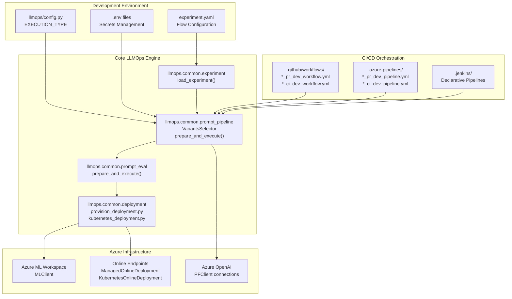
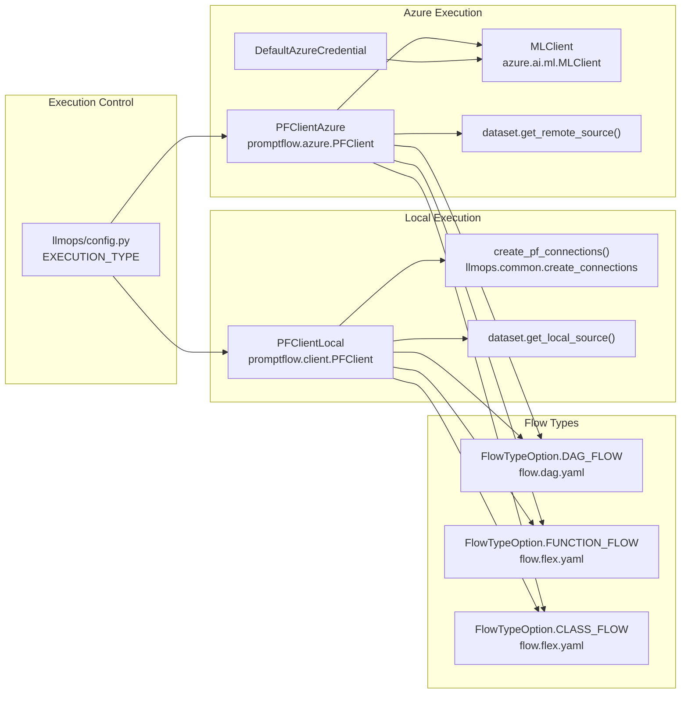

<!-- source: DeepWiki mcp.deepwiki.com · repo microsoft/genaiops-promptflow-template · page 1 Overview · fetched 2026-10-26 -->

# Overview

Relevant source files

The following files were used as context for generating this wiki page:

- [README.md](README.md)
- [chat_with_pdf/configs/deployment_config.json](chat_with_pdf/configs/deployment_config.json)
- [class_flows/configs/deployment_config.json](class_flows/configs/deployment_config.json)
- [docs/Azure_devops_how_to_setup.md](docs/Azure_devops_how_to_setup.md)
- [docs/experiment.yaml](docs/experiment.yaml)
- [docs/github_workflows_how_to_setup.md](docs/github_workflows_how_to_setup.md)
- [function_flows/configs/deployment_config.json](function_flows/configs/deployment_config.json)
- [llmops/common/deployment/kubernetes_deployment.py](llmops/common/deployment/kubernetes_deployment.py)
- [llmops/common/deployment/provision_deployment.py](llmops/common/deployment/provision_deployment.py)
- [llmops/common/get_workspace.py](llmops/common/get_workspace.py)
- [llmops/common/prompt_eval.py](llmops/common/prompt_eval.py)
- [llmops/common/prompt_pipeline.py](llmops/common/prompt_pipeline.py)
- [math_coding/configs/deployment_config.json](math_coding/configs/deployment_config.json)
- [named_entity_recognition/configs/deployment_config.json](named_entity_recognition/configs/deployment_config.json)
- [named_entity_recognition/environment/conda.yml](named_entity_recognition/environment/conda.yml)
- [web_classification/configs/deployment_config.json](web_classification/configs/deployment_config.json)

This document provides a high-level introduction to the LLMOps Prompt Flow template, explaining its purpose, system architecture, and key operational capabilities. The template is designed to streamline the end-to-end lifecycle of Large Language Model applications using Microsoft's Prompt Flow framework.

This overview covers the system's architecture, core components, and execution models. For detailed setup instructions, see [Getting Started](#2). For information about specific use cases and flows, see [Use Cases and Prompt Flows](#3). For CI/CD platform configuration details, see [CI/CD Platforms](#4).

## System Purpose

The LLMOps Prompt Flow template is a comprehensive framework for developing, experimenting, evaluating, and deploying LLM-infused applications. It provides automation for prompt engineering workflows, supporting both local development and cloud-scale operations across Azure AI Studio and Azure Machine Learning platforms.

**Sources:** [README.md:1-84](), [docs/github_workflows_how_to_setup.md:1-18]()

## System Architecture

The template follows a modular architecture that separates concerns between experimentation, evaluation, and deployment while supporting multiple execution environments and CI/CD platforms.

**Sources:** [llmops/common/prompt_pipeline.py:1-583](), [llmops/common/prompt_eval.py:1-521](), [llmops/common/deployment/provision_deployment.py:1-309](), [llmops/common/deployment/kubernetes_deployment.py:1-316]()

## Execution Architecture

The template supports flexible execution modes controlled by the `EXECUTION_TYPE` configuration, enabling both local development and cloud-scale operations.

**Sources:** [llmops/common/prompt_pipeline.py:174-202](), [llmops/common/prompt_eval.py:95-119](), [docs/github_workflows_how_to_setup.md:34-98]()

## Core Components

### Experiment Execution Engine

The `prompt_pipeline.py` module serves as the primary execution engine for running Prompt Flow experiments and bulk runs.

| Component | Purpose | Key Classes/Functions |
|-----------|---------|----------------------|
| `VariantsSelector` | Manages flow variant selection and execution strategies | `VariantSelectionOption`, `is_variant_enabled()` |
| `prepare_and_execute()` | Orchestrates experiment execution workflow | Handles dataset processing, variant execution, result collection |
| `ObjectWrapper` | Abstracts Prompt Flow client operations | Wraps `PFClient` for local/Azure execution |

**Sources:** [llmops/common/prompt_pipeline.py:87-136](), [llmops/common/prompt_pipeline.py:138-496]()

### Evaluation Framework

The `prompt_eval.py` module handles automated evaluation of Prompt Flow runs using configurable evaluation flows.

| Component | Purpose | Key Functions |
|-----------|---------|---------------|
| `prepare_and_execute()` | Executes evaluation flows against bulk runs | Handles dataset mapping, evaluation execution, report generation |
| Evaluator Resolution | Maps evaluation datasets to standard run datasets | `evaluator.find_dataset_with_reference()` |
| Report Generation | Creates CSV and HTML evaluation reports | Pandas-based metric aggregation and visualization |

**Sources:** [llmops/common/prompt_eval.py:59-449]()

### Deployment System

The deployment system supports multiple Azure compute targets through specialized deployment modules.

| Deployment Type | Module | Key Entities |
|-----------------|--------|--------------|
| Azure ML Managed | `provision_deployment.py` | `ManagedOnlineDeployment`, `Environment`, `BuildContext` |
| Kubernetes | `kubernetes_deployment.py` | `KubernetesOnlineDeployment`, `ResourceRequirementsSettings` |
| Azure Web Apps | Web App deployment workflows | Container-based deployment with Docker registry |

**Sources:** [llmops/common/deployment/provision_deployment.py:52-250](), [llmops/common/deployment/kubernetes_deployment.py:59-256]()

## Use Cases and Flow Types

The template includes six example use cases demonstrating different Prompt Flow patterns and deployment scenarios.

| Use Case | Flow Type | Deployment Target | Configuration |
|----------|-----------|------------------|---------------|
| Named Entity Recognition | YAML (DAG) | `Standard_F4s_v2` VM | [named_entity_recognition/configs/deployment_config.json:1-56]() |
| Web Classification | YAML (DAG) | `Standard_E16s_v3` VM | [web_classification/configs/deployment_config.json:1-56]() |
| Math Coding | YAML (DAG) | `Standard_F4s_v2` VM, Web App | [math_coding/configs/deployment_config.json:1-56]() |
| Function Flows | Python Functions | Flexible compute | [function_flows/configs/deployment_config.json:1-56]() |
| Class Flows | Python Classes | Flexible compute | [class_flows/configs/deployment_config.json:1-56]() |
| Chat with PDF | YAML (RAG) | `Standard_F4s_v2` VM | [chat_with_pdf/configs/deployment_config.json:1-57]() |

**Sources:** [README.md:114-149](), [named_entity_recognition/configs/deployment_config.json:1-56](), [web_classification/configs/deployment_config.json:1-56]()

## Configuration Management

The template uses a hierarchical configuration system supporting environment-specific overrides and secrets management.

### Experiment Configuration

Each use case defines its flows, datasets, and evaluators through an `experiment.yaml` file following a standardized schema.

**Key Configuration Elements:**
- `name`: Experiment identifier used for Azure ML jobs and model registration
- `flow`: Path to the standard flow directory
- `datasets`: Data sources with column mappings for flow inputs
- `connections`: Azure OpenAI and other API connections
- `evaluators`: Evaluation flows with dataset references
- `runtime`: Optional Prompt Flow runtime specification

**Sources:** [docs/experiment.yaml:1-124]()

### Deployment Configuration

Deployment targets are configured through `deployment_config.json` files supporting multiple endpoint types with environment-specific settings.

**Endpoint Types Supported:**
- `azure_managed_endpoint`: Azure ML managed online endpoints
- `kubernetes_endpoint`: Kubernetes-based endpoints with resource allocation
- `webapp_endpoint`: Azure Web App container deployments

**Sources:** [named_entity_recognition/configs/deployment_config.json:1-56](), [docs/github_workflows_how_to_setup.md:376-413]()

## Secrets and Environment Management

The template implements a unified secrets management system supporting both local development and CI/CD pipeline execution.

### Local Development
- Secrets stored in `.env` files with key-value pairs
- Environment variable resolution through `resolve_env_vars()`
- Connection creation via `create_pf_connections()`

### CI/CD Pipeline Execution
- GitHub Secrets: `ENV_VARS` repository secret
- Azure DevOps: Variable groups with secret management
- Jenkins: Environment variable injection

**Sources:** [docs/github_workflows_how_to_setup.md:100-169](), [docs/Azure_devops_how_to_setup.md:97-166]()

---

