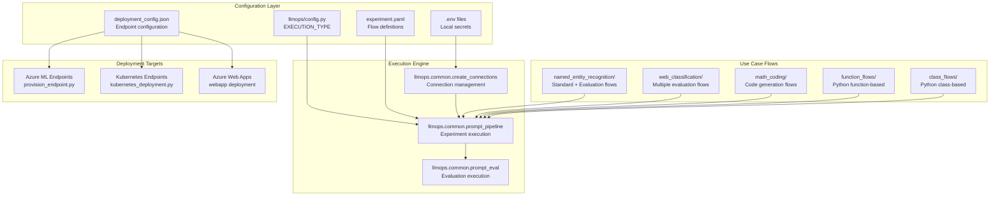
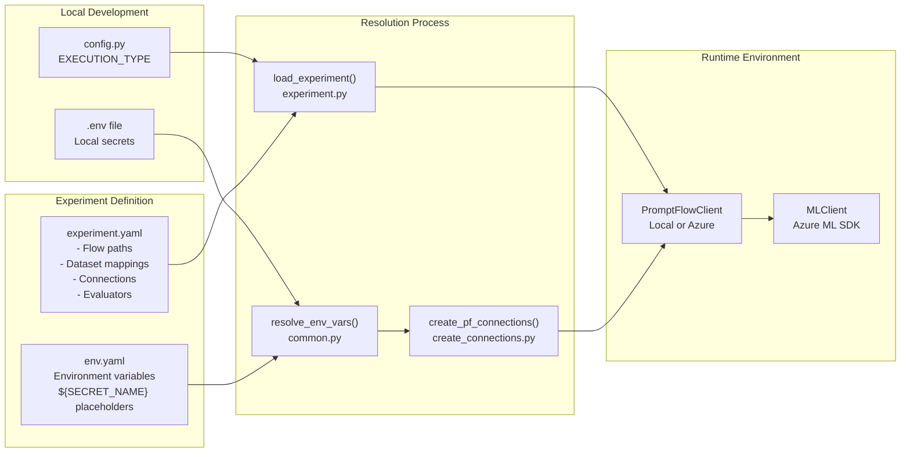
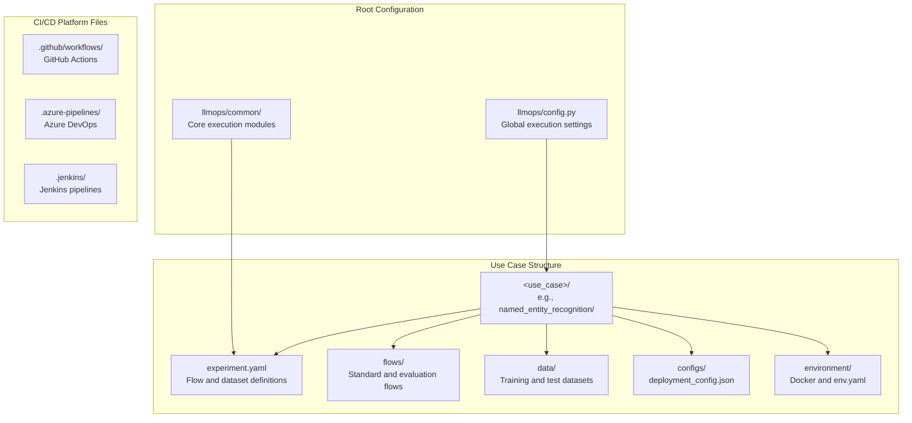

<!-- source: DeepWiki mcp.deepwiki.com · repo microsoft/genaiops-promptflow-template · page 2 Getting Started · fetched 2026-10-26 -->

# Getting Started

<details>
<summary>Relevant source files</summary>

The following files were used as context for generating this wiki page:

- [.github/workflows/class_flows_pr_dev_workflow.yml](.github/workflows/class_flows_pr_dev_workflow.yml)
- [.github/workflows/function_flows_ci_dev_workflow.yml](.github/workflows/function_flows_ci_dev_workflow.yml)
- [.github/workflows/function_flows_pr_dev_workflow.yml](.github/workflows/function_flows_pr_dev_workflow.yml)
- [.jenkins/jobs/prepare_docker_image](.jenkins/jobs/prepare_docker_image)
- [.jenkins/jobs/webapp_deployment](.jenkins/jobs/webapp_deployment)
- [.jenkins/pipelines/platform_cd_dev](.jenkins/pipelines/platform_cd_dev)
- [README.md](README.md)
- [docs/Azure_devops_how_to_setup.md](docs/Azure_devops_how_to_setup.md)
- [docs/experiment.yaml](docs/experiment.yaml)
- [docs/faqs.md](docs/faqs.md)
- [docs/github_workflows_how_to_setup.md](docs/github_workflows_how_to_setup.md)
- [docs/jenkins_how_to_setup.md](docs/jenkins_how_to_setup.md)
- [named_entity_recognition/environment/conda.yml](named_entity_recognition/environment/conda.yml)

</details>


This document provides a comprehensive guide to setting up and running your first Prompt Flow experiment using the LLMOps template. It covers the foundational concepts, initial configuration, and execution steps needed to get started with the system.

For platform-specific CI/CD setup, see [GitHub Actions](#4.1), [Azure DevOps Pipelines](#4.2), or [Jenkins](#4.3). For adding new use cases, see [Use Cases and Prompt Flows](#3).

## Prerequisites

Before beginning, ensure you have the following components available:

| Component | Requirement | Purpose |
|-----------|-------------|---------|
| Azure Subscription | Active subscription | Required for Azure ML/AI Studio workspace |
| Azure ML Workspace or AI Studio Project | Provisioned workspace | Hosts Prompt Flow experiments and deployments |
| Azure OpenAI Service | Deployed `gpt-35-turbo` model | Provides LLM inference capabilities |
| Python Environment | Python 3.9+ | Runs local experiments and CI/CD scripts |
| Git | Latest version | Source control and repository management |

The system supports both Azure Machine Learning and Azure AI Studio as backend platforms. When using Azure AI Studio, the `WORKSPACE_NAME` should point to your AI Studio project name.

Sources: [docs/github_workflows_how_to_setup.md:20-28](), [docs/Azure_devops_how_to_setup.md:19-27](), [README.md:22-23]()

## System Architecture Overview

The LLMOps template implements a multi-layered architecture that supports various execution environments and deployment targets:

### Core System Components



Sources: [llmops/config.py](), [README.md:86-113](), [docs/github_workflows_how_to_setup.md:34-41]()

### Configuration Management Flow



Sources: [llmops/common/experiment.py](), [llmops/common/common.py](), [llmops/common/create_connections.py]()

## Initial Setup

### 1. Repository Setup

Clone the repository and navigate to the project directory:

```bash
git clone https://github.com/microsoft/llmops-promptflow-template.git
cd llmops-promptflow-template
```

### 2. Environment Configuration

The system uses a centralized configuration approach through [llmops/config.py](). Set the execution type based on your requirements:

```python
# For local development and testing
EXECUTION_TYPE = "LOCAL"

# For Azure execution (local machine to Azure)
EXECUTION_TYPE = "AZURE"
```

### 3. Dependencies Installation

Install the core dependencies required for Prompt Flow execution:

```bash
# Install platform-specific requirements
pip install -r ./.github/requirements/execute_job_requirements.txt

# Install use case specific requirements (example: web_classification)
pip install -r ./web_classification/flows/experiment/requirements.txt
```

Sources: [docs/github_workflows_how_to_setup.md:49-57](), [llmops/config.py:37-41]()

## Local Execution Setup

### 1. Create Environment File

Create a `.env` file in the project root directory with your Azure credentials and API keys:

```bash
# Azure Configuration
SUBSCRIPTION_ID=your-subscription-id
RESOURCE_GROUP_NAME=your-resource-group
WORKSPACE_NAME=your-workspace-name
KEY_VAULT_NAME=your-key-vault-name

# Azure OpenAI Configuration
AOAI_API_KEY=your-azure-openai-api-key
AOAI_API_BASE=https://your-resource.openai.azure.com/

# Additional secrets as needed
```

### 2. Connection Configuration

The system automatically creates Prompt Flow connections based on your experiment configuration. Connections are defined in [experiment.yaml files using the following format:

```yaml
connections:
- name: aoai
  connection_type: AzureOpenAIConnection
  api_base: https://your-resource.openai.azure.com/
  api_version: 2023-07-01-preview
  api_key: ${AOAI_API_KEY}
  api_type: azure
```

The `${AOAI_API_KEY}` placeholder will be resolved from your `.env` file during execution.

Sources: [docs/github_workflows_how_to_setup.md:104-112](), [docs/faqs.md:346-354]()

## Azure Execution Setup

### 1. Service Principal Creation

Create an Azure Service Principal with Owner permissions for your subscription:

```bash
spname="your-service-principal-name"
roleName="Owner"
subscriptionId="your-subscription-id"
servicePrincipalName="Azure-ARM-${spname}"

az ad sp create-for-rbac --name $servicePrincipalName --role $roleName --scopes /subscriptions/$subscriptionId --sdk-auth
```

Save the output JSON for use in CI/CD platform configuration.

### 2. Azure ML Workspace Setup

Ensure your Azure ML workspace has the required Prompt Flow connections configured:

1. Navigate to Azure ML Studio
2. Go to Prompt Flow → Connections → Create → Azure OpenAI
3. Create a connection named `aoai` (or match your experiment.yaml configuration)
4. Configure with your Azure OpenAI endpoint and API key

Sources: [docs/github_workflows_how_to_setup.md:171-216](), [docs/github_workflows_how_to_setup.md:286-301]()

## First Prompt Flow Experiment

### 1. Choose a Use Case

The template includes several example use cases. Start with Named Entity Recognition as it's the highest priority flow:

| Use Case | Location | Flow Type | Complexity |
|----------|----------|-----------|------------|
| Named Entity Recognition | `./named_entity_recognition` | YAML-based | ⭐⭐ |
| Web Classification | `./web_classification` | YAML-based | ⭐⭐⭐ |
| Math Coding | `./math_coding` | YAML-based | ⭐⭐ |
| Function Flows | `./function_flows` | Python Functions | ⭐ |
| Class Flows | `./class_flows` | Python Classes | ⭐⭐ |

### 2. Execute Your First Experiment

Run a local experiment using the `prompt_pipeline.py` module:

```bash
# Set execution type to LOCAL in config.py first
python -m llmops.common.prompt_pipeline \
    --base_path ./named_entity_recognition \
    --variants standard_flow.variant_0
```

For Azure execution, ensure you're authenticated with Azure CLI and set `EXECUTION_TYPE = "AZURE"` in [llmops/config.py]():

```bash
az login
python -m llmops.common.prompt_pipeline \
    --base_path ./named_entity_recognition \
    --variants standard_flow.variant_0
```

### 3. Run Evaluation

After the experiment completes, run the evaluation flows:

```bash
python -m llmops.common.prompt_eval \
    --run_id run_id.txt \
    --base_path ./named_entity_recognition \
    --env_name dev
```

Sources: [docs/github_workflows_how_to_setup.md:43-66](), [docs/faqs.md:232-259]()

## Project Structure and Key Files

Understanding the project structure is essential for effective usage:



### Key Configuration Files

- [llmops/config.py]() - Global execution type configuration
- `<use_case>/experiment.yaml` - Flow definitions, datasets, and evaluators
- `<use_case>/configs/deployment_config.json` - Deployment endpoint configuration
- `<use_case>/environment/env.yaml` - Environment variables and secrets
- `.env` - Local development secrets (not committed to git)

Sources: [README.md:86-113](), [docs/experiment.yaml:1-124]()

## Next Steps

Once you have successfully run your first experiment, you can:

1. **Set up CI/CD Integration**: Choose your preferred platform and follow the detailed setup guides:
   - [GitHub Actions Setup](#4.1)
   - [Azure DevOps Setup](#4.2) 
   - [Jenkins Setup](#4.3)

2. **Explore Advanced Use Cases**: Examine the more complex examples like [Web Classification](#3.2) with multiple evaluation flows

3. **Create Custom Flows**: Learn how to add your own use cases by following the flow onboarding documentation

4. **Configure Deployments**: Set up automated deployments to [Azure ML Endpoints](#6.1), [Kubernetes](#6.2), or [Azure Web Apps](#6.3)

5. **Understand Configuration**: Deep dive into [Experiment Configuration](#7.1) and [Environment Management](#7.3)

The system provides a complete end-to-end solution for Prompt Flow development, from local experimentation to production deployment with comprehensive CI/CD integration.

Sources: [README.md:150-157](), [docs/github_workflows_how_to_setup.md:436-513]()

---

