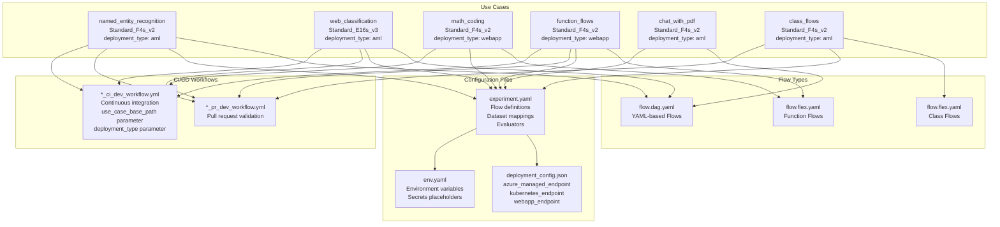
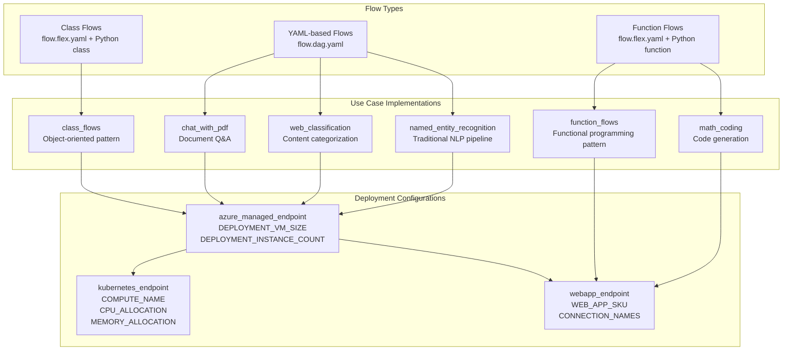
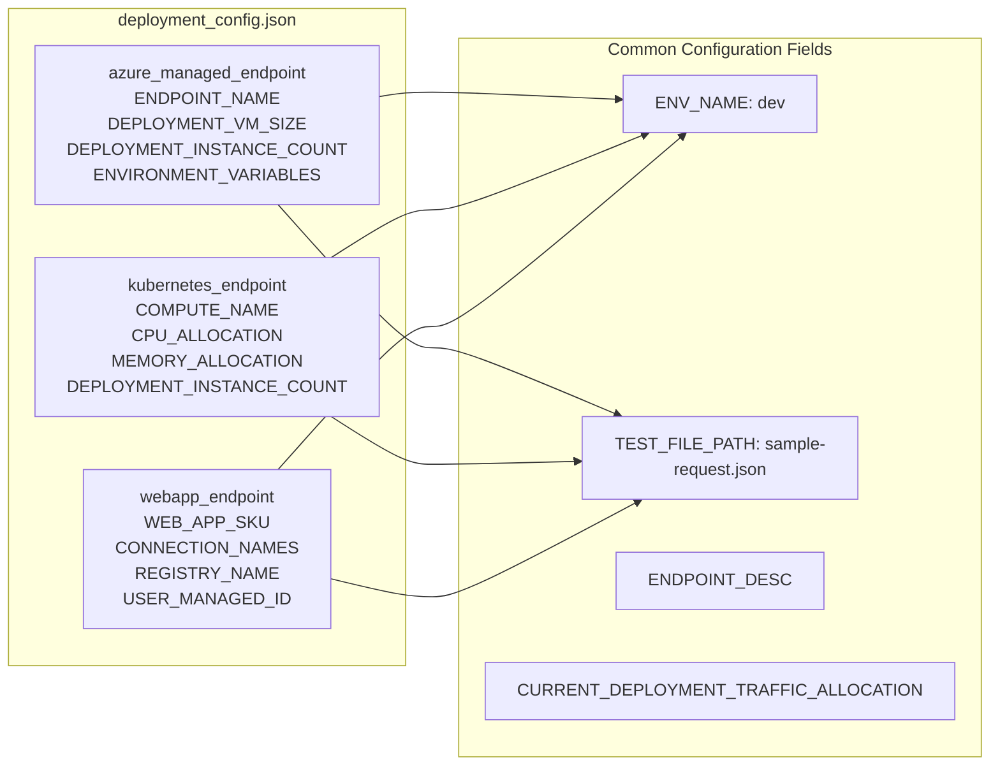

<!-- source: DeepWiki mcp.deepwiki.com · repo microsoft/genaiops-promptflow-template · page 3 Use Cases and Prompt Flows · fetched 2026-10-26 -->

# Use Cases and Prompt Flows

Relevant source files

The following files were used as context for generating this wiki page:

- [.github/workflows/class_flows_pr_dev_workflow.yml](.github/workflows/class_flows_pr_dev_workflow.yml)
- [.github/workflows/function_flows_ci_dev_workflow.yml](.github/workflows/function_flows_ci_dev_workflow.yml)
- [.github/workflows/function_flows_pr_dev_workflow.yml](.github/workflows/function_flows_pr_dev_workflow.yml)
- [.github/workflows/math_coding_ci_dev_workflow.yml](.github/workflows/math_coding_ci_dev_workflow.yml)
- [.github/workflows/named_entity_recognition_ci_dev_workflow.yml](.github/workflows/named_entity_recognition_ci_dev_workflow.yml)
- [.github/workflows/web_classification_ci_dev_workflow.yml](.github/workflows/web_classification_ci_dev_workflow.yml)
- [chat_with_pdf/configs/deployment_config.json](chat_with_pdf/configs/deployment_config.json)
- [class_flows/configs/deployment_config.json](class_flows/configs/deployment_config.json)
- [docs/faqs.md](docs/faqs.md)
- [function_flows/configs/deployment_config.json](function_flows/configs/deployment_config.json)
- [math_coding/configs/deployment_config.json](math_coding/configs/deployment_config.json)
- [named_entity_recognition/configs/deployment_config.json](named_entity_recognition/configs/deployment_config.json)
- [web_classification/configs/deployment_config.json](web_classification/configs/deployment_config.json)

This document describes the different types of Prompt Flows supported by the LLMOps template and the example use cases provided for demonstrating various AI workload patterns. Each use case represents a complete end-to-end implementation including flow definition, experiment configuration, evaluation setup, and deployment configurations across multiple Azure compute targets.

For information about configuring individual experiments, see [Experiment Configuration](#7.1). For details about deploying flows to specific endpoints, see [Deployment](#6).

## Overview

The template provides six example use cases that demonstrate different Prompt Flow patterns and deployment scenarios. Each use case is organized as a self-contained module with its own configurations, data, and CI/CD pipelines.

### Use Case Architecture

Sources: [named_entity_recognition/configs/deployment_config.json:1-56](), [web_classification/configs/deployment_config.json:1-56](), [math_coding/configs/deployment_config.json:1-56](), [function_flows/configs/deployment_config.json:1-56]()

## Supported Flow Types

The template supports three distinct types of Prompt Flows, each with different implementation patterns and use cases.

### Flow Type Implementation Map

Sources: [docs/faqs.md:225-230](), [named_entity_recognition/configs/deployment_config.json:13](), [web_classification/configs/deployment_config.json:13](), [math_coding/configs/deployment_config.json:51]()

| Flow Type | Definition File | Implementation | Use Cases |
|-----------|----------------|----------------|-----------|
| YAML-based Flows | `flow.dag.yaml` | Declarative workflow definition | `named_entity_recognition`, `web_classification`, `chat_with_pdf` |
| Function Flows | `flow.flex.yaml` + Python function | Python function with decorator | `math_coding`, `function_flows` |
| Class Flows | `flow.flex.yaml` + Python class | Python class with methods | `class_flows` |

Sources: [docs/faqs.md:225-230]()

## Primary Use Cases

### Named Entity Recognition

The highest priority use case in the template, implementing traditional NLP entity extraction with optimized compute resources.

**Configuration Details:**
- **VM Size:** `Standard_F4s_v2` for balanced compute and memory
- **Default Deployment:** `deployment_type: "aml"` for Azure ML managed endpoints
- **Flow Type:** YAML-based flows using `flow.dag.yaml`

**CI/CD Integration:**
- Workflow: `named_entity_recognition_ci_dev_workflow.yml`
- Trigger paths: `named_entity_recognition/**`, `.github/**`, `llmops/**`
- Default parameters: `use_case_base_path: "named_entity_recognition"`

Sources: [named_entity_recognition/configs/deployment_config.json:13](), [.github/workflows/named_entity_recognition_ci_dev_workflow.yml:15](), [.github/workflows/named_entity_recognition_ci_dev_workflow.yml:38]()

### Web Classification

Content categorization use case with higher compute requirements for processing larger datasets.

**Configuration Details:**
- **VM Size:** `Standard_E16s_v3` for memory-intensive classification tasks
- **Default Deployment:** `deployment_type: "aml"` 
- **Flow Type:** YAML-based flows

**CI/CD Integration:**
- Workflow: `web_classification_ci_dev_workflow.yml`
- Trigger paths: `web_classification/**`, `.github/**`, `llmops/**`
- Default parameters: `use_case_base_path: "web_classification"`

Sources: [web_classification/configs/deployment_config.json:13](), [.github/workflows/web_classification_ci_dev_workflow.yml:15](), [.github/workflows/web_classification_ci_dev_workflow.yml:38]()

### Math Coding

Code generation use case demonstrating function-based flows with containerized web app deployment.

**Configuration Details:**
- **VM Size:** `Standard_F4s_v2` for code generation workloads
- **Default Deployment:** `deployment_type: "webapp"` for containerized deployment
- **Flow Type:** Function flows using `flow.flex.yaml`

**CI/CD Integration:**
- Workflow: `math_coding_ci_dev_workflow.yml`
- Trigger paths: `math_coding/**`, `.github/**`, `llmops/**`
- Default parameters: `use_case_base_path: "math_coding"`

Sources: [math_coding/configs/deployment_config.json:13](), [.github/workflows/math_coding_ci_dev_workflow.yml:15](), [.github/workflows/math_coding_ci_dev_workflow.yml:37]()

## Secondary Use Cases

### Function Flows

Demonstrates functional programming patterns for Prompt Flow implementations.

**Configuration Details:**
- **VM Size:** `Standard_F4s_v2`
- **Default Deployment:** `deployment_type: "webapp"`
- **Flow Type:** Function flows using Python functions

**CI/CD Integration:**
- PR Workflow: `function_flows_pr_dev_workflow.yml`
- CI Workflow: `function_flows_ci_dev_workflow.yml`
- Default parameters: `use_case_base_path: "function_flows"`

Sources: [function_flows/configs/deployment_config.json:13](), [.github/workflows/function_flows_ci_dev_workflow.yml:15](), [.github/workflows/function_flows_pr_dev_workflow.yml:15]()

### Class Flows

Object-oriented implementation pattern for complex Prompt Flow scenarios.

**Configuration Details:**
- **VM Size:** `Standard_F4s_v2`
- **Default Deployment:** `deployment_type: "aml"`
- **Flow Type:** Class flows using Python classes

**CI/CD Integration:**
- PR Workflow: `class_flows_pr_dev_workflow.yml`
- Trigger paths: `class_flows/**`, `.github/**`, `llmops/**`
- Default parameters: `use_case_base_path: "class_flows"`

Sources: [class_flows/configs/deployment_config.json:13](), [.github/workflows/class_flows_pr_dev_workflow.yml:15]()

### Chat with PDF

Document question-answering use case for processing PDF documents with AI.

**Configuration Details:**
- **VM Size:** `Standard_F4s_v2`
- **Default Deployment:** `deployment_type: "aml"`
- **Flow Type:** YAML-based flows
- **Special Feature:** `DEPLOYMENT_CONDA_PATH` support for custom environments

Sources: [chat_with_pdf/configs/deployment_config.json:13](), [chat_with_pdf/configs/deployment_config.json:33]()

## Deployment Configuration Pattern

Each use case follows a consistent deployment configuration pattern supporting three endpoint types:

### Deployment Configuration Structure

Sources: [named_entity_recognition/configs/deployment_config.json:2-18](), [named_entity_recognition/configs/deployment_config.json:20-39](), [named_entity_recognition/configs/deployment_config.json:41-55]()

| Configuration Field | Azure Managed | Kubernetes | Web App |
|---------------------|---------------|------------|---------|
| `ENV_NAME` | ✓ | ✓ | ✓ |
| `TEST_FILE_PATH` | ✓ | ✓ | ✓ |
| `DEPLOYMENT_VM_SIZE` | ✓ | ✓ | - |
| `CPU_ALLOCATION` | - | ✓ | - |
| `MEMORY_ALLOCATION` | - | ✓ | - |
| `WEB_APP_SKU` | - | - | ✓ |
| `CONNECTION_NAMES` | - | - | ✓ |

Sources: [named_entity_recognition/configs/deployment_config.json:1-56](), [web_classification/configs/deployment_config.json:1-56](), [function_flows/configs/deployment_config.json:1-56]()

## Use Case Selection Guidelines

| Scenario | Recommended Use Case | Reason |
|----------|---------------------|---------|
| NLP entity extraction | `named_entity_recognition` | Optimized for text processing with balanced compute |
| Content categorization | `web_classification` | High-memory VM for large-scale classification |
| Code generation | `math_coding` | Function-based flows with web app deployment |
| Custom function patterns | `function_flows` | Pure function implementation example |
| Object-oriented patterns | `class_flows` | Class-based implementation with Azure ML |
| Document processing | `chat_with_pdf` | Document-specific processing pipeline |

The use cases are designed to be starting templates that can be customized for specific AI workload requirements while maintaining the established CI/CD and deployment patterns.

Sources: [named_entity_recognition/configs/deployment_config.json:7](), [web_classification/configs/deployment_config.json:7](), [math_coding/configs/deployment_config.json:7](), [function_flows/configs/deployment_config.json:7](), [class_flows/configs/deployment_config.json:7](), [chat_with_pdf/configs/deployment_config.json:7]()

---

