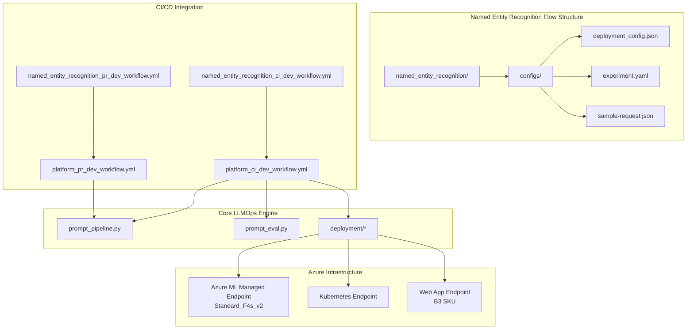
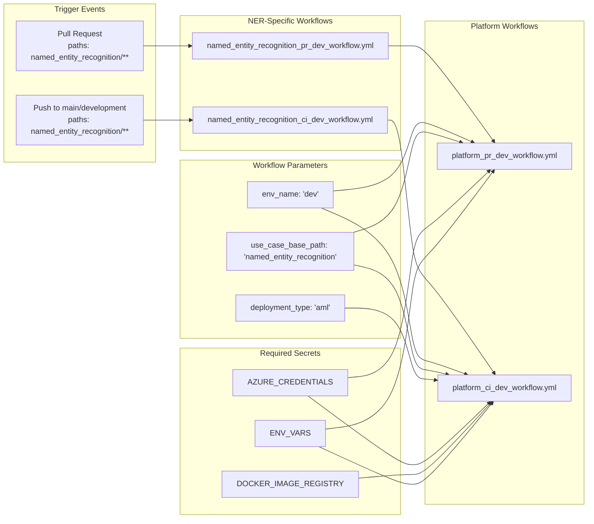

<!-- source: DeepWiki mcp.deepwiki.com · repo microsoft/genaiops-promptflow-template · page 3.1 Named Entity Recognition · fetched 2026-10-26 -->

# Named Entity Recognition

<details>
<summary>Relevant source files</summary>

The following files were used as context for generating this wiki page:

- [.github/workflows/math_coding_ci_dev_workflow.yml](.github/workflows/math_coding_ci_dev_workflow.yml)
- [.github/workflows/math_coding_pr_dev_workflow.yml](.github/workflows/math_coding_pr_dev_workflow.yml)
- [.github/workflows/named_entity_recognition_ci_dev_workflow.yml](.github/workflows/named_entity_recognition_ci_dev_workflow.yml)
- [.github/workflows/named_entity_recognition_pr_dev_workflow.yml](.github/workflows/named_entity_recognition_pr_dev_workflow.yml)
- [.github/workflows/web_classification_ci_dev_workflow.yml](.github/workflows/web_classification_ci_dev_workflow.yml)
- [.github/workflows/web_classification_pr_dev_workflow.yml](.github/workflows/web_classification_pr_dev_workflow.yml)
- [chat_with_pdf/configs/deployment_config.json](chat_with_pdf/configs/deployment_config.json)
- [class_flows/configs/deployment_config.json](class_flows/configs/deployment_config.json)
- [function_flows/configs/deployment_config.json](function_flows/configs/deployment_config.json)
- [math_coding/configs/deployment_config.json](math_coding/configs/deployment_config.json)
- [named_entity_recognition/configs/deployment_config.json](named_entity_recognition/configs/deployment_config.json)
- [web_classification/configs/deployment_config.json](web_classification/configs/deployment_config.json)

</details>


## Purpose and Scope

This document covers the Named Entity Recognition (NER) use case implementation within the LLMOps Prompt Flow template. The NER use case serves as the primary example flow and represents the highest priority template with an importance score of 25.91 in the system architecture. This page details the flow structure, deployment configurations, and CI/CD integration specific to the NER use case.

For information about other use cases like Web Classification or Math Coding, see [Other Use Cases](#3.3). For general deployment concepts, see [Deployment](#6). For CI/CD platform details, see [CI/CD Platforms](#4).

## Use Case Overview

The Named Entity Recognition use case demonstrates how to implement an LLM-powered entity extraction flow using the LLMOps template. This use case is configured as the default example and primary reference implementation for the template's capabilities.

**Flow Characteristics:**
- **Use Case Base Path**: `named_entity_recognition`
- **Default Deployment Type**: `aml` (Azure ML Managed Endpoints)
- **Primary VM Size**: `Standard_F4s_v2`
- **Template Priority**: Highest (25.91 importance score)

Sources: [named_entity_recognition/configs/deployment_config.json:1-56](), [.github/workflows/named_entity_recognition_ci_dev_workflow.yml:15-38]()

## Flow Architecture

The NER use case follows the standard LLMOps template architecture pattern, integrating with the core experiment execution and deployment engine.



Sources: [.github/workflows/named_entity_recognition_pr_dev_workflow.yml:1-37](), [.github/workflows/named_entity_recognition_ci_dev_workflow.yml:1-43]()

## Deployment Configuration

The NER use case supports three deployment targets, each with specific configuration requirements defined in the `deployment_config.json` file.

### Azure ML Managed Endpoint Configuration

| Configuration | Value | Description |
|---------------|--------|-------------|
| `DEPLOYMENT_VM_SIZE` | `Standard_F4s_v2` | Compute SKU for the endpoint |
| `DEPLOYMENT_INSTANCE_COUNT` | `1` | Number of instances |
| `CURRENT_DEPLOYMENT_TRAFFIC_ALLOCATION` | `"100"` | Traffic allocation percentage |
| `TEST_FILE_PATH` | `"sample-request.json"` | Test payload file |

### Kubernetes Endpoint Configuration

| Configuration | Value | Description |
|---------------|--------|-------------|
| `CURRENT_DEPLOYMENT_TRAFFIC_ALLOCATION` | `100` | Traffic allocation (numeric) |
| `DEPLOYMENT_INSTANCE_COUNT` | `1` | Number of instances |
| `CPU_ALLOCATION` | `""` | CPU resource allocation |
| `MEMORY_ALLOCATION` | `""` | Memory resource allocation |

### Web App Endpoint Configuration

| Configuration | Value | Description |
|---------------|--------|-------------|
| `WEB_APP_SKU` | `"B3"` | Azure App Service SKU |
| `TEST_FILE_PATH` | `"sample-request.json"` | Test payload file |
| `USER_MANAGED_ID` | `""` | Managed identity for authentication |

Sources: [named_entity_recognition/configs/deployment_config.json:2-18](), [named_entity_recognition/configs/deployment_config.json:20-39](), [named_entity_recognition/configs/deployment_config.json:41-55]()

## CI/CD Workflow Integration

The NER use case implements dedicated CI/CD workflows that integrate with the platform-level workflow orchestration.



### Pull Request Workflow

The `named_entity_recognition_pr_dev_workflow.yml` triggers on pull requests affecting NER-specific paths and delegates to the platform PR workflow for experiment validation.

**Workflow Configuration:**
- **Trigger Paths**: `named_entity_recognition/**`, `.github/**`, `llmops/**`
- **Target Branches**: `main`, `development`
- **Default Environment**: `pr`
- **Platform Workflow**: `platform_pr_dev_workflow.yml`

### Continuous Integration Workflow

The `named_entity_recognition_ci_dev_workflow.yml` triggers on pushes to main branches and executes the full CI pipeline including deployment.

**Workflow Configuration:**
- **Trigger Paths**: `named_entity_recognition/**`, `.github/**`, `llmops/**`
- **Target Branches**: `main`, `development`  
- **Default Environment**: `dev`
- **Default Deployment Type**: `aml`
- **Platform Workflow**: `platform_ci_dev_workflow.yml`

Sources: [.github/workflows/named_entity_recognition_pr_dev_workflow.yml:16-23](), [.github/workflows/named_entity_recognition_ci_dev_workflow.yml:20-27](), [.github/workflows/named_entity_recognition_pr_dev_workflow.yml:30-36](), [.github/workflows/named_entity_recognition_ci_dev_workflow.yml:34-42]()

## Environment Variables and Configuration

The NER use case supports environment-specific configuration through the deployment configuration structure.

### Standard Environment Variables

All deployment types support the `ENVIRONMENT_VARIABLES` section for runtime configuration:

```json
"ENVIRONMENT_VARIABLES": {
    "example-name": "example-value"
}
```

### Web App Specific Configuration

The webapp endpoint deployment requires additional configuration for Azure Container Registry integration:

| Configuration | Purpose |
|---------------|---------|
| `CONNECTION_NAMES` | Prompt Flow connections required |
| `REGISTRY_NAME` | Azure Container Registry name |
| `REGISTRY_RG_NAME` | Registry resource group |
| `APP_PLAN_NAME` | App Service plan name |
| `WEB_APP_NAME` | Web application name |
| `WEB_APP_RG_NAME` | Web app resource group |

Sources: [named_entity_recognition/configs/deployment_config.json:15-17](), [named_entity_recognition/configs/deployment_config.json:45-52]()

## Integration with Core LLMOps Engine

The NER use case integrates with the core LLMOps engine through standardized parameters and workflow delegation patterns.

**Key Integration Points:**
- **Use Case Base Path**: `named_entity_recognition` parameter passed to platform workflows
- **Deployment Type**: Defaults to `aml` for Azure ML managed endpoints
- **Environment Name**: Configurable through workflow inputs (`dev`, `pr`)
- **Secret Management**: Delegates to platform workflows for Azure credential handling

The NER use case serves as the reference implementation for how other use cases should structure their configuration and workflow integration within the LLMOps template.

Sources: [.github/workflows/named_entity_recognition_ci_dev_workflow.yml:36-38](), [.github/workflows/named_entity_recognition_pr_dev_workflow.yml:32-33]()

---

