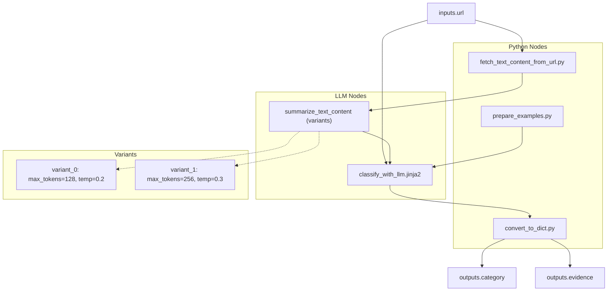
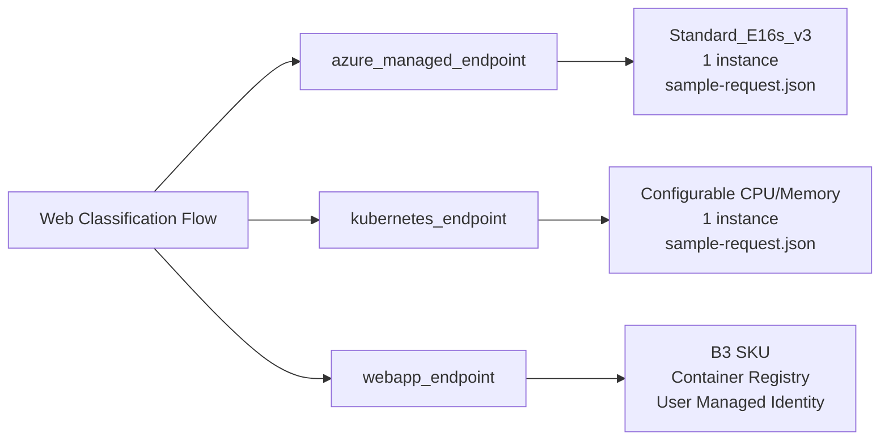
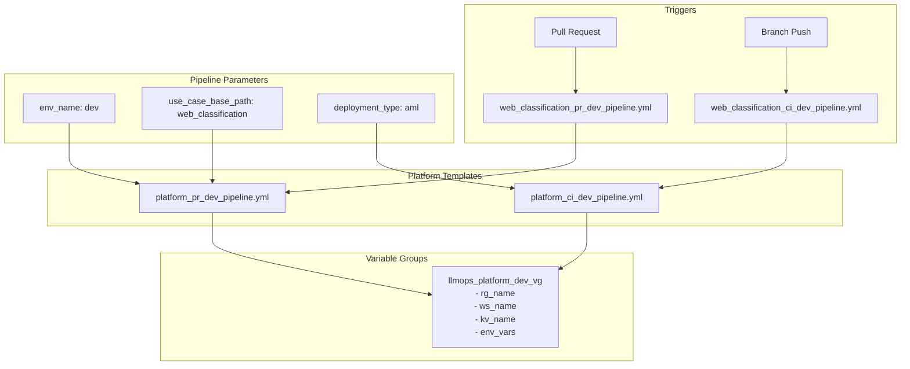

<!-- source: DeepWiki mcp.deepwiki.com · repo microsoft/genaiops-promptflow-template · page 3.2 Web Classification · fetched 2026-10-26 -->

# Web Classification

Relevant source files

The following files were used as context for generating this wiki page:

- [.azure-pipelines/templates/configure_azureml_agent.yml](.azure-pipelines/templates/configure_azureml_agent.yml)
- [.github/workflows/build_validation_workflow.yml](.github/workflows/build_validation_workflow.yml)
- [chat_with_pdf/configs/deployment_config.json](chat_with_pdf/configs/deployment_config.json)
- [class_flows/configs/deployment_config.json](class_flows/configs/deployment_config.json)
- [function_flows/configs/deployment_config.json](function_flows/configs/deployment_config.json)
- [math_coding/.azure-pipelines/math_coding_ci_dev_pipeline.yml](math_coding/.azure-pipelines/math_coding_ci_dev_pipeline.yml)
- [math_coding/.azure-pipelines/math_coding_pr_dev_pipeline.yml](math_coding/.azure-pipelines/math_coding_pr_dev_pipeline.yml)
- [math_coding/configs/deployment_config.json](math_coding/configs/deployment_config.json)
- [named_entity_recognition/.azure-pipelines/named_entity_recognition_ci_dev_pipeline.yml](named_entity_recognition/.azure-pipelines/named_entity_recognition_ci_dev_pipeline.yml)
- [named_entity_recognition/.azure-pipelines/named_entity_recognition_pr_dev_pipeline.yml](named_entity_recognition/.azure-pipelines/named_entity_recognition_pr_dev_pipeline.yml)
- [named_entity_recognition/configs/deployment_config.json](named_entity_recognition/configs/deployment_config.json)
- [web_classification/.azure-pipelines/web_classification_ci_dev_pipeline.yml](web_classification/.azure-pipelines/web_classification_ci_dev_pipeline.yml)
- [web_classification/.azure-pipelines/web_classification_pr_dev_pipeline.yml](web_classification/.azure-pipelines/web_classification_pr_dev_pipeline.yml)
- [web_classification/configs/deployment_config.json](web_classification/configs/deployment_config.json)
- [web_classification/flows/experiment/.promptflow/flow.tools.json](web_classification/flows/experiment/.promptflow/flow.tools.json)
- [web_classification/flows/experiment/flow.dag.yaml](web_classification/flows/experiment/flow.dag.yaml)

## Purpose and Scope

This document covers the Web Classification use case, one of the example Prompt Flows provided in the LLMOps template. The Web Classification flow demonstrates how to build an end-to-end pipeline that fetches content from web URLs, summarizes the content using LLMs, and classifies websites into categories with supporting evidence.

For information about other use cases like Named Entity Recognition, see [Named Entity Recognition](#3.1). For details about the core LLMOps execution engine, see [Core LLMOps Engine](#5).

## Flow Overview

The Web Classification flow is designed to automatically categorize websites by analyzing their content. It takes a URL as input and returns both a classification category and evidence supporting that classification. The flow leverages Azure OpenAI models for both content summarization and classification tasks.

**Flow Characteristics:**
- **Input**: URL (string)
- **Outputs**: Category (string), Evidence (string)
- **Default Deployment VM**: `Standard_E16s_v3` (larger than other flows due to content processing requirements)
- **Default Deployment Type**: Azure ML managed endpoints

Sources: [web_classification/flows/experiment/flow.dag.yaml:1-87](), [web_classification/configs/deployment_config.json:1-56]()

## Flow Architecture

The Web Classification flow consists of five interconnected nodes that process web content through multiple stages:

**Node Details:**

| Node | Type | Function | Connection |
|------|------|----------|------------|
| `fetch_text_content_from_url` | Python | Extracts text content from URL | - |
| `summarize_text_content` | LLM | Summarizes extracted content | `aoai` |
| `prepare_examples` | Python | Generates classification examples | - |
| `classify_with_llm` | LLM | Classifies content with evidence | `aoai` |
| `convert_to_dict` | Python | Converts output to structured format | - |

Sources: [web_classification/flows/experiment/flow.dag.yaml:13-84](), [web_classification/flows/experiment/.promptflow/flow.tools.json:1-77]()

## Deployment Configuration

### Deployment Targets

The Web Classification flow supports three deployment configurations, each optimized for different scenarios:

### Resource Specifications

| Deployment Type | VM Size | Instance Count | Special Configuration |
|-----------------|---------|----------------|----------------------|
| Azure ML Managed | `Standard_E16s_v3` | 1 | Environment variables support |
| Kubernetes | Configurable | 1 | CPU/Memory allocation, Compute name |
| Web App | N/A (B3 SKU) | N/A | Container registry, App plan, Resource group |

**Key Configuration Differences:**
- **Azure ML**: Uses `Standard_E16s_v3` VM size (larger than other flows' `Standard_F4s_v2`)
- **Kubernetes**: Allows custom `CPU_ALLOCATION` and `MEMORY_ALLOCATION` settings
- **Web App**: Requires container registry configuration and user-managed identity

Sources: [web_classification/configs/deployment_config.json:1-56]()

## CI/CD Integration

### Pipeline Structure

The Web Classification flow integrates with the platform's CI/CD system through dedicated pipeline files:

### Pipeline Configuration

**CI Pipeline** ([web_classification_ci_dev_pipeline.yml:1-44]()):
- **Triggers**: `main` and `development` branches
- **Paths**: Changes to `.azure-pipelines/*`, `llmops/*`, `web_classification/*`
- **Default deployment**: `aml` (Azure ML managed endpoints)
- **VM Image**: `ubuntu-latest`

**PR Pipeline** ([web_classification_pr_dev_pipeline.yml:1-37]()):
- **Triggers**: Pull requests to `main` and `development`
- **Environment**: `pr` (separate from production)
- **Scope**: Experiment and evaluation only (no deployment)

Sources: [web_classification/.azure-pipelines/web_classification_ci_dev_pipeline.yml:1-44](), [web_classification/.azure-pipelines/web_classification_pr_dev_pipeline.yml:1-37]()

## Flow Variants and Configuration

### LLM Variants

The `summarize_text_content` node uses a variant system to test different model parameters:

| Variant | Max Tokens | Temperature | Template File |
|---------|------------|-------------|---------------|
| `variant_0` (default) | 128 | 0.2 | `summarize_text_content.jinja2` |
| `variant_1` | 256 | 0.3 | `summarize_text_content__variant_1.jinja2` |

### Connection Configuration

All LLM nodes in the flow use:
- **Connection**: `aoai` (Azure OpenAI)
- **Deployment**: `gpt-35-turbo`
- **API**: `chat`
- **Provider**: `AzureOpenAI`

### Environment Requirements

The flow specifies its dependencies in `requirements.txt` for proper execution in deployed environments.

Sources: [web_classification/flows/experiment/flow.dag.yaml:51-84](), [web_classification/flows/experiment/flow.dag.yaml:85-87]()

---

