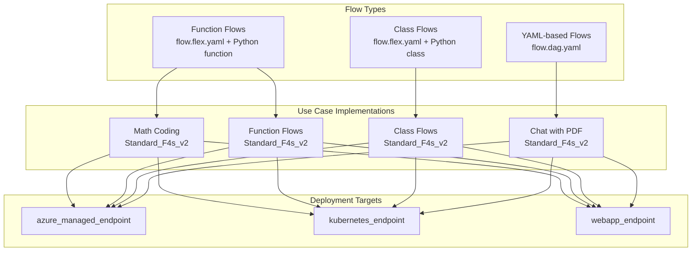
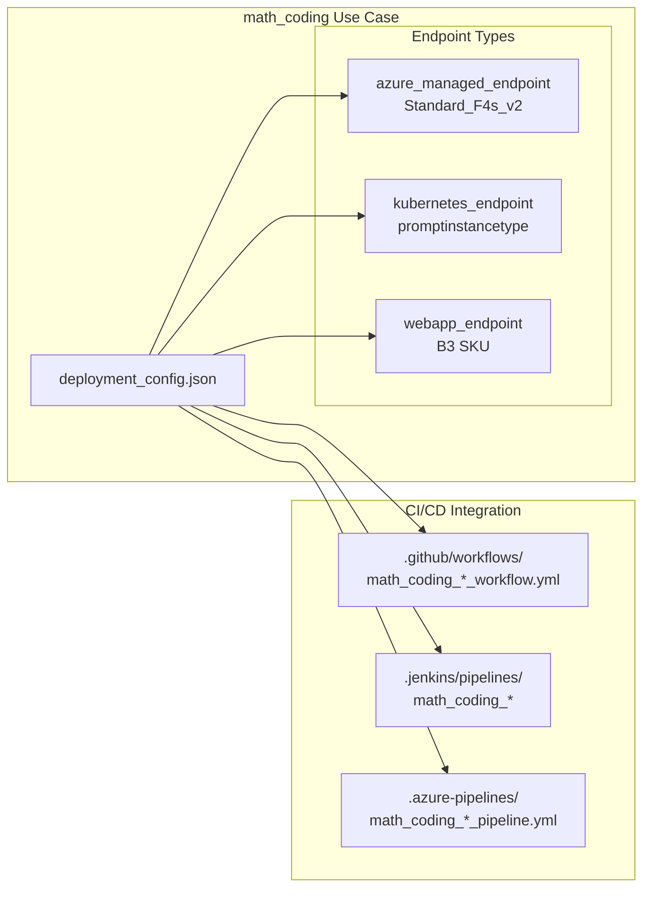
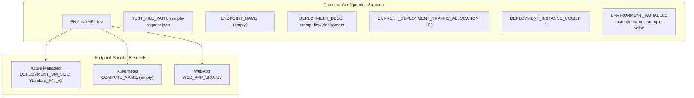
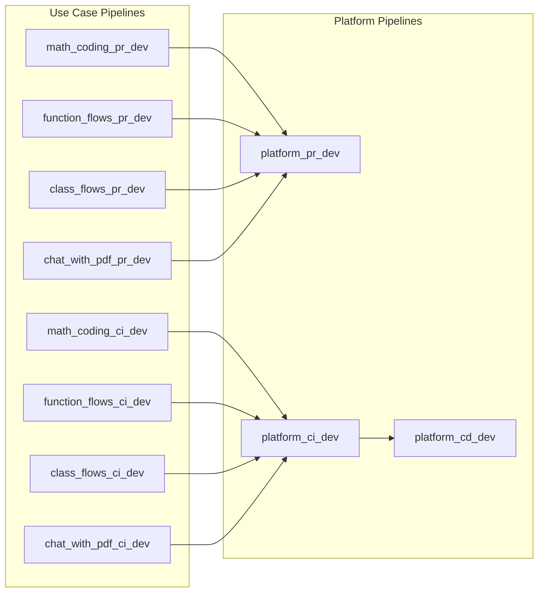

<!-- source: DeepWiki mcp.deepwiki.com · repo microsoft/genaiops-promptflow-template · page 3.3 Other Use Cases · fetched 2026-10-26 -->

# Other Use Cases

<details>
<summary>Relevant source files</summary>

The following files were used as context for generating this wiki page:

- [.github/workflows/class_flows_pr_dev_workflow.yml](.github/workflows/class_flows_pr_dev_workflow.yml)
- [.github/workflows/function_flows_ci_dev_workflow.yml](.github/workflows/function_flows_ci_dev_workflow.yml)
- [.github/workflows/function_flows_pr_dev_workflow.yml](.github/workflows/function_flows_pr_dev_workflow.yml)
- [.jenkins/pipelines/chat_with_pdf_ci_dev](.jenkins/pipelines/chat_with_pdf_ci_dev)
- [.jenkins/pipelines/chat_with_pdf_pr_dev](.jenkins/pipelines/chat_with_pdf_pr_dev)
- [.jenkins/pipelines/class_flows_ci_dev](.jenkins/pipelines/class_flows_ci_dev)
- [.jenkins/pipelines/class_flows_pr_dev](.jenkins/pipelines/class_flows_pr_dev)
- [.jenkins/pipelines/flex_flows_ci_dev](.jenkins/pipelines/flex_flows_ci_dev)
- [.jenkins/pipelines/flex_flows_pr_dev](.jenkins/pipelines/flex_flows_pr_dev)
- [chat_with_pdf/configs/deployment_config.json](chat_with_pdf/configs/deployment_config.json)
- [class_flows/configs/deployment_config.json](class_flows/configs/deployment_config.json)
- [docs/faqs.md](docs/faqs.md)
- [function_flows/configs/deployment_config.json](function_flows/configs/deployment_config.json)
- [math_coding/configs/deployment_config.json](math_coding/configs/deployment_config.json)
- [named_entity_recognition/configs/deployment_config.json](named_entity_recognition/configs/deployment_config.json)
- [web_classification/configs/deployment_config.json](web_classification/configs/deployment_config.json)

</details>


This page documents the additional Prompt Flow use cases provided in the template beyond Named Entity Recognition and Web Classification. These use cases demonstrate different flow types and implementation patterns that can be used as starting points for new projects.

For detailed information about the primary use cases, see [Named Entity Recognition](#3.1) and [Web Classification](#3.2). For general information about use cases and prompt flows, see [Use Cases and Prompt Flows](#3).

## Overview

The template includes four additional use cases that showcase different implementation patterns and flow types:

| Use Case | Importance Score | Primary Flow Type | Description |
|----------|------------------|-------------------|-------------|
| Math Coding | 11.61 | Function/Class | Mathematical problem solving with code generation |
| Function Flows | 9.76 | Function | Python function-based flow implementation |
| Class Flows | 3.76 | Class | Python class-based flow implementation |
| Chat with PDF | 3.93 | Document Processing | Document-based conversational AI |

All use cases follow the same LLMOps patterns established by the primary use cases, with consistent configuration structures and CI/CD pipeline integration.

## Flow Type Architecture

The template supports three distinct flow implementation patterns:



Sources: [docs/faqs.md:225-230](), [math_coding/configs/deployment_config.json:1-56](), [function_flows/configs/deployment_config.json:1-56](), [class_flows/configs/deployment_config.json:1-56](), [chat_with_pdf/configs/deployment_config.json:1-57]()

## Math Coding Use Case

The Math Coding use case demonstrates mathematical problem-solving capabilities with code generation. It uses a Standard_F4s_v2 VM configuration across all deployment types.

### Configuration Characteristics

- **Endpoint Description**: "An online endpoint serving a flow for math coding flow"
- **VM Size**: Standard_F4s_v2 for Azure managed endpoints
- **Deployment Instance Count**: 1
- **Kubernetes VM Size**: "promptinstancetype" (specialized configuration)

### Deployment Configuration Structure



Sources: [math_coding/configs/deployment_config.json:1-56]()

## Function Flows Use Case

Function Flows demonstrate Python function-based flow implementation using the `flow.flex.yaml` pattern.

### Implementation Pattern

Function Flows use Python functions as the primary execution unit, defined alongside a `flow.flex.yaml` configuration file. The flow is described as a "pythin function based flow" in the deployment configuration.

### Configuration Details

- **Endpoint Description**: "An online endpoint serving a flow for pythin function based flow"
- **VM Size**: Standard_F4s_v2
- **Deployment Type**: Supports all three endpoint types (AML, Kubernetes, WebApp)

Sources: [function_flows/configs/deployment_config.json:1-56](), [docs/faqs.md:227]()

## Class Flows Use Case

Class Flows demonstrate Python class-based flow implementation, providing an object-oriented approach to flow definition.

### Implementation Pattern

Class Flows use Python classes as the primary execution unit, defined alongside a `flow.flex.yaml` configuration file. This pattern is suitable for more complex flows that benefit from object-oriented design.

### Configuration Details

- **Endpoint Description**: "An online endpoint serving a flow for python class based flow"
- **VM Size**: Standard_F4s_v2
- **Deployment Type**: Supports all three endpoint types

### Evaluation Integration

Class Flows include specialized evaluation capabilities, including `eval_nlp` evaluation that can run as pure Python script-based evaluations without requiring bulk run experiments.

Sources: [class_flows/configs/deployment_config.json:1-56](), [docs/faqs.md:228](), [docs/faqs.md:285-286]()

## Chat with PDF Use Case

The Chat with PDF use case demonstrates document processing capabilities for conversational AI applications.

### Document Processing Features

This use case showcases document-based conversational AI, likely involving PDF parsing, text extraction, and context-aware responses.

### Configuration Details

- **Endpoint Description**: "An online endpoint serving a flow for chat with pdf flow"
- **VM Size**: Standard_F4s_v2
- **Kubernetes Configuration**: Includes additional `DEPLOYMENT_CONDA_PATH` parameter
- **Deployment Type**: Supports all three endpoint types

### Unique Configuration Elements

The Chat with PDF use case includes a unique configuration element in its Kubernetes endpoint:

```json
"DEPLOYMENT_CONDA_PATH": ""
```

This suggests specialized environment management for document processing dependencies.

Sources: [chat_with_pdf/configs/deployment_config.json:1-57]()

## Common Deployment Patterns

All other use cases follow consistent deployment configuration patterns:

### Standard Configuration Elements



### WebApp Endpoint Configuration

All use cases include consistent WebApp endpoint configuration:

- **App Plan SKU**: B3
- **Connection Names**: Empty array requiring configuration
- **Registry Configuration**: Requires `REGISTRY_NAME` and `REGISTRY_RG_NAME`
- **Managed Identity**: Requires `USER_MANAGED_ID` configuration

Sources: [math_coding/configs/deployment_config.json:41-56](), [function_flows/configs/deployment_config.json:41-56](), [class_flows/configs/deployment_config.json:41-56](), [chat_with_pdf/configs/deployment_config.json:42-57]()

## CI/CD Pipeline Integration

All other use cases integrate with the same CI/CD pipeline structure as the primary use cases:



### Pipeline Parameters

All use case pipelines accept the same core parameters:

- **env_name**: Environment name (pr, dev, prod)
- **use_case_base_path**: Path to the use case folder
- **deployment_type**: Deployment target type (aml, aks, webapp)
- **rg_name**: Azure Resource Group Name
- **ws_name**: Azure ML Workspace Name
- **kv_name**: Azure Key Vault Name (for CI pipelines)

Sources: [.jenkins/pipelines/class_flows_pr_dev:1-44](), [.jenkins/pipelines/chat_with_pdf_pr_dev:1-44](), [.jenkins/pipelines/class_flows_ci_dev:1-48](), [.jenkins/pipelines/chat_with_pdf_ci_dev:1-48](), [.github/workflows/class_flows_pr_dev_workflow.yml:1-38](), [.github/workflows/function_flows_ci_dev_workflow.yml:1-43](), [.github/workflows/function_flows_pr_dev_workflow.yml:1-38]()

---

