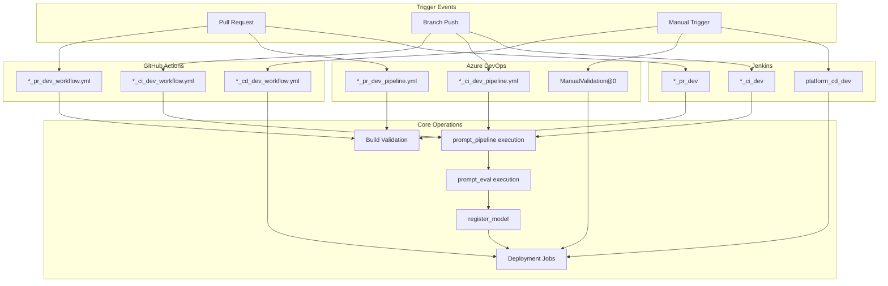

<!-- source: DeepWiki mcp.deepwiki.com · repo microsoft/genaiops-promptflow-template · page 4 CI/CD Platforms · fetched 2026-10-26 -->

# CI/CD Platforms

<details>
<summary>Relevant source files</summary>

The following files were used as context for generating this wiki page:

- [.azure-pipelines/platform_ci_dev_pipeline.yml](.azure-pipelines/platform_ci_dev_pipeline.yml)
- [.azure-pipelines/platform_pr_dev_pipeline.yml](.azure-pipelines/platform_pr_dev_pipeline.yml)
- [.azure-pipelines/templates/aml_real_deployment.yml](.azure-pipelines/templates/aml_real_deployment.yml)
- [.azure-pipelines/templates/kubernetes_deployment.yml](.azure-pipelines/templates/kubernetes_deployment.yml)
- [.jenkins/jobs/prepare_docker_image](.jenkins/jobs/prepare_docker_image)
- [.jenkins/jobs/webapp_deployment](.jenkins/jobs/webapp_deployment)
- [.jenkins/pipelines/platform_cd_dev](.jenkins/pipelines/platform_cd_dev)
- [README.md](README.md)
- [docs/Azure_devops_how_to_setup.md](docs/Azure_devops_how_to_setup.md)
- [docs/experiment.yaml](docs/experiment.yaml)
- [docs/github_workflows_how_to_setup.md](docs/github_workflows_how_to_setup.md)
- [docs/jenkins_how_to_setup.md](docs/jenkins_how_to_setup.md)
- [named_entity_recognition/environment/conda.yml](named_entity_recognition/environment/conda.yml)

</details>


This document provides an overview of the three CI/CD platforms supported by the LLMOps Prompt Flow template and guidance for choosing between them. The template provides complete CI/CD automation for Prompt Flow experimentation, evaluation, and deployment across GitHub Actions, Azure DevOps Pipelines, and Jenkins.

For detailed setup instructions for each platform, see [GitHub Actions](#4.1), [Azure DevOps Pipelines](#4.2), and [Jenkins](#4.3). For information about the core execution engine that these platforms orchestrate, see [Core LLMOps Engine](#5).

## Supported Platforms Overview

The template supports three major CI/CD platforms with functionally equivalent capabilities:

| Platform | Strengths | Configuration Location | Key Features |
|----------|-----------|----------------------|--------------|
| **GitHub Actions** | Native Git integration, extensive marketplace | [.github/workflows/]() | GitHub Secrets, Environment variables, Matrix builds |
| **Azure DevOps** | Enterprise integration, advanced approval gates | [.azure-pipelines/]() | Variable groups, Service connections, Manual validation |  
| **Jenkins** | Maximum flexibility, on-premises support | [.jenkins/]() | Declarative pipelines, Shared libraries, Credential management |

All platforms provide identical functionality for Prompt Flow operations including experimentation, evaluation, model registration, and deployment to multiple targets (Azure ML, Kubernetes, Azure Web Apps).

Sources: [README.md:5](), [docs/github_workflows_how_to_setup.md:5-6](), [docs/Azure_devops_how_to_setup.md:4-5](), [docs/jenkins_how_to_setup.md:5-6]()

## Common Workflow Architecture

**Multi-Platform CI/CD Pipeline Flow**



Sources: [.azure-pipelines/platform_ci_dev_pipeline.yml:22-294](), [docs/github_workflows_how_to_setup.md:251-256](), [docs/jenkins_how_to_setup.md:253-256]()

## Core Execution Pipeline

**Common LLMOps Pipeline Stages**

```mermaid
flowchart LR
    subgraph "Stage 1: Validation"
        BUILD_VAL["build_validation_pipeline.yml<br/>Code quality checks"]
    end
    
    subgraph "Stage 2: Experiment"
        REG_DATA["register_data_asset<br/>Upload datasets"]
        PROMPT_PIPE["prompt_pipeline<br/>Execute flows"]
        EVAL_FLOWS["prompt_eval<br/>Run evaluators"]
    end
    
    subgraph "Stage 3: Deployment"
        REG_MODEL["register_model<br/>Model registration"]
        PROVISION_EP["provision_endpoint<br/>Create endpoints"]
        DEPLOY_MODEL["provision_deployment<br/>Deploy to target"]
        TEST_EP["test_model_on_*<br/>Endpoint testing"]
    end
    
    BUILD_VAL --> REG_DATA
    REG_DATA --> PROMPT_PIPE
    PROMPT_PIPE --> EVAL_FLOWS
    EVAL_FLOWS --> REG_MODEL
    REG_MODEL --> PROVISION_EP
    PROVISION_EP --> DEPLOY_MODEL
    DEPLOY_MODEL --> TEST_EP
```



All platforms execute the same underlying Python modules from the `llmops.common` package, ensuring consistent behavior regardless of the chosen CI/CD platform.

Sources: [.azure-pipelines/platform_ci_dev_pipeline.yml:58-141](), [llmops/common/prompt_pipeline.py](), [llmops/common/prompt_eval.py](), [llmops/common/deployment/register_model.py]()

## File Organization by Platform

### Directory Structure

```
├── .github/workflows/          # GitHub Actions workflows
│   ├── *_pr_dev_workflow.yml  # Pull request workflows  
│   ├── *_ci_dev_workflow.yml  # Continuous integration
│   └── *_cd_dev_workflow.yml  # Continuous deployment
├── .azure-pipelines/          # Azure DevOps pipelines
│   ├── *_pr_dev_pipeline.yml  # Pull request pipelines
│   ├── *_ci_dev_pipeline.yml  # Continuous integration  
│   └── templates/             # Reusable pipeline templates
├── .jenkins/                  # Jenkins declarative pipelines
│   ├── pipelines/             # Main pipeline definitions
│   │   ├── *_pr_dev          # Pull request pipelines
│   │   ├── *_ci_dev          # Continuous integration
│   │   └── platform_cd_dev   # Continuous deployment
│   └── jobs/                  # Individual job definitions
└── llmops/common/             # Shared execution engine
```

Sources: [README.md:88-105](), [.azure-pipelines/](), [.jenkins/]()

## Platform-Specific Features

### Secrets and Variables Management

| Platform | Secrets Storage | Environment Variables | Authentication |
|----------|----------------|----------------------|----------------|
| **GitHub Actions** | Repository Secrets (`ENV_VARS`) | GitHub Environments | Service Principal JSON |
| **Azure DevOps** | Variable Groups (`llmops_platform_dev_vg`) | Pipeline Variables | Service Connections |
| **Jenkins** | Credentials Store (`ENV_VARS` file) | Global Properties | Azure Service Principal |

### Deployment Approval Gates

**Azure DevOps Manual Validation**
```yaml
# From platform_ci_dev_pipeline.yml
- task: ManualValidation@0
  timeoutInMinutes: 60
  inputs:
    notifyUsers: |
      replace@youremail.com
    instructions: "$(run_id_from_submit_job)"
    onTimeout: 'reject'
```

**Jenkins Approval Process**
- Manual pipeline triggers for deployment
- Parameter-based environment selection
- Conditional deployment stages based on `deployment_type`

**GitHub Actions**
- Environment protection rules
- Required reviewers for production deployments
- Branch protection policies

Sources: [.azure-pipelines/platform_ci_dev_pipeline.yml:177-191](), [.jenkins/pipelines/platform_cd_dev:115-175](), [docs/github_workflows_how_to_setup.md:264-285]()

## Choosing a Platform

### Decision Matrix

| Consideration | GitHub Actions | Azure DevOps | Jenkins |
|---------------|----------------|--------------|---------|
| **Git Integration** | Native GitHub | Multi-provider | Plugin-based |
| **Enterprise Features** | Basic | Advanced | Configurable |
| **On-Premises** | Cloud-only | Hybrid | Full support |
| **Learning Curve** | Low | Medium | High |
| **Azure Integration** | Good | Excellent | Good |
| **Customization** | Moderate | High | Highest |

### Recommended Use Cases

- **GitHub Actions**: Open source projects, GitHub-native workflows, rapid prototyping
- **Azure DevOps**: Enterprise environments, complex approval processes, Microsoft ecosystem
- **Jenkins**: On-premises requirements, maximum customization, existing Jenkins infrastructure

The choice between platforms does not affect the underlying LLMOps functionality, as all platforms execute the same `llmops.common` modules with identical parameters and configurations.

Sources: [docs/github_workflows_how_to_setup.md:1-3](), [docs/Azure_devops_how_to_setup.md:1-3](), [docs/jenkins_how_to_setup.md:1-3]()

## Configuration Requirements

All platforms require the same core configuration elements:

### Required Variables
- `RESOURCE_GROUP_NAME`: Azure resource group
- `WORKSPACE_NAME`: Azure ML workspace name  
- `KEY_VAULT_NAME`: Azure Key Vault name
- `SUBSCRIPTION_ID`: Azure subscription identifier

### Required Secrets
- `AZURE_CREDENTIALS`: Service principal authentication
- `ENV_VARS`: Environment variables for flow execution
- `DOCKER_IMAGE_REGISTRY`: Container registry details (for webapp deployment)

### Execution Configuration
The `EXECUTION_TYPE` variable in [llmops/config.py]() determines whether flows execute locally or on Azure, independent of the chosen CI/CD platform.

Sources: [llmops/config.py](), [docs/github_workflows_how_to_setup.md:36-41](), [docs/Azure_devops_how_to_setup.md:34-41](), [docs/jenkins_how_to_setup.md:35-41]()

---

