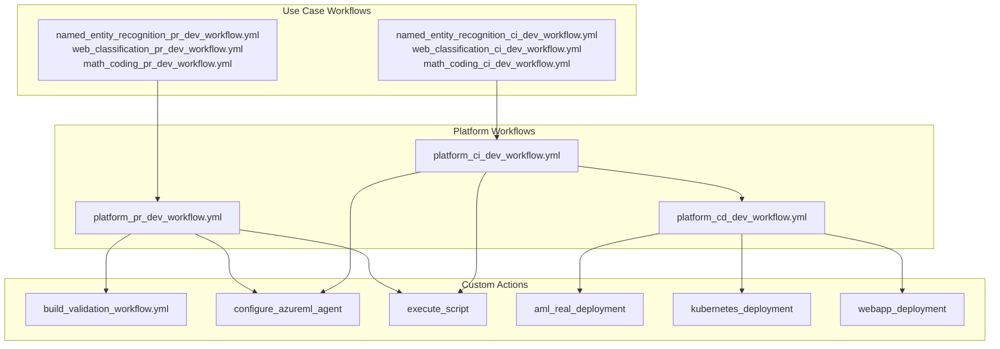
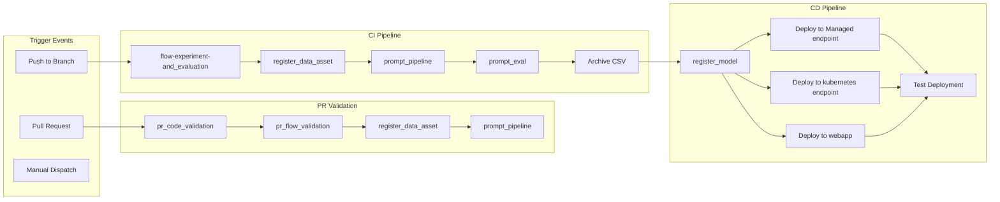
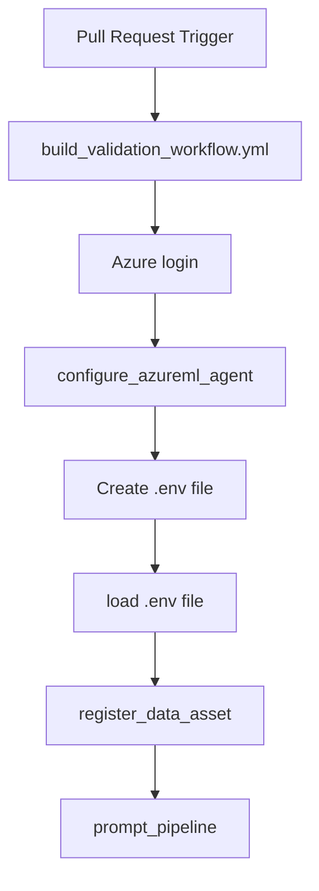
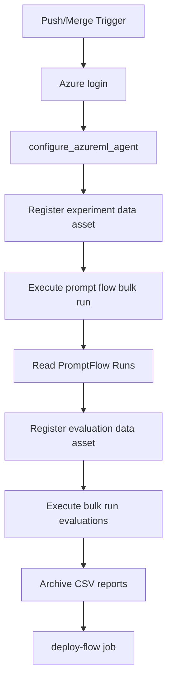
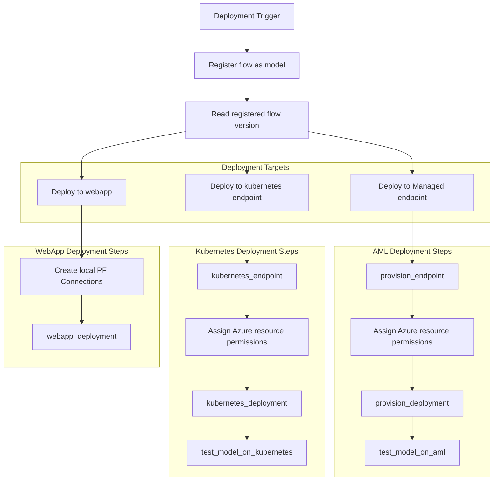
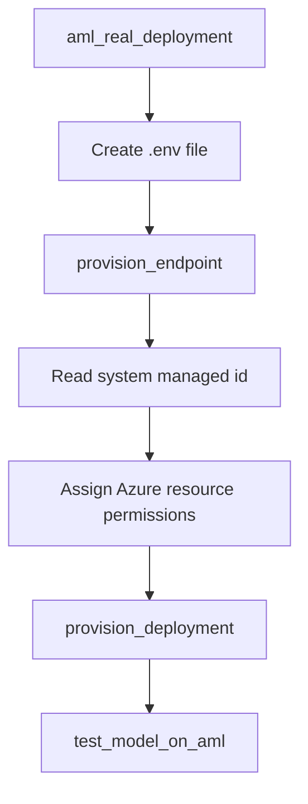
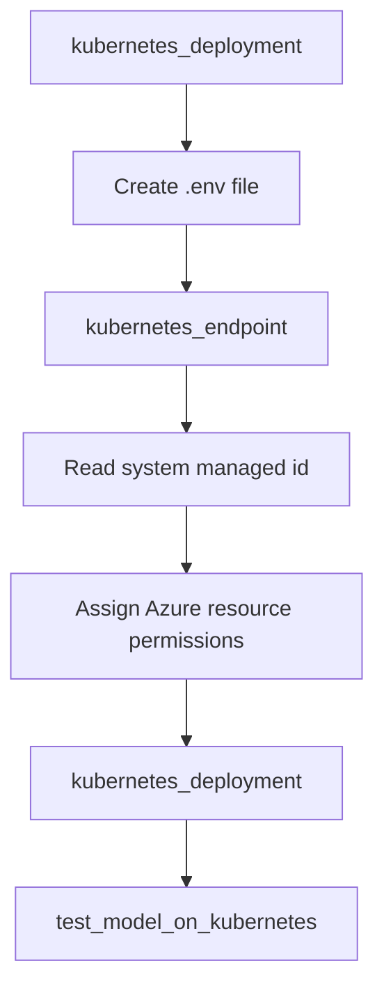

<!-- source: DeepWiki mcp.deepwiki.com · repo microsoft/genaiops-promptflow-template · page 4.1 GitHub Actions · fetched 2026-10-26 -->

# GitHub Actions

<details>
<summary>Relevant source files</summary>

The following files were used as context for generating this wiki page:

- [.env.sample](.env.sample)
- [.github/actions/aml_real_deployment/action.yml](.github/actions/aml_real_deployment/action.yml)
- [.github/actions/kubernetes_deployment/action.yml](.github/actions/kubernetes_deployment/action.yml)
- [.github/workflows/platform_cd_dev_workflow.yml](.github/workflows/platform_cd_dev_workflow.yml)
- [.github/workflows/platform_ci_dev_workflow.yml](.github/workflows/platform_ci_dev_workflow.yml)
- [.github/workflows/platform_pr_dev_workflow.yml](.github/workflows/platform_pr_dev_workflow.yml)
- [README.md](README.md)
- [chat_with_pdf/environment/env.yaml](chat_with_pdf/environment/env.yaml)
- [docs/Azure_devops_how_to_setup.md](docs/Azure_devops_how_to_setup.md)
- [docs/experiment.yaml](docs/experiment.yaml)
- [docs/github_workflows_how_to_setup.md](docs/github_workflows_how_to_setup.md)
- [named_entity_recognition/environment/conda.yml](named_entity_recognition/environment/conda.yml)

</details>


This page provides comprehensive documentation for using GitHub Actions as the CI/CD platform for Prompt Flow operations in the LLMOps template. It covers workflow configuration, secrets management, environment setup, and execution patterns for automating Prompt Flow experimentation, evaluation, and deployment.

For information about other CI/CD platforms, see [Azure DevOps Pipelines](#4.2) and [Jenkins](#4.3). For details about the core LLMOps execution engine, see [Core LLMOps Engine](#5).

## Workflow Architecture

The GitHub Actions implementation follows a hierarchical workflow structure with platform-level workflows that orchestrate use-case-specific operations.

### Core Workflow Structure



Sources: [.github/workflows/platform_pr_dev_workflow.yml:1-105](), [.github/workflows/platform_ci_dev_workflow.yml:1-179](), [.github/workflows/platform_cd_dev_workflow.yml:1-187]()

### Workflow Execution Flow



Sources: [.github/workflows/platform_pr_dev_workflow.yml:32-104](), [.github/workflows/platform_ci_dev_workflow.yml:32-179](), [.github/workflows/platform_cd_dev_workflow.yml:44-187]()

## Secrets and Environment Management

### Repository Secrets Configuration

GitHub Actions uses repository secrets to securely store sensitive information required for Azure authentication and Prompt Flow operations.

| Secret Name | Purpose | Format |
|-------------|---------|--------|
| `AZURE_CREDENTIALS` | Service principal authentication to Azure | JSON object with clientId, clientSecret, subscriptionId, tenantId |
| `ENV_VARS` | Environment variables for flows and connections | Multi-line key=value pairs |
| `DOCKER_IMAGE_REGISTRY` | Container registry details for webapp deployments | JSON array of registry configurations |

Sources: [docs/github_workflows_how_to_setup.md:264-267](), [docs/github_workflows_how_to_setup.md:310-326](), [docs/github_workflows_how_to_setup.md:328-349]()

### Environment Variables Structure

The `ENV_VARS` secret follows a specific naming convention for Prompt Flow connections:

```
AOAI_API_KEY=xxxxxxxxxxxx
<CONNECTION_NAME>_API_KEY=xxxxxxxxxxxx
MODEL_CONFIG_API_KEY=xxxxxxxxxxxx
MAX_TOTAL_TOKEN=4096
```

Connection secrets use the pattern `<CONNECTION_NAME>_API_KEY` where `CONNECTION_NAME` matches the connection name defined in the `experiment.yaml` file.

Sources: [docs/github_workflows_how_to_setup.md:332-349](), [docs/github_workflows_how_to_setup.md:158-168]()

### GitHub Environments and Variables

The template uses GitHub Environments to manage environment-specific configurations:

| Environment | Variables Required |
|-------------|-------------------|
| `pr` | `RESOURCE_GROUP_NAME`, `WORKSPACE_NAME`, `KEY_VAULT_NAME` |
| `dev` | `RESOURCE_GROUP_NAME`, `WORKSPACE_NAME`, `KEY_VAULT_NAME` |

Sources: [docs/github_workflows_how_to_setup.md:269-284]()

## Core Workflow Types

### Pull Request Workflow (`platform_pr_dev_workflow.yml`)

The PR workflow performs lightweight validation to ensure code quality and basic functionality:



Key execution steps in `pr_flow_validation` job:
- Registers experiment dataset as Azure ML Data Asset
- Executes bulk run using `llmops.common.prompt_pipeline`
- Uses lightweight dataset for fast validation

Sources: [.github/workflows/platform_pr_dev_workflow.yml:32-104](), [.github/workflows/platform_pr_dev_workflow.yml:71-100]()

### Continuous Integration Workflow (`platform_ci_dev_workflow.yml`)

The CI workflow performs comprehensive experimentation and evaluation:



Key execution modules:
- `llmops.common.register_data_asset` for dataset registration
- `llmops.common.prompt_pipeline` for bulk execution  
- `llmops.common.prompt_eval` for evaluation runs

Sources: [.github/workflows/platform_ci_dev_workflow.yml:32-163](), [.github/workflows/platform_ci_dev_workflow.yml:74-152]()

### Continuous Deployment Workflow (`platform_cd_dev_workflow.yml`)

The CD workflow handles model registration and deployment to various targets:



Deployment is controlled by the `deployment_type` parameter:
- `aml`: Azure ML Managed Endpoints
- `aks`: Kubernetes Endpoints  
- `webapp`: Azure Web Apps
- `none`: Skip deployment

Sources: [.github/workflows/platform_cd_dev_workflow.yml:44-187](), [.github/workflows/platform_cd_dev_workflow.yml:115-127](), [.github/workflows/platform_cd_dev_workflow.yml:132-143](), [.github/workflows/platform_cd_dev_workflow.yml:169-178]()

## Custom Actions

### Azure ML Deployment Action (`aml_real_deployment`)

The Azure ML deployment action orchestrates managed endpoint provisioning and testing:



Key features:
- Automatic RBAC permission assignment to endpoint managed identity
- Support for both Key Vault RBAC and access policy authorization
- Integration with `llmops.common.deployment` modules

Sources: [.github/actions/aml_real_deployment/action.yml:31-107](), [.github/actions/aml_real_deployment/action.yml:45-97]()

### Kubernetes Deployment Action (`kubernetes_deployment`)

Similar structure to AML deployment but targets Kubernetes compute:



Sources: [.github/actions/kubernetes_deployment/action.yml:29-104](), [.github/actions/kubernetes_deployment/action.yml:42-104]()

## Configuration and Setup

### Repository Structure Requirements

The GitHub Actions workflows expect the following repository structure:

```
.github/
├── workflows/
│   ├── platform_pr_dev_workflow.yml
│   ├── platform_ci_dev_workflow.yml
│   ├── platform_cd_dev_workflow.yml
│   └── <use_case>_*_workflow.yml
├── actions/
│   ├── configure_azureml_agent/
│   ├── execute_script/
│   ├── aml_real_deployment/
│   └── kubernetes_deployment/
└── requirements/
    └── execute_job_requirements.txt
```

Sources: [docs/github_workflows_how_to_setup.md:251-257]()

### Service Principal Configuration

Azure service principal creation for GitHub Actions authentication:

```bash
spname="<provide a name to create a new sp name>"
roleName="Owner"
subscriptionId="<provide your subscription Id>"
servicePrincipalName="Azure-ARM-${spname}"

az ad sp create-for-rbac --name $servicePrincipalName --role $roleName --scopes /subscriptions/$subscriptionId --sdk-auth
```

The output JSON is stored in the `AZURE_CREDENTIALS` repository secret.

Sources: [docs/github_workflows_how_to_setup.md:175-213]()

### Workflow Execution Context

Each workflow execution provides these environment variables:

| Variable | Source | Usage |
|----------|--------|-------|
| `RESOURCE_GROUP_NAME` | GitHub Environment Variables | Azure resource group name |
| `WORKSPACE_NAME` | GitHub Environment Variables | Azure ML workspace name |
| `KEY_VAULT_NAME` | GitHub Environment Variables | Azure Key Vault name |
| `SUBSCRIPTION_ID` | Azure CLI (`az account show`) | Azure subscription ID |
| `RUN_NAME` | `run_id.txt` output file | Prompt Flow run identifier |
| `MODEL_VERSION` | `model_version.txt` output file | Registered model version |

Sources: [.github/workflows/platform_pr_dev_workflow.yml:35-37](), [.github/workflows/platform_ci_dev_workflow.yml:60-68](), [.github/workflows/platform_cd_dev_workflow.yml:104-109]()

## Integration with LLMOps Engine

GitHub Actions workflows integrate with the core LLMOps engine through the `llmops.common` module structure:

### Execution Commands

| Workflow Stage | Command | Module |
|----------------|---------|--------|
| Data Registration | `python -m llmops.common.register_data_asset` | `llmops.common.register_data_asset` |
| Bulk Execution | `python -m llmops.common.prompt_pipeline` | `llmops.common.prompt_pipeline` |
| Evaluation | `python -m llmops.common.prompt_eval` | `llmops.common.prompt_eval` |
| Model Registration | `python -m llmops.common.deployment.register_model` | `llmops.common.deployment.register_model` |
| Endpoint Provisioning | `python -m llmops.common.deployment.provision_endpoint` | `llmops.common.deployment.provision_endpoint` |
| Deployment | `python -m llmops.common.deployment.provision_deployment` | `llmops.common.deployment.provision_deployment` |

Sources: [.github/workflows/platform_pr_dev_workflow.yml:76-79](), [.github/workflows/platform_ci_dev_workflow.yml:99-104](), [.github/workflows/platform_cd_dev_workflow.yml:92-97]()

The GitHub Actions implementation provides a complete CI/CD solution for Prompt Flow operations, with robust error handling, comprehensive logging, and flexible deployment options across multiple Azure compute targets.

---

