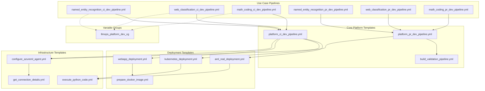
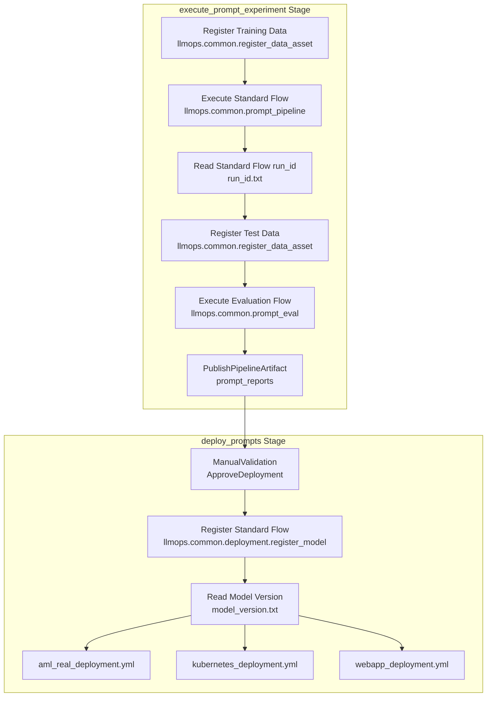
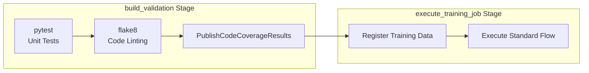
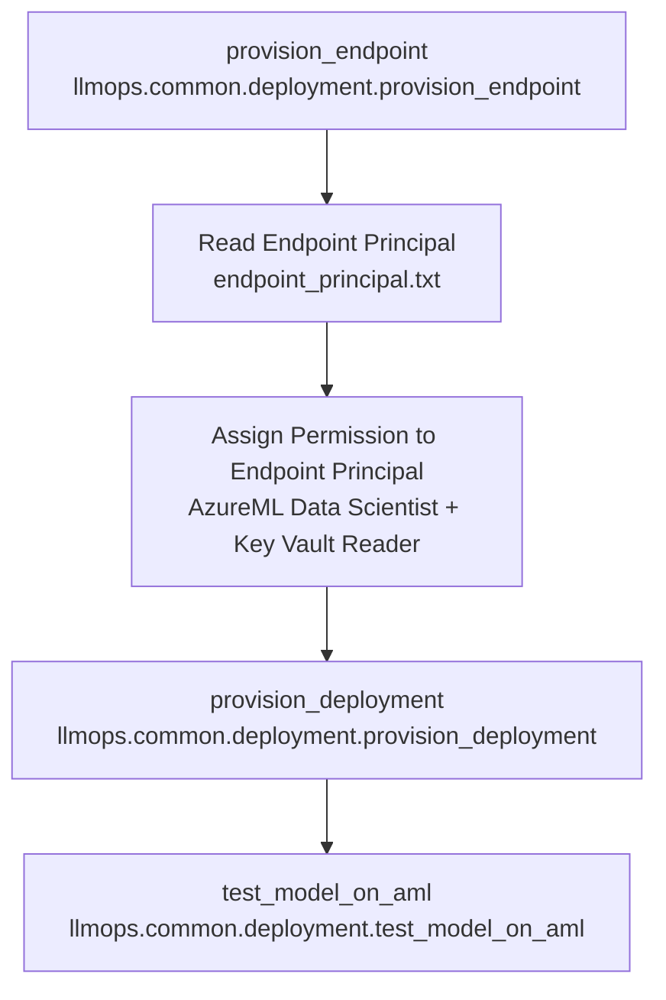
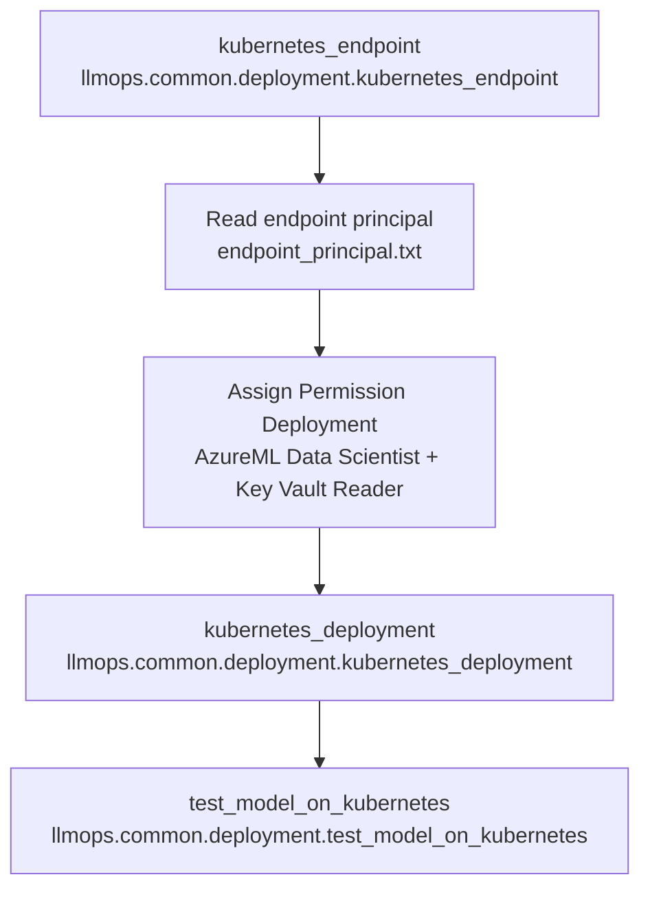
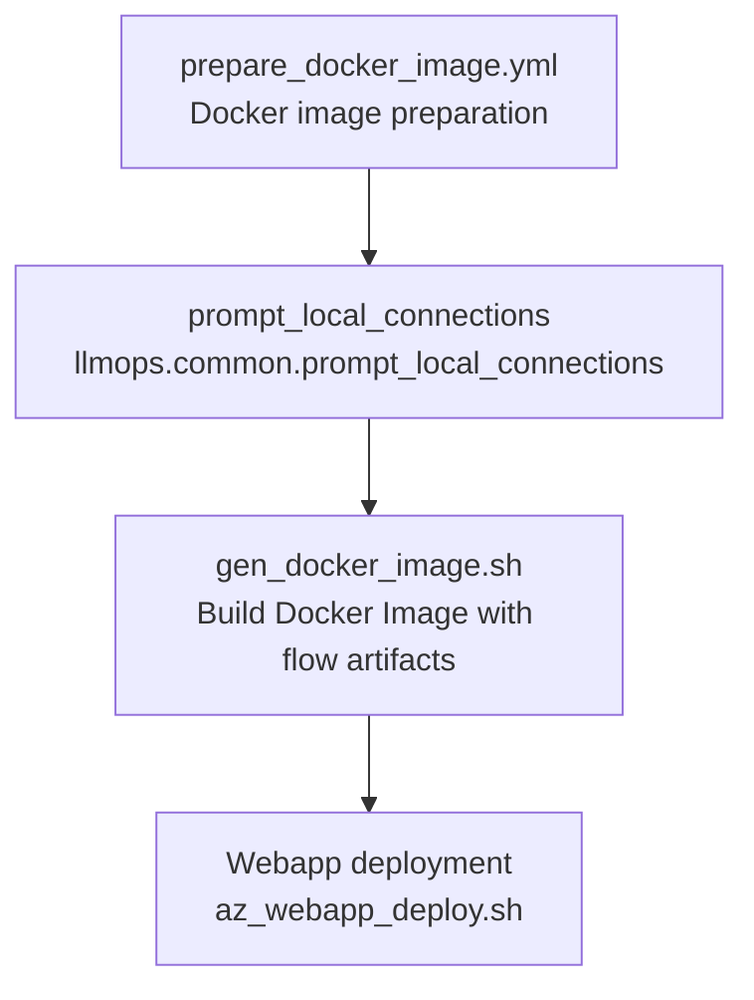
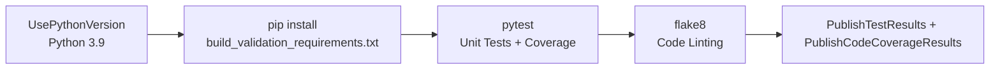

<!-- source: DeepWiki mcp.deepwiki.com · repo microsoft/genaiops-promptflow-template · page 4.2 Azure DevOps Pipelines · fetched 2026-10-26 -->

# Azure DevOps Pipelines

<details>
<summary>Relevant source files</summary>

The following files were used as context for generating this wiki page:

- [.azure-pipelines/build_validation_pipeline.yml](.azure-pipelines/build_validation_pipeline.yml)
- [.azure-pipelines/platform_ci_dev_pipeline.yml](.azure-pipelines/platform_ci_dev_pipeline.yml)
- [.azure-pipelines/platform_pr_dev_pipeline.yml](.azure-pipelines/platform_pr_dev_pipeline.yml)
- [.azure-pipelines/templates/aml_real_deployment.yml](.azure-pipelines/templates/aml_real_deployment.yml)
- [.azure-pipelines/templates/kubernetes_deployment.yml](.azure-pipelines/templates/kubernetes_deployment.yml)
- [.azure-pipelines/templates/prepare_docker_image.yml](.azure-pipelines/templates/prepare_docker_image.yml)
- [.azure-pipelines/templates/webapp_deployment.yml](.azure-pipelines/templates/webapp_deployment.yml)
- [math_coding/.azure-pipelines/math_coding_ci_dev_pipeline.yml](math_coding/.azure-pipelines/math_coding_ci_dev_pipeline.yml)
- [math_coding/.azure-pipelines/math_coding_pr_dev_pipeline.yml](math_coding/.azure-pipelines/math_coding_pr_dev_pipeline.yml)
- [named_entity_recognition/.azure-pipelines/named_entity_recognition_ci_dev_pipeline.yml](named_entity_recognition/.azure-pipelines/named_entity_recognition_ci_dev_pipeline.yml)
- [named_entity_recognition/.azure-pipelines/named_entity_recognition_pr_dev_pipeline.yml](named_entity_recognition/.azure-pipelines/named_entity_recognition_pr_dev_pipeline.yml)
- [web_classification/.azure-pipelines/web_classification_ci_dev_pipeline.yml](web_classification/.azure-pipelines/web_classification_ci_dev_pipeline.yml)
- [web_classification/.azure-pipelines/web_classification_pr_dev_pipeline.yml](web_classification/.azure-pipelines/web_classification_pr_dev_pipeline.yml)

</details>


This document covers the Azure DevOps Pipelines implementation for the LLMOps Prompt Flow template. It details the pipeline architecture, templates, and configuration required to execute Prompt Flow experiments, evaluations, and deployments using Azure DevOps as the CI/CD platform.

For information about other CI/CD platforms supported by this template, see [GitHub Actions](#4.1) and [Jenkins](#4.3). For details about the core LLMOps operations these pipelines execute, see [Core LLMOps Engine](#5).

## Pipeline Architecture Overview

The Azure DevOps implementation follows a template-based architecture with reusable pipeline templates and use case-specific pipeline definitions. The system supports both Pull Request (PR) validation and Continuous Integration (CI) workflows with deployment capabilities.

**Azure DevOps Pipeline Architecture**


Sources: [.azure-pipelines/platform_ci_dev_pipeline.yml:1-294](), [.azure-pipelines/platform_pr_dev_pipeline.yml:1-89](), [named_entity_recognition/.azure-pipelines/named_entity_recognition_ci_dev_pipeline.yml:1-44](), [web_classification/.azure-pipelines/web_classification_ci_dev_pipeline.yml:1-44](), [math_coding/.azure-pipelines/math_coding_ci_dev_pipeline.yml:1-44]()

## Core Pipeline Templates

### Platform CI Pipeline

The `platform_ci_dev_pipeline.yml` serves as the main template for continuous integration workflows. It orchestrates the complete MLOps pipeline from experiment execution through deployment.

**Platform CI Pipeline Flow**


The pipeline accepts key parameters for customization:

| Parameter | Description | Usage |
|-----------|-------------|-------|
| `exec_environment` | Target environment (dev, staging, prod) | Controls experiment configuration loading |
| `use_case_base_path` | Path to the specific use case | Determines which flow to execute |
| `deployment_type` | Deployment target (aml, aks, webapp, none) | Controls which deployment template runs |
| `RESOURCE_GROUP_NAME` | Azure resource group | Configures Azure ML workspace connection |
| `WORKSPACE_NAME` | Azure ML workspace name | Target workspace for experiments |
| `KEY_VAULT_NAME` | Azure Key Vault name | Secrets and connection management |

Sources: [.azure-pipelines/platform_ci_dev_pipeline.yml:21-159](), [.azure-pipelines/platform_ci_dev_pipeline.yml:1-20]()

### Platform PR Pipeline

The `platform_pr_dev_pipeline.yml` template handles Pull Request validation workflows. It performs build validation followed by experiment execution without deployment.

**Platform PR Pipeline Stages**


Sources: [.azure-pipelines/platform_pr_dev_pipeline.yml:15-89](), [.azure-pipelines/build_validation_pipeline.yml:1-36]()

## Use Case Specific Pipelines

Each use case (Named Entity Recognition, Web Classification, Math Coding) has dedicated pipeline files that reference the platform templates with specific parameters.

### Pipeline Configuration Pattern

All use case pipelines follow a consistent pattern:

```yaml
# Example from web_classification_ci_dev_pipeline.yml
variables:
- group: llmops_platform_dev_vg

stages:
  - template: ../../.azure-pipelines/platform_ci_dev_pipeline.yml
    parameters:
      RESOURCE_GROUP_NAME: $(rg_name)
      WORKSPACE_NAME: $(ws_name)
      KEY_VAULT_NAME: $(kv_name)
      exec_environment: ${{ parameters.env_name }}
      use_case_base_path: ${{ parameters.use_case_base_path }}
      deployment_type: ${{ lower(parameters.deployment_type) }}
```

### Use Case Pipeline Matrix

| Use Case | CI Pipeline | PR Pipeline | Default Deployment |
|----------|-------------|-------------|-------------------|
| Named Entity Recognition | `named_entity_recognition_ci_dev_pipeline.yml` | `named_entity_recognition_pr_dev_pipeline.yml` | `aml` |
| Web Classification | `web_classification_ci_dev_pipeline.yml` | `web_classification_pr_dev_pipeline.yml` | `aml` |
| Math Coding | `math_coding_ci_dev_pipeline.yml` | `math_coding_pr_dev_pipeline.yml` | `webapp` |

Sources: [named_entity_recognition/.azure-pipelines/named_entity_recognition_ci_dev_pipeline.yml:34-44](), [web_classification/.azure-pipelines/web_classification_ci_dev_pipeline.yml:34-44](), [math_coding/.azure-pipelines/math_coding_ci_dev_pipeline.yml:34-44]()

## Deployment Templates

### Azure ML Managed Endpoints

The `aml_real_deployment.yml` template handles deployment to Azure ML managed online endpoints.

**AML Deployment Process**


Sources: [.azure-pipelines/templates/aml_real_deployment.yml:20-98]()

### Kubernetes Endpoints

The `kubernetes_deployment.yml` template deploys flows to Azure Kubernetes Service endpoints.

**Kubernetes Deployment Process**


Sources: [.azure-pipelines/templates/kubernetes_deployment.yml:20-96]()

### Web App Deployment

The `webapp_deployment.yml` template deploys flows as containerized Azure Web Apps.

**Web App Deployment Process**


Sources: [.azure-pipelines/templates/webapp_deployment.yml:12-26](), [.azure-pipelines/templates/prepare_docker_image.yml:13-31]()

## Configuration and Variables

### Variable Groups

The system uses the `llmops_platform_dev_vg` variable group to centralize configuration:

| Variable | Purpose | Example |
|----------|---------|---------|
| `rg_name` | Resource group name | Target Azure resource group |
| `ws_name` | Workspace name | Azure ML workspace identifier |
| `kv_name` | Key Vault name | Secrets management vault |
| `env_vars` | Environment variables | Runtime configuration string |
| `DOCKER_IMAGE_REGISTRY` | Container registry details | ACR connection information |
| `AZURE_RM_SVC_CONNECTION` | Service connection | Azure subscription connection |

### Environment Variable Handling

The pipelines create `.env` files from the `env_vars` parameter:

```bash
# From platform_ci_dev_pipeline.yml lines 39-47
echo "$(env_vars)" | tr ' ' '\n' > .env
python -c "from dotenv import load_dotenv; load_dotenv()"
```

Sources: [.azure-pipelines/platform_ci_dev_pipeline.yml:36-55](), [web_classification/.azure-pipelines/web_classification_ci_dev_pipeline.yml:17-18](), [web_classification/.azure-pipelines/web_classification_ci_dev_pipeline.yml:37-44]()

## Build Validation

The `build_validation_pipeline.yml` template performs code quality checks:

**Build Validation Steps**


The validation includes:
- Python dependency installation from [`.azure-pipelines/requirements/build_validation_requirements.txt`]()
- Unit test execution with `pytest` including JUnit XML output and coverage reporting
- Code linting with `flake8` for `./llmops` and `./tests` directories
- Test result and coverage report publishing

Sources: [.azure-pipelines/build_validation_pipeline.yml:6-36]()

## Pipeline Triggers and Path Filters

All Azure DevOps pipelines use path-based filtering to trigger only when relevant files change:

```yaml
# Common trigger pattern
trigger:
  branches:
    include:
      - main
      - development
  paths:
    include:
      - .azure-pipelines/*
      - llmops/*
      - {use_case_name}/*
```

PR pipelines use `trigger: none` and configure PR triggers with the same path filters to ensure efficient resource usage.

Sources: [web_classification/.azure-pipelines/web_classification_ci_dev_pipeline.yml:2-11](), [named_entity_recognition/.azure-pipelines/named_entity_recognition_ci_dev_pipeline.yml:2-11](), [math_coding/.azure-pipelines/math_coding_ci_dev_pipeline.yml:2-11]()

---

