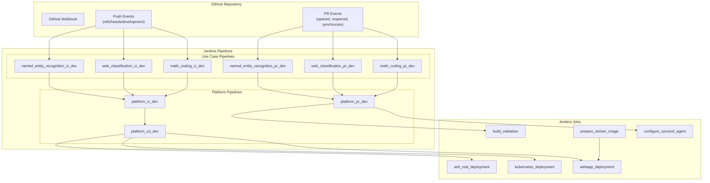
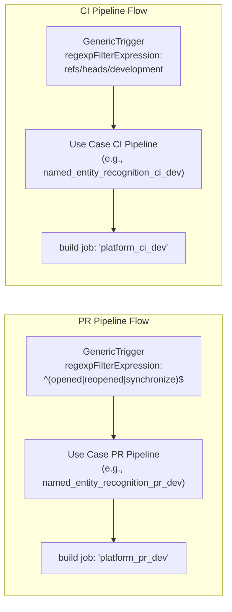
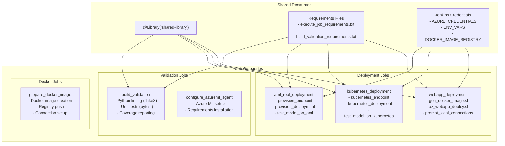
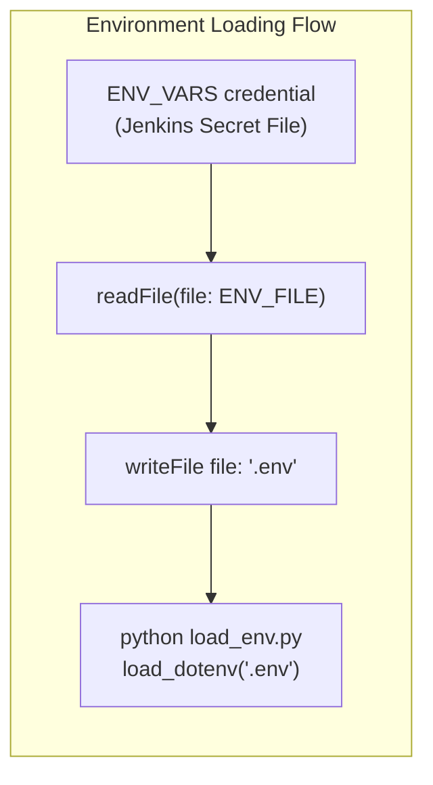
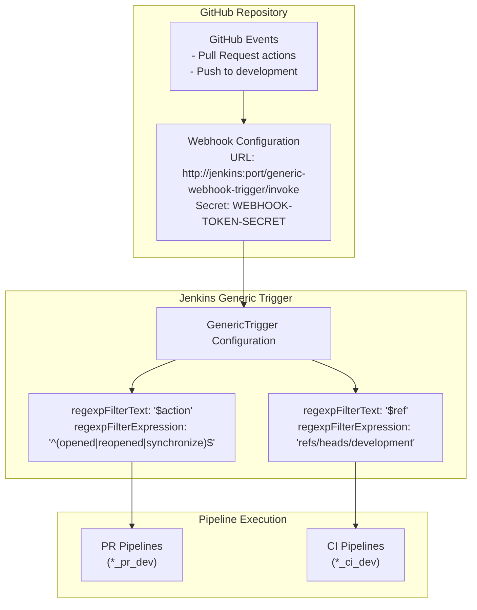

<!-- source: DeepWiki mcp.deepwiki.com · repo microsoft/genaiops-promptflow-template · page 4.3 Jenkins · fetched 2026-10-26 -->

# Jenkins

<details>
<summary>Relevant source files</summary>

The following files were used as context for generating this wiki page:

- [.jenkins/jobs/aml_real_deployment](.jenkins/jobs/aml_real_deployment)
- [.jenkins/jobs/build_validation](.jenkins/jobs/build_validation)
- [.jenkins/jobs/kubernetes_deployment](.jenkins/jobs/kubernetes_deployment)
- [.jenkins/jobs/prepare_docker_image](.jenkins/jobs/prepare_docker_image)
- [.jenkins/jobs/webapp_deployment](.jenkins/jobs/webapp_deployment)
- [.jenkins/pipelines/chat_with_pdf_ci_dev](.jenkins/pipelines/chat_with_pdf_ci_dev)
- [.jenkins/pipelines/chat_with_pdf_pr_dev](.jenkins/pipelines/chat_with_pdf_pr_dev)
- [.jenkins/pipelines/class_flows_ci_dev](.jenkins/pipelines/class_flows_ci_dev)
- [.jenkins/pipelines/class_flows_pr_dev](.jenkins/pipelines/class_flows_pr_dev)
- [.jenkins/pipelines/flex_flows_ci_dev](.jenkins/pipelines/flex_flows_ci_dev)
- [.jenkins/pipelines/flex_flows_pr_dev](.jenkins/pipelines/flex_flows_pr_dev)
- [.jenkins/pipelines/platform_cd_dev](.jenkins/pipelines/platform_cd_dev)
- [.jenkins/pipelines/platform_ci_dev](.jenkins/pipelines/platform_ci_dev)
- [.jenkins/pipelines/platform_pr_dev](.jenkins/pipelines/platform_pr_dev)
- [.jenkins/requirements/build_validation_requirements.txt](.jenkins/requirements/build_validation_requirements.txt)
- [.jenkins/requirements/execute_job_requirements.txt](.jenkins/requirements/execute_job_requirements.txt)
- [docs/jenkins_how_to_setup.md](docs/jenkins_how_to_setup.md)

</details>


Jenkins serves as one of the three supported CI/CD platforms in the LLMOps Prompt Flow template, providing automated build, test, and deployment capabilities for Prompt Flow experiments and models. This page covers the Jenkins-specific implementation, pipeline structure, and configuration requirements.

For information about the other CI/CD platforms, see [GitHub Actions](#4.1) and [Azure DevOps Pipelines](#4.2). For details about the core LLMOps operations that Jenkins orchestrates, see [Core LLMOps Engine](#5).

## Jenkins Architecture Overview

The Jenkins implementation follows a hierarchical pipeline structure with platform-level pipelines that orchestrate use-case specific jobs. The system supports multiple deployment targets and environments through parameterized builds and credential management.



Sources: [docs/jenkins_how_to_setup.md:1-556](), [.jenkins/pipelines/platform_pr_dev:1-119](), [.jenkins/pipelines/platform_ci_dev:1-194](), [.jenkins/pipelines/platform_cd_dev:1-177]()

## Pipeline Structure

### Use Case Pipelines

Use case pipelines serve as entry points triggered by GitHub webhooks. Each use case has two pipeline types:

| Pipeline Pattern | Trigger | Purpose | Example |
|------------------|---------|---------|---------|
| `*_pr_dev` | PR events | Code validation on feature branches | `named_entity_recognition_pr_dev` |
| `*_ci_dev` | Push to development | Full CI/CD execution | `named_entity_recognition_ci_dev` |



Sources: [.jenkins/pipelines/named_entity_recognition_pr_dev:12-27](), [.jenkins/pipelines/named_entity_recognition_ci_dev:14-29](), [.jenkins/pipelines/class_flows_pr_dev:12-27]()

### Platform Pipelines

Platform pipelines contain the core LLMOps logic and are called by use case pipelines:

#### platform_pr_dev
Executes validation workflows for pull requests:
- Azure ML agent configuration via `configure_azureml_agent` job
- Environment file loading from `ENV_VARS` credential
- Code validation via `build_validation` job  
- Data asset registration via `llmops.common.register_data_asset`
- Prompt flow execution via `llmops.common.prompt_pipeline`

#### platform_ci_dev  
Executes full CI workflow for development branch:
- All PR validation steps
- Evaluation execution via `llmops.common.prompt_eval`
- Report archival
- Conditional deployment via `platform_cd_dev`

#### platform_cd_dev
Handles deployment based on `deployment_type` parameter:
- Model registration via `llmops.common.deployment.register_model`
- Deployment job selection: `aml_real_deployment`, `kubernetes_deployment`, or `webapp_deployment`

Sources: [.jenkins/pipelines/platform_pr_dev:21-118](), [.jenkins/pipelines/platform_ci_dev:29-193](), [.jenkins/pipelines/platform_cd_dev:115-176]()

## Job Structure

Jenkins jobs implement specific deployment and validation operations:



Sources: [.jenkins/jobs/build_validation:47-70](), [.jenkins/jobs/aml_real_deployment:51-128](), [.jenkins/jobs/kubernetes_deployment:50-126](), [.jenkins/jobs/webapp_deployment:77-121]()

## Configuration and Setup

### Jenkins Credentials

The system requires several credential types in Jenkins:

| Credential ID | Type | Purpose | Configuration Location |
|---------------|------|---------|----------------------|
| `AZURE_CREDENTIALS` | Azure Service Principal | Azure resource access | Service principal JSON |
| `ENV_VARS` | Secret File | Environment variables | Key-value pairs file |
| `DOCKER_IMAGE_REGISTRY` | Secret Text | Container registry access | JSON with registry details |
| `WEBHOOK-TOKEN-SECRET` | Secret Text | GitHub webhook security | Random high-entropy string |

Sources: [docs/jenkins_how_to_setup.md:258-261](), [docs/jenkins_how_to_setup.md:289-304](), [docs/jenkins_how_to_setup.md:443-445]()

### Global Environment Variables

Jenkins requires environment-specific global variables:

```
RESOURCE_GROUP_NAME_<env>
WORKSPACE_NAME_<env>  
KEY_VAULT_NAME_<env>
```

Where `<env>` represents the target environment (dev, prod, etc.).

Sources: [docs/jenkins_how_to_setup.md:264-269]()

### Requirements Files

Jenkins jobs use specific requirement files:

- **execute_job_requirements.txt**: Core prompt flow and Azure ML dependencies
- **build_validation_requirements.txt**: Testing and validation tools

Sources: [.jenkins/requirements/execute_job_requirements.txt:1-11](), [.jenkins/requirements/build_validation_requirements.txt:1-14]()

## Secrets Management

### Environment Variable Loading

All Jenkins pipelines implement a standardized environment loading pattern:



The environment variables support placeholder replacement syntax `${SECRET_NAME}` in configuration files like `experiment.yaml` and `env.yaml`.

Sources: [docs/jenkins_how_to_setup.md:125-143](), [.jenkins/pipelines/platform_pr_dev:40-70]()

### Connection Naming Convention

Secrets for Prompt Flow connections follow a specific naming pattern:
- Connection API keys: `<CONNECTION_NAME>_API_KEY`
- Flow-specific secrets: `<PARENT_ELEMENT_NAME>_<SECRET_NAME>`

Sources: [docs/jenkins_how_to_setup.md:161-172]()

## Webhook Integration

Jenkins pipelines use the Generic Webhook Trigger plugin for GitHub integration:



Sources: [docs/jenkins_how_to_setup.md:447-466](), [.jenkins/pipelines/named_entity_recognition_pr_dev:12-27](), [.jenkins/pipelines/named_entity_recognition_ci_dev:14-29]()

## Deployment Execution Flow

The deployment process varies by target platform but follows a consistent pattern:

### Azure ML Deployment
1. Model registration via `llmops.common.deployment.register_model`
2. Endpoint provisioning via `llmops.common.deployment.provision_endpoint`
3. RBAC permission assignment for Key Vault and Azure ML workspace
4. Deployment creation via `llmops.common.deployment.provision_deployment`
5. Endpoint testing via `llmops.common.deployment.test_model_on_aml`

### Kubernetes Deployment  
1. Model registration (same as AML)
2. Kubernetes endpoint provisioning via `llmops.common.deployment.kubernetes_endpoint`
3. RBAC permission assignment
4. Kubernetes deployment via `llmops.common.deployment.kubernetes_deployment`
5. Testing via `llmops.common.deployment.test_model_on_kubernetes`

### Web App Deployment
1. Local connection setup via `llmops.common.prompt_local_connections`
2. Docker image creation via `gen_docker_image.sh`
3. Web app deployment via `az_webapp_deploy.sh`

Sources: [.jenkins/jobs/aml_real_deployment:51-128](), [.jenkins/jobs/kubernetes_deployment:50-126](), [.jenkins/jobs/webapp_deployment:77-121]()

---

