<!-- source: DeepWiki mcp.deepwiki.com · repo microsoft/genaiops-promptflow-template · page 5 Core LLMOps Engine · fetched 2026-10-26 -->

# Core LLMOps Engine

Relevant source files

The following files were used as context for generating this wiki page:

- [llmops/common/common.py](llmops/common/common.py)
- [llmops/common/create_connections.py](llmops/common/create_connections.py)
- [llmops/common/deployment/generate_env_vars.py](llmops/common/deployment/generate_env_vars.py)
- [llmops/common/deployment/kubernetes_deployment.py](llmops/common/deployment/kubernetes_deployment.py)
- [llmops/common/deployment/kubernetes_endpoint.py](llmops/common/deployment/kubernetes_endpoint.py)
- [llmops/common/deployment/provision_deployment.py](llmops/common/deployment/provision_deployment.py)
- [llmops/common/deployment/register_model.py](llmops/common/deployment/register_model.py)
- [llmops/common/deployment/test_model_on_aml.py](llmops/common/deployment/test_model_on_aml.py)
- [llmops/common/deployment/test_model_on_kubernetes.py](llmops/common/deployment/test_model_on_kubernetes.py)
- [llmops/common/experiment.py](llmops/common/experiment.py)
- [llmops/common/get_workspace.py](llmops/common/get_workspace.py)
- [llmops/common/prompt_eval.py](llmops/common/prompt_eval.py)
- [llmops/common/prompt_pipeline.py](llmops/common/prompt_pipeline.py)
- [llmops/common/register_data_asset.py](llmops/common/register_data_asset.py)
- [llmops/config.py](llmops/config.py)

## Purpose and Scope

The Core LLMOps Engine is the foundational execution system that powers experiment runs, model evaluation, and deployment operations across all Prompt Flow use cases in this template. It provides standardized interfaces and orchestration logic for running bulk experiments, evaluating results, managing Azure ML assets, and deploying models to various compute targets.

This document covers the core modules in `llmops/common/` that handle experiment execution and asset management. For information about specific use case implementations, see [Use Cases and Prompt Flows](#3). For deployment target details, see [Deployment](#6). For CI/CD pipeline integration, see [CI/CD Platforms](#4).

## Engine Architecture Overview

The Core LLMOps Engine consists of four primary functional layers that work together to provide complete experiment-to-deployment automation:

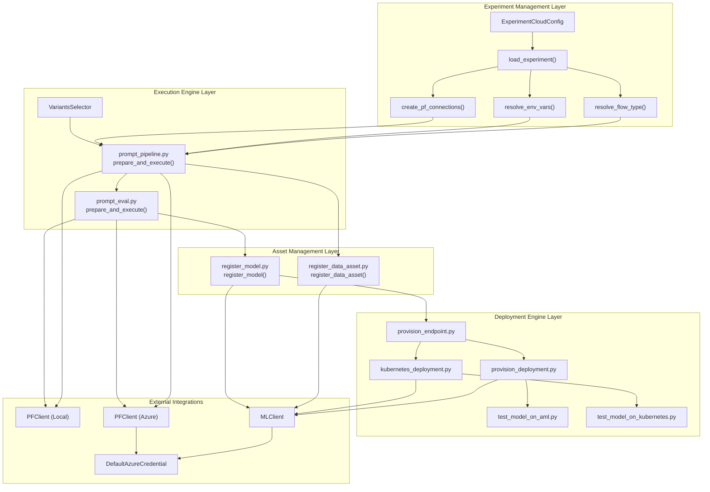

**Sources:** [llmops/common/prompt_pipeline.py:1-584](), [llmops/common/prompt_eval.py:1-521](), [llmops/common/common.py:1-257](), [llmops/common/deployment/provision_deployment.py:1-309](), [llmops/common/deployment/kubernetes_deployment.py:1-316]()

## Execution Context and Client Management

The engine adapts its behavior based on the execution context defined by `EXECUTION_TYPE` configuration, managing different client objects for local versus cloud execution:

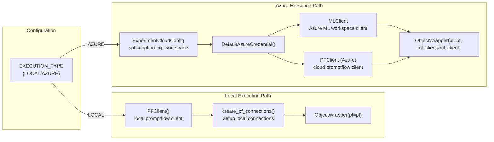

**Sources:** [llmops/config.py:11](), [llmops/common/prompt_pipeline.py:174-202](), [llmops/common/prompt_eval.py:95-119](), [llmops/common/common.py:30-46]()

## Flow Type Resolution and Parameters

The engine automatically detects and configures different types of Prompt Flows through the `resolve_flow_type()` function:

| Flow Type | Detection Criteria | Configuration Handling |
|-----------|-------------------|----------------------|
| `DAG_FLOW` | `flow.dag.yaml` or `flow.dag.yml` present | Uses YAML node variants configuration |
| `FUNCTION_FLOW` | `flow.flex.yaml` with function entry | No additional parameters |
| `CLASS_FLOW` | `flow.flex.yaml` with class entry | Reads `init.json` for class parameters |
| `NO_FLOW` | No flow files found | Used for custom evaluation scripts |

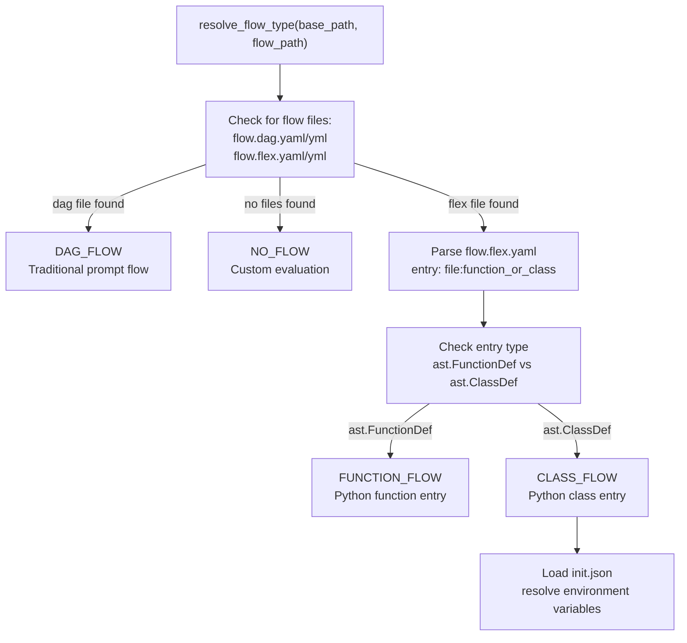

**Sources:** [llmops/common/common.py:95-206](), [llmops/common/prompt_pipeline.py:169-170](), [llmops/common/prompt_eval.py:89-91]()

## Experiment Execution Engine

The `prompt_pipeline.py` module orchestrates bulk experiment runs with support for flow variants and multiple datasets:

### Variant Selection Strategy

The `VariantsSelector` class manages which flow variants to execute:

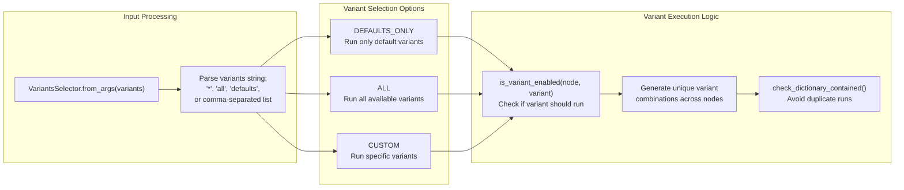

**Sources:** [llmops/common/prompt_pipeline.py:87-136](), [llmops/common/prompt_pipeline.py:222-250](), [llmops/common/prompt_pipeline.py:77-84]()

### Experiment Execution Flow

The main execution loop processes datasets and variants systematically:

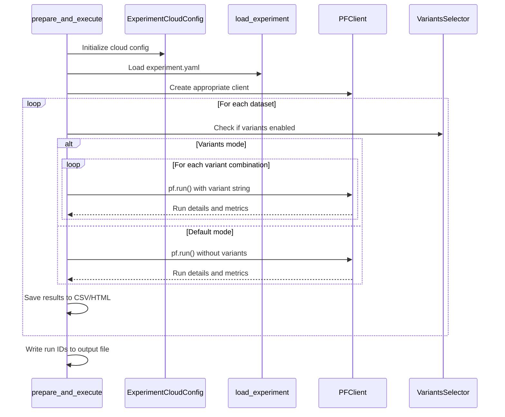

**Sources:** [llmops/common/prompt_pipeline.py:138-495](), [llmops/common/prompt_pipeline.py:277-324](), [llmops/common/prompt_pipeline.py:371-410]()

## Evaluation Engine

The `prompt_eval.py` module runs evaluation flows against completed bulk runs:

### Evaluation Dataset Mapping

The evaluation system uses dataset references to link evaluation data with standard runs:

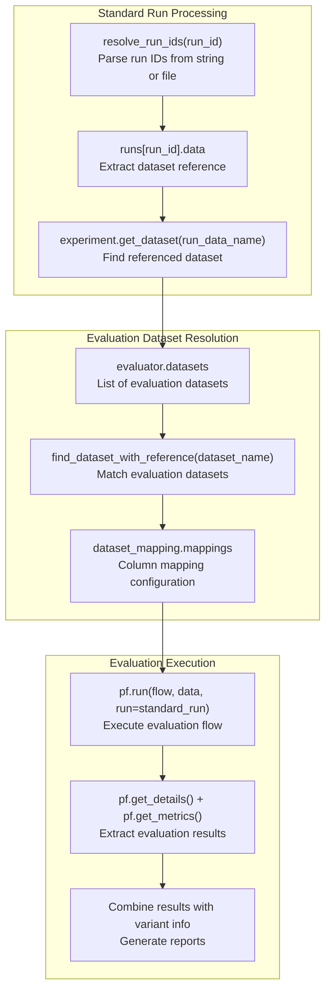

**Sources:** [llmops/common/prompt_eval.py:126-198](), [llmops/common/prompt_eval.py:235-270](), [llmops/common/common.py:235-256]()

### Custom Evaluation Support

For evaluators without flow files (`NO_FLOW` type), the engine supports custom Python evaluation functions:

```mermaid
graph LR
    subgraph "Custom Evaluator Detection"
        check_flow_type["flow_type == FlowTypeOption.NO_FLOW"]
        scan_directory["os.listdir(evaluator.path)<br/>Find eval_*.py files"]
        import_module["importlib.import_module()<br/>Dynamic module loading"]
    end
    
    subgraph "Function Discovery"
        get_functions["inspect.isfunction()<br/>Find all functions in module"]
        filter_eval_functions["function_name.startswith('eval_')<br/>Filter evaluation functions"]
        get_service_function["getattr(module, function_name)<br/>Get function reference"]
    end
    
    subgraph "Function Execution"
        call_eval_function["service_function(<br/>run_name, dataset_path,<br/>mappings, report_dir,<br/>cloud_config)"]
        process_result["Process evaluation results<br/>Generate reports"]
    end
    
    check_flow_type --> scan_directory
    scan_directory --> import_module
    import_module --> get_functions
    get_functions --> filter_eval_functions
    filter_eval_functions --> get_service_function
    get_service_function --> call_eval_function
    call_eval_function --> process_result
```

**Sources:** [llmops/common/prompt_eval.py:344-428](), [llmops/common/prompt_eval.py:370-390]()

## Asset Management System

The engine provides comprehensive asset management for datasets and models in Azure ML:

### Data Asset Registration

The `register_data_asset.py` module handles dataset registration with hash-based change detection:

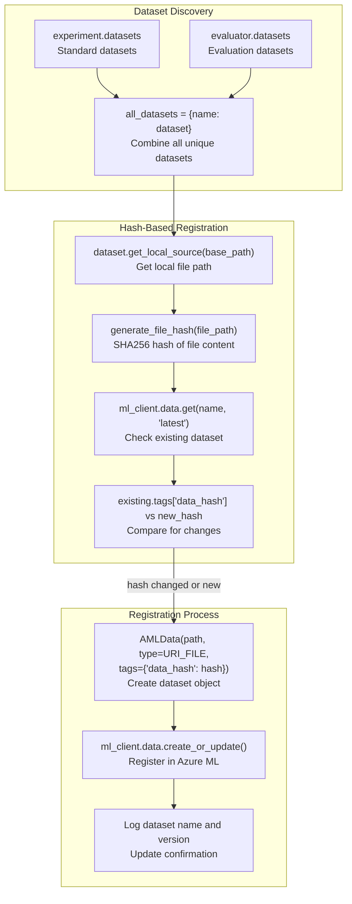

**Sources:** [llmops/common/register_data_asset.py:49-117](), [llmops/common/register_data_asset.py:33-46](), [llmops/common/register_data_asset.py:80-111]()

### Model Registration

The `register_model.py` module handles flow model registration with similar hash-based tracking:

```mermaid
graph LR
    subgraph "Model Preparation"
        get_flow_detail["experiment.get_flow_detail(flow_type)<br/>Get flow path"]
        hash_folder["hash_folder(model_path)<br/>SHA256 of entire flow directory"]
        create_model_tags["model_tags = {'model_hash': hash,<br/>'build_id': build_id}"]
    end
    
    subgraph "Model Object Creation"
        create_model["Model(name, path, stage='Production',<br/>properties={'azureml.promptflow.source_flow_id'})<br/>Create model entity"]
        set_description["description = f'{experiment_name} model<br/>registered for prompt flow deployment'"]
    end
    
    subgraph "Registration Logic"
        check_existing_model["ml_client.models.get(name, 'latest')<br/>Check existing model"]
        compare_model_hashes["existing.tags['model_hash'] vs new_hash<br/>Compare for changes"]
        register_model["ml_client.models.create_or_update()<br/>Register model"]
        output_version["Write model version to output_file<br/>For downstream processes"]
    end
    
    get_flow_detail --> hash_folder
    hash_folder --> create_model_tags
    create_model_tags --> create_model
    create_model --> set_description
    set_description --> check_existing_model
    check_existing_model --> compare_model_hashes
    compare_model_hashes -->|"hash changed or new"| register_model
    register_model --> output_version
```

**Sources:** [llmops/common/deployment/register_model.py:55-120](), [llmops/common/deployment/register_model.py:36-52](), [llmops/common/deployment/register_model.py:93-114]()

## Deployment Engine Components

The deployment engine supports multiple compute targets through specialized modules:

### Deployment Configuration Processing

All deployment modules read from `deployment_config.json` to determine target-specific settings:

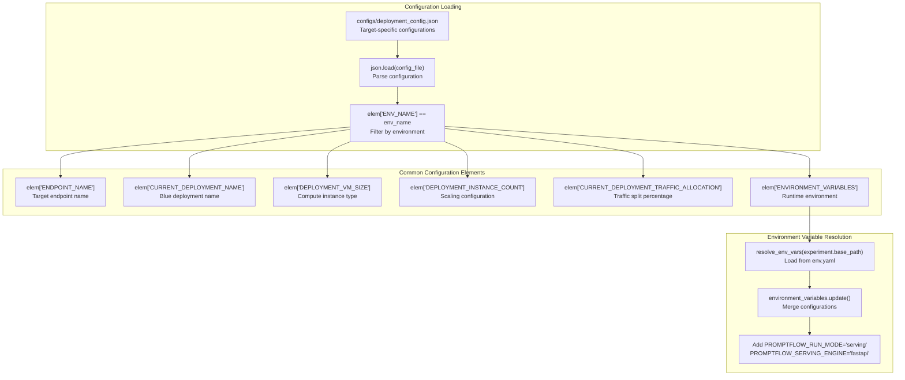

**Sources:** [llmops/common/deployment/provision_deployment.py:133-190](), [llmops/common/deployment/kubernetes_deployment.py:134-192](), [llmops/common/common.py:48-92]()

## Connection Management

The `create_connections.py` module handles Prompt Flow connection setup for local execution:

```mermaid
graph LR
    subgraph "Connection Type Detection"
        CONNECTION_CLASSES["CONNECTION_CLASSES dict<br/>Maps type strings to classes"]
        connection_type["connection_details.connection_type.lower()<br/>Normalize connection type"]
        get_connection_class["CONNECTION_CLASSES[connection_type]<br/>Get appropriate class"]
    end
    
    subgraph "Custom Connection Handling"
        check_custom["connection_type == 'customconnection'<br/>Special handling"]
        process_configs["connection_details.configs.items()<br/>Process config properties"]
        process_secrets["connection_details.secrets.items()<br/>Process secret properties"] 
        resolve_values["_get_valid_connection_values()<br/>Resolve ${} references"]
    end
    
    subgraph "Standard Connection Handling"
        process_properties["connection_details.connection_properties<br/>Extract properties"]
        filter_connection_type["Skip 'connection_type' property<br/>Handle other properties"]
        create_connection["connection_class(**properties)<br/>Instantiate connection"]
    end
    
    subgraph "Connection Registration"
        pf_create_update["pf.connections.create_or_update()<br/>Register with Prompt Flow"]
        handle_errors["Exception handling<br/>Log and re-raise errors"]
    end
    
    CONNECTION_CLASSES --> connection_type
    connection_type --> get_connection_class
    get_connection_class --> check_custom
    
    check_custom -->|"Yes"| process_configs
    process_configs --> process_secrets
    process_secrets --> resolve_values
    
    check_custom -->|"No"| process_properties
    process_properties --> filter_connection_type
    filter_connection_type --> create_connection
    
    resolve_values --> pf_create_update
    create_connection --> pf_create_update
    pf_create_update --> handle_errors
```

**Sources:** [llmops/common/create_connections.py:22-102](), [llmops/common/create_connections.py:105-118](), [llmops/common/create_connections.py:57-95]()

## Configuration and Environment Management

The `ExperimentCloudConfig` class centralizes Azure resource configuration:

| Configuration Source | Priority | Environment Variables |
|---------------------|----------|----------------------|
| Function parameters | Highest | Direct parameter override |
| Environment variables | Medium | `SUBSCRIPTION_ID`, `RESOURCE_GROUP_NAME`, `WORKSPACE_NAME` |
| Default values | Lowest | Fallback when not specified |

The `resolve_env_vars()` function processes environment configuration from `env.yaml` files with variable substitution support using `${VARIABLE_NAME}` syntax.

**Sources:** [llmops/common/experiment_cloud_config.py](), [llmops/common/common.py:48-92]()

---

