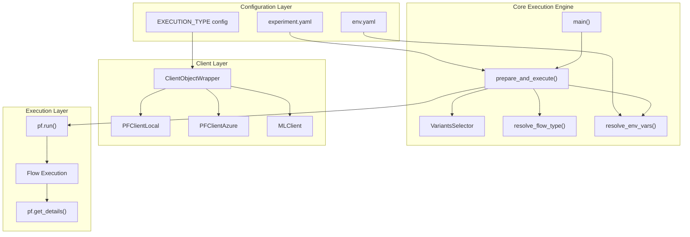
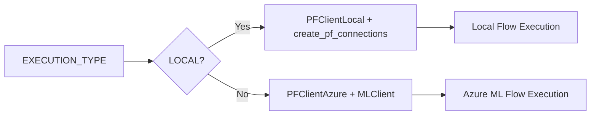
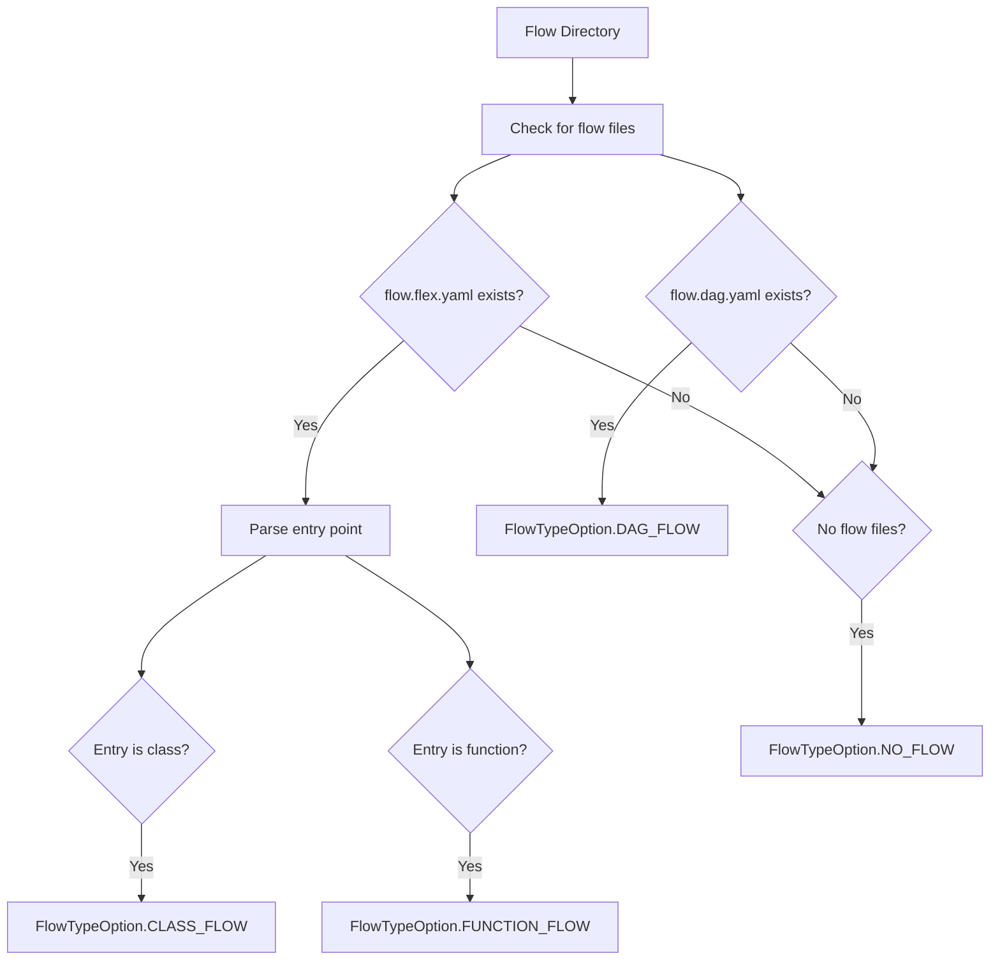
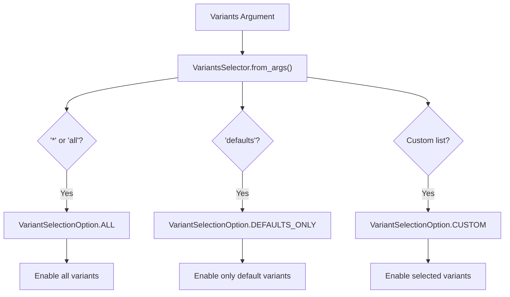
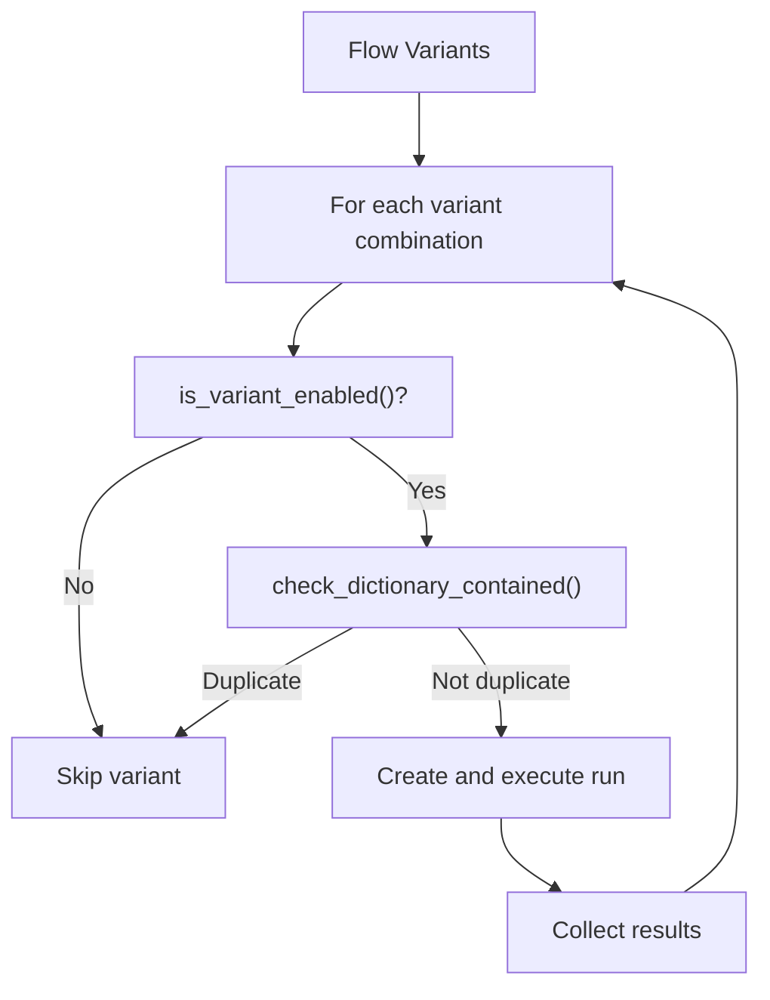
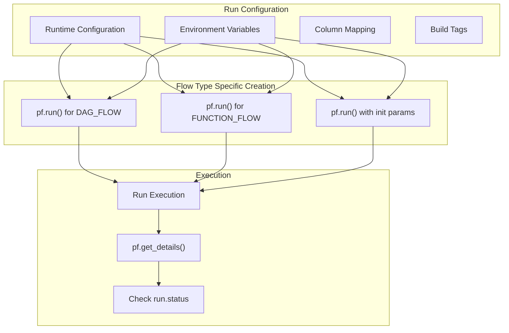
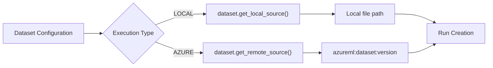
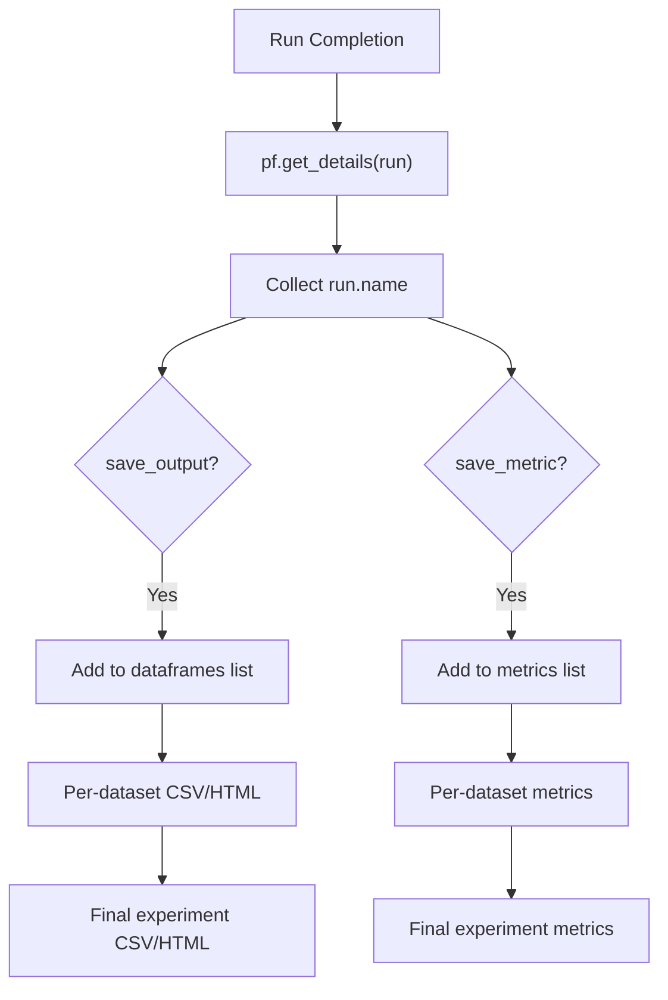

<!-- source: DeepWiki mcp.deepwiki.com · repo microsoft/genaiops-promptflow-template · page 5.1 Experiment Execution · fetched 2026-10-26 -->

# Experiment Execution

<details>
<summary>Relevant source files</summary>

The following files were used as context for generating this wiki page:

- [llmops/common/common.py](llmops/common/common.py)
- [llmops/common/create_connections.py](llmops/common/create_connections.py)
- [llmops/common/deployment/generate_env_vars.py](llmops/common/deployment/generate_env_vars.py)
- [llmops/common/deployment/kubernetes_deployment.py](llmops/common/deployment/kubernetes_deployment.py)
- [llmops/common/deployment/provision_deployment.py](llmops/common/deployment/provision_deployment.py)
- [llmops/common/experiment.py](llmops/common/experiment.py)
- [llmops/common/get_workspace.py](llmops/common/get_workspace.py)
- [llmops/common/prompt_eval.py](llmops/common/prompt_eval.py)
- [llmops/common/prompt_pipeline.py](llmops/common/prompt_pipeline.py)
- [llmops/config.py](llmops/config.py)

</details>


This document covers how the LLMOps system executes Prompt Flow experiments through the core engine's experiment execution module. It explains the process of running standard flows with variant handling, bulk execution, and result collection. For information about evaluating experiments after execution, see [Model Evaluation](#5.2). For information about registering and managing the assets produced by experiments, see [Asset Management](#5.3).

## Purpose and Scope

The experiment execution system is responsible for running Prompt Flow experiments defined in experiment configuration files. It handles variant selection, dataset processing, flow execution across different compute targets, and result collection. The system supports both local and Azure-based execution modes and can process multiple flow types including DAG flows, function flows, and class flows.

## Architecture Overview

The experiment execution system centers around the `prompt_pipeline.py` module, which orchestrates the entire execution process from configuration loading to result collection.



**Sources:** [llmops/common/prompt_pipeline.py:1-584](), [llmops/common/common.py:1-257]()

## Execution Modes

The system supports two execution modes controlled by the `EXECUTION_TYPE` configuration setting:

| Mode | Description | Client Used | Authentication |
|------|-------------|-------------|----------------|
| LOCAL | Executes flows locally | `PFClientLocal` | Local credentials |
| AZURE | Executes flows in Azure ML | `PFClientAzure` + `MLClient` | `DefaultAzureCredential` |

The execution mode is determined by the `EXECUTION_TYPE` setting in the configuration:



**Sources:** [llmops/common/prompt_pipeline.py:174-202](), [llmops/config.py:11]()

## Flow Type Resolution

The system automatically detects and supports different Prompt Flow types based on the flow definition files present:

### Flow Type Detection

The `resolve_flow_type` function examines the flow directory to determine the flow type:



### Supported Flow Types

| Flow Type | Files Required | Description |
|-----------|----------------|-------------|
| `DAG_FLOW` | `flow.dag.yaml` | Traditional DAG-based flows |
| `CLASS_FLOW` | `flow.flex.yaml` + class entry | Flex flows with class-based entry |
| `FUNCTION_FLOW` | `flow.flex.yaml` + function entry | Flex flows with function-based entry |
| `NO_FLOW` | None | Custom evaluation flows |

**Sources:** [llmops/common/common.py:95-207](), [llmops/common/common.py:21-28]()

## Variant Selection and Handling

The `VariantsSelector` class provides flexible variant selection strategies for executing different flow configurations:

### Variant Selection Options



### Variant Processing Logic

The system processes variants to ensure unique combinations are executed:



**Sources:** [llmops/common/prompt_pipeline.py:87-136](), [llmops/common/prompt_pipeline.py:222-349]()

## Run Creation and Execution

The core execution process creates and manages Prompt Flow runs based on the flow type and configuration:

### Run Creation Process



### Run Parameters by Flow Type

The system creates runs with different parameters based on the flow type:

| Parameter | DAG_FLOW | FUNCTION_FLOW | CLASS_FLOW |
|-----------|----------|---------------|------------|
| `flow` | Flow path | Flow path | Flow path |
| `data` | Dataset source | Dataset source | Dataset source |
| `variant` | Variant string | Variant string | Variant string |
| `init` | Not used | Not used | Initialization parameters |
| `environment_variables` | Resolved env vars | Resolved env vars | Resolved env vars |
| `runtime` | Experiment runtime | Experiment runtime | Experiment runtime |

**Sources:** [llmops/common/prompt_pipeline.py:277-324](), [llmops/common/prompt_pipeline.py:371-410]()

## Data Source Handling

The execution system handles both local and remote data sources based on the execution type:



**Sources:** [llmops/common/prompt_pipeline.py:282-287](), [llmops/common/prompt_pipeline.py:375-381]()

## Results Collection and Output

The system provides flexible result collection and output options:

### Output Options

| Flag | Description | Files Generated |
|------|-------------|-----------------|
| `--save_output` | Save detailed run outputs | `*_result.csv`, `*_result.html` |
| `--save_metric` | Save run metrics | `*_metrics.csv`, `*_metrics.html` |
| `--output_file` | Save run IDs to file | Text file with run ID list |

### Result Processing Flow



**Sources:** [llmops/common/prompt_pipeline.py:342-348](), [llmops/common/prompt_pipeline.py:427-432](), [llmops/common/prompt_pipeline.py:434-495]()

## Command Line Interface

The experiment execution module provides a comprehensive command line interface:

### Key Parameters

| Parameter | Description | Default |
|-----------|-------------|---------|
| `--file` | Experiment configuration file | `experiment.yaml` |
| `--variants` | Variant selection strategy | `*` (all) |
| `--base_path` | Use case base directory | Required |
| `--env_name` | Environment overlay name | None |
| `--build_id` | Build identifier for tagging | None |
| `--report_dir` | Output directory for results | `./reports` |

### Usage Examples

```bash
# Run all variants
python -m llmops.common.prompt_pipeline --base_path ./web_classification --variants all

# Run only default variants  
python -m llmops.common.prompt_pipeline --base_path ./web_classification --variants defaults

# Run specific variants
python -m llmops.common.prompt_pipeline --base_path ./web_classification --variants variant_0,variant_1
```

**Sources:** [llmops/common/prompt_pipeline.py:26-47](), [llmops/common/prompt_pipeline.py:504-576]()

---

