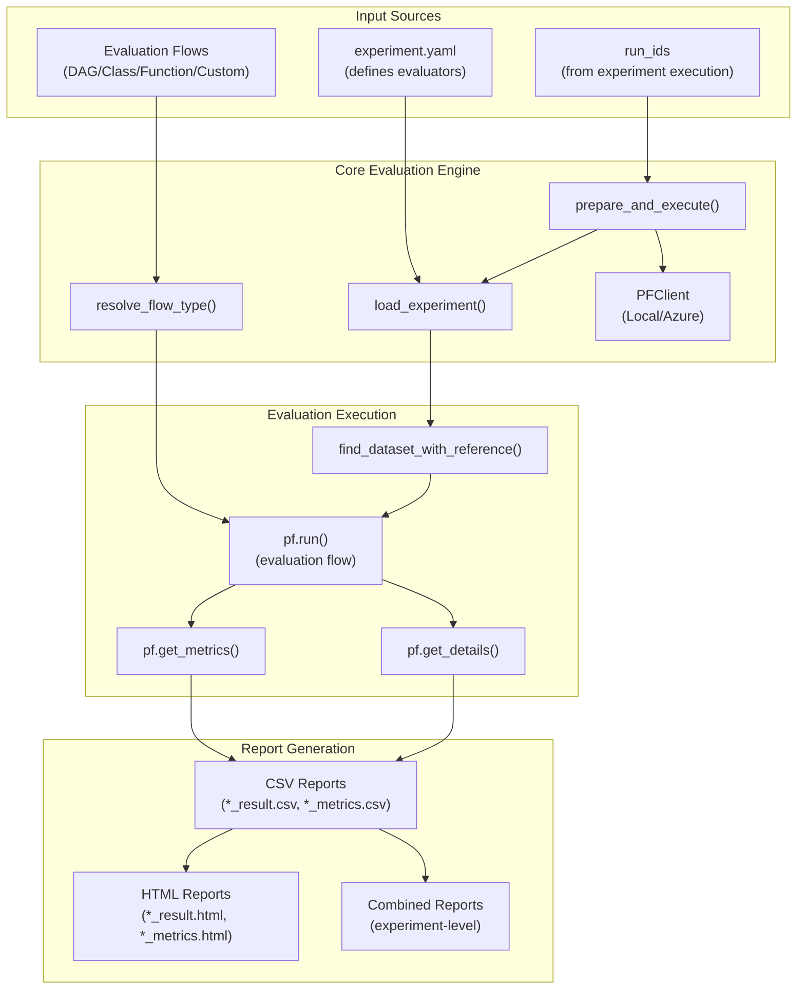
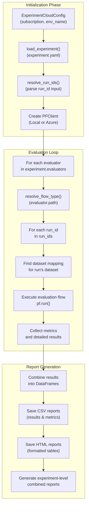
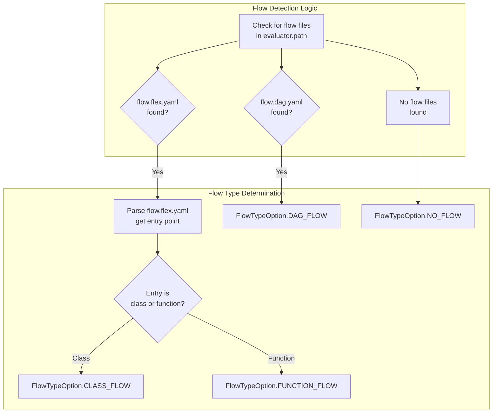
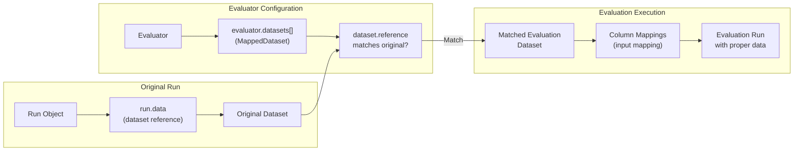
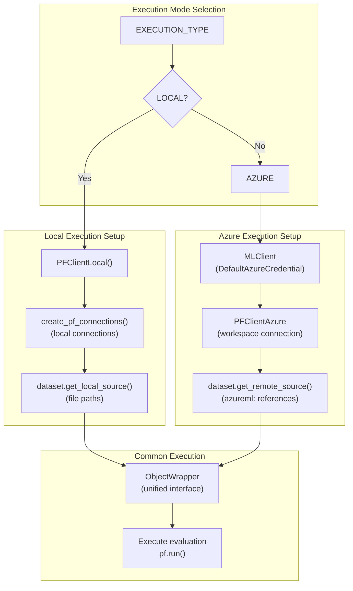
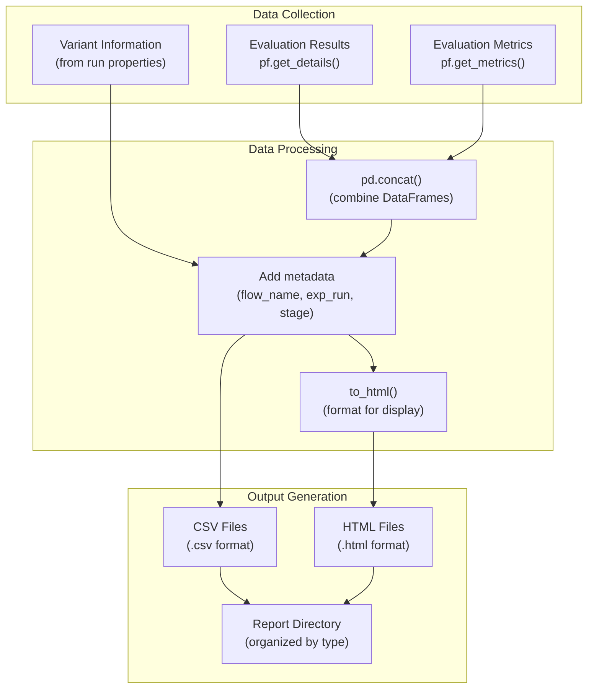
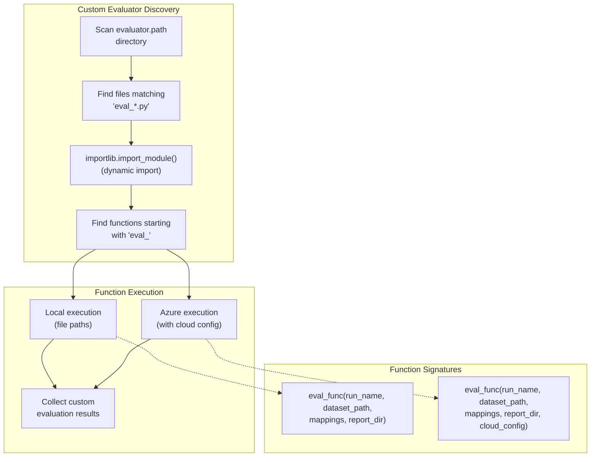

<!-- source: DeepWiki mcp.deepwiki.com · repo microsoft/genaiops-promptflow-template · page 5.2 Model Evaluation · fetched 2026-10-26 -->

# Model Evaluation

Relevant source files

The following files were used as context for generating this wiki page:

- [llmops/common/common.py](llmops/common/common.py)
- [llmops/common/create_connections.py](llmops/common/create_connections.py)
- [llmops/common/deployment/generate_env_vars.py](llmops/common/deployment/generate_env_vars.py)
- [llmops/common/deployment/kubernetes_deployment.py](llmops/common/deployment/kubernetes_deployment.py)
- [llmops/common/deployment/provision_deployment.py](llmops/common/deployment/provision_deployment.py)
- [llmops/common/experiment.py](llmops/common/experiment.py)
- [llmops/common/get_workspace.py](llmops/common/get_workspace.py)
- [llmops/common/prompt_eval.py](llmops/common/prompt_eval.py)
- [llmops/common/prompt_pipeline.py](llmops/common/prompt_pipeline.py)
- [llmops/config.py](llmops/config.py)

This document covers the model evaluation system within the LLMOps Prompt Flow template. The evaluation engine takes completed Prompt Flow runs and executes evaluation flows against them to assess model performance and generate comprehensive evaluation reports.

For information about executing the initial Prompt Flow experiments that generate runs to be evaluated, see [Experiment Execution](#5.1). For information about asset management including data registration, see [Asset Management](#5.3).

## Overview

The model evaluation system is implemented in the `prompt_eval.py` module and provides automated evaluation of Prompt Flow runs using configurable evaluation flows. The system supports multiple evaluation flow types, generates detailed reports, and works in both local and Azure cloud environments.

Sources: [llmops/common/prompt_eval.py:1-521]()

## Evaluation Workflow

The evaluation process follows a structured workflow that loads experiment configuration, resolves evaluation flows, executes evaluations, and generates comprehensive reports.

### Core Evaluation Process

The `prepare_and_execute()` function orchestrates the entire evaluation workflow:

Sources: [llmops/common/prompt_eval.py:59-449]()

## Evaluation Flow Types

The system supports multiple types of evaluation flows, each handled differently based on the flow configuration:

| Flow Type | Description | Execution Method | Configuration |
|-----------|-------------|------------------|---------------|
| `DAG_FLOW` | Traditional Prompt Flow DAG | `pf.run()` with flow path | `flow.dag.yaml` |
| `CLASS_FLOW` | Python class-based flow | `pf.run()` with init params | `flow.flex.yaml` + class |
| `FUNCTION_FLOW` | Python function-based flow | `pf.run()` with flow path | `flow.flex.yaml` + function |
| `NO_FLOW` | Custom evaluation logic | Direct function call | Python module with `eval_*` function |

### Flow Type Resolution

The `resolve_flow_type()` function determines the evaluation flow type by examining the evaluator path:

Sources: [llmops/common/prompt_eval.py:140-141](), [llmops/common/common.py:95-206]()

## Dataset Mapping and Reference Resolution

The evaluation system uses dataset references to link evaluation datasets with the original run datasets:

### Dataset Reference Logic

Sources: [llmops/common/prompt_eval.py:156-191](), [llmops/common/experiment.py:222-234]()

## Evaluation Execution Modes

The system supports both local and Azure execution modes, with different client configurations and data handling:

### Local vs Azure Execution

Sources: [llmops/common/prompt_eval.py:95-119](), [llmops/config.py:11]()

## Report Generation and Output

The evaluation system generates comprehensive reports in multiple formats for analysis and review:

### Report Structure

The system creates several types of reports at different levels of aggregation:

| Report Type | Scope | Files Generated | Content |
|-------------|-------|-----------------|---------|
| Evaluator Reports | Per evaluator | `{evaluator_name}_result.csv/html` | Detailed evaluation results |
| Metrics Reports | Per evaluator | `{evaluator_name}_metrics.csv/html` | Aggregated metrics |
| Experiment Reports | Full experiment | `{experiment_name}_result.csv/html` | Combined results across evaluators |
| Final Reports | Complete evaluation | Combined CSV/HTML | All evaluators and runs |

### Report Generation Process

Sources: [llmops/common/prompt_eval.py:316-449]()

## Custom Evaluation Logic

For cases where traditional Prompt Flow evaluation flows are insufficient, the system supports custom evaluation functions through the `NO_FLOW` type:

### Custom Evaluator Requirements

Custom evaluators must follow specific conventions:

- Located in the evaluator path directory
- Python file starting with `eval_` prefix
- Function name starting with `eval_` prefix
- Specific function signature based on execution type

Sources: [llmops/common/prompt_eval.py:344-428]()

## Integration with CI/CD Pipeline

The evaluation system integrates with the broader LLMOps pipeline through standardized command-line arguments and file-based run ID passing:

### Command Line Interface

The `prompt_eval.py` module can be executed directly with the following key parameters:

- `--run_id`: Run IDs to evaluate (file path or comma-separated string)
- `--file`: Experiment configuration file (default: `experiment.yaml`)
- `--base_path`: Use case base directory
- `--report_dir`: Output directory for evaluation reports
- `--env_name`: Environment name for configuration overlays
- `--build_id`: Build identifier for run tagging

Sources: [llmops/common/prompt_eval.py:451-520]()

---

