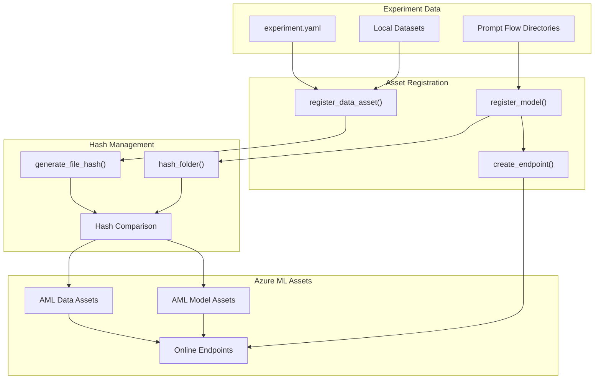
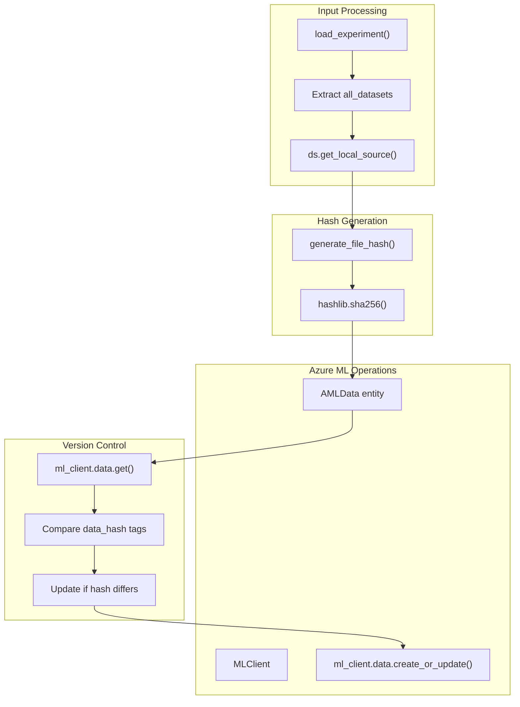
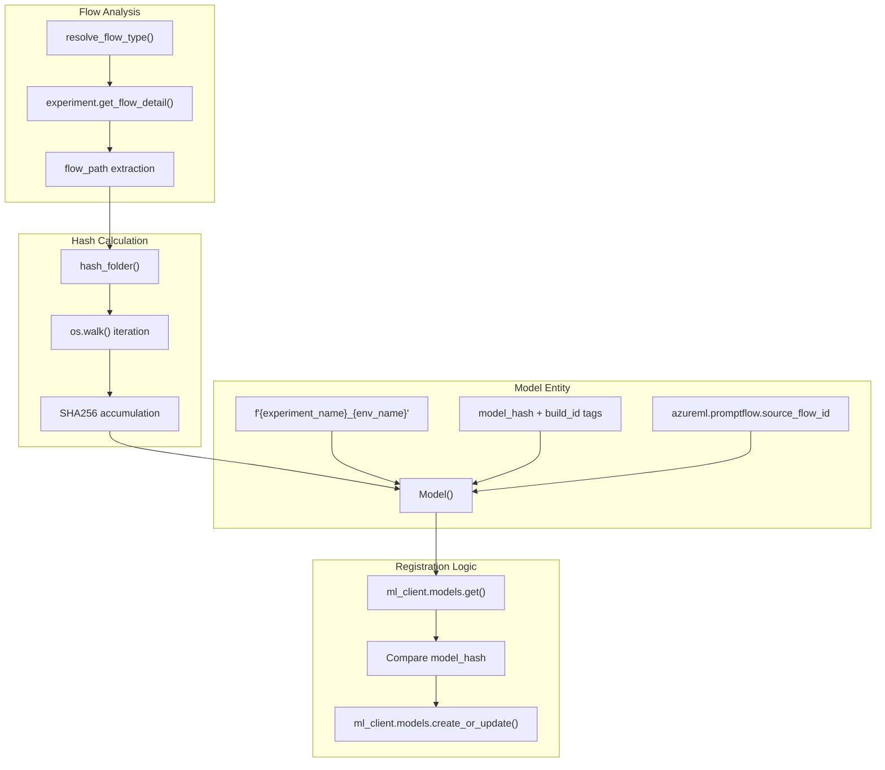
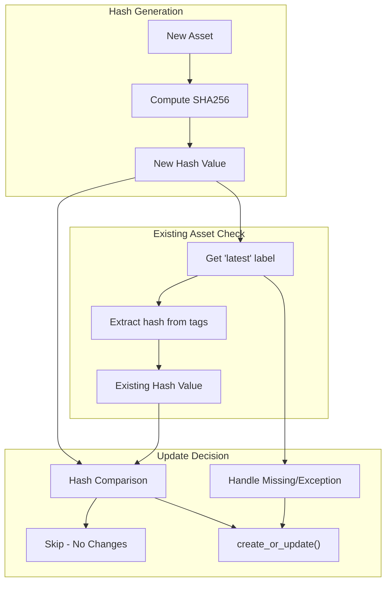

<!-- source: DeepWiki mcp.deepwiki.com · repo microsoft/genaiops-promptflow-template · page 5.3 Asset Management · fetched 2026-10-26 -->

# Asset Management

<details>
<summary>Relevant source files</summary>

The following files were used as context for generating this wiki page:

- [llmops/common/deployment/kubernetes_endpoint.py](llmops/common/deployment/kubernetes_endpoint.py)
- [llmops/common/deployment/provision_endpoint.py](llmops/common/deployment/provision_endpoint.py)
- [llmops/common/deployment/register_model.py](llmops/common/deployment/register_model.py)
- [llmops/common/deployment/test_model_on_aml.py](llmops/common/deployment/test_model_on_aml.py)
- [llmops/common/deployment/test_model_on_kubernetes.py](llmops/common/deployment/test_model_on_kubernetes.py)
- [llmops/common/register_data_asset.py](llmops/common/register_data_asset.py)
- [tests/test_create_aml_deployment.py](tests/test_create_aml_deployment.py)
- [tests/test_create_aml_endpoint.py](tests/test_create_aml_endpoint.py)
- [tests/test_create_kubernetes_deployment.py](tests/test_create_kubernetes_deployment.py)

</details>


## Purpose and Scope

This document covers how data assets and models are registered and managed in Azure ML within the LLMOps system. Asset management is the intermediate layer between experiment execution/evaluation and deployment, responsible for creating versioned, trackable assets that can be deployed to endpoints.

For information about experiment execution, see [Experiment Execution](#5.1). For information about model evaluation, see [Model Evaluation](#5.2). For information about deploying registered assets, see [Deployment](#6).

## Asset Management Workflow

The asset management system follows a three-stage process: data asset registration, model registration, and endpoint provisioning. Each stage uses hash-based versioning to ensure efficient updates and avoid unnecessary re-uploads.



Sources: [llmops/common/register_data_asset.py:49-118](), [llmops/common/deployment/register_model.py:55-120](), [llmops/common/deployment/provision_endpoint.py:33-100]()

## Data Asset Registration

The `register_data_asset` module handles registration of local datasets as versioned Azure ML Data assets. It processes all datasets defined in the experiment configuration, including those used by evaluators.

### Data Asset Registration Process



Sources: [llmops/common/register_data_asset.py:49-118](), [llmops/common/register_data_asset.py:33-46]()

### Key Functions and Classes

| Function/Class | Purpose | Key Parameters |
|----------------|---------|----------------|
| `register_data_asset()` | Main registration function | `base_path`, `exp_filename`, `subscription_id`, `env_name` |
| `generate_file_hash()` | Creates SHA256 hash of file content | `file_path` |
| `AMLData` | Azure ML data asset entity | `path`, `type`, `name`, `tags` |
| `ExperimentCloudConfig` | Cloud configuration wrapper | `subscription_id`, `env_name` |

The system uses `AssetTypes.URI_FILE` for all data assets and includes a `data_hash` tag for version tracking. When a dataset already exists, it compares the stored hash with the current file hash to determine if an update is needed.

Sources: [llmops/common/register_data_asset.py:88-94](), [llmops/common/register_data_asset.py:96-111]()

## Model Registration

The `register_model` module registers Prompt Flow directories as versioned Azure ML Model assets. It supports different flow types and uses folder-level hashing to detect changes.

### Model Registration Architecture



Sources: [llmops/common/deployment/register_model.py:55-120](), [llmops/common/deployment/register_model.py:36-52]()

### Model Registration Configuration

The model registration process creates standardized model names using the pattern `{experiment_name}_{env_name}` and sets specific properties required for Prompt Flow deployment:

| Property | Value | Purpose |
|----------|-------|---------|
| `name` | `{experiment_name}_{env_name}` | Environment-specific model naming |
| `stage` | `"Production"` | Model stage designation |
| `azureml.promptflow.source_flow_id` | `model_path` | Links model to source flow |
| `model_hash` | SHA256 of folder contents | Version tracking |
| `build_id` | Build identifier (optional) | CI/CD traceability |

Sources: [llmops/common/deployment/register_model.py:86-102]()

## Endpoint Provisioning

The endpoint provisioning system creates Azure ML online endpoints as deployment targets. It supports both managed and Kubernetes endpoints with configurable authentication and properties.

### Endpoint Creation Process

```mermaid
graph LR
    subgraph "Configuration Loading"
        CONFIG_FILE["deployment_config.json"]
        ENDPOINT_CONFIG["azure_managed_endpoint array"]
        ENV_MATCH["ENV_NAME matching"]
    end
    
    subgraph "Endpoint Management"
        LIST_EXISTING["ml_client.online_endpoints.list()"]
        CHECK_EXISTS["Endpoint name lookup"]
        CREATE_NEW["ManagedOnlineEndpoint()"]
        BEGIN_CREATE["begin_create_or_update()"]
    end
    
    subgraph "Identity Extraction"
        GET_ENDPOINT["ml_client.online_endpoints.get()"]
        PRINCIPAL_ID["identity.principal_id"]
        OUTPUT_FILE["Write to output_file"]
    end
    
    CONFIG_FILE --> ENDPOINT_CONFIG
    ENDPOINT_CONFIG --> ENV_MATCH
    ENV_MATCH --> LIST_EXISTING
    LIST_EXISTING --> CHECK_EXISTS
    CHECK_EXISTS --> CREATE_NEW
    CREATE_NEW --> BEGIN_CREATE
    BEGIN_CREATE --> GET_ENDPOINT
    GET_ENDPOINT --> PRINCIPAL_ID
    PRINCIPAL_ID --> OUTPUT_FILE
```



Sources: [llmops/common/deployment/provision_endpoint.py:33-100]()

### Endpoint Configuration Structure

The system reads endpoint configuration from `deployment_config.json` files with the following structure:

```json
{
  "azure_managed_endpoint": [
    {
      "ENV_NAME": "dev",
      "ENDPOINT_NAME": "endpoint-name",
      "ENDPOINT_DESC": "endpoint description"
    }
  ]
}
```

Key endpoint properties include:
- `auth_mode`: Set to `"key"` for API key authentication
- `enforce_access_to_default_secret_stores`: Set to `True` for security
- Tags include `build_id` when provided for CI/CD tracking

Sources: [llmops/common/deployment/provision_endpoint.py:56-82]()

## Hash-Based Versioning Strategy

The asset management system implements intelligent versioning using SHA256 hashes to avoid unnecessary uploads and updates. This strategy applies to both data assets and model assets.

### Hash Comparison Logic



Sources: [llmops/common/register_data_asset.py:96-111](), [llmops/common/deployment/register_model.py:104-113]()

### Hash Implementation Details

| Asset Type | Hash Function | Scope | Tag Name |
|------------|---------------|-------|----------|
| Data Assets | `generate_file_hash()` | Single file content | `data_hash` |
| Model Assets | `hash_folder()` | All files in directory tree | `model_hash` |

Both functions use `hashlib.sha256()` with binary file reading to ensure consistent hash generation across platforms. The hash comparison logic handles three scenarios:

1. **Hash Match**: Skip update to avoid unnecessary operations
2. **Hash Difference**: Perform update with new version
3. **Missing/Exception**: Perform update (first-time registration or error recovery)

Sources: [llmops/common/register_data_asset.py:33-46](), [llmops/common/deployment/register_model.py:36-52]()

---

