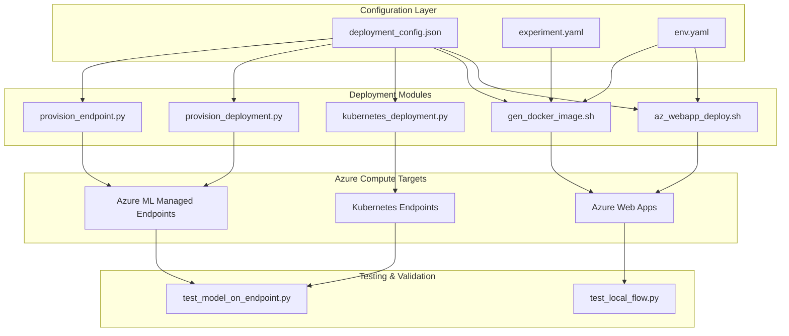
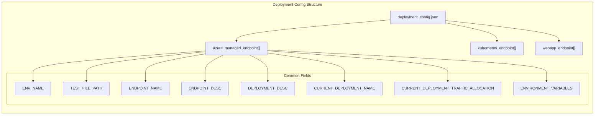
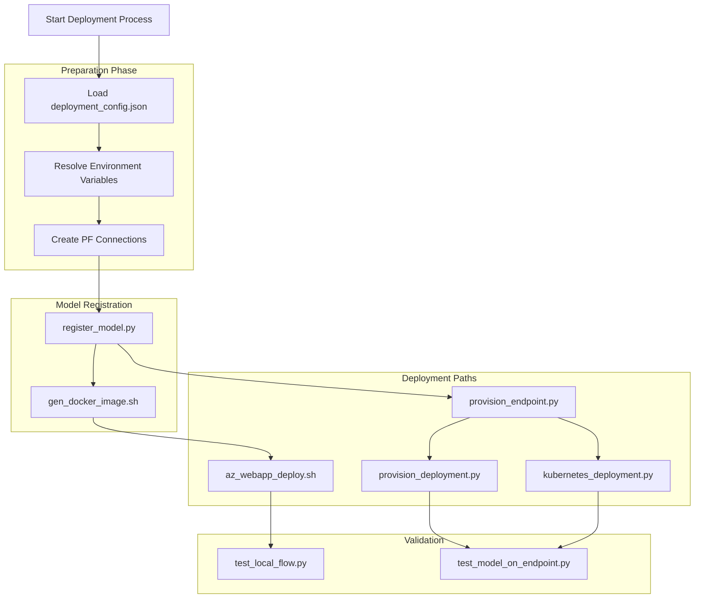

<!-- source: DeepWiki mcp.deepwiki.com · repo microsoft/genaiops-promptflow-template · page 6 Deployment · fetched 2026-10-26 -->

# Deployment

<details>
<summary>Relevant source files</summary>

The following files were used as context for generating this wiki page:

- [chat_with_pdf/configs/deployment_config.json](chat_with_pdf/configs/deployment_config.json)
- [class_flows/configs/deployment_config.json](class_flows/configs/deployment_config.json)
- [function_flows/configs/deployment_config.json](function_flows/configs/deployment_config.json)
- [llmops/common/deployment/provision_endpoint.py](llmops/common/deployment/provision_endpoint.py)
- [llmops/common/deployment/test_local_flow.py](llmops/common/deployment/test_local_flow.py)
- [llmops/common/prompt_local_connections.py](llmops/common/prompt_local_connections.py)
- [llmops/common/scripts/az_webapp_deploy.sh](llmops/common/scripts/az_webapp_deploy.sh)
- [llmops/common/scripts/gen_docker_image.sh](llmops/common/scripts/gen_docker_image.sh)
- [math_coding/configs/deployment_config.json](math_coding/configs/deployment_config.json)
- [named_entity_recognition/configs/deployment_config.json](named_entity_recognition/configs/deployment_config.json)
- [tests/test_create_aml_deployment.py](tests/test_create_aml_deployment.py)
- [tests/test_create_aml_endpoint.py](tests/test_create_aml_endpoint.py)
- [tests/test_create_kubernetes_deployment.py](tests/test_create_kubernetes_deployment.py)
- [web_classification/configs/deployment_config.json](web_classification/configs/deployment_config.json)

</details>


## Purpose and Scope

This document covers the deployment system for Prompt Flow models in the LLMOps template. The deployment system enables deploying trained Prompt Flow models as online endpoints across three Azure compute targets: Azure ML Managed Endpoints, Kubernetes clusters, and Azure Web Apps.

For information about the core experiment execution engine, see [Core LLMOps Engine](#5). For details about configuring deployment parameters, see [Deployment Configuration](#7.2).

## Deployment Architecture Overview

The deployment system follows a unified architecture that supports multiple Azure compute targets through a common configuration-driven approach. Each use case defines its deployment requirements in `deployment_config.json` files, which are then processed by the deployment modules to create the appropriate Azure resources.



**Sources:** [named_entity_recognition/configs/deployment_config.json:1-56](), [llmops/common/deployment/provision_endpoint.py:1-151](), [llmops/common/scripts/gen_docker_image.sh:1-125](), [llmops/common/scripts/az_webapp_deploy.sh:1-152]()

## Deployment Configuration Structure

Each use case includes a `deployment_config.json` file that defines configuration for all three deployment targets. The configuration structure follows a consistent pattern across endpoint types:



### Configuration Fields by Deployment Type

| Field | Azure ML | Kubernetes | Web App | Description |
|-------|----------|------------|---------|-------------|
| `ENV_NAME` | ✓ | ✓ | ✓ | Environment identifier (dev, test, prod) |
| `ENDPOINT_NAME` | ✓ | ✓ | - | Name of the endpoint resource |
| `DEPLOYMENT_VM_SIZE` | ✓ | ✓ | - | VM size for compute instances |
| `DEPLOYMENT_INSTANCE_COUNT` | ✓ | ✓ | - | Number of instances |
| `CPU_ALLOCATION` | - | ✓ | - | CPU resource allocation |
| `MEMORY_ALLOCATION` | - | ✓ | - | Memory resource allocation |
| `WEB_APP_NAME` | - | - | ✓ | Azure Web App name |
| `REGISTRY_NAME` | - | - | ✓ | Container registry name |
| `CONNECTION_NAMES` | - | - | ✓ | Required connection names |

**Sources:** [named_entity_recognition/configs/deployment_config.json:1-56](), [web_classification/configs/deployment_config.json:1-56](), [math_coding/configs/deployment_config.json:1-56]()

## Deployment Process Flow

The deployment process follows different paths depending on the target compute type, but shares common steps for model preparation and validation:



**Sources:** [llmops/common/deployment/provision_endpoint.py:33-100](), [llmops/common/scripts/gen_docker_image.sh:36-125](), [llmops/common/scripts/az_webapp_deploy.sh:36-152]()

## Core Deployment Modules

### ExperimentCloudConfig

The `ExperimentCloudConfig` class provides centralized configuration management for deployment operations:

```python
# Referenced in provision_endpoint.py
config = ExperimentCloudConfig(
    subscription_id=subscription_id, env_name=env_name
)
```

This class resolves Azure subscription details, resource group names, and workspace configurations needed for deployment operations.

### MLClient Integration

Deployment operations use Azure ML SDK's `MLClient` for managing Azure ML resources:

```python
# From provision_endpoint.py
ml_client = MLClient(
    subscription_id=config.subscription_id,
    resource_group_name=config.resource_group_name,
    workspace_name=config.workspace_name,
    credential=DefaultAzureCredential(),
)
```

### Docker Image Generation

The `gen_docker_image.sh` script builds containerized versions of Prompt Flow models for deployment:

Key operations include:
- Reading flow configuration from `experiment.yaml`
- Building Docker images using `pf flow build`
- Pushing images to Azure Container Registry
- Local testing with `test_local_flow.py`

**Sources:** [llmops/common/deployment/provision_endpoint.py:41-52](), [llmops/common/scripts/gen_docker_image.sh:44-63]()

## Deployment Targets

The system supports three primary deployment targets, each with specific characteristics and use cases:

### Azure ML Managed Endpoints

Azure ML Managed Endpoints provide fully managed hosting for Prompt Flow models with automatic scaling and monitoring. For detailed information, see [Azure ML Managed Endpoints](#6.1).

### Kubernetes Endpoints

Kubernetes Endpoints deploy models to Azure Kubernetes Service clusters, providing fine-grained control over resource allocation and networking. For detailed information, see [Kubernetes Endpoints](#6.2).

### Azure Web Apps

Azure Web Apps deploy containerized Prompt Flow models as web applications, suitable for simpler deployment scenarios. For detailed information, see [Azure Web Apps](#6.3).

## Environment Variables and Connections

The deployment system handles environment variables and Prompt Flow connections through multiple mechanisms:

- **Environment Variables**: Managed through `env.yaml` files and processed by `generate_env_vars.py`
- **Prompt Flow Connections**: Created using `create_pf_connections` function
- **API Keys**: Handled through environment variables with uppercase naming convention

The `migrate_connections` module ensures connection configurations are properly transferred between local and cloud environments during deployment.

**Sources:** [llmops/common/scripts/gen_docker_image.sh:67-84](), [llmops/common/scripts/az_webapp_deploy.sh:96-107](), [llmops/common/prompt_local_connections.py:50-54]()

## Testing and Validation

The deployment system includes comprehensive testing capabilities:

### Local Testing

The `test_local_flow.py` module validates containerized deployments by sending HTTP requests to local endpoints:

```python
# From test_local_flow.py
url = "http://0.0.0.0:8080/score"
response = requests.post(url, data=json.dumps(json_data), headers=headers, timeout=30)
```

### Endpoint Testing

After deployment, endpoints are validated using test files specified in `TEST_FILE_PATH` configuration fields, ensuring proper integration with Azure services.

**Sources:** [llmops/common/deployment/test_local_flow.py:19-58](), [tests/test_create_aml_endpoint.py:23-91](), [tests/test_create_aml_deployment.py:26-149]()

---

