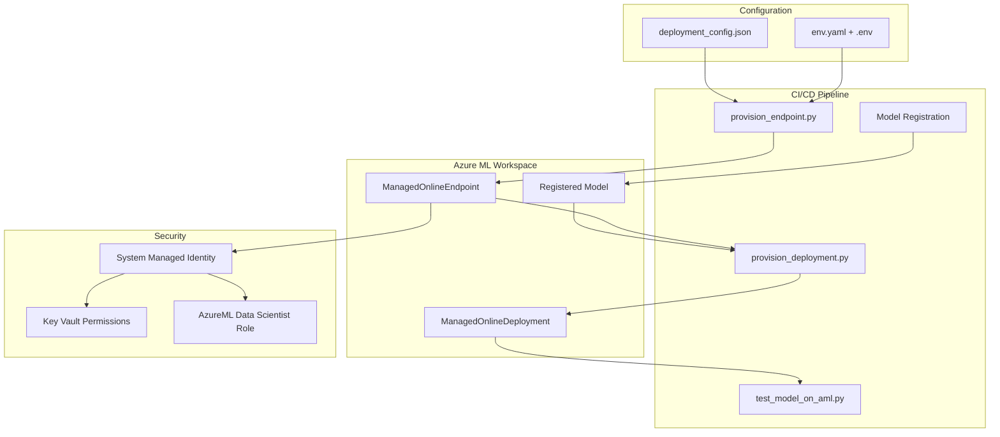
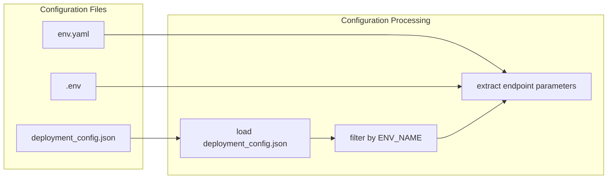
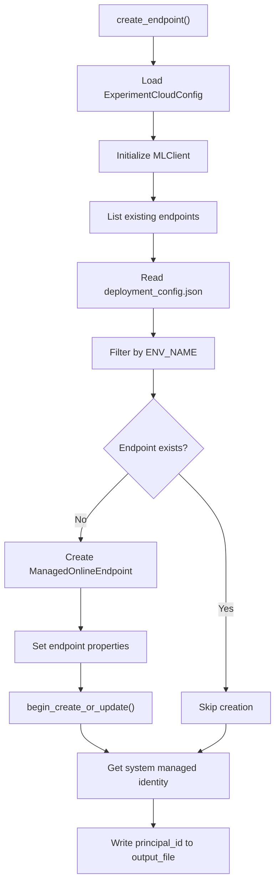
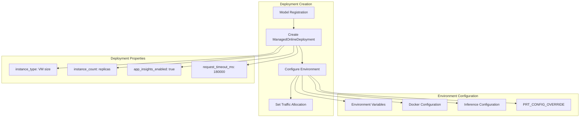
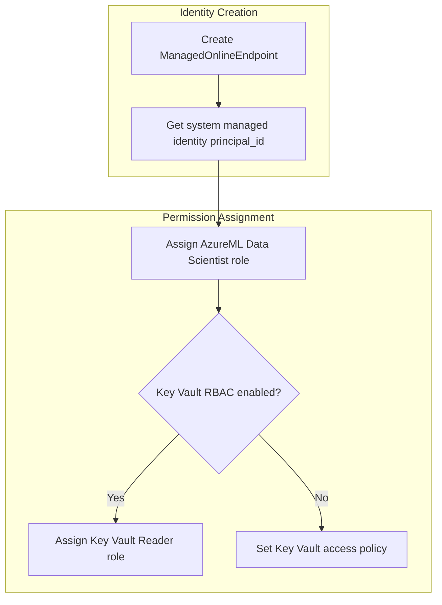
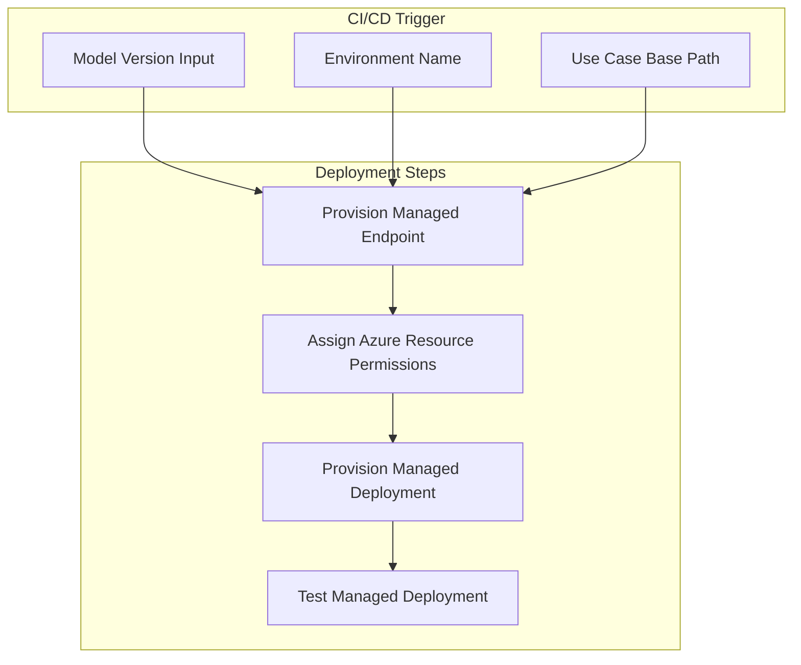

<!-- source: DeepWiki mcp.deepwiki.com · repo microsoft/genaiops-promptflow-template · page 6.1 Azure ML Managed Endpoints · fetched 2026-10-26 -->

# Azure ML Managed Endpoints

Relevant source files

The following files were used as context for generating this wiki page:

- [.env.sample](.env.sample)
- [.github/actions/aml_real_deployment/action.yml](.github/actions/aml_real_deployment/action.yml)
- [.github/actions/kubernetes_deployment/action.yml](.github/actions/kubernetes_deployment/action.yml)
- [.github/workflows/platform_pr_dev_workflow.yml](.github/workflows/platform_pr_dev_workflow.yml)
- [chat_with_pdf/environment/env.yaml](chat_with_pdf/environment/env.yaml)
- [llmops/common/deployment/provision_endpoint.py](llmops/common/deployment/provision_endpoint.py)
- [tests/test_create_aml_deployment.py](tests/test_create_aml_deployment.py)
- [tests/test_create_aml_endpoint.py](tests/test_create_aml_endpoint.py)
- [tests/test_create_kubernetes_deployment.py](tests/test_create_kubernetes_deployment.py)

This document covers how Prompt Flows are deployed to Azure ML managed online endpoints for real-time inference. Azure ML managed endpoints provide a fully managed infrastructure for hosting machine learning models with built-in scaling, monitoring, and security features.

For information about deploying to Kubernetes endpoints, see [Kubernetes Endpoints](#6.2). For deploying to containerized web applications, see [Azure Web Apps](#6.3).

## Overview

Azure ML Managed Endpoints in this system provide a serverless deployment option where Azure handles the underlying compute infrastructure. The deployment process involves creating an endpoint, provisioning a deployment to that endpoint, configuring traffic routing, and setting up appropriate security permissions.

Sources: [llmops/common/deployment/provision_endpoint.py:1-151](), [.github/actions/aml_real_deployment/action.yml:1-107]()

## Configuration

Azure ML managed endpoints are configured through the `deployment_config.json` file, which contains endpoint-specific settings for different environments.

### Deployment Configuration Structure

| Configuration Key | Description | Example |
|------------------|-------------|---------|
| `ENDPOINT_NAME` | Name of the managed endpoint | `"test-endpoint"` |
| `ENDPOINT_DESC` | Description of the endpoint | `"test-endpoint-description"` |
| `ENV_NAME` | Environment name (dev, test, prod) | `"dev"` |
| `DEPLOYMENT_DESC` | Description of the deployment | `"test-deployment-description"` |
| `INSTANCE_TYPE` | VM size for the deployment | `"Standard_F4s_v2"` |
| `INSTANCE_COUNT` | Number of instances | `1` |

The system reads configuration from the `azure_managed_endpoint` section of the deployment config file:

Sources: [llmops/common/deployment/provision_endpoint.py:45-64](), [tests/test_create_aml_endpoint.py:23-61]()

## Endpoint Creation Process

The `create_endpoint` function in `provision_endpoint.py` handles endpoint creation with the following workflow:

### Endpoint Provisioning Logic

### Key Properties of Created Endpoints

The `ManagedOnlineEndpoint` is created with these properties:

- **Authentication Mode**: `"key"` - Uses API keys for authentication
- **System Managed Identity**: Automatically assigned for secure access to Azure resources
- **Tags**: Includes `build_id` for tracking deployment versions
- **Security Properties**: `enforce_access_to_default_secret_stores` set to `True`

Sources: [llmops/common/deployment/provision_endpoint.py:33-100](), [tests/test_create_aml_endpoint.py:75-82]()

## Deployment Process

After endpoint creation, the deployment process creates and configures the actual model deployment on the endpoint. This is handled by the `provision_deployment.py` module.

### Deployment Creation Workflow

### Traffic Management

The system implements blue-green deployment patterns by managing traffic allocation between deployments:

- **New Deployment**: Receives 90% of traffic
- **Previous Deployment**: Receives 10% of traffic (for rollback capability)

Sources: [tests/test_create_aml_deployment.py:136-149](), [.github/actions/aml_real_deployment/action.yml:87-97]()

## Security and Permissions

Azure ML managed endpoints use system-assigned managed identities for secure access to Azure resources. The deployment process automatically configures the necessary permissions.

### Permission Assignment Process

### Required Permissions

| Resource | Permission | Scope |
|----------|------------|--------|
| Azure ML Workspace | AzureML Data Scientist | Workspace level |
| Key Vault (RBAC) | Key Vault Reader | Key Vault level |
| Key Vault (Policy) | Get/List secrets | Key Vault level |

Sources: [.github/actions/aml_real_deployment/action.yml:65-85](), [llmops/common/deployment/provision_endpoint.py:94-99]()

## Testing and Validation

The deployment process includes automated testing through the `test_model_on_aml.py` module, which validates that the deployed endpoint is functioning correctly.

### Test Execution Flow

```mermaid
graph LR
    subgraph "Test Process"
        LOAD_CONFIG["Load test configuration"]
        GET_ENDPOINT["Get endpoint details"]
        PREPARE_DATA["Prepare test data"]
        INVOKE_ENDPOINT["Invoke endpoint"]
        VALIDATE_RESPONSE["Validate response"]
    end
    
    LOAD_CONFIG --> GET_ENDPOINT
    GET_ENDPOINT --> PREPARE_DATA
    PREPARE_DATA --> INVOKE_ENDPOINT
    INVOKE_ENDPOINT --> VALIDATE_RESPONSE
```

The testing process ensures that:
- The endpoint is accessible and responding
- The model produces expected output formats
- The deployment is ready to receive production traffic

Sources: [.github/actions/aml_real_deployment/action.yml:99-107]()

## Integration with CI/CD Pipelines

Azure ML managed endpoint deployment is integrated into the CI/CD pipeline through GitHub Actions, Azure DevOps, and Jenkins. The `aml_real_deployment` action orchestrates the entire deployment process.

### Pipeline Integration

The deployment action requires these inputs:
- `SUBSCRIPTION_ID`: Azure subscription identifier
- `MODEL_VERSION`: Version of the registered model to deploy
- `DEPLOY_ENVIRONMENT`: Target environment (dev, test, prod)
- `use_case_base_path`: Path to the use case configuration files

Sources: [.github/actions/aml_real_deployment/action.yml:5-30](), [.github/workflows/platform_pr_dev_workflow.yml:32-104]()

---

