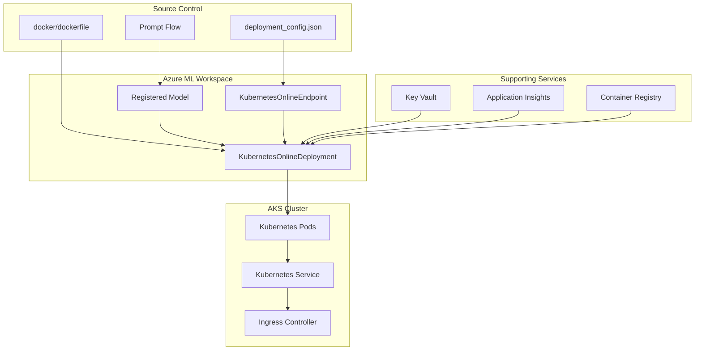
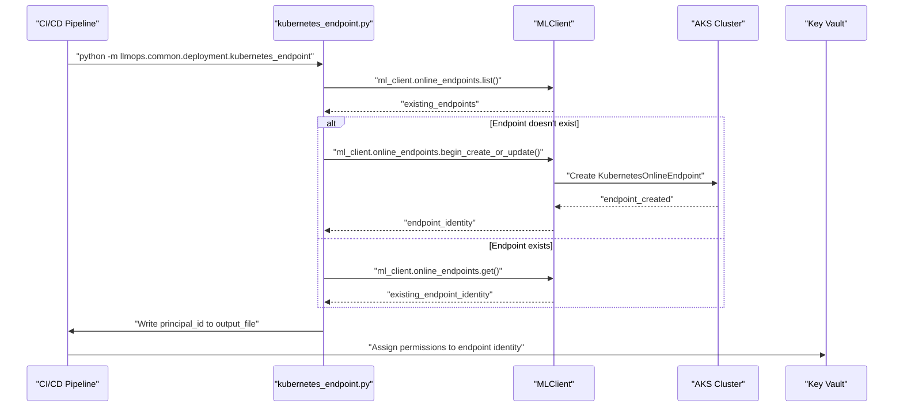
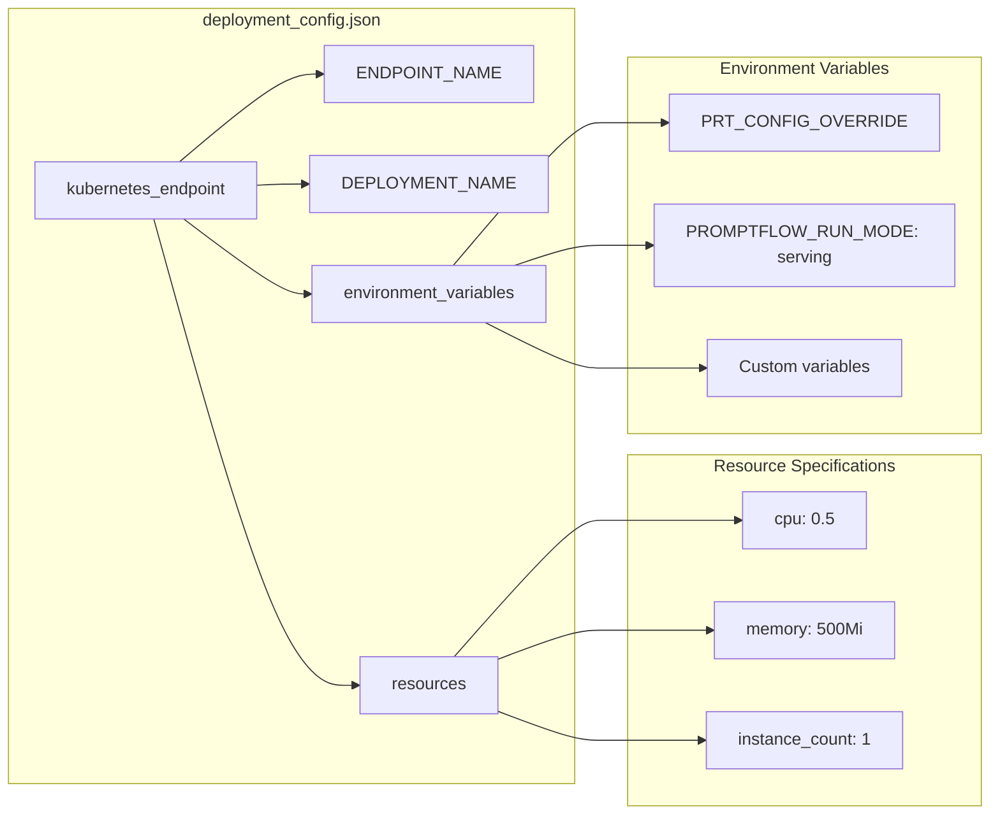
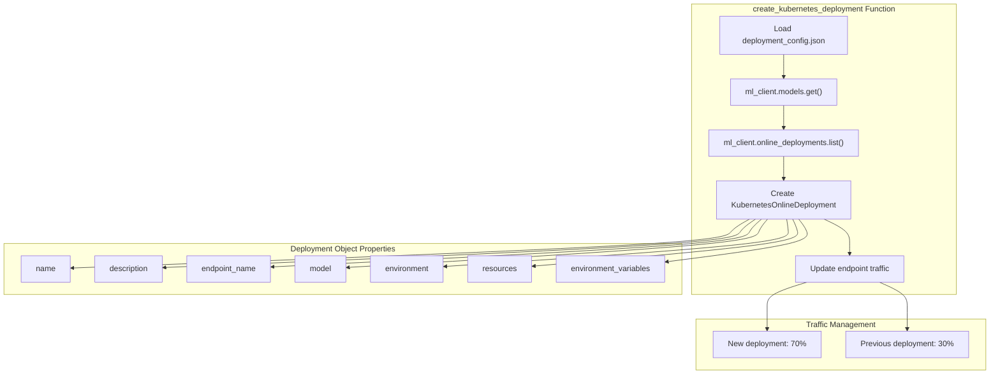
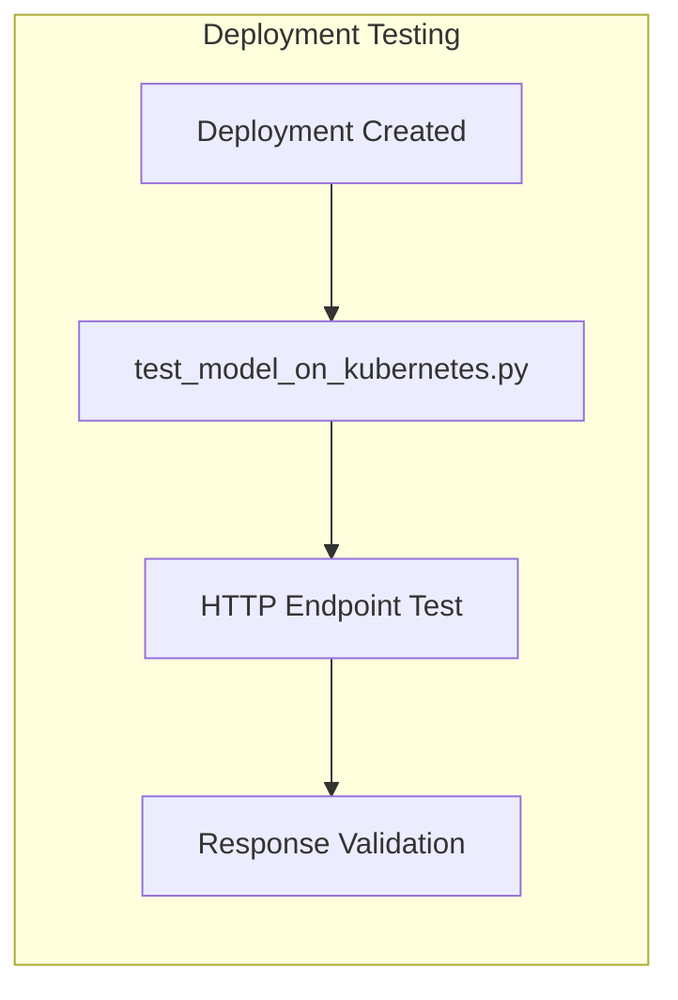

<!-- source: DeepWiki mcp.deepwiki.com · repo microsoft/genaiops-promptflow-template · page 6.2 Kubernetes Endpoints · fetched 2026-10-26 -->

# Kubernetes Endpoints

<details>
<summary>Relevant source files</summary>

The following files were used as context for generating this wiki page:

- [.env.sample](.env.sample)
- [.github/actions/aml_real_deployment/action.yml](.github/actions/aml_real_deployment/action.yml)
- [.github/actions/kubernetes_deployment/action.yml](.github/actions/kubernetes_deployment/action.yml)
- [.github/workflows/platform_pr_dev_workflow.yml](.github/workflows/platform_pr_dev_workflow.yml)
- [chat_with_pdf/environment/env.yaml](chat_with_pdf/environment/env.yaml)
- [llmops/common/deployment/provision_endpoint.py](llmops/common/deployment/provision_endpoint.py)
- [tests/test_create_aml_deployment.py](tests/test_create_aml_deployment.py)
- [tests/test_create_aml_endpoint.py](tests/test_create_aml_endpoint.py)
- [tests/test_create_kubernetes_deployment.py](tests/test_create_kubernetes_deployment.py)

</details>


## Purpose and Scope

This document covers the deployment of Prompt Flow models to Azure Kubernetes Service (AKS) online endpoints within the LLMOps template. Kubernetes endpoints provide a containerized deployment option that offers more control over resource allocation and scaling compared to Azure ML managed endpoints.

For information about Azure ML managed endpoints, see [Azure ML Managed Endpoints](#6.1). For web app deployments, see [Azure Web Apps](#6.3). For general deployment configuration, see [Deployment Configuration](#7.2).

## Architecture Overview

Kubernetes endpoints in this system are implemented as Azure ML online endpoints that target AKS clusters. The deployment process involves creating both the endpoint and the deployment, with specific resource configurations and traffic management.

### Kubernetes Deployment Architecture



Sources: [.github/actions/kubernetes_deployment/action.yml:1-104](), [tests/test_create_kubernetes_deployment.py:1-156]()

## Endpoint Provisioning Process

The Kubernetes endpoint provisioning follows a structured workflow implemented in the CI/CD pipelines.

### Endpoint Creation Workflow



Sources: [.github/actions/kubernetes_deployment/action.yml:42-52](), [.github/actions/kubernetes_deployment/action.yml:54-82]()

## Deployment Configuration

Kubernetes deployments require specific configuration parameters that differ from Azure ML managed endpoints, particularly around resource allocation and scaling.

### Resource Configuration

| Configuration Parameter | Description | Example Value |
|------------------------|-------------|---------------|
| `instance_type` | VM size for the deployment | `"k8s-test-vm-size"` |
| `instance_count` | Number of instances | `1` |
| `cpu` | CPU resource request | `"0.5"` |
| `memory` | Memory resource request | `"500Mi"` |
| `request_timeout_ms` | Request timeout in milliseconds | `180000` |

### Deployment Configuration Structure



Sources: [tests/test_create_kubernetes_deployment.py:36-45](), [tests/test_create_kubernetes_deployment.py:127-138]()

## Deployment Process

The deployment process involves creating a `KubernetesOnlineDeployment` that references the registered model and endpoint.

### Key Deployment Components

The deployment process configures several critical components:

1. **Environment Setup**: Creates a containerized environment using the flow's Dockerfile
2. **Resource Allocation**: Sets CPU and memory limits specific to Kubernetes
3. **Traffic Management**: Implements blue-green deployment with traffic splitting
4. **Monitoring**: Enables Application Insights integration

### Deployment Code Flow



Sources: [tests/test_create_kubernetes_deployment.py:68-70](), [tests/test_create_kubernetes_deployment.py:100-138](), [tests/test_create_kubernetes_deployment.py:153-155]()

## Environment Variables and Configuration

Kubernetes deployments require specific environment variables for proper operation within the Prompt Flow runtime.

### Required Environment Variables

| Variable | Purpose | Example |
|----------|---------|---------|
| `PROMPTFLOW_RUN_MODE` | Sets runtime mode | `"serving"` |
| `PRT_CONFIG_OVERRIDE` | Azure ML configuration | `"deployment.subscription_id=...,deployment.resource_group=..."` |

### PRT_CONFIG_OVERRIDE Format

The `PRT_CONFIG_OVERRIDE` environment variable contains deployment-specific configuration:

```
deployment.subscription_id={SUBSCRIPTION_ID},
deployment.resource_group={RESOURCE_GROUP_NAME},
deployment.workspace_name={WORKSPACE_NAME},
deployment.endpoint_name={endpoint_name},
deployment.deployment_name={deployment_name}
```

Sources: [tests/test_create_kubernetes_deployment.py:127-138]()

## Testing and Validation

The system includes automated testing for Kubernetes deployments through the `test_model_on_kubernetes` module.

### Testing Workflow



Sources: [.github/actions/kubernetes_deployment/action.yml:96-104]()

## Comparison with Other Endpoint Types

Kubernetes endpoints offer distinct advantages and trade-offs compared to other deployment options:

### Deployment Type Comparison

| Feature | Kubernetes Endpoints | Azure ML Managed | Web Apps |
|---------|---------------------|------------------|----------|
| Resource Control | High (CPU/Memory limits) | Medium | Low |
| Scaling | Manual/HPA | Automatic | Automatic |
| Traffic Split | 70/30 (Blue-Green) | 90/10 (Canary) | N/A |
| Container Registry | Required | Optional | Required |
| Management Overhead | High | Low | Medium |

### Configuration Differences

Kubernetes deployments use different configuration parameters:

- **Resource Specifications**: CPU and memory are specified in Kubernetes format (`"0.5"` for CPU, `"500Mi"` for memory)
- **Instance Types**: Use Kubernetes node types rather than Azure VM sizes
- **Traffic Management**: Default 70/30 split vs 90/10 for managed endpoints

Sources: [tests/test_create_kubernetes_deployment.py:39-40](), [tests/test_create_kubernetes_deployment.py:124-125](), [tests/test_create_kubernetes_deployment.py:153-155]()

## CI/CD Integration

Kubernetes endpoints are integrated into the CI/CD pipeline through dedicated GitHub Actions workflows.

### Pipeline Steps

1. **Endpoint Provisioning**: Creates or updates the Kubernetes online endpoint
2. **Permission Assignment**: Grants necessary permissions to the endpoint's managed identity
3. **Deployment Creation**: Creates the deployment with specified model and configuration
4. **Testing**: Validates the deployment functionality

### Required Permissions

The endpoint's managed identity requires:
- `AzureML Data Scientist` role on the ML workspace
- `Key Vault Reader` role or appropriate Key Vault access policies

Sources: [.github/actions/kubernetes_deployment/action.yml:74-82]()

---

