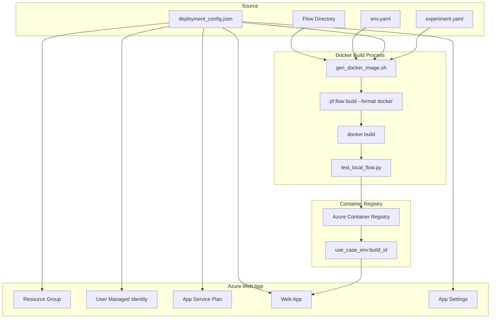
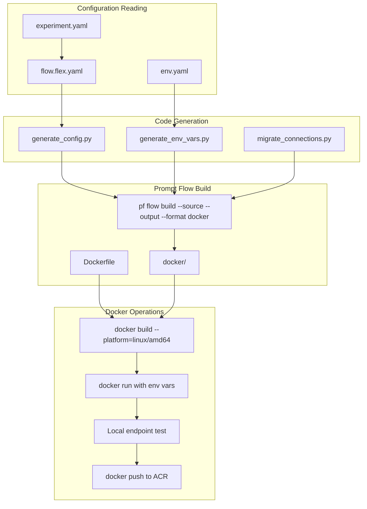
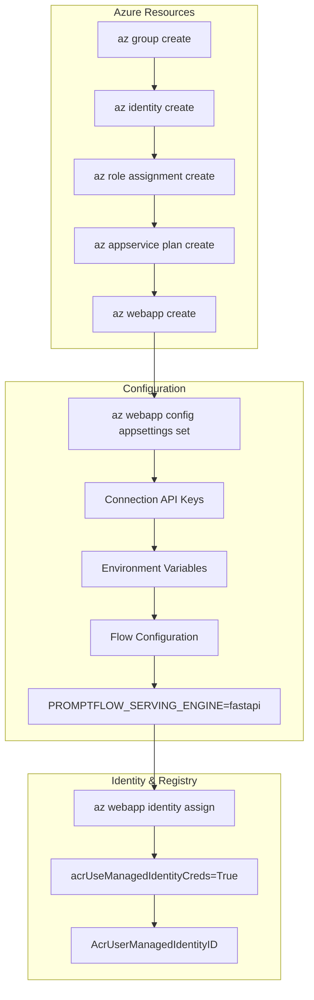
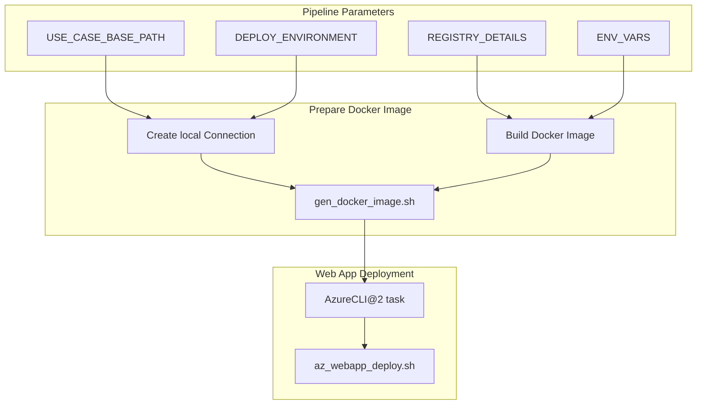
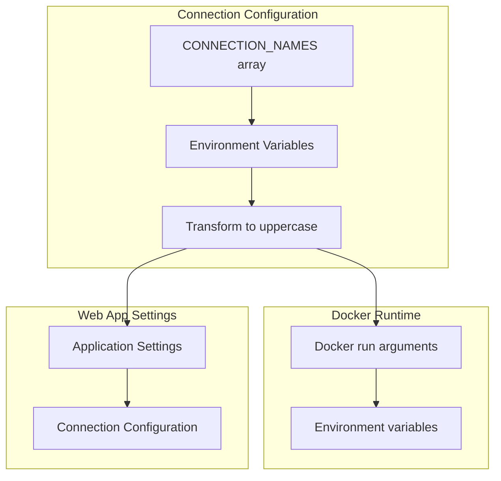

<!-- source: DeepWiki mcp.deepwiki.com · repo microsoft/genaiops-promptflow-template · page 6.3 Azure Web Apps · fetched 2026-10-26 -->

# Azure Web Apps

Relevant source files

The following files were used as context for generating this wiki page:

- [.azure-pipelines/build_validation_pipeline.yml](.azure-pipelines/build_validation_pipeline.yml)
- [.azure-pipelines/templates/prepare_docker_image.yml](.azure-pipelines/templates/prepare_docker_image.yml)
- [.azure-pipelines/templates/webapp_deployment.yml](.azure-pipelines/templates/webapp_deployment.yml)
- [llmops/common/deployment/test_local_flow.py](llmops/common/deployment/test_local_flow.py)
- [llmops/common/prompt_local_connections.py](llmops/common/prompt_local_connections.py)
- [llmops/common/scripts/az_webapp_deploy.sh](llmops/common/scripts/az_webapp_deploy.sh)
- [llmops/common/scripts/gen_docker_image.sh](llmops/common/scripts/gen_docker_image.sh)

This document covers the deployment of Prompt Flows as containerized Azure Web Apps. Azure Web Apps provide a managed platform for hosting containerized applications, offering an alternative to Azure ML managed endpoints and Kubernetes endpoints. For information about other deployment options, see [Azure ML Managed Endpoints](#6.1) and [Kubernetes Endpoints](#6.2).

## Architecture Overview

The Azure Web Apps deployment process involves containerizing Prompt Flows using Docker, pushing the images to Azure Container Registry, and deploying them as Azure Web Apps with managed identity authentication.

### Web App Deployment Flow

Sources: [llmops/common/scripts/gen_docker_image.sh:1-125](), [llmops/common/scripts/az_webapp_deploy.sh:1-152]()

## Docker Image Generation

The Docker image generation process is orchestrated by the `gen_docker_image.sh` script, which creates a containerized version of the Prompt Flow ready for deployment.

### Docker Build Process

Sources: [llmops/common/scripts/gen_docker_image.sh:44-122]()

The script performs these key operations:

1. **Configuration Extraction**: Reads the flow configuration from `experiment.yaml` and extracts the `STANDARD_FLOW` path [llmops/common/scripts/gen_docker_image.sh:45]()

2. **Environment Processing**: Generates environment variables from `flow.flex.yaml` and `env.yaml` using helper scripts [llmops/common/scripts/gen_docker_image.sh:50-58]()

3. **Prompt Flow Build**: Uses the Prompt Flow CLI to build the flow into Docker format [llmops/common/scripts/gen_docker_image.sh:63]()

4. **Docker Image Creation**: Builds the Docker image with Linux/AMD64 platform support [llmops/common/scripts/gen_docker_image.sh:69]()

5. **Local Testing**: Runs the container locally and tests the endpoint [llmops/common/scripts/gen_docker_image.sh:100-112]()

6. **Registry Push**: Tags and pushes the image to Azure Container Registry [llmops/common/scripts/gen_docker_image.sh:114-121]()

## Web App Deployment Configuration

The deployment process is configured through the `deployment_config.json` file, which defines the `webapp_endpoint` configuration for each environment.

### Required Configuration Fields

| Field | Description | Example |
|-------|-------------|---------|
| `ENV_NAME` | Environment identifier | "dev", "test", "prod" |
| `REGISTRY_NAME` | Azure Container Registry name | "myregistry" |
| `WEB_APP_RG_NAME` | Resource group for Web App | "rg-webapp-dev" |
| `USER_MANAGED_ID` | Managed identity name | "id-webapp-dev" |
| `APP_PLAN_NAME` | App Service Plan name | "plan-webapp-dev" |
| `WEB_APP_NAME` | Web App name | "webapp-promptflow-dev" |
| `REGISTRY_RG_NAME` | Registry resource group | "rg-registry" |
| `WEB_APP_SKU` | App Service Plan SKU | "B1", "S1", "P1v2" |
| `CONNECTION_NAMES` | Array of connection names | ["aoai_connection"] |

Sources: [llmops/common/scripts/az_webapp_deploy.sh:42-49]()

## Deployment Process

The `az_webapp_deploy.sh` script handles the complete Azure Web App deployment process, including resource provisioning and configuration.

### Resource Provisioning Flow

Sources: [llmops/common/scripts/az_webapp_deploy.sh:69-152]()

### Key Deployment Steps

1. **Resource Group Creation**: Creates the resource group in the specified location [llmops/common/scripts/az_webapp_deploy.sh:70]()

2. **Managed Identity Setup**: Creates a user-managed identity and assigns ACR pull permissions [llmops/common/scripts/az_webapp_deploy.sh:73-83]()

3. **App Service Plan**: Creates the App Service Plan with the specified SKU [llmops/common/scripts/az_webapp_deploy.sh:84]()

4. **Web App Creation**: Creates the Web App with the container image from ACR [llmops/common/scripts/az_webapp_deploy.sh:88-89]()

5. **Configuration Settings**: Sets up application settings including:
   - Port configuration (`WEBSITES_PORT=8080`) [llmops/common/scripts/az_webapp_deploy.sh:93-94]()
   - Connection API keys [llmops/common/scripts/az_webapp_deploy.sh:96-107]()
   - Environment variables [llmops/common/scripts/az_webapp_deploy.sh:109-119]()
   - Flow initialization parameters [llmops/common/scripts/az_webapp_deploy.sh:121-133]()
   - Prompt Flow serving engine [llmops/common/scripts/az_webapp_deploy.sh:135-138]()

6. **Managed Identity Configuration**: Assigns the managed identity to the Web App and configures ACR access [llmops/common/scripts/az_webapp_deploy.sh:141-152]()

## CI/CD Integration

The Azure Web Apps deployment integrates with Azure DevOps Pipelines through specialized templates.

### Pipeline Template Structure

Sources: [.azure-pipelines/templates/webapp_deployment.yml:1-27](), [.azure-pipelines/templates/prepare_docker_image.yml:1-31]()

The pipeline template includes two main phases:

1. **Docker Image Preparation**: Uses the `prepare_docker_image.yml` template to create local connections and build the Docker image [.azure-pipelines/templates/webapp_deployment.yml:12-17]()

2. **Web App Deployment**: Executes the deployment script using Azure CLI task [.azure-pipelines/templates/webapp_deployment.yml:19-27]()

## Local Testing

Before deployment, the system validates the containerized Prompt Flow locally using the `test_local_flow.py` module.

### Local Testing Process

The testing module performs the following operations:

1. **Request Preparation**: Loads the sample request from `sample-request.json` [llmops/common/deployment/test_local_flow.py:27-28]()

2. **Endpoint Testing**: Posts the request to the local container endpoint at `http://0.0.0.0:8080/score` [llmops/common/deployment/test_local_flow.py:30]()

3. **Retry Logic**: Implements retry logic with exponential backoff for reliability [llmops/common/deployment/test_local_flow.py:34-58]()

4. **Response Validation**: Validates the response status and logs the results [llmops/common/deployment/test_local_flow.py:42-51]()

Sources: [llmops/common/deployment/test_local_flow.py:19-76]()

## Connection Management

The deployment process includes connection management for accessing external services like Azure OpenAI.

### Connection Setup Process

Sources: [llmops/common/scripts/gen_docker_image.sh:76-84](), [llmops/common/scripts/az_webapp_deploy.sh:96-107]()

The connection management process:

1. **Connection Name Processing**: Reads connection names from the deployment configuration [llmops/common/scripts/az_webapp_deploy.sh:66]()

2. **API Key Resolution**: Resolves API keys from environment variables using uppercase transformation [llmops/common/scripts/az_webapp_deploy.sh:98-101]()

3. **Docker Environment**: Passes connection details as environment variables to the Docker container [llmops/common/scripts/gen_docker_image.sh:82-84]()

4. **Web App Configuration**: Sets the same environment variables in the Web App application settings [llmops/common/scripts/az_webapp_deploy.sh:103-107]()

---

