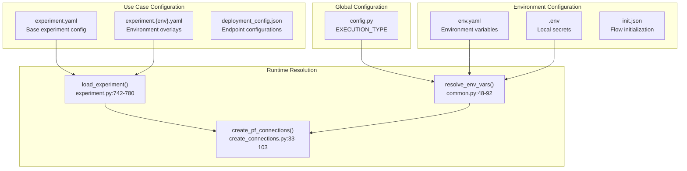
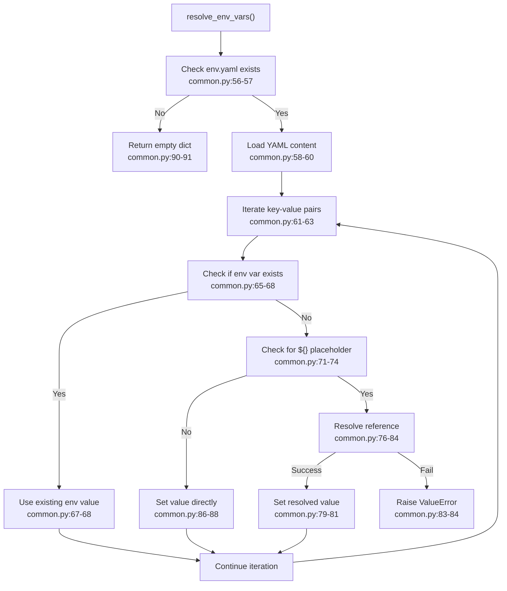
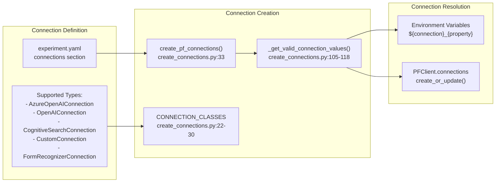
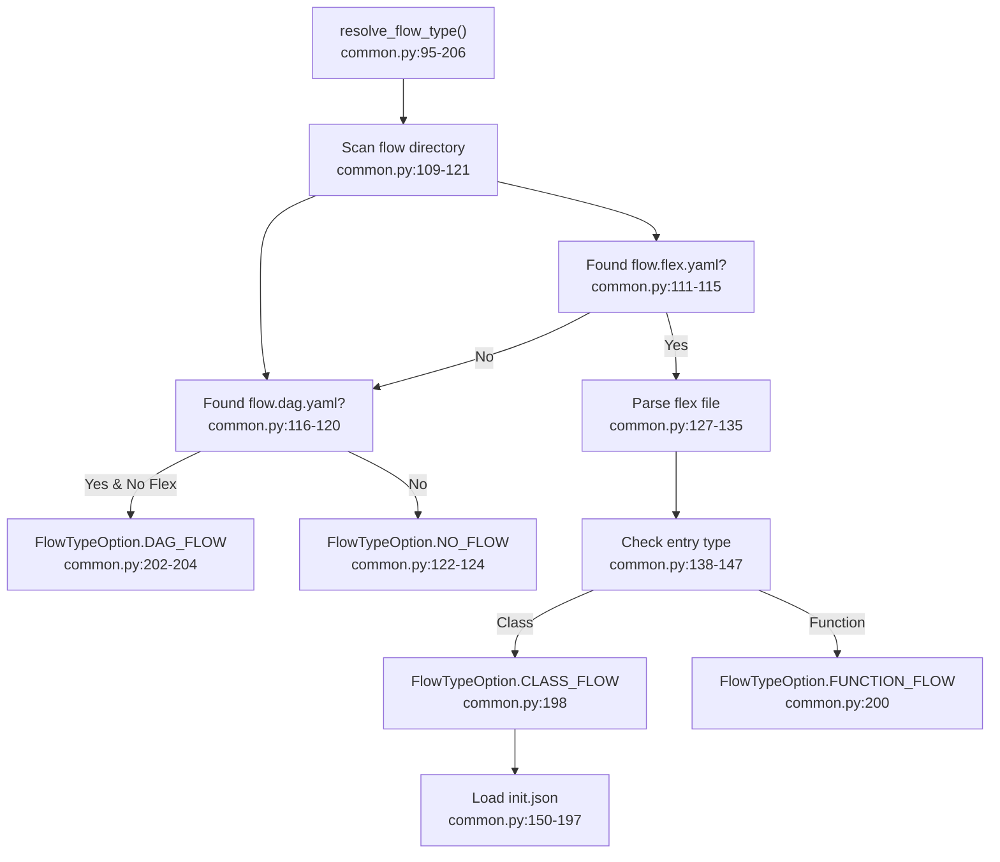
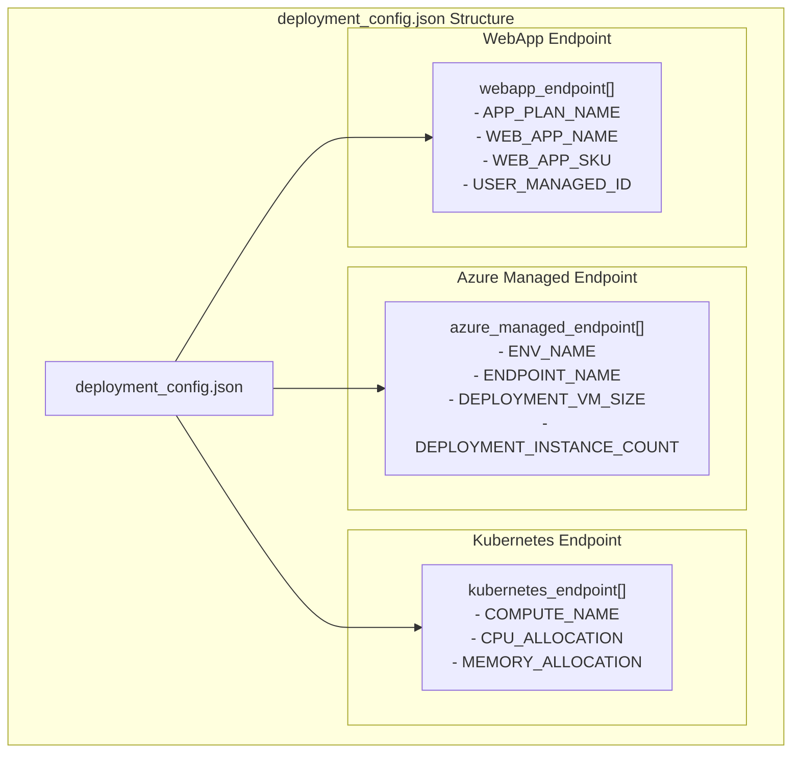

<!-- source: DeepWiki mcp.deepwiki.com · repo microsoft/genaiops-promptflow-template · page 7 Configuration · fetched 2026-10-26 -->

# Configuration

<details>
<summary>Relevant source files</summary>

The following files were used as context for generating this wiki page:

- [.github/workflows/class_flows_pr_dev_workflow.yml](.github/workflows/class_flows_pr_dev_workflow.yml)
- [.github/workflows/function_flows_ci_dev_workflow.yml](.github/workflows/function_flows_ci_dev_workflow.yml)
- [.github/workflows/function_flows_pr_dev_workflow.yml](.github/workflows/function_flows_pr_dev_workflow.yml)
- [chat_with_pdf/configs/deployment_config.json](chat_with_pdf/configs/deployment_config.json)
- [class_flows/configs/deployment_config.json](class_flows/configs/deployment_config.json)
- [docs/faqs.md](docs/faqs.md)
- [function_flows/configs/deployment_config.json](function_flows/configs/deployment_config.json)
- [llmops/common/common.py](llmops/common/common.py)
- [llmops/common/create_connections.py](llmops/common/create_connections.py)
- [llmops/common/deployment/generate_env_vars.py](llmops/common/deployment/generate_env_vars.py)
- [llmops/common/experiment.py](llmops/common/experiment.py)
- [llmops/config.py](llmops/config.py)
- [math_coding/configs/deployment_config.json](math_coding/configs/deployment_config.json)
- [named_entity_recognition/configs/deployment_config.json](named_entity_recognition/configs/deployment_config.json)
- [web_classification/configs/deployment_config.json](web_classification/configs/deployment_config.json)

</details>


This document covers the configuration system used throughout the LLMOps Prompt Flow template, including experiment configuration, deployment configuration, environment variable management, and connection setup. The configuration system supports multiple environments (dev, prod, pr) and provides flexible override mechanisms.

For specific details about experiment configuration files, see [Experiment Configuration](#7.1). For deployment-specific configuration, see [Deployment Configuration](#7.2). For environment variables and secrets management, see [Environment and Secrets Management](#7.3).

## Configuration Architecture

The template uses a multi-layered configuration approach with several interconnected configuration files and mechanisms:



Sources: [llmops/config.py:1-12](), [llmops/common/common.py:48-92](), [llmops/common/experiment.py:742-780](), [llmops/common/create_connections.py:33-103]()

## Configuration File Types

The template uses several types of configuration files, each serving a specific purpose:

| Configuration Type | File Pattern | Purpose | Location |
|---|---|---|---|
| Global Execution | `config.py` | Controls local vs Azure execution | `llmops/config.py` |
| Experiment Base | `experiment.yaml` | Defines flows, datasets, evaluators | `{use_case}/experiment.yaml` |
| Environment Overlay | `experiment.{env}.yaml` | Environment-specific overrides | `{use_case}/experiment.{env}.yaml` |
| Deployment | `deployment_config.json` | Endpoint deployment settings | `{use_case}/configs/deployment_config.json` |
| Environment Variables | `env.yaml` | Environment variable definitions | `{use_case}/environment/env.yaml` |
| Local Secrets | `.env` | Local development secrets | Project root |
| Flow Initialization | `init.json` | Class flow initialization parameters | `{use_case}/flows/{flow}/init.json` |

Sources: [llmops/config.py:1-12](), [named_entity_recognition/configs/deployment_config.json:1-56](), [llmops/common/common.py:48-92]()

## Execution Type Configuration

The global execution mode is controlled by the `EXECUTION_TYPE` setting in [llmops/config.py:11](). This determines whether operations run locally or on Azure:

```python
EXECUTION_TYPE = "LOCAL"  # or "AZURE"
```

This setting affects how the prompt pipeline and evaluation scripts execute, with local execution using the Prompt Flow client directly and Azure execution using the Azure ML workspace.

Sources: [llmops/config.py:1-12]()

## Environment Variable Resolution

The environment variable resolution system supports hierarchical configuration with placeholder substitution:



The resolution process handles three types of values:
- **Direct values**: Set as-is in the environment
- **Existing environment variables**: Preserved if already set
- **Placeholder references**: `${VARIABLE_NAME}` syntax resolved from environment

Sources: [llmops/common/common.py:48-92]()

## Connection Configuration

Connection configuration enables integration with external services like Azure OpenAI, Cognitive Search, and custom APIs:



Connection properties support placeholder resolution where values like `${api_key}` are resolved to environment variables following the pattern `{CONNECTION_NAME}_{PROPERTY}` in uppercase.

Sources: [llmops/common/create_connections.py:22-119](), [llmops/common/experiment.py:626-687]()

## Flow Type Resolution

The system automatically detects flow types based on the files present in the flow directory:



This automatic detection enables the system to handle different flow types (DAG, Function, Class) with appropriate initialization parameters.

Sources: [llmops/common/common.py:95-206]()

## Deployment Configuration Structure

Each use case contains a standardized deployment configuration supporting multiple endpoint types:



Each endpoint type supports environment-specific configuration through the `ENV_NAME` field, allowing different settings for dev, prod, and pr environments.

Sources: [named_entity_recognition/configs/deployment_config.json:1-56](), [web_classification/configs/deployment_config.json:1-56](), [math_coding/configs/deployment_config.json:1-56]()

## Configuration Override Hierarchy

The configuration system supports environment-specific overrides through a layered approach:

1. **Base Configuration**: `experiment.yaml` contains common settings
2. **Environment Overlays**: `experiment.{env}.yaml` files override base settings
3. **Environment Variables**: Runtime values from `env.yaml` and `.env`
4. **CI/CD Variables**: Platform-specific secrets and variables

This hierarchy allows the same codebase to work across multiple environments with appropriate configuration differences while maintaining a single source of truth for common settings.

Sources: [llmops/common/experiment.py:690-740](), [docs/faqs.md:216-223]()

---

