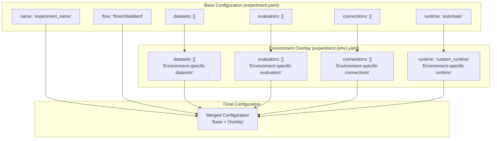
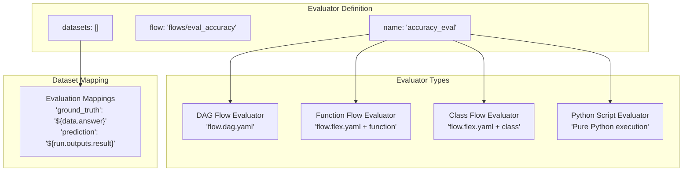
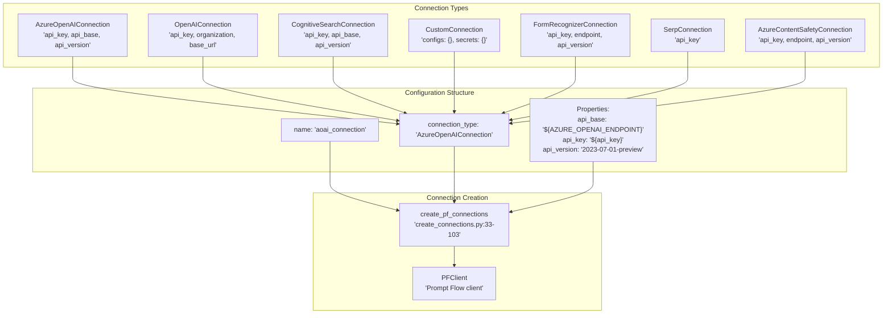
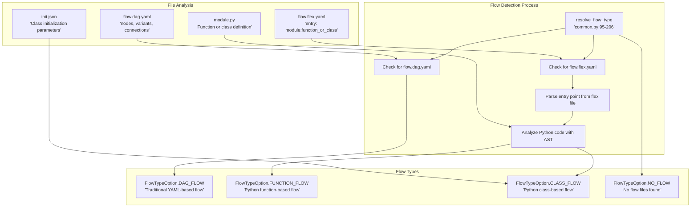
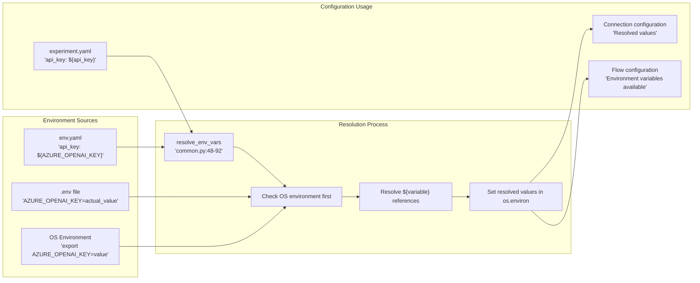
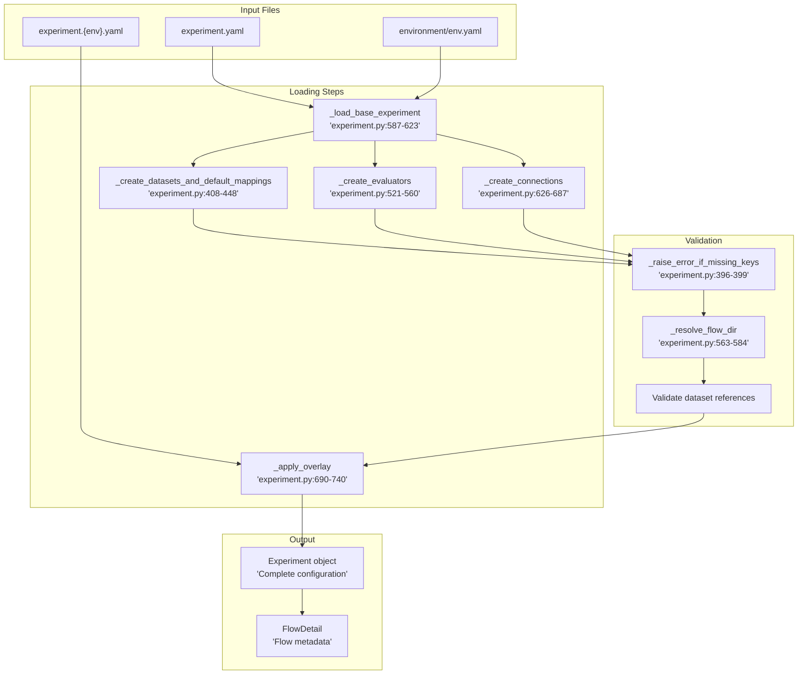

<!-- source: DeepWiki mcp.deepwiki.com · repo microsoft/genaiops-promptflow-template · page 7.1 Experiment Configuration · fetched 2026-10-26 -->

# Experiment Configuration

<details>
<summary>Relevant source files</summary>

The following files were used as context for generating this wiki page:

- [.github/workflows/class_flows_pr_dev_workflow.yml](.github/workflows/class_flows_pr_dev_workflow.yml)
- [.github/workflows/function_flows_ci_dev_workflow.yml](.github/workflows/function_flows_ci_dev_workflow.yml)
- [.github/workflows/function_flows_pr_dev_workflow.yml](.github/workflows/function_flows_pr_dev_workflow.yml)
- [docs/faqs.md](docs/faqs.md)
- [llmops/common/common.py](llmops/common/common.py)
- [llmops/common/create_connections.py](llmops/common/create_connections.py)
- [llmops/common/deployment/generate_env_vars.py](llmops/common/deployment/generate_env_vars.py)
- [llmops/common/experiment.py](llmops/common/experiment.py)
- [llmops/config.py](llmops/config.py)

</details>


This document covers the experiment configuration system in the LLMOps Prompt Flow template, which defines how Prompt Flow experiments are structured, loaded, and executed. This system handles the definition of flows, datasets, evaluators, connections, and runtime configurations through YAML-based configuration files.

For information about deployment configuration, see [Deployment Configuration](#7.2). For environment and secrets management, see [Environment and Secrets Management](#7.3).

## Configuration System Overview

The experiment configuration system is built around the `Experiment` class and related configuration classes that define all aspects of a Prompt Flow experiment. The system supports environment-specific overlays, allowing different configurations for different deployment environments (pr, dev, prod).

```mermaid
graph TB
    subgraph "Configuration Files"
        BASE[experiment.yaml<br/>"Base Configuration"]
        OVERLAY[experiment.{env}.yaml<br/>"Environment Overlay"]
        ENV[environment/env.yaml<br/>"Environment Variables"]
    end
    
    subgraph "Configuration Classes"
        EXP[Experiment<br/>"Main experiment definition"]
        DS[Dataset<br/>"Data source definition"]
        MDS[MappedDataset<br/>"Dataset with mappings"]
        EVAL[Evaluator<br/>"Evaluation flow definition"]
        CONN[Connection<br/>"Flow connections"]
        FD[FlowDetail<br/>"Flow metadata"]
    end
    
    subgraph "Loading Process"
        LOAD[load_experiment<br/>"experiment.py:742-780"]
        RESOLVE[resolve_env_vars<br/>"common.py:48-92"]
        FLOW_TYPE[resolve_flow_type<br/>"common.py:95-206"]
    end
    
    BASE --> LOAD
    OVERLAY --> LOAD
    ENV --> RESOLVE
    
    LOAD --> EXP
    EXP --> DS
    EXP --> EVAL
    EXP --> CONN
    DS --> MDS
    EXP --> FD
    
    RESOLVE --> LOAD
    FLOW_TYPE --> LOAD
```

**Sources:** [llmops/common/experiment.py:1-781](), [llmops/common/common.py:1-257]()

## Core Configuration Classes

The experiment configuration system uses several key classes to represent different aspects of an experiment:

| Class | Purpose | Key Properties |
|-------|---------|----------------|
| `Experiment` | Main experiment container | `name`, `flow`, `datasets`, `evaluators`, `connections`, `runtime` |
| `Dataset` | Data source definition | `name`, `source`, `description`, `reference` |
| `MappedDataset` | Dataset with input mappings | `dataset`, `mappings` |
| `Evaluator` | Evaluation flow definition | `name`, `path`, `datasets` |
| `Connection` | Flow connection configuration | `name`, `connection_type`, `connection_properties` |
| `FlowDetail` | Flow metadata and variants | `flow_path`, `all_variants`, `all_llm_nodes`, `default_variants` |

**Sources:** [llmops/common/experiment.py:31-318]()

## Configuration File Structure

The experiment configuration follows a standardized YAML structure with support for environment-specific overlays:



**Sources:** [llmops/common/experiment.py:587-780](), [docs/faqs.md:217-222]()

## Dataset Configuration

Datasets define the data sources used by experiments and evaluators. The system supports both local files and Azure ML registered datasets:

```mermaid
graph LR
    subgraph "Standard Datasets"
        STD_DS[Dataset<br/>"name: 'main_data'<br/>source: 'data/input.jsonl'<br/>mappings: {...}"]
    end
    
    subgraph "Evaluation Datasets"
        EVAL_DS[Dataset<br/>"name: 'eval_data'<br/>source: 'data/eval.jsonl'<br/>reference: 'main_data'<br/>mappings: {...}"]
    end
    
    subgraph "Data Sources"
        LOCAL["Local File<br/>'data/input.jsonl'"]
        REMOTE["Azure ML Dataset<br/>'azureml:dataset:version'"]
    end
    
    subgraph "Mapped Datasets"
        MDS1[MappedDataset<br/>"dataset + mappings<br/>{'input': '${data.input}'}"]
        MDS2[MappedDataset<br/>"dataset + mappings<br/>{'ground_truth': '${data.truth}'}"]
    end
    
    STD_DS --> MDS1
    EVAL_DS --> MDS2
    
    LOCAL --> STD_DS
    REMOTE --> STD_DS
    LOCAL --> EVAL_DS
    REMOTE --> EVAL_DS
```

Dataset configuration supports several key features:
- **Source flexibility**: Local files or Azure ML registered datasets via `azureml:` prefix
- **Reference linking**: Evaluation datasets can reference standard datasets via `reference` field
- **Input mappings**: Map dataset columns to flow inputs using `${data.column}` or `${run.outputs.column}` syntax

**Sources:** [llmops/common/experiment.py:31-116](), [llmops/common/experiment.py:408-518]()

## Evaluator Configuration

Evaluators define how experiments are evaluated after execution. The system supports multiple evaluator types and dataset configurations:



**Sources:** [llmops/common/experiment.py:199-247](), [llmops/common/experiment.py:521-560]()

## Connection Configuration

Connections define how flows connect to external services like Azure OpenAI, Azure Search, or custom APIs:



The connection system supports placeholder resolution using `${variable_name}` syntax, where actual values are resolved from environment variables.

**Sources:** [llmops/common/experiment.py:149-197](), [llmops/common/experiment.py:626-687](), [llmops/common/create_connections.py:22-119]()

## Flow Type Resolution

The system automatically detects flow types based on the files present in the flow directory:



**Sources:** [llmops/common/common.py:95-206](), [llmops/common/common.py:21-28]()

## Environment Variable Resolution

The configuration system supports dynamic environment variable resolution for secrets and configuration values:



The resolution process follows this priority order:
1. Check if variable already exists in OS environment
2. Resolve `${variable}` references from environment sources
3. Set resolved values in `os.environ` for flow access

**Sources:** [llmops/common/common.py:48-92]()

## Configuration Loading Workflow

The complete experiment loading process combines multiple configuration sources and validation steps:



**Sources:** [llmops/common/experiment.py:742-780](), [llmops/common/experiment.py:587-623](), [llmops/common/experiment.py:690-740]()

## Execution Type Configuration

The system supports different execution modes controlled by the `EXECUTION_TYPE` setting:

| Execution Type | Description | Configuration Location |
|----------------|-------------|----------------------|
| `LOCAL` | Run experiments locally with local Prompt Flow client | [llmops/config.py:11]() |
| `AZURE` | Run experiments on Azure ML with cloud resources | [llmops/config.py:11]() |

The execution type determines which client and runtime are used for experiment execution, as referenced in the FAQ documentation.

**Sources:** [llmops/config.py:1-12](), [docs/faqs.md:235-255]()

---

