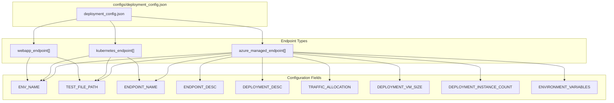
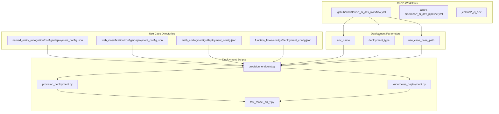

<!-- source: DeepWiki mcp.deepwiki.com · repo microsoft/genaiops-promptflow-template · page 7.2 Deployment Configuration · fetched 2026-10-26 -->

# Deployment Configuration

Relevant source files

The following files were used as context for generating this wiki page:

- [.github/workflows/class_flows_pr_dev_workflow.yml](.github/workflows/class_flows_pr_dev_workflow.yml)
- [.github/workflows/function_flows_ci_dev_workflow.yml](.github/workflows/function_flows_ci_dev_workflow.yml)
- [.github/workflows/function_flows_pr_dev_workflow.yml](.github/workflows/function_flows_pr_dev_workflow.yml)
- [chat_with_pdf/configs/deployment_config.json](chat_with_pdf/configs/deployment_config.json)
- [class_flows/configs/deployment_config.json](class_flows/configs/deployment_config.json)
- [docs/faqs.md](docs/faqs.md)
- [function_flows/configs/deployment_config.json](function_flows/configs/deployment_config.json)
- [math_coding/configs/deployment_config.json](math_coding/configs/deployment_config.json)
- [named_entity_recognition/configs/deployment_config.json](named_entity_recognition/configs/deployment_config.json)
- [web_classification/configs/deployment_config.json](web_classification/configs/deployment_config.json)

This document covers the structure and usage of `deployment_config.json` files that define endpoint configurations for Prompt Flow deployments across different Azure compute targets. These configuration files specify deployment settings for Azure ML Managed Endpoints, Kubernetes Endpoints, and Azure Web App Endpoints.

For information about the actual deployment processes and scripts, see [Azure ML Managed Endpoints](#6.1), [Kubernetes Endpoints](#6.2), and [Azure Web Apps](#6.3). For experiment configuration, see [Experiment Configuration](#7.1).

## Configuration File Structure

Each use case contains a `deployment_config.json` file in its `configs/` directory that defines deployment configurations for three endpoint types. The configuration supports multiple environments through the `ENV_NAME` field.

### Deployment Configuration Schema

Sources: [named_entity_recognition/configs/deployment_config.json:1-56](), [web_classification/configs/deployment_config.json:1-56](), [math_coding/configs/deployment_config.json:1-56]()

## Azure Managed Endpoint Configuration

The `azure_managed_endpoint` section configures deployments to Azure ML managed online endpoints or Azure AI Studio managed endpoints.

### Core Fields

| Field | Description | Example |
|-------|-------------|---------|
| `ENV_NAME` | Environment identifier matching experiment environments | "dev", "prod" |
| `TEST_FILE_PATH` | Path to test payload file for endpoint validation | "sample-request.json" |
| `ENDPOINT_NAME` | Azure endpoint name (auto-generated if empty) | "" |
| `ENDPOINT_DESC` | Human-readable endpoint description | "An online endpoint serving a flow for named entity flow" |
| `DEPLOYMENT_DESC` | Description for the deployment | "prompt flow deployment" |

### Traffic Management

| Field | Description | Usage |
|-------|-------------|-------|
| `CURRENT_DEPLOYMENT_NAME` | Name of the current deployment | Auto-generated if empty |
| `CURRENT_DEPLOYMENT_TRAFFIC_ALLOCATION` | Traffic percentage for current deployment | "100" for single deployment |
| `PRIOR_DEPLOYMENT_NAME` | Name of previous deployment for blue-green deployments | "" for new deployments |
| `PRIOR_DEPLOYMENT_TRAFFIC_ALLOCATION` | Traffic percentage for previous deployment | "0" for full cutover |

### Compute Configuration

| Field | Description | Common Values |
|-------|-------------|---------------|
| `DEPLOYMENT_VM_SIZE` | Azure VM SKU for the deployment | "Standard_F4s_v2", "Standard_E16s_v3" |
| `DEPLOYMENT_INSTANCE_COUNT` | Number of instances for the deployment | 1 |
| `ENVIRONMENT_VARIABLES` | Key-value pairs for runtime environment | `{"example-name": "example-value"}` |

Sources: [named_entity_recognition/configs/deployment_config.json:2-18](), [web_classification/configs/deployment_config.json:2-18](), [docs/faqs.md:484-511]()

## Kubernetes Endpoint Configuration  

The `kubernetes_endpoint` section configures deployments to Azure Kubernetes Service clusters attached to Azure ML workspaces.

### Kubernetes-Specific Fields

| Field | Description | Usage |
|-------|-------------|-------|
| `COMPUTE_NAME` | Name of attached AKS compute in Azure ML | Must be pre-configured |
| `CPU_ALLOCATION` | CPU resource allocation for the pod | e.g., "1000m" |
| `MEMORY_ALLOCATION` | Memory resource allocation for the pod | e.g., "2Gi" |
| `DEPLOYMENT_VM_SIZE` | VM size specification for Kubernetes | "promptinstancetype" |

The kubernetes endpoint configuration inherits most fields from the Azure managed endpoint but adds Kubernetes-specific resource allocation settings.

Sources: [named_entity_recognition/configs/deployment_config.json:20-39](), [math_coding/configs/deployment_config.json:20-39](), [docs/faqs.md:519-542]()

## Web App Endpoint Configuration

The `webapp_endpoint` section configures deployments to Azure Web Apps using containerized deployment.

### Web App Fields

| Field | Description | Purpose |
|-------|-------------|---------|
| `CONNECTION_NAMES` | Array of Prompt Flow connection names required | [""] for auto-discovery |
| `REGISTRY_NAME` | Azure Container Registry name | For storing Docker images |
| `REGISTRY_RG_NAME` | Resource group containing the registry | ACR resource group |
| `APP_PLAN_NAME` | Azure App Service Plan name | Compute resource for Web App |
| `WEB_APP_NAME` | Azure Web App name | Target web application |
| `WEB_APP_RG_NAME` | Resource group for the Web App | Web App resource group |
| `WEB_APP_SKU` | App Service Plan SKU | "B3" for Basic tier |
| `USER_MANAGED_ID` | Managed identity for authentication | For accessing Azure resources |

Sources: [named_entity_recognition/configs/deployment_config.json:41-55](), [function_flows/configs/deployment_config.json:41-55](), [docs/faqs.md:542-555]()

## Configuration Usage in Deployment Pipeline

The deployment configuration files are consumed by the LLMOps deployment engine to provision and configure endpoints.

Sources: [.github/workflows/function_flows_ci_dev_workflow.yml:16-38](), [docs/faqs.md:447-448]()

## Environment-Specific Configuration

Each deployment configuration supports multiple environments through the `ENV_NAME` field. The deployment scripts filter configurations based on the target environment.

### Environment Filtering Logic

The deployment process uses the `ENV_NAME` field to select the appropriate configuration entry:

1. CI/CD workflows pass `env_name` parameter (e.g., "dev", "prod")  
2. Deployment scripts load `deployment_config.json` from the use case directory
3. Scripts filter configuration arrays by matching `ENV_NAME` field
4. Selected configuration drives endpoint provisioning and deployment

### VM Size Variations by Use Case

Different use cases specify different VM sizes based on their resource requirements:

| Use Case | VM Size | Rationale |
|----------|---------|-----------|
| Named Entity Recognition | Standard_F4s_v2 | CPU-optimized for NLP tasks |
| Web Classification | Standard_E16s_v3 | Memory-optimized for large models |  
| Math Coding | Standard_F4s_v2 | Balanced compute for code generation |
| Function/Class Flows | Standard_F4s_v2 | General purpose compute |

Sources: [named_entity_recognition/configs/deployment_config.json:13](), [web_classification/configs/deployment_config.json:13](), [math_coding/configs/deployment_config.json:13]()

## Integration with Deployment Types

The `deployment_type` parameter in CI/CD workflows determines which section of the configuration file is used:

- `deployment_type: "aml"` → Uses `azure_managed_endpoint` configuration
- `deployment_type: "aks"` → Uses `kubernetes_endpoint` configuration  
- `deployment_type: "webapp"` → Uses `webapp_endpoint` configuration

This mapping allows the same configuration file to support multiple deployment targets while maintaining environment-specific settings for each target type.

Sources: [.github/workflows/function_flows_ci_dev_workflow.yml:16-19](), [docs/faqs.md:447-448]()

---

