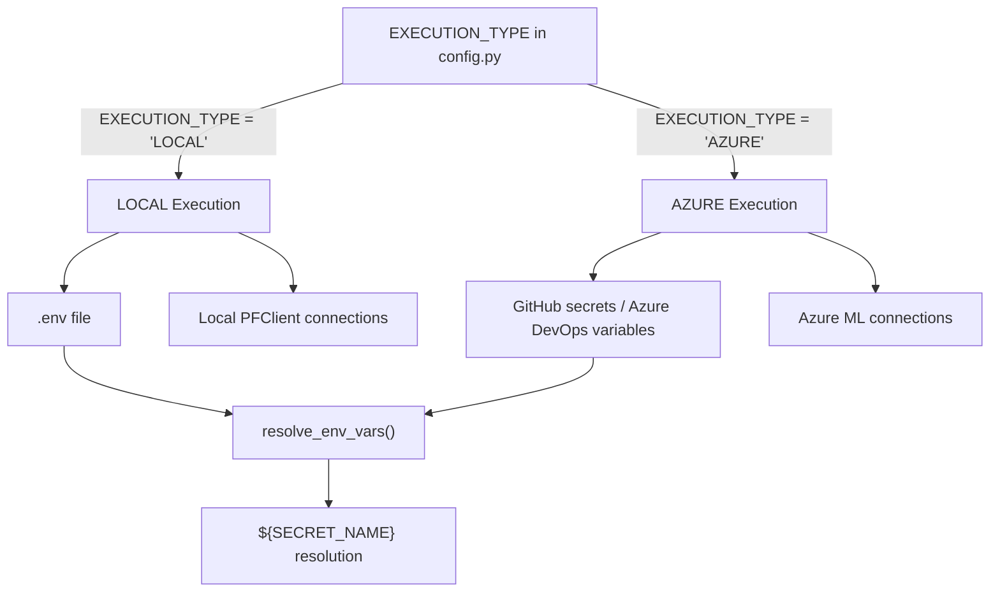
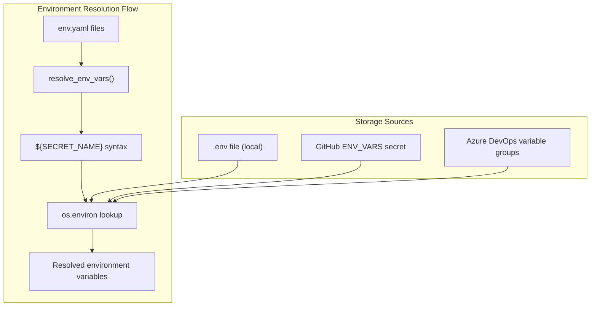
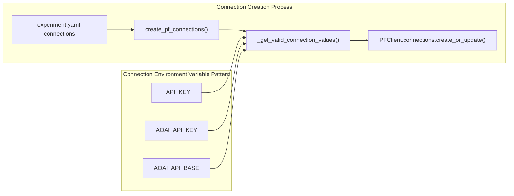
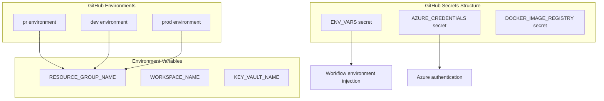
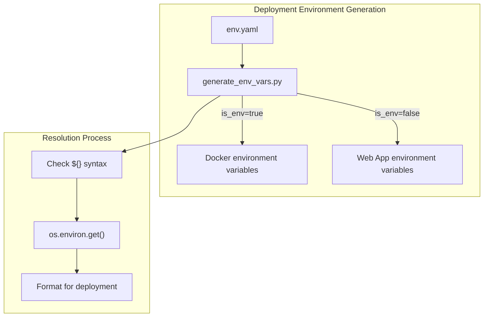

<!-- source: DeepWiki mcp.deepwiki.com · repo microsoft/genaiops-promptflow-template · page 7.3 Environment and Secrets Management · fetched 2026-10-26 -->

# Environment and Secrets Management

Relevant source files

The following files were used as context for generating this wiki page:

- [.github/workflows/class_flows_pr_dev_workflow.yml](.github/workflows/class_flows_pr_dev_workflow.yml)
- [.github/workflows/function_flows_ci_dev_workflow.yml](.github/workflows/function_flows_ci_dev_workflow.yml)
- [.github/workflows/function_flows_pr_dev_workflow.yml](.github/workflows/function_flows_pr_dev_workflow.yml)
- [README.md](README.md)
- [docs/Azure_devops_how_to_setup.md](docs/Azure_devops_how_to_setup.md)
- [docs/experiment.yaml](docs/experiment.yaml)
- [docs/faqs.md](docs/faqs.md)
- [docs/github_workflows_how_to_setup.md](docs/github_workflows_how_to_setup.md)
- [llmops/common/common.py](llmops/common/common.py)
- [llmops/common/create_connections.py](llmops/common/create_connections.py)
- [llmops/common/deployment/generate_env_vars.py](llmops/common/deployment/generate_env_vars.py)
- [llmops/common/experiment.py](llmops/common/experiment.py)
- [llmops/config.py](llmops/config.py)
- [named_entity_recognition/environment/conda.yml](named_entity_recognition/environment/conda.yml)

This document covers how the LLMOps Prompt Flow template manages environment variables, secrets, and configuration across different execution environments and CI/CD platforms. It explains the mechanisms for resolving placeholders, storing sensitive information securely, and configuring environment-specific settings.

For information about experiment configuration, see [Experiment Configuration](#7.1). For deployment-specific configuration, see [Deployment Configuration](#7.2).

## Execution Environment Types

The template supports two primary execution environments controlled by the `EXECUTION_TYPE` configuration in [llmops/config.py:11]().

**Local Execution Environment**
- Uses `.env` files for secret storage
- Creates local Prompt Flow connections via `PFClient`
- Suitable for development and testing

**Azure Execution Environment**  
- Uses platform-specific secret storage (GitHub secrets, Azure DevOps variable groups)
- Leverages Azure ML workspace connections
- Used for CI/CD pipelines and production deployments

Sources: [llmops/config.py:11](), [docs/github_workflows_how_to_setup.md:36-42](), [docs/Azure_devops_how_to_setup.md:34-40]()

## Environment Variable Resolution

The template uses a sophisticated environment variable resolution system centered around the `resolve_env_vars()` function.

**Resolution Process:**
1. Reads `environment/env.yaml` files from use case directories
2. Processes placeholder syntax `${SECRET_NAME}` 
3. Resolves placeholders against `os.environ`
4. Validates that all required variables are available

**Key Functions:**
- `resolve_env_vars()` in [llmops/common/common.py:48-92]()
- Handles both direct values and placeholder references
- Raises `ValueError` for unresolved placeholders

Sources: [llmops/common/common.py:48-92](), [docs/github_workflows_how_to_setup.md:125-142](), [docs/Azure_devops_how_to_setup.md:122-139]()

## Secret Storage Mechanisms

The template supports multiple secret storage mechanisms depending on the execution platform and environment.

| Platform | Storage Method | Environment Variable Source | Access Pattern |
|----------|----------------|----------------------------|----------------|
| Local Development | `.env` files | `os.environ` via `python-dotenv` | Direct file reading |
| GitHub Actions | Repository secrets | `ENV_VARS` secret | Workflow environment injection |
| Azure DevOps | Variable groups | `ENV_VARS` variable | Pipeline variable expansion |
| Jenkins | Environment variables | System configuration | Build environment |

**Placeholder Syntax:**
- Standard format: `${SECRET_NAME}`
- Used in: `experiment.yaml`, `env.yaml`, `init.json`, `flow.flex.yaml`
- Resolved at runtime by environment resolution functions

**Security Considerations:**
- `.env` files excluded via `.gitignore`
- Secrets never committed to source control
- Platform-specific secure storage (GitHub secrets, Azure Key Vault integration)

Sources: [docs/github_workflows_how_to_setup.md:100-169](), [docs/Azure_devops_how_to_setup.md:97-166](), [docs/faqs.md:149-206]()

## Connection Environment Variables

The template uses a specific naming convention for connection-related environment variables to ensure consistency across different connection types.

**Connection Variable Resolution:**
- Function: `_get_valid_connection_values()` in [llmops/common/create_connections.py:105-118]()
- Pattern: `{CONNECTION_NAME}_{PROPERTY_NAME}` (uppercase)
- Supports placeholder syntax with automatic resolution

**Supported Connection Types:**
- `AzureOpenAIConnection`, `OpenAIConnection`, `CognitiveSearchConnection`
- `CustomConnection`, `FormRecognizerConnection`, `SerpConnection`
- `AzureContentSafetyConnection`

Sources: [llmops/common/create_connections.py:22-30](), [llmops/common/create_connections.py:105-118](), [docs/github_workflows_how_to_setup.md:332-339]()

## Platform-Specific Configuration

Each CI/CD platform has specific mechanisms for managing environment variables and secrets.

### GitHub Actions Configuration

**GitHub-Specific Features:**
- Environment-specific variables via GitHub Environments
- Repository secrets for sensitive data
- Workflow-level environment variable injection

### Azure DevOps Configuration

**Variable Groups:**
- Primary group: `llmops_platform_dev_vg`
- Contains: `AZURE_RM_SVC_CONNECTION`, `rg_name`, `ws_name`, `kv_name`
- Environment-specific groups: `llmops_platform_<env>_vg`

**Service Connections:**
- Azure Resource Manager connection: `azure_connection`
- Used for authentication to Azure services

Sources: [docs/github_workflows_how_to_setup.md:269-284](), [docs/Azure_devops_how_to_setup.md:247-257]()

## Deployment Environment Variables

The template includes specialized handling for deployment-time environment variable generation.

**Key Script:** `generate_env_vars.py` in [llmops/common/deployment/generate_env_vars.py:1-58]()

**Functionality:**
- Reads environment configuration from YAML files
- Resolves placeholder variables against system environment
- Formats output for different deployment targets (Docker vs Web App)
- Supports both `-e KEY=VALUE` and `KEY=VALUE` formats

**Usage Patterns:**
- Docker deployments: `python generate_env_vars.py env.yaml true`
- Web App deployments: `python generate_env_vars.py env.yaml false`

Sources: [llmops/common/deployment/generate_env_vars.py:1-58]()

## Environment-Specific Configuration

The template supports environment-specific configurations through file naming conventions and overlay patterns.

**Configuration File Patterns:**
- Base configuration: `experiment.yaml`
- Environment overlays: `experiment.<env_name>.yaml`
- Environment files: `env.yaml`, `env.<env_name>.yaml`

**Supported Environments:**
- `pr` - Pull request validation
- `dev` - Development environment  
- `prod` - Production environment
- Custom environments as needed

**Resolution Priority:**
1. Environment-specific files (highest priority)
2. Base configuration files
3. Default values (lowest priority)

Sources: [docs/faqs.md:217-222](), [docs/the_experiment_file.md]() (referenced but not provided)

---

