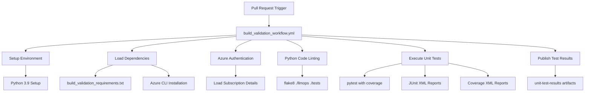
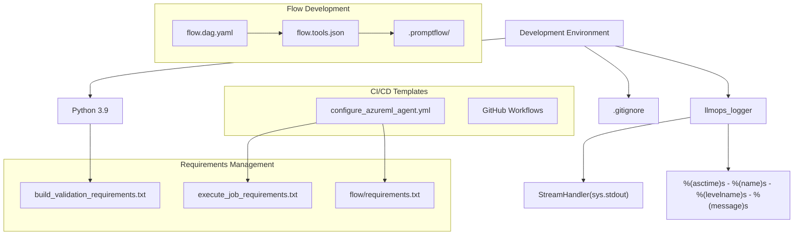
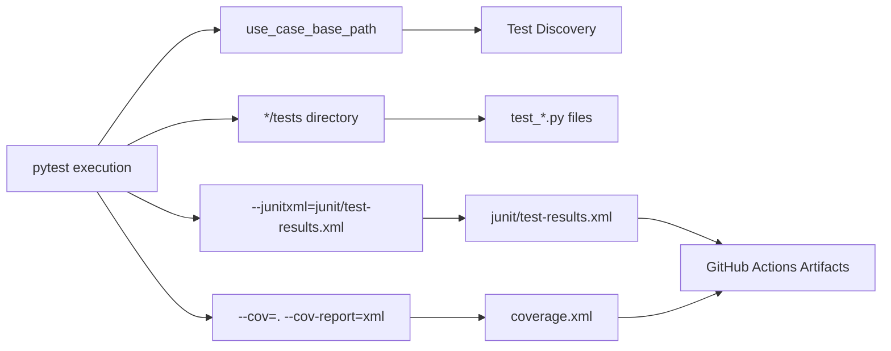
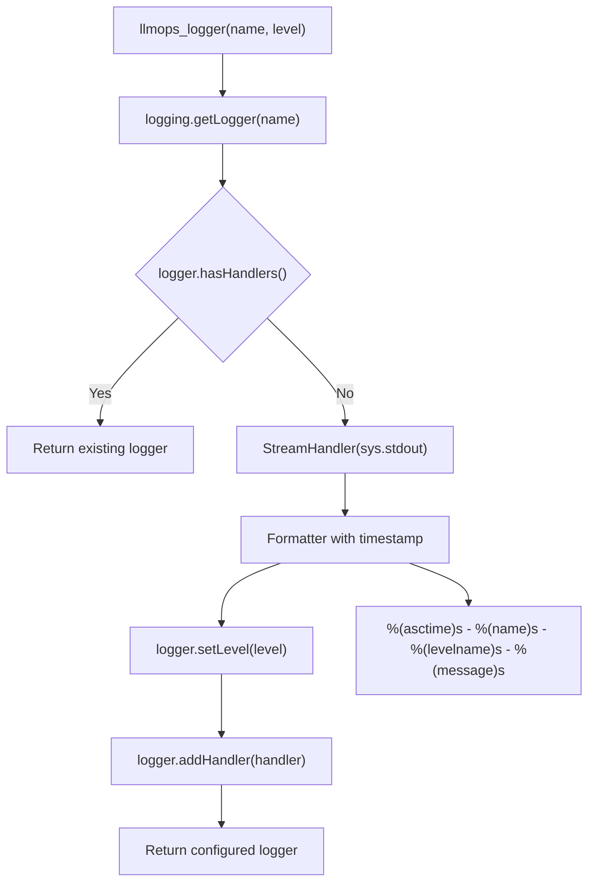
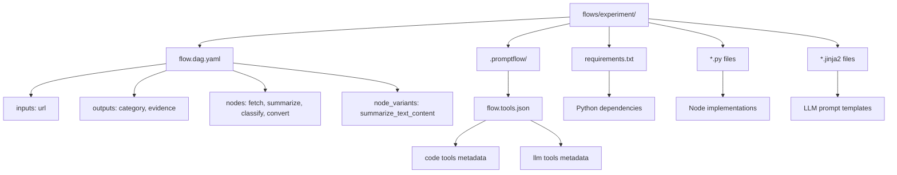

<!-- source: DeepWiki mcp.deepwiki.com · repo microsoft/genaiops-promptflow-template · page 8 Development and Testing · fetched 2026-10-26 -->

# Development and Testing

<details>
<summary>Relevant source files</summary>

The following files were used as context for generating this wiki page:

- [.azure-pipelines/templates/configure_azureml_agent.yml](.azure-pipelines/templates/configure_azureml_agent.yml)
- [.github/workflows/build_validation_workflow.yml](.github/workflows/build_validation_workflow.yml)
- [.gitignore](.gitignore)
- [llmops/common/logger.py](llmops/common/logger.py)
- [web_classification/flows/experiment/.promptflow/flow.tools.json](web_classification/flows/experiment/.promptflow/flow.tools.json)
- [web_classification/flows/experiment/flow.dag.yaml](web_classification/flows/experiment/flow.dag.yaml)

</details>


This page provides information for developers working on the LLMOps Prompt Flow template itself, including build validation, testing frameworks, and development environment setup. This documentation is intended for contributors and maintainers of the template codebase, not for end users implementing Prompt Flow solutions.

For information about configuring and running Prompt Flow experiments as an end user, see [Getting Started](#2). For details about the core LLMOps engine components, see [Core LLMOps Engine](#5).

## Build Validation Process

The template implements a comprehensive build validation workflow that ensures code quality and correctness before changes are merged. The validation process is implemented as a reusable GitHub Actions workflow.

### Build Validation Workflow Architecture



**Validation Steps**

The build validation workflow executes the following sequence:

1. **Environment Setup**: Configures Python 3.9 environment as specified in [.github/workflows/build_validation_workflow.yml:23-25]()
2. **Dependency Installation**: Installs validation requirements from [.github/workflows/build_validation_workflow.yml:32]()
3. **Azure Authentication**: Authenticates using service principal credentials for cloud resource access [.github/workflows/build_validation_workflow.yml:35-38]()
4. **Code Linting**: Runs `flake8` against `./llmops` and `./tests` directories [.github/workflows/build_validation_workflow.yml:48]()
5. **Unit Testing**: Executes pytest with coverage reporting [.github/workflows/build_validation_workflow.yml:53]()
6. **Artifact Publishing**: Uploads test results as workflow artifacts [.github/workflows/build_validation_workflow.yml:55-59]()

**Sources**: `.github/workflows/build_validation_workflow.yml`

## Development Environment Components

The development environment consists of multiple dependency management systems and configuration files that support different execution contexts.

### Environment Architecture



**Key Components**:

| Component | Purpose | Location |
|-----------|---------|----------|
| Build Validation Requirements | Dependencies for code validation and testing | `.github/requirements/build_validation_requirements.txt` |
| Execute Job Requirements | Dependencies for CI/CD pipeline execution | `.azure-pipelines/requirements/execute_job_requirements.txt` |
| Flow Requirements | Flow-specific Python dependencies | `*/flows/*/requirements.txt` |
| Azure ML Agent Template | Pipeline template for dependency installation | `.azure-pipelines/templates/configure_azureml_agent.yml` |

**Sources**: `.github/workflows/build_validation_workflow.yml`, `.azure-pipelines/templates/configure_azureml_agent.yml`, `.gitignore`

## Testing Framework

The template uses pytest as the primary testing framework with coverage reporting and JUnit XML output for CI/CD integration.

### Test Execution Configuration



The testing configuration supports:
- **Dynamic test discovery** based on `use_case_base_path` parameter [.github/workflows/build_validation_workflow.yml:53]()
- **JUnit XML reporting** for CI/CD integration
- **Coverage analysis** with XML output format
- **Artifact collection** for test result preservation

**Test Organization Pattern**:
```
{use_case}/
├── flows/
│   └── experiment/
│       ├── flow.dag.yaml
│       └── requirements.txt
└── tests/
    └── test_*.py
```

**Sources**: `.github/workflows/build_validation_workflow.yml`

## Code Quality Standards

The template enforces code quality through automated linting and file organization standards.

### Linting Configuration

The build validation runs `flake8` against two primary directories:
- `./llmops` - Core LLMOps engine modules
- `./tests` - Test suites across all use cases

### File Organization Standards

The `.gitignore` configuration excludes development artifacts and sensitive files:

| Category | Excluded Items | Lines |
|----------|---------------|-------|
| Python Artifacts | `__pycache__/`, `*.py[cod]`, `.pytest_cache/` | [.gitignore:2-3](), [.gitignore:51]() |
| Test Outputs | `coverage.xml`, `htmlcov/`, `junit/` | [.gitignore:47](), [.gitignore:40]() |
| Environment Files | `.env`, `.venv/`, `ENV/` | [.gitignore:108-114]() |
| Prompt Flow Files | `**/.promptflow` | [.gitignore:146]() |
| IDE Configuration | `.vscode`, `.idea/` | [.gitignore:148-150]() |

**Sources**: `.github/workflows/build_validation_workflow.yml`, `.gitignore`

## Development Logging and Debugging

The template provides a standardized logging utility through the `llmops_logger` function for consistent log formatting across all components.

### Logger Architecture



**Logger Features**:
- **Singleton Pattern**: Prevents duplicate handlers with `hasHandlers()` check [llmops/common/logger.py:18-19]()
- **Standard Output**: All logs directed to `sys.stdout` [llmops/common/logger.py:21]()
- **Consistent Formatting**: Timestamp, logger name, level, and message [llmops/common/logger.py:22-24]()
- **Default Configuration**: Name defaults to "llmops", level defaults to `logging.INFO` [llmops/common/logger.py:6-7]()

**Usage Pattern**:
```python
from llmops.common.logger import llmops_logger
logger = llmops_logger("component_name")
logger.info("Operation completed successfully")
```

**Sources**: `llmops/common/logger.py`

## Flow Development Structure

Prompt Flow development follows a standardized directory structure with specific metadata files for tooling integration.

### Flow Component Organization



**Flow Structure Example** (Web Classification):
- **Flow Definition**: [web_classification/flows/experiment/flow.dag.yaml:1-87]() defines the complete flow DAG
- **Node Variants**: Support multiple implementations like `variant_0` and `variant_1` [web_classification/flows/experiment/flow.dag.yaml:52-84]()
- **Tool Metadata**: [web_classification/flows/experiment/.promptflow/flow.tools.json:1-77]() provides tooling integration
- **Environment Dependencies**: [web_classification/flows/experiment/flow.dag.yaml:86]() references `requirements.txt`

**Sources**: `web_classification/flows/experiment/flow.dag.yaml`, `web_classification/flows/experiment/.promptflow/flow.tools.json`

---

