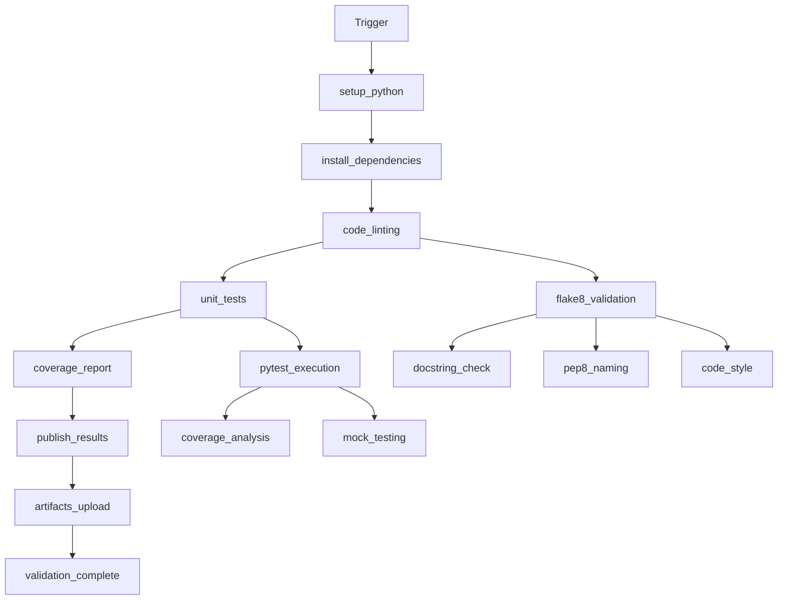
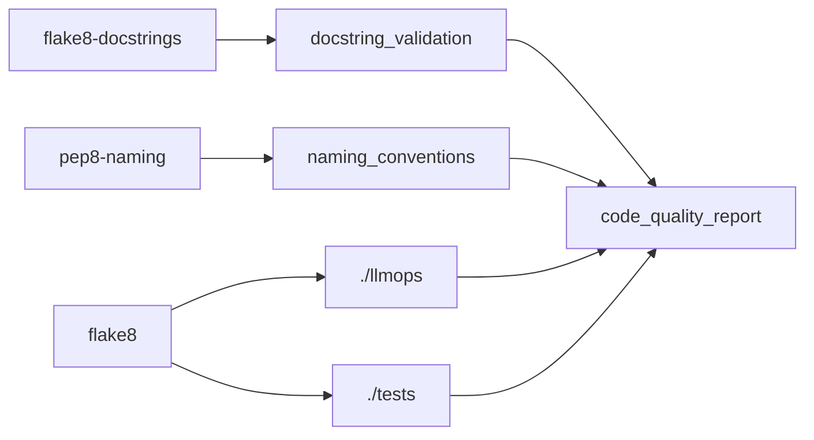
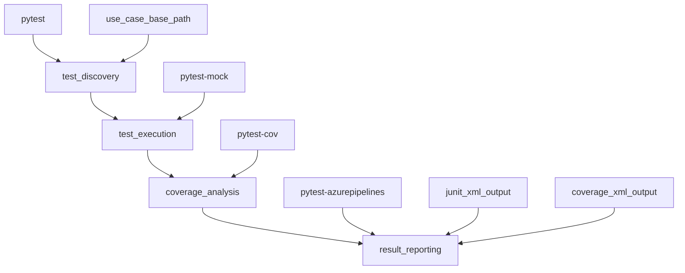
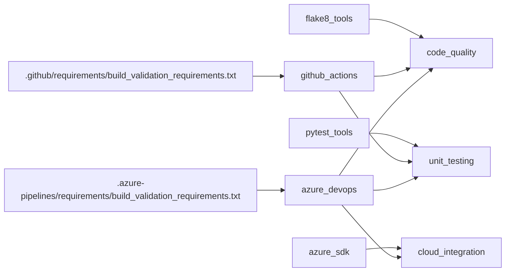
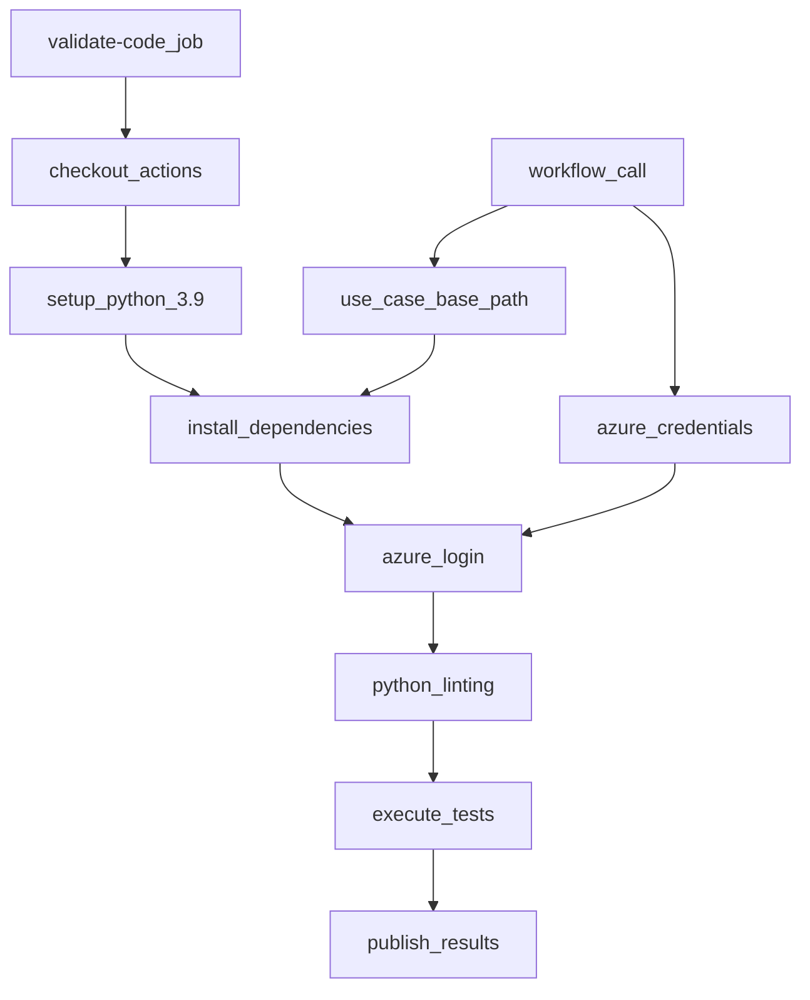
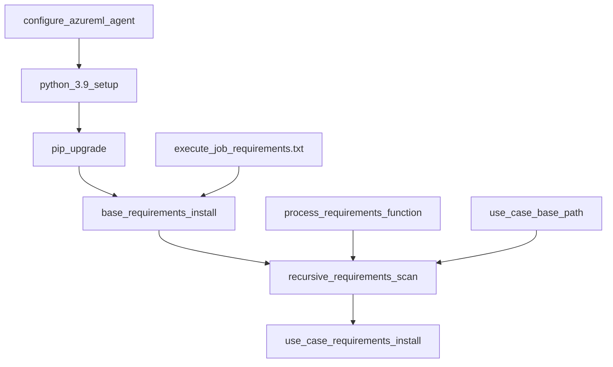
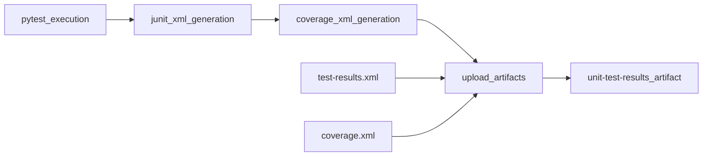

<!-- source: DeepWiki mcp.deepwiki.com · repo microsoft/genaiops-promptflow-template · page 8.1 Build Validation · fetched 2026-10-26 -->

# Build Validation

<details>
<summary>Relevant source files</summary>

The following files were used as context for generating this wiki page:

- [.azure-pipelines/requirements/build_validation_requirements.txt](.azure-pipelines/requirements/build_validation_requirements.txt)
- [.azure-pipelines/requirements/execute_job_requirements.txt](.azure-pipelines/requirements/execute_job_requirements.txt)
- [.azure-pipelines/templates/configure_azureml_agent.yml](.azure-pipelines/templates/configure_azureml_agent.yml)
- [.azure-pipelines/web_classification_pf_in_aml_pipeline_workflow.yml](.azure-pipelines/web_classification_pf_in_aml_pipeline_workflow.yml)
- [.github/requirements/build_validation_requirements.txt](.github/requirements/build_validation_requirements.txt)
- [.github/requirements/execute_job_requirements.txt](.github/requirements/execute_job_requirements.txt)
- [.github/workflows/build_validation_workflow.yml](.github/workflows/build_validation_workflow.yml)
- [.github/workflows/chat_with_pdf_pr_dev_workflow.yml](.github/workflows/chat_with_pdf_pr_dev_workflow.yml)
- [web_classification/flows/experiment/.promptflow/flow.tools.json](web_classification/flows/experiment/.promptflow/flow.tools.json)
- [web_classification/flows/experiment/flow.dag.yaml](web_classification/flows/experiment/flow.dag.yaml)

</details>


The build validation system ensures code quality, correctness, and compatibility across the LLMOps Prompt Flow template. This system provides automated linting, unit testing, and dependency validation that runs as part of the CI/CD pipeline before any Prompt Flow experiments are executed.

For information about the broader CI/CD platforms that incorporate build validation, see [CI/CD Platforms](#4). For details about the actual execution of experiments and deployments that occur after validation passes, see [Core LLMOps Engine](#5).

## Build Validation Process

The build validation process consists of three main validation stages that must pass before any Prompt Flow operations can proceed:



Sources: [.github/workflows/build_validation_workflow.yml:15-59]()

## Code Quality Validation

### Linting Configuration

The system uses `flake8` as the primary linting tool with several extensions to enforce comprehensive code quality standards:

| Tool | Purpose | Configuration |
|------|---------|---------------|
| `flake8` | Base code style checker | Version 4.0.1 |
| `flake8-docstrings` | Docstring validation | Version 1.6.0 |
| `pep8-naming` | Naming convention enforcement | Version 0.13.0 |



The linting process validates both the core `llmops` module and the `tests` directory, ensuring consistent code quality across implementation and test code.

Sources: [.github/workflows/build_validation_workflow.yml:47-48](), [.github/requirements/build_validation_requirements.txt:1-3]()

### Validation Targets

The build validation specifically targets these directories:
- `./llmops` - Core LLMOps functionality modules
- `./tests` - Unit test implementations

This ensures that both production code and test code maintain consistent quality standards.

Sources: [.github/workflows/build_validation_workflow.yml:48]()

## Unit Testing Framework

### Testing Infrastructure

The unit testing system uses `pytest` with multiple extensions for comprehensive test execution and reporting:



### Test Execution Configuration

The pytest execution includes several key parameters:

| Parameter | Purpose | Value |
|-----------|---------|-------|
| `--junitxml` | XML test results | `junit/test-results.xml` |
| `--cov` | Coverage target | `.` (current directory) |
| `--cov-report` | Coverage format | `xml` |

The test execution command targets the specific use case being validated:
```bash
pytest ${{ inputs.use_case_base_path }}/tests --junitxml=junit/test-results.xml --cov=. --cov-report=xml
```

Sources: [.github/workflows/build_validation_workflow.yml:50-53](), [.github/requirements/build_validation_requirements.txt:4-7]()

### Test Dependencies

The testing framework includes specialized dependencies for different testing scenarios:

- `pytest-mock==3.7.0` - Mock object support for isolating components
- `pytest-azurepipelines==1.0.3` - Azure DevOps integration for result publishing
- `pytest-cov==3.0.0` - Code coverage measurement and reporting

Sources: [.github/requirements/build_validation_requirements.txt:4-6]()

## Dependency Management

### Build Validation Dependencies

The build validation system maintains separate dependency files for validation-specific requirements:



### Core Dependencies

Both platforms share the same core validation dependencies:

| Category | Dependencies |
|----------|-------------|
| **Linting** | `flake8==4.0.1`, `flake8-docstrings==1.6.0`, `pep8-naming==0.13.0` |
| **Testing** | `pytest==7.1.2`, `pytest-cov==3.0.0`, `pytest-mock==3.7.0` |
| **Azure Integration** | `azure-ai-ml>=1.16.0`, `azure-identity>=1.15.0` |
| **Prompt Flow** | `promptflow>=1.11.0`, `promptflow-azure>=1.11.0` |

Sources: [.github/requirements/build_validation_requirements.txt:1-15](), [.azure-pipelines/requirements/build_validation_requirements.txt:1-15]()

## CI/CD Platform Integration

### GitHub Actions Integration

The build validation integrates with GitHub Actions through a reusable workflow that accepts parameters for different use cases:



### Workflow Parameters

The build validation workflow accepts these inputs:

| Input | Type | Description | Required |
|-------|------|-------------|----------|
| `use_case_base_path` | string | The flow use-case to validate | Yes |
| `azure_credentials` | secret | Service principal auth to Azure | Yes |

Sources: [.github/workflows/build_validation_workflow.yml:4-13]()

### Azure DevOps Integration

For Azure DevOps pipelines, the build validation dependencies are installed through the `configure_azureml_agent.yml` template, which includes recursive requirements installation:



The recursive requirements processing ensures all nested `requirements.txt` files within a use case are discovered and installed.

Sources: [.azure-pipelines/templates/configure_azureml_agent.yml:25-40]()

## Result Publishing and Artifacts

### Test Result Artifacts

The build validation system publishes test results as artifacts for later analysis:



### Artifact Configuration

The artifacts are configured as follows:

| Artifact | Name | Path Pattern |
|----------|------|--------------|
| Unit Test Results | `unit-test-results` | `**/test-*.xml` |

This pattern captures all XML test result files generated during the validation process.

Sources: [.github/workflows/build_validation_workflow.yml:55-59]()

## Environment Setup

### Python Environment

The build validation requires Python 3.9 and installs dependencies in this order:

1. Upgrade `pip` to latest version
2. Install build validation requirements
3. Verify Azure CLI installation
4. Execute validation steps

This consistent environment setup ensures reproducible validation results across different execution contexts.

Sources: [.github/workflows/build_validation_workflow.yml:23-33]()

---

