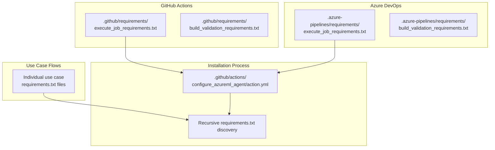
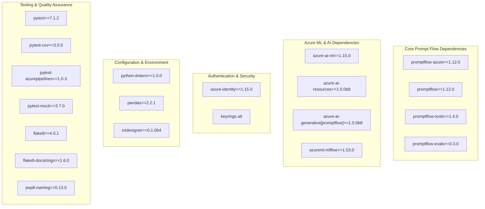
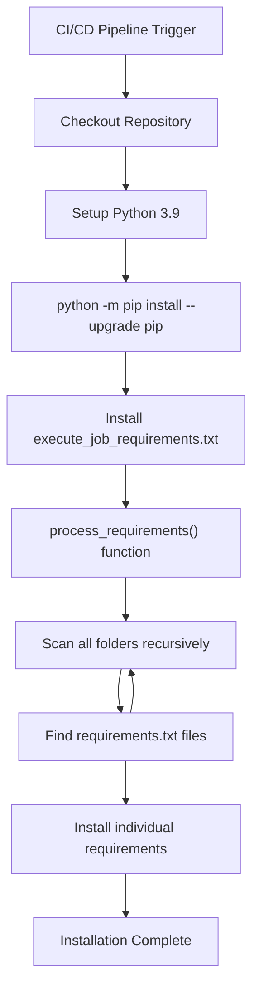

<!-- source: DeepWiki mcp.deepwiki.com · repo microsoft/genaiops-promptflow-template · page 8.2 Dependencies and Requirements · fetched 2026-10-26 -->

# Dependencies and Requirements

<details>
<summary>Relevant source files</summary>

The following files were used as context for generating this wiki page:

- [.azure-pipelines/requirements/build_validation_requirements.txt](.azure-pipelines/requirements/build_validation_requirements.txt)
- [.azure-pipelines/requirements/execute_job_requirements.txt](.azure-pipelines/requirements/execute_job_requirements.txt)
- [.azure-pipelines/web_classification_pf_in_aml_pipeline_workflow.yml](.azure-pipelines/web_classification_pf_in_aml_pipeline_workflow.yml)
- [.github/actions/configure_azureml_agent/action.yml](.github/actions/configure_azureml_agent/action.yml)
- [.github/requirements/build_validation_requirements.txt](.github/requirements/build_validation_requirements.txt)
- [.github/requirements/execute_job_requirements.txt](.github/requirements/execute_job_requirements.txt)
- [.github/workflows/chat_with_pdf_pr_dev_workflow.yml](.github/workflows/chat_with_pdf_pr_dev_workflow.yml)

</details>


This document outlines the Python dependencies and requirements management across the LLMOps Prompt Flow template. It covers the different requirement files used for various execution environments, the core dependency categories, and how dependencies are installed during CI/CD operations.

For information about configuring environments and secrets, see [Environment and Secrets Management](#7.3). For details about the build validation process that uses these dependencies, see [Build Validation](#8.1).

## Requirements File Organization

The template uses a structured approach to manage dependencies across different CI/CD platforms and execution contexts. Requirements files are organized by platform and purpose.



**Requirements File Structure**

| Platform | Execute Jobs | Build Validation |
|----------|-------------|------------------|
| GitHub Actions | `.github/requirements/execute_job_requirements.txt` | `.github/requirements/build_validation_requirements.txt` |
| Azure DevOps | `.azure-pipelines/requirements/execute_job_requirements.txt` | `.azure-pipelines/requirements/build_validation_requirements.txt` |

Sources: [.github/requirements/execute_job_requirements.txt:1-15](), [.azure-pipelines/requirements/execute_job_requirements.txt:1-14](), [.github/requirements/build_validation_requirements.txt:1-15](), [.azure-pipelines/requirements/build_validation_requirements.txt:1-15]()

## Core Dependency Categories

The template's dependencies are organized into functional categories that support different aspects of the LLMOps pipeline.



**Execute Job Requirements**

| Category | Dependencies | Version Constraints |
|----------|-------------|-------------------|
| Prompt Flow Core | `promptflow`, `promptflow-azure`, `promptflow-tools`, `promptflow-evals` | `>=1.12.0`, `>=1.4.0`, `>=0.3.0` |
| Azure ML | `azure-ai-ml`, `azure-ai-resources`, `azure-ai-generative` | `==1.15.0`, `>=1.0.0b8` |
| Authentication | `azure-identity`, `keyrings.alt` | `==1.16.0` |
| Environment | `python-dotenv`, `azureml-mlflow` | `>=1.0.0`, `>=1.53.0` |

**Build Validation Requirements**

| Category | Dependencies | Purpose |
|----------|-------------|---------|
| Testing | `pytest`, `pytest-cov`, `pytest-mock`, `pytest-azurepipelines` | Unit testing and coverage |
| Code Quality | `flake8`, `flake8-docstrings`, `pep8-naming` | Linting and style checking |
| ML Support | `azure-ai-ml`, `azure-identity`, `mldesigner` | ML pipeline validation |

Sources: [.github/requirements/execute_job_requirements.txt:1-14](), [.github/requirements/build_validation_requirements.txt:1-15]()

## Python Version Requirements

The template standardizes on Python 3.9 as the default version across all CI/CD platforms and execution environments.

**Version Configuration**

- **Default Python Version**: `3.9`
- **GitHub Actions Setup**: Uses `actions/setup-python@v4` with configurable `versionSpec`
- **Azure DevOps**: Configured through pipeline templates
- **Jenkins**: Configured through job definitions

Sources: [.github/actions/configure_azureml_agent/action.yml:6-8](), [.github/actions/configure_azureml_agent/action.yml:19-21]()

## Dependency Installation Process

The template implements a recursive dependency discovery and installation process that ensures all required packages are available across different execution contexts.



**Installation Steps**

1. **Base Installation**: Install core requirements from `execute_job_requirements.txt`
2. **Recursive Discovery**: The `process_requirements()` function scans all directories
3. **Individual Installation**: Install dependencies from each discovered `requirements.txt`
4. **Verification**: Check Azure CLI installation with `az version`

**Process Requirements Function**

The recursive installation process is implemented in the `configure_azureml_agent` action:

```bash
process_requirements() {
  local folder=$1
  for file in "$folder"/*; do
      if [ -d "$file" ]; then
          process_requirements "$file"
      elif [ -f "$file" ] && [ "$(basename "$file")" == "requirements.txt" ]; then
          echo "Installing dependencies from $file"
          python -m pip install -r "$file"
      fi
  done
}
```

Sources: [.github/actions/configure_azureml_agent/action.yml:23-46]()

## Platform-Specific Considerations

While the core dependencies remain consistent, there are minor variations between GitHub Actions and Azure DevOps requirements files.

**Key Differences**

| Aspect | GitHub Actions | Azure DevOps |
|--------|---------------|--------------|
| File Location | `.github/requirements/` | `.azure-pipelines/requirements/` |
| Duplicate Entries | `python-dotenv` appears twice | Clean dependency list |
| Line Endings | Extra blank lines | Clean formatting |

**Common Dependencies Across Platforms**

Both platforms share identical core dependencies for:
- Prompt Flow execution (`promptflow-azure>=1.12.0`)
- Azure ML integration (`azure-ai-ml==1.15.0`) 
- Authentication (`azure-identity==1.16.0`)
- Environment management (`python-dotenv>=1.0.0`)

Sources: [.github/requirements/execute_job_requirements.txt:1-15](), [.azure-pipelines/requirements/execute_job_requirements.txt:1-14]()

## Version Pinning Strategy

The template uses a mixed approach to version pinning based on the stability and criticality of dependencies.

**Exact Version Pinning**
- `azure-ai-ml==1.15.0` - Core Azure ML functionality
- `azure-identity==1.16.0` - Authentication stability
- `pytest==7.1.2` - Testing framework consistency
- `pandas==2.2.1` - Data processing stability

**Minimum Version Requirements**
- `promptflow>=1.12.0` - Prompt Flow features
- `azure-ai-resources>=1.0.0b8` - Beta feature support
- `python-dotenv>=1.0.0` - Configuration management

**Benefits of Mixed Strategy**
- **Stability**: Exact pinning for critical infrastructure components
- **Flexibility**: Minimum versions for actively developed components
- **Compatibility**: Balance between feature access and stability

Sources: [.github/requirements/execute_job_requirements.txt:1-14](), [.github/requirements/build_validation_requirements.txt:8-14]()

---

