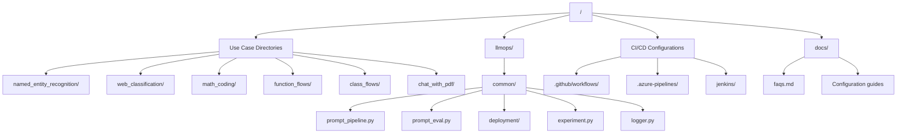
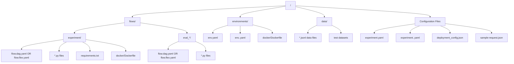
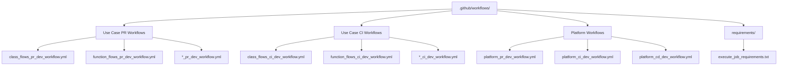
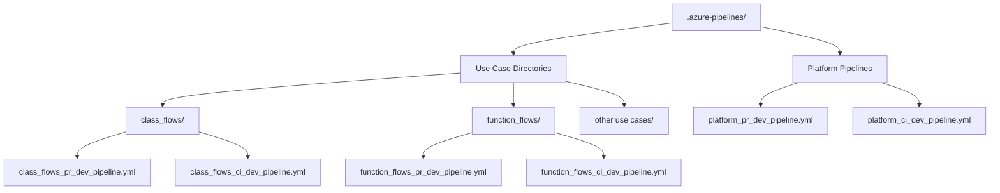
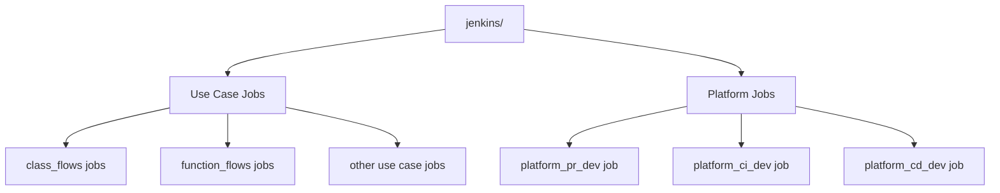
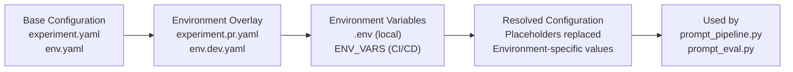
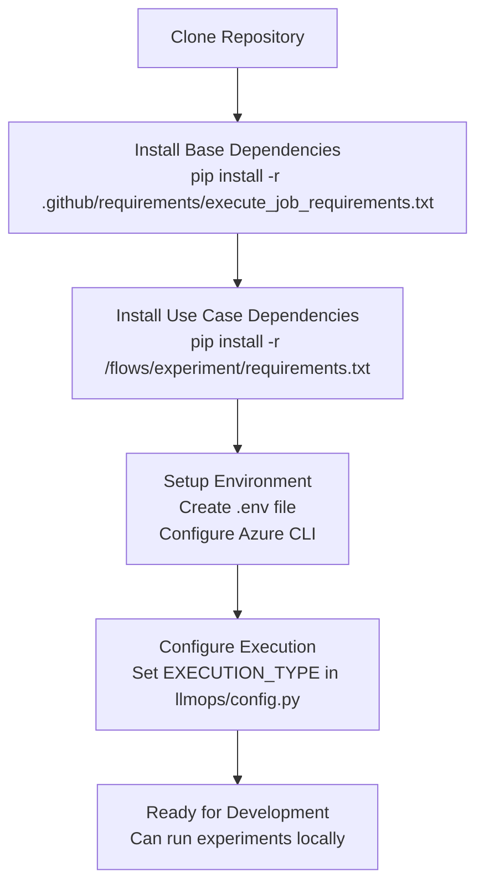

<!-- source: DeepWiki mcp.deepwiki.com · repo microsoft/genaiops-promptflow-template · page 8.3 Project Structure · fetched 2026-10-26 -->

# Project Structure

Relevant source files

The following files were used as context for generating this wiki page:

- [.github/workflows/class_flows_pr_dev_workflow.yml](.github/workflows/class_flows_pr_dev_workflow.yml)
- [.github/workflows/function_flows_ci_dev_workflow.yml](.github/workflows/function_flows_ci_dev_workflow.yml)
- [.github/workflows/function_flows_pr_dev_workflow.yml](.github/workflows/function_flows_pr_dev_workflow.yml)
- [.gitignore](.gitignore)
- [docs/faqs.md](docs/faqs.md)
- [llmops/common/logger.py](llmops/common/logger.py)

This document provides a comprehensive overview of the directory structure, file organization, and development setup for the LLMOps Prompt Flow template. It covers how the codebase is organized across use cases, CI/CD platforms, configuration management, and the core LLMOps engine modules.

For information about specific configuration file formats, see [Configuration](#7). For details about the core execution engine functionality, see [Core LLMOps Engine](#5).

## High-Level Directory Organization

The project follows a modular structure with clear separation between use cases, platform-specific CI/CD configurations, and shared LLMOps functionality.

**Sources:** [docs/faqs.md:134-138](), [.gitignore:1-150](), [llmops/common/logger.py:1-31]()

## Use Case Directory Structure

Each use case follows a standardized directory structure that supports different types of Prompt Flows and deployment configurations.

**Sources:** [docs/faqs.md:131-147](), [docs/faqs.md:217-223](), [docs/faqs.md:66-68]()

## Core LLMOps Engine Structure

The `llmops/` directory contains the shared modules that power experiment execution, evaluation, and deployment across all use cases.

| Module | File Path | Primary Classes/Functions | Purpose |
|--------|-----------|---------------------------|---------|
| Experiment Management | `llmops/common/experiment.py` | `load_experiment`, `ExperimentCloudConfig` | Load and validate experiment configurations |
| Pipeline Execution | `llmops/common/prompt_pipeline.py` | Main execution logic | Execute Prompt Flow experiments and bulk runs |
| Evaluation | `llmops/common/prompt_eval.py` | Evaluation orchestration | Run evaluators against experiment outputs |
| Model Registration | `llmops/common/register_model.py` | Model registration | Register models in Azure ML |
| Data Management | `llmops/common/register_data_asset.py` | Data asset registration | Register datasets in Azure ML |
| Deployment | `llmops/common/deployment/` | Multiple deployment modules | Handle different deployment targets |
| Connection Management | `llmops/common/create_connections.py` | `create_pf_connections`, `CONNECTION_CLASSES` | Create Prompt Flow connections |
| Utilities | `llmops/common/common.py` | `resolve_env_vars`, `resolve_flow_type` | Common utility functions |
| Logging | `llmops/common/logger.py` | `llmops_logger` | Standardized logging across modules |

```mermaid
graph TB
    LLMOPS_COMMON["llmops/common/"] --> EXPERIMENT_MGT["Experiment Management"]
    LLMOPS_COMMON --> EXECUTION["Execution Engine"]  
    LLMOPS_COMMON --> DEPLOYMENT_ENGINE["Deployment Engine"]
    LLMOPS_COMMON --> UTILITIES["Utilities & Config"]
    
    EXPERIMENT_MGT --> EXPERIMENT_PY["experiment.py"]
    EXPERIMENT_MGT --> CONNECTIONS_PY["create_connections.py"]
    
    EXECUTION --> PROMPT_PIPELINE["prompt_pipeline.py"]
    EXECUTION --> PROMPT_EVAL["prompt_eval.py"]
    EXECUTION --> REGISTER_DATA["register_data_asset.py"]
    
    DEPLOYMENT_ENGINE --> REGISTER_MODEL["register_model.py"]
    DEPLOYMENT_ENGINE --> PROVISION_ENDPOINT["provision_endpoint.py"]
    DEPLOYMENT_ENGINE --> PROVISION_DEPLOYMENT["provision_deployment.py"]
    DEPLOYMENT_ENGINE --> K8S_DEPLOYMENT["kubernetes_deployment.py"]
    DEPLOYMENT_ENGINE --> TEST_ENDPOINTS["test_model_on_*.py"]
    
    UTILITIES --> COMMON_PY["common.py"]
    UTILITIES --> LOGGER_PY["logger.py"]
    UTILITIES --> CONFIG_PY["config.py"]
```

**Sources:** [llmops/common/logger.py:6-30](), [docs/faqs.md:215-216](), [docs/faqs.md:283-294]()

## CI/CD Platform Organization

The project supports three CI/CD platforms with parallel workflow structures. Each platform has both use-case-specific and platform-wide workflows.

### GitHub Actions Structure

### Azure DevOps Structure

### Jenkins Structure

**Sources:** [.github/workflows/class_flows_pr_dev_workflow.yml:1-38](), [.github/workflows/function_flows_ci_dev_workflow.yml:1-43](), [.github/workflows/function_flows_pr_dev_workflow.yml:1-38](), [docs/faqs.md:439-448]()

## Configuration File Organization

Configuration files follow a hierarchical overlay pattern that allows environment-specific customization while maintaining base configurations.

| Configuration Type | Base File | Environment Overlays | Purpose |
|-------------------|-----------|---------------------|---------|
| Experiment Config | `experiment.yaml` | `experiment.<env>.yaml` | Define flows, datasets, evaluators, connections |
| Environment Variables | `env.yaml` | `env.<env>.yaml` | Define secrets and environment variables |
| Deployment Config | `deployment_config.json` | N/A | Define endpoint and deployment configurations |
| Local Environment | `.env` (gitignored) | N/A | Local development secrets |
| Dependencies | `requirements.txt` | N/A | Python package dependencies |

### Configuration Resolution Pattern

**Sources:** [docs/faqs.md:151-158](), [docs/faqs.md:217-223](), [docs/faqs.md:198-206]()

## Development Environment Setup

The project uses multiple `requirements.txt` files to manage dependencies for different execution contexts.

### Dependency Management Structure

| Requirements File | Location | Purpose |
|------------------|----------|---------|
| Execute Job Requirements | `.github/requirements/execute_job_requirements.txt` | CI/CD pipeline dependencies |
| Use Case Requirements | `<use_case>/flows/experiment/requirements.txt` | Use case-specific dependencies |
| Docker Requirements | `<use_case>/environments/docker/requirements.txt` | Container deployment dependencies |

### Local Development Setup Process

### Ignored Files and Directories

The [.gitignore:107-121]() file specifies important patterns:
- `.env` files containing secrets
- `.promptflow` directories created by Prompt Flow SDK
- `run_id.txt` files generated during execution
- `reports/` directory containing evaluation outputs
- IDE-specific directories (`.vscode`, `.idea`)

**Sources:** [docs/faqs.md:131-147](), [docs/faqs.md:234-244](), [.gitignore:107-121]()

## File Naming Conventions

The project follows consistent naming patterns to support the multi-platform CI/CD approach:

| File Type | Pattern | Examples |
|-----------|---------|----------|
| Use Case PR Workflows | `<use_case>_pr_dev_workflow.yml` | `class_flows_pr_dev_workflow.yml` |
| Use Case CI Workflows | `<use_case>_ci_dev_workflow.yml` | `function_flows_ci_dev_workflow.yml` |
| Environment Overlays | `<base_name>.<env>.yaml` | `experiment.pr.yaml`, `env.dev.yaml` |
| Platform Workflows | `platform_<type>_dev_workflow.yml` | `platform_pr_dev_workflow.yml` |
| Evaluation Flows | `eval_<name>` | `eval_checklist`, `eval_nlp` |

This naming convention enables the template to automatically discover and execute the appropriate workflows and configurations based on use case and environment parameters.

**Sources:** [.github/workflows/class_flows_pr_dev_workflow.yml:1](), [.github/workflows/function_flows_ci_dev_workflow.yml:1](), [docs/faqs.md:217-223]()