# Page: Overview

# Overview

<details>
<summary>Relevant source files</summary>

The following files were used as context for generating this wiki page:

- [README.md](README.md)
- [chat_with_pdf/configs/deployment_config.json](chat_with_pdf/configs/deployment_config.json)
- [class_flows/configs/deployment_config.json](class_flows/configs/deployment_config.json)
- [docs/Azure_devops_how_to_setup.md](docs/Azure_devops_how_to_setup.md)
- [docs/experiment.yaml](docs/experiment.yaml)
- [docs/github_workflows_how_to_setup.md](docs/github_workflows_how_to_setup.md)
- [function_flows/configs/deployment_config.json](function_flows/configs/deployment_config.json)
- [llmops/common/deployment/kubernetes_deployment.py](llmops/common/deployment/kubernetes_deployment.py)
- [llmops/common/deployment/provision_deployment.py](llmops/common/deployment/provision_deployment.py)
- [llmops/common/get_workspace.py](llmops/common/get_workspace.py)
- [llmops/common/prompt_eval.py](llmops/common/prompt_eval.py)
- [llmops/common/prompt_pipeline.py](llmops/common/prompt_pipeline.py)
- [math_coding/configs/deployment_config.json](math_coding/configs/deployment_config.json)
- [named_entity_recognition/configs/deployment_config.json](named_entity_recognition/configs/deployment_config.json)
- [named_entity_recognition/environment/conda.yml](named_entity_recognition/environment/conda.yml)
- [web_classification/configs/deployment_config.json](web_classification/configs/deployment_config.json)

</details>


This document provides a high-level introduction to the LLMOps Prompt Flow template, explaining its purpose, system architecture, and key operational capabilities. The template is designed to streamline the end-to-end lifecycle of Large Language Model applications using Microsoft's Prompt Flow framework.

This overview covers the system's architecture, core components, and execution models. For detailed setup instructions, see [Getting Started](#2). For information about specific use cases and flows, see [Use Cases and Prompt Flows](#3). For CI/CD platform configuration details, see [CI/CD Platforms](#4).

## System Purpose

The LLMOps Prompt Flow template is a comprehensive framework for developing, experimenting, evaluating, and deploying LLM-infused applications. It provides automation for prompt engineering workflows, supporting both local development and cloud-scale operations across Azure AI Studio and Azure Machine Learning platforms.

**Sources:** [README.md:1-84](), [docs/github_workflows_how_to_setup.md:1-18]()

## System Architecture

The template follows a modular architecture that separates concerns between experimentation, evaluation, and deployment while supporting multiple execution environments and CI/CD platforms.

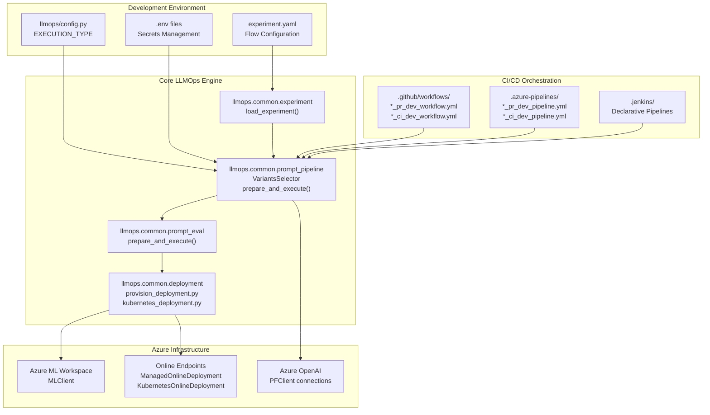

**Sources:** [llmops/common/prompt_pipeline.py:1-583](), [llmops/common/prompt_eval.py:1-521](), [llmops/common/deployment/provision_deployment.py:1-309](), [llmops/common/deployment/kubernetes_deployment.py:1-316]()

## Execution Architecture

The template supports flexible execution modes controlled by the `EXECUTION_TYPE` configuration, enabling both local development and cloud-scale operations.

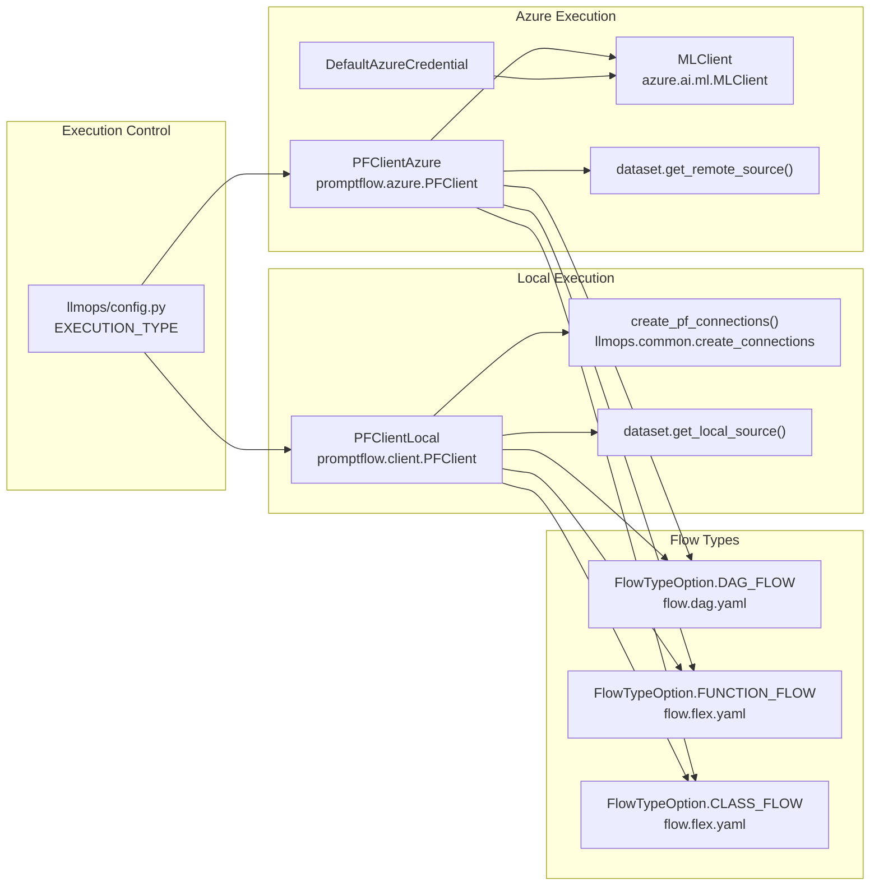

**Sources:** [llmops/common/prompt_pipeline.py:174-202](), [llmops/common/prompt_eval.py:95-119](), [docs/github_workflows_how_to_setup.md:34-98]()

## Core Components

### Experiment Execution Engine

The `prompt_pipeline.py` module serves as the primary execution engine for running Prompt Flow experiments and bulk runs.

| Component | Purpose | Key Classes/Functions |
|-----------|---------|----------------------|
| `VariantsSelector` | Manages flow variant selection and execution strategies | `VariantSelectionOption`, `is_variant_enabled()` |
| `prepare_and_execute()` | Orchestrates experiment execution workflow | Handles dataset processing, variant execution, result collection |
| `ObjectWrapper` | Abstracts Prompt Flow client operations | Wraps `PFClient` for local/Azure execution |

**Sources:** [llmops/common/prompt_pipeline.py:87-136](), [llmops/common/prompt_pipeline.py:138-496]()

### Evaluation Framework

The `prompt_eval.py` module handles automated evaluation of Prompt Flow runs using configurable evaluation flows.

| Component | Purpose | Key Functions |
|-----------|---------|---------------|
| `prepare_and_execute()` | Executes evaluation flows against bulk runs | Handles dataset mapping, evaluation execution, report generation |
| Evaluator Resolution | Maps evaluation datasets to standard run datasets | `evaluator.find_dataset_with_reference()` |
| Report Generation | Creates CSV and HTML evaluation reports | Pandas-based metric aggregation and visualization |

**Sources:** [llmops/common/prompt_eval.py:59-449]()

### Deployment System

The deployment system supports multiple Azure compute targets through specialized deployment modules.

| Deployment Type | Module | Key Entities |
|-----------------|--------|--------------|
| Azure ML Managed | `provision_deployment.py` | `ManagedOnlineDeployment`, `Environment`, `BuildContext` |
| Kubernetes | `kubernetes_deployment.py` | `KubernetesOnlineDeployment`, `ResourceRequirementsSettings` |
| Azure Web Apps | Web App deployment workflows | Container-based deployment with Docker registry |

**Sources:** [llmops/common/deployment/provision_deployment.py:52-250](), [llmops/common/deployment/kubernetes_deployment.py:59-256]()

## Use Cases and Flow Types

The template includes six example use cases demonstrating different Prompt Flow patterns and deployment scenarios.

| Use Case | Flow Type | Deployment Target | Configuration |
|----------|-----------|------------------|---------------|
| Named Entity Recognition | YAML (DAG) | `Standard_F4s_v2` VM | [named_entity_recognition/configs/deployment_config.json:1-56]() |
| Web Classification | YAML (DAG) | `Standard_E16s_v3` VM | [web_classification/configs/deployment_config.json:1-56]() |
| Math Coding | YAML (DAG) | `Standard_F4s_v2` VM, Web App | [math_coding/configs/deployment_config.json:1-56]() |
| Function Flows | Python Functions | Flexible compute | [function_flows/configs/deployment_config.json:1-56]() |
| Class Flows | Python Classes | Flexible compute | [class_flows/configs/deployment_config.json:1-56]() |
| Chat with PDF | YAML (RAG) | `Standard_F4s_v2` VM | [chat_with_pdf/configs/deployment_config.json:1-57]() |

**Sources:** [README.md:114-149](), [named_entity_recognition/configs/deployment_config.json:1-56](), [web_classification/configs/deployment_config.json:1-56]()

## Configuration Management

The template uses a hierarchical configuration system supporting environment-specific overrides and secrets management.

### Experiment Configuration

Each use case defines its flows, datasets, and evaluators through an `experiment.yaml` file following a standardized schema.

**Key Configuration Elements:**
- `name`: Experiment identifier used for Azure ML jobs and model registration
- `flow`: Path to the standard flow directory
- `datasets`: Data sources with column mappings for flow inputs
- `connections`: Azure OpenAI and other API connections
- `evaluators`: Evaluation flows with dataset references
- `runtime`: Optional Prompt Flow runtime specification

**Sources:** [docs/experiment.yaml:1-124]()

### Deployment Configuration

Deployment targets are configured through `deployment_config.json` files supporting multiple endpoint types with environment-specific settings.

**Endpoint Types Supported:**
- `azure_managed_endpoint`: Azure ML managed online endpoints
- `kubernetes_endpoint`: Kubernetes-based endpoints with resource allocation
- `webapp_endpoint`: Azure Web App container deployments

**Sources:** [named_entity_recognition/configs/deployment_config.json:1-56](), [docs/github_workflows_how_to_setup.md:376-413]()

## Secrets and Environment Management

The template implements a unified secrets management system supporting both local development and CI/CD pipeline execution.

### Local Development
- Secrets stored in `.env` files with key-value pairs
- Environment variable resolution through `resolve_env_vars()`
- Connection creation via `create_pf_connections()`

### CI/CD Pipeline Execution
- GitHub Secrets: `ENV_VARS` repository secret
- Azure DevOps: Variable groups with secret management
- Jenkins: Environment variable injection

**Sources:** [docs/github_workflows_how_to_setup.md:100-169](), [docs/Azure_devops_how_to_setup.md:97-166]()

---

# Page: Getting Started

# Getting Started

<details>
<summary>Relevant source files</summary>

The following files were used as context for generating this wiki page:

- [.github/workflows/class_flows_pr_dev_workflow.yml](.github/workflows/class_flows_pr_dev_workflow.yml)
- [.github/workflows/function_flows_ci_dev_workflow.yml](.github/workflows/function_flows_ci_dev_workflow.yml)
- [.github/workflows/function_flows_pr_dev_workflow.yml](.github/workflows/function_flows_pr_dev_workflow.yml)
- [.jenkins/jobs/prepare_docker_image](.jenkins/jobs/prepare_docker_image)
- [.jenkins/jobs/webapp_deployment](.jenkins/jobs/webapp_deployment)
- [.jenkins/pipelines/platform_cd_dev](.jenkins/pipelines/platform_cd_dev)
- [README.md](README.md)
- [docs/Azure_devops_how_to_setup.md](docs/Azure_devops_how_to_setup.md)
- [docs/experiment.yaml](docs/experiment.yaml)
- [docs/faqs.md](docs/faqs.md)
- [docs/github_workflows_how_to_setup.md](docs/github_workflows_how_to_setup.md)
- [docs/jenkins_how_to_setup.md](docs/jenkins_how_to_setup.md)
- [named_entity_recognition/environment/conda.yml](named_entity_recognition/environment/conda.yml)

</details>


This document provides a comprehensive guide to setting up and running your first Prompt Flow experiment using the LLMOps template. It covers the foundational concepts, initial configuration, and execution steps needed to get started with the system.

For platform-specific CI/CD setup, see [GitHub Actions](#4.1), [Azure DevOps Pipelines](#4.2), or [Jenkins](#4.3). For adding new use cases, see [Use Cases and Prompt Flows](#3).

## Prerequisites

Before beginning, ensure you have the following components available:

| Component | Requirement | Purpose |
|-----------|-------------|---------|
| Azure Subscription | Active subscription | Required for Azure ML/AI Studio workspace |
| Azure ML Workspace or AI Studio Project | Provisioned workspace | Hosts Prompt Flow experiments and deployments |
| Azure OpenAI Service | Deployed `gpt-35-turbo` model | Provides LLM inference capabilities |
| Python Environment | Python 3.9+ | Runs local experiments and CI/CD scripts |
| Git | Latest version | Source control and repository management |

The system supports both Azure Machine Learning and Azure AI Studio as backend platforms. When using Azure AI Studio, the `WORKSPACE_NAME` should point to your AI Studio project name.

Sources: [docs/github_workflows_how_to_setup.md:20-28](), [docs/Azure_devops_how_to_setup.md:19-27](), [README.md:22-23]()

## System Architecture Overview

The LLMOps template implements a multi-layered architecture that supports various execution environments and deployment targets:

### Core System Components

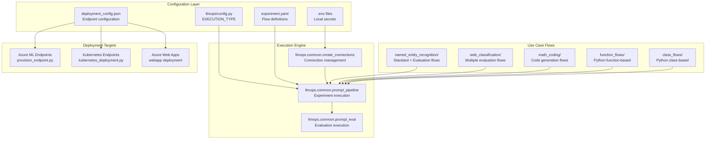

Sources: [llmops/config.py](), [README.md:86-113](), [docs/github_workflows_how_to_setup.md:34-41]()

### Configuration Management Flow

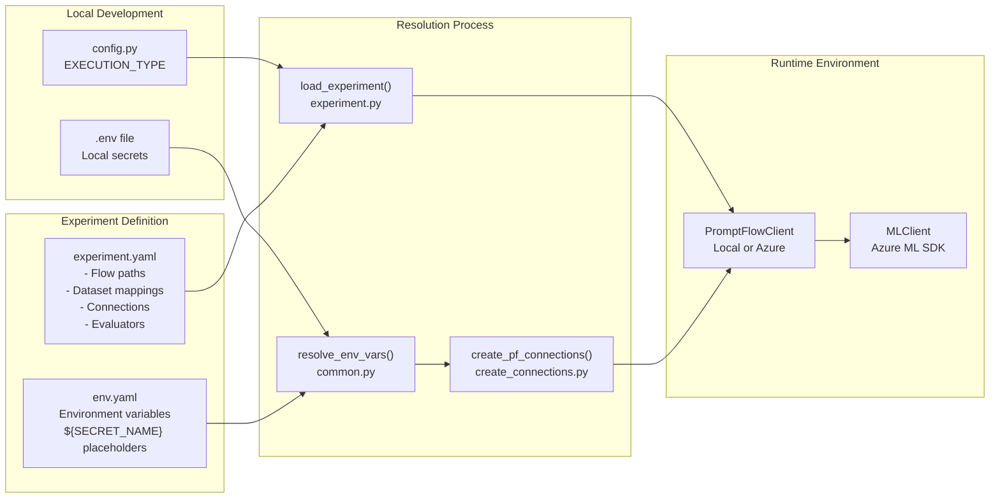

Sources: [llmops/common/experiment.py](), [llmops/common/common.py](), [llmops/common/create_connections.py]()

## Initial Setup

### 1. Repository Setup

Clone the repository and navigate to the project directory:

```bash
git clone https://github.com/microsoft/llmops-promptflow-template.git
cd llmops-promptflow-template
```

### 2. Environment Configuration

The system uses a centralized configuration approach through [llmops/config.py](). Set the execution type based on your requirements:

```python
# For local development and testing
EXECUTION_TYPE = "LOCAL"

# For Azure execution (local machine to Azure)
EXECUTION_TYPE = "AZURE"
```

### 3. Dependencies Installation

Install the core dependencies required for Prompt Flow execution:

```bash
# Install platform-specific requirements
pip install -r ./.github/requirements/execute_job_requirements.txt

# Install use case specific requirements (example: web_classification)
pip install -r ./web_classification/flows/experiment/requirements.txt
```

Sources: [docs/github_workflows_how_to_setup.md:49-57](), [llmops/config.py:37-41]()

## Local Execution Setup

### 1. Create Environment File

Create a `.env` file in the project root directory with your Azure credentials and API keys:

```bash
# Azure Configuration
SUBSCRIPTION_ID=your-subscription-id
RESOURCE_GROUP_NAME=your-resource-group
WORKSPACE_NAME=your-workspace-name
KEY_VAULT_NAME=your-key-vault-name

# Azure OpenAI Configuration
AOAI_API_KEY=your-azure-openai-api-key
AOAI_API_BASE=https://your-resource.openai.azure.com/

# Additional secrets as needed
```

### 2. Connection Configuration

The system automatically creates Prompt Flow connections based on your experiment configuration. Connections are defined in [experiment.yaml files using the following format:

```yaml
connections:
- name: aoai
  connection_type: AzureOpenAIConnection
  api_base: https://your-resource.openai.azure.com/
  api_version: 2023-07-01-preview
  api_key: ${AOAI_API_KEY}
  api_type: azure
```

The `${AOAI_API_KEY}` placeholder will be resolved from your `.env` file during execution.

Sources: [docs/github_workflows_how_to_setup.md:104-112](), [docs/faqs.md:346-354]()

## Azure Execution Setup

### 1. Service Principal Creation

Create an Azure Service Principal with Owner permissions for your subscription:

```bash
spname="your-service-principal-name"
roleName="Owner"
subscriptionId="your-subscription-id"
servicePrincipalName="Azure-ARM-${spname}"

az ad sp create-for-rbac --name $servicePrincipalName --role $roleName --scopes /subscriptions/$subscriptionId --sdk-auth
```

Save the output JSON for use in CI/CD platform configuration.

### 2. Azure ML Workspace Setup

Ensure your Azure ML workspace has the required Prompt Flow connections configured:

1. Navigate to Azure ML Studio
2. Go to Prompt Flow → Connections → Create → Azure OpenAI
3. Create a connection named `aoai` (or match your experiment.yaml configuration)
4. Configure with your Azure OpenAI endpoint and API key

Sources: [docs/github_workflows_how_to_setup.md:171-216](), [docs/github_workflows_how_to_setup.md:286-301]()

## First Prompt Flow Experiment

### 1. Choose a Use Case

The template includes several example use cases. Start with Named Entity Recognition as it's the highest priority flow:

| Use Case | Location | Flow Type | Complexity |
|----------|----------|-----------|------------|
| Named Entity Recognition | `./named_entity_recognition` | YAML-based | ⭐⭐ |
| Web Classification | `./web_classification` | YAML-based | ⭐⭐⭐ |
| Math Coding | `./math_coding` | YAML-based | ⭐⭐ |
| Function Flows | `./function_flows` | Python Functions | ⭐ |
| Class Flows | `./class_flows` | Python Classes | ⭐⭐ |

### 2. Execute Your First Experiment

Run a local experiment using the `prompt_pipeline.py` module:

```bash
# Set execution type to LOCAL in config.py first
python -m llmops.common.prompt_pipeline \
    --base_path ./named_entity_recognition \
    --variants standard_flow.variant_0
```

For Azure execution, ensure you're authenticated with Azure CLI and set `EXECUTION_TYPE = "AZURE"` in [llmops/config.py]():

```bash
az login
python -m llmops.common.prompt_pipeline \
    --base_path ./named_entity_recognition \
    --variants standard_flow.variant_0
```

### 3. Run Evaluation

After the experiment completes, run the evaluation flows:

```bash
python -m llmops.common.prompt_eval \
    --run_id run_id.txt \
    --base_path ./named_entity_recognition \
    --env_name dev
```

Sources: [docs/github_workflows_how_to_setup.md:43-66](), [docs/faqs.md:232-259]()

## Project Structure and Key Files

Understanding the project structure is essential for effective usage:

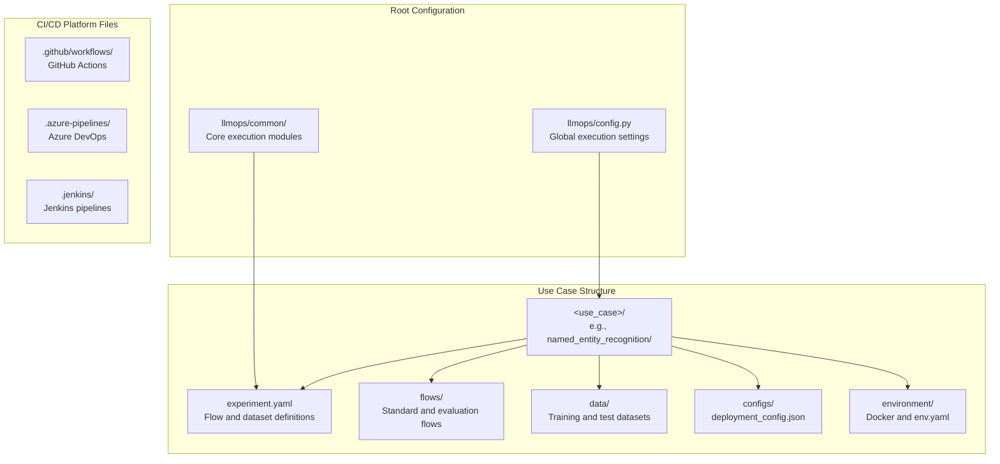

### Key Configuration Files

- [llmops/config.py]() - Global execution type configuration
- `<use_case>/experiment.yaml` - Flow definitions, datasets, and evaluators
- `<use_case>/configs/deployment_config.json` - Deployment endpoint configuration
- `<use_case>/environment/env.yaml` - Environment variables and secrets
- `.env` - Local development secrets (not committed to git)

Sources: [README.md:86-113](), [docs/experiment.yaml:1-124]()

## Next Steps

Once you have successfully run your first experiment, you can:

1. **Set up CI/CD Integration**: Choose your preferred platform and follow the detailed setup guides:
   - [GitHub Actions Setup](#4.1)
   - [Azure DevOps Setup](#4.2) 
   - [Jenkins Setup](#4.3)

2. **Explore Advanced Use Cases**: Examine the more complex examples like [Web Classification](#3.2) with multiple evaluation flows

3. **Create Custom Flows**: Learn how to add your own use cases by following the flow onboarding documentation

4. **Configure Deployments**: Set up automated deployments to [Azure ML Endpoints](#6.1), [Kubernetes](#6.2), or [Azure Web Apps](#6.3)

5. **Understand Configuration**: Deep dive into [Experiment Configuration](#7.1) and [Environment Management](#7.3)

The system provides a complete end-to-end solution for Prompt Flow development, from local experimentation to production deployment with comprehensive CI/CD integration.

Sources: [README.md:150-157](), [docs/github_workflows_how_to_setup.md:436-513]()

---

# Page: Use Cases and Prompt Flows

# Use Cases and Prompt Flows

<details>
<summary>Relevant source files</summary>

The following files were used as context for generating this wiki page:

- [.github/workflows/class_flows_pr_dev_workflow.yml](.github/workflows/class_flows_pr_dev_workflow.yml)
- [.github/workflows/function_flows_ci_dev_workflow.yml](.github/workflows/function_flows_ci_dev_workflow.yml)
- [.github/workflows/function_flows_pr_dev_workflow.yml](.github/workflows/function_flows_pr_dev_workflow.yml)
- [.github/workflows/math_coding_ci_dev_workflow.yml](.github/workflows/math_coding_ci_dev_workflow.yml)
- [.github/workflows/named_entity_recognition_ci_dev_workflow.yml](.github/workflows/named_entity_recognition_ci_dev_workflow.yml)
- [.github/workflows/web_classification_ci_dev_workflow.yml](.github/workflows/web_classification_ci_dev_workflow.yml)
- [chat_with_pdf/configs/deployment_config.json](chat_with_pdf/configs/deployment_config.json)
- [class_flows/configs/deployment_config.json](class_flows/configs/deployment_config.json)
- [docs/faqs.md](docs/faqs.md)
- [function_flows/configs/deployment_config.json](function_flows/configs/deployment_config.json)
- [math_coding/configs/deployment_config.json](math_coding/configs/deployment_config.json)
- [named_entity_recognition/configs/deployment_config.json](named_entity_recognition/configs/deployment_config.json)
- [web_classification/configs/deployment_config.json](web_classification/configs/deployment_config.json)

</details>


This document describes the different types of Prompt Flows supported by the LLMOps template and the example use cases provided for demonstrating various AI workload patterns. Each use case represents a complete end-to-end implementation including flow definition, experiment configuration, evaluation setup, and deployment configurations across multiple Azure compute targets.

For information about configuring individual experiments, see [Experiment Configuration](#7.1). For details about deploying flows to specific endpoints, see [Deployment](#6).

## Overview

The template provides six example use cases that demonstrate different Prompt Flow patterns and deployment scenarios. Each use case is organized as a self-contained module with its own configurations, data, and CI/CD pipelines.

### Use Case Architecture

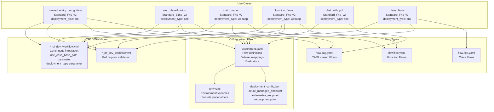

Sources: [named_entity_recognition/configs/deployment_config.json:1-56](), [web_classification/configs/deployment_config.json:1-56](), [math_coding/configs/deployment_config.json:1-56](), [function_flows/configs/deployment_config.json:1-56]()

## Supported Flow Types

The template supports three distinct types of Prompt Flows, each with different implementation patterns and use cases.

### Flow Type Implementation Map

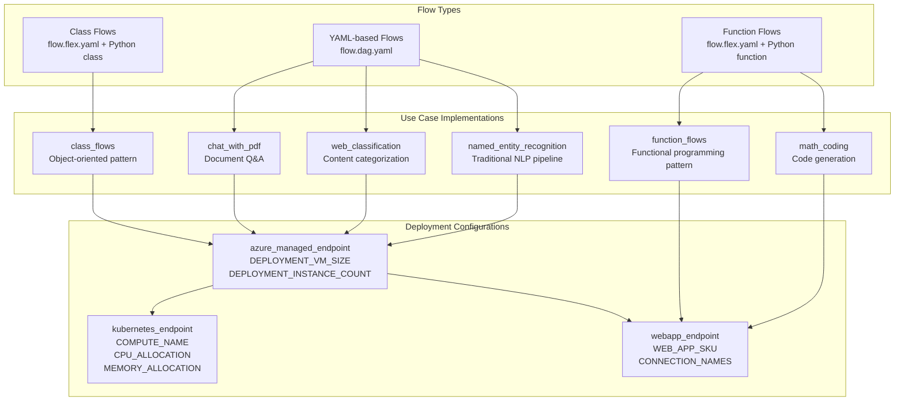

Sources: [docs/faqs.md:225-230](), [named_entity_recognition/configs/deployment_config.json:13](), [web_classification/configs/deployment_config.json:13](), [math_coding/configs/deployment_config.json:51]()

| Flow Type | Definition File | Implementation | Use Cases |
|-----------|----------------|----------------|-----------|
| YAML-based Flows | `flow.dag.yaml` | Declarative workflow definition | `named_entity_recognition`, `web_classification`, `chat_with_pdf` |
| Function Flows | `flow.flex.yaml` + Python function | Python function with decorator | `math_coding`, `function_flows` |
| Class Flows | `flow.flex.yaml` + Python class | Python class with methods | `class_flows` |

Sources: [docs/faqs.md:225-230]()

## Primary Use Cases

### Named Entity Recognition

The highest priority use case in the template, implementing traditional NLP entity extraction with optimized compute resources.

**Configuration Details:**
- **VM Size:** `Standard_F4s_v2` for balanced compute and memory
- **Default Deployment:** `deployment_type: "aml"` for Azure ML managed endpoints
- **Flow Type:** YAML-based flows using `flow.dag.yaml`

**CI/CD Integration:**
- Workflow: `named_entity_recognition_ci_dev_workflow.yml`
- Trigger paths: `named_entity_recognition/**`, `.github/**`, `llmops/**`
- Default parameters: `use_case_base_path: "named_entity_recognition"`

Sources: [named_entity_recognition/configs/deployment_config.json:13](), [.github/workflows/named_entity_recognition_ci_dev_workflow.yml:15](), [.github/workflows/named_entity_recognition_ci_dev_workflow.yml:38]()

### Web Classification

Content categorization use case with higher compute requirements for processing larger datasets.

**Configuration Details:**
- **VM Size:** `Standard_E16s_v3` for memory-intensive classification tasks
- **Default Deployment:** `deployment_type: "aml"` 
- **Flow Type:** YAML-based flows

**CI/CD Integration:**
- Workflow: `web_classification_ci_dev_workflow.yml`
- Trigger paths: `web_classification/**`, `.github/**`, `llmops/**`
- Default parameters: `use_case_base_path: "web_classification"`

Sources: [web_classification/configs/deployment_config.json:13](), [.github/workflows/web_classification_ci_dev_workflow.yml:15](), [.github/workflows/web_classification_ci_dev_workflow.yml:38]()

### Math Coding

Code generation use case demonstrating function-based flows with containerized web app deployment.

**Configuration Details:**
- **VM Size:** `Standard_F4s_v2` for code generation workloads
- **Default Deployment:** `deployment_type: "webapp"` for containerized deployment
- **Flow Type:** Function flows using `flow.flex.yaml`

**CI/CD Integration:**
- Workflow: `math_coding_ci_dev_workflow.yml`
- Trigger paths: `math_coding/**`, `.github/**`, `llmops/**`
- Default parameters: `use_case_base_path: "math_coding"`

Sources: [math_coding/configs/deployment_config.json:13](), [.github/workflows/math_coding_ci_dev_workflow.yml:15](), [.github/workflows/math_coding_ci_dev_workflow.yml:37]()

## Secondary Use Cases

### Function Flows

Demonstrates functional programming patterns for Prompt Flow implementations.

**Configuration Details:**
- **VM Size:** `Standard_F4s_v2`
- **Default Deployment:** `deployment_type: "webapp"`
- **Flow Type:** Function flows using Python functions

**CI/CD Integration:**
- PR Workflow: `function_flows_pr_dev_workflow.yml`
- CI Workflow: `function_flows_ci_dev_workflow.yml`
- Default parameters: `use_case_base_path: "function_flows"`

Sources: [function_flows/configs/deployment_config.json:13](), [.github/workflows/function_flows_ci_dev_workflow.yml:15](), [.github/workflows/function_flows_pr_dev_workflow.yml:15]()

### Class Flows

Object-oriented implementation pattern for complex Prompt Flow scenarios.

**Configuration Details:**
- **VM Size:** `Standard_F4s_v2`
- **Default Deployment:** `deployment_type: "aml"`
- **Flow Type:** Class flows using Python classes

**CI/CD Integration:**
- PR Workflow: `class_flows_pr_dev_workflow.yml`
- Trigger paths: `class_flows/**`, `.github/**`, `llmops/**`
- Default parameters: `use_case_base_path: "class_flows"`

Sources: [class_flows/configs/deployment_config.json:13](), [.github/workflows/class_flows_pr_dev_workflow.yml:15]()

### Chat with PDF

Document question-answering use case for processing PDF documents with AI.

**Configuration Details:**
- **VM Size:** `Standard_F4s_v2`
- **Default Deployment:** `deployment_type: "aml"`
- **Flow Type:** YAML-based flows
- **Special Feature:** `DEPLOYMENT_CONDA_PATH` support for custom environments

Sources: [chat_with_pdf/configs/deployment_config.json:13](), [chat_with_pdf/configs/deployment_config.json:33]()

## Deployment Configuration Pattern

Each use case follows a consistent deployment configuration pattern supporting three endpoint types:

### Deployment Configuration Structure

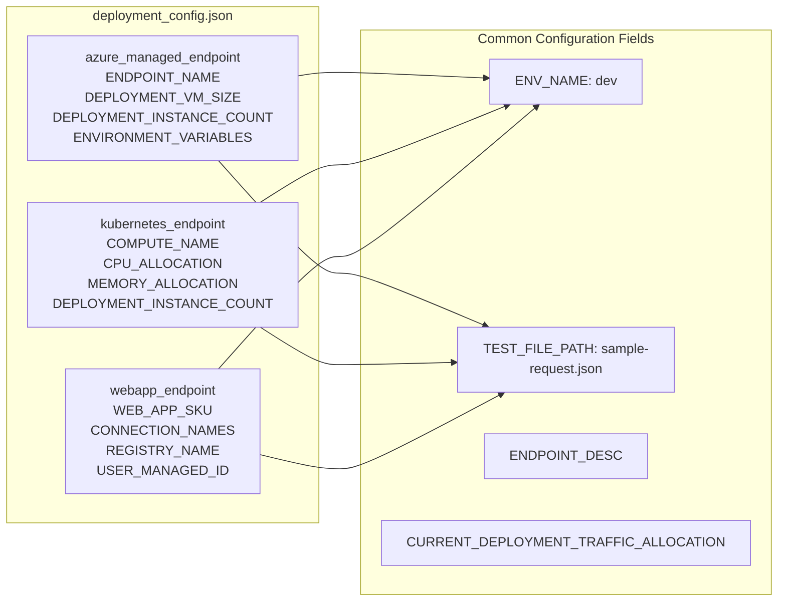

Sources: [named_entity_recognition/configs/deployment_config.json:2-18](), [named_entity_recognition/configs/deployment_config.json:20-39](), [named_entity_recognition/configs/deployment_config.json:41-55]()

| Configuration Field | Azure Managed | Kubernetes | Web App |
|---------------------|---------------|------------|---------|
| `ENV_NAME` | ✓ | ✓ | ✓ |
| `TEST_FILE_PATH` | ✓ | ✓ | ✓ |
| `DEPLOYMENT_VM_SIZE` | ✓ | ✓ | - |
| `CPU_ALLOCATION` | - | ✓ | - |
| `MEMORY_ALLOCATION` | - | ✓ | - |
| `WEB_APP_SKU` | - | - | ✓ |
| `CONNECTION_NAMES` | - | - | ✓ |

Sources: [named_entity_recognition/configs/deployment_config.json:1-56](), [web_classification/configs/deployment_config.json:1-56](), [function_flows/configs/deployment_config.json:1-56]()

## Use Case Selection Guidelines

| Scenario | Recommended Use Case | Reason |
|----------|---------------------|---------|
| NLP entity extraction | `named_entity_recognition` | Optimized for text processing with balanced compute |
| Content categorization | `web_classification` | High-memory VM for large-scale classification |
| Code generation | `math_coding` | Function-based flows with web app deployment |
| Custom function patterns | `function_flows` | Pure function implementation example |
| Object-oriented patterns | `class_flows` | Class-based implementation with Azure ML |
| Document processing | `chat_with_pdf` | Document-specific processing pipeline |

The use cases are designed to be starting templates that can be customized for specific AI workload requirements while maintaining the established CI/CD and deployment patterns.

Sources: [named_entity_recognition/configs/deployment_config.json:7](), [web_classification/configs/deployment_config.json:7](), [math_coding/configs/deployment_config.json:7](), [function_flows/configs/deployment_config.json:7](), [class_flows/configs/deployment_config.json:7](), [chat_with_pdf/configs/deployment_config.json:7]()

---

# Page: Named Entity Recognition

# Named Entity Recognition

<details>
<summary>Relevant source files</summary>

The following files were used as context for generating this wiki page:

- [.github/workflows/math_coding_ci_dev_workflow.yml](.github/workflows/math_coding_ci_dev_workflow.yml)
- [.github/workflows/math_coding_pr_dev_workflow.yml](.github/workflows/math_coding_pr_dev_workflow.yml)
- [.github/workflows/named_entity_recognition_ci_dev_workflow.yml](.github/workflows/named_entity_recognition_ci_dev_workflow.yml)
- [.github/workflows/named_entity_recognition_pr_dev_workflow.yml](.github/workflows/named_entity_recognition_pr_dev_workflow.yml)
- [.github/workflows/web_classification_ci_dev_workflow.yml](.github/workflows/web_classification_ci_dev_workflow.yml)
- [.github/workflows/web_classification_pr_dev_workflow.yml](.github/workflows/web_classification_pr_dev_workflow.yml)
- [chat_with_pdf/configs/deployment_config.json](chat_with_pdf/configs/deployment_config.json)
- [class_flows/configs/deployment_config.json](class_flows/configs/deployment_config.json)
- [function_flows/configs/deployment_config.json](function_flows/configs/deployment_config.json)
- [math_coding/configs/deployment_config.json](math_coding/configs/deployment_config.json)
- [named_entity_recognition/configs/deployment_config.json](named_entity_recognition/configs/deployment_config.json)
- [web_classification/configs/deployment_config.json](web_classification/configs/deployment_config.json)

</details>


## Purpose and Scope

This document covers the Named Entity Recognition (NER) use case implementation within the LLMOps Prompt Flow template. The NER use case serves as the primary example flow and represents the highest priority template with an importance score of 25.91 in the system architecture. This page details the flow structure, deployment configurations, and CI/CD integration specific to the NER use case.

For information about other use cases like Web Classification or Math Coding, see [Other Use Cases](#3.3). For general deployment concepts, see [Deployment](#6). For CI/CD platform details, see [CI/CD Platforms](#4).

## Use Case Overview

The Named Entity Recognition use case demonstrates how to implement an LLM-powered entity extraction flow using the LLMOps template. This use case is configured as the default example and primary reference implementation for the template's capabilities.

**Flow Characteristics:**
- **Use Case Base Path**: `named_entity_recognition`
- **Default Deployment Type**: `aml` (Azure ML Managed Endpoints)
- **Primary VM Size**: `Standard_F4s_v2`
- **Template Priority**: Highest (25.91 importance score)

Sources: [named_entity_recognition/configs/deployment_config.json:1-56](), [.github/workflows/named_entity_recognition_ci_dev_workflow.yml:15-38]()

## Flow Architecture

The NER use case follows the standard LLMOps template architecture pattern, integrating with the core experiment execution and deployment engine.

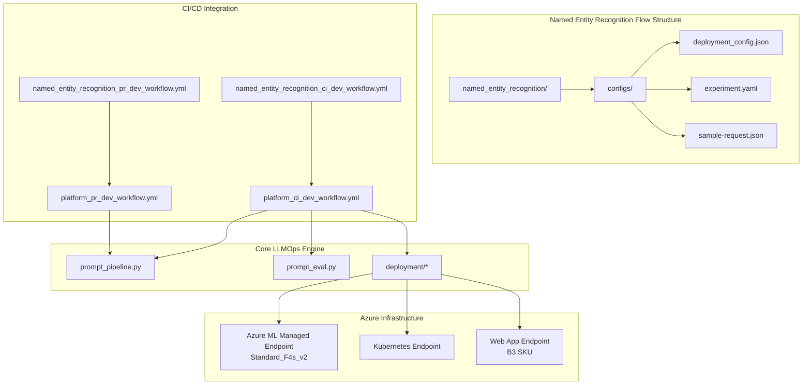

Sources: [.github/workflows/named_entity_recognition_pr_dev_workflow.yml:1-37](), [.github/workflows/named_entity_recognition_ci_dev_workflow.yml:1-43]()

## Deployment Configuration

The NER use case supports three deployment targets, each with specific configuration requirements defined in the `deployment_config.json` file.

### Azure ML Managed Endpoint Configuration

| Configuration | Value | Description |
|---------------|--------|-------------|
| `DEPLOYMENT_VM_SIZE` | `Standard_F4s_v2` | Compute SKU for the endpoint |
| `DEPLOYMENT_INSTANCE_COUNT` | `1` | Number of instances |
| `CURRENT_DEPLOYMENT_TRAFFIC_ALLOCATION` | `"100"` | Traffic allocation percentage |
| `TEST_FILE_PATH` | `"sample-request.json"` | Test payload file |

### Kubernetes Endpoint Configuration

| Configuration | Value | Description |
|---------------|--------|-------------|
| `CURRENT_DEPLOYMENT_TRAFFIC_ALLOCATION` | `100` | Traffic allocation (numeric) |
| `DEPLOYMENT_INSTANCE_COUNT` | `1` | Number of instances |
| `CPU_ALLOCATION` | `""` | CPU resource allocation |
| `MEMORY_ALLOCATION` | `""` | Memory resource allocation |

### Web App Endpoint Configuration

| Configuration | Value | Description |
|---------------|--------|-------------|
| `WEB_APP_SKU` | `"B3"` | Azure App Service SKU |
| `TEST_FILE_PATH` | `"sample-request.json"` | Test payload file |
| `USER_MANAGED_ID` | `""` | Managed identity for authentication |

Sources: [named_entity_recognition/configs/deployment_config.json:2-18](), [named_entity_recognition/configs/deployment_config.json:20-39](), [named_entity_recognition/configs/deployment_config.json:41-55]()

## CI/CD Workflow Integration

The NER use case implements dedicated CI/CD workflows that integrate with the platform-level workflow orchestration.

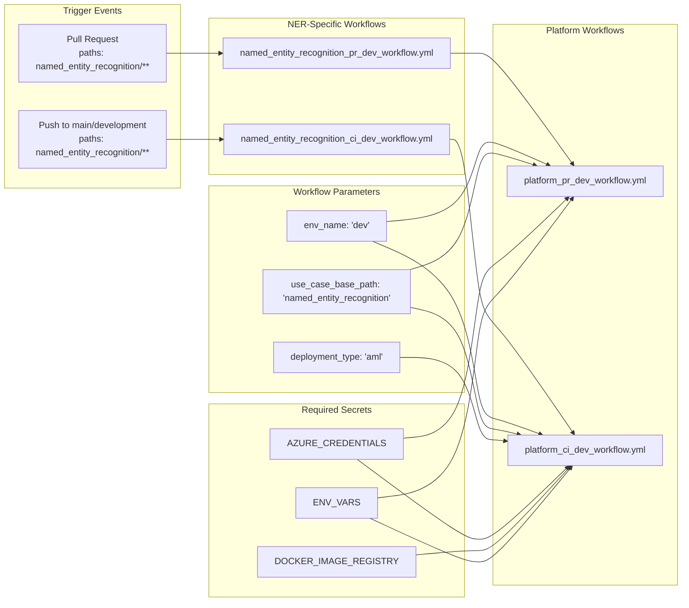

### Pull Request Workflow

The `named_entity_recognition_pr_dev_workflow.yml` triggers on pull requests affecting NER-specific paths and delegates to the platform PR workflow for experiment validation.

**Workflow Configuration:**
- **Trigger Paths**: `named_entity_recognition/**`, `.github/**`, `llmops/**`
- **Target Branches**: `main`, `development`
- **Default Environment**: `pr`
- **Platform Workflow**: `platform_pr_dev_workflow.yml`

### Continuous Integration Workflow

The `named_entity_recognition_ci_dev_workflow.yml` triggers on pushes to main branches and executes the full CI pipeline including deployment.

**Workflow Configuration:**
- **Trigger Paths**: `named_entity_recognition/**`, `.github/**`, `llmops/**`
- **Target Branches**: `main`, `development`  
- **Default Environment**: `dev`
- **Default Deployment Type**: `aml`
- **Platform Workflow**: `platform_ci_dev_workflow.yml`

Sources: [.github/workflows/named_entity_recognition_pr_dev_workflow.yml:16-23](), [.github/workflows/named_entity_recognition_ci_dev_workflow.yml:20-27](), [.github/workflows/named_entity_recognition_pr_dev_workflow.yml:30-36](), [.github/workflows/named_entity_recognition_ci_dev_workflow.yml:34-42]()

## Environment Variables and Configuration

The NER use case supports environment-specific configuration through the deployment configuration structure.

### Standard Environment Variables

All deployment types support the `ENVIRONMENT_VARIABLES` section for runtime configuration:

```json
"ENVIRONMENT_VARIABLES": {
    "example-name": "example-value"
}
```

### Web App Specific Configuration

The webapp endpoint deployment requires additional configuration for Azure Container Registry integration:

| Configuration | Purpose |
|---------------|---------|
| `CONNECTION_NAMES` | Prompt Flow connections required |
| `REGISTRY_NAME` | Azure Container Registry name |
| `REGISTRY_RG_NAME` | Registry resource group |
| `APP_PLAN_NAME` | App Service plan name |
| `WEB_APP_NAME` | Web application name |
| `WEB_APP_RG_NAME` | Web app resource group |

Sources: [named_entity_recognition/configs/deployment_config.json:15-17](), [named_entity_recognition/configs/deployment_config.json:45-52]()

## Integration with Core LLMOps Engine

The NER use case integrates with the core LLMOps engine through standardized parameters and workflow delegation patterns.

**Key Integration Points:**
- **Use Case Base Path**: `named_entity_recognition` parameter passed to platform workflows
- **Deployment Type**: Defaults to `aml` for Azure ML managed endpoints
- **Environment Name**: Configurable through workflow inputs (`dev`, `pr`)
- **Secret Management**: Delegates to platform workflows for Azure credential handling

The NER use case serves as the reference implementation for how other use cases should structure their configuration and workflow integration within the LLMOps template.

Sources: [.github/workflows/named_entity_recognition_ci_dev_workflow.yml:36-38](), [.github/workflows/named_entity_recognition_pr_dev_workflow.yml:32-33]()

---

# Page: Web Classification

# Web Classification

<details>
<summary>Relevant source files</summary>

The following files were used as context for generating this wiki page:

- [.azure-pipelines/templates/configure_azureml_agent.yml](.azure-pipelines/templates/configure_azureml_agent.yml)
- [.github/workflows/build_validation_workflow.yml](.github/workflows/build_validation_workflow.yml)
- [chat_with_pdf/configs/deployment_config.json](chat_with_pdf/configs/deployment_config.json)
- [class_flows/configs/deployment_config.json](class_flows/configs/deployment_config.json)
- [function_flows/configs/deployment_config.json](function_flows/configs/deployment_config.json)
- [math_coding/.azure-pipelines/math_coding_ci_dev_pipeline.yml](math_coding/.azure-pipelines/math_coding_ci_dev_pipeline.yml)
- [math_coding/.azure-pipelines/math_coding_pr_dev_pipeline.yml](math_coding/.azure-pipelines/math_coding_pr_dev_pipeline.yml)
- [math_coding/configs/deployment_config.json](math_coding/configs/deployment_config.json)
- [named_entity_recognition/.azure-pipelines/named_entity_recognition_ci_dev_pipeline.yml](named_entity_recognition/.azure-pipelines/named_entity_recognition_ci_dev_pipeline.yml)
- [named_entity_recognition/.azure-pipelines/named_entity_recognition_pr_dev_pipeline.yml](named_entity_recognition/.azure-pipelines/named_entity_recognition_pr_dev_pipeline.yml)
- [named_entity_recognition/configs/deployment_config.json](named_entity_recognition/configs/deployment_config.json)
- [web_classification/.azure-pipelines/web_classification_ci_dev_pipeline.yml](web_classification/.azure-pipelines/web_classification_ci_dev_pipeline.yml)
- [web_classification/.azure-pipelines/web_classification_pr_dev_pipeline.yml](web_classification/.azure-pipelines/web_classification_pr_dev_pipeline.yml)
- [web_classification/configs/deployment_config.json](web_classification/configs/deployment_config.json)
- [web_classification/flows/experiment/.promptflow/flow.tools.json](web_classification/flows/experiment/.promptflow/flow.tools.json)
- [web_classification/flows/experiment/flow.dag.yaml](web_classification/flows/experiment/flow.dag.yaml)

</details>


## Purpose and Scope

This document covers the Web Classification use case, one of the example Prompt Flows provided in the LLMOps template. The Web Classification flow demonstrates how to build an end-to-end pipeline that fetches content from web URLs, summarizes the content using LLMs, and classifies websites into categories with supporting evidence.

For information about other use cases like Named Entity Recognition, see [Named Entity Recognition](#3.1). For details about the core LLMOps execution engine, see [Core LLMOps Engine](#5).

## Flow Overview

The Web Classification flow is designed to automatically categorize websites by analyzing their content. It takes a URL as input and returns both a classification category and evidence supporting that classification. The flow leverages Azure OpenAI models for both content summarization and classification tasks.

**Flow Characteristics:**
- **Input**: URL (string)
- **Outputs**: Category (string), Evidence (string)
- **Default Deployment VM**: `Standard_E16s_v3` (larger than other flows due to content processing requirements)
- **Default Deployment Type**: Azure ML managed endpoints

Sources: [web_classification/flows/experiment/flow.dag.yaml:1-87](), [web_classification/configs/deployment_config.json:1-56]()

## Flow Architecture

The Web Classification flow consists of five interconnected nodes that process web content through multiple stages:

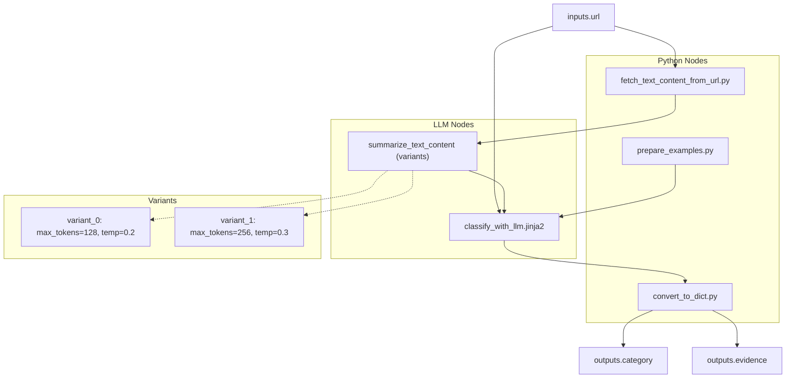

**Node Details:**

| Node | Type | Function | Connection |
|------|------|----------|------------|
| `fetch_text_content_from_url` | Python | Extracts text content from URL | - |
| `summarize_text_content` | LLM | Summarizes extracted content | `aoai` |
| `prepare_examples` | Python | Generates classification examples | - |
| `classify_with_llm` | LLM | Classifies content with evidence | `aoai` |
| `convert_to_dict` | Python | Converts output to structured format | - |

Sources: [web_classification/flows/experiment/flow.dag.yaml:13-84](), [web_classification/flows/experiment/.promptflow/flow.tools.json:1-77]()

## Deployment Configuration

### Deployment Targets

The Web Classification flow supports three deployment configurations, each optimized for different scenarios:

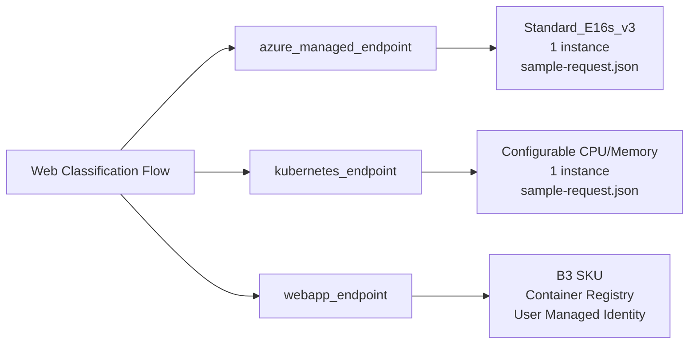

### Resource Specifications

| Deployment Type | VM Size | Instance Count | Special Configuration |
|-----------------|---------|----------------|----------------------|
| Azure ML Managed | `Standard_E16s_v3` | 1 | Environment variables support |
| Kubernetes | Configurable | 1 | CPU/Memory allocation, Compute name |
| Web App | N/A (B3 SKU) | N/A | Container registry, App plan, Resource group |

**Key Configuration Differences:**
- **Azure ML**: Uses `Standard_E16s_v3` VM size (larger than other flows' `Standard_F4s_v2`)
- **Kubernetes**: Allows custom `CPU_ALLOCATION` and `MEMORY_ALLOCATION` settings
- **Web App**: Requires container registry configuration and user-managed identity

Sources: [web_classification/configs/deployment_config.json:1-56]()

## CI/CD Integration

### Pipeline Structure

The Web Classification flow integrates with the platform's CI/CD system through dedicated pipeline files:

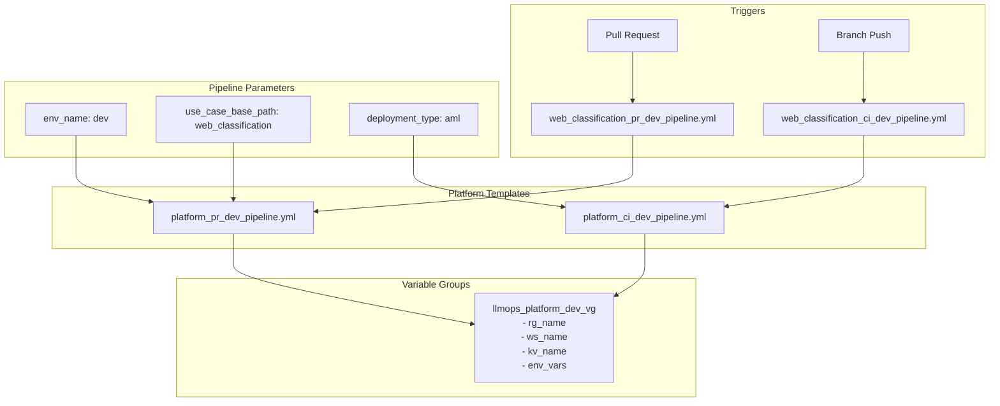

### Pipeline Configuration

**CI Pipeline** ([web_classification_ci_dev_pipeline.yml:1-44]()):
- **Triggers**: `main` and `development` branches
- **Paths**: Changes to `.azure-pipelines/*`, `llmops/*`, `web_classification/*`
- **Default deployment**: `aml` (Azure ML managed endpoints)
- **VM Image**: `ubuntu-latest`

**PR Pipeline** ([web_classification_pr_dev_pipeline.yml:1-37]()):
- **Triggers**: Pull requests to `main` and `development`
- **Environment**: `pr` (separate from production)
- **Scope**: Experiment and evaluation only (no deployment)

Sources: [web_classification/.azure-pipelines/web_classification_ci_dev_pipeline.yml:1-44](), [web_classification/.azure-pipelines/web_classification_pr_dev_pipeline.yml:1-37]()

## Flow Variants and Configuration

### LLM Variants

The `summarize_text_content` node uses a variant system to test different model parameters:

| Variant | Max Tokens | Temperature | Template File |
|---------|------------|-------------|---------------|
| `variant_0` (default) | 128 | 0.2 | `summarize_text_content.jinja2` |
| `variant_1` | 256 | 0.3 | `summarize_text_content__variant_1.jinja2` |

### Connection Configuration

All LLM nodes in the flow use:
- **Connection**: `aoai` (Azure OpenAI)
- **Deployment**: `gpt-35-turbo`
- **API**: `chat`
- **Provider**: `AzureOpenAI`

### Environment Requirements

The flow specifies its dependencies in `requirements.txt` for proper execution in deployed environments.

Sources: [web_classification/flows/experiment/flow.dag.yaml:51-84](), [web_classification/flows/experiment/flow.dag.yaml:85-87]()

---

# Page: Other Use Cases

# Other Use Cases

<details>
<summary>Relevant source files</summary>

The following files were used as context for generating this wiki page:

- [.github/workflows/class_flows_pr_dev_workflow.yml](.github/workflows/class_flows_pr_dev_workflow.yml)
- [.github/workflows/function_flows_ci_dev_workflow.yml](.github/workflows/function_flows_ci_dev_workflow.yml)
- [.github/workflows/function_flows_pr_dev_workflow.yml](.github/workflows/function_flows_pr_dev_workflow.yml)
- [.jenkins/pipelines/chat_with_pdf_ci_dev](.jenkins/pipelines/chat_with_pdf_ci_dev)
- [.jenkins/pipelines/chat_with_pdf_pr_dev](.jenkins/pipelines/chat_with_pdf_pr_dev)
- [.jenkins/pipelines/class_flows_ci_dev](.jenkins/pipelines/class_flows_ci_dev)
- [.jenkins/pipelines/class_flows_pr_dev](.jenkins/pipelines/class_flows_pr_dev)
- [.jenkins/pipelines/flex_flows_ci_dev](.jenkins/pipelines/flex_flows_ci_dev)
- [.jenkins/pipelines/flex_flows_pr_dev](.jenkins/pipelines/flex_flows_pr_dev)
- [chat_with_pdf/configs/deployment_config.json](chat_with_pdf/configs/deployment_config.json)
- [class_flows/configs/deployment_config.json](class_flows/configs/deployment_config.json)
- [docs/faqs.md](docs/faqs.md)
- [function_flows/configs/deployment_config.json](function_flows/configs/deployment_config.json)
- [math_coding/configs/deployment_config.json](math_coding/configs/deployment_config.json)
- [named_entity_recognition/configs/deployment_config.json](named_entity_recognition/configs/deployment_config.json)
- [web_classification/configs/deployment_config.json](web_classification/configs/deployment_config.json)

</details>


This page documents the additional Prompt Flow use cases provided in the template beyond Named Entity Recognition and Web Classification. These use cases demonstrate different flow types and implementation patterns that can be used as starting points for new projects.

For detailed information about the primary use cases, see [Named Entity Recognition](#3.1) and [Web Classification](#3.2). For general information about use cases and prompt flows, see [Use Cases and Prompt Flows](#3).

## Overview

The template includes four additional use cases that showcase different implementation patterns and flow types:

| Use Case | Importance Score | Primary Flow Type | Description |
|----------|------------------|-------------------|-------------|
| Math Coding | 11.61 | Function/Class | Mathematical problem solving with code generation |
| Function Flows | 9.76 | Function | Python function-based flow implementation |
| Class Flows | 3.76 | Class | Python class-based flow implementation |
| Chat with PDF | 3.93 | Document Processing | Document-based conversational AI |

All use cases follow the same LLMOps patterns established by the primary use cases, with consistent configuration structures and CI/CD pipeline integration.

## Flow Type Architecture

The template supports three distinct flow implementation patterns:

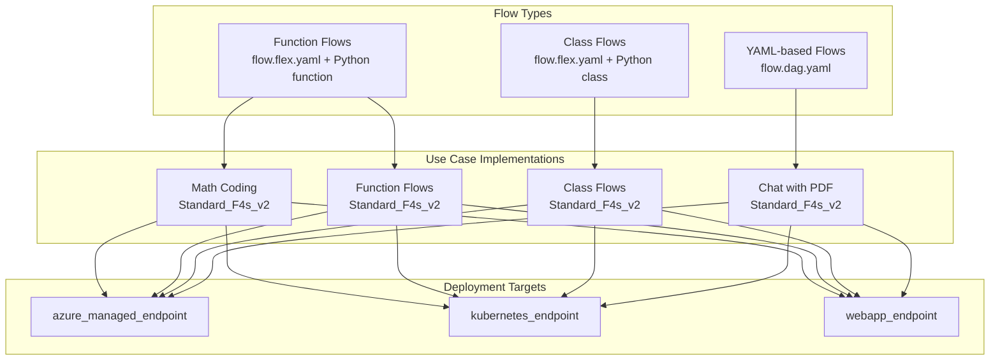

Sources: [docs/faqs.md:225-230](), [math_coding/configs/deployment_config.json:1-56](), [function_flows/configs/deployment_config.json:1-56](), [class_flows/configs/deployment_config.json:1-56](), [chat_with_pdf/configs/deployment_config.json:1-57]()

## Math Coding Use Case

The Math Coding use case demonstrates mathematical problem-solving capabilities with code generation. It uses a Standard_F4s_v2 VM configuration across all deployment types.

### Configuration Characteristics

- **Endpoint Description**: "An online endpoint serving a flow for math coding flow"
- **VM Size**: Standard_F4s_v2 for Azure managed endpoints
- **Deployment Instance Count**: 1
- **Kubernetes VM Size**: "promptinstancetype" (specialized configuration)

### Deployment Configuration Structure

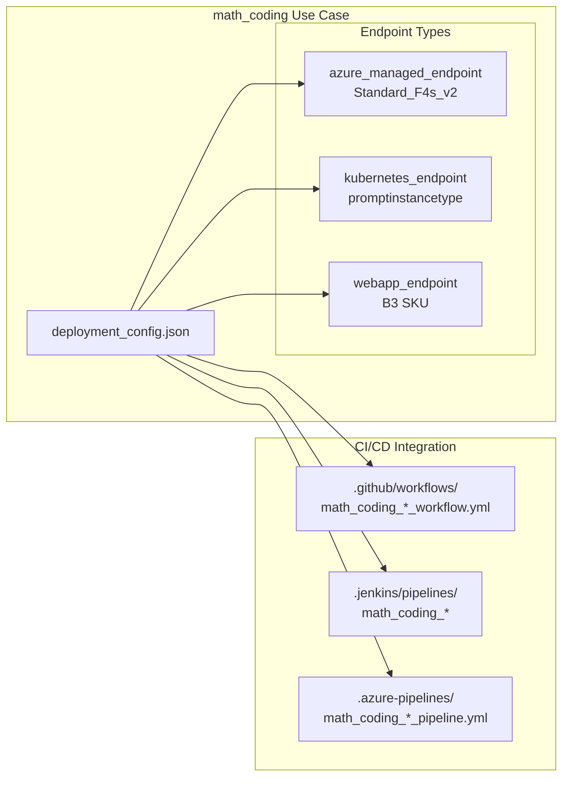

Sources: [math_coding/configs/deployment_config.json:1-56]()

## Function Flows Use Case

Function Flows demonstrate Python function-based flow implementation using the `flow.flex.yaml` pattern.

### Implementation Pattern

Function Flows use Python functions as the primary execution unit, defined alongside a `flow.flex.yaml` configuration file. The flow is described as a "pythin function based flow" in the deployment configuration.

### Configuration Details

- **Endpoint Description**: "An online endpoint serving a flow for pythin function based flow"
- **VM Size**: Standard_F4s_v2
- **Deployment Type**: Supports all three endpoint types (AML, Kubernetes, WebApp)

Sources: [function_flows/configs/deployment_config.json:1-56](), [docs/faqs.md:227]()

## Class Flows Use Case

Class Flows demonstrate Python class-based flow implementation, providing an object-oriented approach to flow definition.

### Implementation Pattern

Class Flows use Python classes as the primary execution unit, defined alongside a `flow.flex.yaml` configuration file. This pattern is suitable for more complex flows that benefit from object-oriented design.

### Configuration Details

- **Endpoint Description**: "An online endpoint serving a flow for python class based flow"
- **VM Size**: Standard_F4s_v2
- **Deployment Type**: Supports all three endpoint types

### Evaluation Integration

Class Flows include specialized evaluation capabilities, including `eval_nlp` evaluation that can run as pure Python script-based evaluations without requiring bulk run experiments.

Sources: [class_flows/configs/deployment_config.json:1-56](), [docs/faqs.md:228](), [docs/faqs.md:285-286]()

## Chat with PDF Use Case

The Chat with PDF use case demonstrates document processing capabilities for conversational AI applications.

### Document Processing Features

This use case showcases document-based conversational AI, likely involving PDF parsing, text extraction, and context-aware responses.

### Configuration Details

- **Endpoint Description**: "An online endpoint serving a flow for chat with pdf flow"
- **VM Size**: Standard_F4s_v2
- **Kubernetes Configuration**: Includes additional `DEPLOYMENT_CONDA_PATH` parameter
- **Deployment Type**: Supports all three endpoint types

### Unique Configuration Elements

The Chat with PDF use case includes a unique configuration element in its Kubernetes endpoint:

```json
"DEPLOYMENT_CONDA_PATH": ""
```

This suggests specialized environment management for document processing dependencies.

Sources: [chat_with_pdf/configs/deployment_config.json:1-57]()

## Common Deployment Patterns

All other use cases follow consistent deployment configuration patterns:

### Standard Configuration Elements

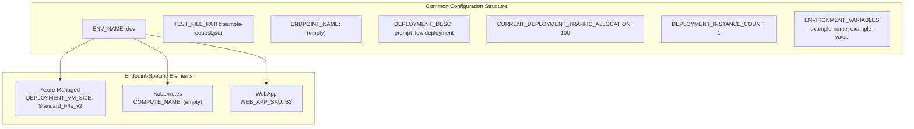

### WebApp Endpoint Configuration

All use cases include consistent WebApp endpoint configuration:

- **App Plan SKU**: B3
- **Connection Names**: Empty array requiring configuration
- **Registry Configuration**: Requires `REGISTRY_NAME` and `REGISTRY_RG_NAME`
- **Managed Identity**: Requires `USER_MANAGED_ID` configuration

Sources: [math_coding/configs/deployment_config.json:41-56](), [function_flows/configs/deployment_config.json:41-56](), [class_flows/configs/deployment_config.json:41-56](), [chat_with_pdf/configs/deployment_config.json:42-57]()

## CI/CD Pipeline Integration

All other use cases integrate with the same CI/CD pipeline structure as the primary use cases:

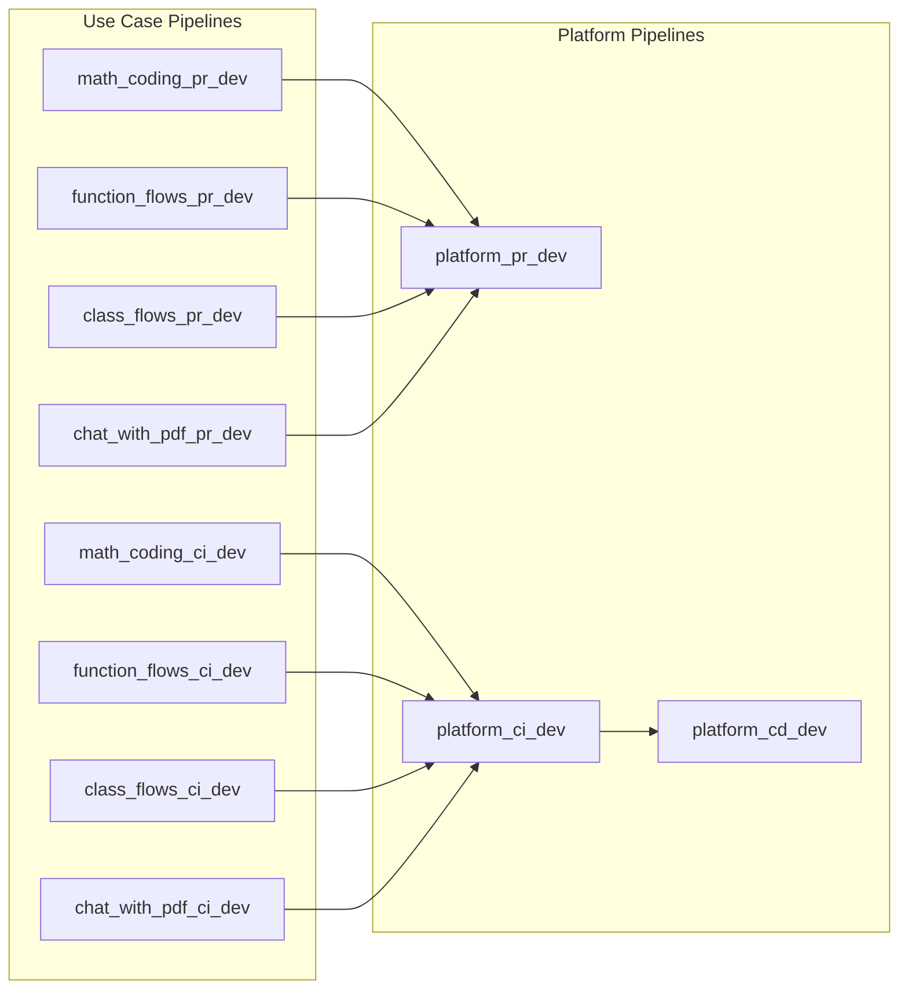

### Pipeline Parameters

All use case pipelines accept the same core parameters:

- **env_name**: Environment name (pr, dev, prod)
- **use_case_base_path**: Path to the use case folder
- **deployment_type**: Deployment target type (aml, aks, webapp)
- **rg_name**: Azure Resource Group Name
- **ws_name**: Azure ML Workspace Name
- **kv_name**: Azure Key Vault Name (for CI pipelines)

Sources: [.jenkins/pipelines/class_flows_pr_dev:1-44](), [.jenkins/pipelines/chat_with_pdf_pr_dev:1-44](), [.jenkins/pipelines/class_flows_ci_dev:1-48](), [.jenkins/pipelines/chat_with_pdf_ci_dev:1-48](), [.github/workflows/class_flows_pr_dev_workflow.yml:1-38](), [.github/workflows/function_flows_ci_dev_workflow.yml:1-43](), [.github/workflows/function_flows_pr_dev_workflow.yml:1-38]()

---

# Page: CI/CD Platforms

# CI/CD Platforms

<details>
<summary>Relevant source files</summary>

The following files were used as context for generating this wiki page:

- [.azure-pipelines/platform_ci_dev_pipeline.yml](.azure-pipelines/platform_ci_dev_pipeline.yml)
- [.azure-pipelines/platform_pr_dev_pipeline.yml](.azure-pipelines/platform_pr_dev_pipeline.yml)
- [.azure-pipelines/templates/aml_real_deployment.yml](.azure-pipelines/templates/aml_real_deployment.yml)
- [.azure-pipelines/templates/kubernetes_deployment.yml](.azure-pipelines/templates/kubernetes_deployment.yml)
- [.jenkins/jobs/prepare_docker_image](.jenkins/jobs/prepare_docker_image)
- [.jenkins/jobs/webapp_deployment](.jenkins/jobs/webapp_deployment)
- [.jenkins/pipelines/platform_cd_dev](.jenkins/pipelines/platform_cd_dev)
- [README.md](README.md)
- [docs/Azure_devops_how_to_setup.md](docs/Azure_devops_how_to_setup.md)
- [docs/experiment.yaml](docs/experiment.yaml)
- [docs/github_workflows_how_to_setup.md](docs/github_workflows_how_to_setup.md)
- [docs/jenkins_how_to_setup.md](docs/jenkins_how_to_setup.md)
- [named_entity_recognition/environment/conda.yml](named_entity_recognition/environment/conda.yml)

</details>


This document provides an overview of the three CI/CD platforms supported by the LLMOps Prompt Flow template and guidance for choosing between them. The template provides complete CI/CD automation for Prompt Flow experimentation, evaluation, and deployment across GitHub Actions, Azure DevOps Pipelines, and Jenkins.

For detailed setup instructions for each platform, see [GitHub Actions](#4.1), [Azure DevOps Pipelines](#4.2), and [Jenkins](#4.3). For information about the core execution engine that these platforms orchestrate, see [Core LLMOps Engine](#5).

## Supported Platforms Overview

The template supports three major CI/CD platforms with functionally equivalent capabilities:

| Platform | Strengths | Configuration Location | Key Features |
|----------|-----------|----------------------|--------------|
| **GitHub Actions** | Native Git integration, extensive marketplace | [.github/workflows/]() | GitHub Secrets, Environment variables, Matrix builds |
| **Azure DevOps** | Enterprise integration, advanced approval gates | [.azure-pipelines/]() | Variable groups, Service connections, Manual validation |  
| **Jenkins** | Maximum flexibility, on-premises support | [.jenkins/]() | Declarative pipelines, Shared libraries, Credential management |

All platforms provide identical functionality for Prompt Flow operations including experimentation, evaluation, model registration, and deployment to multiple targets (Azure ML, Kubernetes, Azure Web Apps).

Sources: [README.md:5](), [docs/github_workflows_how_to_setup.md:5-6](), [docs/Azure_devops_how_to_setup.md:4-5](), [docs/jenkins_how_to_setup.md:5-6]()

## Common Workflow Architecture

**Multi-Platform CI/CD Pipeline Flow**

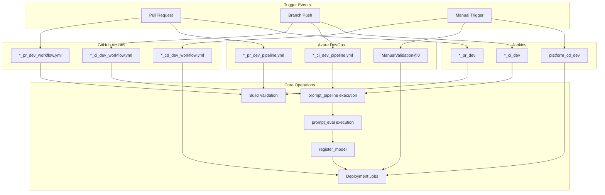

Sources: [.azure-pipelines/platform_ci_dev_pipeline.yml:22-294](), [docs/github_workflows_how_to_setup.md:251-256](), [docs/jenkins_how_to_setup.md:253-256]()

## Core Execution Pipeline

**Common LLMOps Pipeline Stages**

```mermaid
flowchart LR
    subgraph "Stage 1: Validation"
        BUILD_VAL["build_validation_pipeline.yml<br/>Code quality checks"]
    end
    
    subgraph "Stage 2: Experiment"
        REG_DATA["register_data_asset<br/>Upload datasets"]
        PROMPT_PIPE["prompt_pipeline<br/>Execute flows"]
        EVAL_FLOWS["prompt_eval<br/>Run evaluators"]
    end
    
    subgraph "Stage 3: Deployment"
        REG_MODEL["register_model<br/>Model registration"]
        PROVISION_EP["provision_endpoint<br/>Create endpoints"]
        DEPLOY_MODEL["provision_deployment<br/>Deploy to target"]
        TEST_EP["test_model_on_*<br/>Endpoint testing"]
    end
    
    BUILD_VAL --> REG_DATA
    REG_DATA --> PROMPT_PIPE
    PROMPT_PIPE --> EVAL_FLOWS
    EVAL_FLOWS --> REG_MODEL
    REG_MODEL --> PROVISION_EP
    PROVISION_EP --> DEPLOY_MODEL
    DEPLOY_MODEL --> TEST_EP
```

All platforms execute the same underlying Python modules from the `llmops.common` package, ensuring consistent behavior regardless of the chosen CI/CD platform.

Sources: [.azure-pipelines/platform_ci_dev_pipeline.yml:58-141](), [llmops/common/prompt_pipeline.py](), [llmops/common/prompt_eval.py](), [llmops/common/deployment/register_model.py]()

## File Organization by Platform

### Directory Structure

```
├── .github/workflows/          # GitHub Actions workflows
│   ├── *_pr_dev_workflow.yml  # Pull request workflows  
│   ├── *_ci_dev_workflow.yml  # Continuous integration
│   └── *_cd_dev_workflow.yml  # Continuous deployment
├── .azure-pipelines/          # Azure DevOps pipelines
│   ├── *_pr_dev_pipeline.yml  # Pull request pipelines
│   ├── *_ci_dev_pipeline.yml  # Continuous integration  
│   └── templates/             # Reusable pipeline templates
├── .jenkins/                  # Jenkins declarative pipelines
│   ├── pipelines/             # Main pipeline definitions
│   │   ├── *_pr_dev          # Pull request pipelines
│   │   ├── *_ci_dev          # Continuous integration
│   │   └── platform_cd_dev   # Continuous deployment
│   └── jobs/                  # Individual job definitions
└── llmops/common/             # Shared execution engine
```

Sources: [README.md:88-105](), [.azure-pipelines/](), [.jenkins/]()

## Platform-Specific Features

### Secrets and Variables Management

| Platform | Secrets Storage | Environment Variables | Authentication |
|----------|----------------|----------------------|----------------|
| **GitHub Actions** | Repository Secrets (`ENV_VARS`) | GitHub Environments | Service Principal JSON |
| **Azure DevOps** | Variable Groups (`llmops_platform_dev_vg`) | Pipeline Variables | Service Connections |
| **Jenkins** | Credentials Store (`ENV_VARS` file) | Global Properties | Azure Service Principal |

### Deployment Approval Gates

**Azure DevOps Manual Validation**
```yaml
# From platform_ci_dev_pipeline.yml
- task: ManualValidation@0
  timeoutInMinutes: 60
  inputs:
    notifyUsers: |
      replace@youremail.com
    instructions: "$(run_id_from_submit_job)"
    onTimeout: 'reject'
```

**Jenkins Approval Process**
- Manual pipeline triggers for deployment
- Parameter-based environment selection
- Conditional deployment stages based on `deployment_type`

**GitHub Actions**
- Environment protection rules
- Required reviewers for production deployments
- Branch protection policies

Sources: [.azure-pipelines/platform_ci_dev_pipeline.yml:177-191](), [.jenkins/pipelines/platform_cd_dev:115-175](), [docs/github_workflows_how_to_setup.md:264-285]()

## Choosing a Platform

### Decision Matrix

| Consideration | GitHub Actions | Azure DevOps | Jenkins |
|---------------|----------------|--------------|---------|
| **Git Integration** | Native GitHub | Multi-provider | Plugin-based |
| **Enterprise Features** | Basic | Advanced | Configurable |
| **On-Premises** | Cloud-only | Hybrid | Full support |
| **Learning Curve** | Low | Medium | High |
| **Azure Integration** | Good | Excellent | Good |
| **Customization** | Moderate | High | Highest |

### Recommended Use Cases

- **GitHub Actions**: Open source projects, GitHub-native workflows, rapid prototyping
- **Azure DevOps**: Enterprise environments, complex approval processes, Microsoft ecosystem
- **Jenkins**: On-premises requirements, maximum customization, existing Jenkins infrastructure

The choice between platforms does not affect the underlying LLMOps functionality, as all platforms execute the same `llmops.common` modules with identical parameters and configurations.

Sources: [docs/github_workflows_how_to_setup.md:1-3](), [docs/Azure_devops_how_to_setup.md:1-3](), [docs/jenkins_how_to_setup.md:1-3]()

## Configuration Requirements

All platforms require the same core configuration elements:

### Required Variables
- `RESOURCE_GROUP_NAME`: Azure resource group
- `WORKSPACE_NAME`: Azure ML workspace name  
- `KEY_VAULT_NAME`: Azure Key Vault name
- `SUBSCRIPTION_ID`: Azure subscription identifier

### Required Secrets
- `AZURE_CREDENTIALS`: Service principal authentication
- `ENV_VARS`: Environment variables for flow execution
- `DOCKER_IMAGE_REGISTRY`: Container registry details (for webapp deployment)

### Execution Configuration
The `EXECUTION_TYPE` variable in [llmops/config.py]() determines whether flows execute locally or on Azure, independent of the chosen CI/CD platform.

Sources: [llmops/config.py](), [docs/github_workflows_how_to_setup.md:36-41](), [docs/Azure_devops_how_to_setup.md:34-41](), [docs/jenkins_how_to_setup.md:35-41]()

---

# Page: GitHub Actions

# GitHub Actions

<details>
<summary>Relevant source files</summary>

The following files were used as context for generating this wiki page:

- [.env.sample](.env.sample)
- [.github/actions/aml_real_deployment/action.yml](.github/actions/aml_real_deployment/action.yml)
- [.github/actions/kubernetes_deployment/action.yml](.github/actions/kubernetes_deployment/action.yml)
- [.github/workflows/platform_cd_dev_workflow.yml](.github/workflows/platform_cd_dev_workflow.yml)
- [.github/workflows/platform_ci_dev_workflow.yml](.github/workflows/platform_ci_dev_workflow.yml)
- [.github/workflows/platform_pr_dev_workflow.yml](.github/workflows/platform_pr_dev_workflow.yml)
- [README.md](README.md)
- [chat_with_pdf/environment/env.yaml](chat_with_pdf/environment/env.yaml)
- [docs/Azure_devops_how_to_setup.md](docs/Azure_devops_how_to_setup.md)
- [docs/experiment.yaml](docs/experiment.yaml)
- [docs/github_workflows_how_to_setup.md](docs/github_workflows_how_to_setup.md)
- [named_entity_recognition/environment/conda.yml](named_entity_recognition/environment/conda.yml)

</details>


This page provides comprehensive documentation for using GitHub Actions as the CI/CD platform for Prompt Flow operations in the LLMOps template. It covers workflow configuration, secrets management, environment setup, and execution patterns for automating Prompt Flow experimentation, evaluation, and deployment.

For information about other CI/CD platforms, see [Azure DevOps Pipelines](#4.2) and [Jenkins](#4.3). For details about the core LLMOps execution engine, see [Core LLMOps Engine](#5).

## Workflow Architecture

The GitHub Actions implementation follows a hierarchical workflow structure with platform-level workflows that orchestrate use-case-specific operations.

### Core Workflow Structure

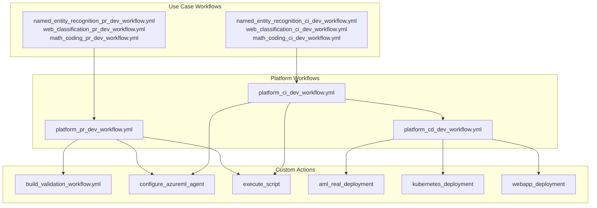

Sources: [.github/workflows/platform_pr_dev_workflow.yml:1-105](), [.github/workflows/platform_ci_dev_workflow.yml:1-179](), [.github/workflows/platform_cd_dev_workflow.yml:1-187]()

### Workflow Execution Flow

```mermaid
graph LR
    subgraph "Trigger Events"
        PR["Pull Request"]
        PUSH["Push to Branch"]
        MANUAL["Manual Dispatch"]
    end
    
    subgraph "PR Validation"
        CODE_VAL["pr_code_validation"]
        FLOW_VAL["pr_flow_validation"]
        DATA_REG["register_data_asset"]
        BULK_RUN["prompt_pipeline"]
    end
    
    subgraph "CI Pipeline"
        FULL_EXP["flow-experiment-and_evaluation"]
        DATA_REG_CI["register_data_asset"] 
        BULK_RUN_CI["prompt_pipeline"]
        EVAL_RUN["prompt_eval"]
        REPORTS["Archive CSV"]
    end
    
    subgraph "CD Pipeline"
        MODEL_REG["register_model"]
        AML_DEPLOY_STEP["Deploy to Managed endpoint"]
        K8S_DEPLOY_STEP["Deploy to kubernetes endpoint"]
        WEBAPP_DEPLOY_STEP["Deploy to webapp"]
        TEST_DEPLOY["Test Deployment"]
    end
    
    PR --> CODE_VAL
    CODE_VAL --> FLOW_VAL
    FLOW_VAL --> DATA_REG
    DATA_REG --> BULK_RUN
    
    PUSH --> FULL_EXP
    FULL_EXP --> DATA_REG_CI
    DATA_REG_CI --> BULK_RUN_CI
    BULK_RUN_CI --> EVAL_RUN
    EVAL_RUN --> REPORTS
    REPORTS --> MODEL_REG
    
    MODEL_REG --> AML_DEPLOY_STEP
    MODEL_REG --> K8S_DEPLOY_STEP
    MODEL_REG --> WEBAPP_DEPLOY_STEP
    
    AML_DEPLOY_STEP --> TEST_DEPLOY
    K8S_DEPLOY_STEP --> TEST_DEPLOY
    WEBAPP_DEPLOY_STEP --> TEST_DEPLOY
```

Sources: [.github/workflows/platform_pr_dev_workflow.yml:32-104](), [.github/workflows/platform_ci_dev_workflow.yml:32-179](), [.github/workflows/platform_cd_dev_workflow.yml:44-187]()

## Secrets and Environment Management

### Repository Secrets Configuration

GitHub Actions uses repository secrets to securely store sensitive information required for Azure authentication and Prompt Flow operations.

| Secret Name | Purpose | Format |
|-------------|---------|--------|
| `AZURE_CREDENTIALS` | Service principal authentication to Azure | JSON object with clientId, clientSecret, subscriptionId, tenantId |
| `ENV_VARS` | Environment variables for flows and connections | Multi-line key=value pairs |
| `DOCKER_IMAGE_REGISTRY` | Container registry details for webapp deployments | JSON array of registry configurations |

Sources: [docs/github_workflows_how_to_setup.md:264-267](), [docs/github_workflows_how_to_setup.md:310-326](), [docs/github_workflows_how_to_setup.md:328-349]()

### Environment Variables Structure

The `ENV_VARS` secret follows a specific naming convention for Prompt Flow connections:

```
AOAI_API_KEY=xxxxxxxxxxxx
<CONNECTION_NAME>_API_KEY=xxxxxxxxxxxx
MODEL_CONFIG_API_KEY=xxxxxxxxxxxx
MAX_TOTAL_TOKEN=4096
```

Connection secrets use the pattern `<CONNECTION_NAME>_API_KEY` where `CONNECTION_NAME` matches the connection name defined in the `experiment.yaml` file.

Sources: [docs/github_workflows_how_to_setup.md:332-349](), [docs/github_workflows_how_to_setup.md:158-168]()

### GitHub Environments and Variables

The template uses GitHub Environments to manage environment-specific configurations:

| Environment | Variables Required |
|-------------|-------------------|
| `pr` | `RESOURCE_GROUP_NAME`, `WORKSPACE_NAME`, `KEY_VAULT_NAME` |
| `dev` | `RESOURCE_GROUP_NAME`, `WORKSPACE_NAME`, `KEY_VAULT_NAME` |

Sources: [docs/github_workflows_how_to_setup.md:269-284]()

## Core Workflow Types

### Pull Request Workflow (`platform_pr_dev_workflow.yml`)

The PR workflow performs lightweight validation to ensure code quality and basic functionality:

```mermaid
graph TD
    PR_START["Pull Request Trigger"]
    BUILD_VAL["build_validation_workflow.yml"]
    AZURE_LOGIN["Azure login"]
    CONFIG_AGENT["configure_azureml_agent"]
    CREATE_ENV["Create .env file"]
    LOAD_ENV["load .env file"]
    REG_DATA["register_data_asset"]
    EXEC_FLOW["prompt_pipeline"]
    
    PR_START --> BUILD_VAL
    BUILD_VAL --> AZURE_LOGIN
    AZURE_LOGIN --> CONFIG_AGENT
    CONFIG_AGENT --> CREATE_ENV
    CREATE_ENV --> LOAD_ENV
    LOAD_ENV --> REG_DATA
    REG_DATA --> EXEC_FLOW
```

Key execution steps in `pr_flow_validation` job:
- Registers experiment dataset as Azure ML Data Asset
- Executes bulk run using `llmops.common.prompt_pipeline`
- Uses lightweight dataset for fast validation

Sources: [.github/workflows/platform_pr_dev_workflow.yml:32-104](), [.github/workflows/platform_pr_dev_workflow.yml:71-100]()

### Continuous Integration Workflow (`platform_ci_dev_workflow.yml`)

The CI workflow performs comprehensive experimentation and evaluation:

```mermaid
graph TD
    CI_START["Push/Merge Trigger"]
    AZURE_LOGIN["Azure login"]
    CONFIG_AGENT["configure_azureml_agent"]
    REG_EXP_DATA["Register experiment data asset"]
    EXEC_BULK["Execute prompt flow bulk run"]
    READ_RUNS["Read PromptFlow Runs"]
    REG_EVAL_DATA["Register evaluation data asset"]
    EXEC_EVAL["Execute bulk run evaluations"]
    ARCHIVE["Archive CSV reports"]
    DEPLOY_TRIGGER["deploy-flow job"]
    
    CI_START --> AZURE_LOGIN
    AZURE_LOGIN --> CONFIG_AGENT
    CONFIG_AGENT --> REG_EXP_DATA
    REG_EXP_DATA --> EXEC_BULK
    EXEC_BULK --> READ_RUNS
    READ_RUNS --> REG_EVAL_DATA
    REG_EVAL_DATA --> EXEC_EVAL
    EXEC_EVAL --> ARCHIVE
    ARCHIVE --> DEPLOY_TRIGGER
```

Key execution modules:
- `llmops.common.register_data_asset` for dataset registration
- `llmops.common.prompt_pipeline` for bulk execution  
- `llmops.common.prompt_eval` for evaluation runs

Sources: [.github/workflows/platform_ci_dev_workflow.yml:32-163](), [.github/workflows/platform_ci_dev_workflow.yml:74-152]()

### Continuous Deployment Workflow (`platform_cd_dev_workflow.yml`)

The CD workflow handles model registration and deployment to various targets:

```mermaid
graph TD
    CD_START["Deployment Trigger"]
    MODEL_REG["Register flow as model"]
    READ_VERSION["Read registered flow version"]
    
    subgraph "Deployment Targets"
        AML_DEPLOY["Deploy to Managed endpoint"]
        K8S_DEPLOY["Deploy to kubernetes endpoint"] 
        WEBAPP_DEPLOY["Deploy to webapp"]
    end
    
    subgraph "AML Deployment Steps"
        PROVISION_EP["provision_endpoint"]
        ASSIGN_RBAC["Assign Azure resource permissions"]
        PROVISION_DEP["provision_deployment"]
        TEST_AML["test_model_on_aml"]
    end
    
    subgraph "Kubernetes Deployment Steps"
        K8S_EP["kubernetes_endpoint"]
        K8S_RBAC["Assign Azure resource permissions"]
        K8S_DEP["kubernetes_deployment"]
        TEST_K8S["test_model_on_kubernetes"]
    end
    
    subgraph "WebApp Deployment Steps"
        CREATE_CONN["Create local PF Connections"]
        WEBAPP_DEP["webapp_deployment"]
    end
    
    CD_START --> MODEL_REG
    MODEL_REG --> READ_VERSION
    
    READ_VERSION --> AML_DEPLOY
    READ_VERSION --> K8S_DEPLOY
    READ_VERSION --> WEBAPP_DEPLOY
    
    AML_DEPLOY --> PROVISION_EP
    PROVISION_EP --> ASSIGN_RBAC
    ASSIGN_RBAC --> PROVISION_DEP
    PROVISION_DEP --> TEST_AML
    
    K8S_DEPLOY --> K8S_EP
    K8S_EP --> K8S_RBAC
    K8S_RBAC --> K8S_DEP
    K8S_DEP --> TEST_K8S
    
    WEBAPP_DEPLOY --> CREATE_CONN
    CREATE_CONN --> WEBAPP_DEP
```

Deployment is controlled by the `deployment_type` parameter:
- `aml`: Azure ML Managed Endpoints
- `aks`: Kubernetes Endpoints  
- `webapp`: Azure Web Apps
- `none`: Skip deployment

Sources: [.github/workflows/platform_cd_dev_workflow.yml:44-187](), [.github/workflows/platform_cd_dev_workflow.yml:115-127](), [.github/workflows/platform_cd_dev_workflow.yml:132-143](), [.github/workflows/platform_cd_dev_workflow.yml:169-178]()

## Custom Actions

### Azure ML Deployment Action (`aml_real_deployment`)

The Azure ML deployment action orchestrates managed endpoint provisioning and testing:

```mermaid
graph TD
    START["aml_real_deployment"]
    CREATE_ENV["Create .env file"]
    PROVISION_EP["provision_endpoint"]
    READ_PRINCIPAL["Read system managed id"]
    ASSIGN_PERMS["Assign Azure resource permissions"]
    PROVISION_DEPLOY["provision_deployment"] 
    TEST_DEPLOY["test_model_on_aml"]
    
    START --> CREATE_ENV
    CREATE_ENV --> PROVISION_EP
    PROVISION_EP --> READ_PRINCIPAL
    READ_PRINCIPAL --> ASSIGN_PERMS
    ASSIGN_PERMS --> PROVISION_DEPLOY
    PROVISION_DEPLOY --> TEST_DEPLOY
```

Key features:
- Automatic RBAC permission assignment to endpoint managed identity
- Support for both Key Vault RBAC and access policy authorization
- Integration with `llmops.common.deployment` modules

Sources: [.github/actions/aml_real_deployment/action.yml:31-107](), [.github/actions/aml_real_deployment/action.yml:45-97]()

### Kubernetes Deployment Action (`kubernetes_deployment`)

Similar structure to AML deployment but targets Kubernetes compute:

```mermaid
graph TD
    START["kubernetes_deployment"]
    CREATE_ENV["Create .env file"]
    PROVISION_K8S["kubernetes_endpoint"]
    READ_PRINCIPAL["Read system managed id"]  
    ASSIGN_PERMS["Assign Azure resource permissions"]
    PROVISION_K8S_DEPLOY["kubernetes_deployment"]
    TEST_K8S["test_model_on_kubernetes"]
    
    START --> CREATE_ENV
    CREATE_ENV --> PROVISION_K8S
    PROVISION_K8S --> READ_PRINCIPAL
    READ_PRINCIPAL --> ASSIGN_PERMS
    ASSIGN_PERMS --> PROVISION_K8S_DEPLOY
    PROVISION_K8S_DEPLOY --> TEST_K8S
```

Sources: [.github/actions/kubernetes_deployment/action.yml:29-104](), [.github/actions/kubernetes_deployment/action.yml:42-104]()

## Configuration and Setup

### Repository Structure Requirements

The GitHub Actions workflows expect the following repository structure:

```
.github/
├── workflows/
│   ├── platform_pr_dev_workflow.yml
│   ├── platform_ci_dev_workflow.yml
│   ├── platform_cd_dev_workflow.yml
│   └── <use_case>_*_workflow.yml
├── actions/
│   ├── configure_azureml_agent/
│   ├── execute_script/
│   ├── aml_real_deployment/
│   └── kubernetes_deployment/
└── requirements/
    └── execute_job_requirements.txt
```

Sources: [docs/github_workflows_how_to_setup.md:251-257]()

### Service Principal Configuration

Azure service principal creation for GitHub Actions authentication:

```bash
spname="<provide a name to create a new sp name>"
roleName="Owner"
subscriptionId="<provide your subscription Id>"
servicePrincipalName="Azure-ARM-${spname}"

az ad sp create-for-rbac --name $servicePrincipalName --role $roleName --scopes /subscriptions/$subscriptionId --sdk-auth
```

The output JSON is stored in the `AZURE_CREDENTIALS` repository secret.

Sources: [docs/github_workflows_how_to_setup.md:175-213]()

### Workflow Execution Context

Each workflow execution provides these environment variables:

| Variable | Source | Usage |
|----------|--------|-------|
| `RESOURCE_GROUP_NAME` | GitHub Environment Variables | Azure resource group name |
| `WORKSPACE_NAME` | GitHub Environment Variables | Azure ML workspace name |
| `KEY_VAULT_NAME` | GitHub Environment Variables | Azure Key Vault name |
| `SUBSCRIPTION_ID` | Azure CLI (`az account show`) | Azure subscription ID |
| `RUN_NAME` | `run_id.txt` output file | Prompt Flow run identifier |
| `MODEL_VERSION` | `model_version.txt` output file | Registered model version |

Sources: [.github/workflows/platform_pr_dev_workflow.yml:35-37](), [.github/workflows/platform_ci_dev_workflow.yml:60-68](), [.github/workflows/platform_cd_dev_workflow.yml:104-109]()

## Integration with LLMOps Engine

GitHub Actions workflows integrate with the core LLMOps engine through the `llmops.common` module structure:

### Execution Commands

| Workflow Stage | Command | Module |
|----------------|---------|--------|
| Data Registration | `python -m llmops.common.register_data_asset` | `llmops.common.register_data_asset` |
| Bulk Execution | `python -m llmops.common.prompt_pipeline` | `llmops.common.prompt_pipeline` |
| Evaluation | `python -m llmops.common.prompt_eval` | `llmops.common.prompt_eval` |
| Model Registration | `python -m llmops.common.deployment.register_model` | `llmops.common.deployment.register_model` |
| Endpoint Provisioning | `python -m llmops.common.deployment.provision_endpoint` | `llmops.common.deployment.provision_endpoint` |
| Deployment | `python -m llmops.common.deployment.provision_deployment` | `llmops.common.deployment.provision_deployment` |

Sources: [.github/workflows/platform_pr_dev_workflow.yml:76-79](), [.github/workflows/platform_ci_dev_workflow.yml:99-104](), [.github/workflows/platform_cd_dev_workflow.yml:92-97]()

The GitHub Actions implementation provides a complete CI/CD solution for Prompt Flow operations, with robust error handling, comprehensive logging, and flexible deployment options across multiple Azure compute targets.

---

# Page: Azure DevOps Pipelines

# Azure DevOps Pipelines

<details>
<summary>Relevant source files</summary>

The following files were used as context for generating this wiki page:

- [.azure-pipelines/build_validation_pipeline.yml](.azure-pipelines/build_validation_pipeline.yml)
- [.azure-pipelines/platform_ci_dev_pipeline.yml](.azure-pipelines/platform_ci_dev_pipeline.yml)
- [.azure-pipelines/platform_pr_dev_pipeline.yml](.azure-pipelines/platform_pr_dev_pipeline.yml)
- [.azure-pipelines/templates/aml_real_deployment.yml](.azure-pipelines/templates/aml_real_deployment.yml)
- [.azure-pipelines/templates/kubernetes_deployment.yml](.azure-pipelines/templates/kubernetes_deployment.yml)
- [.azure-pipelines/templates/prepare_docker_image.yml](.azure-pipelines/templates/prepare_docker_image.yml)
- [.azure-pipelines/templates/webapp_deployment.yml](.azure-pipelines/templates/webapp_deployment.yml)
- [math_coding/.azure-pipelines/math_coding_ci_dev_pipeline.yml](math_coding/.azure-pipelines/math_coding_ci_dev_pipeline.yml)
- [math_coding/.azure-pipelines/math_coding_pr_dev_pipeline.yml](math_coding/.azure-pipelines/math_coding_pr_dev_pipeline.yml)
- [named_entity_recognition/.azure-pipelines/named_entity_recognition_ci_dev_pipeline.yml](named_entity_recognition/.azure-pipelines/named_entity_recognition_ci_dev_pipeline.yml)
- [named_entity_recognition/.azure-pipelines/named_entity_recognition_pr_dev_pipeline.yml](named_entity_recognition/.azure-pipelines/named_entity_recognition_pr_dev_pipeline.yml)
- [web_classification/.azure-pipelines/web_classification_ci_dev_pipeline.yml](web_classification/.azure-pipelines/web_classification_ci_dev_pipeline.yml)
- [web_classification/.azure-pipelines/web_classification_pr_dev_pipeline.yml](web_classification/.azure-pipelines/web_classification_pr_dev_pipeline.yml)

</details>


This document covers the Azure DevOps Pipelines implementation for the LLMOps Prompt Flow template. It details the pipeline architecture, templates, and configuration required to execute Prompt Flow experiments, evaluations, and deployments using Azure DevOps as the CI/CD platform.

For information about other CI/CD platforms supported by this template, see [GitHub Actions](#4.1) and [Jenkins](#4.3). For details about the core LLMOps operations these pipelines execute, see [Core LLMOps Engine](#5).

## Pipeline Architecture Overview

The Azure DevOps implementation follows a template-based architecture with reusable pipeline templates and use case-specific pipeline definitions. The system supports both Pull Request (PR) validation and Continuous Integration (CI) workflows with deployment capabilities.

**Azure DevOps Pipeline Architecture**
```mermaid
graph TB
    subgraph "Use Case Pipelines"
        UC_NER["named_entity_recognition_ci_dev_pipeline.yml"]
        UC_WEB["web_classification_ci_dev_pipeline.yml"] 
        UC_MATH["math_coding_ci_dev_pipeline.yml"]
        UC_NER_PR["named_entity_recognition_pr_dev_pipeline.yml"]
        UC_WEB_PR["web_classification_pr_dev_pipeline.yml"]
        UC_MATH_PR["math_coding_pr_dev_pipeline.yml"]
    end
    
    subgraph "Core Platform Templates"
        PLATFORM_CI["platform_ci_dev_pipeline.yml"]
        PLATFORM_PR["platform_pr_dev_pipeline.yml"]
        BUILD_VAL["build_validation_pipeline.yml"]
    end
    
    subgraph "Deployment Templates"
        AML_DEPLOY["aml_real_deployment.yml"]
        K8S_DEPLOY["kubernetes_deployment.yml"]
        WEBAPP_DEPLOY["webapp_deployment.yml"]
        DOCKER_PREP["prepare_docker_image.yml"]
    end
    
    subgraph "Infrastructure Templates"
        CONFIGURE["configure_azureml_agent.yml"]
        EXECUTE["execute_python_code.yml"]
        CONNECT["get_connection_details.yml"]
    end
    
    subgraph "Variable Groups"
        VG["llmops_platform_dev_vg"]
    end
    
    UC_NER --> PLATFORM_CI
    UC_WEB --> PLATFORM_CI
    UC_MATH --> PLATFORM_CI
    UC_NER_PR --> PLATFORM_PR
    UC_WEB_PR --> PLATFORM_PR
    UC_MATH_PR --> PLATFORM_PR
    
    PLATFORM_CI --> AML_DEPLOY
    PLATFORM_CI --> K8S_DEPLOY
    PLATFORM_CI --> WEBAPP_DEPLOY
    PLATFORM_PR --> BUILD_VAL
    
    WEBAPP_DEPLOY --> DOCKER_PREP
    AML_DEPLOY --> EXECUTE
    K8S_DEPLOY --> EXECUTE
    
    PLATFORM_CI --> CONFIGURE
    PLATFORM_PR --> CONFIGURE
    CONFIGURE --> CONNECT
    
    UC_NER -.-> VG
    UC_WEB -.-> VG
    UC_MATH -.-> VG
```

Sources: [.azure-pipelines/platform_ci_dev_pipeline.yml:1-294](), [.azure-pipelines/platform_pr_dev_pipeline.yml:1-89](), [named_entity_recognition/.azure-pipelines/named_entity_recognition_ci_dev_pipeline.yml:1-44](), [web_classification/.azure-pipelines/web_classification_ci_dev_pipeline.yml:1-44](), [math_coding/.azure-pipelines/math_coding_ci_dev_pipeline.yml:1-44]()

## Core Pipeline Templates

### Platform CI Pipeline

The `platform_ci_dev_pipeline.yml` serves as the main template for continuous integration workflows. It orchestrates the complete MLOps pipeline from experiment execution through deployment.

**Platform CI Pipeline Flow**
```mermaid
graph TD
    subgraph "execute_prompt_experiment Stage"
        REGISTER_DATA["Register Training Data<br/>llmops.common.register_data_asset"]
        EXECUTE_FLOW["Execute Standard Flow<br/>llmops.common.prompt_pipeline"]
        READ_RUN["Read Standard Flow run_id<br/>run_id.txt"]
        REGISTER_TEST["Register Test Data<br/>llmops.common.register_data_asset"]
        EXECUTE_EVAL["Execute Evaluation Flow<br/>llmops.common.prompt_eval"]
        PUBLISH_REPORTS["PublishPipelineArtifact<br/>prompt_reports"]
    end
    
    subgraph "deploy_prompts Stage"
        APPROVE["ManualValidation<br/>ApproveDeployment"]
        REGISTER_MODEL["Register Standard Flow<br/>llmops.common.deployment.register_model"]
        READ_VERSION["Read Model Version<br/>model_version.txt"]
        DEPLOY_AML["aml_real_deployment.yml"]
        DEPLOY_K8S["kubernetes_deployment.yml"]
        DEPLOY_WEBAPP["webapp_deployment.yml"]
    end
    
    REGISTER_DATA --> EXECUTE_FLOW
    EXECUTE_FLOW --> READ_RUN
    READ_RUN --> REGISTER_TEST
    REGISTER_TEST --> EXECUTE_EVAL
    EXECUTE_EVAL --> PUBLISH_REPORTS
    
    PUBLISH_REPORTS --> APPROVE
    APPROVE --> REGISTER_MODEL
    REGISTER_MODEL --> READ_VERSION
    READ_VERSION --> DEPLOY_AML
    READ_VERSION --> DEPLOY_K8S
    READ_VERSION --> DEPLOY_WEBAPP
```

The pipeline accepts key parameters for customization:

| Parameter | Description | Usage |
|-----------|-------------|-------|
| `exec_environment` | Target environment (dev, staging, prod) | Controls experiment configuration loading |
| `use_case_base_path` | Path to the specific use case | Determines which flow to execute |
| `deployment_type` | Deployment target (aml, aks, webapp, none) | Controls which deployment template runs |
| `RESOURCE_GROUP_NAME` | Azure resource group | Configures Azure ML workspace connection |
| `WORKSPACE_NAME` | Azure ML workspace name | Target workspace for experiments |
| `KEY_VAULT_NAME` | Azure Key Vault name | Secrets and connection management |

Sources: [.azure-pipelines/platform_ci_dev_pipeline.yml:21-159](), [.azure-pipelines/platform_ci_dev_pipeline.yml:1-20]()

### Platform PR Pipeline

The `platform_pr_dev_pipeline.yml` template handles Pull Request validation workflows. It performs build validation followed by experiment execution without deployment.

**Platform PR Pipeline Stages**
```mermaid
graph LR
    subgraph "build_validation Stage"
        PYTEST["pytest<br/>Unit Tests"]
        FLAKE8["flake8<br/>Code Linting"]
        COVERAGE["PublishCodeCoverageResults"]
    end
    
    subgraph "execute_training_job Stage"
        REG_DATA["Register Training Data"]
        EXEC_FLOW["Execute Standard Flow"]
    end
    
    PYTEST --> FLAKE8
    FLAKE8 --> COVERAGE
    COVERAGE --> REG_DATA
    REG_DATA --> EXEC_FLOW
```

Sources: [.azure-pipelines/platform_pr_dev_pipeline.yml:15-89](), [.azure-pipelines/build_validation_pipeline.yml:1-36]()

## Use Case Specific Pipelines

Each use case (Named Entity Recognition, Web Classification, Math Coding) has dedicated pipeline files that reference the platform templates with specific parameters.

### Pipeline Configuration Pattern

All use case pipelines follow a consistent pattern:

```yaml
# Example from web_classification_ci_dev_pipeline.yml
variables:
- group: llmops_platform_dev_vg

stages:
  - template: ../../.azure-pipelines/platform_ci_dev_pipeline.yml
    parameters:
      RESOURCE_GROUP_NAME: $(rg_name)
      WORKSPACE_NAME: $(ws_name)
      KEY_VAULT_NAME: $(kv_name)
      exec_environment: ${{ parameters.env_name }}
      use_case_base_path: ${{ parameters.use_case_base_path }}
      deployment_type: ${{ lower(parameters.deployment_type) }}
```

### Use Case Pipeline Matrix

| Use Case | CI Pipeline | PR Pipeline | Default Deployment |
|----------|-------------|-------------|-------------------|
| Named Entity Recognition | `named_entity_recognition_ci_dev_pipeline.yml` | `named_entity_recognition_pr_dev_pipeline.yml` | `aml` |
| Web Classification | `web_classification_ci_dev_pipeline.yml` | `web_classification_pr_dev_pipeline.yml` | `aml` |
| Math Coding | `math_coding_ci_dev_pipeline.yml` | `math_coding_pr_dev_pipeline.yml` | `webapp` |

Sources: [named_entity_recognition/.azure-pipelines/named_entity_recognition_ci_dev_pipeline.yml:34-44](), [web_classification/.azure-pipelines/web_classification_ci_dev_pipeline.yml:34-44](), [math_coding/.azure-pipelines/math_coding_ci_dev_pipeline.yml:34-44]()

## Deployment Templates

### Azure ML Managed Endpoints

The `aml_real_deployment.yml` template handles deployment to Azure ML managed online endpoints.

**AML Deployment Process**
```mermaid
graph TD
    PROVISION_EP["provision_endpoint<br/>llmops.common.deployment.provision_endpoint"]
    READ_PRINCIPAL["Read Endpoint Principal<br/>endpoint_principal.txt"]
    ASSIGN_PERMS["Assign Permission to Endpoint Principal<br/>AzureML Data Scientist + Key Vault Reader"]
    PROVISION_DEP["provision_deployment<br/>llmops.common.deployment.provision_deployment"]
    TEST_EP["test_model_on_aml<br/>llmops.common.deployment.test_model_on_aml"]
    
    PROVISION_EP --> READ_PRINCIPAL
    READ_PRINCIPAL --> ASSIGN_PERMS
    ASSIGN_PERMS --> PROVISION_DEP
    PROVISION_DEP --> TEST_EP
```

Sources: [.azure-pipelines/templates/aml_real_deployment.yml:20-98]()

### Kubernetes Endpoints

The `kubernetes_deployment.yml` template deploys flows to Azure Kubernetes Service endpoints.

**Kubernetes Deployment Process**
```mermaid
graph TD
    PROVISION_K8S["kubernetes_endpoint<br/>llmops.common.deployment.kubernetes_endpoint"]
    READ_PRINCIPAL_K8S["Read endpoint principal<br/>endpoint_principal.txt"]
    ASSIGN_PERMS_K8S["Assign Permission Deployment<br/>AzureML Data Scientist + Key Vault Reader"]
    DEPLOY_K8S["kubernetes_deployment<br/>llmops.common.deployment.kubernetes_deployment"]
    TEST_K8S["test_model_on_kubernetes<br/>llmops.common.deployment.test_model_on_kubernetes"]
    
    PROVISION_K8S --> READ_PRINCIPAL_K8S
    READ_PRINCIPAL_K8S --> ASSIGN_PERMS_K8S
    ASSIGN_PERMS_K8S --> DEPLOY_K8S
    DEPLOY_K8S --> TEST_K8S
```

Sources: [.azure-pipelines/templates/kubernetes_deployment.yml:20-96]()

### Web App Deployment

The `webapp_deployment.yml` template deploys flows as containerized Azure Web Apps.

**Web App Deployment Process**
```mermaid
graph TD
    PREP_DOCKER["prepare_docker_image.yml<br/>Docker image preparation"]
    CREATE_CONN["prompt_local_connections<br/>llmops.common.prompt_local_connections"]
    BUILD_IMAGE["gen_docker_image.sh<br/>Build Docker Image with flow artifacts"]
    DEPLOY_WEBAPP["Webapp deployment<br/>az_webapp_deploy.sh"]
    
    PREP_DOCKER --> CREATE_CONN
    CREATE_CONN --> BUILD_IMAGE
    BUILD_IMAGE --> DEPLOY_WEBAPP
```

Sources: [.azure-pipelines/templates/webapp_deployment.yml:12-26](), [.azure-pipelines/templates/prepare_docker_image.yml:13-31]()

## Configuration and Variables

### Variable Groups

The system uses the `llmops_platform_dev_vg` variable group to centralize configuration:

| Variable | Purpose | Example |
|----------|---------|---------|
| `rg_name` | Resource group name | Target Azure resource group |
| `ws_name` | Workspace name | Azure ML workspace identifier |
| `kv_name` | Key Vault name | Secrets management vault |
| `env_vars` | Environment variables | Runtime configuration string |
| `DOCKER_IMAGE_REGISTRY` | Container registry details | ACR connection information |
| `AZURE_RM_SVC_CONNECTION` | Service connection | Azure subscription connection |

### Environment Variable Handling

The pipelines create `.env` files from the `env_vars` parameter:

```bash
# From platform_ci_dev_pipeline.yml lines 39-47
echo "$(env_vars)" | tr ' ' '\n' > .env
python -c "from dotenv import load_dotenv; load_dotenv()"
```

Sources: [.azure-pipelines/platform_ci_dev_pipeline.yml:36-55](), [web_classification/.azure-pipelines/web_classification_ci_dev_pipeline.yml:17-18](), [web_classification/.azure-pipelines/web_classification_ci_dev_pipeline.yml:37-44]()

## Build Validation

The `build_validation_pipeline.yml` template performs code quality checks:

**Build Validation Steps**
```mermaid
graph LR
    PYTHON["UsePythonVersion<br/>Python 3.9"]
    DEPS["pip install<br/>build_validation_requirements.txt"]
    PYTEST["pytest<br/>Unit Tests + Coverage"]
    FLAKE8["flake8<br/>Code Linting"]
    PUBLISH["PublishTestResults + PublishCodeCoverageResults"]
    
    PYTHON --> DEPS
    DEPS --> PYTEST
    PYTEST --> FLAKE8
    FLAKE8 --> PUBLISH
```

The validation includes:
- Python dependency installation from [`.azure-pipelines/requirements/build_validation_requirements.txt`]()
- Unit test execution with `pytest` including JUnit XML output and coverage reporting
- Code linting with `flake8` for `./llmops` and `./tests` directories
- Test result and coverage report publishing

Sources: [.azure-pipelines/build_validation_pipeline.yml:6-36]()

## Pipeline Triggers and Path Filters

All Azure DevOps pipelines use path-based filtering to trigger only when relevant files change:

```yaml
# Common trigger pattern
trigger:
  branches:
    include:
      - main
      - development
  paths:
    include:
      - .azure-pipelines/*
      - llmops/*
      - {use_case_name}/*
```

PR pipelines use `trigger: none` and configure PR triggers with the same path filters to ensure efficient resource usage.

Sources: [web_classification/.azure-pipelines/web_classification_ci_dev_pipeline.yml:2-11](), [named_entity_recognition/.azure-pipelines/named_entity_recognition_ci_dev_pipeline.yml:2-11](), [math_coding/.azure-pipelines/math_coding_ci_dev_pipeline.yml:2-11]()

---

# Page: Jenkins

# Jenkins

<details>
<summary>Relevant source files</summary>

The following files were used as context for generating this wiki page:

- [.jenkins/jobs/aml_real_deployment](.jenkins/jobs/aml_real_deployment)
- [.jenkins/jobs/build_validation](.jenkins/jobs/build_validation)
- [.jenkins/jobs/kubernetes_deployment](.jenkins/jobs/kubernetes_deployment)
- [.jenkins/jobs/prepare_docker_image](.jenkins/jobs/prepare_docker_image)
- [.jenkins/jobs/webapp_deployment](.jenkins/jobs/webapp_deployment)
- [.jenkins/pipelines/chat_with_pdf_ci_dev](.jenkins/pipelines/chat_with_pdf_ci_dev)
- [.jenkins/pipelines/chat_with_pdf_pr_dev](.jenkins/pipelines/chat_with_pdf_pr_dev)
- [.jenkins/pipelines/class_flows_ci_dev](.jenkins/pipelines/class_flows_ci_dev)
- [.jenkins/pipelines/class_flows_pr_dev](.jenkins/pipelines/class_flows_pr_dev)
- [.jenkins/pipelines/flex_flows_ci_dev](.jenkins/pipelines/flex_flows_ci_dev)
- [.jenkins/pipelines/flex_flows_pr_dev](.jenkins/pipelines/flex_flows_pr_dev)
- [.jenkins/pipelines/platform_cd_dev](.jenkins/pipelines/platform_cd_dev)
- [.jenkins/pipelines/platform_ci_dev](.jenkins/pipelines/platform_ci_dev)
- [.jenkins/pipelines/platform_pr_dev](.jenkins/pipelines/platform_pr_dev)
- [.jenkins/requirements/build_validation_requirements.txt](.jenkins/requirements/build_validation_requirements.txt)
- [.jenkins/requirements/execute_job_requirements.txt](.jenkins/requirements/execute_job_requirements.txt)
- [docs/jenkins_how_to_setup.md](docs/jenkins_how_to_setup.md)

</details>


Jenkins serves as one of the three supported CI/CD platforms in the LLMOps Prompt Flow template, providing automated build, test, and deployment capabilities for Prompt Flow experiments and models. This page covers the Jenkins-specific implementation, pipeline structure, and configuration requirements.

For information about the other CI/CD platforms, see [GitHub Actions](#4.1) and [Azure DevOps Pipelines](#4.2). For details about the core LLMOps operations that Jenkins orchestrates, see [Core LLMOps Engine](#5).

## Jenkins Architecture Overview

The Jenkins implementation follows a hierarchical pipeline structure with platform-level pipelines that orchestrate use-case specific jobs. The system supports multiple deployment targets and environments through parameterized builds and credential management.

```mermaid
graph TB
    subgraph "GitHub Repository"
        WEBHOOK[GitHub Webhook]
        PR_EVENT["PR Events<br/>(opened, reopened, synchronize)"]
        PUSH_EVENT["Push Events<br/>(refs/heads/development)"]
    end
    
    subgraph "Jenkins Pipelines"
        subgraph "Use Case Pipelines"
            NER_PR["named_entity_recognition_pr_dev"]
            NER_CI["named_entity_recognition_ci_dev"]
            WEB_PR["web_classification_pr_dev"]
            WEB_CI["web_classification_ci_dev"]
            MATH_PR["math_coding_pr_dev"]
            MATH_CI["math_coding_ci_dev"]
        end
        
        subgraph "Platform Pipelines"
            PLATFORM_PR["platform_pr_dev"]
            PLATFORM_CI["platform_ci_dev"]
            PLATFORM_CD["platform_cd_dev"]
        end
    end
    
    subgraph "Jenkins Jobs"
        BUILD_VAL["build_validation"]
        AML_DEPLOY["aml_real_deployment"]
        K8S_DEPLOY["kubernetes_deployment"]
        WEBAPP_DEPLOY["webapp_deployment"]
        DOCKER_PREP["prepare_docker_image"]
        CONFIGURE_AGENT["configure_azureml_agent"]
    end
    
    PR_EVENT --> NER_PR
    PR_EVENT --> WEB_PR
    PR_EVENT --> MATH_PR
    PUSH_EVENT --> NER_CI
    PUSH_EVENT --> WEB_CI
    PUSH_EVENT --> MATH_CI
    
    NER_PR --> PLATFORM_PR
    WEB_PR --> PLATFORM_PR
    MATH_PR --> PLATFORM_PR
    
    NER_CI --> PLATFORM_CI
    WEB_CI --> PLATFORM_CI
    MATH_CI --> PLATFORM_CI
    
    PLATFORM_CI --> PLATFORM_CD
    
    PLATFORM_PR --> BUILD_VAL
    PLATFORM_PR --> CONFIGURE_AGENT
    
    PLATFORM_CD --> AML_DEPLOY
    PLATFORM_CD --> K8S_DEPLOY
    PLATFORM_CD --> WEBAPP_DEPLOY
    
    DOCKER_PREP --> WEBAPP_DEPLOY
```

Sources: [docs/jenkins_how_to_setup.md:1-556](), [.jenkins/pipelines/platform_pr_dev:1-119](), [.jenkins/pipelines/platform_ci_dev:1-194](), [.jenkins/pipelines/platform_cd_dev:1-177]()

## Pipeline Structure

### Use Case Pipelines

Use case pipelines serve as entry points triggered by GitHub webhooks. Each use case has two pipeline types:

| Pipeline Pattern | Trigger | Purpose | Example |
|------------------|---------|---------|---------|
| `*_pr_dev` | PR events | Code validation on feature branches | `named_entity_recognition_pr_dev` |
| `*_ci_dev` | Push to development | Full CI/CD execution | `named_entity_recognition_ci_dev` |

```mermaid
graph LR
    subgraph "PR Pipeline Flow"
        PR_TRIGGER["GenericTrigger<br/>regexpFilterExpression:<br/>^(opened|reopened|synchronize)$"]
        USE_CASE_PR["Use Case PR Pipeline<br/>(e.g., named_entity_recognition_pr_dev)"]
        PLATFORM_PR_CALL["build job: 'platform_pr_dev'"]
    end
    
    subgraph "CI Pipeline Flow"
        CI_TRIGGER["GenericTrigger<br/>regexpFilterExpression:<br/>refs/heads/development"]
        USE_CASE_CI["Use Case CI Pipeline<br/>(e.g., named_entity_recognition_ci_dev)"]
        PLATFORM_CI_CALL["build job: 'platform_ci_dev'"]
    end
    
    PR_TRIGGER --> USE_CASE_PR
    USE_CASE_PR --> PLATFORM_PR_CALL
    
    CI_TRIGGER --> USE_CASE_CI
    USE_CASE_CI --> PLATFORM_CI_CALL
```

Sources: [.jenkins/pipelines/named_entity_recognition_pr_dev:12-27](), [.jenkins/pipelines/named_entity_recognition_ci_dev:14-29](), [.jenkins/pipelines/class_flows_pr_dev:12-27]()

### Platform Pipelines

Platform pipelines contain the core LLMOps logic and are called by use case pipelines:

#### platform_pr_dev
Executes validation workflows for pull requests:
- Azure ML agent configuration via `configure_azureml_agent` job
- Environment file loading from `ENV_VARS` credential
- Code validation via `build_validation` job  
- Data asset registration via `llmops.common.register_data_asset`
- Prompt flow execution via `llmops.common.prompt_pipeline`

#### platform_ci_dev  
Executes full CI workflow for development branch:
- All PR validation steps
- Evaluation execution via `llmops.common.prompt_eval`
- Report archival
- Conditional deployment via `platform_cd_dev`

#### platform_cd_dev
Handles deployment based on `deployment_type` parameter:
- Model registration via `llmops.common.deployment.register_model`
- Deployment job selection: `aml_real_deployment`, `kubernetes_deployment`, or `webapp_deployment`

Sources: [.jenkins/pipelines/platform_pr_dev:21-118](), [.jenkins/pipelines/platform_ci_dev:29-193](), [.jenkins/pipelines/platform_cd_dev:115-176]()

## Job Structure

Jenkins jobs implement specific deployment and validation operations:

```mermaid
graph TB
    subgraph "Job Categories"
        subgraph "Validation Jobs"
            BUILD_VAL["build_validation<br/>- Python linting (flake8)<br/>- Unit tests (pytest)<br/>- Coverage reporting"]
            CONFIGURE["configure_azureml_agent<br/>- Azure ML setup<br/>- Requirements installation"]
        end
        
        subgraph "Deployment Jobs"
            AML_JOB["aml_real_deployment<br/>- provision_endpoint<br/>- provision_deployment<br/>- test_model_on_aml"]
            K8S_JOB["kubernetes_deployment<br/>- kubernetes_endpoint<br/>- kubernetes_deployment<br/>- test_model_on_kubernetes"]
            WEBAPP_JOB["webapp_deployment<br/>- gen_docker_image.sh<br/>- az_webapp_deploy.sh<br/>- prompt_local_connections"]
        end
        
        subgraph "Docker Jobs"
            DOCKER_JOB["prepare_docker_image<br/>- Docker image creation<br/>- Registry push<br/>- Connection setup"]
        end
    end
    
    subgraph "Shared Resources"
        SHARED_LIB["@Library('shared-library')"]
        REQUIREMENTS["Requirements Files<br/>- execute_job_requirements.txt<br/>- build_validation_requirements.txt"]
        CREDENTIALS["Jenkins Credentials<br/>- AZURE_CREDENTIALS<br/>- ENV_VARS<br/>- DOCKER_IMAGE_REGISTRY"]
    end
    
    SHARED_LIB --> BUILD_VAL
    SHARED_LIB --> AML_JOB  
    SHARED_LIB --> K8S_JOB
    SHARED_LIB --> WEBAPP_JOB
    
    REQUIREMENTS --> BUILD_VAL
    REQUIREMENTS --> AML_JOB
    REQUIREMENTS --> K8S_JOB
    REQUIREMENTS --> WEBAPP_JOB
    
    CREDENTIALS --> AML_JOB
    CREDENTIALS --> K8S_JOB  
    CREDENTIALS --> WEBAPP_JOB
```

Sources: [.jenkins/jobs/build_validation:47-70](), [.jenkins/jobs/aml_real_deployment:51-128](), [.jenkins/jobs/kubernetes_deployment:50-126](), [.jenkins/jobs/webapp_deployment:77-121]()

## Configuration and Setup

### Jenkins Credentials

The system requires several credential types in Jenkins:

| Credential ID | Type | Purpose | Configuration Location |
|---------------|------|---------|----------------------|
| `AZURE_CREDENTIALS` | Azure Service Principal | Azure resource access | Service principal JSON |
| `ENV_VARS` | Secret File | Environment variables | Key-value pairs file |
| `DOCKER_IMAGE_REGISTRY` | Secret Text | Container registry access | JSON with registry details |
| `WEBHOOK-TOKEN-SECRET` | Secret Text | GitHub webhook security | Random high-entropy string |

Sources: [docs/jenkins_how_to_setup.md:258-261](), [docs/jenkins_how_to_setup.md:289-304](), [docs/jenkins_how_to_setup.md:443-445]()

### Global Environment Variables

Jenkins requires environment-specific global variables:

```
RESOURCE_GROUP_NAME_<env>
WORKSPACE_NAME_<env>  
KEY_VAULT_NAME_<env>
```

Where `<env>` represents the target environment (dev, prod, etc.).

Sources: [docs/jenkins_how_to_setup.md:264-269]()

### Requirements Files

Jenkins jobs use specific requirement files:

- **execute_job_requirements.txt**: Core prompt flow and Azure ML dependencies
- **build_validation_requirements.txt**: Testing and validation tools

Sources: [.jenkins/requirements/execute_job_requirements.txt:1-11](), [.jenkins/requirements/build_validation_requirements.txt:1-14]()

## Secrets Management

### Environment Variable Loading

All Jenkins pipelines implement a standardized environment loading pattern:

```mermaid
graph LR
    subgraph "Environment Loading Flow"
        ENV_VARS_CRED["ENV_VARS credential<br/>(Jenkins Secret File)"]
        READ_FILE["readFile(file: ENV_FILE)"]
        WRITE_ENV["writeFile file: '.env'"]
        PYTHON_LOAD["python load_env.py<br/>load_dotenv('.env')"]
    end
    
    ENV_VARS_CRED --> READ_FILE
    READ_FILE --> WRITE_ENV
    WRITE_ENV --> PYTHON_LOAD
```

The environment variables support placeholder replacement syntax `${SECRET_NAME}` in configuration files like `experiment.yaml` and `env.yaml`.

Sources: [docs/jenkins_how_to_setup.md:125-143](), [.jenkins/pipelines/platform_pr_dev:40-70]()

### Connection Naming Convention

Secrets for Prompt Flow connections follow a specific naming pattern:
- Connection API keys: `<CONNECTION_NAME>_API_KEY`
- Flow-specific secrets: `<PARENT_ELEMENT_NAME>_<SECRET_NAME>`

Sources: [docs/jenkins_how_to_setup.md:161-172]()

## Webhook Integration

Jenkins pipelines use the Generic Webhook Trigger plugin for GitHub integration:

```mermaid
graph TB
    subgraph "GitHub Repository"
        GITHUB_EVENTS["GitHub Events<br/>- Pull Request actions<br/>- Push to development"]
        WEBHOOK_CONFIG["Webhook Configuration<br/>URL: http://jenkins:port/generic-webhook-trigger/invoke<br/>Secret: WEBHOOK-TOKEN-SECRET"]
    end
    
    subgraph "Jenkins Generic Trigger"
        TRIGGER_CONFIG["GenericTrigger Configuration"]
        PR_FILTER["regexpFilterText: '$action'<br/>regexpFilterExpression: '^(opened|reopened|synchronize)$'"]
        PUSH_FILTER["regexpFilterText: '$ref'<br/>regexpFilterExpression: 'refs/heads/development'"]
    end
    
    subgraph "Pipeline Execution"
        PR_PIPELINE["PR Pipelines<br/>(*_pr_dev)"]
        CI_PIPELINE["CI Pipelines<br/>(*_ci_dev)"]
    end
    
    GITHUB_EVENTS --> WEBHOOK_CONFIG
    WEBHOOK_CONFIG --> TRIGGER_CONFIG
    TRIGGER_CONFIG --> PR_FILTER
    TRIGGER_CONFIG --> PUSH_FILTER
    PR_FILTER --> PR_PIPELINE
    PUSH_FILTER --> CI_PIPELINE
```

Sources: [docs/jenkins_how_to_setup.md:447-466](), [.jenkins/pipelines/named_entity_recognition_pr_dev:12-27](), [.jenkins/pipelines/named_entity_recognition_ci_dev:14-29]()

## Deployment Execution Flow

The deployment process varies by target platform but follows a consistent pattern:

### Azure ML Deployment
1. Model registration via `llmops.common.deployment.register_model`
2. Endpoint provisioning via `llmops.common.deployment.provision_endpoint`
3. RBAC permission assignment for Key Vault and Azure ML workspace
4. Deployment creation via `llmops.common.deployment.provision_deployment`
5. Endpoint testing via `llmops.common.deployment.test_model_on_aml`

### Kubernetes Deployment  
1. Model registration (same as AML)
2. Kubernetes endpoint provisioning via `llmops.common.deployment.kubernetes_endpoint`
3. RBAC permission assignment
4. Kubernetes deployment via `llmops.common.deployment.kubernetes_deployment`
5. Testing via `llmops.common.deployment.test_model_on_kubernetes`

### Web App Deployment
1. Local connection setup via `llmops.common.prompt_local_connections`
2. Docker image creation via `gen_docker_image.sh`
3. Web app deployment via `az_webapp_deploy.sh`

Sources: [.jenkins/jobs/aml_real_deployment:51-128](), [.jenkins/jobs/kubernetes_deployment:50-126](), [.jenkins/jobs/webapp_deployment:77-121]()

---

# Page: Core LLMOps Engine

# Core LLMOps Engine

<details>
<summary>Relevant source files</summary>

The following files were used as context for generating this wiki page:

- [llmops/common/common.py](llmops/common/common.py)
- [llmops/common/create_connections.py](llmops/common/create_connections.py)
- [llmops/common/deployment/generate_env_vars.py](llmops/common/deployment/generate_env_vars.py)
- [llmops/common/deployment/kubernetes_deployment.py](llmops/common/deployment/kubernetes_deployment.py)
- [llmops/common/deployment/kubernetes_endpoint.py](llmops/common/deployment/kubernetes_endpoint.py)
- [llmops/common/deployment/provision_deployment.py](llmops/common/deployment/provision_deployment.py)
- [llmops/common/deployment/register_model.py](llmops/common/deployment/register_model.py)
- [llmops/common/deployment/test_model_on_aml.py](llmops/common/deployment/test_model_on_aml.py)
- [llmops/common/deployment/test_model_on_kubernetes.py](llmops/common/deployment/test_model_on_kubernetes.py)
- [llmops/common/experiment.py](llmops/common/experiment.py)
- [llmops/common/get_workspace.py](llmops/common/get_workspace.py)
- [llmops/common/prompt_eval.py](llmops/common/prompt_eval.py)
- [llmops/common/prompt_pipeline.py](llmops/common/prompt_pipeline.py)
- [llmops/common/register_data_asset.py](llmops/common/register_data_asset.py)
- [llmops/config.py](llmops/config.py)

</details>


## Purpose and Scope

The Core LLMOps Engine is the foundational execution system that powers experiment runs, model evaluation, and deployment operations across all Prompt Flow use cases in this template. It provides standardized interfaces and orchestration logic for running bulk experiments, evaluating results, managing Azure ML assets, and deploying models to various compute targets.

This document covers the core modules in `llmops/common/` that handle experiment execution and asset management. For information about specific use case implementations, see [Use Cases and Prompt Flows](#3). For deployment target details, see [Deployment](#6). For CI/CD pipeline integration, see [CI/CD Platforms](#4).

## Engine Architecture Overview

The Core LLMOps Engine consists of four primary functional layers that work together to provide complete experiment-to-deployment automation:

```mermaid
graph TB
    subgraph "Experiment Management Layer"
        ExperimentCloudConfig["ExperimentCloudConfig"]
        load_experiment["load_experiment()"]
        resolve_env_vars["resolve_env_vars()"]
        resolve_flow_type["resolve_flow_type()"]
        create_pf_connections["create_pf_connections()"]
    end
    
    subgraph "Execution Engine Layer"
        prompt_pipeline["prompt_pipeline.py<br/>prepare_and_execute()"]
        VariantsSelector["VariantsSelector"]
        prompt_eval["prompt_eval.py<br/>prepare_and_execute()"]
    end
    
    subgraph "Asset Management Layer"
        register_data_asset["register_data_asset.py<br/>register_data_asset()"]
        register_model["register_model.py<br/>register_model()"]
    end
    
    subgraph "Deployment Engine Layer"
        provision_endpoint["provision_endpoint.py"]
        provision_deployment["provision_deployment.py"]
        kubernetes_deployment["kubernetes_deployment.py"]
        test_model_aml["test_model_on_aml.py"]
        test_model_k8s["test_model_on_kubernetes.py"]
    end
    
    subgraph "External Integrations"
        PFClientLocal["PFClient (Local)"]
        PFClientAzure["PFClient (Azure)"]
        MLClient["MLClient"]
        DefaultAzureCredential["DefaultAzureCredential"]
    end
    
    ExperimentCloudConfig --> load_experiment
    load_experiment --> resolve_flow_type
    load_experiment --> resolve_env_vars
    load_experiment --> create_pf_connections
    
    resolve_flow_type --> prompt_pipeline
    resolve_env_vars --> prompt_pipeline
    create_pf_connections --> prompt_pipeline
    VariantsSelector --> prompt_pipeline
    
    prompt_pipeline --> prompt_eval
    prompt_pipeline --> register_data_asset
    prompt_eval --> register_model
    
    register_model --> provision_endpoint
    provision_endpoint --> provision_deployment
    provision_endpoint --> kubernetes_deployment
    provision_deployment --> test_model_aml
    kubernetes_deployment --> test_model_k8s
    
    prompt_pipeline --> PFClientLocal
    prompt_pipeline --> PFClientAzure
    prompt_eval --> PFClientLocal
    prompt_eval --> PFClientAzure
    register_data_asset --> MLClient
    register_model --> MLClient
    provision_deployment --> MLClient
    kubernetes_deployment --> MLClient
    
    MLClient --> DefaultAzureCredential
    PFClientAzure --> DefaultAzureCredential
```

**Sources:** [llmops/common/prompt_pipeline.py:1-584](), [llmops/common/prompt_eval.py:1-521](), [llmops/common/common.py:1-257](), [llmops/common/deployment/provision_deployment.py:1-309](), [llmops/common/deployment/kubernetes_deployment.py:1-316]()

## Execution Context and Client Management

The engine adapts its behavior based on the execution context defined by `EXECUTION_TYPE` configuration, managing different client objects for local versus cloud execution:

```mermaid
graph LR
    subgraph "Configuration"
        EXECUTION_TYPE["EXECUTION_TYPE<br/>(LOCAL/AZURE)"]
    end
    
    subgraph "Local Execution Path"
        PFClientLocal["PFClient()<br/>local promptflow client"]
        create_pf_connections_local["create_pf_connections()<br/>setup local connections"]
        ObjectWrapper_local["ObjectWrapper(pf=pf)"]
    end
    
    subgraph "Azure Execution Path"
        ExperimentCloudConfig_azure["ExperimentCloudConfig<br/>subscription, rg, workspace"]
        DefaultAzureCredential_azure["DefaultAzureCredential()"]
        MLClient_azure["MLClient<br/>Azure ML workspace client"]
        PFClientAzure_azure["PFClient (Azure)<br/>cloud promptflow client"]
        ObjectWrapper_azure["ObjectWrapper(pf=pf, ml_client=ml_client)"]
    end
    
    EXECUTION_TYPE -->|"LOCAL"| PFClientLocal
    EXECUTION_TYPE -->|"AZURE"| ExperimentCloudConfig_azure
    
    PFClientLocal --> create_pf_connections_local
    create_pf_connections_local --> ObjectWrapper_local
    
    ExperimentCloudConfig_azure --> DefaultAzureCredential_azure
    DefaultAzureCredential_azure --> MLClient_azure
    DefaultAzureCredential_azure --> PFClientAzure_azure
    MLClient_azure --> ObjectWrapper_azure
    PFClientAzure_azure --> ObjectWrapper_azure
```

**Sources:** [llmops/config.py:11](), [llmops/common/prompt_pipeline.py:174-202](), [llmops/common/prompt_eval.py:95-119](), [llmops/common/common.py:30-46]()

## Flow Type Resolution and Parameters

The engine automatically detects and configures different types of Prompt Flows through the `resolve_flow_type()` function:

| Flow Type | Detection Criteria | Configuration Handling |
|-----------|-------------------|----------------------|
| `DAG_FLOW` | `flow.dag.yaml` or `flow.dag.yml` present | Uses YAML node variants configuration |
| `FUNCTION_FLOW` | `flow.flex.yaml` with function entry | No additional parameters |
| `CLASS_FLOW` | `flow.flex.yaml` with class entry | Reads `init.json` for class parameters |
| `NO_FLOW` | No flow files found | Used for custom evaluation scripts |

```mermaid
graph TD
    resolve_flow_type["resolve_flow_type(base_path, flow_path)"]
    
    check_files["Check for flow files:<br/>flow.dag.yaml/yml<br/>flow.flex.yaml/yml"]
    
    dag_flow["DAG_FLOW<br/>Traditional prompt flow"]
    function_flow["FUNCTION_FLOW<br/>Python function entry"]
    class_flow["CLASS_FLOW<br/>Python class entry"]
    no_flow["NO_FLOW<br/>Custom evaluation"]
    
    parse_flex["Parse flow.flex.yaml<br/>entry: file:function_or_class"]
    check_entry_type["Check entry type<br/>ast.FunctionDef vs ast.ClassDef"]
    load_init_json["Load init.json<br/>resolve environment variables"]
    
    resolve_flow_type --> check_files
    check_files -->|"dag file found"| dag_flow
    check_files -->|"flex file found"| parse_flex
    check_files -->|"no files found"| no_flow
    
    parse_flex --> check_entry_type
    check_entry_type -->|"ast.FunctionDef"| function_flow
    check_entry_type -->|"ast.ClassDef"| class_flow
    
    class_flow --> load_init_json
```

**Sources:** [llmops/common/common.py:95-206](), [llmops/common/prompt_pipeline.py:169-170](), [llmops/common/prompt_eval.py:89-91]()

## Experiment Execution Engine

The `prompt_pipeline.py` module orchestrates bulk experiment runs with support for flow variants and multiple datasets:

### Variant Selection Strategy

The `VariantsSelector` class manages which flow variants to execute:

```mermaid
graph LR
    subgraph "Variant Selection Options"
        DEFAULTS_ONLY["DEFAULTS_ONLY<br/>Run only default variants"]
        ALL["ALL<br/>Run all available variants"]
        CUSTOM["CUSTOM<br/>Run specific variants"]
    end
    
    subgraph "Input Processing"
        from_args["VariantsSelector.from_args(variants)"]
        parse_variants["Parse variants string:<br/>'*', 'all', 'defaults',<br/>or comma-separated list"]
    end
    
    subgraph "Variant Execution Logic"
        is_variant_enabled["is_variant_enabled(node, variant)<br/>Check if variant should run"]
        variant_combinations["Generate unique variant<br/>combinations across nodes"]
        check_dictionary_contained["check_dictionary_contained()<br/>Avoid duplicate runs"]
    end
    
    from_args --> parse_variants
    parse_variants --> DEFAULTS_ONLY
    parse_variants --> ALL
    parse_variants --> CUSTOM
    
    DEFAULTS_ONLY --> is_variant_enabled
    ALL --> is_variant_enabled
    CUSTOM --> is_variant_enabled
    
    is_variant_enabled --> variant_combinations
    variant_combinations --> check_dictionary_contained
```

**Sources:** [llmops/common/prompt_pipeline.py:87-136](), [llmops/common/prompt_pipeline.py:222-250](), [llmops/common/prompt_pipeline.py:77-84]()

### Experiment Execution Flow

The main execution loop processes datasets and variants systematically:

```mermaid
sequenceDiagram
    participant prepare_and_execute
    participant ExperimentCloudConfig
    participant load_experiment
    participant PFClient
    participant VariantsSelector
    
    prepare_and_execute->>ExperimentCloudConfig: Initialize cloud config
    prepare_and_execute->>load_experiment: Load experiment.yaml
    prepare_and_execute->>PFClient: Create appropriate client
    
    loop For each dataset
        prepare_and_execute->>VariantsSelector: Check if variants enabled
        alt Variants mode
            loop For each variant combination
                prepare_and_execute->>PFClient: pf.run() with variant string
                PFClient-->>prepare_and_execute: Run details and metrics
            end
        else Default mode
            prepare_and_execute->>PFClient: pf.run() without variants
            PFClient-->>prepare_and_execute: Run details and metrics
        end
        prepare_and_execute->>prepare_and_execute: Save results to CSV/HTML
    end
    
    prepare_and_execute->>prepare_and_execute: Write run IDs to output file
```

**Sources:** [llmops/common/prompt_pipeline.py:138-495](), [llmops/common/prompt_pipeline.py:277-324](), [llmops/common/prompt_pipeline.py:371-410]()

## Evaluation Engine

The `prompt_eval.py` module runs evaluation flows against completed bulk runs:

### Evaluation Dataset Mapping

The evaluation system uses dataset references to link evaluation data with standard runs:

```mermaid
graph TD
    subgraph "Standard Run Processing"
        resolve_run_ids["resolve_run_ids(run_id)<br/>Parse run IDs from string or file"]
        get_run_data["runs[run_id].data<br/>Extract dataset reference"]
        find_dataset["experiment.get_dataset(run_data_name)<br/>Find referenced dataset"]
    end
    
    subgraph "Evaluation Dataset Resolution"
        evaluator_datasets["evaluator.datasets<br/>List of evaluation datasets"]
        find_dataset_with_reference["find_dataset_with_reference(dataset_name)<br/>Match evaluation datasets"]
        column_mapping["dataset_mapping.mappings<br/>Column mapping configuration"]
    end
    
    subgraph "Evaluation Execution"
        create_eval_run["pf.run(flow, data, run=standard_run)<br/>Execute evaluation flow"]
        get_eval_results["pf.get_details() + pf.get_metrics()<br/>Extract evaluation results"]
        combine_results["Combine results with variant info<br/>Generate reports"]
    end
    
    resolve_run_ids --> get_run_data
    get_run_data --> find_dataset
    find_dataset --> evaluator_datasets
    evaluator_datasets --> find_dataset_with_reference
    find_dataset_with_reference --> column_mapping
    column_mapping --> create_eval_run
    create_eval_run --> get_eval_results
    get_eval_results --> combine_results
```

**Sources:** [llmops/common/prompt_eval.py:126-198](), [llmops/common/prompt_eval.py:235-270](), [llmops/common/common.py:235-256]()

### Custom Evaluation Support

For evaluators without flow files (`NO_FLOW` type), the engine supports custom Python evaluation functions:

```mermaid
graph LR
    subgraph "Custom Evaluator Detection"
        check_flow_type["flow_type == FlowTypeOption.NO_FLOW"]
        scan_directory["os.listdir(evaluator.path)<br/>Find eval_*.py files"]
        import_module["importlib.import_module()<br/>Dynamic module loading"]
    end
    
    subgraph "Function Discovery"
        get_functions["inspect.isfunction()<br/>Find all functions in module"]
        filter_eval_functions["function_name.startswith('eval_')<br/>Filter evaluation functions"]
        get_service_function["getattr(module, function_name)<br/>Get function reference"]
    end
    
    subgraph "Function Execution"
        call_eval_function["service_function(<br/>run_name, dataset_path,<br/>mappings, report_dir,<br/>cloud_config)"]
        process_result["Process evaluation results<br/>Generate reports"]
    end
    
    check_flow_type --> scan_directory
    scan_directory --> import_module
    import_module --> get_functions
    get_functions --> filter_eval_functions
    filter_eval_functions --> get_service_function
    get_service_function --> call_eval_function
    call_eval_function --> process_result
```

**Sources:** [llmops/common/prompt_eval.py:344-428](), [llmops/common/prompt_eval.py:370-390]()

## Asset Management System

The engine provides comprehensive asset management for datasets and models in Azure ML:

### Data Asset Registration

The `register_data_asset.py` module handles dataset registration with hash-based change detection:

```mermaid
graph TD
    subgraph "Dataset Discovery"
        load_experiment_datasets["experiment.datasets<br/>Standard datasets"]
        load_evaluator_datasets["evaluator.datasets<br/>Evaluation datasets"]
        merge_datasets["all_datasets = {name: dataset}<br/>Combine all unique datasets"]
    end
    
    subgraph "Hash-Based Registration"
        get_local_source["dataset.get_local_source(base_path)<br/>Get local file path"]
        generate_file_hash["generate_file_hash(file_path)<br/>SHA256 hash of file content"]
        check_existing["ml_client.data.get(name, 'latest')<br/>Check existing dataset"]
        compare_hashes["existing.tags['data_hash'] vs new_hash<br/>Compare for changes"]
    end
    
    subgraph "Registration Process"
        create_aml_dataset["AMLData(path, type=URI_FILE,<br/>tags={'data_hash': hash})<br/>Create dataset object"]
        register_dataset["ml_client.data.create_or_update()<br/>Register in Azure ML"]
        log_version["Log dataset name and version<br/>Update confirmation"]
    end
    
    load_experiment_datasets --> merge_datasets
    load_evaluator_datasets --> merge_datasets
    merge_datasets --> get_local_source
    get_local_source --> generate_file_hash
    generate_file_hash --> check_existing
    check_existing --> compare_hashes
    compare_hashes -->|"hash changed or new"| create_aml_dataset
    create_aml_dataset --> register_dataset
    register_dataset --> log_version
```

**Sources:** [llmops/common/register_data_asset.py:49-117](), [llmops/common/register_data_asset.py:33-46](), [llmops/common/register_data_asset.py:80-111]()

### Model Registration

The `register_model.py` module handles flow model registration with similar hash-based tracking:

```mermaid
graph LR
    subgraph "Model Preparation"
        get_flow_detail["experiment.get_flow_detail(flow_type)<br/>Get flow path"]
        hash_folder["hash_folder(model_path)<br/>SHA256 of entire flow directory"]
        create_model_tags["model_tags = {'model_hash': hash,<br/>'build_id': build_id}"]
    end
    
    subgraph "Model Object Creation"
        create_model["Model(name, path, stage='Production',<br/>properties={'azureml.promptflow.source_flow_id'})<br/>Create model entity"]
        set_description["description = f'{experiment_name} model<br/>registered for prompt flow deployment'"]
    end
    
    subgraph "Registration Logic"
        check_existing_model["ml_client.models.get(name, 'latest')<br/>Check existing model"]
        compare_model_hashes["existing.tags['model_hash'] vs new_hash<br/>Compare for changes"]
        register_model["ml_client.models.create_or_update()<br/>Register model"]
        output_version["Write model version to output_file<br/>For downstream processes"]
    end
    
    get_flow_detail --> hash_folder
    hash_folder --> create_model_tags
    create_model_tags --> create_model
    create_model --> set_description
    set_description --> check_existing_model
    check_existing_model --> compare_model_hashes
    compare_model_hashes -->|"hash changed or new"| register_model
    register_model --> output_version
```

**Sources:** [llmops/common/deployment/register_model.py:55-120](), [llmops/common/deployment/register_model.py:36-52](), [llmops/common/deployment/register_model.py:93-114]()

## Deployment Engine Components

The deployment engine supports multiple compute targets through specialized modules:

### Deployment Configuration Processing

All deployment modules read from `deployment_config.json` to determine target-specific settings:

```mermaid
graph TD
    subgraph "Configuration Loading"
        deployment_config["configs/deployment_config.json<br/>Target-specific configurations"]
        parse_config["json.load(config_file)<br/>Parse configuration"]
        filter_env["elem['ENV_NAME'] == env_name<br/>Filter by environment"]
    end
    
    subgraph "Common Configuration Elements"
        endpoint_name["elem['ENDPOINT_NAME']<br/>Target endpoint name"]
        deployment_name["elem['CURRENT_DEPLOYMENT_NAME']<br/>Blue deployment name"]
        vm_size["elem['DEPLOYMENT_VM_SIZE']<br/>Compute instance type"]
        instance_count["elem['DEPLOYMENT_INSTANCE_COUNT']<br/>Scaling configuration"]
        traffic_allocation["elem['CURRENT_DEPLOYMENT_TRAFFIC_ALLOCATION']<br/>Traffic split percentage"]
        environment_variables["elem['ENVIRONMENT_VARIABLES']<br/>Runtime environment"]
    end
    
    subgraph "Environment Variable Resolution"
        resolve_env_vars_config["resolve_env_vars(experiment.base_path)<br/>Load from env.yaml"]
        merge_env_vars["environment_variables.update()<br/>Merge configurations"]
        add_promptflow_vars["Add PROMPTFLOW_RUN_MODE='serving'<br/>PROMPTFLOW_SERVING_ENGINE='fastapi'"]
    end
    
    deployment_config --> parse_config
    parse_config --> filter_env
    filter_env --> endpoint_name
    filter_env --> deployment_name
    filter_env --> vm_size
    filter_env --> instance_count
    filter_env --> traffic_allocation
    filter_env --> environment_variables
    
    environment_variables --> resolve_env_vars_config
    resolve_env_vars_config --> merge_env_vars
    merge_env_vars --> add_promptflow_vars
```

**Sources:** [llmops/common/deployment/provision_deployment.py:133-190](), [llmops/common/deployment/kubernetes_deployment.py:134-192](), [llmops/common/common.py:48-92]()

## Connection Management

The `create_connections.py` module handles Prompt Flow connection setup for local execution:

```mermaid
graph LR
    subgraph "Connection Type Detection"
        CONNECTION_CLASSES["CONNECTION_CLASSES dict<br/>Maps type strings to classes"]
        connection_type["connection_details.connection_type.lower()<br/>Normalize connection type"]
        get_connection_class["CONNECTION_CLASSES[connection_type]<br/>Get appropriate class"]
    end
    
    subgraph "Custom Connection Handling"
        check_custom["connection_type == 'customconnection'<br/>Special handling"]
        process_configs["connection_details.configs.items()<br/>Process config properties"]
        process_secrets["connection_details.secrets.items()<br/>Process secret properties"] 
        resolve_values["_get_valid_connection_values()<br/>Resolve ${} references"]
    end
    
    subgraph "Standard Connection Handling"
        process_properties["connection_details.connection_properties<br/>Extract properties"]
        filter_connection_type["Skip 'connection_type' property<br/>Handle other properties"]
        create_connection["connection_class(**properties)<br/>Instantiate connection"]
    end
    
    subgraph "Connection Registration"
        pf_create_update["pf.connections.create_or_update()<br/>Register with Prompt Flow"]
        handle_errors["Exception handling<br/>Log and re-raise errors"]
    end
    
    CONNECTION_CLASSES --> connection_type
    connection_type --> get_connection_class
    get_connection_class --> check_custom
    
    check_custom -->|"Yes"| process_configs
    process_configs --> process_secrets
    process_secrets --> resolve_values
    
    check_custom -->|"No"| process_properties
    process_properties --> filter_connection_type
    filter_connection_type --> create_connection
    
    resolve_values --> pf_create_update
    create_connection --> pf_create_update
    pf_create_update --> handle_errors
```

**Sources:** [llmops/common/create_connections.py:22-102](), [llmops/common/create_connections.py:105-118](), [llmops/common/create_connections.py:57-95]()

## Configuration and Environment Management

The `ExperimentCloudConfig` class centralizes Azure resource configuration:

| Configuration Source | Priority | Environment Variables |
|---------------------|----------|----------------------|
| Function parameters | Highest | Direct parameter override |
| Environment variables | Medium | `SUBSCRIPTION_ID`, `RESOURCE_GROUP_NAME`, `WORKSPACE_NAME` |
| Default values | Lowest | Fallback when not specified |

The `resolve_env_vars()` function processes environment configuration from `env.yaml` files with variable substitution support using `${VARIABLE_NAME}` syntax.

**Sources:** [llmops/common/experiment_cloud_config.py](), [llmops/common/common.py:48-92]()

---

# Page: Experiment Execution

# Experiment Execution

<details>
<summary>Relevant source files</summary>

The following files were used as context for generating this wiki page:

- [llmops/common/common.py](llmops/common/common.py)
- [llmops/common/create_connections.py](llmops/common/create_connections.py)
- [llmops/common/deployment/generate_env_vars.py](llmops/common/deployment/generate_env_vars.py)
- [llmops/common/deployment/kubernetes_deployment.py](llmops/common/deployment/kubernetes_deployment.py)
- [llmops/common/deployment/provision_deployment.py](llmops/common/deployment/provision_deployment.py)
- [llmops/common/experiment.py](llmops/common/experiment.py)
- [llmops/common/get_workspace.py](llmops/common/get_workspace.py)
- [llmops/common/prompt_eval.py](llmops/common/prompt_eval.py)
- [llmops/common/prompt_pipeline.py](llmops/common/prompt_pipeline.py)
- [llmops/config.py](llmops/config.py)

</details>


This document covers how the LLMOps system executes Prompt Flow experiments through the core engine's experiment execution module. It explains the process of running standard flows with variant handling, bulk execution, and result collection. For information about evaluating experiments after execution, see [Model Evaluation](#5.2). For information about registering and managing the assets produced by experiments, see [Asset Management](#5.3).

## Purpose and Scope

The experiment execution system is responsible for running Prompt Flow experiments defined in experiment configuration files. It handles variant selection, dataset processing, flow execution across different compute targets, and result collection. The system supports both local and Azure-based execution modes and can process multiple flow types including DAG flows, function flows, and class flows.

## Architecture Overview

The experiment execution system centers around the `prompt_pipeline.py` module, which orchestrates the entire execution process from configuration loading to result collection.

```mermaid
graph TB
    subgraph "Configuration Layer"
        EXP_CONFIG["experiment.yaml"]
        ENV_CONFIG["env.yaml"]
        EXECUTION_TYPE["EXECUTION_TYPE config"]
    end
    
    subgraph "Core Execution Engine"
        MAIN["main()"]
        PREPARE_EXECUTE["prepare_and_execute()"]
        VARIANT_SELECTOR["VariantsSelector"]
        FLOW_RESOLVER["resolve_flow_type()"]
        ENV_RESOLVER["resolve_env_vars()"]
    end
    
    subgraph "Client Layer"
        LOCAL_CLIENT["PFClientLocal"]
        AZURE_CLIENT["PFClientAzure"]
        ML_CLIENT["MLClient"]
        WRAPPER["ClientObjectWrapper"]
    end
    
    subgraph "Execution Layer"
        RUN_CREATION["pf.run()"]
        FLOW_EXECUTION["Flow Execution"]
        RESULT_COLLECTION["pf.get_details()"]
    end
    
    EXP_CONFIG --> PREPARE_EXECUTE
    ENV_CONFIG --> ENV_RESOLVER
    EXECUTION_TYPE --> WRAPPER
    
    MAIN --> PREPARE_EXECUTE
    PREPARE_EXECUTE --> VARIANT_SELECTOR
    PREPARE_EXECUTE --> FLOW_RESOLVER
    PREPARE_EXECUTE --> ENV_RESOLVER
    
    WRAPPER --> LOCAL_CLIENT
    WRAPPER --> AZURE_CLIENT
    WRAPPER --> ML_CLIENT
    
    PREPARE_EXECUTE --> RUN_CREATION
    RUN_CREATION --> FLOW_EXECUTION
    FLOW_EXECUTION --> RESULT_COLLECTION
```

**Sources:** [llmops/common/prompt_pipeline.py:1-584](), [llmops/common/common.py:1-257]()

## Execution Modes

The system supports two execution modes controlled by the `EXECUTION_TYPE` configuration setting:

| Mode | Description | Client Used | Authentication |
|------|-------------|-------------|----------------|
| LOCAL | Executes flows locally | `PFClientLocal` | Local credentials |
| AZURE | Executes flows in Azure ML | `PFClientAzure` + `MLClient` | `DefaultAzureCredential` |

The execution mode is determined by the `EXECUTION_TYPE` setting in the configuration:

```mermaid
graph LR
    CONFIG["EXECUTION_TYPE"] --> LOCAL_BRANCH{"LOCAL?"}
    LOCAL_BRANCH -->|Yes| LOCAL_SETUP["PFClientLocal + create_pf_connections"]
    LOCAL_BRANCH -->|No| AZURE_SETUP["PFClientAzure + MLClient"]
    
    LOCAL_SETUP --> LOCAL_EXEC["Local Flow Execution"]
    AZURE_SETUP --> AZURE_EXEC["Azure ML Flow Execution"]
```

**Sources:** [llmops/common/prompt_pipeline.py:174-202](), [llmops/config.py:11]()

## Flow Type Resolution

The system automatically detects and supports different Prompt Flow types based on the flow definition files present:

### Flow Type Detection

The `resolve_flow_type` function examines the flow directory to determine the flow type:

```mermaid
graph TD
    FLOW_DIR["Flow Directory"] --> CHECK_FILES["Check for flow files"]
    CHECK_FILES --> FLEX_CHECK{"flow.flex.yaml exists?"}
    CHECK_FILES --> DAG_CHECK{"flow.dag.yaml exists?"}
    
    FLEX_CHECK -->|Yes| PARSE_ENTRY["Parse entry point"]
    PARSE_ENTRY --> CLASS_CHECK{"Entry is class?"}
    PARSE_ENTRY --> FUNC_CHECK{"Entry is function?"}
    
    CLASS_CHECK -->|Yes| CLASS_FLOW["FlowTypeOption.CLASS_FLOW"]
    FUNC_CHECK -->|Yes| FUNCTION_FLOW["FlowTypeOption.FUNCTION_FLOW"]
    
    DAG_CHECK -->|Yes| DAG_FLOW["FlowTypeOption.DAG_FLOW"]
    
    FLEX_CHECK -->|No| NO_FLOW_CHECK{"No flow files?"}
    DAG_CHECK -->|No| NO_FLOW_CHECK
    NO_FLOW_CHECK -->|Yes| NO_FLOW["FlowTypeOption.NO_FLOW"]
```

### Supported Flow Types

| Flow Type | Files Required | Description |
|-----------|----------------|-------------|
| `DAG_FLOW` | `flow.dag.yaml` | Traditional DAG-based flows |
| `CLASS_FLOW` | `flow.flex.yaml` + class entry | Flex flows with class-based entry |
| `FUNCTION_FLOW` | `flow.flex.yaml` + function entry | Flex flows with function-based entry |
| `NO_FLOW` | None | Custom evaluation flows |

**Sources:** [llmops/common/common.py:95-207](), [llmops/common/common.py:21-28]()

## Variant Selection and Handling

The `VariantsSelector` class provides flexible variant selection strategies for executing different flow configurations:

### Variant Selection Options

```mermaid
graph TB
    VARIANT_INPUT["Variants Argument"] --> PARSER["VariantsSelector.from_args()"]
    
    PARSER --> ALL_CHECK{"'*' or 'all'?"}
    PARSER --> DEFAULT_CHECK{"'defaults'?"}
    PARSER --> CUSTOM_CHECK{"Custom list?"}
    
    ALL_CHECK -->|Yes| ALL_VARIANTS["VariantSelectionOption.ALL"]
    DEFAULT_CHECK -->|Yes| DEFAULTS_ONLY["VariantSelectionOption.DEFAULTS_ONLY"]
    CUSTOM_CHECK -->|Yes| CUSTOM_VARIANTS["VariantSelectionOption.CUSTOM"]
    
    ALL_VARIANTS --> ENABLE_ALL["Enable all variants"]
    DEFAULTS_ONLY --> ENABLE_DEFAULTS["Enable only default variants"]
    CUSTOM_VARIANTS --> ENABLE_SELECTED["Enable selected variants"]
```

### Variant Processing Logic

The system processes variants to ensure unique combinations are executed:

```mermaid
graph TD
    VARIANTS["Flow Variants"] --> ITERATE["For each variant combination"]
    ITERATE --> CHECK_ENABLED["is_variant_enabled()?"]
    CHECK_ENABLED -->|Yes| CHECK_DUPLICATE["check_dictionary_contained()"]
    CHECK_ENABLED -->|No| SKIP["Skip variant"]
    
    CHECK_DUPLICATE -->|Not duplicate| CREATE_RUN["Create and execute run"]
    CHECK_DUPLICATE -->|Duplicate| SKIP
    
    CREATE_RUN --> COLLECT_RESULTS["Collect results"]
    COLLECT_RESULTS --> ITERATE
```

**Sources:** [llmops/common/prompt_pipeline.py:87-136](), [llmops/common/prompt_pipeline.py:222-349]()

## Run Creation and Execution

The core execution process creates and manages Prompt Flow runs based on the flow type and configuration:

### Run Creation Process

```mermaid
graph TB
    subgraph "Run Configuration"
        RUNTIME_CONFIG["Runtime Configuration"]
        ENV_VARS["Environment Variables"]
        COLUMN_MAPPING["Column Mapping"]
        TAGS["Build Tags"]
    end
    
    subgraph "Flow Type Specific Creation"
        DAG_RUN["pf.run() for DAG_FLOW"]
        FUNC_RUN["pf.run() for FUNCTION_FLOW"]  
        CLASS_RUN["pf.run() with init params"]
    end
    
    subgraph "Execution"
        RUN_EXECUTE["Run Execution"]
        GET_DETAILS["pf.get_details()"]
        STATUS_CHECK["Check run.status"]
    end
    
    RUNTIME_CONFIG --> DAG_RUN
    RUNTIME_CONFIG --> FUNC_RUN
    RUNTIME_CONFIG --> CLASS_RUN
    
    ENV_VARS --> DAG_RUN
    ENV_VARS --> FUNC_RUN
    ENV_VARS --> CLASS_RUN
    
    DAG_RUN --> RUN_EXECUTE
    FUNC_RUN --> RUN_EXECUTE
    CLASS_RUN --> RUN_EXECUTE
    
    RUN_EXECUTE --> GET_DETAILS
    GET_DETAILS --> STATUS_CHECK
```

### Run Parameters by Flow Type

The system creates runs with different parameters based on the flow type:

| Parameter | DAG_FLOW | FUNCTION_FLOW | CLASS_FLOW |
|-----------|----------|---------------|------------|
| `flow` | Flow path | Flow path | Flow path |
| `data` | Dataset source | Dataset source | Dataset source |
| `variant` | Variant string | Variant string | Variant string |
| `init` | Not used | Not used | Initialization parameters |
| `environment_variables` | Resolved env vars | Resolved env vars | Resolved env vars |
| `runtime` | Experiment runtime | Experiment runtime | Experiment runtime |

**Sources:** [llmops/common/prompt_pipeline.py:277-324](), [llmops/common/prompt_pipeline.py:371-410]()

## Data Source Handling

The execution system handles both local and remote data sources based on the execution type:

```mermaid
graph LR
    DATASET["Dataset Configuration"] --> EXEC_TYPE{"Execution Type"}
    
    EXEC_TYPE -->|LOCAL| LOCAL_SOURCE["dataset.get_local_source()"]
    EXEC_TYPE -->|AZURE| REMOTE_SOURCE["dataset.get_remote_source()"]
    
    LOCAL_SOURCE --> LOCAL_PATH["Local file path"]
    REMOTE_SOURCE --> AZURE_PATH["azureml:dataset:version"]
    
    LOCAL_PATH --> RUN_CREATION["Run Creation"]
    AZURE_PATH --> RUN_CREATION
```

**Sources:** [llmops/common/prompt_pipeline.py:282-287](), [llmops/common/prompt_pipeline.py:375-381]()

## Results Collection and Output

The system provides flexible result collection and output options:

### Output Options

| Flag | Description | Files Generated |
|------|-------------|-----------------|
| `--save_output` | Save detailed run outputs | `*_result.csv`, `*_result.html` |
| `--save_metric` | Save run metrics | `*_metrics.csv`, `*_metrics.html` |
| `--output_file` | Save run IDs to file | Text file with run ID list |

### Result Processing Flow

```mermaid
graph TD
    RUN_COMPLETE["Run Completion"] --> GET_DETAILS["pf.get_details(run)"]
    GET_DETAILS --> COLLECT_ID["Collect run.name"]
    
    COLLECT_ID --> SAVE_OUTPUT_CHECK{"save_output?"}
    COLLECT_ID --> SAVE_METRIC_CHECK{"save_metric?"}
    
    SAVE_OUTPUT_CHECK -->|Yes| OUTPUT_DF["Add to dataframes list"]
    SAVE_METRIC_CHECK -->|Yes| METRIC_DF["Add to metrics list"]
    
    OUTPUT_DF --> DATASET_OUTPUT["Per-dataset CSV/HTML"]
    METRIC_DF --> DATASET_METRICS["Per-dataset metrics"]
    
    DATASET_OUTPUT --> FINAL_OUTPUT["Final experiment CSV/HTML"]
    DATASET_METRICS --> FINAL_METRICS["Final experiment metrics"]
```

**Sources:** [llmops/common/prompt_pipeline.py:342-348](), [llmops/common/prompt_pipeline.py:427-432](), [llmops/common/prompt_pipeline.py:434-495]()

## Command Line Interface

The experiment execution module provides a comprehensive command line interface:

### Key Parameters

| Parameter | Description | Default |
|-----------|-------------|---------|
| `--file` | Experiment configuration file | `experiment.yaml` |
| `--variants` | Variant selection strategy | `*` (all) |
| `--base_path` | Use case base directory | Required |
| `--env_name` | Environment overlay name | None |
| `--build_id` | Build identifier for tagging | None |
| `--report_dir` | Output directory for results | `./reports` |

### Usage Examples

```bash
# Run all variants
python -m llmops.common.prompt_pipeline --base_path ./web_classification --variants all

# Run only default variants  
python -m llmops.common.prompt_pipeline --base_path ./web_classification --variants defaults

# Run specific variants
python -m llmops.common.prompt_pipeline --base_path ./web_classification --variants variant_0,variant_1
```

**Sources:** [llmops/common/prompt_pipeline.py:26-47](), [llmops/common/prompt_pipeline.py:504-576]()

---

# Page: Model Evaluation

# Model Evaluation

<details>
<summary>Relevant source files</summary>

The following files were used as context for generating this wiki page:

- [llmops/common/common.py](llmops/common/common.py)
- [llmops/common/create_connections.py](llmops/common/create_connections.py)
- [llmops/common/deployment/generate_env_vars.py](llmops/common/deployment/generate_env_vars.py)
- [llmops/common/deployment/kubernetes_deployment.py](llmops/common/deployment/kubernetes_deployment.py)
- [llmops/common/deployment/provision_deployment.py](llmops/common/deployment/provision_deployment.py)
- [llmops/common/experiment.py](llmops/common/experiment.py)
- [llmops/common/get_workspace.py](llmops/common/get_workspace.py)
- [llmops/common/prompt_eval.py](llmops/common/prompt_eval.py)
- [llmops/common/prompt_pipeline.py](llmops/common/prompt_pipeline.py)
- [llmops/config.py](llmops/config.py)

</details>


This document covers the model evaluation system within the LLMOps Prompt Flow template. The evaluation engine takes completed Prompt Flow runs and executes evaluation flows against them to assess model performance and generate comprehensive evaluation reports.

For information about executing the initial Prompt Flow experiments that generate runs to be evaluated, see [Experiment Execution](#5.1). For information about asset management including data registration, see [Asset Management](#5.3).

## Overview

The model evaluation system is implemented in the `prompt_eval.py` module and provides automated evaluation of Prompt Flow runs using configurable evaluation flows. The system supports multiple evaluation flow types, generates detailed reports, and works in both local and Azure cloud environments.

```mermaid
graph TB
    subgraph "Input Sources"
        RUN_IDS["run_ids<br/>(from experiment execution)"]
        EXP_CONFIG["experiment.yaml<br/>(defines evaluators)"]
        EVAL_FLOWS["Evaluation Flows<br/>(DAG/Class/Function/Custom)"]
    end
    
    subgraph "Core Evaluation Engine"
        PREPARE["prepare_and_execute()"]
        LOAD_EXP["load_experiment()"]
        RESOLVE_TYPE["resolve_flow_type()"]
        PF_CLIENT["PFClient<br/>(Local/Azure)"]
    end
    
    subgraph "Evaluation Execution"
        FIND_DATASETS["find_dataset_with_reference()"]
        RUN_EVAL["pf.run()<br/>(evaluation flow)"]
        GET_METRICS["pf.get_metrics()"]
        GET_DETAILS["pf.get_details()"]
    end
    
    subgraph "Report Generation"
        CSV_REPORTS["CSV Reports<br/>(*_result.csv, *_metrics.csv)"]
        HTML_REPORTS["HTML Reports<br/>(*_result.html, *_metrics.html)"]
        COMBINED_REPORTS["Combined Reports<br/>(experiment-level)"]
    end
    
    RUN_IDS --> PREPARE
    EXP_CONFIG --> LOAD_EXP
    EVAL_FLOWS --> RESOLVE_TYPE
    
    PREPARE --> LOAD_EXP
    PREPARE --> PF_CLIENT
    LOAD_EXP --> FIND_DATASETS
    RESOLVE_TYPE --> RUN_EVAL
    
    FIND_DATASETS --> RUN_EVAL
    RUN_EVAL --> GET_METRICS
    RUN_EVAL --> GET_DETAILS
    
    GET_METRICS --> CSV_REPORTS
    GET_DETAILS --> CSV_REPORTS
    CSV_REPORTS --> HTML_REPORTS
    CSV_REPORTS --> COMBINED_REPORTS
```

Sources: [llmops/common/prompt_eval.py:1-521]()

## Evaluation Workflow

The evaluation process follows a structured workflow that loads experiment configuration, resolves evaluation flows, executes evaluations, and generates comprehensive reports.

### Core Evaluation Process

The `prepare_and_execute()` function orchestrates the entire evaluation workflow:

```mermaid
graph TD
    subgraph "Initialization Phase"
        LOAD_CONFIG["ExperimentCloudConfig<br/>(subscription, env_name)"]
        LOAD_EXP["load_experiment()<br/>(experiment.yaml)"]
        RESOLVE_RUNS["resolve_run_ids()<br/>(parse run_id input)"]
        CREATE_CLIENT["Create PFClient<br/>(Local or Azure)"]
    end
    
    subgraph "Evaluation Loop"
        ITER_EVAL["For each evaluator<br/>in experiment.evaluators"]
        RESOLVE_FLOW["resolve_flow_type()<br/>(evaluator.path)"]
        ITER_RUNS["For each run_id<br/>in run_ids"]
        FIND_DATASET["Find dataset mapping<br/>for run's dataset"]
        EXECUTE_EVAL["Execute evaluation flow<br/>pf.run()"]
        COLLECT_RESULTS["Collect metrics<br/>and detailed results"]
    end
    
    subgraph "Report Generation"
        COMBINE_DATA["Combine results<br/>into DataFrames"]
        SAVE_CSV["Save CSV reports<br/>(results & metrics)"]
        SAVE_HTML["Save HTML reports<br/>(formatted tables)"]
        FINAL_REPORTS["Generate experiment-level<br/>combined reports"]
    end
    
    LOAD_CONFIG --> LOAD_EXP
    LOAD_EXP --> RESOLVE_RUNS
    RESOLVE_RUNS --> CREATE_CLIENT
    CREATE_CLIENT --> ITER_EVAL
    
    ITER_EVAL --> RESOLVE_FLOW
    RESOLVE_FLOW --> ITER_RUNS
    ITER_RUNS --> FIND_DATASET
    FIND_DATASET --> EXECUTE_EVAL
    EXECUTE_EVAL --> COLLECT_RESULTS
    
    COLLECT_RESULTS --> COMBINE_DATA
    COMBINE_DATA --> SAVE_CSV
    SAVE_CSV --> SAVE_HTML
    SAVE_HTML --> FINAL_REPORTS
```

Sources: [llmops/common/prompt_eval.py:59-449]()

## Evaluation Flow Types

The system supports multiple types of evaluation flows, each handled differently based on the flow configuration:

| Flow Type | Description | Execution Method | Configuration |
|-----------|-------------|------------------|---------------|
| `DAG_FLOW` | Traditional Prompt Flow DAG | `pf.run()` with flow path | `flow.dag.yaml` |
| `CLASS_FLOW` | Python class-based flow | `pf.run()` with init params | `flow.flex.yaml` + class |
| `FUNCTION_FLOW` | Python function-based flow | `pf.run()` with flow path | `flow.flex.yaml` + function |
| `NO_FLOW` | Custom evaluation logic | Direct function call | Python module with `eval_*` function |

### Flow Type Resolution

The `resolve_flow_type()` function determines the evaluation flow type by examining the evaluator path:

```mermaid
graph TD
    subgraph "Flow Detection Logic"
        CHECK_FILES["Check for flow files<br/>in evaluator.path"]
        FLEX_FOUND{"flow.flex.yaml<br/>found?"}
        DAG_FOUND{"flow.dag.yaml<br/>found?"}
        NO_FLOW_FOUND["No flow files<br/>found"]
    end
    
    subgraph "Flow Type Determination"
        PARSE_FLEX["Parse flow.flex.yaml<br/>get entry point"]
        CHECK_ENTRY{"Entry is<br/>class or function?"}
        CLASS_FLOW["FlowTypeOption.CLASS_FLOW"]
        FUNCTION_FLOW["FlowTypeOption.FUNCTION_FLOW"]
        DAG_FLOW["FlowTypeOption.DAG_FLOW"]
        NO_FLOW["FlowTypeOption.NO_FLOW"]
    end
    
    CHECK_FILES --> FLEX_FOUND
    CHECK_FILES --> DAG_FOUND
    CHECK_FILES --> NO_FLOW_FOUND
    
    FLEX_FOUND -->|Yes| PARSE_FLEX
    PARSE_FLEX --> CHECK_ENTRY
    CHECK_ENTRY -->|Class| CLASS_FLOW
    CHECK_ENTRY -->|Function| FUNCTION_FLOW
    
    DAG_FOUND -->|Yes| DAG_FLOW
    NO_FLOW_FOUND --> NO_FLOW
```

Sources: [llmops/common/prompt_eval.py:140-141](), [llmops/common/common.py:95-206]()

## Dataset Mapping and Reference Resolution

The evaluation system uses dataset references to link evaluation datasets with the original run datasets:

### Dataset Reference Logic

```mermaid
graph LR
    subgraph "Original Run"
        RUN["Run Object"]
        RUN_DATA["run.data<br/>(dataset reference)"]
        RUN_DATASET["Original Dataset"]
    end
    
    subgraph "Evaluator Configuration"
        EVALUATOR["Evaluator"]
        EVAL_DATASETS["evaluator.datasets[]<br/>(MappedDataset)"]
        REF_CHECK["dataset.reference<br/>matches original?"]
    end
    
    subgraph "Evaluation Execution"
        MATCHED_DATASET["Matched Evaluation<br/>Dataset"]
        COLUMN_MAPPING["Column Mappings<br/>(input mapping)"]
        EVAL_RUN["Evaluation Run<br/>with proper data"]
    end
    
    RUN --> RUN_DATA
    RUN_DATA --> RUN_DATASET
    
    EVALUATOR --> EVAL_DATASETS
    EVAL_DATASETS --> REF_CHECK
    RUN_DATASET --> REF_CHECK
    REF_CHECK -->|Match| MATCHED_DATASET
    MATCHED_DATASET --> COLUMN_MAPPING
    COLUMN_MAPPING --> EVAL_RUN
```

Sources: [llmops/common/prompt_eval.py:156-191](), [llmops/common/experiment.py:222-234]()

## Evaluation Execution Modes

The system supports both local and Azure execution modes, with different client configurations and data handling:

### Local vs Azure Execution

```mermaid
graph TD
    subgraph "Execution Mode Selection"
        CHECK_MODE["EXECUTION_TYPE"]
        LOCAL_MODE{"LOCAL?"}
        AZURE_MODE["AZURE"]
    end
    
    subgraph "Local Execution Setup"
        PF_LOCAL["PFClientLocal()"]
        CREATE_CONN_LOCAL["create_pf_connections()<br/>(local connections)"]
        LOCAL_DATA["dataset.get_local_source()<br/>(file paths)"]
    end
    
    subgraph "Azure Execution Setup"
        ML_CLIENT["MLClient<br/>(DefaultAzureCredential)"]
        PF_AZURE["PFClientAzure<br/>(workspace connection)"]
        AZURE_DATA["dataset.get_remote_source()<br/>(azureml: references)"]
    end
    
    subgraph "Common Execution"
        WRAPPER["ObjectWrapper<br/>(unified interface)"]
        RUN_EVAL["Execute evaluation<br/>pf.run()"]
    end
    
    CHECK_MODE --> LOCAL_MODE
    LOCAL_MODE -->|Yes| PF_LOCAL
    LOCAL_MODE -->|No| AZURE_MODE
    
    PF_LOCAL --> CREATE_CONN_LOCAL
    CREATE_CONN_LOCAL --> LOCAL_DATA
    LOCAL_DATA --> WRAPPER
    
    AZURE_MODE --> ML_CLIENT
    ML_CLIENT --> PF_AZURE
    PF_AZURE --> AZURE_DATA
    AZURE_DATA --> WRAPPER
    
    WRAPPER --> RUN_EVAL
```

Sources: [llmops/common/prompt_eval.py:95-119](), [llmops/config.py:11]()

## Report Generation and Output

The evaluation system generates comprehensive reports in multiple formats for analysis and review:

### Report Structure

The system creates several types of reports at different levels of aggregation:

| Report Type | Scope | Files Generated | Content |
|-------------|-------|-----------------|---------|
| Evaluator Reports | Per evaluator | `{evaluator_name}_result.csv/html` | Detailed evaluation results |
| Metrics Reports | Per evaluator | `{evaluator_name}_metrics.csv/html` | Aggregated metrics |
| Experiment Reports | Full experiment | `{experiment_name}_result.csv/html` | Combined results across evaluators |
| Final Reports | Complete evaluation | Combined CSV/HTML | All evaluators and runs |

### Report Generation Process

```mermaid
graph TD
    subgraph "Data Collection"
        EVAL_RESULTS["Evaluation Results<br/>pf.get_details()"]
        EVAL_METRICS["Evaluation Metrics<br/>pf.get_metrics()"]
        VARIANT_INFO["Variant Information<br/>(from run properties)"]
    end
    
    subgraph "Data Processing"
        COMBINE_DF["pd.concat()<br/>(combine DataFrames)"]
        ADD_METADATA["Add metadata<br/>(flow_name, exp_run, stage)"]
        STYLE_HTML["to_html()<br/>(format for display)"]
    end
    
    subgraph "Output Generation"
        CSV_OUT["CSV Files<br/>(.csv format)"]
        HTML_OUT["HTML Files<br/>(.html format)"]
        REPORT_DIR["Report Directory<br/>(organized by type)"]
    end
    
    EVAL_RESULTS --> COMBINE_DF
    EVAL_METRICS --> COMBINE_DF
    VARIANT_INFO --> ADD_METADATA
    
    COMBINE_DF --> ADD_METADATA
    ADD_METADATA --> CSV_OUT
    ADD_METADATA --> STYLE_HTML
    STYLE_HTML --> HTML_OUT
    
    CSV_OUT --> REPORT_DIR
    HTML_OUT --> REPORT_DIR
```

Sources: [llmops/common/prompt_eval.py:316-449]()

## Custom Evaluation Logic

For cases where traditional Prompt Flow evaluation flows are insufficient, the system supports custom evaluation functions through the `NO_FLOW` type:

### Custom Evaluator Requirements

Custom evaluators must follow specific conventions:

- Located in the evaluator path directory
- Python file starting with `eval_` prefix
- Function name starting with `eval_` prefix
- Specific function signature based on execution type

```mermaid
graph TD
    subgraph "Custom Evaluator Discovery"
        SCAN_DIR["Scan evaluator.path<br/>directory"]
        FIND_FILES["Find files matching<br/>'eval_*.py'"]
        IMPORT_MODULE["importlib.import_module()<br/>(dynamic import)"]
        FIND_FUNCTIONS["Find functions starting<br/>with 'eval_'"]
    end
    
    subgraph "Function Execution"
        LOCAL_CALL["Local execution<br/>(file paths)"]
        AZURE_CALL["Azure execution<br/>(with cloud config)"]
        COLLECT_RESULT["Collect custom<br/>evaluation results"]
    end
    
    subgraph "Function Signatures"
        LOCAL_SIG["eval_func(run_name, dataset_path,<br/>mappings, report_dir)"]
        AZURE_SIG["eval_func(run_name, dataset_path,<br/>mappings, report_dir, cloud_config)"]
    end
    
    SCAN_DIR --> FIND_FILES
    FIND_FILES --> IMPORT_MODULE
    IMPORT_MODULE --> FIND_FUNCTIONS
    
    FIND_FUNCTIONS --> LOCAL_CALL
    FIND_FUNCTIONS --> AZURE_CALL
    LOCAL_CALL --> COLLECT_RESULT
    AZURE_CALL --> COLLECT_RESULT
    
    LOCAL_CALL -.-> LOCAL_SIG
    AZURE_CALL -.-> AZURE_SIG
```

Sources: [llmops/common/prompt_eval.py:344-428]()

## Integration with CI/CD Pipeline

The evaluation system integrates with the broader LLMOps pipeline through standardized command-line arguments and file-based run ID passing:

### Command Line Interface

The `prompt_eval.py` module can be executed directly with the following key parameters:

- `--run_id`: Run IDs to evaluate (file path or comma-separated string)
- `--file`: Experiment configuration file (default: `experiment.yaml`)
- `--base_path`: Use case base directory
- `--report_dir`: Output directory for evaluation reports
- `--env_name`: Environment name for configuration overlays
- `--build_id`: Build identifier for run tagging

Sources: [llmops/common/prompt_eval.py:451-520]()

---

# Page: Asset Management

# Asset Management

<details>
<summary>Relevant source files</summary>

The following files were used as context for generating this wiki page:

- [llmops/common/deployment/kubernetes_endpoint.py](llmops/common/deployment/kubernetes_endpoint.py)
- [llmops/common/deployment/provision_endpoint.py](llmops/common/deployment/provision_endpoint.py)
- [llmops/common/deployment/register_model.py](llmops/common/deployment/register_model.py)
- [llmops/common/deployment/test_model_on_aml.py](llmops/common/deployment/test_model_on_aml.py)
- [llmops/common/deployment/test_model_on_kubernetes.py](llmops/common/deployment/test_model_on_kubernetes.py)
- [llmops/common/register_data_asset.py](llmops/common/register_data_asset.py)
- [tests/test_create_aml_deployment.py](tests/test_create_aml_deployment.py)
- [tests/test_create_aml_endpoint.py](tests/test_create_aml_endpoint.py)
- [tests/test_create_kubernetes_deployment.py](tests/test_create_kubernetes_deployment.py)

</details>


## Purpose and Scope

This document covers how data assets and models are registered and managed in Azure ML within the LLMOps system. Asset management is the intermediate layer between experiment execution/evaluation and deployment, responsible for creating versioned, trackable assets that can be deployed to endpoints.

For information about experiment execution, see [Experiment Execution](#5.1). For information about model evaluation, see [Model Evaluation](#5.2). For information about deploying registered assets, see [Deployment](#6).

## Asset Management Workflow

The asset management system follows a three-stage process: data asset registration, model registration, and endpoint provisioning. Each stage uses hash-based versioning to ensure efficient updates and avoid unnecessary re-uploads.

```mermaid
graph TD
    subgraph "Experiment Data"
        EXP["experiment.yaml"]
        DATASETS["Local Datasets"]
        FLOWS["Prompt Flow Directories"]
    end
    
    subgraph "Asset Registration"
        REG_DATA["register_data_asset()"]
        REG_MODEL["register_model()"]
        PROV_ENDPOINT["create_endpoint()"]
    end
    
    subgraph "Azure ML Assets"
        AML_DATA["AML Data Assets"]
        AML_MODEL["AML Model Assets"]
        AML_ENDPOINT["Online Endpoints"]
    end
    
    subgraph "Hash Management"
        DATA_HASH["generate_file_hash()"]
        MODEL_HASH["hash_folder()"]
        HASH_CHECK["Hash Comparison"]
    end
    
    EXP --> REG_DATA
    DATASETS --> REG_DATA
    FLOWS --> REG_MODEL
    
    REG_DATA --> DATA_HASH
    REG_MODEL --> MODEL_HASH
    DATA_HASH --> HASH_CHECK
    MODEL_HASH --> HASH_CHECK
    
    HASH_CHECK --> AML_DATA
    HASH_CHECK --> AML_MODEL
    REG_MODEL --> PROV_ENDPOINT
    PROV_ENDPOINT --> AML_ENDPOINT
    
    AML_DATA --> AML_ENDPOINT
    AML_MODEL --> AML_ENDPOINT
```

Sources: [llmops/common/register_data_asset.py:49-118](), [llmops/common/deployment/register_model.py:55-120](), [llmops/common/deployment/provision_endpoint.py:33-100]()

## Data Asset Registration

The `register_data_asset` module handles registration of local datasets as versioned Azure ML Data assets. It processes all datasets defined in the experiment configuration, including those used by evaluators.

### Data Asset Registration Process

```mermaid
graph TB
    subgraph "Input Processing"
        LOAD_EXP["load_experiment()"]
        GET_DATASETS["Extract all_datasets"]
        LOCAL_PATH["ds.get_local_source()"]
    end
    
    subgraph "Hash Generation"
        FILE_HASH["generate_file_hash()"]
        SHA256["hashlib.sha256()"]
    end
    
    subgraph "Azure ML Operations"
        ML_CLIENT["MLClient"]
        AML_DATA["AMLData entity"]
        CREATE_UPDATE["ml_client.data.create_or_update()"]
    end
    
    subgraph "Version Control"
        GET_EXISTING["ml_client.data.get()"]
        COMPARE_HASH["Compare data_hash tags"]
        UPDATE_DECISION["Update if hash differs"]
    end
    
    LOAD_EXP --> GET_DATASETS
    GET_DATASETS --> LOCAL_PATH
    LOCAL_PATH --> FILE_HASH
    FILE_HASH --> SHA256
    
    SHA256 --> AML_DATA
    AML_DATA --> GET_EXISTING
    GET_EXISTING --> COMPARE_HASH
    COMPARE_HASH --> UPDATE_DECISION
    UPDATE_DECISION --> CREATE_UPDATE
```

Sources: [llmops/common/register_data_asset.py:49-118](), [llmops/common/register_data_asset.py:33-46]()

### Key Functions and Classes

| Function/Class | Purpose | Key Parameters |
|----------------|---------|----------------|
| `register_data_asset()` | Main registration function | `base_path`, `exp_filename`, `subscription_id`, `env_name` |
| `generate_file_hash()` | Creates SHA256 hash of file content | `file_path` |
| `AMLData` | Azure ML data asset entity | `path`, `type`, `name`, `tags` |
| `ExperimentCloudConfig` | Cloud configuration wrapper | `subscription_id`, `env_name` |

The system uses `AssetTypes.URI_FILE` for all data assets and includes a `data_hash` tag for version tracking. When a dataset already exists, it compares the stored hash with the current file hash to determine if an update is needed.

Sources: [llmops/common/register_data_asset.py:88-94](), [llmops/common/register_data_asset.py:96-111]()

## Model Registration

The `register_model` module registers Prompt Flow directories as versioned Azure ML Model assets. It supports different flow types and uses folder-level hashing to detect changes.

### Model Registration Architecture

```mermaid
graph TB
    subgraph "Flow Analysis"
        RESOLVE_FLOW["resolve_flow_type()"]
        FLOW_DETAIL["experiment.get_flow_detail()"]
        FLOW_PATH["flow_path extraction"]
    end
    
    subgraph "Hash Calculation"
        HASH_FOLDER["hash_folder()"]
        WALK_FILES["os.walk() iteration"]
        ACCUMULATE["SHA256 accumulation"]
    end
    
    subgraph "Model Entity"
        MODEL_ENTITY["Model()"]
        MODEL_NAME["f'{experiment_name}_{env_name}'"]
        MODEL_TAGS["model_hash + build_id tags"]
        PROPERTIES["azureml.promptflow.source_flow_id"]
    end
    
    subgraph "Registration Logic"
        GET_EXISTING["ml_client.models.get()"]
        HASH_COMPARE["Compare model_hash"]
        CREATE_OR_UPDATE["ml_client.models.create_or_update()"]
    end
    
    RESOLVE_FLOW --> FLOW_DETAIL
    FLOW_DETAIL --> FLOW_PATH
    FLOW_PATH --> HASH_FOLDER
    HASH_FOLDER --> WALK_FILES
    WALK_FILES --> ACCUMULATE
    
    ACCUMULATE --> MODEL_ENTITY
    MODEL_NAME --> MODEL_ENTITY
    MODEL_TAGS --> MODEL_ENTITY
    PROPERTIES --> MODEL_ENTITY
    
    MODEL_ENTITY --> GET_EXISTING
    GET_EXISTING --> HASH_COMPARE
    HASH_COMPARE --> CREATE_OR_UPDATE
```

Sources: [llmops/common/deployment/register_model.py:55-120](), [llmops/common/deployment/register_model.py:36-52]()

### Model Registration Configuration

The model registration process creates standardized model names using the pattern `{experiment_name}_{env_name}` and sets specific properties required for Prompt Flow deployment:

| Property | Value | Purpose |
|----------|-------|---------|
| `name` | `{experiment_name}_{env_name}` | Environment-specific model naming |
| `stage` | `"Production"` | Model stage designation |
| `azureml.promptflow.source_flow_id` | `model_path` | Links model to source flow |
| `model_hash` | SHA256 of folder contents | Version tracking |
| `build_id` | Build identifier (optional) | CI/CD traceability |

Sources: [llmops/common/deployment/register_model.py:86-102]()

## Endpoint Provisioning

The endpoint provisioning system creates Azure ML online endpoints as deployment targets. It supports both managed and Kubernetes endpoints with configurable authentication and properties.

### Endpoint Creation Process

```mermaid
graph LR
    subgraph "Configuration Loading"
        CONFIG_FILE["deployment_config.json"]
        ENDPOINT_CONFIG["azure_managed_endpoint array"]
        ENV_MATCH["ENV_NAME matching"]
    end
    
    subgraph "Endpoint Management"
        LIST_EXISTING["ml_client.online_endpoints.list()"]
        CHECK_EXISTS["Endpoint name lookup"]
        CREATE_NEW["ManagedOnlineEndpoint()"]
        BEGIN_CREATE["begin_create_or_update()"]
    end
    
    subgraph "Identity Extraction"
        GET_ENDPOINT["ml_client.online_endpoints.get()"]
        PRINCIPAL_ID["identity.principal_id"]
        OUTPUT_FILE["Write to output_file"]
    end
    
    CONFIG_FILE --> ENDPOINT_CONFIG
    ENDPOINT_CONFIG --> ENV_MATCH
    ENV_MATCH --> LIST_EXISTING
    LIST_EXISTING --> CHECK_EXISTS
    CHECK_EXISTS --> CREATE_NEW
    CREATE_NEW --> BEGIN_CREATE
    BEGIN_CREATE --> GET_ENDPOINT
    GET_ENDPOINT --> PRINCIPAL_ID
    PRINCIPAL_ID --> OUTPUT_FILE
```

Sources: [llmops/common/deployment/provision_endpoint.py:33-100]()

### Endpoint Configuration Structure

The system reads endpoint configuration from `deployment_config.json` files with the following structure:

```json
{
  "azure_managed_endpoint": [
    {
      "ENV_NAME": "dev",
      "ENDPOINT_NAME": "endpoint-name",
      "ENDPOINT_DESC": "endpoint description"
    }
  ]
}
```

Key endpoint properties include:
- `auth_mode`: Set to `"key"` for API key authentication
- `enforce_access_to_default_secret_stores`: Set to `True` for security
- Tags include `build_id` when provided for CI/CD tracking

Sources: [llmops/common/deployment/provision_endpoint.py:56-82]()

## Hash-Based Versioning Strategy

The asset management system implements intelligent versioning using SHA256 hashes to avoid unnecessary uploads and updates. This strategy applies to both data assets and model assets.

### Hash Comparison Logic

```mermaid
graph TD
    subgraph "Hash Generation"
        NEW_ASSET["New Asset"]
        COMPUTE_HASH["Compute SHA256"]
        NEW_HASH["New Hash Value"]
    end
    
    subgraph "Existing Asset Check"
        GET_LATEST["Get 'latest' label"]
        EXTRACT_TAG["Extract hash from tags"]
        EXISTING_HASH["Existing Hash Value"]
    end
    
    subgraph "Update Decision"
        COMPARE["Hash Comparison"]
        SKIP_UPDATE["Skip - No Changes"]
        PERFORM_UPDATE["create_or_update()"]
        HANDLE_MISSING["Handle Missing/Exception"]
    end
    
    NEW_ASSET --> COMPUTE_HASH
    COMPUTE_HASH --> NEW_HASH
    
    NEW_HASH --> GET_LATEST
    GET_LATEST --> EXTRACT_TAG
    EXTRACT_TAG --> EXISTING_HASH
    
    NEW_HASH --> COMPARE
    EXISTING_HASH --> COMPARE
    COMPARE --> SKIP_UPDATE
    COMPARE --> PERFORM_UPDATE
    GET_LATEST --> HANDLE_MISSING
    HANDLE_MISSING --> PERFORM_UPDATE
```

Sources: [llmops/common/register_data_asset.py:96-111](), [llmops/common/deployment/register_model.py:104-113]()

### Hash Implementation Details

| Asset Type | Hash Function | Scope | Tag Name |
|------------|---------------|-------|----------|
| Data Assets | `generate_file_hash()` | Single file content | `data_hash` |
| Model Assets | `hash_folder()` | All files in directory tree | `model_hash` |

Both functions use `hashlib.sha256()` with binary file reading to ensure consistent hash generation across platforms. The hash comparison logic handles three scenarios:

1. **Hash Match**: Skip update to avoid unnecessary operations
2. **Hash Difference**: Perform update with new version
3. **Missing/Exception**: Perform update (first-time registration or error recovery)

Sources: [llmops/common/register_data_asset.py:33-46](), [llmops/common/deployment/register_model.py:36-52]()

---

# Page: Deployment

# Deployment

<details>
<summary>Relevant source files</summary>

The following files were used as context for generating this wiki page:

- [chat_with_pdf/configs/deployment_config.json](chat_with_pdf/configs/deployment_config.json)
- [class_flows/configs/deployment_config.json](class_flows/configs/deployment_config.json)
- [function_flows/configs/deployment_config.json](function_flows/configs/deployment_config.json)
- [llmops/common/deployment/provision_endpoint.py](llmops/common/deployment/provision_endpoint.py)
- [llmops/common/deployment/test_local_flow.py](llmops/common/deployment/test_local_flow.py)
- [llmops/common/prompt_local_connections.py](llmops/common/prompt_local_connections.py)
- [llmops/common/scripts/az_webapp_deploy.sh](llmops/common/scripts/az_webapp_deploy.sh)
- [llmops/common/scripts/gen_docker_image.sh](llmops/common/scripts/gen_docker_image.sh)
- [math_coding/configs/deployment_config.json](math_coding/configs/deployment_config.json)
- [named_entity_recognition/configs/deployment_config.json](named_entity_recognition/configs/deployment_config.json)
- [tests/test_create_aml_deployment.py](tests/test_create_aml_deployment.py)
- [tests/test_create_aml_endpoint.py](tests/test_create_aml_endpoint.py)
- [tests/test_create_kubernetes_deployment.py](tests/test_create_kubernetes_deployment.py)
- [web_classification/configs/deployment_config.json](web_classification/configs/deployment_config.json)

</details>


## Purpose and Scope

This document covers the deployment system for Prompt Flow models in the LLMOps template. The deployment system enables deploying trained Prompt Flow models as online endpoints across three Azure compute targets: Azure ML Managed Endpoints, Kubernetes clusters, and Azure Web Apps.

For information about the core experiment execution engine, see [Core LLMOps Engine](#5). For details about configuring deployment parameters, see [Deployment Configuration](#7.2).

## Deployment Architecture Overview

The deployment system follows a unified architecture that supports multiple Azure compute targets through a common configuration-driven approach. Each use case defines its deployment requirements in `deployment_config.json` files, which are then processed by the deployment modules to create the appropriate Azure resources.

```mermaid
graph TB
    subgraph "Configuration Layer"
        DC["deployment_config.json"]
        EXP["experiment.yaml"]
        ENV["env.yaml"]
    end
    
    subgraph "Deployment Modules"
        PE["provision_endpoint.py"]
        PD["provision_deployment.py"]
        KD["kubernetes_deployment.py"]
        GDI["gen_docker_image.sh"]
        WAD["az_webapp_deploy.sh"]
    end
    
    subgraph "Azure Compute Targets"
        AML["Azure ML Managed Endpoints"]
        K8S["Kubernetes Endpoints"]
        WEBAPP["Azure Web Apps"]
    end
    
    subgraph "Testing & Validation"
        TLF["test_local_flow.py"]
        TME["test_model_on_endpoint.py"]
    end
    
    DC --> PE
    DC --> PD
    DC --> KD
    DC --> GDI
    DC --> WAD
    
    EXP --> GDI
    ENV --> GDI
    ENV --> WAD
    
    PE --> AML
    PD --> AML
    KD --> K8S
    GDI --> WEBAPP
    WAD --> WEBAPP
    
    AML --> TME
    K8S --> TME
    WEBAPP --> TLF
```

**Sources:** [named_entity_recognition/configs/deployment_config.json:1-56](), [llmops/common/deployment/provision_endpoint.py:1-151](), [llmops/common/scripts/gen_docker_image.sh:1-125](), [llmops/common/scripts/az_webapp_deploy.sh:1-152]()

## Deployment Configuration Structure

Each use case includes a `deployment_config.json` file that defines configuration for all three deployment targets. The configuration structure follows a consistent pattern across endpoint types:

```mermaid
graph LR
    subgraph "Deployment Config Structure"
        ROOT["deployment_config.json"]
        AME["azure_managed_endpoint[]"]
        KE["kubernetes_endpoint[]"]
        WE["webapp_endpoint[]"]
        
        ROOT --> AME
        ROOT --> KE
        ROOT --> WE
        
        subgraph "Common Fields"
            ENV["ENV_NAME"]
            TEST["TEST_FILE_PATH"]
            ENAME["ENDPOINT_NAME"]
            EDESC["ENDPOINT_DESC"]
            DDESC["DEPLOYMENT_DESC"]
            DNAME["CURRENT_DEPLOYMENT_NAME"]
            TRAFFIC["CURRENT_DEPLOYMENT_TRAFFIC_ALLOCATION"]
            ENVVARS["ENVIRONMENT_VARIABLES"]
        end
        
        AME --> ENV
        AME --> TEST
        AME --> ENAME
        AME --> EDESC
        AME --> DDESC
        AME --> DNAME
        AME --> TRAFFIC
        AME --> ENVVARS
    end
```

### Configuration Fields by Deployment Type

| Field | Azure ML | Kubernetes | Web App | Description |
|-------|----------|------------|---------|-------------|
| `ENV_NAME` | ✓ | ✓ | ✓ | Environment identifier (dev, test, prod) |
| `ENDPOINT_NAME` | ✓ | ✓ | - | Name of the endpoint resource |
| `DEPLOYMENT_VM_SIZE` | ✓ | ✓ | - | VM size for compute instances |
| `DEPLOYMENT_INSTANCE_COUNT` | ✓ | ✓ | - | Number of instances |
| `CPU_ALLOCATION` | - | ✓ | - | CPU resource allocation |
| `MEMORY_ALLOCATION` | - | ✓ | - | Memory resource allocation |
| `WEB_APP_NAME` | - | - | ✓ | Azure Web App name |
| `REGISTRY_NAME` | - | - | ✓ | Container registry name |
| `CONNECTION_NAMES` | - | - | ✓ | Required connection names |

**Sources:** [named_entity_recognition/configs/deployment_config.json:1-56](), [web_classification/configs/deployment_config.json:1-56](), [math_coding/configs/deployment_config.json:1-56]()

## Deployment Process Flow

The deployment process follows different paths depending on the target compute type, but shares common steps for model preparation and validation:

```mermaid
flowchart TD
    START["Start Deployment Process"]
    
    subgraph "Preparation Phase"
        LOAD_CONFIG["Load deployment_config.json"]
        RESOLVE_ENV["Resolve Environment Variables"]
        CREATE_CONN["Create PF Connections"]
    end
    
    subgraph "Model Registration"
        REG_MODEL["register_model.py"]
        GEN_DOCKER["gen_docker_image.sh"]
    end
    
    subgraph "Deployment Paths"
        PROVISION_EP["provision_endpoint.py"]
        PROVISION_DEP["provision_deployment.py"]
        K8S_DEPLOY["kubernetes_deployment.py"]
        WEBAPP_DEPLOY["az_webapp_deploy.sh"]
    end
    
    subgraph "Validation"
        TEST_LOCAL["test_local_flow.py"]
        TEST_ENDPOINT["test_model_on_endpoint.py"]
    end
    
    START --> LOAD_CONFIG
    LOAD_CONFIG --> RESOLVE_ENV
    RESOLVE_ENV --> CREATE_CONN
    CREATE_CONN --> REG_MODEL
    
    REG_MODEL --> PROVISION_EP
    REG_MODEL --> GEN_DOCKER
    
    PROVISION_EP --> PROVISION_DEP
    PROVISION_EP --> K8S_DEPLOY
    GEN_DOCKER --> WEBAPP_DEPLOY
    
    PROVISION_DEP --> TEST_ENDPOINT
    K8S_DEPLOY --> TEST_ENDPOINT
    WEBAPP_DEPLOY --> TEST_LOCAL
```

**Sources:** [llmops/common/deployment/provision_endpoint.py:33-100](), [llmops/common/scripts/gen_docker_image.sh:36-125](), [llmops/common/scripts/az_webapp_deploy.sh:36-152]()

## Core Deployment Modules

### ExperimentCloudConfig

The `ExperimentCloudConfig` class provides centralized configuration management for deployment operations:

```python
# Referenced in provision_endpoint.py
config = ExperimentCloudConfig(
    subscription_id=subscription_id, env_name=env_name
)
```

This class resolves Azure subscription details, resource group names, and workspace configurations needed for deployment operations.

### MLClient Integration

Deployment operations use Azure ML SDK's `MLClient` for managing Azure ML resources:

```python
# From provision_endpoint.py
ml_client = MLClient(
    subscription_id=config.subscription_id,
    resource_group_name=config.resource_group_name,
    workspace_name=config.workspace_name,
    credential=DefaultAzureCredential(),
)
```

### Docker Image Generation

The `gen_docker_image.sh` script builds containerized versions of Prompt Flow models for deployment:

Key operations include:
- Reading flow configuration from `experiment.yaml`
- Building Docker images using `pf flow build`
- Pushing images to Azure Container Registry
- Local testing with `test_local_flow.py`

**Sources:** [llmops/common/deployment/provision_endpoint.py:41-52](), [llmops/common/scripts/gen_docker_image.sh:44-63]()

## Deployment Targets

The system supports three primary deployment targets, each with specific characteristics and use cases:

### Azure ML Managed Endpoints

Azure ML Managed Endpoints provide fully managed hosting for Prompt Flow models with automatic scaling and monitoring. For detailed information, see [Azure ML Managed Endpoints](#6.1).

### Kubernetes Endpoints

Kubernetes Endpoints deploy models to Azure Kubernetes Service clusters, providing fine-grained control over resource allocation and networking. For detailed information, see [Kubernetes Endpoints](#6.2).

### Azure Web Apps

Azure Web Apps deploy containerized Prompt Flow models as web applications, suitable for simpler deployment scenarios. For detailed information, see [Azure Web Apps](#6.3).

## Environment Variables and Connections

The deployment system handles environment variables and Prompt Flow connections through multiple mechanisms:

- **Environment Variables**: Managed through `env.yaml` files and processed by `generate_env_vars.py`
- **Prompt Flow Connections**: Created using `create_pf_connections` function
- **API Keys**: Handled through environment variables with uppercase naming convention

The `migrate_connections` module ensures connection configurations are properly transferred between local and cloud environments during deployment.

**Sources:** [llmops/common/scripts/gen_docker_image.sh:67-84](), [llmops/common/scripts/az_webapp_deploy.sh:96-107](), [llmops/common/prompt_local_connections.py:50-54]()

## Testing and Validation

The deployment system includes comprehensive testing capabilities:

### Local Testing

The `test_local_flow.py` module validates containerized deployments by sending HTTP requests to local endpoints:

```python
# From test_local_flow.py
url = "http://0.0.0.0:8080/score"
response = requests.post(url, data=json.dumps(json_data), headers=headers, timeout=30)
```

### Endpoint Testing

After deployment, endpoints are validated using test files specified in `TEST_FILE_PATH` configuration fields, ensuring proper integration with Azure services.

**Sources:** [llmops/common/deployment/test_local_flow.py:19-58](), [tests/test_create_aml_endpoint.py:23-91](), [tests/test_create_aml_deployment.py:26-149]()

---

# Page: Azure ML Managed Endpoints

# Azure ML Managed Endpoints

<details>
<summary>Relevant source files</summary>

The following files were used as context for generating this wiki page:

- [.env.sample](.env.sample)
- [.github/actions/aml_real_deployment/action.yml](.github/actions/aml_real_deployment/action.yml)
- [.github/actions/kubernetes_deployment/action.yml](.github/actions/kubernetes_deployment/action.yml)
- [.github/workflows/platform_pr_dev_workflow.yml](.github/workflows/platform_pr_dev_workflow.yml)
- [chat_with_pdf/environment/env.yaml](chat_with_pdf/environment/env.yaml)
- [llmops/common/deployment/provision_endpoint.py](llmops/common/deployment/provision_endpoint.py)
- [tests/test_create_aml_deployment.py](tests/test_create_aml_deployment.py)
- [tests/test_create_aml_endpoint.py](tests/test_create_aml_endpoint.py)
- [tests/test_create_kubernetes_deployment.py](tests/test_create_kubernetes_deployment.py)

</details>


This document covers how Prompt Flows are deployed to Azure ML managed online endpoints for real-time inference. Azure ML managed endpoints provide a fully managed infrastructure for hosting machine learning models with built-in scaling, monitoring, and security features.

For information about deploying to Kubernetes endpoints, see [Kubernetes Endpoints](#6.2). For deploying to containerized web applications, see [Azure Web Apps](#6.3).

## Overview

Azure ML Managed Endpoints in this system provide a serverless deployment option where Azure handles the underlying compute infrastructure. The deployment process involves creating an endpoint, provisioning a deployment to that endpoint, configuring traffic routing, and setting up appropriate security permissions.

```mermaid
graph TB
    subgraph "CI/CD Pipeline"
        MODEL_REG["Model Registration"]
        ENDPOINT_PROV["provision_endpoint.py"]
        DEPLOY_PROV["provision_deployment.py"]
        TEST_DEPLOY["test_model_on_aml.py"]
    end
    
    subgraph "Azure ML Workspace"
        ENDPOINT["ManagedOnlineEndpoint"]
        DEPLOYMENT["ManagedOnlineDeployment"]
        MODEL["Registered Model"]
    end
    
    subgraph "Configuration"
        CONFIG["deployment_config.json"]
        ENV_CONFIG["env.yaml + .env"]
    end
    
    subgraph "Security"
        ENDPOINT_IDENTITY["System Managed Identity"]
        KV_PERMS["Key Vault Permissions"]
        AML_PERMS["AzureML Data Scientist Role"]
    end
    
    MODEL_REG --> MODEL
    CONFIG --> ENDPOINT_PROV
    ENV_CONFIG --> ENDPOINT_PROV
    ENDPOINT_PROV --> ENDPOINT
    ENDPOINT --> ENDPOINT_IDENTITY
    ENDPOINT_IDENTITY --> KV_PERMS
    ENDPOINT_IDENTITY --> AML_PERMS
    MODEL --> DEPLOY_PROV
    ENDPOINT --> DEPLOY_PROV
    DEPLOY_PROV --> DEPLOYMENT
    DEPLOYMENT --> TEST_DEPLOY
```

Sources: [llmops/common/deployment/provision_endpoint.py:1-151](), [.github/actions/aml_real_deployment/action.yml:1-107]()

## Configuration

Azure ML managed endpoints are configured through the `deployment_config.json` file, which contains endpoint-specific settings for different environments.

### Deployment Configuration Structure

| Configuration Key | Description | Example |
|------------------|-------------|---------|
| `ENDPOINT_NAME` | Name of the managed endpoint | `"test-endpoint"` |
| `ENDPOINT_DESC` | Description of the endpoint | `"test-endpoint-description"` |
| `ENV_NAME` | Environment name (dev, test, prod) | `"dev"` |
| `DEPLOYMENT_DESC` | Description of the deployment | `"test-deployment-description"` |
| `INSTANCE_TYPE` | VM size for the deployment | `"Standard_F4s_v2"` |
| `INSTANCE_COUNT` | Number of instances | `1` |

The system reads configuration from the `azure_managed_endpoint` section of the deployment config file:

```mermaid
graph LR
    subgraph "Configuration Files"
        DEPLOY_CONFIG["deployment_config.json"]
        ENV_YAML["env.yaml"]
        DOT_ENV[".env"]
    end
    
    subgraph "Configuration Processing"
        LOAD_CONFIG["load deployment_config.json"]
        FILTER_ENV["filter by ENV_NAME"]
        EXTRACT_PARAMS["extract endpoint parameters"]
    end
    
    DEPLOY_CONFIG --> LOAD_CONFIG
    ENV_YAML --> EXTRACT_PARAMS
    DOT_ENV --> EXTRACT_PARAMS
    LOAD_CONFIG --> FILTER_ENV
    FILTER_ENV --> EXTRACT_PARAMS
```

Sources: [llmops/common/deployment/provision_endpoint.py:45-64](), [tests/test_create_aml_endpoint.py:23-61]()

## Endpoint Creation Process

The `create_endpoint` function in `provision_endpoint.py` handles endpoint creation with the following workflow:

### Endpoint Provisioning Logic

```mermaid
graph TD
    START["create_endpoint()"] --> LOAD_CONFIG["Load ExperimentCloudConfig"]
    LOAD_CONFIG --> INIT_CLIENT["Initialize MLClient"]
    INIT_CLIENT --> LIST_ENDPOINTS["List existing endpoints"]
    LIST_ENDPOINTS --> READ_CONFIG["Read deployment_config.json"]
    READ_CONFIG --> FILTER_CONFIG["Filter by ENV_NAME"]
    FILTER_CONFIG --> CHECK_EXISTS{"Endpoint exists?"}
    CHECK_EXISTS -->|No| CREATE_ENDPOINT["Create ManagedOnlineEndpoint"]
    CHECK_EXISTS -->|Yes| SKIP_CREATE["Skip creation"]
    CREATE_ENDPOINT --> SET_PROPS["Set endpoint properties"]
    SET_PROPS --> SUBMIT_CREATE["begin_create_or_update()"]
    SUBMIT_CREATE --> GET_IDENTITY["Get system managed identity"]
    SKIP_CREATE --> GET_IDENTITY
    GET_IDENTITY --> WRITE_OUTPUT["Write principal_id to output_file"]
```

### Key Properties of Created Endpoints

The `ManagedOnlineEndpoint` is created with these properties:

- **Authentication Mode**: `"key"` - Uses API keys for authentication
- **System Managed Identity**: Automatically assigned for secure access to Azure resources
- **Tags**: Includes `build_id` for tracking deployment versions
- **Security Properties**: `enforce_access_to_default_secret_stores` set to `True`

Sources: [llmops/common/deployment/provision_endpoint.py:33-100](), [tests/test_create_aml_endpoint.py:75-82]()

## Deployment Process

After endpoint creation, the deployment process creates and configures the actual model deployment on the endpoint. This is handled by the `provision_deployment.py` module.

### Deployment Creation Workflow

```mermaid
graph TD
    subgraph "Deployment Creation"
        REGISTER_MODEL["Model Registration"]
        CREATE_DEPLOY["Create ManagedOnlineDeployment"]
        CONFIG_ENV["Configure Environment"]
        SET_TRAFFIC["Set Traffic Allocation"]
    end
    
    subgraph "Deployment Properties"
        INSTANCE_TYPE["instance_type: VM size"]
        INSTANCE_COUNT["instance_count: replicas"]
        APP_INSIGHTS["app_insights_enabled: true"]
        REQUEST_TIMEOUT["request_timeout_ms: 180000"]
    end
    
    subgraph "Environment Configuration"
        ENV_VARS["Environment Variables"]
        DOCKER_CONFIG["Docker Configuration"]
        INFERENCE_CONFIG["Inference Configuration"]
        PRT_CONFIG["PRT_CONFIG_OVERRIDE"]
    end
    
    REGISTER_MODEL --> CREATE_DEPLOY
    CREATE_DEPLOY --> CONFIG_ENV
    CONFIG_ENV --> SET_TRAFFIC
    
    CREATE_DEPLOY --> INSTANCE_TYPE
    CREATE_DEPLOY --> INSTANCE_COUNT
    CREATE_DEPLOY --> APP_INSIGHTS
    CREATE_DEPLOY --> REQUEST_TIMEOUT
    
    CONFIG_ENV --> ENV_VARS
    CONFIG_ENV --> DOCKER_CONFIG
    CONFIG_ENV --> INFERENCE_CONFIG
    CONFIG_ENV --> PRT_CONFIG
```

### Traffic Management

The system implements blue-green deployment patterns by managing traffic allocation between deployments:

- **New Deployment**: Receives 90% of traffic
- **Previous Deployment**: Receives 10% of traffic (for rollback capability)

Sources: [tests/test_create_aml_deployment.py:136-149](), [.github/actions/aml_real_deployment/action.yml:87-97]()

## Security and Permissions

Azure ML managed endpoints use system-assigned managed identities for secure access to Azure resources. The deployment process automatically configures the necessary permissions.

### Permission Assignment Process

```mermaid
graph TD
    subgraph "Identity Creation"
        CREATE_ENDPOINT["Create ManagedOnlineEndpoint"]
        GET_PRINCIPAL["Get system managed identity principal_id"]
    end
    
    subgraph "Permission Assignment"
        AML_ROLE["Assign AzureML Data Scientist role"]
        KV_CHECK{"Key Vault RBAC enabled?"}
        KV_RBAC["Assign Key Vault Reader role"]
        KV_POLICY["Set Key Vault access policy"]
    end
    
    CREATE_ENDPOINT --> GET_PRINCIPAL
    GET_PRINCIPAL --> AML_ROLE
    AML_ROLE --> KV_CHECK
    KV_CHECK -->|Yes| KV_RBAC
    KV_CHECK -->|No| KV_POLICY
```

### Required Permissions

| Resource | Permission | Scope |
|----------|------------|--------|
| Azure ML Workspace | AzureML Data Scientist | Workspace level |
| Key Vault (RBAC) | Key Vault Reader | Key Vault level |
| Key Vault (Policy) | Get/List secrets | Key Vault level |

Sources: [.github/actions/aml_real_deployment/action.yml:65-85](), [llmops/common/deployment/provision_endpoint.py:94-99]()

## Testing and Validation

The deployment process includes automated testing through the `test_model_on_aml.py` module, which validates that the deployed endpoint is functioning correctly.

### Test Execution Flow

```mermaid
graph LR
    subgraph "Test Process"
        LOAD_CONFIG["Load test configuration"]
        GET_ENDPOINT["Get endpoint details"]
        PREPARE_DATA["Prepare test data"]
        INVOKE_ENDPOINT["Invoke endpoint"]
        VALIDATE_RESPONSE["Validate response"]
    end
    
    LOAD_CONFIG --> GET_ENDPOINT
    GET_ENDPOINT --> PREPARE_DATA
    PREPARE_DATA --> INVOKE_ENDPOINT
    INVOKE_ENDPOINT --> VALIDATE_RESPONSE
```

The testing process ensures that:
- The endpoint is accessible and responding
- The model produces expected output formats
- The deployment is ready to receive production traffic

Sources: [.github/actions/aml_real_deployment/action.yml:99-107]()

## Integration with CI/CD Pipelines

Azure ML managed endpoint deployment is integrated into the CI/CD pipeline through GitHub Actions, Azure DevOps, and Jenkins. The `aml_real_deployment` action orchestrates the entire deployment process.

### Pipeline Integration

```mermaid
graph TB
    subgraph "CI/CD Trigger"
        MODEL_VERSION["Model Version Input"]
        ENV_NAME["Environment Name"]
        BASE_PATH["Use Case Base Path"]
    end
    
    subgraph "Deployment Steps"
        PROVISION_ENDPOINT["Provision Managed Endpoint"]
        ASSIGN_PERMS["Assign Azure Resource Permissions"]
        PROVISION_DEPLOY["Provision Managed Deployment"]
        TEST_DEPLOY["Test Managed Deployment"]
    end
    
    MODEL_VERSION --> PROVISION_ENDPOINT
    ENV_NAME --> PROVISION_ENDPOINT
    BASE_PATH --> PROVISION_ENDPOINT
    PROVISION_ENDPOINT --> ASSIGN_PERMS
    ASSIGN_PERMS --> PROVISION_DEPLOY
    PROVISION_DEPLOY --> TEST_DEPLOY
```

The deployment action requires these inputs:
- `SUBSCRIPTION_ID`: Azure subscription identifier
- `MODEL_VERSION`: Version of the registered model to deploy
- `DEPLOY_ENVIRONMENT`: Target environment (dev, test, prod)
- `use_case_base_path`: Path to the use case configuration files

Sources: [.github/actions/aml_real_deployment/action.yml:5-30](), [.github/workflows/platform_pr_dev_workflow.yml:32-104]()

---

# Page: Kubernetes Endpoints

# Kubernetes Endpoints

<details>
<summary>Relevant source files</summary>

The following files were used as context for generating this wiki page:

- [.env.sample](.env.sample)
- [.github/actions/aml_real_deployment/action.yml](.github/actions/aml_real_deployment/action.yml)
- [.github/actions/kubernetes_deployment/action.yml](.github/actions/kubernetes_deployment/action.yml)
- [.github/workflows/platform_pr_dev_workflow.yml](.github/workflows/platform_pr_dev_workflow.yml)
- [chat_with_pdf/environment/env.yaml](chat_with_pdf/environment/env.yaml)
- [llmops/common/deployment/provision_endpoint.py](llmops/common/deployment/provision_endpoint.py)
- [tests/test_create_aml_deployment.py](tests/test_create_aml_deployment.py)
- [tests/test_create_aml_endpoint.py](tests/test_create_aml_endpoint.py)
- [tests/test_create_kubernetes_deployment.py](tests/test_create_kubernetes_deployment.py)

</details>


## Purpose and Scope

This document covers the deployment of Prompt Flow models to Azure Kubernetes Service (AKS) online endpoints within the LLMOps template. Kubernetes endpoints provide a containerized deployment option that offers more control over resource allocation and scaling compared to Azure ML managed endpoints.

For information about Azure ML managed endpoints, see [Azure ML Managed Endpoints](#6.1). For web app deployments, see [Azure Web Apps](#6.3). For general deployment configuration, see [Deployment Configuration](#7.2).

## Architecture Overview

Kubernetes endpoints in this system are implemented as Azure ML online endpoints that target AKS clusters. The deployment process involves creating both the endpoint and the deployment, with specific resource configurations and traffic management.

### Kubernetes Deployment Architecture

```mermaid
graph TB
    subgraph "Source Control"
        CONFIG["deployment_config.json"]
        FLOW["Prompt Flow"]
        DOCKERFILE["docker/dockerfile"]
    end
    
    subgraph "Azure ML Workspace"
        MODEL["Registered Model"]
        ENDPOINT["KubernetesOnlineEndpoint"]
        DEPLOYMENT["KubernetesOnlineDeployment"]
    end
    
    subgraph "AKS Cluster"
        PODS["Kubernetes Pods"]
        SERVICE["Kubernetes Service"]
        INGRESS["Ingress Controller"]
    end
    
    subgraph "Supporting Services"
        KV["Key Vault"]
        INSIGHTS["Application Insights"]
        REGISTRY["Container Registry"]
    end
    
    CONFIG --> ENDPOINT
    FLOW --> MODEL
    DOCKERFILE --> DEPLOYMENT
    MODEL --> DEPLOYMENT
    ENDPOINT --> DEPLOYMENT
    DEPLOYMENT --> PODS
    PODS --> SERVICE
    SERVICE --> INGRESS
    
    KV --> DEPLOYMENT
    INSIGHTS --> DEPLOYMENT
    REGISTRY --> DEPLOYMENT
```

Sources: [.github/actions/kubernetes_deployment/action.yml:1-104](), [tests/test_create_kubernetes_deployment.py:1-156]()

## Endpoint Provisioning Process

The Kubernetes endpoint provisioning follows a structured workflow implemented in the CI/CD pipelines.

### Endpoint Creation Workflow

```mermaid
sequenceDiagram
    participant CI as "CI/CD Pipeline"
    participant KE as "kubernetes_endpoint.py"
    participant ML as "MLClient"
    participant AKS as "AKS Cluster"
    participant KV as "Key Vault"
    
    CI->>KE: "python -m llmops.common.deployment.kubernetes_endpoint"
    KE->>ML: "ml_client.online_endpoints.list()"
    ML-->>KE: "existing_endpoints"
    
    alt Endpoint doesn't exist
        KE->>ML: "ml_client.online_endpoints.begin_create_or_update()"
        ML->>AKS: "Create KubernetesOnlineEndpoint"
        AKS-->>ML: "endpoint_created"
        ML-->>KE: "endpoint_identity"
    else Endpoint exists
        KE->>ML: "ml_client.online_endpoints.get()"
        ML-->>KE: "existing_endpoint_identity"
    end
    
    KE->>CI: "Write principal_id to output_file"
    CI->>KV: "Assign permissions to endpoint identity"
```

Sources: [.github/actions/kubernetes_deployment/action.yml:42-52](), [.github/actions/kubernetes_deployment/action.yml:54-82]()

## Deployment Configuration

Kubernetes deployments require specific configuration parameters that differ from Azure ML managed endpoints, particularly around resource allocation and scaling.

### Resource Configuration

| Configuration Parameter | Description | Example Value |
|------------------------|-------------|---------------|
| `instance_type` | VM size for the deployment | `"k8s-test-vm-size"` |
| `instance_count` | Number of instances | `1` |
| `cpu` | CPU resource request | `"0.5"` |
| `memory` | Memory resource request | `"500Mi"` |
| `request_timeout_ms` | Request timeout in milliseconds | `180000` |

### Deployment Configuration Structure

```mermaid
graph LR
    subgraph "deployment_config.json"
        AKS_CONFIG["kubernetes_endpoint"]
        ENDPOINT_NAME["ENDPOINT_NAME"]
        DEPLOYMENT_NAME["DEPLOYMENT_NAME"]
        RESOURCES["resources"]
        ENV_VARS["environment_variables"]
    end
    
    subgraph "Resource Specifications"
        CPU["cpu: 0.5"]
        MEMORY["memory: 500Mi"]
        INSTANCES["instance_count: 1"]
    end
    
    subgraph "Environment Variables"
        PRT_CONFIG["PRT_CONFIG_OVERRIDE"]
        FLOW_MODE["PROMPTFLOW_RUN_MODE: serving"]
        CUSTOM_VARS["Custom variables"]
    end
    
    AKS_CONFIG --> ENDPOINT_NAME
    AKS_CONFIG --> DEPLOYMENT_NAME
    AKS_CONFIG --> RESOURCES
    AKS_CONFIG --> ENV_VARS
    
    RESOURCES --> CPU
    RESOURCES --> MEMORY
    RESOURCES --> INSTANCES
    
    ENV_VARS --> PRT_CONFIG
    ENV_VARS --> FLOW_MODE
    ENV_VARS --> CUSTOM_VARS
```

Sources: [tests/test_create_kubernetes_deployment.py:36-45](), [tests/test_create_kubernetes_deployment.py:127-138]()

## Deployment Process

The deployment process involves creating a `KubernetesOnlineDeployment` that references the registered model and endpoint.

### Key Deployment Components

The deployment process configures several critical components:

1. **Environment Setup**: Creates a containerized environment using the flow's Dockerfile
2. **Resource Allocation**: Sets CPU and memory limits specific to Kubernetes
3. **Traffic Management**: Implements blue-green deployment with traffic splitting
4. **Monitoring**: Enables Application Insights integration

### Deployment Code Flow

```mermaid
graph TD
    subgraph "create_kubernetes_deployment Function"
        LOAD_CONFIG["Load deployment_config.json"]
        GET_MODEL["ml_client.models.get()"]
        LIST_DEPLOYMENTS["ml_client.online_deployments.list()"]
        CREATE_DEPLOYMENT["Create KubernetesOnlineDeployment"]
        UPDATE_TRAFFIC["Update endpoint traffic"]
    end
    
    subgraph "Deployment Object Properties"
        NAME["name"]
        DESCRIPTION["description"]
        ENDPOINT_NAME["endpoint_name"]
        MODEL["model"]
        ENVIRONMENT["environment"]
        RESOURCES["resources"]
        ENV_VARIABLES["environment_variables"]
    end
    
    subgraph "Traffic Management"
        NEW_TRAFFIC["New deployment: 70%"]
        OLD_TRAFFIC["Previous deployment: 30%"]
    end
    
    LOAD_CONFIG --> GET_MODEL
    GET_MODEL --> LIST_DEPLOYMENTS
    LIST_DEPLOYMENTS --> CREATE_DEPLOYMENT
    CREATE_DEPLOYMENT --> NAME
    CREATE_DEPLOYMENT --> DESCRIPTION
    CREATE_DEPLOYMENT --> ENDPOINT_NAME
    CREATE_DEPLOYMENT --> MODEL
    CREATE_DEPLOYMENT --> ENVIRONMENT
    CREATE_DEPLOYMENT --> RESOURCES
    CREATE_DEPLOYMENT --> ENV_VARIABLES
    CREATE_DEPLOYMENT --> UPDATE_TRAFFIC
    UPDATE_TRAFFIC --> NEW_TRAFFIC
    UPDATE_TRAFFIC --> OLD_TRAFFIC
```

Sources: [tests/test_create_kubernetes_deployment.py:68-70](), [tests/test_create_kubernetes_deployment.py:100-138](), [tests/test_create_kubernetes_deployment.py:153-155]()

## Environment Variables and Configuration

Kubernetes deployments require specific environment variables for proper operation within the Prompt Flow runtime.

### Required Environment Variables

| Variable | Purpose | Example |
|----------|---------|---------|
| `PROMPTFLOW_RUN_MODE` | Sets runtime mode | `"serving"` |
| `PRT_CONFIG_OVERRIDE` | Azure ML configuration | `"deployment.subscription_id=...,deployment.resource_group=..."` |

### PRT_CONFIG_OVERRIDE Format

The `PRT_CONFIG_OVERRIDE` environment variable contains deployment-specific configuration:

```
deployment.subscription_id={SUBSCRIPTION_ID},
deployment.resource_group={RESOURCE_GROUP_NAME},
deployment.workspace_name={WORKSPACE_NAME},
deployment.endpoint_name={endpoint_name},
deployment.deployment_name={deployment_name}
```

Sources: [tests/test_create_kubernetes_deployment.py:127-138]()

## Testing and Validation

The system includes automated testing for Kubernetes deployments through the `test_model_on_kubernetes` module.

### Testing Workflow

```mermaid
graph LR
    subgraph "Deployment Testing"
        DEPLOY["Deployment Created"]
        TEST_SCRIPT["test_model_on_kubernetes.py"]
        ENDPOINT_TEST["HTTP Endpoint Test"]
        VALIDATION["Response Validation"]
    end
    
    DEPLOY --> TEST_SCRIPT
    TEST_SCRIPT --> ENDPOINT_TEST
    ENDPOINT_TEST --> VALIDATION
```

Sources: [.github/actions/kubernetes_deployment/action.yml:96-104]()

## Comparison with Other Endpoint Types

Kubernetes endpoints offer distinct advantages and trade-offs compared to other deployment options:

### Deployment Type Comparison

| Feature | Kubernetes Endpoints | Azure ML Managed | Web Apps |
|---------|---------------------|------------------|----------|
| Resource Control | High (CPU/Memory limits) | Medium | Low |
| Scaling | Manual/HPA | Automatic | Automatic |
| Traffic Split | 70/30 (Blue-Green) | 90/10 (Canary) | N/A |
| Container Registry | Required | Optional | Required |
| Management Overhead | High | Low | Medium |

### Configuration Differences

Kubernetes deployments use different configuration parameters:

- **Resource Specifications**: CPU and memory are specified in Kubernetes format (`"0.5"` for CPU, `"500Mi"` for memory)
- **Instance Types**: Use Kubernetes node types rather than Azure VM sizes
- **Traffic Management**: Default 70/30 split vs 90/10 for managed endpoints

Sources: [tests/test_create_kubernetes_deployment.py:39-40](), [tests/test_create_kubernetes_deployment.py:124-125](), [tests/test_create_kubernetes_deployment.py:153-155]()

## CI/CD Integration

Kubernetes endpoints are integrated into the CI/CD pipeline through dedicated GitHub Actions workflows.

### Pipeline Steps

1. **Endpoint Provisioning**: Creates or updates the Kubernetes online endpoint
2. **Permission Assignment**: Grants necessary permissions to the endpoint's managed identity
3. **Deployment Creation**: Creates the deployment with specified model and configuration
4. **Testing**: Validates the deployment functionality

### Required Permissions

The endpoint's managed identity requires:
- `AzureML Data Scientist` role on the ML workspace
- `Key Vault Reader` role or appropriate Key Vault access policies

Sources: [.github/actions/kubernetes_deployment/action.yml:74-82]()

---

# Page: Azure Web Apps

# Azure Web Apps

<details>
<summary>Relevant source files</summary>

The following files were used as context for generating this wiki page:

- [.azure-pipelines/build_validation_pipeline.yml](.azure-pipelines/build_validation_pipeline.yml)
- [.azure-pipelines/templates/prepare_docker_image.yml](.azure-pipelines/templates/prepare_docker_image.yml)
- [.azure-pipelines/templates/webapp_deployment.yml](.azure-pipelines/templates/webapp_deployment.yml)
- [llmops/common/deployment/test_local_flow.py](llmops/common/deployment/test_local_flow.py)
- [llmops/common/prompt_local_connections.py](llmops/common/prompt_local_connections.py)
- [llmops/common/scripts/az_webapp_deploy.sh](llmops/common/scripts/az_webapp_deploy.sh)
- [llmops/common/scripts/gen_docker_image.sh](llmops/common/scripts/gen_docker_image.sh)

</details>


This document covers the deployment of Prompt Flows as containerized Azure Web Apps. Azure Web Apps provide a managed platform for hosting containerized applications, offering an alternative to Azure ML managed endpoints and Kubernetes endpoints. For information about other deployment options, see [Azure ML Managed Endpoints](#6.1) and [Kubernetes Endpoints](#6.2).

## Architecture Overview

The Azure Web Apps deployment process involves containerizing Prompt Flows using Docker, pushing the images to Azure Container Registry, and deploying them as Azure Web Apps with managed identity authentication.

### Web App Deployment Flow

```mermaid
flowchart TD
    subgraph "Source"
        EXP["experiment.yaml"]
        DEP_CONFIG["deployment_config.json"]
        ENV_YAML["env.yaml"]
        FLOW_DIR["Flow Directory"]
    end
    
    subgraph "Docker Build Process"
        GEN_SCRIPT["gen_docker_image.sh"]
        PF_BUILD["pf flow build --format docker"]
        DOCKER_BUILD["docker build"]
        LOCAL_TEST["test_local_flow.py"]
    end
    
    subgraph "Container Registry"
        ACR["Azure Container Registry"]
        IMAGE_TAG["use_case_env:build_id"]
    end
    
    subgraph "Azure Web App"
        RG["Resource Group"]
        MI["User Managed Identity"]
        ASP["App Service Plan"]
        WEBAPP["Web App"]
        APP_SETTINGS["App Settings"]
    end
    
    EXP --> GEN_SCRIPT
    DEP_CONFIG --> GEN_SCRIPT
    ENV_YAML --> GEN_SCRIPT
    FLOW_DIR --> GEN_SCRIPT
    
    GEN_SCRIPT --> PF_BUILD
    PF_BUILD --> DOCKER_BUILD
    DOCKER_BUILD --> LOCAL_TEST
    LOCAL_TEST --> ACR
    
    ACR --> IMAGE_TAG
    IMAGE_TAG --> WEBAPP
    
    DEP_CONFIG --> RG
    DEP_CONFIG --> MI
    DEP_CONFIG --> ASP
    DEP_CONFIG --> WEBAPP
    DEP_CONFIG --> APP_SETTINGS
```

Sources: [llmops/common/scripts/gen_docker_image.sh:1-125](), [llmops/common/scripts/az_webapp_deploy.sh:1-152]()

## Docker Image Generation

The Docker image generation process is orchestrated by the `gen_docker_image.sh` script, which creates a containerized version of the Prompt Flow ready for deployment.

### Docker Build Process

```mermaid
flowchart TD
    subgraph "Configuration Reading"
        CONFIG_PATH["experiment.yaml"]
        ENV_FILE["env.yaml"]
        FLOW_FLEX["flow.flex.yaml"]
    end
    
    subgraph "Code Generation"
        GEN_CONFIG["generate_config.py"]
        GEN_ENV["generate_env_vars.py"]
        MIGRATE_CONN["migrate_connections.py"]
    end
    
    subgraph "Prompt Flow Build"
        PF_FLOW_BUILD["pf flow build --source --output --format docker"]
        DOCKER_DIR["docker/"]
        DOCKERFILE["Dockerfile"]
    end
    
    subgraph "Docker Operations"
        DOCKER_BUILD_CMD["docker build --platform=linux/amd64"]
        DOCKER_RUN["docker run with env vars"]
        DOCKER_TEST["Local endpoint test"]
        DOCKER_PUSH["docker push to ACR"]
    end
    
    CONFIG_PATH --> FLOW_FLEX
    FLOW_FLEX --> GEN_CONFIG
    ENV_FILE --> GEN_ENV
    
    GEN_CONFIG --> PF_FLOW_BUILD
    GEN_ENV --> PF_FLOW_BUILD
    MIGRATE_CONN --> PF_FLOW_BUILD
    
    PF_FLOW_BUILD --> DOCKER_DIR
    DOCKERFILE --> DOCKER_BUILD_CMD
    DOCKER_DIR --> DOCKER_BUILD_CMD
    
    DOCKER_BUILD_CMD --> DOCKER_RUN
    DOCKER_RUN --> DOCKER_TEST
    DOCKER_TEST --> DOCKER_PUSH
```

Sources: [llmops/common/scripts/gen_docker_image.sh:44-122]()

The script performs these key operations:

1. **Configuration Extraction**: Reads the flow configuration from `experiment.yaml` and extracts the `STANDARD_FLOW` path [llmops/common/scripts/gen_docker_image.sh:45]()

2. **Environment Processing**: Generates environment variables from `flow.flex.yaml` and `env.yaml` using helper scripts [llmops/common/scripts/gen_docker_image.sh:50-58]()

3. **Prompt Flow Build**: Uses the Prompt Flow CLI to build the flow into Docker format [llmops/common/scripts/gen_docker_image.sh:63]()

4. **Docker Image Creation**: Builds the Docker image with Linux/AMD64 platform support [llmops/common/scripts/gen_docker_image.sh:69]()

5. **Local Testing**: Runs the container locally and tests the endpoint [llmops/common/scripts/gen_docker_image.sh:100-112]()

6. **Registry Push**: Tags and pushes the image to Azure Container Registry [llmops/common/scripts/gen_docker_image.sh:114-121]()

## Web App Deployment Configuration

The deployment process is configured through the `deployment_config.json` file, which defines the `webapp_endpoint` configuration for each environment.

### Required Configuration Fields

| Field | Description | Example |
|-------|-------------|---------|
| `ENV_NAME` | Environment identifier | "dev", "test", "prod" |
| `REGISTRY_NAME` | Azure Container Registry name | "myregistry" |
| `WEB_APP_RG_NAME` | Resource group for Web App | "rg-webapp-dev" |
| `USER_MANAGED_ID` | Managed identity name | "id-webapp-dev" |
| `APP_PLAN_NAME` | App Service Plan name | "plan-webapp-dev" |
| `WEB_APP_NAME` | Web App name | "webapp-promptflow-dev" |
| `REGISTRY_RG_NAME` | Registry resource group | "rg-registry" |
| `WEB_APP_SKU` | App Service Plan SKU | "B1", "S1", "P1v2" |
| `CONNECTION_NAMES` | Array of connection names | ["aoai_connection"] |

Sources: [llmops/common/scripts/az_webapp_deploy.sh:42-49]()

## Deployment Process

The `az_webapp_deploy.sh` script handles the complete Azure Web App deployment process, including resource provisioning and configuration.

### Resource Provisioning Flow

```mermaid
flowchart TD
    subgraph "Azure Resources"
        RG_CREATE["az group create"]
        ID_CREATE["az identity create"]
        ROLE_ASSIGN["az role assignment create"]
        PLAN_CREATE["az appservice plan create"]
        WEBAPP_CREATE["az webapp create"]
    end
    
    subgraph "Configuration"
        APP_SETTINGS["az webapp config appsettings set"]
        CONN_SETTINGS["Connection API Keys"]
        ENV_SETTINGS["Environment Variables"]
        INIT_SETTINGS["Flow Configuration"]
        PF_ENGINE["PROMPTFLOW_SERVING_ENGINE=fastapi"]
    end
    
    subgraph "Identity & Registry"
        ID_ASSIGN["az webapp identity assign"]
        ACR_CONFIG["acrUseManagedIdentityCreds=True"]
        CLIENT_ID["AcrUserManagedIdentityID"]
    end
    
    RG_CREATE --> ID_CREATE
    ID_CREATE --> ROLE_ASSIGN
    ROLE_ASSIGN --> PLAN_CREATE
    PLAN_CREATE --> WEBAPP_CREATE
    
    WEBAPP_CREATE --> APP_SETTINGS
    APP_SETTINGS --> CONN_SETTINGS
    CONN_SETTINGS --> ENV_SETTINGS
    ENV_SETTINGS --> INIT_SETTINGS
    INIT_SETTINGS --> PF_ENGINE
    
    PF_ENGINE --> ID_ASSIGN
    ID_ASSIGN --> ACR_CONFIG
    ACR_CONFIG --> CLIENT_ID
```

Sources: [llmops/common/scripts/az_webapp_deploy.sh:69-152]()

### Key Deployment Steps

1. **Resource Group Creation**: Creates the resource group in the specified location [llmops/common/scripts/az_webapp_deploy.sh:70]()

2. **Managed Identity Setup**: Creates a user-managed identity and assigns ACR pull permissions [llmops/common/scripts/az_webapp_deploy.sh:73-83]()

3. **App Service Plan**: Creates the App Service Plan with the specified SKU [llmops/common/scripts/az_webapp_deploy.sh:84]()

4. **Web App Creation**: Creates the Web App with the container image from ACR [llmops/common/scripts/az_webapp_deploy.sh:88-89]()

5. **Configuration Settings**: Sets up application settings including:
   - Port configuration (`WEBSITES_PORT=8080`) [llmops/common/scripts/az_webapp_deploy.sh:93-94]()
   - Connection API keys [llmops/common/scripts/az_webapp_deploy.sh:96-107]()
   - Environment variables [llmops/common/scripts/az_webapp_deploy.sh:109-119]()
   - Flow initialization parameters [llmops/common/scripts/az_webapp_deploy.sh:121-133]()
   - Prompt Flow serving engine [llmops/common/scripts/az_webapp_deploy.sh:135-138]()

6. **Managed Identity Configuration**: Assigns the managed identity to the Web App and configures ACR access [llmops/common/scripts/az_webapp_deploy.sh:141-152]()

## CI/CD Integration

The Azure Web Apps deployment integrates with Azure DevOps Pipelines through specialized templates.

### Pipeline Template Structure

```mermaid
flowchart TD
    subgraph "Pipeline Parameters"
        USE_CASE["USE_CASE_BASE_PATH"]
        DEPLOY_ENV["DEPLOY_ENVIRONMENT"]
        REGISTRY["REGISTRY_DETAILS"]
        ENV_VARS["ENV_VARS"]
    end
    
    subgraph "Prepare Docker Image"
        CONN_TASK["Create local Connection"]
        DOCKER_TASK["Build Docker Image"]
        GEN_SCRIPT["gen_docker_image.sh"]
    end
    
    subgraph "Web App Deployment"
        AZURE_CLI["AzureCLI@2 task"]
        DEPLOY_SCRIPT["az_webapp_deploy.sh"]
    end
    
    USE_CASE --> CONN_TASK
    DEPLOY_ENV --> CONN_TASK
    REGISTRY --> DOCKER_TASK
    ENV_VARS --> DOCKER_TASK
    
    CONN_TASK --> GEN_SCRIPT
    DOCKER_TASK --> GEN_SCRIPT
    
    GEN_SCRIPT --> AZURE_CLI
    AZURE_CLI --> DEPLOY_SCRIPT
```

Sources: [.azure-pipelines/templates/webapp_deployment.yml:1-27](), [.azure-pipelines/templates/prepare_docker_image.yml:1-31]()

The pipeline template includes two main phases:

1. **Docker Image Preparation**: Uses the `prepare_docker_image.yml` template to create local connections and build the Docker image [.azure-pipelines/templates/webapp_deployment.yml:12-17]()

2. **Web App Deployment**: Executes the deployment script using Azure CLI task [.azure-pipelines/templates/webapp_deployment.yml:19-27]()

## Local Testing

Before deployment, the system validates the containerized Prompt Flow locally using the `test_local_flow.py` module.

### Local Testing Process

The testing module performs the following operations:

1. **Request Preparation**: Loads the sample request from `sample-request.json` [llmops/common/deployment/test_local_flow.py:27-28]()

2. **Endpoint Testing**: Posts the request to the local container endpoint at `http://0.0.0.0:8080/score` [llmops/common/deployment/test_local_flow.py:30]()

3. **Retry Logic**: Implements retry logic with exponential backoff for reliability [llmops/common/deployment/test_local_flow.py:34-58]()

4. **Response Validation**: Validates the response status and logs the results [llmops/common/deployment/test_local_flow.py:42-51]()

Sources: [llmops/common/deployment/test_local_flow.py:19-76]()

## Connection Management

The deployment process includes connection management for accessing external services like Azure OpenAI.

### Connection Setup Process

```mermaid
flowchart TD
    subgraph "Connection Configuration"
        CONN_NAMES["CONNECTION_NAMES array"]
        API_KEYS["Environment Variables"]
        UPPERCASE["Transform to uppercase"]
    end
    
    subgraph "Docker Runtime"
        DOCKER_ARGS["Docker run arguments"]
        ENV_VARS["Environment variables"]
    end
    
    subgraph "Web App Settings"
        APP_SETTINGS["Application Settings"]
        CONN_CONFIG["Connection Configuration"]
    end
    
    CONN_NAMES --> API_KEYS
    API_KEYS --> UPPERCASE
    UPPERCASE --> DOCKER_ARGS
    DOCKER_ARGS --> ENV_VARS
    
    UPPERCASE --> APP_SETTINGS
    APP_SETTINGS --> CONN_CONFIG
```

Sources: [llmops/common/scripts/gen_docker_image.sh:76-84](), [llmops/common/scripts/az_webapp_deploy.sh:96-107]()

The connection management process:

1. **Connection Name Processing**: Reads connection names from the deployment configuration [llmops/common/scripts/az_webapp_deploy.sh:66]()

2. **API Key Resolution**: Resolves API keys from environment variables using uppercase transformation [llmops/common/scripts/az_webapp_deploy.sh:98-101]()

3. **Docker Environment**: Passes connection details as environment variables to the Docker container [llmops/common/scripts/gen_docker_image.sh:82-84]()

4. **Web App Configuration**: Sets the same environment variables in the Web App application settings [llmops/common/scripts/az_webapp_deploy.sh:103-107]()

---

# Page: Configuration

# Configuration

<details>
<summary>Relevant source files</summary>

The following files were used as context for generating this wiki page:

- [.github/workflows/class_flows_pr_dev_workflow.yml](.github/workflows/class_flows_pr_dev_workflow.yml)
- [.github/workflows/function_flows_ci_dev_workflow.yml](.github/workflows/function_flows_ci_dev_workflow.yml)
- [.github/workflows/function_flows_pr_dev_workflow.yml](.github/workflows/function_flows_pr_dev_workflow.yml)
- [chat_with_pdf/configs/deployment_config.json](chat_with_pdf/configs/deployment_config.json)
- [class_flows/configs/deployment_config.json](class_flows/configs/deployment_config.json)
- [docs/faqs.md](docs/faqs.md)
- [function_flows/configs/deployment_config.json](function_flows/configs/deployment_config.json)
- [llmops/common/common.py](llmops/common/common.py)
- [llmops/common/create_connections.py](llmops/common/create_connections.py)
- [llmops/common/deployment/generate_env_vars.py](llmops/common/deployment/generate_env_vars.py)
- [llmops/common/experiment.py](llmops/common/experiment.py)
- [llmops/config.py](llmops/config.py)
- [math_coding/configs/deployment_config.json](math_coding/configs/deployment_config.json)
- [named_entity_recognition/configs/deployment_config.json](named_entity_recognition/configs/deployment_config.json)
- [web_classification/configs/deployment_config.json](web_classification/configs/deployment_config.json)

</details>


This document covers the configuration system used throughout the LLMOps Prompt Flow template, including experiment configuration, deployment configuration, environment variable management, and connection setup. The configuration system supports multiple environments (dev, prod, pr) and provides flexible override mechanisms.

For specific details about experiment configuration files, see [Experiment Configuration](#7.1). For deployment-specific configuration, see [Deployment Configuration](#7.2). For environment variables and secrets management, see [Environment and Secrets Management](#7.3).

## Configuration Architecture

The template uses a multi-layered configuration approach with several interconnected configuration files and mechanisms:

```mermaid
graph TB
    subgraph "Global Configuration"
        CONFIG["config.py<br/>EXECUTION_TYPE"]
    end
    
    subgraph "Use Case Configuration"
        EXPERIMENT["experiment.yaml<br/>Base experiment config"]
        EXPERIMENT_ENV["experiment.{env}.yaml<br/>Environment overlays"]
        DEPLOYMENT["deployment_config.json<br/>Endpoint configurations"]
    end
    
    subgraph "Environment Configuration"
        ENV_YAML["env.yaml<br/>Environment variables"]
        DOT_ENV[".env<br/>Local secrets"]
        INIT_JSON["init.json<br/>Flow initialization"]
    end
    
    subgraph "Runtime Resolution"
        RESOLVE_ENV["resolve_env_vars()<br/>common.py:48-92"]
        LOAD_EXP["load_experiment()<br/>experiment.py:742-780"]
        CREATE_CONN["create_pf_connections()<br/>create_connections.py:33-103"]
    end
    
    CONFIG --> RESOLVE_ENV
    ENV_YAML --> RESOLVE_ENV
    DOT_ENV --> RESOLVE_ENV
    
    EXPERIMENT --> LOAD_EXP
    EXPERIMENT_ENV --> LOAD_EXP
    LOAD_EXP --> CREATE_CONN
    
    RESOLVE_ENV --> CREATE_CONN
```

Sources: [llmops/config.py:1-12](), [llmops/common/common.py:48-92](), [llmops/common/experiment.py:742-780](), [llmops/common/create_connections.py:33-103]()

## Configuration File Types

The template uses several types of configuration files, each serving a specific purpose:

| Configuration Type | File Pattern | Purpose | Location |
|---|---|---|---|
| Global Execution | `config.py` | Controls local vs Azure execution | `llmops/config.py` |
| Experiment Base | `experiment.yaml` | Defines flows, datasets, evaluators | `{use_case}/experiment.yaml` |
| Environment Overlay | `experiment.{env}.yaml` | Environment-specific overrides | `{use_case}/experiment.{env}.yaml` |
| Deployment | `deployment_config.json` | Endpoint deployment settings | `{use_case}/configs/deployment_config.json` |
| Environment Variables | `env.yaml` | Environment variable definitions | `{use_case}/environment/env.yaml` |
| Local Secrets | `.env` | Local development secrets | Project root |
| Flow Initialization | `init.json` | Class flow initialization parameters | `{use_case}/flows/{flow}/init.json` |

Sources: [llmops/config.py:1-12](), [named_entity_recognition/configs/deployment_config.json:1-56](), [llmops/common/common.py:48-92]()

## Execution Type Configuration

The global execution mode is controlled by the `EXECUTION_TYPE` setting in [llmops/config.py:11](). This determines whether operations run locally or on Azure:

```python
EXECUTION_TYPE = "LOCAL"  # or "AZURE"
```

This setting affects how the prompt pipeline and evaluation scripts execute, with local execution using the Prompt Flow client directly and Azure execution using the Azure ML workspace.

Sources: [llmops/config.py:1-12]()

## Environment Variable Resolution

The environment variable resolution system supports hierarchical configuration with placeholder substitution:

```mermaid
flowchart TD
    START["resolve_env_vars()"] --> CHECK_YAML["Check env.yaml exists<br/>common.py:56-57"]
    CHECK_YAML -->|No| EMPTY["Return empty dict<br/>common.py:90-91"]
    CHECK_YAML -->|Yes| LOAD_YAML["Load YAML content<br/>common.py:58-60"]
    
    LOAD_YAML --> ITERATE["Iterate key-value pairs<br/>common.py:61-63"]
    ITERATE --> CHECK_ENV["Check if env var exists<br/>common.py:65-68"]
    CHECK_ENV -->|Yes| USE_ENV["Use existing env value<br/>common.py:67-68"]
    CHECK_ENV -->|No| CHECK_PLACEHOLDER["Check for ${} placeholder<br/>common.py:71-74"]
    
    CHECK_PLACEHOLDER -->|No| SET_DIRECT["Set value directly<br/>common.py:86-88"]
    CHECK_PLACEHOLDER -->|Yes| RESOLVE_REF["Resolve reference<br/>common.py:76-84"]
    
    RESOLVE_REF -->|Success| SET_RESOLVED["Set resolved value<br/>common.py:79-81"]
    RESOLVE_REF -->|Fail| ERROR["Raise ValueError<br/>common.py:83-84"]
    
    USE_ENV --> CONTINUE["Continue iteration"]
    SET_DIRECT --> CONTINUE
    SET_RESOLVED --> CONTINUE
    CONTINUE --> ITERATE
```

The resolution process handles three types of values:
- **Direct values**: Set as-is in the environment
- **Existing environment variables**: Preserved if already set
- **Placeholder references**: `${VARIABLE_NAME}` syntax resolved from environment

Sources: [llmops/common/common.py:48-92]()

## Connection Configuration

Connection configuration enables integration with external services like Azure OpenAI, Cognitive Search, and custom APIs:

```mermaid
graph LR
    subgraph "Connection Definition"
        EXP_CONN["experiment.yaml<br/>connections section"]
        CONN_TYPES["Supported Types:<br/>- AzureOpenAIConnection<br/>- OpenAIConnection<br/>- CognitiveSearchConnection<br/>- CustomConnection<br/>- FormRecognizerConnection"]
    end
    
    subgraph "Connection Creation"
        CREATE_FUNC["create_pf_connections()<br/>create_connections.py:33"]
        CONN_CLASSES["CONNECTION_CLASSES<br/>create_connections.py:22-30"]
        VALIDATE["_get_valid_connection_values()<br/>create_connections.py:105-118"]
    end
    
    subgraph "Connection Resolution"
        ENV_VARS["Environment Variables<br/>${connection}_{property}"]
        PF_CLIENT["PFClient.connections<br/>create_or_update()"]
    end
    
    EXP_CONN --> CREATE_FUNC
    CONN_TYPES --> CONN_CLASSES
    CREATE_FUNC --> VALIDATE
    VALIDATE --> ENV_VARS
    VALIDATE --> PF_CLIENT
```

Connection properties support placeholder resolution where values like `${api_key}` are resolved to environment variables following the pattern `{CONNECTION_NAME}_{PROPERTY}` in uppercase.

Sources: [llmops/common/create_connections.py:22-119](), [llmops/common/experiment.py:626-687]()

## Flow Type Resolution

The system automatically detects flow types based on the files present in the flow directory:

```mermaid
graph TD
    RESOLVE["resolve_flow_type()<br/>common.py:95-206"] --> SCAN["Scan flow directory<br/>common.py:109-121"]
    SCAN --> CHECK_FLEX["Found flow.flex.yaml?<br/>common.py:111-115"]
    SCAN --> CHECK_DAG["Found flow.dag.yaml?<br/>common.py:116-120"]
    
    CHECK_FLEX -->|Yes| PARSE_FLEX["Parse flex file<br/>common.py:127-135"]
    CHECK_DAG -->|Yes & No Flex| DAG_FLOW["FlowTypeOption.DAG_FLOW<br/>common.py:202-204"]
    CHECK_FLEX -->|No| CHECK_DAG
    CHECK_DAG -->|No| NO_FLOW["FlowTypeOption.NO_FLOW<br/>common.py:122-124"]
    
    PARSE_FLEX --> CHECK_ENTRY["Check entry type<br/>common.py:138-147"]
    CHECK_ENTRY -->|Class| CLASS_FLOW["FlowTypeOption.CLASS_FLOW<br/>common.py:198"]
    CHECK_ENTRY -->|Function| FUNC_FLOW["FlowTypeOption.FUNCTION_FLOW<br/>common.py:200"]
    
    CLASS_FLOW --> LOAD_INIT["Load init.json<br/>common.py:150-197"]
```

This automatic detection enables the system to handle different flow types (DAG, Function, Class) with appropriate initialization parameters.

Sources: [llmops/common/common.py:95-206]()

## Deployment Configuration Structure

Each use case contains a standardized deployment configuration supporting multiple endpoint types:

```mermaid
graph TB
    subgraph "deployment_config.json Structure"
        ROOT["deployment_config.json"]
        
        subgraph "Azure Managed Endpoint"
            AME_CONFIG["azure_managed_endpoint[]<br/>- ENV_NAME<br/>- ENDPOINT_NAME<br/>- DEPLOYMENT_VM_SIZE<br/>- DEPLOYMENT_INSTANCE_COUNT"]
        end
        
        subgraph "Kubernetes Endpoint"
            K8S_CONFIG["kubernetes_endpoint[]<br/>- COMPUTE_NAME<br/>- CPU_ALLOCATION<br/>- MEMORY_ALLOCATION"]
        end
        
        subgraph "WebApp Endpoint"
            WEBAPP_CONFIG["webapp_endpoint[]<br/>- APP_PLAN_NAME<br/>- WEB_APP_NAME<br/>- WEB_APP_SKU<br/>- USER_MANAGED_ID"]
        end
    end
    
    ROOT --> AME_CONFIG
    ROOT --> K8S_CONFIG
    ROOT --> WEBAPP_CONFIG
```

Each endpoint type supports environment-specific configuration through the `ENV_NAME` field, allowing different settings for dev, prod, and pr environments.

Sources: [named_entity_recognition/configs/deployment_config.json:1-56](), [web_classification/configs/deployment_config.json:1-56](), [math_coding/configs/deployment_config.json:1-56]()

## Configuration Override Hierarchy

The configuration system supports environment-specific overrides through a layered approach:

1. **Base Configuration**: `experiment.yaml` contains common settings
2. **Environment Overlays**: `experiment.{env}.yaml` files override base settings
3. **Environment Variables**: Runtime values from `env.yaml` and `.env`
4. **CI/CD Variables**: Platform-specific secrets and variables

This hierarchy allows the same codebase to work across multiple environments with appropriate configuration differences while maintaining a single source of truth for common settings.

Sources: [llmops/common/experiment.py:690-740](), [docs/faqs.md:216-223]()

---

# Page: Experiment Configuration

# Experiment Configuration

<details>
<summary>Relevant source files</summary>

The following files were used as context for generating this wiki page:

- [.github/workflows/class_flows_pr_dev_workflow.yml](.github/workflows/class_flows_pr_dev_workflow.yml)
- [.github/workflows/function_flows_ci_dev_workflow.yml](.github/workflows/function_flows_ci_dev_workflow.yml)
- [.github/workflows/function_flows_pr_dev_workflow.yml](.github/workflows/function_flows_pr_dev_workflow.yml)
- [docs/faqs.md](docs/faqs.md)
- [llmops/common/common.py](llmops/common/common.py)
- [llmops/common/create_connections.py](llmops/common/create_connections.py)
- [llmops/common/deployment/generate_env_vars.py](llmops/common/deployment/generate_env_vars.py)
- [llmops/common/experiment.py](llmops/common/experiment.py)
- [llmops/config.py](llmops/config.py)

</details>


This document covers the experiment configuration system in the LLMOps Prompt Flow template, which defines how Prompt Flow experiments are structured, loaded, and executed. This system handles the definition of flows, datasets, evaluators, connections, and runtime configurations through YAML-based configuration files.

For information about deployment configuration, see [Deployment Configuration](#7.2). For environment and secrets management, see [Environment and Secrets Management](#7.3).

## Configuration System Overview

The experiment configuration system is built around the `Experiment` class and related configuration classes that define all aspects of a Prompt Flow experiment. The system supports environment-specific overlays, allowing different configurations for different deployment environments (pr, dev, prod).

```mermaid
graph TB
    subgraph "Configuration Files"
        BASE[experiment.yaml<br/>"Base Configuration"]
        OVERLAY[experiment.{env}.yaml<br/>"Environment Overlay"]
        ENV[environment/env.yaml<br/>"Environment Variables"]
    end
    
    subgraph "Configuration Classes"
        EXP[Experiment<br/>"Main experiment definition"]
        DS[Dataset<br/>"Data source definition"]
        MDS[MappedDataset<br/>"Dataset with mappings"]
        EVAL[Evaluator<br/>"Evaluation flow definition"]
        CONN[Connection<br/>"Flow connections"]
        FD[FlowDetail<br/>"Flow metadata"]
    end
    
    subgraph "Loading Process"
        LOAD[load_experiment<br/>"experiment.py:742-780"]
        RESOLVE[resolve_env_vars<br/>"common.py:48-92"]
        FLOW_TYPE[resolve_flow_type<br/>"common.py:95-206"]
    end
    
    BASE --> LOAD
    OVERLAY --> LOAD
    ENV --> RESOLVE
    
    LOAD --> EXP
    EXP --> DS
    EXP --> EVAL
    EXP --> CONN
    DS --> MDS
    EXP --> FD
    
    RESOLVE --> LOAD
    FLOW_TYPE --> LOAD
```

**Sources:** [llmops/common/experiment.py:1-781](), [llmops/common/common.py:1-257]()

## Core Configuration Classes

The experiment configuration system uses several key classes to represent different aspects of an experiment:

| Class | Purpose | Key Properties |
|-------|---------|----------------|
| `Experiment` | Main experiment container | `name`, `flow`, `datasets`, `evaluators`, `connections`, `runtime` |
| `Dataset` | Data source definition | `name`, `source`, `description`, `reference` |
| `MappedDataset` | Dataset with input mappings | `dataset`, `mappings` |
| `Evaluator` | Evaluation flow definition | `name`, `path`, `datasets` |
| `Connection` | Flow connection configuration | `name`, `connection_type`, `connection_properties` |
| `FlowDetail` | Flow metadata and variants | `flow_path`, `all_variants`, `all_llm_nodes`, `default_variants` |

**Sources:** [llmops/common/experiment.py:31-318]()

## Configuration File Structure

The experiment configuration follows a standardized YAML structure with support for environment-specific overlays:

```mermaid
graph TB
    subgraph "Base Configuration (experiment.yaml)"
        BASE_NAME["name: 'experiment_name'"]
        BASE_FLOW["flow: 'flows/standard'"]
        BASE_DATASETS["datasets: []"]
        BASE_EVALUATORS["evaluators: []"]
        BASE_CONNECTIONS["connections: []"]
        BASE_RUNTIME["runtime: 'automatic'"]
    end
    
    subgraph "Environment Overlay (experiment.{env}.yaml)"
        OVERLAY_DATASETS["datasets: []<br/>'Environment-specific datasets'"]
        OVERLAY_EVALUATORS["evaluators: []<br/>'Environment-specific evaluators'"]
        OVERLAY_CONNECTIONS["connections: []<br/>'Environment-specific connections'"]
        OVERLAY_RUNTIME["runtime: 'custom_runtime'<br/>'Environment-specific runtime'"]
    end
    
    subgraph "Final Configuration"
        MERGED["Merged Configuration<br/>'Base + Overlay'"]
    end
    
    BASE_NAME --> MERGED
    BASE_FLOW --> MERGED
    BASE_DATASETS --> OVERLAY_DATASETS
    BASE_EVALUATORS --> OVERLAY_EVALUATORS
    BASE_CONNECTIONS --> OVERLAY_CONNECTIONS
    BASE_RUNTIME --> OVERLAY_RUNTIME
    
    OVERLAY_DATASETS --> MERGED
    OVERLAY_EVALUATORS --> MERGED
    OVERLAY_CONNECTIONS --> MERGED
    OVERLAY_RUNTIME --> MERGED
```

**Sources:** [llmops/common/experiment.py:587-780](), [docs/faqs.md:217-222]()

## Dataset Configuration

Datasets define the data sources used by experiments and evaluators. The system supports both local files and Azure ML registered datasets:

```mermaid
graph LR
    subgraph "Standard Datasets"
        STD_DS[Dataset<br/>"name: 'main_data'<br/>source: 'data/input.jsonl'<br/>mappings: {...}"]
    end
    
    subgraph "Evaluation Datasets"
        EVAL_DS[Dataset<br/>"name: 'eval_data'<br/>source: 'data/eval.jsonl'<br/>reference: 'main_data'<br/>mappings: {...}"]
    end
    
    subgraph "Data Sources"
        LOCAL["Local File<br/>'data/input.jsonl'"]
        REMOTE["Azure ML Dataset<br/>'azureml:dataset:version'"]
    end
    
    subgraph "Mapped Datasets"
        MDS1[MappedDataset<br/>"dataset + mappings<br/>{'input': '${data.input}'}"]
        MDS2[MappedDataset<br/>"dataset + mappings<br/>{'ground_truth': '${data.truth}'}"]
    end
    
    STD_DS --> MDS1
    EVAL_DS --> MDS2
    
    LOCAL --> STD_DS
    REMOTE --> STD_DS
    LOCAL --> EVAL_DS
    REMOTE --> EVAL_DS
```

Dataset configuration supports several key features:
- **Source flexibility**: Local files or Azure ML registered datasets via `azureml:` prefix
- **Reference linking**: Evaluation datasets can reference standard datasets via `reference` field
- **Input mappings**: Map dataset columns to flow inputs using `${data.column}` or `${run.outputs.column}` syntax

**Sources:** [llmops/common/experiment.py:31-116](), [llmops/common/experiment.py:408-518]()

## Evaluator Configuration

Evaluators define how experiments are evaluated after execution. The system supports multiple evaluator types and dataset configurations:

```mermaid
graph TB
    subgraph "Evaluator Definition"
        EVAL_NAME["name: 'accuracy_eval'"]
        EVAL_FLOW["flow: 'flows/eval_accuracy'"]
        EVAL_DATASETS["datasets: []"]
    end
    
    subgraph "Evaluator Types"
        DAG_EVAL["DAG Flow Evaluator<br/>'flow.dag.yaml'"]
        FUNC_EVAL["Function Flow Evaluator<br/>'flow.flex.yaml + function'"]
        CLASS_EVAL["Class Flow Evaluator<br/>'flow.flex.yaml + class'"]
        SCRIPT_EVAL["Python Script Evaluator<br/>'Pure Python execution'"]
    end
    
    subgraph "Dataset Mapping"
        EVAL_MAP["Evaluation Mappings<br/>'ground_truth': '${data.answer}'<br/>'prediction': '${run.outputs.result}'"]
    end
    
    EVAL_NAME --> DAG_EVAL
    EVAL_NAME --> FUNC_EVAL
    EVAL_NAME --> CLASS_EVAL
    EVAL_NAME --> SCRIPT_EVAL
    
    EVAL_DATASETS --> EVAL_MAP
```

**Sources:** [llmops/common/experiment.py:199-247](), [llmops/common/experiment.py:521-560]()

## Connection Configuration

Connections define how flows connect to external services like Azure OpenAI, Azure Search, or custom APIs:

```mermaid
graph TB
    subgraph "Connection Types"
        AOAI["AzureOpenAIConnection<br/>'api_key, api_base, api_version'"]
        OAI["OpenAIConnection<br/>'api_key, organization, base_url'"]
        SEARCH["CognitiveSearchConnection<br/>'api_key, api_base, api_version'"]
        CUSTOM["CustomConnection<br/>'configs: {}, secrets: {}'"]
        FORM["FormRecognizerConnection<br/>'api_key, endpoint, api_version'"]
        SERP["SerpConnection<br/>'api_key'"]
        SAFETY["AzureContentSafetyConnection<br/>'api_key, endpoint, api_version'"]
    end
    
    subgraph "Configuration Structure"
        CONN_NAME["name: 'aoai_connection'"]
        CONN_TYPE["connection_type: 'AzureOpenAIConnection'"]
        CONN_PROPS["Properties:<br/>api_base: '${AZURE_OPENAI_ENDPOINT}'<br/>api_key: '${api_key}'<br/>api_version: '2023-07-01-preview'"]
    end
    
    subgraph "Connection Creation"
        CREATE["create_pf_connections<br/>'create_connections.py:33-103'"]
        PF_CLIENT["PFClient<br/>'Prompt Flow client'"]
    end
    
    CONN_NAME --> CREATE
    CONN_TYPE --> CREATE
    CONN_PROPS --> CREATE
    
    CREATE --> PF_CLIENT
    
    AOAI --> CONN_TYPE
    OAI --> CONN_TYPE
    SEARCH --> CONN_TYPE
    CUSTOM --> CONN_TYPE
    FORM --> CONN_TYPE
    SERP --> CONN_TYPE
    SAFETY --> CONN_TYPE
```

The connection system supports placeholder resolution using `${variable_name}` syntax, where actual values are resolved from environment variables.

**Sources:** [llmops/common/experiment.py:149-197](), [llmops/common/experiment.py:626-687](), [llmops/common/create_connections.py:22-119]()

## Flow Type Resolution

The system automatically detects flow types based on the files present in the flow directory:

```mermaid
graph TB
    subgraph "Flow Detection Process"
        SCAN["resolve_flow_type<br/>'common.py:95-206'"]
        CHECK_FLEX["Check for flow.flex.yaml"]
        CHECK_DAG["Check for flow.dag.yaml"]
        PARSE_ENTRY["Parse entry point from flex file"]
        ANALYZE_CODE["Analyze Python code with AST"]
    end
    
    subgraph "Flow Types"
        DAG_FLOW["FlowTypeOption.DAG_FLOW<br/>'Traditional YAML-based flow'"]
        FUNCTION_FLOW["FlowTypeOption.FUNCTION_FLOW<br/>'Python function-based flow'"]
        CLASS_FLOW["FlowTypeOption.CLASS_FLOW<br/>'Python class-based flow'"]
        NO_FLOW["FlowTypeOption.NO_FLOW<br/>'No flow files found'"]
    end
    
    subgraph "File Analysis"
        FLEX_FILE["flow.flex.yaml<br/>'entry: module:function_or_class'"]
        DAG_FILE["flow.dag.yaml<br/>'nodes, variants, connections'"]
        INIT_FILE["init.json<br/>'Class initialization parameters'"]
        PYTHON_FILE["module.py<br/>'Function or class definition'"]
    end
    
    SCAN --> CHECK_FLEX
    SCAN --> CHECK_DAG
    CHECK_FLEX --> PARSE_ENTRY
    PARSE_ENTRY --> ANALYZE_CODE
    
    CHECK_DAG --> DAG_FLOW
    ANALYZE_CODE --> FUNCTION_FLOW
    ANALYZE_CODE --> CLASS_FLOW
    SCAN --> NO_FLOW
    
    FLEX_FILE --> CHECK_FLEX
    DAG_FILE --> CHECK_DAG
    INIT_FILE --> CLASS_FLOW
    PYTHON_FILE --> ANALYZE_CODE
```

**Sources:** [llmops/common/common.py:95-206](), [llmops/common/common.py:21-28]()

## Environment Variable Resolution

The configuration system supports dynamic environment variable resolution for secrets and configuration values:

```mermaid
graph LR
    subgraph "Environment Sources"
        ENV_YAML["env.yaml<br/>'api_key: ${AZURE_OPENAI_KEY}'"]
        ENV_FILE[".env file<br/>'AZURE_OPENAI_KEY=actual_value'"]
        OS_ENV["OS Environment<br/>'export AZURE_OPENAI_KEY=value'"]
    end
    
    subgraph "Resolution Process"
        RESOLVE["resolve_env_vars<br/>'common.py:48-92'"]
        CHECK_OS["Check OS environment first"]
        RESOLVE_REF["Resolve ${variable} references"]
        SET_ENV["Set resolved values in os.environ"]
    end
    
    subgraph "Configuration Usage"
        EXP_CONFIG["experiment.yaml<br/>'api_key: ${api_key}'"]
        CONN_CONFIG["Connection configuration<br/>'Resolved values'"]
        FLOW_CONFIG["Flow configuration<br/>'Environment variables available'"]
    end
    
    ENV_YAML --> RESOLVE
    ENV_FILE --> CHECK_OS
    OS_ENV --> CHECK_OS
    
    RESOLVE --> CHECK_OS
    CHECK_OS --> RESOLVE_REF
    RESOLVE_REF --> SET_ENV
    
    EXP_CONFIG --> RESOLVE
    SET_ENV --> CONN_CONFIG
    SET_ENV --> FLOW_CONFIG
```

The resolution process follows this priority order:
1. Check if variable already exists in OS environment
2. Resolve `${variable}` references from environment sources
3. Set resolved values in `os.environ` for flow access

**Sources:** [llmops/common/common.py:48-92]()

## Configuration Loading Workflow

The complete experiment loading process combines multiple configuration sources and validation steps:

```mermaid
graph TB
    subgraph "Input Files"
        BASE_EXP["experiment.yaml"]
        OVERLAY_EXP["experiment.{env}.yaml"]
        ENV_VARS["environment/env.yaml"]
    end
    
    subgraph "Loading Steps"
        LOAD_BASE["_load_base_experiment<br/>'experiment.py:587-623'"]
        CREATE_DATASETS["_create_datasets_and_default_mappings<br/>'experiment.py:408-448'"]
        CREATE_EVALUATORS["_create_evaluators<br/>'experiment.py:521-560'"]
        CREATE_CONNECTIONS["_create_connections<br/>'experiment.py:626-687'"]
        APPLY_OVERLAY["_apply_overlay<br/>'experiment.py:690-740'"]
    end
    
    subgraph "Validation"
        VALIDATE_KEYS["_raise_error_if_missing_keys<br/>'experiment.py:396-399'"]
        RESOLVE_PATHS["_resolve_flow_dir<br/>'experiment.py:563-584'"]
        CHECK_REFS["Validate dataset references"]
    end
    
    subgraph "Output"
        EXPERIMENT["Experiment object<br/>'Complete configuration'"]
        FLOW_DETAIL["FlowDetail<br/>'Flow metadata'"]
    end
    
    BASE_EXP --> LOAD_BASE
    ENV_VARS --> LOAD_BASE
    
    LOAD_BASE --> CREATE_DATASETS
    LOAD_BASE --> CREATE_EVALUATORS
    LOAD_BASE --> CREATE_CONNECTIONS
    
    CREATE_DATASETS --> VALIDATE_KEYS
    CREATE_EVALUATORS --> VALIDATE_KEYS
    CREATE_CONNECTIONS --> VALIDATE_KEYS
    
    VALIDATE_KEYS --> RESOLVE_PATHS
    RESOLVE_PATHS --> CHECK_REFS
    
    OVERLAY_EXP --> APPLY_OVERLAY
    CHECK_REFS --> APPLY_OVERLAY
    
    APPLY_OVERLAY --> EXPERIMENT
    EXPERIMENT --> FLOW_DETAIL
```

**Sources:** [llmops/common/experiment.py:742-780](), [llmops/common/experiment.py:587-623](), [llmops/common/experiment.py:690-740]()

## Execution Type Configuration

The system supports different execution modes controlled by the `EXECUTION_TYPE` setting:

| Execution Type | Description | Configuration Location |
|----------------|-------------|----------------------|
| `LOCAL` | Run experiments locally with local Prompt Flow client | [llmops/config.py:11]() |
| `AZURE` | Run experiments on Azure ML with cloud resources | [llmops/config.py:11]() |

The execution type determines which client and runtime are used for experiment execution, as referenced in the FAQ documentation.

**Sources:** [llmops/config.py:1-12](), [docs/faqs.md:235-255]()

---

# Page: Deployment Configuration

# Deployment Configuration

<details>
<summary>Relevant source files</summary>

The following files were used as context for generating this wiki page:

- [.github/workflows/class_flows_pr_dev_workflow.yml](.github/workflows/class_flows_pr_dev_workflow.yml)
- [.github/workflows/function_flows_ci_dev_workflow.yml](.github/workflows/function_flows_ci_dev_workflow.yml)
- [.github/workflows/function_flows_pr_dev_workflow.yml](.github/workflows/function_flows_pr_dev_workflow.yml)
- [chat_with_pdf/configs/deployment_config.json](chat_with_pdf/configs/deployment_config.json)
- [class_flows/configs/deployment_config.json](class_flows/configs/deployment_config.json)
- [docs/faqs.md](docs/faqs.md)
- [function_flows/configs/deployment_config.json](function_flows/configs/deployment_config.json)
- [math_coding/configs/deployment_config.json](math_coding/configs/deployment_config.json)
- [named_entity_recognition/configs/deployment_config.json](named_entity_recognition/configs/deployment_config.json)
- [web_classification/configs/deployment_config.json](web_classification/configs/deployment_config.json)

</details>


This document covers the structure and usage of `deployment_config.json` files that define endpoint configurations for Prompt Flow deployments across different Azure compute targets. These configuration files specify deployment settings for Azure ML Managed Endpoints, Kubernetes Endpoints, and Azure Web App Endpoints.

For information about the actual deployment processes and scripts, see [Azure ML Managed Endpoints](#6.1), [Kubernetes Endpoints](#6.2), and [Azure Web Apps](#6.3). For experiment configuration, see [Experiment Configuration](#7.1).

## Configuration File Structure

Each use case contains a `deployment_config.json` file in its `configs/` directory that defines deployment configurations for three endpoint types. The configuration supports multiple environments through the `ENV_NAME` field.

### Deployment Configuration Schema

```mermaid
graph TB
    subgraph "configs/deployment_config.json"
        CONFIG[deployment_config.json]
    end
    
    subgraph "Endpoint Types"
        AML["azure_managed_endpoint[]"]
        K8S["kubernetes_endpoint[]"]
        WEBAPP["webapp_endpoint[]"]
    end
    
    subgraph "Configuration Fields"
        ENV["ENV_NAME"]
        TEST["TEST_FILE_PATH"]
        ENDPOINT["ENDPOINT_NAME"]
        DESC["ENDPOINT_DESC"]
        DEPLOY["DEPLOYMENT_DESC"]
        TRAFFIC["TRAFFIC_ALLOCATION"]
        VM["DEPLOYMENT_VM_SIZE"]
        INSTANCE["DEPLOYMENT_INSTANCE_COUNT"]
        ENVVARS["ENVIRONMENT_VARIABLES"]
    end
    
    CONFIG --> AML
    CONFIG --> K8S
    CONFIG --> WEBAPP
    
    AML --> ENV
    AML --> TEST
    AML --> ENDPOINT
    AML --> DESC
    AML --> DEPLOY
    AML --> TRAFFIC
    AML --> VM
    AML --> INSTANCE
    AML --> ENVVARS
    
    K8S --> ENV
    K8S --> TEST
    K8S --> ENDPOINT
    WEBAPP --> ENV
    WEBAPP --> TEST
```

Sources: [named_entity_recognition/configs/deployment_config.json:1-56](), [web_classification/configs/deployment_config.json:1-56](), [math_coding/configs/deployment_config.json:1-56]()

## Azure Managed Endpoint Configuration

The `azure_managed_endpoint` section configures deployments to Azure ML managed online endpoints or Azure AI Studio managed endpoints.

### Core Fields

| Field | Description | Example |
|-------|-------------|---------|
| `ENV_NAME` | Environment identifier matching experiment environments | "dev", "prod" |
| `TEST_FILE_PATH` | Path to test payload file for endpoint validation | "sample-request.json" |
| `ENDPOINT_NAME` | Azure endpoint name (auto-generated if empty) | "" |
| `ENDPOINT_DESC` | Human-readable endpoint description | "An online endpoint serving a flow for named entity flow" |
| `DEPLOYMENT_DESC` | Description for the deployment | "prompt flow deployment" |

### Traffic Management

| Field | Description | Usage |
|-------|-------------|-------|
| `CURRENT_DEPLOYMENT_NAME` | Name of the current deployment | Auto-generated if empty |
| `CURRENT_DEPLOYMENT_TRAFFIC_ALLOCATION` | Traffic percentage for current deployment | "100" for single deployment |
| `PRIOR_DEPLOYMENT_NAME` | Name of previous deployment for blue-green deployments | "" for new deployments |
| `PRIOR_DEPLOYMENT_TRAFFIC_ALLOCATION` | Traffic percentage for previous deployment | "0" for full cutover |

### Compute Configuration

| Field | Description | Common Values |
|-------|-------------|---------------|
| `DEPLOYMENT_VM_SIZE` | Azure VM SKU for the deployment | "Standard_F4s_v2", "Standard_E16s_v3" |
| `DEPLOYMENT_INSTANCE_COUNT` | Number of instances for the deployment | 1 |
| `ENVIRONMENT_VARIABLES` | Key-value pairs for runtime environment | `{"example-name": "example-value"}` |

Sources: [named_entity_recognition/configs/deployment_config.json:2-18](), [web_classification/configs/deployment_config.json:2-18](), [docs/faqs.md:484-511]()

## Kubernetes Endpoint Configuration  

The `kubernetes_endpoint` section configures deployments to Azure Kubernetes Service clusters attached to Azure ML workspaces.

### Kubernetes-Specific Fields

| Field | Description | Usage |
|-------|-------------|-------|
| `COMPUTE_NAME` | Name of attached AKS compute in Azure ML | Must be pre-configured |
| `CPU_ALLOCATION` | CPU resource allocation for the pod | e.g., "1000m" |
| `MEMORY_ALLOCATION` | Memory resource allocation for the pod | e.g., "2Gi" |
| `DEPLOYMENT_VM_SIZE` | VM size specification for Kubernetes | "promptinstancetype" |

The kubernetes endpoint configuration inherits most fields from the Azure managed endpoint but adds Kubernetes-specific resource allocation settings.

Sources: [named_entity_recognition/configs/deployment_config.json:20-39](), [math_coding/configs/deployment_config.json:20-39](), [docs/faqs.md:519-542]()

## Web App Endpoint Configuration

The `webapp_endpoint` section configures deployments to Azure Web Apps using containerized deployment.

### Web App Fields

| Field | Description | Purpose |
|-------|-------------|---------|
| `CONNECTION_NAMES` | Array of Prompt Flow connection names required | [""] for auto-discovery |
| `REGISTRY_NAME` | Azure Container Registry name | For storing Docker images |
| `REGISTRY_RG_NAME` | Resource group containing the registry | ACR resource group |
| `APP_PLAN_NAME` | Azure App Service Plan name | Compute resource for Web App |
| `WEB_APP_NAME` | Azure Web App name | Target web application |
| `WEB_APP_RG_NAME` | Resource group for the Web App | Web App resource group |
| `WEB_APP_SKU` | App Service Plan SKU | "B3" for Basic tier |
| `USER_MANAGED_ID` | Managed identity for authentication | For accessing Azure resources |

Sources: [named_entity_recognition/configs/deployment_config.json:41-55](), [function_flows/configs/deployment_config.json:41-55](), [docs/faqs.md:542-555]()

## Configuration Usage in Deployment Pipeline

The deployment configuration files are consumed by the LLMOps deployment engine to provision and configure endpoints.

```mermaid
graph TB
    subgraph "Use Case Directories"
        NER["named_entity_recognition/configs/deployment_config.json"]
        WEB["web_classification/configs/deployment_config.json"] 
        MATH["math_coding/configs/deployment_config.json"]
        FUNC["function_flows/configs/deployment_config.json"]
    end
    
    subgraph "Deployment Scripts"
        PROVISION_EP["provision_endpoint.py"]
        PROVISION_DEP["provision_deployment.py"]
        K8S_DEP["kubernetes_deployment.py"]
        TEST_MODEL["test_model_on_*.py"]
    end
    
    subgraph "CI/CD Workflows"
        GH_CI[".github/workflows/*_ci_dev_workflow.yml"]
        AZ_CI[".azure-pipelines/*_ci_dev_pipeline.yml"]
        JENKINS_CI["jenkins/*_ci_dev"]
    end
    
    subgraph "Deployment Parameters"
        ENV_NAME["env_name"]
        DEPLOY_TYPE["deployment_type"]
        BASE_PATH["use_case_base_path"]
    end
    
    NER --> PROVISION_EP
    WEB --> PROVISION_EP
    MATH --> PROVISION_EP
    FUNC --> PROVISION_EP
    
    GH_CI --> ENV_NAME
    GH_CI --> DEPLOY_TYPE
    GH_CI --> BASE_PATH
    
    ENV_NAME --> PROVISION_EP
    DEPLOY_TYPE --> PROVISION_EP
    BASE_PATH --> PROVISION_EP
    
    PROVISION_EP --> PROVISION_DEP
    PROVISION_EP --> K8S_DEP
    PROVISION_DEP --> TEST_MODEL
    K8S_DEP --> TEST_MODEL
```

Sources: [.github/workflows/function_flows_ci_dev_workflow.yml:16-38](), [docs/faqs.md:447-448]()

## Environment-Specific Configuration

Each deployment configuration supports multiple environments through the `ENV_NAME` field. The deployment scripts filter configurations based on the target environment.

### Environment Filtering Logic

The deployment process uses the `ENV_NAME` field to select the appropriate configuration entry:

1. CI/CD workflows pass `env_name` parameter (e.g., "dev", "prod")  
2. Deployment scripts load `deployment_config.json` from the use case directory
3. Scripts filter configuration arrays by matching `ENV_NAME` field
4. Selected configuration drives endpoint provisioning and deployment

### VM Size Variations by Use Case

Different use cases specify different VM sizes based on their resource requirements:

| Use Case | VM Size | Rationale |
|----------|---------|-----------|
| Named Entity Recognition | Standard_F4s_v2 | CPU-optimized for NLP tasks |
| Web Classification | Standard_E16s_v3 | Memory-optimized for large models |  
| Math Coding | Standard_F4s_v2 | Balanced compute for code generation |
| Function/Class Flows | Standard_F4s_v2 | General purpose compute |

Sources: [named_entity_recognition/configs/deployment_config.json:13](), [web_classification/configs/deployment_config.json:13](), [math_coding/configs/deployment_config.json:13]()

## Integration with Deployment Types

The `deployment_type` parameter in CI/CD workflows determines which section of the configuration file is used:

- `deployment_type: "aml"` → Uses `azure_managed_endpoint` configuration
- `deployment_type: "aks"` → Uses `kubernetes_endpoint` configuration  
- `deployment_type: "webapp"` → Uses `webapp_endpoint` configuration

This mapping allows the same configuration file to support multiple deployment targets while maintaining environment-specific settings for each target type.

Sources: [.github/workflows/function_flows_ci_dev_workflow.yml:16-19](), [docs/faqs.md:447-448]()

---

# Page: Environment and Secrets Management

# Environment and Secrets Management

<details>
<summary>Relevant source files</summary>

The following files were used as context for generating this wiki page:

- [.github/workflows/class_flows_pr_dev_workflow.yml](.github/workflows/class_flows_pr_dev_workflow.yml)
- [.github/workflows/function_flows_ci_dev_workflow.yml](.github/workflows/function_flows_ci_dev_workflow.yml)
- [.github/workflows/function_flows_pr_dev_workflow.yml](.github/workflows/function_flows_pr_dev_workflow.yml)
- [README.md](README.md)
- [docs/Azure_devops_how_to_setup.md](docs/Azure_devops_how_to_setup.md)
- [docs/experiment.yaml](docs/experiment.yaml)
- [docs/faqs.md](docs/faqs.md)
- [docs/github_workflows_how_to_setup.md](docs/github_workflows_how_to_setup.md)
- [llmops/common/common.py](llmops/common/common.py)
- [llmops/common/create_connections.py](llmops/common/create_connections.py)
- [llmops/common/deployment/generate_env_vars.py](llmops/common/deployment/generate_env_vars.py)
- [llmops/common/experiment.py](llmops/common/experiment.py)
- [llmops/config.py](llmops/config.py)
- [named_entity_recognition/environment/conda.yml](named_entity_recognition/environment/conda.yml)

</details>


This document covers how the LLMOps Prompt Flow template manages environment variables, secrets, and configuration across different execution environments and CI/CD platforms. It explains the mechanisms for resolving placeholders, storing sensitive information securely, and configuring environment-specific settings.

For information about experiment configuration, see [Experiment Configuration](#7.1). For deployment-specific configuration, see [Deployment Configuration](#7.2).

## Execution Environment Types

The template supports two primary execution environments controlled by the `EXECUTION_TYPE` configuration in [llmops/config.py:11]().

```mermaid
graph TB
    CONFIG["EXECUTION_TYPE in config.py"]
    LOCAL["LOCAL Execution"]
    AZURE["AZURE Execution"] 
    
    CONFIG --> |"EXECUTION_TYPE = 'LOCAL'"| LOCAL
    CONFIG --> |"EXECUTION_TYPE = 'AZURE'"| AZURE
    
    LOCAL --> LOCAL_ENV[".env file"]
    LOCAL --> LOCAL_CONN["Local PFClient connections"]
    
    AZURE --> CLOUD_ENV["GitHub secrets / Azure DevOps variables"]
    AZURE --> CLOUD_CONN["Azure ML connections"]
    
    LOCAL_ENV --> RESOLVE["resolve_env_vars()"]
    CLOUD_ENV --> RESOLVE
    RESOLVE --> PLACEHOLDERS["${SECRET_NAME} resolution"]
```

**Local Execution Environment**
- Uses `.env` files for secret storage
- Creates local Prompt Flow connections via `PFClient`
- Suitable for development and testing

**Azure Execution Environment**  
- Uses platform-specific secret storage (GitHub secrets, Azure DevOps variable groups)
- Leverages Azure ML workspace connections
- Used for CI/CD pipelines and production deployments

Sources: [llmops/config.py:11](), [docs/github_workflows_how_to_setup.md:36-42](), [docs/Azure_devops_how_to_setup.md:34-40]()

## Environment Variable Resolution

The template uses a sophisticated environment variable resolution system centered around the `resolve_env_vars()` function.

```mermaid
graph TB
    subgraph "Environment Resolution Flow"
        ENV_YAML["env.yaml files"]
        RESOLVE_FUNC["resolve_env_vars()"]
        PLACEHOLDER["${SECRET_NAME} syntax"]
        OS_ENV["os.environ lookup"]
        RESULT["Resolved environment variables"]
    end
    
    ENV_YAML --> RESOLVE_FUNC
    RESOLVE_FUNC --> PLACEHOLDER
    PLACEHOLDER --> OS_ENV
    OS_ENV --> RESULT
    
    subgraph "Storage Sources"
        DOT_ENV[".env file (local)"]
        GITHUB_SECRETS["GitHub ENV_VARS secret"]
        AZURE_VARS["Azure DevOps variable groups"]
    end
    
    DOT_ENV --> OS_ENV
    GITHUB_SECRETS --> OS_ENV  
    AZURE_VARS --> OS_ENV
```

**Resolution Process:**
1. Reads `environment/env.yaml` files from use case directories
2. Processes placeholder syntax `${SECRET_NAME}` 
3. Resolves placeholders against `os.environ`
4. Validates that all required variables are available

**Key Functions:**
- `resolve_env_vars()` in [llmops/common/common.py:48-92]()
- Handles both direct values and placeholder references
- Raises `ValueError` for unresolved placeholders

Sources: [llmops/common/common.py:48-92](), [docs/github_workflows_how_to_setup.md:125-142](), [docs/Azure_devops_how_to_setup.md:122-139]()

## Secret Storage Mechanisms

The template supports multiple secret storage mechanisms depending on the execution platform and environment.

| Platform | Storage Method | Environment Variable Source | Access Pattern |
|----------|----------------|----------------------------|----------------|
| Local Development | `.env` files | `os.environ` via `python-dotenv` | Direct file reading |
| GitHub Actions | Repository secrets | `ENV_VARS` secret | Workflow environment injection |
| Azure DevOps | Variable groups | `ENV_VARS` variable | Pipeline variable expansion |
| Jenkins | Environment variables | System configuration | Build environment |

**Placeholder Syntax:**
- Standard format: `${SECRET_NAME}`
- Used in: `experiment.yaml`, `env.yaml`, `init.json`, `flow.flex.yaml`
- Resolved at runtime by environment resolution functions

**Security Considerations:**
- `.env` files excluded via `.gitignore`
- Secrets never committed to source control
- Platform-specific secure storage (GitHub secrets, Azure Key Vault integration)

Sources: [docs/github_workflows_how_to_setup.md:100-169](), [docs/Azure_devops_how_to_setup.md:97-166](), [docs/faqs.md:149-206]()

## Connection Environment Variables

The template uses a specific naming convention for connection-related environment variables to ensure consistency across different connection types.

```mermaid
graph LR
    subgraph "Connection Environment Variable Pattern"
        NAMING["<CONNECTION_NAME>_API_KEY"]
        EXAMPLE1["AOAI_API_KEY"]  
        EXAMPLE2["AOAI_API_BASE"]
    end
    
    subgraph "Connection Creation Process"
        EXP_CONFIG["experiment.yaml connections"]
        CREATE_CONN["create_pf_connections()"]
        GET_VALID["_get_valid_connection_values()"]
        PF_CLIENT["PFClient.connections.create_or_update()"]
    end
    
    EXP_CONFIG --> CREATE_CONN
    CREATE_CONN --> GET_VALID
    GET_VALID --> PF_CLIENT
    
    NAMING --> GET_VALID
    EXAMPLE1 --> GET_VALID
    EXAMPLE2 --> GET_VALID
```

**Connection Variable Resolution:**
- Function: `_get_valid_connection_values()` in [llmops/common/create_connections.py:105-118]()
- Pattern: `{CONNECTION_NAME}_{PROPERTY_NAME}` (uppercase)
- Supports placeholder syntax with automatic resolution

**Supported Connection Types:**
- `AzureOpenAIConnection`, `OpenAIConnection`, `CognitiveSearchConnection`
- `CustomConnection`, `FormRecognizerConnection`, `SerpConnection`
- `AzureContentSafetyConnection`

Sources: [llmops/common/create_connections.py:22-30](), [llmops/common/create_connections.py:105-118](), [docs/github_workflows_how_to_setup.md:332-339]()

## Platform-Specific Configuration

Each CI/CD platform has specific mechanisms for managing environment variables and secrets.

### GitHub Actions Configuration

```mermaid
graph TB
    subgraph "GitHub Secrets Structure"
        AZURE_CREDS["AZURE_CREDENTIALS secret"]
        ENV_VARS_SECRET["ENV_VARS secret"]
        DOCKER_REGISTRY["DOCKER_IMAGE_REGISTRY secret"]
    end
    
    subgraph "GitHub Environments"
        PR_ENV["pr environment"]
        DEV_ENV["dev environment"] 
        PROD_ENV["prod environment"]
    end
    
    subgraph "Environment Variables"
        RESOURCE_GROUP["RESOURCE_GROUP_NAME"]
        WORKSPACE["WORKSPACE_NAME"]
        KEY_VAULT["KEY_VAULT_NAME"]
    end
    
    PR_ENV --> RESOURCE_GROUP
    DEV_ENV --> RESOURCE_GROUP
    PROD_ENV --> RESOURCE_GROUP
    
    ENV_VARS_SECRET --> WORKFLOW_INJECT["Workflow environment injection"]
    AZURE_CREDS --> AUTH["Azure authentication"]
```

**GitHub-Specific Features:**
- Environment-specific variables via GitHub Environments
- Repository secrets for sensitive data
- Workflow-level environment variable injection

### Azure DevOps Configuration

**Variable Groups:**
- Primary group: `llmops_platform_dev_vg`
- Contains: `AZURE_RM_SVC_CONNECTION`, `rg_name`, `ws_name`, `kv_name`
- Environment-specific groups: `llmops_platform_<env>_vg`

**Service Connections:**
- Azure Resource Manager connection: `azure_connection`
- Used for authentication to Azure services

Sources: [docs/github_workflows_how_to_setup.md:269-284](), [docs/Azure_devops_how_to_setup.md:247-257]()

## Deployment Environment Variables

The template includes specialized handling for deployment-time environment variable generation.

```mermaid
graph TB
    subgraph "Deployment Environment Generation"
        ENV_YAML["env.yaml"]
        GENERATE_SCRIPT["generate_env_vars.py"]
        DOCKER_ENV["Docker environment variables"]
        WEBAPP_ENV["Web App environment variables"]
    end
    
    ENV_YAML --> GENERATE_SCRIPT
    GENERATE_SCRIPT --> |"is_env=true"| DOCKER_ENV
    GENERATE_SCRIPT --> |"is_env=false"| WEBAPP_ENV
    
    subgraph "Resolution Process"
        PLACEHOLDER_CHECK["Check ${} syntax"]
        OS_LOOKUP["os.environ.get()"]
        FORMAT_OUTPUT["Format for deployment"]
    end
    
    GENERATE_SCRIPT --> PLACEHOLDER_CHECK
    PLACEHOLDER_CHECK --> OS_LOOKUP
    OS_LOOKUP --> FORMAT_OUTPUT
```

**Key Script:** `generate_env_vars.py` in [llmops/common/deployment/generate_env_vars.py:1-58]()

**Functionality:**
- Reads environment configuration from YAML files
- Resolves placeholder variables against system environment
- Formats output for different deployment targets (Docker vs Web App)
- Supports both `-e KEY=VALUE` and `KEY=VALUE` formats

**Usage Patterns:**
- Docker deployments: `python generate_env_vars.py env.yaml true`
- Web App deployments: `python generate_env_vars.py env.yaml false`

Sources: [llmops/common/deployment/generate_env_vars.py:1-58]()

## Environment-Specific Configuration

The template supports environment-specific configurations through file naming conventions and overlay patterns.

**Configuration File Patterns:**
- Base configuration: `experiment.yaml`
- Environment overlays: `experiment.<env_name>.yaml`
- Environment files: `env.yaml`, `env.<env_name>.yaml`

**Supported Environments:**
- `pr` - Pull request validation
- `dev` - Development environment  
- `prod` - Production environment
- Custom environments as needed

**Resolution Priority:**
1. Environment-specific files (highest priority)
2. Base configuration files
3. Default values (lowest priority)

Sources: [docs/faqs.md:217-222](), [docs/the_experiment_file.md]() (referenced but not provided)

---

# Page: Development and Testing

# Development and Testing

<details>
<summary>Relevant source files</summary>

The following files were used as context for generating this wiki page:

- [.azure-pipelines/templates/configure_azureml_agent.yml](.azure-pipelines/templates/configure_azureml_agent.yml)
- [.github/workflows/build_validation_workflow.yml](.github/workflows/build_validation_workflow.yml)
- [.gitignore](.gitignore)
- [llmops/common/logger.py](llmops/common/logger.py)
- [web_classification/flows/experiment/.promptflow/flow.tools.json](web_classification/flows/experiment/.promptflow/flow.tools.json)
- [web_classification/flows/experiment/flow.dag.yaml](web_classification/flows/experiment/flow.dag.yaml)

</details>


This page provides information for developers working on the LLMOps Prompt Flow template itself, including build validation, testing frameworks, and development environment setup. This documentation is intended for contributors and maintainers of the template codebase, not for end users implementing Prompt Flow solutions.

For information about configuring and running Prompt Flow experiments as an end user, see [Getting Started](#2). For details about the core LLMOps engine components, see [Core LLMOps Engine](#5).

## Build Validation Process

The template implements a comprehensive build validation workflow that ensures code quality and correctness before changes are merged. The validation process is implemented as a reusable GitHub Actions workflow.

### Build Validation Workflow Architecture

```mermaid
graph TD
    PR["Pull Request Trigger"] --> BVW["build_validation_workflow.yml"]
    BVW --> Setup["Setup Environment"]
    BVW --> Dependencies["Load Dependencies"]
    BVW --> AzureAuth["Azure Authentication"]
    BVW --> Linting["Python Code Linting"]
    BVW --> UnitTests["Execute Unit Tests"]
    BVW --> Artifacts["Publish Test Results"]
    
    Setup --> Python39["Python 3.9 Setup"]
    Dependencies --> BuildReqs["build_validation_requirements.txt"]
    Dependencies --> AzureCLI["Azure CLI Installation"]
    
    AzureAuth --> SubscriptionDetails["Load Subscription Details"]
    
    Linting --> Flake8["flake8 ./llmops ./tests"]
    
    UnitTests --> Pytest["pytest with coverage"]
    UnitTests --> JUnitXML["JUnit XML Reports"]
    UnitTests --> CoverageXML["Coverage XML Reports"]
    
    Artifacts --> TestResults["unit-test-results artifacts"]
```

**Validation Steps**

The build validation workflow executes the following sequence:

1. **Environment Setup**: Configures Python 3.9 environment as specified in [.github/workflows/build_validation_workflow.yml:23-25]()
2. **Dependency Installation**: Installs validation requirements from [.github/workflows/build_validation_workflow.yml:32]()
3. **Azure Authentication**: Authenticates using service principal credentials for cloud resource access [.github/workflows/build_validation_workflow.yml:35-38]()
4. **Code Linting**: Runs `flake8` against `./llmops` and `./tests` directories [.github/workflows/build_validation_workflow.yml:48]()
5. **Unit Testing**: Executes pytest with coverage reporting [.github/workflows/build_validation_workflow.yml:53]()
6. **Artifact Publishing**: Uploads test results as workflow artifacts [.github/workflows/build_validation_workflow.yml:55-59]()

**Sources**: `.github/workflows/build_validation_workflow.yml`

## Development Environment Components

The development environment consists of multiple dependency management systems and configuration files that support different execution contexts.

### Environment Architecture

```mermaid
graph TB
    DevEnv["Development Environment"] --> Python["Python 3.9"]
    DevEnv --> GitIgnore[".gitignore"]
    DevEnv --> Logger["llmops_logger"]
    
    subgraph "Requirements Management"
        BuildReqs["build_validation_requirements.txt"]
        ExecReqs["execute_job_requirements.txt"] 
        FlowReqs["flow/requirements.txt"]
    end
    
    subgraph "CI/CD Templates"
        AzureAgent["configure_azureml_agent.yml"]
        GHWorkflows["GitHub Workflows"]
    end
    
    subgraph "Flow Development"
        FlowDAG["flow.dag.yaml"]
        FlowTools["flow.tools.json"]
        PromptFlowDir[".promptflow/"]
    end
    
    Python --> BuildReqs
    AzureAgent --> ExecReqs
    AzureAgent --> FlowReqs
    
    FlowDAG --> FlowTools
    FlowTools --> PromptFlowDir
    
    Logger --> StreamHandler["StreamHandler(sys.stdout)"]
    Logger --> Formatter["%(asctime)s - %(name)s - %(levelname)s - %(message)s"]
```

**Key Components**:

| Component | Purpose | Location |
|-----------|---------|----------|
| Build Validation Requirements | Dependencies for code validation and testing | `.github/requirements/build_validation_requirements.txt` |
| Execute Job Requirements | Dependencies for CI/CD pipeline execution | `.azure-pipelines/requirements/execute_job_requirements.txt` |
| Flow Requirements | Flow-specific Python dependencies | `*/flows/*/requirements.txt` |
| Azure ML Agent Template | Pipeline template for dependency installation | `.azure-pipelines/templates/configure_azureml_agent.yml` |

**Sources**: `.github/workflows/build_validation_workflow.yml`, `.azure-pipelines/templates/configure_azureml_agent.yml`, `.gitignore`

## Testing Framework

The template uses pytest as the primary testing framework with coverage reporting and JUnit XML output for CI/CD integration.

### Test Execution Configuration

```mermaid
graph LR
    TestExec["pytest execution"] --> UseCase["use_case_base_path"]
    TestExec --> TestsDir["*/tests directory"]
    TestExec --> JUnit["--junitxml=junit/test-results.xml"]
    TestExec --> Coverage["--cov=. --cov-report=xml"]
    
    UseCase --> TestDiscovery["Test Discovery"]
    TestsDir --> TestFiles["test_*.py files"]
    
    JUnit --> TestResults["junit/test-results.xml"]
    Coverage --> CoverageReport["coverage.xml"]
    
    TestResults --> Artifacts["GitHub Actions Artifacts"]
    CoverageReport --> Artifacts
```

The testing configuration supports:
- **Dynamic test discovery** based on `use_case_base_path` parameter [.github/workflows/build_validation_workflow.yml:53]()
- **JUnit XML reporting** for CI/CD integration
- **Coverage analysis** with XML output format
- **Artifact collection** for test result preservation

**Test Organization Pattern**:
```
{use_case}/
├── flows/
│   └── experiment/
│       ├── flow.dag.yaml
│       └── requirements.txt
└── tests/
    └── test_*.py
```

**Sources**: `.github/workflows/build_validation_workflow.yml`

## Code Quality Standards

The template enforces code quality through automated linting and file organization standards.

### Linting Configuration

The build validation runs `flake8` against two primary directories:
- `./llmops` - Core LLMOps engine modules
- `./tests` - Test suites across all use cases

### File Organization Standards

The `.gitignore` configuration excludes development artifacts and sensitive files:

| Category | Excluded Items | Lines |
|----------|---------------|-------|
| Python Artifacts | `__pycache__/`, `*.py[cod]`, `.pytest_cache/` | [.gitignore:2-3](), [.gitignore:51]() |
| Test Outputs | `coverage.xml`, `htmlcov/`, `junit/` | [.gitignore:47](), [.gitignore:40]() |
| Environment Files | `.env`, `.venv/`, `ENV/` | [.gitignore:108-114]() |
| Prompt Flow Files | `**/.promptflow` | [.gitignore:146]() |
| IDE Configuration | `.vscode`, `.idea/` | [.gitignore:148-150]() |

**Sources**: `.github/workflows/build_validation_workflow.yml`, `.gitignore`

## Development Logging and Debugging

The template provides a standardized logging utility through the `llmops_logger` function for consistent log formatting across all components.

### Logger Architecture

```mermaid
graph TD
    LoggerCall["llmops_logger(name, level)"] --> GetLogger["logging.getLogger(name)"]
    GetLogger --> HasHandlers{"logger.hasHandlers()"}
    
    HasHandlers -->|Yes| ReturnLogger["Return existing logger"]
    HasHandlers -->|No| CreateHandler["StreamHandler(sys.stdout)"]
    
    CreateHandler --> SetFormatter["Formatter with timestamp"]
    SetFormatter --> ConfigLogger["logger.setLevel(level)"]
    ConfigLogger --> AddHandler["logger.addHandler(handler)"]
    AddHandler --> ReturnNewLogger["Return configured logger"]
    
    SetFormatter --> FormatString["%(asctime)s - %(name)s - %(levelname)s - %(message)s"]
```

**Logger Features**:
- **Singleton Pattern**: Prevents duplicate handlers with `hasHandlers()` check [llmops/common/logger.py:18-19]()
- **Standard Output**: All logs directed to `sys.stdout` [llmops/common/logger.py:21]()
- **Consistent Formatting**: Timestamp, logger name, level, and message [llmops/common/logger.py:22-24]()
- **Default Configuration**: Name defaults to "llmops", level defaults to `logging.INFO` [llmops/common/logger.py:6-7]()

**Usage Pattern**:
```python
from llmops.common.logger import llmops_logger
logger = llmops_logger("component_name")
logger.info("Operation completed successfully")
```

**Sources**: `llmops/common/logger.py`

## Flow Development Structure

Prompt Flow development follows a standardized directory structure with specific metadata files for tooling integration.

### Flow Component Organization

```mermaid
graph TB
    FlowDir["flows/experiment/"] --> FlowDAG["flow.dag.yaml"]
    FlowDir --> Requirements["requirements.txt"]
    FlowDir --> PythonFiles["*.py files"]
    FlowDir --> TemplateFiles["*.jinja2 files"]
    FlowDir --> PromptFlowMeta[".promptflow/"]
    
    FlowDAG --> Inputs["inputs: url"]
    FlowDAG --> Outputs["outputs: category, evidence"]
    FlowDAG --> Nodes["nodes: fetch, summarize, classify, convert"]
    FlowDAG --> Variants["node_variants: summarize_text_content"]
    
    PromptFlowMeta --> FlowTools["flow.tools.json"]
    FlowTools --> CodeTools["code tools metadata"]
    FlowTools --> LLMTools["llm tools metadata"]
    
    Requirements --> PythonDeps["Python dependencies"]
    PythonFiles --> NodeImplementation["Node implementations"]
    TemplateFiles --> LLMPrompts["LLM prompt templates"]
```

**Flow Structure Example** (Web Classification):
- **Flow Definition**: [web_classification/flows/experiment/flow.dag.yaml:1-87]() defines the complete flow DAG
- **Node Variants**: Support multiple implementations like `variant_0` and `variant_1` [web_classification/flows/experiment/flow.dag.yaml:52-84]()
- **Tool Metadata**: [web_classification/flows/experiment/.promptflow/flow.tools.json:1-77]() provides tooling integration
- **Environment Dependencies**: [web_classification/flows/experiment/flow.dag.yaml:86]() references `requirements.txt`

**Sources**: `web_classification/flows/experiment/flow.dag.yaml`, `web_classification/flows/experiment/.promptflow/flow.tools.json`

---

# Page: Build Validation

# Build Validation

<details>
<summary>Relevant source files</summary>

The following files were used as context for generating this wiki page:

- [.azure-pipelines/requirements/build_validation_requirements.txt](.azure-pipelines/requirements/build_validation_requirements.txt)
- [.azure-pipelines/requirements/execute_job_requirements.txt](.azure-pipelines/requirements/execute_job_requirements.txt)
- [.azure-pipelines/templates/configure_azureml_agent.yml](.azure-pipelines/templates/configure_azureml_agent.yml)
- [.azure-pipelines/web_classification_pf_in_aml_pipeline_workflow.yml](.azure-pipelines/web_classification_pf_in_aml_pipeline_workflow.yml)
- [.github/requirements/build_validation_requirements.txt](.github/requirements/build_validation_requirements.txt)
- [.github/requirements/execute_job_requirements.txt](.github/requirements/execute_job_requirements.txt)
- [.github/workflows/build_validation_workflow.yml](.github/workflows/build_validation_workflow.yml)
- [.github/workflows/chat_with_pdf_pr_dev_workflow.yml](.github/workflows/chat_with_pdf_pr_dev_workflow.yml)
- [web_classification/flows/experiment/.promptflow/flow.tools.json](web_classification/flows/experiment/.promptflow/flow.tools.json)
- [web_classification/flows/experiment/flow.dag.yaml](web_classification/flows/experiment/flow.dag.yaml)

</details>


The build validation system ensures code quality, correctness, and compatibility across the LLMOps Prompt Flow template. This system provides automated linting, unit testing, and dependency validation that runs as part of the CI/CD pipeline before any Prompt Flow experiments are executed.

For information about the broader CI/CD platforms that incorporate build validation, see [CI/CD Platforms](#4). For details about the actual execution of experiments and deployments that occur after validation passes, see [Core LLMOps Engine](#5).

## Build Validation Process

The build validation process consists of three main validation stages that must pass before any Prompt Flow operations can proceed:

```mermaid
flowchart TD
    A["Trigger"] --> B["setup_python"]
    B --> C["install_dependencies"]
    C --> D["code_linting"]
    D --> E["unit_tests"]
    E --> F["coverage_report"]
    F --> G["publish_results"]
    
    D --> H["flake8_validation"]
    H --> I["docstring_check"]
    H --> J["pep8_naming"]
    H --> K["code_style"]
    
    E --> L["pytest_execution"]
    L --> M["coverage_analysis"]
    L --> N["mock_testing"]
    
    G --> O["artifacts_upload"]
    O --> P["validation_complete"]
```

Sources: [.github/workflows/build_validation_workflow.yml:15-59]()

## Code Quality Validation

### Linting Configuration

The system uses `flake8` as the primary linting tool with several extensions to enforce comprehensive code quality standards:

| Tool | Purpose | Configuration |
|------|---------|---------------|
| `flake8` | Base code style checker | Version 4.0.1 |
| `flake8-docstrings` | Docstring validation | Version 1.6.0 |
| `pep8-naming` | Naming convention enforcement | Version 0.13.0 |

```mermaid
graph LR
    A["flake8"] --> B["./llmops"]
    A --> C["./tests"]
    
    D["flake8-docstrings"] --> E["docstring_validation"]
    F["pep8-naming"] --> G["naming_conventions"]
    
    E --> H["code_quality_report"]
    G --> H
    B --> H
    C --> H
```

The linting process validates both the core `llmops` module and the `tests` directory, ensuring consistent code quality across implementation and test code.

Sources: [.github/workflows/build_validation_workflow.yml:47-48](), [.github/requirements/build_validation_requirements.txt:1-3]()

### Validation Targets

The build validation specifically targets these directories:
- `./llmops` - Core LLMOps functionality modules
- `./tests` - Unit test implementations

This ensures that both production code and test code maintain consistent quality standards.

Sources: [.github/workflows/build_validation_workflow.yml:48]()

## Unit Testing Framework

### Testing Infrastructure

The unit testing system uses `pytest` with multiple extensions for comprehensive test execution and reporting:

```mermaid
graph TD
    A["pytest"] --> B["test_discovery"]
    B --> C["test_execution"]
    C --> D["coverage_analysis"]
    D --> E["result_reporting"]
    
    F["pytest-cov"] --> D
    G["pytest-mock"] --> C
    H["pytest-azurepipelines"] --> E
    
    I["use_case_base_path"] --> B
    J["junit_xml_output"] --> E
    K["coverage_xml_output"] --> E
```

### Test Execution Configuration

The pytest execution includes several key parameters:

| Parameter | Purpose | Value |
|-----------|---------|-------|
| `--junitxml` | XML test results | `junit/test-results.xml` |
| `--cov` | Coverage target | `.` (current directory) |
| `--cov-report` | Coverage format | `xml` |

The test execution command targets the specific use case being validated:
```bash
pytest ${{ inputs.use_case_base_path }}/tests --junitxml=junit/test-results.xml --cov=. --cov-report=xml
```

Sources: [.github/workflows/build_validation_workflow.yml:50-53](), [.github/requirements/build_validation_requirements.txt:4-7]()

### Test Dependencies

The testing framework includes specialized dependencies for different testing scenarios:

- `pytest-mock==3.7.0` - Mock object support for isolating components
- `pytest-azurepipelines==1.0.3` - Azure DevOps integration for result publishing
- `pytest-cov==3.0.0` - Code coverage measurement and reporting

Sources: [.github/requirements/build_validation_requirements.txt:4-6]()

## Dependency Management

### Build Validation Dependencies

The build validation system maintains separate dependency files for validation-specific requirements:

```mermaid
graph LR
    A[".github/requirements/build_validation_requirements.txt"] --> B["github_actions"]
    C[".azure-pipelines/requirements/build_validation_requirements.txt"] --> D["azure_devops"]
    
    E["flake8_tools"] --> F["code_quality"]
    G["pytest_tools"] --> H["unit_testing"]
    I["azure_sdk"] --> J["cloud_integration"]
    
    B --> F
    B --> H
    D --> F
    D --> H
    D --> J
```

### Core Dependencies

Both platforms share the same core validation dependencies:

| Category | Dependencies |
|----------|-------------|
| **Linting** | `flake8==4.0.1`, `flake8-docstrings==1.6.0`, `pep8-naming==0.13.0` |
| **Testing** | `pytest==7.1.2`, `pytest-cov==3.0.0`, `pytest-mock==3.7.0` |
| **Azure Integration** | `azure-ai-ml>=1.16.0`, `azure-identity>=1.15.0` |
| **Prompt Flow** | `promptflow>=1.11.0`, `promptflow-azure>=1.11.0` |

Sources: [.github/requirements/build_validation_requirements.txt:1-15](), [.azure-pipelines/requirements/build_validation_requirements.txt:1-15]()

## CI/CD Platform Integration

### GitHub Actions Integration

The build validation integrates with GitHub Actions through a reusable workflow that accepts parameters for different use cases:

```mermaid
graph TD
    A["workflow_call"] --> B["use_case_base_path"]
    A --> C["azure_credentials"]
    
    D["validate-code_job"] --> E["checkout_actions"]
    E --> F["setup_python_3.9"]
    F --> G["install_dependencies"]
    G --> H["azure_login"]
    H --> I["python_linting"]
    I --> J["execute_tests"]
    J --> K["publish_results"]
    
    B --> G
    C --> H
```

### Workflow Parameters

The build validation workflow accepts these inputs:

| Input | Type | Description | Required |
|-------|------|-------------|----------|
| `use_case_base_path` | string | The flow use-case to validate | Yes |
| `azure_credentials` | secret | Service principal auth to Azure | Yes |

Sources: [.github/workflows/build_validation_workflow.yml:4-13]()

### Azure DevOps Integration

For Azure DevOps pipelines, the build validation dependencies are installed through the `configure_azureml_agent.yml` template, which includes recursive requirements installation:

```mermaid
graph TD
    A["configure_azureml_agent"] --> B["python_3.9_setup"]
    B --> C["pip_upgrade"]
    C --> D["base_requirements_install"]
    D --> E["recursive_requirements_scan"]
    E --> F["use_case_requirements_install"]
    
    G["execute_job_requirements.txt"] --> D
    H["process_requirements_function"] --> E
    I["use_case_base_path"] --> E
```

The recursive requirements processing ensures all nested `requirements.txt` files within a use case are discovered and installed.

Sources: [.azure-pipelines/templates/configure_azureml_agent.yml:25-40]()

## Result Publishing and Artifacts

### Test Result Artifacts

The build validation system publishes test results as artifacts for later analysis:

```mermaid
graph LR
    A["pytest_execution"] --> B["junit_xml_generation"]
    B --> C["coverage_xml_generation"]
    C --> D["upload_artifacts"]
    
    E["test-results.xml"] --> D
    F["coverage.xml"] --> D
    D --> G["unit-test-results_artifact"]
```

### Artifact Configuration

The artifacts are configured as follows:

| Artifact | Name | Path Pattern |
|----------|------|--------------|
| Unit Test Results | `unit-test-results` | `**/test-*.xml` |

This pattern captures all XML test result files generated during the validation process.

Sources: [.github/workflows/build_validation_workflow.yml:55-59]()

## Environment Setup

### Python Environment

The build validation requires Python 3.9 and installs dependencies in this order:

1. Upgrade `pip` to latest version
2. Install build validation requirements
3. Verify Azure CLI installation
4. Execute validation steps

This consistent environment setup ensures reproducible validation results across different execution contexts.

Sources: [.github/workflows/build_validation_workflow.yml:23-33]()

---

# Page: Dependencies and Requirements

# Dependencies and Requirements

<details>
<summary>Relevant source files</summary>

The following files were used as context for generating this wiki page:

- [.azure-pipelines/requirements/build_validation_requirements.txt](.azure-pipelines/requirements/build_validation_requirements.txt)
- [.azure-pipelines/requirements/execute_job_requirements.txt](.azure-pipelines/requirements/execute_job_requirements.txt)
- [.azure-pipelines/web_classification_pf_in_aml_pipeline_workflow.yml](.azure-pipelines/web_classification_pf_in_aml_pipeline_workflow.yml)
- [.github/actions/configure_azureml_agent/action.yml](.github/actions/configure_azureml_agent/action.yml)
- [.github/requirements/build_validation_requirements.txt](.github/requirements/build_validation_requirements.txt)
- [.github/requirements/execute_job_requirements.txt](.github/requirements/execute_job_requirements.txt)
- [.github/workflows/chat_with_pdf_pr_dev_workflow.yml](.github/workflows/chat_with_pdf_pr_dev_workflow.yml)

</details>


This document outlines the Python dependencies and requirements management across the LLMOps Prompt Flow template. It covers the different requirement files used for various execution environments, the core dependency categories, and how dependencies are installed during CI/CD operations.

For information about configuring environments and secrets, see [Environment and Secrets Management](#7.3). For details about the build validation process that uses these dependencies, see [Build Validation](#8.1).

## Requirements File Organization

The template uses a structured approach to manage dependencies across different CI/CD platforms and execution contexts. Requirements files are organized by platform and purpose.

```mermaid
graph TB
    subgraph "GitHub Actions"
        GH_EXEC[".github/requirements/<br/>execute_job_requirements.txt"]
        GH_BUILD[".github/requirements/<br/>build_validation_requirements.txt"]
    end
    
    subgraph "Azure DevOps"
        AZ_EXEC[".azure-pipelines/requirements/<br/>execute_job_requirements.txt"]
        AZ_BUILD[".azure-pipelines/requirements/<br/>build_validation_requirements.txt"]
    end
    
    subgraph "Use Case Flows"
        USECASE_REQ["Individual use case<br/>requirements.txt files"]
    end
    
    subgraph "Installation Process"
        CONFIGURE_ACTION[".github/actions/<br/>configure_azureml_agent/action.yml"]
        RECURSIVE_INSTALL["Recursive requirements.txt discovery"]
    end
    
    GH_EXEC --> CONFIGURE_ACTION
    AZ_EXEC --> CONFIGURE_ACTION
    USECASE_REQ --> RECURSIVE_INSTALL
    CONFIGURE_ACTION --> RECURSIVE_INSTALL
```

**Requirements File Structure**

| Platform | Execute Jobs | Build Validation |
|----------|-------------|------------------|
| GitHub Actions | `.github/requirements/execute_job_requirements.txt` | `.github/requirements/build_validation_requirements.txt` |
| Azure DevOps | `.azure-pipelines/requirements/execute_job_requirements.txt` | `.azure-pipelines/requirements/build_validation_requirements.txt` |

Sources: [.github/requirements/execute_job_requirements.txt:1-15](), [.azure-pipelines/requirements/execute_job_requirements.txt:1-14](), [.github/requirements/build_validation_requirements.txt:1-15](), [.azure-pipelines/requirements/build_validation_requirements.txt:1-15]()

## Core Dependency Categories

The template's dependencies are organized into functional categories that support different aspects of the LLMOps pipeline.

```mermaid
graph TB
    subgraph "Core Prompt Flow Dependencies"
        PF_AZURE["promptflow-azure>=1.12.0"]
        PF_CORE["promptflow>=1.12.0"]
        PF_TOOLS["promptflow-tools>=1.4.0"]
        PF_EVALS["promptflow-evals>=0.3.0"]
    end
    
    subgraph "Azure ML & AI Dependencies"
        AZURE_ML["azure-ai-ml==1.15.0"]
        AZURE_RESOURCES["azure-ai-resources>=1.0.0b8"]
        AZURE_GENERATIVE["azure-ai-generative[promptflow]>=1.0.0b8"]
        AZUREML_MLFLOW["azureml-mlflow>=1.53.0"]
    end
    
    subgraph "Authentication & Security"
        AZURE_IDENTITY["azure-identity>=1.15.0"]
        KEYRINGS["keyrings.alt"]
    end
    
    subgraph "Configuration & Environment"
        PYTHON_DOTENV["python-dotenv>=1.0.0"]
        PANDAS["pandas==2.2.1"]
        MLDESIGNER["mldesigner==0.1.0b4"]
    end
    
    subgraph "Testing & Quality Assurance"
        PYTEST["pytest==7.1.2"]
        PYTEST_COV["pytest-cov==3.0.0"]
        PYTEST_AZURE["pytest-azurepipelines==1.0.3"]
        PYTEST_MOCK["pytest-mock==3.7.0"]
        FLAKE8["flake8==4.0.1"]
        FLAKE8_DOCS["flake8-docstrings==1.6.0"]
        PEP8_NAMING["pep8-naming==0.13.0"]
    end
```

**Execute Job Requirements**

| Category | Dependencies | Version Constraints |
|----------|-------------|-------------------|
| Prompt Flow Core | `promptflow`, `promptflow-azure`, `promptflow-tools`, `promptflow-evals` | `>=1.12.0`, `>=1.4.0`, `>=0.3.0` |
| Azure ML | `azure-ai-ml`, `azure-ai-resources`, `azure-ai-generative` | `==1.15.0`, `>=1.0.0b8` |
| Authentication | `azure-identity`, `keyrings.alt` | `==1.16.0` |
| Environment | `python-dotenv`, `azureml-mlflow` | `>=1.0.0`, `>=1.53.0` |

**Build Validation Requirements**

| Category | Dependencies | Purpose |
|----------|-------------|---------|
| Testing | `pytest`, `pytest-cov`, `pytest-mock`, `pytest-azurepipelines` | Unit testing and coverage |
| Code Quality | `flake8`, `flake8-docstrings`, `pep8-naming` | Linting and style checking |
| ML Support | `azure-ai-ml`, `azure-identity`, `mldesigner` | ML pipeline validation |

Sources: [.github/requirements/execute_job_requirements.txt:1-14](), [.github/requirements/build_validation_requirements.txt:1-15]()

## Python Version Requirements

The template standardizes on Python 3.9 as the default version across all CI/CD platforms and execution environments.

**Version Configuration**

- **Default Python Version**: `3.9`
- **GitHub Actions Setup**: Uses `actions/setup-python@v4` with configurable `versionSpec`
- **Azure DevOps**: Configured through pipeline templates
- **Jenkins**: Configured through job definitions

Sources: [.github/actions/configure_azureml_agent/action.yml:6-8](), [.github/actions/configure_azureml_agent/action.yml:19-21]()

## Dependency Installation Process

The template implements a recursive dependency discovery and installation process that ensures all required packages are available across different execution contexts.

```mermaid
flowchart TD
    START["CI/CD Pipeline Trigger"]
    CHECKOUT["Checkout Repository"]
    SETUP_PYTHON["Setup Python 3.9"]
    UPGRADE_PIP["python -m pip install --upgrade pip"]
    INSTALL_BASE["Install execute_job_requirements.txt"]
    DISCOVER["process_requirements() function"]
    SCAN_FOLDERS["Scan all folders recursively"]
    FIND_REQUIREMENTS["Find requirements.txt files"]
    INSTALL_INDIVIDUAL["Install individual requirements"]
    COMPLETE["Installation Complete"]
    
    START --> CHECKOUT
    CHECKOUT --> SETUP_PYTHON
    SETUP_PYTHON --> UPGRADE_PIP
    UPGRADE_PIP --> INSTALL_BASE
    INSTALL_BASE --> DISCOVER
    DISCOVER --> SCAN_FOLDERS
    SCAN_FOLDERS --> FIND_REQUIREMENTS
    FIND_REQUIREMENTS --> INSTALL_INDIVIDUAL
    INSTALL_INDIVIDUAL --> COMPLETE
    
    FIND_REQUIREMENTS --> SCAN_FOLDERS
```

**Installation Steps**

1. **Base Installation**: Install core requirements from `execute_job_requirements.txt`
2. **Recursive Discovery**: The `process_requirements()` function scans all directories
3. **Individual Installation**: Install dependencies from each discovered `requirements.txt`
4. **Verification**: Check Azure CLI installation with `az version`

**Process Requirements Function**

The recursive installation process is implemented in the `configure_azureml_agent` action:

```bash
process_requirements() {
  local folder=$1
  for file in "$folder"/*; do
      if [ -d "$file" ]; then
          process_requirements "$file"
      elif [ -f "$file" ] && [ "$(basename "$file")" == "requirements.txt" ]; then
          echo "Installing dependencies from $file"
          python -m pip install -r "$file"
      fi
  done
}
```

Sources: [.github/actions/configure_azureml_agent/action.yml:23-46]()

## Platform-Specific Considerations

While the core dependencies remain consistent, there are minor variations between GitHub Actions and Azure DevOps requirements files.

**Key Differences**

| Aspect | GitHub Actions | Azure DevOps |
|--------|---------------|--------------|
| File Location | `.github/requirements/` | `.azure-pipelines/requirements/` |
| Duplicate Entries | `python-dotenv` appears twice | Clean dependency list |
| Line Endings | Extra blank lines | Clean formatting |

**Common Dependencies Across Platforms**

Both platforms share identical core dependencies for:
- Prompt Flow execution (`promptflow-azure>=1.12.0`)
- Azure ML integration (`azure-ai-ml==1.15.0`) 
- Authentication (`azure-identity==1.16.0`)
- Environment management (`python-dotenv>=1.0.0`)

Sources: [.github/requirements/execute_job_requirements.txt:1-15](), [.azure-pipelines/requirements/execute_job_requirements.txt:1-14]()

## Version Pinning Strategy

The template uses a mixed approach to version pinning based on the stability and criticality of dependencies.

**Exact Version Pinning**
- `azure-ai-ml==1.15.0` - Core Azure ML functionality
- `azure-identity==1.16.0` - Authentication stability
- `pytest==7.1.2` - Testing framework consistency
- `pandas==2.2.1` - Data processing stability

**Minimum Version Requirements**
- `promptflow>=1.12.0` - Prompt Flow features
- `azure-ai-resources>=1.0.0b8` - Beta feature support
- `python-dotenv>=1.0.0` - Configuration management

**Benefits of Mixed Strategy**
- **Stability**: Exact pinning for critical infrastructure components
- **Flexibility**: Minimum versions for actively developed components
- **Compatibility**: Balance between feature access and stability

Sources: [.github/requirements/execute_job_requirements.txt:1-14](), [.github/requirements/build_validation_requirements.txt:8-14]()

---

# Page: Project Structure

# Project Structure

<details>
<summary>Relevant source files</summary>

The following files were used as context for generating this wiki page:

- [.github/workflows/class_flows_pr_dev_workflow.yml](.github/workflows/class_flows_pr_dev_workflow.yml)
- [.github/workflows/function_flows_ci_dev_workflow.yml](.github/workflows/function_flows_ci_dev_workflow.yml)
- [.github/workflows/function_flows_pr_dev_workflow.yml](.github/workflows/function_flows_pr_dev_workflow.yml)
- [.gitignore](.gitignore)
- [docs/faqs.md](docs/faqs.md)
- [llmops/common/logger.py](llmops/common/logger.py)

</details>


This document provides a comprehensive overview of the directory structure, file organization, and development setup for the LLMOps Prompt Flow template. It covers how the codebase is organized across use cases, CI/CD platforms, configuration management, and the core LLMOps engine modules.

For information about specific configuration file formats, see [Configuration](#7). For details about the core execution engine functionality, see [Core LLMOps Engine](#5).

## High-Level Directory Organization

The project follows a modular structure with clear separation between use cases, platform-specific CI/CD configurations, and shared LLMOps functionality.

```mermaid
graph TD
    ROOT["/"] --> USECASES["Use Case Directories"]
    ROOT --> LLMOPS["llmops/"]
    ROOT --> CICD["CI/CD Configurations"]
    ROOT --> DOCS["docs/"]
    
    USECASES --> NER["named_entity_recognition/"]
    USECASES --> WEB["web_classification/"]
    USECASES --> MATH["math_coding/"]
    USECASES --> FUNC["function_flows/"]
    USECASES --> CLASS["class_flows/"]
    USECASES --> PDF["chat_with_pdf/"]
    
    LLMOPS --> COMMON["common/"]
    COMMON --> PIPELINE["prompt_pipeline.py"]
    COMMON --> EVAL["prompt_eval.py"]
    COMMON --> DEPLOY["deployment/"]
    COMMON --> EXPERIMENT["experiment.py"]
    COMMON --> LOGGER["logger.py"]
    
    CICD --> GITHUB[".github/workflows/"]
    CICD --> AZURE[".azure-pipelines/"]
    CICD --> JENKINS["jenkins/"]
    
    DOCS --> FAQS["faqs.md"]
    DOCS --> CONFIG_DOCS["Configuration guides"]
```

**Sources:** [docs/faqs.md:134-138](), [.gitignore:1-150](), [llmops/common/logger.py:1-31]()

## Use Case Directory Structure

Each use case follows a standardized directory structure that supports different types of Prompt Flows and deployment configurations.

```mermaid
graph TB
    USECASE["<use_case_name>/"] --> FLOWS["flows/"]
    USECASE --> ENVS["environments/"]
    USECASE --> DATA["data/"]
    USECASE --> CONFIGS["Configuration Files"]
    
    FLOWS --> EXPERIMENT_FLOW["experiment/"]
    FLOWS --> EVAL_FLOWS["eval_*/"]
    
    EXPERIMENT_FLOW --> FLOW_DEF["flow.dag.yaml OR flow.flex.yaml"]
    EXPERIMENT_FLOW --> PYTHON_CODE["*.py files"]
    EXPERIMENT_FLOW --> REQUIREMENTS["requirements.txt"]
    EXPERIMENT_FLOW --> DOCKER["docker/Dockerfile"]
    
    EVAL_FLOWS --> EVAL_FLOW_DEF["flow.dag.yaml OR flow.flex.yaml"]
    EVAL_FLOWS --> EVAL_PYTHON["*.py files"]
    
    ENVS --> ENV_YAML["env.yaml"]
    ENVS --> ENV_OVERLAYS["env.<environment>.yaml"]
    ENVS --> DOCKER_ENV["docker/Dockerfile"]
    
    DATA --> TRAIN_DATA["*.jsonl data files"]
    DATA --> TEST_DATA["test datasets"]
    
    CONFIGS --> EXPERIMENT_YAML["experiment.yaml"]
    CONFIGS --> EXPERIMENT_OVERLAYS["experiment.<environment>.yaml"]
    CONFIGS --> DEPLOYMENT_JSON["deployment_config.json"]
    CONFIGS --> SAMPLE_REQUEST["sample-request.json"]
```

**Sources:** [docs/faqs.md:131-147](), [docs/faqs.md:217-223](), [docs/faqs.md:66-68]()

## Core LLMOps Engine Structure

The `llmops/` directory contains the shared modules that power experiment execution, evaluation, and deployment across all use cases.

| Module | File Path | Primary Classes/Functions | Purpose |
|--------|-----------|---------------------------|---------|
| Experiment Management | `llmops/common/experiment.py` | `load_experiment`, `ExperimentCloudConfig` | Load and validate experiment configurations |
| Pipeline Execution | `llmops/common/prompt_pipeline.py` | Main execution logic | Execute Prompt Flow experiments and bulk runs |
| Evaluation | `llmops/common/prompt_eval.py` | Evaluation orchestration | Run evaluators against experiment outputs |
| Model Registration | `llmops/common/register_model.py` | Model registration | Register models in Azure ML |
| Data Management | `llmops/common/register_data_asset.py` | Data asset registration | Register datasets in Azure ML |
| Deployment | `llmops/common/deployment/` | Multiple deployment modules | Handle different deployment targets |
| Connection Management | `llmops/common/create_connections.py` | `create_pf_connections`, `CONNECTION_CLASSES` | Create Prompt Flow connections |
| Utilities | `llmops/common/common.py` | `resolve_env_vars`, `resolve_flow_type` | Common utility functions |
| Logging | `llmops/common/logger.py` | `llmops_logger` | Standardized logging across modules |

```mermaid
graph TB
    LLMOPS_COMMON["llmops/common/"] --> EXPERIMENT_MGT["Experiment Management"]
    LLMOPS_COMMON --> EXECUTION["Execution Engine"]  
    LLMOPS_COMMON --> DEPLOYMENT_ENGINE["Deployment Engine"]
    LLMOPS_COMMON --> UTILITIES["Utilities & Config"]
    
    EXPERIMENT_MGT --> EXPERIMENT_PY["experiment.py"]
    EXPERIMENT_MGT --> CONNECTIONS_PY["create_connections.py"]
    
    EXECUTION --> PROMPT_PIPELINE["prompt_pipeline.py"]
    EXECUTION --> PROMPT_EVAL["prompt_eval.py"]
    EXECUTION --> REGISTER_DATA["register_data_asset.py"]
    
    DEPLOYMENT_ENGINE --> REGISTER_MODEL["register_model.py"]
    DEPLOYMENT_ENGINE --> PROVISION_ENDPOINT["provision_endpoint.py"]
    DEPLOYMENT_ENGINE --> PROVISION_DEPLOYMENT["provision_deployment.py"]
    DEPLOYMENT_ENGINE --> K8S_DEPLOYMENT["kubernetes_deployment.py"]
    DEPLOYMENT_ENGINE --> TEST_ENDPOINTS["test_model_on_*.py"]
    
    UTILITIES --> COMMON_PY["common.py"]
    UTILITIES --> LOGGER_PY["logger.py"]
    UTILITIES --> CONFIG_PY["config.py"]
```

**Sources:** [llmops/common/logger.py:6-30](), [docs/faqs.md:215-216](), [docs/faqs.md:283-294]()

## CI/CD Platform Organization

The project supports three CI/CD platforms with parallel workflow structures. Each platform has both use-case-specific and platform-wide workflows.

### GitHub Actions Structure

```mermaid
graph TB
    GITHUB_WF[".github/workflows/"] --> UC_PR["Use Case PR Workflows"]
    GITHUB_WF --> UC_CI["Use Case CI Workflows"]
    GITHUB_WF --> PLATFORM_WF["Platform Workflows"]
    GITHUB_WF --> REQS["requirements/"]
    
    UC_PR --> CF_PR["class_flows_pr_dev_workflow.yml"]
    UC_PR --> FF_PR["function_flows_pr_dev_workflow.yml"]
    UC_PR --> OTHER_PR["*_pr_dev_workflow.yml"]
    
    UC_CI --> CF_CI["class_flows_ci_dev_workflow.yml"]
    UC_CI --> FF_CI["function_flows_ci_dev_workflow.yml"]
    UC_CI --> OTHER_CI["*_ci_dev_workflow.yml"]
    
    PLATFORM_WF --> PLATFORM_PR["platform_pr_dev_workflow.yml"]
    PLATFORM_WF --> PLATFORM_CI["platform_ci_dev_workflow.yml"]
    PLATFORM_WF --> PLATFORM_CD["platform_cd_dev_workflow.yml"]
    
    REQS --> EXECUTE_REQS["execute_job_requirements.txt"]
```

### Azure DevOps Structure

```mermaid
graph TB
    AZURE_PIPELINES[".azure-pipelines/"] --> UC_DIRS["Use Case Directories"]
    
    UC_DIRS --> CF_DIR["class_flows/"]
    UC_DIRS --> FF_DIR["function_flows/"]
    UC_DIRS --> OTHER_DIRS["other use cases/"]
    
    CF_DIR --> CF_PR_PIPE["class_flows_pr_dev_pipeline.yml"]
    CF_DIR --> CF_CI_PIPE["class_flows_ci_dev_pipeline.yml"]
    
    FF_DIR --> FF_PR_PIPE["function_flows_pr_dev_pipeline.yml"]
    FF_DIR --> FF_CI_PIPE["function_flows_ci_dev_pipeline.yml"]
    
    AZURE_PIPELINES --> PLATFORM_PIPES["Platform Pipelines"]
    PLATFORM_PIPES --> PLATFORM_PR_PIPE["platform_pr_dev_pipeline.yml"]
    PLATFORM_PIPES --> PLATFORM_CI_PIPE["platform_ci_dev_pipeline.yml"]
```

### Jenkins Structure

```mermaid
graph TB
    JENKINS_DIR["jenkins/"] --> UC_JENKINS["Use Case Jobs"]
    JENKINS_DIR --> PLATFORM_JENKINS["Platform Jobs"]
    
    UC_JENKINS --> CF_JENKINS["class_flows jobs"]
    UC_JENKINS --> FF_JENKINS["function_flows jobs"]
    UC_JENKINS --> OTHER_JENKINS["other use case jobs"]
    
    PLATFORM_JENKINS --> PLATFORM_PR_JOB["platform_pr_dev job"]
    PLATFORM_JENKINS --> PLATFORM_CI_JOB["platform_ci_dev job"]
    PLATFORM_JENKINS --> PLATFORM_CD_JOB["platform_cd_dev job"]
```

**Sources:** [.github/workflows/class_flows_pr_dev_workflow.yml:1-38](), [.github/workflows/function_flows_ci_dev_workflow.yml:1-43](), [.github/workflows/function_flows_pr_dev_workflow.yml:1-38](), [docs/faqs.md:439-448]()

## Configuration File Organization

Configuration files follow a hierarchical overlay pattern that allows environment-specific customization while maintaining base configurations.

| Configuration Type | Base File | Environment Overlays | Purpose |
|-------------------|-----------|---------------------|---------|
| Experiment Config | `experiment.yaml` | `experiment.<env>.yaml` | Define flows, datasets, evaluators, connections |
| Environment Variables | `env.yaml` | `env.<env>.yaml` | Define secrets and environment variables |
| Deployment Config | `deployment_config.json` | N/A | Define endpoint and deployment configurations |
| Local Environment | `.env` (gitignored) | N/A | Local development secrets |
| Dependencies | `requirements.txt` | N/A | Python package dependencies |

### Configuration Resolution Pattern

```mermaid
graph LR
    BASE_CONFIG["Base Configuration<br/>experiment.yaml<br/>env.yaml"] --> OVERLAY["Environment Overlay<br/>experiment.pr.yaml<br/>env.dev.yaml"]
    
    OVERLAY --> ENV_VARS["Environment Variables<br/>.env (local)<br/>ENV_VARS (CI/CD)"]
    
    ENV_VARS --> RESOLVED["Resolved Configuration<br/>Placeholders replaced<br/>Environment-specific values"]
    
    RESOLVED --> EXECUTION["Used by<br/>prompt_pipeline.py<br/>prompt_eval.py"]
```

**Sources:** [docs/faqs.md:151-158](), [docs/faqs.md:217-223](), [docs/faqs.md:198-206]()

## Development Environment Setup

The project uses multiple `requirements.txt` files to manage dependencies for different execution contexts.

### Dependency Management Structure

| Requirements File | Location | Purpose |
|------------------|----------|---------|
| Execute Job Requirements | `.github/requirements/execute_job_requirements.txt` | CI/CD pipeline dependencies |
| Use Case Requirements | `<use_case>/flows/experiment/requirements.txt` | Use case-specific dependencies |
| Docker Requirements | `<use_case>/environments/docker/requirements.txt` | Container deployment dependencies |

### Local Development Setup Process

```mermaid
graph TB
    CLONE["Clone Repository"] --> INSTALL_BASE["Install Base Dependencies<br/>pip install -r .github/requirements/execute_job_requirements.txt"]
    
    INSTALL_BASE --> INSTALL_UC["Install Use Case Dependencies<br/>pip install -r <use_case>/flows/experiment/requirements.txt"]
    
    INSTALL_UC --> SETUP_ENV["Setup Environment<br/>Create .env file<br/>Configure Azure CLI"]
    
    SETUP_ENV --> CONFIG_EXEC["Configure Execution<br/>Set EXECUTION_TYPE in llmops/config.py"]
    
    CONFIG_EXEC --> READY["Ready for Development<br/>Can run experiments locally"]
```

### Ignored Files and Directories

The [.gitignore:107-121]() file specifies important patterns:
- `.env` files containing secrets
- `.promptflow` directories created by Prompt Flow SDK
- `run_id.txt` files generated during execution
- `reports/` directory containing evaluation outputs
- IDE-specific directories (`.vscode`, `.idea`)

**Sources:** [docs/faqs.md:131-147](), [docs/faqs.md:234-244](), [.gitignore:107-121]()

## File Naming Conventions

The project follows consistent naming patterns to support the multi-platform CI/CD approach:

| File Type | Pattern | Examples |
|-----------|---------|----------|
| Use Case PR Workflows | `<use_case>_pr_dev_workflow.yml` | `class_flows_pr_dev_workflow.yml` |
| Use Case CI Workflows | `<use_case>_ci_dev_workflow.yml` | `function_flows_ci_dev_workflow.yml` |
| Environment Overlays | `<base_name>.<env>.yaml` | `experiment.pr.yaml`, `env.dev.yaml` |
| Platform Workflows | `platform_<type>_dev_workflow.yml` | `platform_pr_dev_workflow.yml` |
| Evaluation Flows | `eval_<name>` | `eval_checklist`, `eval_nlp` |

This naming convention enables the template to automatically discover and execute the appropriate workflows and configurations based on use case and environment parameters.

**Sources:** [.github/workflows/class_flows_pr_dev_workflow.yml:1](), [.github/workflows/function_flows_ci_dev_workflow.yml:1](), [docs/faqs.md:217-223]()