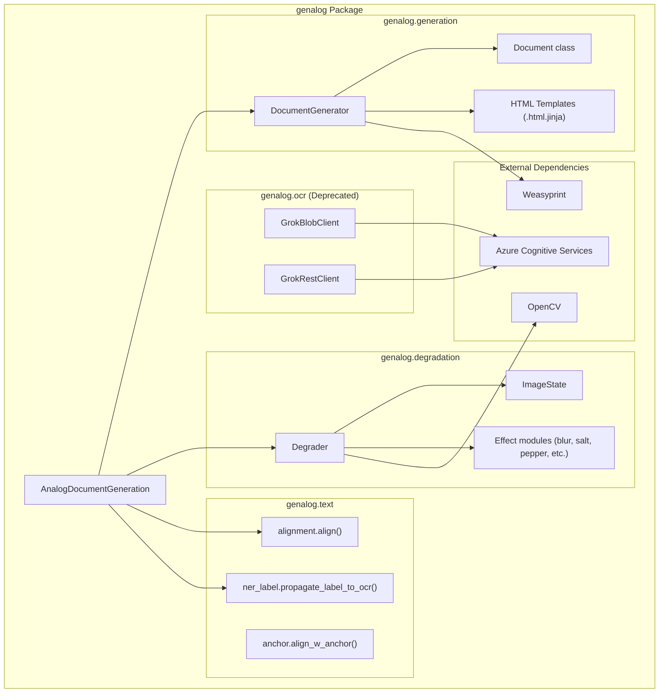
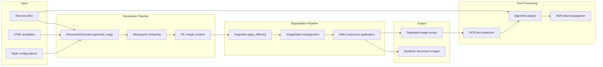

<!-- source: DeepWiki mcp.deepwiki.com · repo microsoft/genalog · page 1 Overview · fetched 2026-10-26 -->

# Overview

<details>
<summary>Relevant source files</summary>

The following files were used as context for generating this wiki page:

- [README.md](README.md)
- [docs/genalog_docs/index.md](docs/genalog_docs/index.md)
- [docs/genalog_docs/static/genalog_demo.gif](docs/genalog_docs/static/genalog_demo.gif)
- [example/demo_generate.py](example/demo_generate.py)

</details>


## Purpose and Scope

This document provides a high-level introduction to genalog, a Python package for generating synthetic document images that simulate the characteristics of scanned analog documents. Genalog enables researchers and developers to create realistic training datasets for optical character recognition (OCR) and natural language processing (NLP) models by applying controlled degradations to clean text documents.

For installation instructions and quick start examples, see [Getting Started](#1.1). For detailed system design and module relationships, see [System Architecture](#1.2).

## System Capabilities

Genalog provides four core capabilities for synthetic document generation and analysis:

| Capability | Description | Primary Module |
|------------|-------------|----------------|
| **Flexible Image Generation** | Convert text to document images using HTML templates with customizable styling | `genalog.generation` |
| **Custom Image Degradation** | Apply synthetic noise, blur, artifacts, and other degradations to simulate scanning effects | `genalog.degradation` |
| **OCR Text Extraction** | Extract text from images using Azure Cognitive Search pipeline | `genalog.ocr` (deprecated) |
| **Text Alignment & Metrics** | Align OCR output with ground truth text and calculate performance metrics | `genalog.text` |

The system operates in maintenance mode with limited support, focusing on providing a stable platform for synthetic document research.

Sources: [README.md:13-19](), [README.md:5](), [README.md:9]()

## Core System Architecture

The following diagram shows the main modules and their relationships within the genalog system:

### Genalog Module Architecture



The `AnalogDocumentGeneration` class serves as the main orchestrator, coordinating document generation through `DocumentGenerator`, applying degradations via `Degrader`, and enabling text processing through the `genalog.text` module.

Sources: [example/demo_generate.py:2](), [README.md:102-106](), [example/demo_generate.py:30]()

## Data Processing Pipeline

### End-to-End Document Generation Flow



This pipeline transforms clean text through HTML template rendering, applies realistic degradations, and provides tools for aligning the resulting OCR output with ground truth text for training data generation.

Sources: [example/demo_generate.py:31](), [example/demo_generate.py:18-28](), [README.md:47-64]()

## Key Use Cases and Applications

### Primary Application Scenarios

1. **Synthetic Dataset Generation**: Create labeled training datasets for OCR and NER models by generating clean documents, applying degradations, and propagating labels through the text alignment process.

2. **OCR Model Evaluation**: Generate test datasets with known ground truth to benchmark OCR system performance under various degradation conditions.

3. **Document Understanding Research**: Develop robust NLP models that can handle real-world OCR errors by training on synthetic data with controlled noise characteristics.

### Configuration Example

The system uses declarative configuration for document generation:

```python
# Style combinations for document generation
STYLE_COMBINATIONS = {
    "font_family": ["Times"],
    "font_size": ["12px"], 
    "text_align": ["justify"],
    "language": ["en_US"],
    "hyphenate": [True],
}

# Degradation effects applied sequentially
DEGRADATIONS = [
    ("blur", {"radius": 5}),
    ("bleed_through", {"alpha": 0.8}),
    ("morphology", {"operation": "open"}),
    ("pepper", {"amount": 0.05}),
]
```

This configuration-driven approach enables systematic exploration of document variations and degradation effects for research purposes.

Sources: [example/demo_generate.py:8-14](), [example/demo_generate.py:18-28](), [README.md:66-74]()

## Integration Requirements

Genalog integrates with several external systems and services:

- **Weasyprint**: HTML-to-image rendering engine requiring system-level dependencies (`Pango`, `cairo`, `GDK-PixBuf`)
- **Azure Cognitive Services**: Cloud-based OCR processing (optional, through deprecated `genalog.ocr` module)
- **OpenCV**: Image processing and degradation effects
- **BioPython**: Sequence alignment algorithms for text processing

The package supports Python 3.6+ and is primarily tested on Linux-64 platforms, with additional installation steps required for macOS and Windows environments.

Sources: [README.md:32-38](), [README.md:3](), [README.md:79-83]()

---

